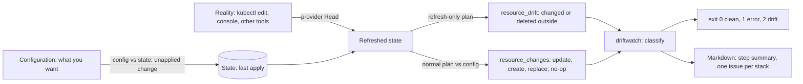

# Drift Is a Plan You Did Not Ask For

*Drift is reality moving away from your last apply; a refresh-only plan shows it on its own, before your next change hides it.*

## Metadata

| Field | Value |
|---|---|
| Type | Build |
| Languages | Python |
| Prerequisites | [Remote State and Locking](https://cloudcaptain.io/learn/iac/remote-state-locking) |
| Time | 75 minutes |
| Tools | tofu, terraform, kubectl, kind, github-actions |

<Quiz stage="pre" />

## The Problem

On Thursday night checkout breaks and the on-call engineer does the fast thing: `kubectl edit configmap flags` turns the new payment path off, and a teammate fixes a missing package on a worker VM by editing its startup script in the cloud console. Checkout recovers. Both objects are owned by OpenTofu, and nobody writes the change back into the configuration. On Tuesday someone opens a pull request that adds one banner file. CI runs `tofu plan`, the reviewer sees `+ local_file.banner` at the top, skims a summary of 2 to add, 2 to change, 1 to destroy, and approves. The apply turns the broken payment path back on, rotates a database password someone had changed by hand back to the old value, and destroys and recreates the worker VM. Checkout breaks again, this time during business hours.

The plan was correct. A normal plan refreshes every resource, then compares the configuration with what it found, so every `~` is either the change you made or the undoing of a change someone else made, and the output does not say which. The `-/+` on the VM came from a drifted attribute that cannot change in place. The rotated password was in the plan as `(sensitive value)`, which is exactly what nobody reads. Drift that is only discovered at apply time is discovered by accident, by whoever happens to apply next, in a plan about something else.

You are going to build `driftwatch`, the job that runs every night before anyone needs to apply. It runs a refresh-only plan to see only what changed outside OpenTofu, runs a normal plan to learn what the next apply would do about each change, classifies every finding as changed outside, deleted outside, replaced by the next apply or ignored by `ignore_changes`, exits 0, 1 or 2 like `-detailed-exitcode`, and writes a Markdown report that updates one issue per stack instead of opening a new one every night. After that, `tofu plan -refresh-only`, `tofu apply -refresh-only`, `ignore_changes`, `import` blocks and a scheduled workflow are all knobs on the same three pictures you met in the first lesson of this phase.

## The Concept

The engine holds three pictures: the **configuration** (what you want), the **state** (what the last apply recorded), and **reality** (what the provider reports now). Two different differences hide in them. Reality not matching state is **drift**: someone or something changed the object outside OpenTofu. The configuration not matching state is an **unapplied change**: you edited the code and have not applied it yet. A normal plan first refreshes state from reality in memory and then diffs the configuration against that, so both differences arrive in one list. A **refresh-only plan** stops after the first step. Its only proposed change is "make state match reality", which is precisely the plan you did not ask for.

Refresh is the provider's `Read` for every resource in state, and the provider decides what drift looks like. An attribute it can read back shows up as `has changed` with the old and new values. An object it cannot find, or one it decides is no longer the object it created, is dropped from state and shows up as `has been deleted`. The `hashicorp/local` provider's id for a file is the SHA-1 of its content, so an edited file is reported as deleted, not changed. Refresh also only visits what is already in state: a bucket created by hand next to yours is invisible to it, and only an `import` block brings it in.

Drift alone does not tell you how bad it is. The consequence is what the next normal apply does about it: an **update** reverts it in place, a **create** brings back something that was deleted, a **replace** destroys and recreates the object because the drifted attribute cannot change in place, and a **no-op** leaves it alone, either because `ignore_changes` lists the attribute or because your configuration never set it. That is why `driftwatch` runs two plans: the refresh-only plan says what changed, the normal plan says what happens next.



Every finding ends in one of three decisions: **revert** it (a normal apply), **accept** it (`tofu apply -refresh-only` writes reality into state, then you put the new value in the code, or list the attribute in `ignore_changes` if it is meant to be managed elsewhere), or **adopt** what was created outside (`import`). A drift report is useful when it makes that decision obvious per resource and never shows a secret while doing it.

## Build It

`code/main.py` is `driftwatch`. Every call to `tofu` goes through a `runner` function passed into `main()`, so the tests replace it with a fake that returns fixture JSON, and everything after the two plans is pure and runs on any machine.

### Step 1: two plans through one runner

The refresh-only plan and the normal plan use the same flags. `-detailed-exitcode` makes 2 a success, so only 0 and 2 continue; `-lock-timeout` matters because a plan takes the state lock from the previous lesson, and a nightly job should wait for a running apply rather than fail:

```python
def plan_argv(binary: str, chdir: str, out: str, refresh_only: bool, lock_timeout: str) -> List[str]:
    argv = [binary, f"-chdir={chdir}", "plan"]
    if refresh_only:
        argv.append("-refresh-only")
    argv += ["-input=false", "-no-color", "-detailed-exitcode", f"-lock-timeout={lock_timeout}", f"-out={out}"]
    return argv


def run_plan(runner: Runner, binary: str, chdir: str, out: str, refresh_only: bool, lock_timeout: str) -> Tuple[int, Dict[str, Any]]:
    label = "refresh-only plan" if refresh_only else "plan"
    code, _, err = runner(plan_argv(binary, chdir, out, refresh_only, lock_timeout))
    if code not in (EXIT_CLEAN, EXIT_DRIFT):
        raise DriftError(f"{label} failed (exit {code}): {tail(err)}")
    show_code, stdout, show_err = runner([binary, f"-chdir={chdir}", "show", "-json", out])
    ...
    return code, parse_plan(stdout, label)
```

The plans are saved with `-out` and read back with `tofu show -json`, never scraped from the human output. `parse_plan()` refuses state JSON, a `format_version` other than 1.x, and a plan with `"errored": true`, because an errored plan has an incomplete drift list and a nightly job that reports "no drift" from it is lying.

### Step 2: what drift looks like in the plan JSON

`resource_drift` has the same shape as `resource_changes`, with `before` taken from the stored state and `after` from the refresh. A ConfigMap patched with `kubectl`, shortened from `code/tests/fixtures/refresh_only.json`:

```json
{
  "address": "kubernetes_config_map_v1.flags",
  "mode": "managed",
  "type": "kubernetes_config_map_v1",
  "provider_name": "registry.opentofu.org/hashicorp/kubernetes",
  "change": {
    "actions": ["update"],
    "before": {"data": {"checkout": "on", "color": "blue"}, "metadata": [{"name": "flags", "resource_version": "1201"}]},
    "after":  {"data": {"checkout": "on", "color": "red"},  "metadata": [{"name": "flags", "resource_version": "1388"}]},
    "before_sensitive": {"data": {}, "metadata": [{}]},
    "after_sensitive": {"data": {}, "metadata": [{}]}
  }
}
```

A deleted object has `"actions": ["delete"]` and `"after": null`. Data sources can appear too; `classify()` skips everything whose `mode` is not `managed`, because a data source changing is the point of a data source.

### Step 3: flatten, diff, and never print a secret

Nested objects and lists become paths in the syntax you would write in `ignore_changes`, so the report and the fix use the same words:

```python
def flatten(value: Any, prefix: Path = ()) -> Dict[Path, Any]:
    if isinstance(value, dict):
        flat: Dict[Path, Any] = {}
        for key in sorted(value):
            flat.update(flatten(value[key], prefix + (key,)))
        return flat
    if isinstance(value, list):
        flat = {}
        for index, item in enumerate(value):
            flat.update(flatten(item, prefix + (index,)))
        return flat
    if value is None:
        return {}
    return {prefix: value}
```

`render_path(("metadata", 0, "labels", "app.kubernetes.io/name"))` is `metadata[0].labels["app.kubernetes.io/name"]`. `tofu show -json` prints sensitive values in plain text, and this report is headed for a GitHub issue, so every leaf is checked against `before_sensitive` and `after_sensitive`, where `true` marks a sensitive subtree:

```python
secret = is_sensitive(change.get("before_sensitive"), path) or is_sensitive(change.get("after_sensitive"), path)
pairs.append((path, AttrDiff(render_path(path), None if secret else old, None if secret else new, secret)))
```

The value is dropped before it is stored, not when it is printed, so no output format can leak it.

### Step 4: classify by what the next apply does

`load_ignore_rules()` reads `lifecycle.ignore_changes` from every `*.tf.json` file in the root module (OpenTofu's JSON syntax, so no HCL parser) and `parse_rule()` turns `metadata[0].labels`, `tags["Cost Center"]` or `"all"` into a path prefix. Then each drifted resource gets one category:

```python
if finding.drift == "delete":
    finding.category = DELETED
else:
    pairs = attribute_changes(change)
    finding.diffs = [diff for _, diff in pairs]
    matched = rules.get(config_address(address), [])
    covered = [any(covers(rule, path) for _, rule in matched) for path, _ in pairs]
    finding.ignored_by = sorted({text for text, rule in matched if any(covers(rule, path) for path, _ in pairs)})
    if finding.next_apply == "replace":
        finding.category = REPLACE
        finding.replace_paths = [render_path(path) for path in next_change["change"].get("replace_paths") or []]
    elif (pairs and all(covered)) or finding.next_apply == "no-op":
        finding.category = IGNORED
```

`next_apply` comes from the normal plan's `resource_changes` for the same address; `["delete", "create"]` in either order is a replacement, and `replace_paths` names the attribute that forced it. Without the normal plan (`--drift-only`), "ignored" needs every changed path covered by a rule, and that is rarely true: the ConfigMap whose labels you ignore also changed `metadata[0].resource_version`, a computed attribute no configuration sets. Only the normal plan's `no-op` proves the next apply leaves it alone, which is why `run` does both plans by default.

Whatever the normal plan wants to do to an address that did *not* drift is an **unapplied change**, and goes into a separate `pending` list instead of the findings.

### Step 5: an exit code CI can trust

```python
def exit_code(report: Report, strict: bool = False, fail_on_pending: bool = False) -> int:
    actionable = [finding for finding in report.findings if strict or finding.category != IGNORED]
    if actionable or (fail_on_pending and report.pending):
        return EXIT_DRIFT
    return EXIT_CLEAN
```

This differs from `tofu` on purpose. In refresh-only mode `tofu` exits 2 whenever the refreshed state differs from the stored one, including attributes you told it to ignore; `driftwatch` exits 2 only for drift someone has to act on, and `--strict` restores the stricter rule. `argparse` exits 2 on a usage error, which a CI job would read as "drift found", so `main()` catches that and returns 1: any error, from a typo to a held state lock, is 1.

### Step 6: a report for a person, a key for a bot

The Markdown report has a summary table (address, finding, next apply, changed attributes), one section per finding with a before and after table, a separate section for unapplied changes, and a marker on the last line:

```python
def dedupe_key(stack: str) -> str:
    return "driftwatch-" + hashlib.sha256(stack.encode("utf-8")).hexdigest()[:12]


def fingerprint(report: Report) -> str:
    signature = sorted([finding.address, finding.category, sorted(diff.path for diff in finding.diffs)] for finding in report.findings)
    if not signature:
        return "clean"
    return hashlib.sha256(json.dumps(signature).encode("utf-8")).hexdigest()[:16]
```

The key is one per stack: the nightly job searches open issues for it and edits the one it finds. The fingerprint leaves values out, so a `resource_version` that moves every night does not look like new drift, while a new attribute or a new resource does. Table cells escape `|` as `\|` and inline code uses double backticks when a value contains one, so a startup script cannot break the table. `--markdown FILE` writes the report, and `--step-summary` appends it to the file GitHub Actions names in `GITHUB_STEP_SUMMARY`.

### Step 7: run it

```bash
F=code/tests/fixtures
python3 code/main.py report --refresh-plan $F/refresh_only.json --plan $F/plan.json --config $F/main.tf.json --stack shop-prod
#   -/+ google_compute_instance.worker  replaced by the next apply: ... metadata_startup_script forces replacement ...
#   -   local_file.motd  deleted outside: ... the next apply creates it again
#   ~   kubernetes_config_map_v1.flags  changed outside: ... data.color: "blue" -> "red"
#   ~   kubernetes_secret_v1.db  changed outside: ... data.password: (sensitive) -> (sensitive)
#   =   kubernetes_config_map_v1.routing  ignored: ... covered by ignore_changes (metadata[0].labels)
#   +   local_file.banner  create          (an unapplied change, not drift)
echo "exit $?"                                                            # 2
python3 code/main.py report --refresh-plan $F/refresh_only.json --plan $F/plan.json --config $F/main.tf.json --markdown /tmp/drift.md
python3 code/main.py run --chdir path/to/stack --json                       # runs tofu for real; needs tofu init first
```

<RunTests />

## Use It

Do the same with `tofu` against a stack that owns one file:

```bash
mkdir -p /tmp/drift-demo && cd /tmp/drift-demo
cat > main.tf <<'EOF'
resource "local_file" "motd" {
  filename = "${path.module}/out/motd.txt"
  content  = "hello from tofu\n"
}
EOF
tofu init && tofu apply -auto-approve
tofu plan -refresh-only -detailed-exitcode; echo "exit $?"     # 0: "No changes. Your infrastructure still matches the configuration."
echo "edited by hand" > out/motd.txt
tofu plan -refresh-only -detailed-exitcode; echo "exit $?"     # 2: "Objects have changed outside of OpenTofu", "local_file.motd has been deleted"
tofu plan -refresh-only -out=drift.tfplan
tofu show -json drift.tfplan | jq '.resource_drift[] | {address, actions: .change.actions}'
tofu apply -refresh-only -auto-approve                          # accept: state now says the file does not exist
tofu plan -refresh-only -detailed-exitcode; echo "exit $?"     # 0: state matches reality again
tofu plan -detailed-exitcode; echo "exit $?"                    # 2: + local_file.motd, now an unapplied change
```

The last two lines are the whole difference between drift and an unapplied change. After `apply -refresh-only` there is no drift left, because state and reality agree; the configuration still wants the file, so a normal plan wants to create it. `apply -refresh-only` never touches infrastructure. It is the "accept" decision, and it is only finished when the code agrees with the new reality too.

Attributes another system manages on purpose belong in `ignore_changes`. A label added by an admission webhook or an on-call engineer, an autoscaler's replica count, tags a cost tool writes:

```hcl
resource "kubernetes_config_map_v1" "routing" {
  metadata {
    name      = "routing"
    namespace = "shop"
    labels    = { app = "shop" }
  }
  data = { upstream = "v1" }

  lifecycle {
    ignore_changes = [metadata[0].labels]
  }
}
```

```bash
kubectl -n shop patch configmap flags --type merge -p '{"data":{"color":"red"}}'
kubectl -n shop label configmap routing owner=oncall
tofu plan -refresh-only              # "# kubernetes_config_map_v1.flags has changed" and "...routing has changed"
tofu plan                            # ~ flags: color "red" -> "blue"; routing is not in the list at all
```

The refresh-only plan still reports the label, because `ignore_changes` changes planning, not refresh: the normal plan keeps the refreshed value instead of the configured one. `ignore_changes = all` (the string `"all"` in JSON syntax) stops OpenTofu from ever updating the resource, which is almost always a mistake on anything but a bootstrap object.

What refresh cannot see at all is what was never in state. Adopt it with an `import` block, let OpenTofu write the configuration, review it, apply:

```hcl
import {
  to = aws_s3_bucket.logs
  id = "shop-prod-logs"
}
```

```bash
tofu plan -generate-config-out=generated.tf     # experimental: writes a resource block for every import without one
tofu apply                                      # the bucket is now in state; from tonight on, refresh watches it
```

Then run the check every night, before anyone needs to apply. The job assumes a role through OIDC, so no long-lived cloud key sits in the repository; the role needs read access to everything the stack manages plus the state and its lock object:

```yaml
name: drift
on:
  schedule:
    - cron: "17 3 * * *"
  workflow_dispatch:
permissions:
  contents: read
  id-token: write
  issues: write
jobs:
  drift:
    runs-on: ubuntu-latest
    strategy:
      fail-fast: false
      matrix:
        stack: [network, shop-prod]
    steps:
      - uses: actions/checkout@v4
      - uses: opentofu/setup-opentofu@v1
        with:
          tofu_wrapper: false
      - uses: aws-actions/configure-aws-credentials@v4
        with:
          role-to-assume: arn:aws:iam::123456789012:role/drift-readonly
          aws-region: eu-central-1
      - run: tofu -chdir=stacks/${{ matrix.stack }} init -input=false
      - id: drift
        run: |
          rc=0
          python3 tools/driftwatch.py run --chdir stacks/${{ matrix.stack }} --stack ${{ matrix.stack }} \
            --markdown drift.md --step-summary --json > drift.json || rc=$?
          echo "rc=$rc" >> "$GITHUB_OUTPUT"
          [ "$rc" != 1 ]
      - env:
          GH_TOKEN: ${{ github.token }}
          RC: ${{ steps.drift.outputs.rc }}
          STACK: ${{ matrix.stack }}
        run: |
          key=$(jq -r .key drift.json)
          number=$(gh issue list --label drift --state open --limit 100 --json number,body \
            --jq "map(select(.body | contains(\"$key\"))) | .[0].number // empty")
          if [ "$RC" = 2 ] && [ -n "$number" ]; then gh issue edit "$number" --body-file drift.md
          elif [ "$RC" = 2 ]; then gh issue create --title "Drift: $STACK" --label drift --body-file drift.md
          elif [ -n "$number" ]; then gh issue close "$number" --comment "No drift on $(date -u +%F)."
          fi
```

`tofu_wrapper: false` keeps the setup action's wrapper script out of the way, so `driftwatch` reads `tofu`'s own stdout and exit code. Exit 1 fails the job (someone must look at the error); exit 2 keeps it green and opens or edits the issue; exit 0 closes it. Hosted platforms do the same with a schedule and a UI: HCP Terraform's health assessments run this check per workspace, and Argo CD's `selfHeal` is the continuous version for Kubernetes manifests, a reconciler that reverts drift within minutes instead of reporting it every morning.

| What you built | Real tool | Note |
|---|---|---|
| `run_plan` with `-refresh-only` | `tofu plan -refresh-only -detailed-exitcode` | proposes only "make state match reality"; never changes infrastructure |
| the second, normal plan | `tofu plan -detailed-exitcode` | its `resource_changes` say what the next apply does about each drift |
| reading `resource_drift` | `tofu show -json drift.tfplan \| jq .resource_drift` | sensitive values are plain text here; mask them before they leave the job |
| deleted outside | `# X has been deleted` | the provider decides; `local_file` reports an edited file this way |
| changed outside with the diff | `# X has changed` | before is the last state, after is the refresh |
| replaced by the next apply | `# forces replacement`, `replace_paths` | the drift a reviewer most needs to see before approving an unrelated PR |
| ignored, with the rule | `lifecycle { ignore_changes = [...] }` | refresh still sees it, and refresh-only exit 2 still counts it |
| unapplied changes | a normal plan exiting 2 after `apply -refresh-only` | configuration ahead of state; not drift |
| accept | `tofu apply -refresh-only` | then write the new value into the code |
| adopt | `import` blocks, `-generate-config-out` | refresh only sees what is already in state |
| Markdown, key and fingerprint | `$GITHUB_STEP_SUMMARY`, `gh issue edit`, HCP Terraform health assessments | one issue per stack, updated, then closed |

<Quiz stage="check" />

## Ship It

Two artifacts in `outputs/`:

- **`skill-drift-triage.md`**: a runbook for an agent or an on-call engineer: run the refresh-only plan and the normal plan, classify each finding, find out who changed it (cloud audit logs, Kubernetes managed fields), choose revert, accept, ignore or adopt with a decision table, apply the decision in the right order, and file a report that never contains a secret.
- **`prompt-drift-report.md`**: paste `tofu plan -refresh-only` output, plan JSON or `driftwatch --json` and get a structured report: a verdict, a table of findings with what the next apply would do, the likely cause of each, one recommended decision per resource, and the exact commands, with sensitive values left out.

<ShipIt />

## Exercises

### Easy

Add `--ignore-attr PATH` (repeatable) for computed attributes that change on every write, such as `metadata[0].resource_version`, and drop them from the diffs, from the Markdown and from the fingerprint. Write the tests first: the patched `flags` fixture still reports `data.color` and only that, and a resource whose only drift is an ignored attribute disappears from the report.

### Medium

Give each finding an age. Add `--history FILE`, a JSON file keyed by the dedupe key that stores the first night each (address, category, paths) signature was seen, and print "first seen 2026-10-28, 4 nights" in the text and Markdown reports. Inject the clock so the tests can run five nights in a row: a signature keeps its first date while it persists, a new attribute starts a new date, and a clean night clears the stack.

### Hard

Make "accept" a command. `driftwatch codify` takes the changed-outside findings whose drifted attribute is a literal in a `.tf.json` file, writes the drifted value into the configuration, runs `tofu apply -refresh-only -auto-approve`, and proves with a normal plan that the next apply is now a no-op for those addresses. It must refuse sensitive attributes, replace-on-apply findings and values that come from variables or expressions, and print a branch name and `gh pr create` command for the change. Test it with the fake runner first, then against the `local_file` stack from Use It.

<Quiz stage="post" />

## Key Terms

| Term | Common misconception | Precise definition |
|---|---|---|
| Drift | "Any `~` in a plan." | A difference between what the last apply recorded in state and what the provider reads now, caused outside OpenTofu: a console, `kubectl`, another tool, or the platform itself. |
| Unapplied change | "The same thing as drift." | A difference between the configuration and state: code you changed and have not applied. A normal plan shows it; a refresh-only plan does not. |
| Refresh-only plan | "A dry run of apply." | A plan whose only proposed change is updating state to match reality. Applying it rewrites state and outputs and never touches infrastructure. |
| `resource_drift` | "The resources the next apply will change." | The plan JSON list of objects that changed outside, with `before` from the stored state and `after` from the refresh. A normal plan keeps only drift that is not a no-op. |
| `ignore_changes` | "Hides drift from refresh." | A lifecycle setting that makes planning keep the refreshed value of the listed attributes instead of the configured one. Refresh still sees the drift, and a refresh-only plan still counts it in its exit code. |
| `-detailed-exitcode` | "2 means it failed." | 0 is success with no changes, 1 is an error, 2 is success with changes present. In refresh-only mode 2 means the refreshed state differs from the stored state. |
| Dedupe key and fingerprint | "A hash of the report text." | The key is stable per stack so a scheduled job finds and edits its own issue; the fingerprint hashes addresses, categories and attribute paths without values, so it changes only when the drift does. |
| Import block | "A way to repair drift." | Configuration that adopts an object created outside into state on the next apply. Refresh only reads objects already in state, so this is the only way unmanaged objects become visible. |

## Further Reading

- [Terraform Advanced](https://cloudcaptain.io/docs/tools/terraform/advanced): remote state, locking and workspaces, the setup a nightly drift job runs against.
- [Terraform Cheat Sheet](https://cloudcaptain.io/docs/tools/terraform/cheatsheet): `-refresh-only`, `import`, `state` subcommands and the rest of the CLI in one page.
- [GitHub Actions Fundamentals](https://cloudcaptain.io/docs/tools/github-actions/fundamentals): schedules, permissions and job outputs, the pieces of the nightly workflow.
- [GitOps](https://cloudcaptain.io/docs/tools/cicd/gitops): continuous reconciliation and self-healing, the alternative to reporting drift once a night.
- [OpenTofu: plan command](https://opentofu.org/docs/cli/commands/plan/): refresh-only mode, `-detailed-exitcode` and `-generate-config-out`, from the source.
- [OpenTofu: JSON output format](https://opentofu.org/docs/internals/json-format/): `resource_drift`, `resource_changes`, `replace_paths` and the sensitive-value markers you parsed.
- [OpenTofu: resource lifecycle](https://opentofu.org/docs/language/resources/behavior/#lifecycle-customizations): `ignore_changes`, `create_before_destroy` and `prevent_destroy` semantics.
- [OpenTofu: import](https://opentofu.org/docs/language/import/): import blocks and generated configuration for objects created outside.
- [GitHub: adding a job summary](https://docs.github.com/en/actions/using-workflows/workflow-commands-for-github-actions#adding-a-job-summary): how `GITHUB_STEP_SUMMARY` works and its size limit.
- [GitHub: OpenID Connect](https://docs.github.com/en/actions/deployment/security-hardening-your-deployments/about-security-hardening-with-openid-connect): short-lived cloud credentials for scheduled jobs, no stored keys.
