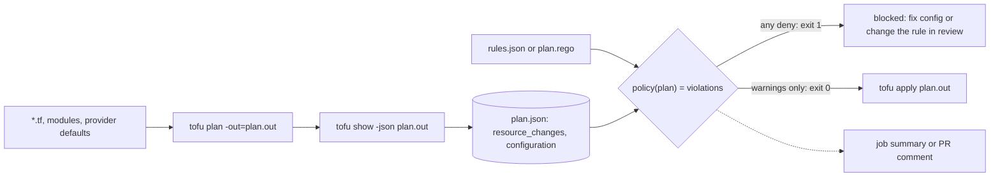

# Policy Is a Function Over the Plan JSON

*A policy reads the plan JSON and returns violations; run it between plan and apply, and let deny be an exit code.*

## Metadata

| Field | Value |
|---|---|
| Type | Build |
| Languages | Python |
| Prerequisites | [Drift Detection](https://cloudcaptain.io/learn/iac/drift-detection) |
| Time | 90 minutes |
| Tools | tofu, terraform, conftest, opa |

<Quiz stage="pre" />

## The Problem

A pull request in the payments repository renames a database instance so it matches the new naming standard. The plan is 340 lines long. The reviewer scrolls through tag updates, sees nothing alarming, and approves. Line 212 says `-/+` with `# forces replacement` next to the identifier: the provider cannot rename that resource in place, so apply destroys the database and creates an empty one. The same pull request also adds three resources without an `owner` tag, writes a config file with mode `0777`, and pulls a module from an engineer's personal fork on GitHub.

The team had rules for all of this. A wiki page called "Infrastructure standards" lists them, and a CI step greps the `*.tf` files for `0777` and for `source = "git::`. The grep passed, because none of the four problems is in the diff. Whether a change is an update or a replacement is written in the provider's schema. The missing tag came from a module whose defaults nobody opened. The `0777` is the `local_file` provider's default and appears in no source file. The fork was referenced through a variable. Each fact becomes visible in exactly one place before apply: the plan.

`tofu show -json plan.out` turns that plan into a documented JSON document, and a policy is a function over it: plan in, violations out, exit non-zero on anything that must not ship. You are going to write `planguard`, a rule engine whose rules are data (required tags, forbidden values, size limits, protected addresses, no replacement of stateful resources, a module-source allow-list), then write the same rules in Rego and prove, on a real OpenTofu plan, that `conftest` and `opa` report exactly the same violations.

## The Concept

The plan JSON is a contract between the engine and everything that wants to judge a change before it happens. Two parts matter to a policy. `resource_changes` has one entry per resource instance with its full `address` (`module.web["a"].aws_s3_bucket.logs[0]`), its `type`, its `mode` (`managed` or `data`), and a `change` holding `actions`, `before`, `after` and `after_unknown`. `configuration` is the source as the engine understood it, including every module call and its `source`. Expansion of `count` and `for_each`, provider defaults and module internals are already resolved in both.

Every rule has three parts. **Select**: which resources it applies to, by type and address pattern, and for attribute rules by action (create and update have an `after` to inspect; a delete does not). **Check**: an attribute path with an operator (`exists`, `in`, `matches`, `lte`), a lifecycle fact (the actions contain `delete`, or contain both `delete` and `create`), or a configuration fact (a module source). **Report**: a level and a message that tells the author what to change. A `deny` blocks the apply; a `warn` is printed and passes, which is how you roll a new rule out without breaking every pipeline on the day it lands.



A value in the plan has three states, not two. It can be **present** in `after`, **missing** (absent or null), or **known after apply**: computed by the provider or derived from another resource's id, omitted from `after` and marked `true` at the same path in `after_unknown`. A policy that only reads `after` treats unknown as missing and passes it silently, which is how a security group rule built from a computed CIDR gets through review. `planguard` fails closed: an unknown value violates the rule unless the rule says `"unknown": "allow"`. The second distinction is between presence and value: `in`, `matches` and `lte` say nothing about a missing attribute, so a required value is two rules, one `exists` and one value check. That is also how Rego behaves, where an undefined reference makes the whole rule body undefined.

The last decision is where the function runs. On the saved plan file, after `plan` and before `apply`, and the apply consumes that same file. Then what passed policy is what runs.

## Build It

`code/main.py` is `planguard`. Loading, rule parsing and evaluation are pure functions over dictionaries; the only side effect is an optional `tofu show -json` call made through an injectable `runner`, so the tests use committed fixture plans in `code/fixtures/` and never need OpenTofu. The rules live in `code/rules.json`; their Rego twin is `code/policy/plan.rego`.

### Step 1: read the plan, and refuse what is not one

`tofu show -json` prints a plan when given a plan file and the state when given nothing, and both are JSON. Evaluating policy over state passes every rule vacuously, so the loader checks first:

```python
if data.get("errored"):
    raise PlanError('the plan errored ("errored": true); a policy verdict on a failed plan means nothing, fix the plan first')
if "planned_values" not in data and "resource_changes" not in data:
    if "values" in data:
        raise PlanError("this is state, not a plan: run `tofu plan -out=plan.out`, then `tofu show -json plan.out`")
```

Each entry of `resource_changes` becomes a `Change` with its address, type, mode, actions, `after`, `after_unknown` and `action_reason`. The actions list is the ground truth for what apply will do:

```python
def action_label(actions: Sequence[str]) -> str:
    acts = list(actions)
    if acts == ["delete", "create"]:
        return "replace"
    if acts == ["create", "delete"]:
        return "replace (create before destroy)"
    return ",".join(acts) or "no-op"
```

Module calls come from `configuration.root_module.module_calls`, walked recursively so a module inside a module gets the address `module.net.module.subnets`, the same form the addresses in `resource_changes` use.

### Step 2: rules are data, and the loader is strict

A rule is a JSON object. This one is the forbidden-values rule from `code/rules.json`:

```json
{
  "id": "forbid-huge-sizes",
  "level": "deny",
  "type": "terraform_data",
  "path": "input.size",
  "op": "not_in",
  "value": ["xlarge", "metal"],
  "message": "xlarge and metal sizes need a capacity review"
}
```

The demo infrastructure is made of `terraform_data` resources whose `input` looks like a cloud resource (`kind`, `size`, `disk_gb`, `tags`), so the paths start with `input.`; on an AWS plan the same rule reads `tags.owner` on `aws_*` types. `parse_rule()` rejects a rule before it can silently never match: an unknown field (a typo such as `opp`), an operator outside the list, `lte` without a number, `in` without a list, a regular expression that does not compile, a message that is empty. Every error names the rule:

```python
unknown_fields = sorted(set(item) - RULE_FIELDS)
if unknown_fields:
    raise PolicyError(f'rule "{rule_id}": unknown field(s) {", ".join(unknown_fields)}; allowed: {", ".join(sorted(RULE_FIELDS))}')
```

A policy engine that accepts a misspelled rule is worse than none, because the green check now means something false.

### Step 3: select, then walk a path

Type and address patterns are globs with `*` and `?` only. Everything else is literal, including the brackets in `module.web["a"]`, so the pattern means the same thing in Python and in OPA's `glob.match`:

```python
def glob_regex(pattern: str) -> "re.Pattern[str]":
    parts = [".*" if char == "*" else "." if char == "?" else re.escape(char) for char in pattern]
    return re.compile("".join(parts), re.DOTALL)
```

`lookup()` walks a dotted path through maps and lists and returns a `MISSING` sentinel instead of raising. `is_unknown()` asks whether any prefix of the path is `true` in `after_unknown`, because a whole object can be unknown (`"input": true`) as well as one leaf inside it:

```python
def is_unknown(after_unknown: Any, path: Sequence[Any]) -> bool:
    return any(lookup(after_unknown, path[:length]) is True for length in range(1, len(path) + 1))
```

### Step 4: present, missing or unknown

The attribute check is where the three states from The Concept become code:

```python
def attribute_problem(rule: Rule, change: Change) -> Optional[str]:
    where = shown_path(rule.path)
    if is_unknown(change.after_unknown, rule.path):
        return None if rule.allow_unknown else f"{where} is known after apply, so it cannot be checked at plan time"
    value = lookup(change.after, rule.path)
    present = value is not MISSING and value is not None
    if rule.op == "exists":
        return None if present else f"{where} is missing"
    if rule.op == "absent":
        return f"{where} is set to {json.dumps(value)}" if present else None
    if not present or holds(rule.op, value, rule.value):
        return None
    return f"{where} is {json.dumps(value)}, want {rule.op} {json.dumps(rule.value)}"
```

`holds()` implements the operators. One trap is Python's own: `True == 1` and `True < 5` are both true, while JSON and Rego keep booleans and numbers apart, so comparisons go through `same()` and `is_number()`, which refuse to mix them. Another is regular-expression dialects: Python's `re` and Go's RE2 (which OPA uses) agree on character classes, anchors and quantifiers, and disagree on lookarounds and backreferences, so rules stay in the common subset.

### Step 5: lifecycle and configuration rules

Two rules ignore attributes and read only the actions. `no_delete` fires on anything that destroys a protected address, which includes a replacement; `no_replace` fires on a destroy that comes with a create:

```python
reason = f"; reason {change.action_reason}" if change.action_reason else ""
if rule.check == "no_delete" and "delete" in change.actions:
    return f"the plan would {change.action} a protected address{reason}"
if rule.check == "no_replace" and "delete" in change.actions and "create" in change.actions:
    return f"the plan would destroy and recreate it{reason}"
```

`action_reason` comes for free and is worth printing: `replace_because_cannot_update` means a provider-forced replacement, `delete_because_no_resource_config` means someone deleted the block. The module rule walks the module calls from Step 1 and reports every `source` that matches none of the allowed regular expressions, at the address `module.NAME` with the action `config`.

### Step 6: report, and let the exit code be the interface

`evaluate()` runs every rule over every change and sorts denies before warnings, in rule order. The exit code is the whole contract with CI:

```python
def exit_code(violations: Sequence[Violation], fail_on_warn: bool = False) -> int:
    tally = counts(violations)
    return 1 if tally["deny"] or (fail_on_warn and tally["warn"]) else 0
```

Errors in the input exit 2, so a pipeline can tell "the policy said no" from "the policy could not run". The same violations render as text, as `--json` for machines, and as `--markdown` for `$GITHUB_STEP_SUMMARY` or a PR comment.

### Step 7: run it

```bash
cd curriculum/phases/07-iac/06-policy-as-code
python3 code/main.py code/fixtures/plan.json --rules code/rules.json          # 8 denied, 2 warnings, exit 1
python3 code/main.py code/fixtures/plan-clean.json --rules code/rules.json    # policy passed, exit 0
python3 code/main.py code/fixtures/plan.json --rules code/rules.json --json | python3 -m json.tool | head -30
python3 code/main.py code/fixtures/plan.json --rules code/rules.json --markdown
python3 code/main.py --show plan.out --rules code/rules.json                  # runs tofu show -json plan.out for you
```

The first command prints, among others:

```text
DENY  no-replace-stateful       -/+ terraform_data.db (replace)
      stateful resources are not replaced by a routine apply; write a migration plan: the plan would destroy and recreate it; reason replace_because_cannot_update
WARN  name-convention           +   terraform_data.api (create)
      names are lowercase words joined by dashes: input.name is known after apply, so it cannot be checked at plan time
```

<RunTests />

## Use It

The common engine for this job is Open Policy Agent, and `conftest` is its command-line front end for configuration files. `code/policy/plan.rego` is your ten rules in Rego. The helpers mirror `planguard` one for one; this is the shape of every rule:

```rego
writes contains rc if {
	some rc in input.resource_changes
	rc.mode == "managed"
	some action in rc.change.actions
	action in {"create", "update"}
}

unknown(rc, path) if {
	some n in numbers.range(1, count(path))
	object.get(rc.change.after_unknown, array.slice(path, 0, n), false) == true
}

deny contains result if {
	some rc in writes
	type_is(rc, ["terraform_data"])
	violates(rc, {"path": ["input", "disk_gb"], "op": "lte", "value": 500})
	result := finding("disk-limit", rc, "disks above 500 GB need a capacity review")
}
```

`deny` and `warn` are the rule names conftest looks for in `package main`. Each result is an object with `msg` plus `rule` and `address`; conftest prints `msg` and keeps the other keys as metadata, which is what makes a set comparison with `planguard` possible. Run both on the same plan:

```bash
mkdir -p /tmp/pac && cd /tmp/pac      # put a main.tf here; code/smoke.sh has the baseline and the violating change
tofu init
tofu plan -out=plan.out
tofu show -json plan.out > plan.json
LESSON=~/CloudCaptain/curriculum/phases/07-iac/06-policy-as-code
python3 $LESSON/code/main.py plan.json --rules $LESSON/code/rules.json; echo "planguard exit $?"
conftest test --parser json --policy $LESSON/code/policy plan.json; echo "conftest exit $?"
conftest test --parser json --policy $LESSON/code/policy --output json plan.json | python3 -m json.tool
opa check $LESSON/code/policy
opa eval --format pretty --data $LESSON/code/policy --input plan.json 'data.main.deny'
opa eval --format pretty --data $LESSON/code/policy --input plan.json 'count(data.main.deny)'
```

`code/smoke.sh` does exactly this on a real plan: a baseline that passes all three engines and is applied, then a change that replaces `terraform_data.db` (its `triggers_replace` changed), deletes the audit log, adds an untagged `xlarge` resource with a 1000 GB disk, a `local_file` without `file_permission` (the plan shows `"0777"`, the provider default, though no source file says so), a name built from `random_pet.api.id` (known after apply), and a module from `./vendor/legacy`. It asserts that `planguard`, `conftest` and `opa eval` return the same ten (level, rule, address) findings, and that the gate keeps apply from running.

In CI the order is fixed: plan to a file, render it, judge it, and apply that file only if the judge said yes. A GitHub Actions job:

```yaml
- run: tofu init -input=false
- run: tofu plan -input=false -out=plan.out
- run: tofu show -json plan.out > plan.json
- run: python3 policy/planguard.py plan.json --rules policy/rules.json --markdown >> "$GITHUB_STEP_SUMMARY"
- run: conftest test --parser json --policy policy/rego --output github plan.json
- run: tofu apply -input=false plan.out
  if: github.ref == 'refs/heads/main'
```

Every step fails the job on a non-zero exit, so the apply never runs after a deny. Treat `plan.json` as a secret: the OpenTofu and Terraform docs both warn that `show -json` prints sensitive values in plain text, so do not upload it as a public artifact.

Why not `lifecycle { prevent_destroy = true }` for the audit log? It makes the plan fail if it would destroy that resource, which is good, but it lives in the resource block. Delete the block and the protection goes with it, and the plan happily deletes the resource. A `no_delete` policy lives outside the code it protects, so removing the resource does not remove the rule.

The other engines you will meet:

- **Sentinel** is HashiCorp's proprietary policy language. It runs only inside HCP Terraform and Terraform Enterprise, with enforcement levels advisory, soft-mandatory (an authorised user can override) and hard-mandatory. The same products also accept OPA policy sets and, in recent releases, a native HCL policy framework. On OpenTofu, or on self-run Terraform, conftest or `opa eval` in CI is the usual choice.
- **OPA Gatekeeper** and **Kyverno** are the Kubernetes analogues. They run as admission webhooks, so they judge every object the API server receives, whether it came from `kubectl apply`, Helm or Argo CD. Gatekeeper uses Rego in ConstraintTemplates; Kyverno writes policies as Kubernetes resources in YAML. The built-in `ValidatingAdmissionPolicy` does the same job with CEL expressions and no webhook.
- **Checkov** and **Trivy** (`trivy config .`, which absorbed tfsec's checks) are static scanners with hundreds of built-in misconfiguration checks over the source. They answer "is this a known-bad pattern" for free; a plan policy answers "is this change allowed here". Checkov can also read plan JSON (`checkov -f plan.json`), which gets it past the defaults and module problem from The Problem.

| What you built | Real tool | Note |
|---|---|---|
| a rule as data: select, check, report | a Rego `deny` or `warn` rule in `package main` | conftest's default namespace and rule names; `deny_*` and `warn_*` prefixes also count |
| `load_plan` refuses state and errored plans | nothing by default | conftest checks any JSON and passes a state file; add a Rego rule that requires `input.resource_changes` |
| `exists`, `in`, `matches`, `lte` | `object.get`, `in`, `regex.match`, `<=` | an undefined reference makes a Rego body undefined: presence and value are separate checks in both |
| unknown fails closed | read `after_unknown` yourself | neither OPA nor conftest knows what "known after apply" means |
| `no_delete`, `no_replace` | `"delete" in rc.change.actions`; `prevent_destroy` | `prevent_destroy` disappears with the resource block |
| `module_source` allow-list | `walk` over `configuration.root_module` | registry modules also carry `version_constraint`; pin them |
| exit 1 on deny, `--fail-on-warn` | conftest exits 1 on failures | with `--fail-on-warn` conftest exits 1 for warnings only and 2 for failures |
| `--markdown` for the job summary | `conftest --output github`, `--output sarif` | annotations on the PR instead of a log line |
| not built: exceptions | conftest `exception` rules, Sentinel soft-mandatory overrides | every exception needs an owner and an expiry (Medium exercise) |

<Quiz stage="check" />

## Ship It

Two artifacts in `outputs/`:

- **`skill-policy-gate-design.md`**: a runbook for putting a policy gate into an IaC pipeline: inventory the standards that already exist on paper, express each as select, check and report, choose deny or warn per rule with a rollout date, place the gate on the saved plan between plan and apply, add an exception process with owners and expiry dates, test every rule against fixture plans that pass and fail, and keep a second engine (Rego) in agreement with the first. It ends with the report a platform team posts when the gate goes live.
- **`prompt-write-policy.md`**: describe a requirement in one sentence and paste a sample of your plan JSON; the model returns the rule in `planguard` JSON, the same rule in Rego, a passing and a failing `resource_changes` fixture, the edge cases it considered (missing, unknown, replace, module instances) and a recommended level.

<ShipIt />

## Exercises

### Easy

Add a plan-wide rule, `"check": "max_deletes"` with `"value": N`, that denies once when the plan destroys more than N resources in total (replacements count). Write the tests first: the fixture plan has two destroys, so N = 1 denies and N = 2 passes. Then add the Rego version with `count(deletes) > 1` and confirm both engines agree on the fixture with conftest.

### Medium

Add exceptions: an `exceptions.json` with entries `{"rule", "address", "reason", "owner", "expires"}`. A violation that matches an unexpired exception is printed as `EXCEPTED` with the reason and does not count towards the exit code; an expired exception stops working and is itself reported as a warning, so exceptions cannot quietly become permanent. Inject the clock so the tests can move time. Then write the Rego twin with conftest's `exception` rules and decide which of the two models is easier to audit.

### Hard

Make `rules.json` the single source of truth: add `planguard rego RULES` that compiles every rule into Rego (the helpers stay hand-written, each rule becomes one generated `deny` or `warn` block). Prove it in the tests by compiling `code/rules.json` and checking that the output has one block per rule with the same id, level, path and operator, and extend `code/smoke.sh` so conftest runs the generated policy against both fixtures and the real plan and agrees with `planguard` on every set. Finish with a paragraph on what you lose when policy authors can no longer write Rego directly.

<Quiz stage="post" />

## Key Terms

| Term | Common misconception | Precise definition |
|---|---|---|
| Plan JSON | "It is the plan text in JSON." | The documented machine-readable form of a saved plan from `tofu show -json PLANFILE`: per-instance `resource_changes` with actions and before/after values, `configuration` with module calls, and the prior state. |
| Policy as code | "A linter for HCL." | Rules stored, reviewed and tested like code and evaluated by a program as a gate; over the plan they judge the resolved change, not the text that produced it. |
| Deny and warn | "Warnings are useless." | Two levels with one difference, the exit code. Warn is the rollout phase of a rule: visible on every run, blocking none, until the date it becomes deny. |
| Known after apply | "A missing value." | A value the plan cannot compute yet, omitted from `after` and marked `true` in `after_unknown`; a policy must decide whether it passes, and failing closed is the safe default. |
| Fail closed | "Strict for the sake of it." | When a check cannot be evaluated (unknown value, unparseable input), the result is a violation or an error, never a pass. |
| Replacement | "An update that takes longer." | Actions `["delete", "create"]` (or `["create", "delete"]` with `create_before_destroy`), usually forced by the provider schema; for stateful resources it is data loss. |
| Module source allow-list | "Pinning versions." | A rule over `configuration` that every module comes from an approved location (a local path, a registry namespace, a Git organisation); version pinning is a separate check on `version_constraint`. |
| Admission controller | "Only for security teams." | A hook in the Kubernetes API server that accepts or rejects every create and update; Gatekeeper, Kyverno and `ValidatingAdmissionPolicy` are policy engines in that position. |

## Further Reading

- [Terraform Advanced](https://cloudcaptain.io/docs/tools/terraform/advanced): remote state, modules and workspaces, the structure your rules select over.
- [DevSecOps Fundamentals](https://cloudcaptain.io/docs/tools/devsecops/fundamentals): where Checkov and other IaC scanners sit in a secure pipeline next to a plan gate.
- [Kubernetes Security](https://cloudcaptain.io/docs/tools/kubernetes/security): admission control and OPA Gatekeeper, the same idea one layer down.
- [GitHub Actions Fundamentals](https://cloudcaptain.io/docs/tools/github-actions/fundamentals): jobs, steps and exit codes, the machinery the gate plugs into.
- [OpenTofu JSON output format](https://opentofu.org/docs/internals/json-format/): every field of the plan JSON, including `after_unknown`, `action_reason` and `configuration`.
- [Conftest](https://www.conftest.dev/): `test`, `verify`, output formats, `exception` rules and the namespace conventions.
- [OPA policy language](https://www.openpolicyagent.org/docs/policy-language): `contains`, `if`, `some ... in`, functions and why an undefined reference ends a rule body.
- [OPA and Terraform](https://www.openpolicyagent.org/docs/terraform): the OPA project's own walk-through of policy over plan JSON.
- [HCP Terraform policy enforcement](https://developer.hashicorp.com/terraform/cloud-docs/policy-enforcement): Sentinel, OPA and native policy sets with their enforcement levels.
- [Kyverno documentation](https://kyverno.io/docs/): policies as Kubernetes resources, for when the thing to judge is a manifest rather than a plan.
