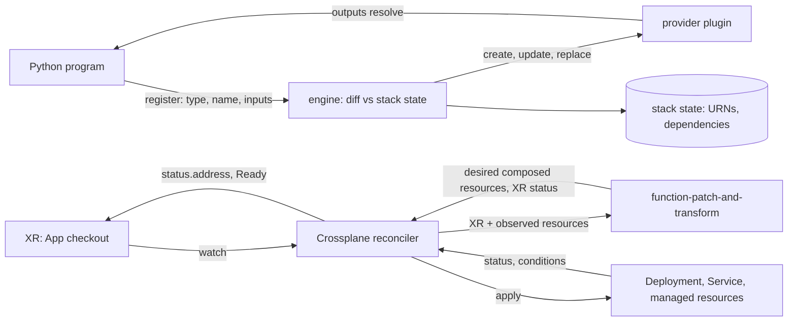

# Same Engine, Different Front End: Pulumi and Crossplane

*Pulumi turns a program into the plan and state you already know; Crossplane turns a Kubernetes object into a render that never stops.*

## Metadata

| Field | Value |
|---|---|
| Type | Build |
| Languages | Python |
| Prerequisites | [Modules and Variables](https://cloudcaptain.io/learn/iac/modules-variables) |
| Time | 90 minutes |
| Tools | pulumi, crossplane, kubectl, kind, docker |

<Quiz stage="pre" />

## The Problem

The platform team owns the network, DNS and the shared cluster in OpenTofu. The checkout team wants loops over an API response and unit tests, so they write their stack in Pulumi with Python. In week one their CI log prints `Calling __str__ on an Output[T] is not supported` where a bucket name should be, and a `print()` inside an `apply()` shows up on `pulumi up` but never on `pulumi preview`. In week two a config change replaces a resource with a fixed name, and the replacement fails because the old one still exists: Pulumi created the new one first. Nobody on the team can say why, because nobody thinks of the program as a list of messages to an engine.

Meanwhile the platform team adopts Crossplane so that any team can `kubectl apply` an `App` and get a Deployment, a Service and a database. The first `App` sits at `Ready=False` for a day while its Deployment runs fine. A developer changes `size: large` and expects a plan to approve; instead the change is live a minute later, because there is no plan, only a reconciler that renders the desired resources again and applies them. The argument in the architecture review is about YAML versus Python versus HCL, which is the least interesting difference between the three tools.

All three are the engine you wrote in the state-reconciler lesson: desired state, a record of what exists, a diff, providers that act. What differs is the front end that produces the desired state and the moment the engine runs. You are going to write both front ends: `minipulumi`, an engine that runs a real Pulumi program unchanged and records the same dependency graph `pulumi` does, and `minixp`, a Crossplane-style composition renderer whose output the smoke test compares with `crossplane composition render`.

## The Concept

In OpenTofu the desired state is a set of files the engine parses. In **Pulumi** the desired state comes from running a program. Every resource constructor is a message to the engine (a `RegisterResource` call over gRPC in the real one): here is a resource of this type, with this name and these inputs. The engine diffs that one resource against the stack's state immediately, calls the provider, and answers with its outputs. The program never waits for an answer. It holds an **Output**, a value that will be known later plus the set of resources it came from. Passing an Output into another resource's inputs is how the engine learns the dependency; nothing is declared twice. `apply()` derives a new Output, `Output.all()` joins several, and both keep the union of their resource sets.

**Preview** runs the same program against the same engine with the providers in dry-run mode. Outputs of resources that would be created or replaced are **unknown**, so callbacks on them are skipped and their derived values stay unknown; that is Pulumi's `output<string>` and OpenTofu's `(known after apply)`. A **stack** is one instance of the program with its own config and state; a resource's identity in that state is its **URN**, `urn:pulumi:<stack>::<project>::<type>::<name>`. When an input that the provider cannot change in place differs, the resource is replaced, and Pulumi's default order is the opposite of OpenTofu's: create the replacement, repoint dependents, delete the original last.

In **Crossplane** the desired state is a Kubernetes object, a **composite resource** (XR) whose schema is defined by an XRD. A **Composition** is a pipeline of functions; function-patch-and-transform takes the XR and the observed composed resources and returns the desired composed resources plus the XR's status. It is a pure function: same inputs, same output. Crossplane applies the result, provider controllers reconcile each **managed resource** against the cloud API, observed status comes back, readiness checks decide whether each composed resource is ready, and the function runs again. There is no plan to approve and no state file: the API server holds desired and observed state, and the `crossplane.io/external-name` annotation holds the cloud id.



| Piece of the engine | OpenTofu | Pulumi | Crossplane |
|---|---|---|---|
| Desired state | `.tf` files | the objects a program registers | an XR plus a Composition |
| Record of ownership | state file | stack state (URNs) | objects in the API server, `external-name` annotations |
| Where dependencies come from | references in expressions | Outputs passed as inputs | none between composed resources; providers retry until references resolve |
| When the engine runs | `tofu apply` | `pulumi up` | continuously |
| Default replacement | destroy, then create | create, then delete | decided by the provider controller; there is no replace step to review |

## Build It

`code/main.py` holds both tools. `minipulumi` (`main.py pulumi ...`) is an engine with a built-in `random` provider that mirrors `pulumi_random`, so a real Pulumi program runs on it unchanged. `minixp` (`main.py xp render ...`) renders a function-patch-and-transform Composition. Both are standard library only, and every test runs without Pulumi, Docker or a cluster.

### Step 1: an Output is a value plus where it came from

The value is a thunk evaluated later; the resource set is fixed when the Output is made. `apply()` keeps the set, so a string built from two resources still points at both:

```python
class Output:
    def __init__(self, thunk, resources=(), secret=False):
        self._thunk = thunk
        self._resources = frozenset(resources)
        self._secret = secret
        self._value = _UNSET

    def apply(self, fn):
        def thunk():
            value = self.resolve()
            if contains_unknown(value):
                return UNKNOWN
            result = fn(value)
            if isinstance(result, Output):
                raise TypeError("apply() callback returned an Output; combine Outputs with Output.all() before apply()")
            return result

        return Output(thunk, self._resources, self._secret)
```

`Output.all()` unions the sets of its inputs, `Output.secret()` sets the flag that every derived Output inherits, and `__str__` returns the same warning Pulumi prints when someone puts an Output in an f-string. The real SDK flattens an Output returned from `apply`; minipulumi refuses it so the dependency set stays static.

### Step 2: registering a resource is a diff against state

A resource constructor calls `Deployment.register()`. The dependencies are read off the inputs, the provider fills defaults, and the diff is the state-reconciler diff for one resource:

```python
for key, value in props.items():
    resources, secret = collect(value)
    if resources:
        property_dependencies[key] = self.in_registration_order(resources)
    dependencies |= resources
...
prior = self.prior.get(urn)
op, diffs = "create", []
if prior is not None:
    old = reveal(prior.get("inputs"))
    diffs = sorted(key for key in set(old) | set(inputs) if contains_unknown(inputs.get(key)) or old.get(key) != inputs.get(key))
    if not diffs:
        op = "same"
    elif any(provider.forces_replacement(rtype, key) for key in diffs):
        op = "replace"
    else:
        op = "update"
```

Because a Python program can only pass an Output from a resource it has already constructed, registration order is always a valid topological order. The engine acts on each registration as it arrives and never sorts anything; the graph is still recorded, in `dependencies` and per input in `propertyDependencies`, because destroy needs it in reverse.

### Step 3: preview is the same program with holes in it

In preview the provider is not called for creates and replacements. The resource's outputs are its inputs, everything computed is unknown, and the callbacks that depend on them never run:

```python
if op == "same":
    rid, outputs = prior["id"], reveal(prior.get("outputs"))
elif self.preview:
    rid, outputs = UNKNOWN, provider.preview_outputs(rtype, inputs)
```

An unknown input forces a diff, so a change to `suffix` shows up as a replacement of `port` too: its `keepers` contain the name built from `suffix.result`, which is unknown until the new suffix exists. In `--json` output an unknown is written as `04da6b54-80e4-46f7-96ec-b56ff0331ba9`, the sentinel Pulumi's own protocol uses for an unknown string.

### Step 4: replacement creates first and deletes last

```python
else:
    if op == "replace" and opts.delete_before_replace:
        self.delete_entry(prior, "deleted original")
    rid, outputs = provider.create(rtype, inputs)
    self.events.append(f"created {name}" if op == "create" else f"created replacement {name}")
    if op == "replace" and not opts.delete_before_replace:
        self.pending_deletes.append(prior)
```

`finish()` runs after the program: it resolves the exports into the stack resource's outputs, deletes the originals of replaced resources (dependents first), then deletes everything that is in state but was not registered, in reverse state order. `protect=True` turns a replacement or a deletion into an error before anything happens. Secret values are written to state with Pulumi's secret signature (`4dabf18193072939515e22adb298388d`); the real engine stores ciphertext from the stack's secrets provider there, while minipulumi stores the plaintext form that `pulumi stack export --show-secrets` prints.

### Step 5: the real Pulumi program, unchanged

The example in `code/examples/pulumi-app/__main__.py` is an ordinary Pulumi program:

```python
import pulumi
import pulumi_random as random

config = pulumi.Config()
suffix_length = config.get_int("suffixLength") or 6

pet = random.RandomPet("pet", length=2)
suffix = random.RandomString("suffix", length=suffix_length, special=False, upper=False)
name = pulumi.Output.all(pet.id, suffix.result).apply(lambda parts: f"{parts[0]}-{parts[1]}")
port = random.RandomInteger("port", min=8000, max=8999, keepers={"name": name})

pulumi.export("name", name)
pulumi.export("port", port.result)
```

`run_program()` puts two shim modules named `pulumi` and `pulumi_random` into `sys.modules`, runs the file with `runpy`, and restores whatever was there before. The shims export minipulumi's `Output`, `Config`, `ResourceOptions`, `export` and the four random resource classes with the same type tokens (`random:index/randomPet:RandomPet` and so on). `Config` reads `Pulumi.<stack>.yaml`, the file `pulumi config set` writes.

### Step 6: run minipulumi

```bash
cp -R code/examples/pulumi-app /tmp/mp && cd /tmp/mp
MP="python3 $OLDPWD/code/main.py pulumi"
$MP preview                    # + 4 to create (the stack resource and three resources); name: [unknown]
$MP up                         # + 4 created; name: "quiet-falcon-eqh524"
$MP output --json
$MP graph                      # "port" -> "pet"; "port" -> "suffix"
printf 'config:\n  ccsmoke:suffixLength: "8"\n' > Pulumi.dev.yaml
$MP preview                    # +- suffix replace [diff: ~length]; +- port replace [diff: ~keepers]; 2 unchanged
$MP up --json | python3 -c 'import json,sys; print(json.load(sys.stdin)["events"])'
$MP export | head -30          # the state, in the shape of pulumi stack export
$MP destroy                    # port, suffix, pet, then the stack: - 4 deleted
```

The events after the second `up` are `created replacement suffix`, `created replacement port`, `deleted original port`, `deleted original suffix`: create-before-delete, and originals removed dependents first.

### Step 7: minixp, field paths and transforms

Patches address fields with Crossplane's field path syntax: dots, `[0]` for list indexes and `[key]` for keys that contain dots or slashes, such as `metadata.annotations[platform.example.org/description]`. `get_value()` raises `FieldNotFound`, which is not an error: a patch whose source is missing is skipped unless its policy says `Required`. `set_value()` creates the objects and lists on the way. Transforms are a small interpreter:

```python
def run_transform(transform, value):
    kind = transform.get("type")
    if kind == "map":
        table = transform.get("map")
        if not isinstance(table, dict):
            raise CompositionError("given transform type map requires configuration")
        if not isinstance(value, str):
            raise CompositionError(f"type {type_name(value)} is not supported for map transform")
        if value not in table:
            raise CompositionError(f"key {value} is not found in map")
        return copy.deepcopy(table[value])
    if kind == "string":
        return string_transform(transform.get("string") or {}, value)
```

`string` covers `Format` (Go's `fmt.Sprintf` verbs `%s`, `%v`, `%d`, `%f`, `%q`, through `go_format()`), `Convert` (`ToUpper`, `ToLower`, `ToBase64`, `FromBase64`, `ToJson`), `TrimPrefix`, `TrimSuffix`, `Regexp`, `Replace` and `Join`; `math` covers `Multiply`, `ClampMin` and `ClampMax`; `convert` changes the type. The error strings follow function-patch-and-transform's, so a missing map key says `key huge is not found in map` in both tools.

### Step 8: a composition is a pure function

`render()` checks that the Composition's `compositeTypeRef` matches the XR and that `mode` is `Pipeline` (`mode: Resources`, native patch and transform, was removed in Crossplane v2), expands `PatchSet` references, and then for each resource template copies the base and applies the patches in order:

```python
for index, patch in enumerate(template.get("patches") or []):
    kind = patch.get("type", "FromCompositeFieldPath")
    try:
        apply_patch(patch, xr, desired_xr, composed, seen)
    except FieldNotFound as missing:
        if (patch.get("policy") or {}).get("fromFieldPath") != "Required":
            continue
        if kind in TO_COMPOSED_PATCHES and seen is None:
            warnings.append(f"not adding new composed resource {name!r}: {kind} patch at index {index} has policy.fromFieldPath: Required and {missing} is not set")
            skip = True
            break
```

`FromCompositeFieldPath` copies from the XR into the composed resource, `CombineFromComposite` formats several XR fields into one, and `ToCompositeFieldPath` copies from the *observed* composed resource into the XR's status, which is why it does nothing on the first render. `stamp_metadata()` then adds what Crossplane adds to every composed resource: the `crossplane.io/composition-resource-name` annotation (the template name, the key that matches observed to desired), the `crossplane.io/composite` label, `generateName: <xr>-` until an observed name exists, the XR's namespace, and a controller owner reference.

### Step 9: readiness and status flow back

```python
def is_ready(observed, checks):
    if not checks:
        return get_condition(observed, "Ready").get("status") == "True"
    return all(run_readiness_check(check, observed) for check in checks)
```

A resource that has not been observed is not ready. With no checks the default is the `Ready` condition, which managed resources carry and a Deployment does not; the example therefore checks `MatchCondition Available=True` on the Deployment and `NonEmpty spec.clusterIP` on the Service. `composite_output()` sets the XR's `Ready` condition to `True` (`Available`) when every composed resource is ready and to `False` (`Creating`, with a message naming the unready ones) otherwise.

### Step 10: run minixp

```bash
XP="python3 code/main.py xp render code/examples/xp/xr.json code/examples/xp/composition.json"
$XP                            # App/checkout: Ready=False Creating: Unready resources: deployment, service
$XP --json | python3 -c 'import json,sys; d=json.load(sys.stdin)[1]; print(d["spec"]["replicas"], d["metadata"]["labels"])'   # 2 {'team': 'payments', ...}
$XP --stream > rendered.yaml   # --- separated JSON documents, a YAML stream kubectl accepts
```

The smoke test then creates the rendered Deployment and Service on kind (without the owner reference, since no XR exists there), reads them back with `kubectl get -o json`, and renders again with `--observed`: the XR's status gains `address` (the Service's `clusterIP`) and `availableReplicas`, and `Ready` turns `True`. That second render is the reconcile loop, run once by hand.

<RunTests />

## Use It

Pulumi first, on the same example program, with a local backend (the state goes into `~/.pulumi` instead of Pulumi Cloud):

```bash
cp -R code/examples/pulumi-app ~/pulumi-demo && cd ~/pulumi-demo
python3 -m venv venv && venv/bin/pip install -r requirements.txt     # pulumi and pulumi-random, pinned
export PULUMI_CONFIG_PASSPHRASE=demo                                  # encrypts secrets in the local stack
pulumi login --local                                                  # or: pulumi login file:///some/dir
pulumi stack init dev
pulumi preview                                                        # + 4 to create; name: output<string>
pulumi preview --json | python3 -c 'import json,sys; print([(s["op"], s["urn"].split("::")[-1]) for s in json.load(sys.stdin)["steps"]])'
pulumi up --yes
pulumi stack output --json
pulumi stack export | python3 -c 'import json,sys; [print(r["urn"].split("::")[-1], [d.split("::")[-1] for d in r.get("dependencies", [])]) for r in json.load(sys.stdin)["deployment"]["resources"]]'
pulumi stack graph graph.dot                                          # the same edges, as DOT
pulumi config set suffixLength 8 && cat Pulumi.dev.yaml               # the file minipulumi's Config reads
pulumi preview --diff                                                 # +- suffix (length), +- port (keepers), pet unchanged
pulumi up --yes
pulumi destroy --yes && pulumi stack rm --yes dev
```

The export also lists a `pulumi:providers:random` resource: the default provider instance, created on first use and not counted in the summary. The rest is the graph minipulumi wrote, and the smoke test compares the two on the same program and the same `Pulumi.dev.yaml`. Things the real tool adds on the same engine: `pulumi refresh` (the refresh phase on its own), `pulumi import` and `pulumi convert --from terraform` for migrations, `ComponentResource` (Pulumi's module, a parent whose type prefixes its children's URNs), `aliases` (the `moved` block), and the Automation API, which drives the engine from your own program instead of the CLI.

Crossplane next. The model is four objects: an XRD defines the API, a Composition implements it, a Function package does the rendering, and an XR is one request. Since Crossplane v2 an XRD is `apiextensions.crossplane.io/v2` and its XRs are namespaced by default; a namespaced XR composes namespaced resources, which is why managed resources moved to API groups with `.m.` in them, such as `s3.aws.m.upbound.io`. A minimal XRD for the lesson's `App`:

```yaml
apiVersion: apiextensions.crossplane.io/v2
kind: CompositeResourceDefinition
metadata:
  name: apps.platform.example.org
spec:
  group: platform.example.org
  names: {kind: App, plural: apps}
  scope: Namespaced
  versions:
  - name: v1alpha1
    served: true
    referenceable: true
    schema:
      openAPIV3Schema:
        type: object
        properties:
          spec:
            type: object
            properties:
              size: {type: string, enum: [small, medium, large]}
              team: {type: string}
              image: {type: string}
          status:
            type: object
            properties:
              address: {type: string}
              availableReplicas: {type: integer}
```

Render offline first. `crossplane composition render` (the older spelling `crossplane render` still works as a hidden alias) runs the Crossplane render engine and each function in Docker, so it needs a Docker daemon but no cluster:

```bash
crossplane composition render code/examples/xp/xr.json code/examples/xp/composition.json code/examples/xp/functions.yaml
crossplane composition render code/examples/xp/xr.json code/examples/xp/composition.json code/examples/xp/functions.yaml \
  --observed-resources observed.yaml                                  # the second render: status flows back
crossplane composition render ... --include-function-results          # the function's warnings, as Result objects
```

On a cluster, the same objects are applied and the reconciler takes over:

```bash
helm repo add crossplane-stable https://charts.crossplane.io/stable && helm repo update
helm install crossplane crossplane-stable/crossplane --namespace crossplane-system --create-namespace --wait
kubectl apply -f code/examples/xp/functions.yaml                      # installs function-patch-and-transform
kubectl apply -f xrd.yaml -f code/examples/xp/composition.json
kubectl create namespace cc-pulumi-crossplane
kubectl apply -f code/examples/xp/xr.json
kubectl get app checkout -n cc-pulumi-crossplane                      # SYNCED, READY
crossplane resource trace app checkout -n cc-pulumi-crossplane        # the XR and every composed resource with its conditions
kubectl delete deployment -n cc-pulumi-crossplane -l crossplane.io/composite=checkout   # drift: it comes back
```

Deployments and Services are within Crossplane's default permissions; the Compositions documentation notes that other kinds may need RBAC granted to Crossplane before it can compose them. The last command is the difference that matters. Delete a composed resource, or change it by hand, and the next reconcile puts it back without anyone running anything; OpenTofu and Pulumi notice the same drift only when someone runs `plan`, `preview` or `refresh`. That is the trade. A reconciler that never stops wins when many teams request the same shapes through a Kubernetes API, under RBAC and GitOps (Argo CD or Flux applying XRs from Git), and when drift must be reverted without a pipeline. A run you trigger wins when a human must read a plan before every change, when there is no Kubernetes cluster that is already run as production, or when one team owns the whole estate. Most organisations run both: OpenTofu for the foundation, including the cluster Crossplane runs in, and Crossplane for the per-team resources on top. The skill you ship in this lesson makes that decision explicit.

| What you built | Real tool | Note |
|---|---|---|
| `Output`, `apply`, `Output.all`, `Output.concat`, `Output.secret` | the `pulumi.Output` class | the real one also lifts attribute access (`bucket.arn`) and flattens Outputs returned from `apply` |
| `Deployment.register()` acting per resource | the engine's `RegisterResource` handler over gRPC | the real engine runs independent registrations in parallel |
| `UNKNOWN` in preview | unknowns, shown as `output<string>` | same sentinel on the wire: `04da6b54-...` |
| state with `dependencies`, `propertyDependencies`, `protect` | `pulumi stack export` | the real state also has providers, parents, aliases and pending operations |
| create-before-delete, `delete_before_replace` | default replacement order, `deleteBeforeReplace` | Terraform and OpenTofu default to the opposite |
| `Config` reading `Pulumi.<stack>.yaml` | `pulumi config set` | `--secret` values are ciphertext in that file; minipulumi refuses them |
| `render()` | `crossplane composition render` | the real one runs the functions and the real reconciler in Docker |
| `run_transform()`, `apply_patch()` | function-patch-and-transform | also `match` transforms, environment patches, `CombineToComposite`, merge policies |
| `is_ready()` and the XR `Ready` condition | readiness checks and the composite reconciler | the real XR also gets `Synced` and per-resource events |
| `stamp_metadata()` | composed resource metadata | real names come from the API server's `generateName` |
| a second render with `--observed` | the reconcile loop | runs on every watch event and on a poll interval, forever |

<Quiz stage="check" />

## Ship It

Two artifacts in `outputs/`:

- **`skill-iac-tool-choice.md`**: a decision runbook for "OpenTofu, Pulumi or Crossplane": the facts to collect first (who changes the infrastructure, whether every change needs a reviewed plan, how drift must be handled, whether a production cluster exists), a decision table, a one-hour spike per candidate with the commands to run and what to record, migration paths with the no-op check before any state is removed, and a fixed report.
- **`prompt-translate-hcl-to-pulumi.md`**: paste HCL (and optionally the existing state) and get a block-by-block mapping, a Pulumi Python program that passes Outputs instead of strings, the behaviour that changes (replacement order, preview semantics, secrets, provider config), an import plan that ends in a no-op `pulumi preview`, and the verification commands.

<ShipIt />

## Exercises

### Easy

Add `ignore_changes` to `ResourceOptions`: listed inputs are excluded from the diff and the prior value is kept in state, the way Pulumi's option of the same name works. Tests first: change `length` on a `RandomString` with `ignore_changes=["length"]` and assert the step is `same`, the old length is still in state, and changing `special` on the same resource still replaces it.

### Medium

Implement `ComponentResource`, Pulumi's module. A component registers a non-custom resource with no provider; children pass `opts=ResourceOptions(parent=component)`; a child's URN carries the parent's type chain (`urn:pulumi:dev::demo::cc:web:Site$random:index/randomPet:RandomPet::site-pet`), and its state entry has `parent` set to the component's URN. Tests first: two components of the same type with children of the same names, no URN collision, and destroy removes the children before their component.

### Hard

Turn `minixp` into a reconciler. Write a loop that renders, applies each composed resource with `kubectl apply` (name from the observed object or a stable `<xr>-<template>` name), reads the observed objects back by the `crossplane.io/composite` label, renders again, and stops when the XR is `Ready=True` or a timeout passes, writing the XR status to a file. Then delete the Deployment by hand and show, with timestamps, that the next iteration recreates it; compare with `pulumi refresh` followed by `pulumi up` on the Pulumi side.

<Quiz stage="post" />

## Key Terms

| Term | Common misconception | Precise definition |
|---|---|---|
| Output | "A Pulumi variable holding a string." | A value that becomes known when the engine has acted on a resource, plus the set of resources it came from. Passing it as an input records the dependency; `apply` derives new Outputs and keeps the set. |
| Unknown | "A preview bug." | The value of an output that only exists after create or replace. Callbacks on it do not run in preview; any input that contains one counts as changed. OpenTofu prints it as `(known after apply)`. |
| Stack and URN | "A stack is a deployment log." | A stack is one instance of a program with its own config and state. A URN, `urn:pulumi:<stack>::<project>::<type>::<name>`, is a resource's identity in that state; renaming it is a replacement unless an alias says otherwise. |
| Replacement order | "Every IaC tool destroys first." | Pulumi creates the replacement, repoints dependents and deletes the original last unless `deleteBeforeReplace` is set; Terraform and OpenTofu destroy first unless `create_before_destroy` is set. |
| Composite resource (XR) | "A Crossplane config file." | A Kubernetes object of a kind an XRD defines, the request for one instance of a platform API. Since v2 it is namespaced by default. |
| Composition function | "A script that calls the cloud." | A pure function in a Composition pipeline: given the XR and the observed composed resources it returns desired composed resources and XR status. Crossplane and the providers do the applying. |
| Patch | "A JSON patch on the XR." | A copy from one field path to another with transforms: `FromCompositeFieldPath` into a composed resource, `ToCompositeFieldPath` from an observed composed resource into the XR. A missing source skips the patch unless the policy is `Required`. |
| Readiness check | "Crossplane knows when anything is ready." | A rule on the observed composed resource. With none, the `Ready` condition must be `True`, which Deployments and Services never report, so core types need `MatchCondition`, `NonEmpty` or `MatchString` checks. |
| Continuous reconciliation | "The same as running apply in a cron job." | A controller re-renders and re-applies on every watch event and on a poll interval, so drift is reverted in minutes; there is no plan step to approve. |

## Further Reading

- [Terraform Fundamentals](https://cloudcaptain.io/docs/tools/terraform/fundamentals): the Reference page, including its Terraform-versus-Pulumi comparison, read now as two front ends on one engine.
- [Platform Engineering learning path](https://cloudcaptain.io/docs/learning-paths/platform-engineering): where self-service infrastructure with Crossplane fits among the other platform pieces.
- [GitOps](https://cloudcaptain.io/docs/tools/cicd/gitops): how XRs end up applied from Git by Argo CD or Flux, the workflow that replaces a reviewed plan.
- [Pulumi: Inputs and Outputs](https://www.pulumi.com/docs/iac/concepts/inputs-outputs/): the official description of `apply`, `all`, unknowns during preview and why `str()` on an Output fails.
- [Pulumi: State and backends](https://www.pulumi.com/docs/iac/concepts/state-and-backends/): what the stack state holds and how the local backend you used differs from Pulumi Cloud.
- [Pulumi: deleteBeforeReplace](https://www.pulumi.com/docs/iac/concepts/options/deletebeforereplace/): the default create-before-delete order and when to turn it around.
- [Crossplane: Compositions](https://docs.crossplane.io/latest/composition/compositions/): pipelines, functions, readiness and `crossplane composition render`, the model `minixp` implements.
- [Crossplane: Upgrade to v2](https://docs.crossplane.io/latest/guides/upgrade-to-crossplane-v2/): namespaced XRs, `.m.` managed resource groups and the removal of native patch and transform.
- [function-patch-and-transform](https://github.com/crossplane-contrib/function-patch-and-transform): the source of the patches, transforms and readiness checks, with the error strings minixp copies.
