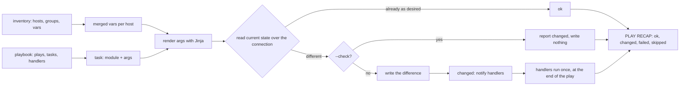

# Idempotence Is a Check Before Every Change

*A playbook is safe to run twice because every module reads the current state first and writes only the difference.*

## Metadata

| Field | Value |
|---|---|
| Type | Build |
| Languages | Python |
| Prerequisites | [Plan and Apply](https://cloudcaptain.io/learn/iac/state-reconciler) |
| Time | 90 minutes |
| Tools | ansible-playbook, ansible-inventory, ansible, ansible-lint, docker |

<Quiz stage="pre" />

## The Problem

The web tier is configured by `provision.sh`, which CI runs on every deploy. It appends `PORT=8080` to `/etc/app/app.env` with `echo >>`, rewrites the nginx site with a heredoc, runs `./seed.sh`, and ends with `systemctl restart nginx`. After a month `app.env` holds thirty `PORT=` lines and the application reads the first, which is the old value. The seed script has inserted the default admin user thirty times. Every deploy restarts nginx and drops in-flight connections, including the deploys that changed nothing. Two hosts that were down during one deploy are now different from the rest, and nobody can say how.

Then the change-freeze review asks the only question that matters: what will this script change on production? There is no answer short of running it. The script cannot tell "already done" from "needs doing", so it cannot report anything other than "I ran", it cannot be previewed, and its restart cannot be made conditional on a real change.

The missing property is **idempotence**: running the same configuration a second time leaves the machine exactly as the first run did and reports that nothing happened. No tool adds that afterwards. Every single step has to read the current state, compare it with the desired state, write only when they differ, and say which of the two it did. Ansible's modules are that pattern, and the rest of Ansible (inventory, variables, Jinja, connections, handlers, check mode) is the machinery that runs those steps on many hosts. You are going to write `miniansible`, a small Ansible that runs the same playbook as the real one and produces the same files and the same `PLAY RECAP`.

## The Concept

Every module is a tiny reconciler. `copy` hashes the file on the target and writes only when the hash differs from the content you asked for. `lineinfile` reads the file, finds the line by a regular expression, and replaces or inserts only when the line is not already right. `file` stats the path and creates or chmods only what is missing. Each returns `changed` or `ok`, and that bit drives everything else: the counters in the `PLAY RECAP`, which handlers get notified, and what check mode reports. There is no state file as in the previous lesson's engine; the target itself is the state, read again on every run.

Because reading and writing are separate steps inside each module, **check mode** (`--check`) is cheap: run the read and the comparison, skip the write, report `changed`. **Diff mode** (`--diff`) prints the comparison. A module that cannot compare, such as `command` running an arbitrary program, cannot be idempotent on its own; it needs a guard (`creates:`, `removes:`) or a `changed_when:` expression that tells the engine how to judge it. A **handler** is a task that runs only when notified by a task that reported `changed`, once per host, at the end of the play, however many tasks notified it. That is how "restart nginx only when its config changed" is expressed.



The controller pushes. For each host it opens a **connection** (SSH by default, `local` for the controller itself, `docker exec` for a container), and for each task it renders the arguments with the host's variables and runs the module through that connection. Which hosts and which variables come from the **inventory**: hosts belong to groups, groups have children, and variables are layered. Real Ansible has about twenty precedence levels (role defaults, `group_vars/` directories, `vars_files`, `set_fact` and more); `miniansible` implements this subset, lowest first, and every level it has sits in the same order as in Ansible:

| Level | Where it is set | Note |
|---|---|---|
| inventory group vars | `[web:vars]`, or `vars:` under a group in YAML | `all` first, then deeper groups; groups at the same depth by `ansible_group_priority`, then by name |
| inventory host vars | `web1 http_port=8080`, or the mapping under the host in YAML | beats every group |
| facts | gathered by `setup` at the start of a play | `ansible_facts.os_family`, also injected as `ansible_os_family` |
| play vars | `vars:` on the play | |
| task vars | `vars:` on the task | |
| registered vars | `register: result` | |
| extra vars | `-e key=value` | always wins |

## Build It

`code/main.py` is `miniansible`: a YAML subset, an inventory, a Jinja subset, a connection interface with three implementations, ten modules, and a play runner. Only `LocalConnection` and `DockerConnection` touch a real machine; the tests use `FakeConnection`, an in-memory filesystem, so they run on macOS and in CI without root or Docker.

### Step 1: read playbooks the way PyYAML does

Ansible parses YAML with PyYAML, which follows YAML 1.1. That is why `become: yes` is a boolean and why `mode: 0644` works while `mode: 644` does not. The scalar resolver copies those rules:

```python
def plain_scalar(text: str) -> Any:
    if text in NULL_WORDS:
        return None
    if text in TRUE_WORDS:
        return True
    if text in FALSE_WORDS:
        return False
    if OCTAL_RE.match(text):
        return int(text, 8)
    if INT_RE.match(text):
        return int(text)
    if FLOAT_RE.match(text):
        return float(text)
    return text
```

`TRUE_WORDS` holds `true`, `yes` and `on` in their three spellings. `0644` matches `OCTAL_RE` and becomes 420, which is the right permission; `644` is the decimal number 644, which is octal 1204, and `file` would set the sticky bit and odd permissions. The module warns about it, and the habit that avoids it is quoting: `mode: "0644"`. The parser also reads literal block scalars (`content: |`) for file contents, and refuses an unquoted value that starts with `{{` with the line number, which is the most common playbook syntax error: YAML reads `{` as the start of a mapping.

### Step 2: an inventory is groups, children and layered variables

An INI inventory is sections. `[web]` lists hosts, `[prod:children]` lists groups, `[prod:vars]` sets group variables, and hosts above the first section land in `ungrouped`. `web[01:02].example.com` expands to two hosts. Values are typed the way the current ansible-core INI plugin types them, by trying a Python literal first:

```python
def ini_value(text: str) -> Any:
    try:
        return ast.literal_eval(text)
    except (ValueError, SyntaxError):
        return text
```

So `http_port=80` is an int, `backup=True` a boolean, and `backup=true` or `backup=yes` stay strings. Host-line values are split with `shlex` first, so quotes group words. After parsing, `reconcile()` attaches every top-level group to `all` and moves a host out of `ungrouped` once it is in a real group. The merged variables for a host are a sort and a fold:

```python
    def var_layers(self, host: str) -> List[Tuple[str, Dict[str, Any]]]:
        depth = self.depths()
        names = sorted(self.groups_of(host), key=lambda g: (depth.get(g, 0), self.groups[g].priority, g))
        layers = [(f"group_vars ({name})", self.groups[name].vars) for name in names]
        layers.append(("host vars", self.hosts.get(host, {})))
        return layers
```

Depth is the distance from `all`, so a child group overrides its parent; siblings fall back to `ansible_group_priority`, then to alphabetical order, so `web` beats `canary` when both set `color`. `inventory --host H --explain` prints each variable with the layer it came from and the layers it overrode, which is the question you ask during every "why does prod have the wrong value" incident. The YAML format (`all: children: prod: hosts: ...`) loads into the same structure, and the tests require both formats to produce identical variables.

### Step 3: a Jinja subset for arguments, conditions and templates

Task arguments, `when:` conditions and template files all use Jinja. `ExpressionParser` is a recursive-descent parser for the expression language: names, `.attr` and `[key]`, literals and lists, `==` and friends, `in` and `not in`, `and`, `or`, `not`, `~`, inline `if`/`else`, filters (`default`, `upper`, `join`, `length` and a dozen more) and tests (`is defined`). Three rules decide whether your output matches Ansible's.

A string that is exactly one `{{ expression }}` keeps its native type, so `"{{ app_port }}"` is the integer 8080 and `"{{ features }}"` a list; anything else renders to text. Variables are templated lazily: `app_root: "{{ root }}/srv/app"` is stored as text and rendered when a task uses it, after `-e root=...` is known, and a variable that refers to itself is reported as a recursive loop. And a condition must produce a boolean; current ansible-core releases reject `when: some_string` instead of guessing:

```python
def evaluate_condition(expression: Any, ctx: Context) -> bool:
    if isinstance(expression, bool):
        return expression
    text = str(expression).strip()
    match = SINGLE_EXPRESSION_RE.match(text)
    if match:
        text = match.group(1)
    value = strict(evaluate(parse_expression(text), ctx))
    if not isinstance(value, bool):
        raise TemplateError(f"Conditional result ({bool(value)}) was derived from value of type {type_name(value)!r}. Conditionals must have a boolean result.")
    return value
```

Template files add statements: ``, ``, ``, `` with `loop.index`, ``, comments, and the `-` markers that strip whitespace. The `template` module turns on Jinja's `trim_blocks`, which removes the newline right after a block tag, so a `` on its own line does not leave a blank line. Jinja drops the template's final newline and Ansible adds trailing newlines back until the output has as many as the source; `render_template` does both, which is what makes the smoke able to compare files byte for byte:

```python
def render_template(source: str, ctx: Context) -> str:
    body = source[:-1] if source.endswith("\n") else source
    nodes = parse_template_nodes(lex_template(body), 0, ())[0]
    out: List[str] = []
    render_nodes(nodes, ctx.child({}), out)
    result = "".join(out)
    missing = trailing_newlines(source) - trailing_newlines(result)
    return result + "\n" * missing if missing > 0 else result
```

### Step 4: one connection interface, three transports

Modules never call `open()` or `subprocess` directly. They call `stat`, `read`, `write`, `mkdir`, `chmod`, `remove`, `run` and `exists` on a `Connection`. `LocalConnection` maps them onto `os` calls, `FakeConnection` onto dictionaries, and `DockerConnection` onto `docker exec` with a POSIX shell inside the container, passing paths as positional arguments so nothing needs quoting:

```python
    def call(self, argv: Sequence[str], stdin: Optional[str] = None, chdir: Optional[str] = None) -> CommandResult:
        result = self.runner(self.exec_argv(argv, stdin is not None, chdir), stdin)
        if result.rc != 0 and ("No such container" in result.stderr or "is not running" in result.stderr):
            raise Unreachable(f"container {self.container!r} is not reachable: {result.stderr.strip()}")
        return result
```

`write` is `docker exec -i BOX sh -c 'cat > "$1"' sh PATH` with the content on stdin; `stat` is a three-way `[ -d ] / [ -f ] / [ -e ]` test plus `stat -c %a`. A missing container raises `Unreachable`, which the runner counts in the recap's `unreachable` column instead of `failed`, exactly the distinction Ansible makes. Which connection a host gets follows Ansible's order: the `ansible_connection` variable beats the play's `connection:` keyword, which beats `-c` on the command line. The real design differs in one place: `miniansible` runs its modules on the controller and moves only file operations across the connection, while Ansible packs the module code and its arguments into one Python file, copies it to the target, and runs it there with the target's Python. That is why managed hosts need Python, and why a real module sees the target's filesystem and libraries directly instead of through a remote shell.

### Step 5: modules that check before they change

`copy` and `template` share one function. It refuses a missing parent directory with Ansible's message, hashes both sides with SHA-1 (the `checksum` Ansible reports), and writes only on a difference, and only outside check mode:

```python
    before = ctx.conn.read(dest) if current is not None else ""
    checksum = sha1(content)
    result = Result(data={"dest": dest, "checksum": checksum})
    if current is None or sha1(before) != checksum:
        result.changed = True
        result.diffs.append({"before": before, "after": content, "before_header": dest, "after_header": source})
        if not ctx.check:
            ctx.conn.write(dest, content)
```

`file` creates missing directories one level at a time and applies `mode` to each one it created, like `mkdir -p` with permissions. `lineinfile` follows ansible-core's algorithm: replace the last line matching `regexp`; if nothing matches, do nothing when the exact line is already present; otherwise insert after the last line matching `insertafter`, or at the end. `command` and `shell` cannot compare, so they honour the guards and are honest in check mode:

```python
    verb = "Would" if ctx.check else "Did"
    if creates and ctx.conn.exists(str(creates)):
        return Result(msg=f"{verb} not run command since '{creates}' exists", data={"rc": 0, "stdout": f"skipped, since {creates} exists", "cmd": argv})
    if removes and not ctx.conn.exists(str(removes)):
        return Result(msg=f"{verb} not run command since '{removes}' does not exist", data={"rc": 0, "stdout": f"skipped, since {removes} does not exist", "cmd": argv})
    if ctx.check:
        if creates is None and removes is None:
            return Result(skipped=True, msg="Command would have run if not in check mode", data={"cmd": argv})
        return Result(changed=True, msg="Command would have run if not in check mode", data={"rc": 0, "cmd": argv})
```

Without a guard, a command in check mode is skipped; with a guard, it reports what it would do. `service` is a fake that keeps a JSON file of service states through the connection (`started` changes only a stopped service, `restarted` always changes), so handler behaviour can be tested without systemd. `setup` gathers facts from `uname -snrm` and `/etc/os-release` and maps the distribution to `os_family` with Ansible's table (Ubuntu is `Debian`, Rocky is `RedHat`). Every module rejects unknown arguments with Ansible's "Unsupported parameters" message, so a typo such as `contnet:` fails at load time instead of silently doing nothing.

### Step 6: the play loop, handlers and the recap

`PlaybookRunner.run_play` runs each task on every host still in the play: evaluate `when` (per item when there is a `loop`), render the arguments, run the module, apply `changed_when` and `failed_when` with the registered result in scope, store `register`. Then it counts, and the counting is where `ok`, `changed` and notifications come from:

```python
        if result.skipped:
            stats.skipped += 1
            return "skipped"
        stats.ok += 1
        if not result.changed:
            return "ok"
        stats.changed += 1
        for name in task.notify:
            if name not in state.notified:
                state.notified.append(name)
        return "changed"
```

A changed task is also an `ok` task, which is why a first run reads `ok=6 changed=5`. A failed host leaves the play, and its notified handlers do not run. After the last task the handlers run in the order they are defined, once per host, only where a notification arrived:

```python
        for handler in play.handlers:
            names = {handler.name, *handler.listen}
            targets = [s for s in states if s.active and handler.name not in s.handled and any(n in names for n in s.notified)]
            if targets:
                for state in targets:
                    state.handled.append(handler.name)
                self.run_task(handler, play, targets, "RUNNING HANDLER")
```

The output copies `ansible-playbook`'s: `TASK [name]` banners, `ok:`, `changed:`, `skipping:` and `fatal:` lines, unified diffs with `--diff`, and a `PLAY RECAP` line in the exact column format, so `parse_recap()` reads both tools' output. `--json` prints every result instead. The exit code is 2 when a host failed and 4 when one was unreachable, as with `ansible-playbook`.

### Step 7: run it twice

```bash
mkdir -p /tmp/cc-ansible/templates /tmp/cc-ansible/target && cd /tmp/cc-ansible
cat > site.yml <<'EOF'
- name: configure the demo app
  hosts: app
  vars:
    app_root: "{{ root }}/srv/app"
    app_port: 8080
    features: [metrics, healthz]
  tasks:
    - name: app directory
      ansible.builtin.file:
        path: "{{ app_root }}"
        state: directory
        mode: "0755"
    - name: config file from a template
      ansible.builtin.template:
        src: app.conf.j2
        dest: "{{ app_root }}/app.conf"
        mode: "0644"
      notify: reload app
    - name: port in the env file
      ansible.builtin.lineinfile:
        path: "{{ app_root }}/app.env"
        regexp: "^PORT="
        line: "PORT={{ app_port }}"
        create: true
        mode: "0644"
      notify: reload app
    - name: seed data once
      ansible.builtin.command:
        cmd: "touch {{ app_root }}/seeded"
        creates: "{{ app_root }}/seeded"
  handlers:
    - name: reload app
      ansible.builtin.shell:
        cmd: "echo reloaded >> {{ app_root }}/reloads"
      changed_when: true
EOF
cat > templates/app.conf.j2 <<'EOF'
[server]
host = {{ ansible_facts.hostname }}
port = {{ app_port }}

feature.{{ feature }} = on

EOF
printf '[app]\nlocalhost ansible_connection=local\n' > hosts.ini
MA=~/CloudCaptain/curriculum/phases/07-iac/08-ansible-config/code/main.py
python3 $MA playbook -i hosts.ini site.yml -e root=$PWD/target            # ok=6 changed=5; the handler runs once for two notifications
python3 $MA playbook -i hosts.ini site.yml -e root=$PWD/target            # ok=5 changed=0
printf 'PORT=9999\n' > target/srv/app/app.env
python3 $MA playbook -i hosts.ini site.yml -e root=$PWD/target --check --diff   # -PORT=9999 +PORT=8080, changed=1, handler skipped
cat target/srv/app/app.env                                                # still PORT=9999: check mode wrote nothing
python3 $MA inventory -i hosts.ini --graph
python3 $MA inventory -i hosts.ini --host localhost --explain
python3 $MA adhoc app -i hosts.ini -m setup -a filter=ansible_os_family
python3 $MA adhoc all -i localhost, -c local -m ping
```

In check mode the notified handler shows as `skipping`: it is a `shell` task without a guard, and check mode cannot know what an arbitrary command would do. Its `changed_when: true` states the truth for real runs (appending always changes the file) and keeps `ansible-lint` quiet.

<RunTests />

## Use It

Install ansible-core (current release <ToolVersion name="ansible" />; this lesson pins 2.21.5) into a virtual environment. Current ansible-core releases need Python 3.12 or newer on the controller; managed hosts need a Python 3 for the modules to run under (3.9 or newer for this release). Then point it at the same files from Step 7:

```bash
python3 -m venv ~/.venvs/ansible && ~/.venvs/ansible/bin/pip install 'ansible-core==2.21.5'
export PATH="$HOME/.venvs/ansible/bin:$PATH"
cd /tmp/cc-ansible && mkdir -p real
ansible --version                                                       # ansible [core 2.21.5], and which Python it runs on
ansible-inventory -i hosts.ini --graph                                  # @all: |--@ungrouped: |--@app: ...
ansible-inventory -i hosts.ini --list                                   # groups plus _meta.hostvars, the merged inventory vars
ansible-inventory -i hosts.ini --host localhost
ansible-playbook -i hosts.ini site.yml -e root=$PWD/real                # ok=6 changed=5, same as miniansible
ansible-playbook -i hosts.ini site.yml -e root=$PWD/real                # changed=0: this second run is the idempotence test
printf 'PORT=8080\n' > target/srv/app/app.env && diff -r real/srv target/srv   # no output: both tools wrote the same files
printf 'PORT=9999\n' > real/srv/app/app.env
ansible-playbook -i hosts.ini site.yml -e root=$PWD/real --check --diff # the same diff and recap as miniansible, nothing written
ansible app -i hosts.ini -m ansible.builtin.setup -a 'filter=ansible_os_family,ansible_hostname'
ansible all -i localhost, -c local -m ansible.builtin.ping              # an inventory of one, the local connection, no SSH
ansible-playbook -i hosts.ini site.yml --syntax-check
```

The docker connection lives in the `community.docker` collection, not in ansible-core. Against a throwaway container both tools use the same inventory line, and the second tool to run finds nothing to do, because idempotence is a property of the target, not of the tool:

```bash
ansible-galaxy collection install 'community.docker:==5.4.0'
docker run -d --name box --hostname box python:3.12-alpine sleep 3600
printf '[app]\nbox ansible_connection=community.docker.docker ansible_python_interpreter=/usr/local/bin/python3\n' > box.ini
ansible-playbook -i box.ini site.yml -e root=/srv                       # modules copied into the container and run with its python3
python3 $MA playbook -i box.ini site.yml -e root=/srv                   # miniansible over docker exec: changed=0
docker exec box cat /srv/srv/app/app.conf                               # host = box
docker rm -f box
```

Two tools make idempotence a gate rather than a hope. `ansible-lint` reads the playbook statically: `pip install ansible-lint`, then `ansible-lint site.yml` flags short module names (`fqcn`), `command` and `shell` tasks with no `changed_when` or guard (`no-changed-when`), unquoted octal modes (`risky-octal`) and files created without a mode (`risky-file-permissions`). Molecule runs it: `pip install molecule 'molecule-plugins[docker]'` and `molecule test` in a role creates a container, converges, converges again in its `idempotence` step and fails if anything reports `changed`, runs your verifier and destroys the container. That second converge is the same check as the second run above, wired into CI.

Last, when not to configure a server at all. If the hosts are identical and replaceable, bake the configuration into an image (a Dockerfile, or a Packer template that may itself run this playbook once at build time) and replace instances instead of mutating them: a host that is never changed after boot cannot drift, and rollback is the previous image. Configuration management earns its keep on long-lived machines that cannot be replaced cheaply (databases, bastions, network devices, bare metal), on the first boot of an image, and inside the image build itself.

| What you built | Real tool | Note |
|---|---|---|
| `parse_ini_inventory`, `parse_yaml_inventory`, `var_layers` | inventory plugins (`ini`, `yaml`, plus dynamic ones for clouds), `ansible-inventory --list` | real inventories add `group_vars/` and `host_vars/` directories and about twenty precedence levels |
| `inventory --host H --explain` | `ansible-inventory --host H`, `ansible -m debug -a var=x` | Ansible shows the value, not where it came from |
| `ExpressionParser`, `render_template` | Jinja2 with Ansible's filters, tests and lookups | Ansible runs real Jinja2 on the controller; `trim_blocks` on in `template` |
| `LocalConnection`, `DockerConnection`, `FakeConnection` | connection plugins: `ssh` (default), `local`, `community.docker.docker`, `winrm`, `kubernetes.core.kubectl` | Ansible copies the module to the target and runs it with the target's Python |
| `copy`, `template`, `file`, `lineinfile` | `ansible.builtin.copy`, `template`, `file`, `lineinfile` | same compare-then-write; real ones add `backup`, `validate`, owners and SELinux contexts |
| `command` with `creates`/`removes` | `ansible.builtin.command`, `shell` | `changed_when: false` for read-only commands |
| fake `service` | `ansible.builtin.service`, `systemd_service` | `restarted` always reports changed; put it in a handler |
| `--check`, `--diff` | `ansible-playbook --check --diff` | only as honest as each module's comparison |
| handlers with `notify` and `listen` | handlers, `meta: flush_handlers`, `--force-handlers` | definition order, once per host per flush |
| `parse_recap`, exit codes 2 and 4 | `PLAY RECAP`, `ansible-playbook` exit codes | `ok` counts changed tasks too |

<Quiz stage="check" />

## Ship It

Two artifacts in `outputs/`:

- **`skill-idempotent-playbook-review.md`**: a review runbook for a playbook or role before it merges: syntax check and lint, a task-by-task decision table for the shapes that are never idempotent (`shell` with `>>`, commands without guards, restarts outside handlers, unquoted modes, `state: latest`), a double run against a throwaway container that must end in `changed=0`, a drift test that proves `--check --diff` reports exactly the drift, and a fixed report format.
- **`prompt-shell-script-to-playbook.md`**: paste a provisioning shell script and get an inventory and a playbook in which every line became a module that checks before it changes, with a line-by-line mapping table, guards or `changed_when` for what has no module, restarts moved into handlers, and the commands that prove the result is idempotent.

<ShipIt />

## Exercises

### Easy

Add `insertbefore` to `lineinfile`, including the special value `BOF`, with ansible-core's rule that a line already present at the target position is not inserted again. Write the tests first: a file with `[server]` and `[client]` sections where `insertbefore: '^\[client\]'` adds a line once and a second run reports `ok`.

### Medium

Load `group_vars/NAME.yml` and `host_vars/HOST.yml` from the directory next to the inventory and from the playbook's directory, and put them in the precedence chain where Ansible puts them (inventory file vars, then inventory `group_vars/`, then playbook `group_vars/`, and the same for hosts). Make `--explain` print the file each value came from. Test it with a host whose `ntp_server` is set in all four places and assert the winner and the override chain.

### Hard

Run modules on the target the way Ansible does. Package a module function and its arguments into one self-contained Python file, copy it through the connection to a temporary directory, run it with the target's `python3`, read one JSON object from its stdout as the result, and delete the directory. Keep the controller-side modules as a fallback for targets without Python. Prove with the `python:3.12-alpine` container that both paths produce the same files and the same `PLAY RECAP`, and measure the cost per task of each.

<Quiz stage="post" />

## Key Terms

| Term | Common misconception | Precise definition |
|---|---|---|
| Idempotence | "The playbook only runs once." | Running the same configuration again leaves the target as the first run did and reports no change. Each module earns it by reading the current state and writing only the difference. |
| `changed` vs `ok` | "`ok` means nothing happened." | Every successful task counts as `ok`; those that modified the target also count as `changed`. A second run with `changed=0` is the test of idempotence. |
| Check mode | "A simulation of the whole run." | `--check` runs each module's read and comparison and skips the write. It is exactly as accurate as those comparisons; a `command` without `creates`/`removes` is skipped because it has none. |
| Handler | "A task that runs at the end." | A task that runs only when notified by a `changed` task, once per host, after the play's tasks (or at `meta: flush_handlers`), in the order handlers are defined. |
| Variable precedence | "The last file read wins." | A fixed order of about twenty sources, from role defaults to `-e` extra vars. Inside the inventory, groups merge by depth from `all`, then `ansible_group_priority`, then name, and host vars beat every group. |
| Facts | "Variables you write yourself." | Data the `setup` module gathers from the target at the start of a play (`ansible_facts.os_family`, `hostname`, `distribution`), available to `when` and templates. |
| Connection plugin | "Ansible needs SSH." | The transport between controller and host: `ssh` by default, `local` for the controller, `community.docker.docker` for containers. Modules are copied over it and run with the target's Python. |
| Mutable vs immutable | "Configuration management and images compete." | Mutable infrastructure is changed in place by repeated runs and can drift between them; immutable infrastructure is replaced from an image that never changes after boot. Playbooks are often used to build those images. |

## Further Reading

- [Ansible Fundamentals](https://cloudcaptain.io/docs/tools/ansible/fundamentals): inventory, modules, playbooks and roles, the vocabulary this lesson rebuilt.
- [Ansible Cheat Sheet](https://cloudcaptain.io/docs/tools/ansible/cheatsheet): the ad hoc, inventory, vault and playbook flags you will use next to `--check --diff`.
- [Ansible Playbook Examples](https://cloudcaptain.io/docs/tools/ansible/examples): longer playbooks to read with the question "what does each task compare before it writes?".
- [YAML Fundamentals](https://cloudcaptain.io/docs/tools/yaml/fundamentals): block scalars, quoting and the type rules behind `mode: 0644` and `become: yes`.
- [Understanding variable precedence](https://docs.ansible.com/ansible/latest/playbook_guide/playbooks_variables.html#understanding-variable-precedence): the full list of levels that `miniansible` implements a subset of.
- [Validating tasks: check mode and diff mode](https://docs.ansible.com/ansible/latest/playbook_guide/playbooks_checkmode.html): which modules support check mode and how `check_mode: false` forces a task to run.
- [Handlers: running operations on change](https://docs.ansible.com/ansible/latest/playbook_guide/playbooks_handlers.html): `listen`, `flush_handlers` and the ordering rules.
- [How to build your inventory](https://docs.ansible.com/ansible/latest/inventory_guide/intro_inventory.html): INI and YAML formats, ranges, groups of groups and `ansible_group_priority`.
- [Jinja template designer documentation](https://jinja.palletsprojects.com/en/stable/templates/): the full language your expression parser and template renderer are a subset of, including whitespace control.
- [ansible-lint rules](https://ansible.readthedocs.io/projects/lint/rules/): `no-changed-when`, `risky-octal`, `fqcn` and the rest, each with the reason it exists.
