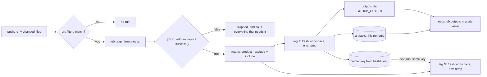

# A Pipeline Is a Graph of Jobs in Clean Rooms

*Jobs are nodes, needs are edges, and every job starts in an empty room; outputs, artifacts and caches are the only doors between them.*

## Metadata

| Field | Value |
|---|---|
| Type | Build |
| Languages | Python |
| Prerequisites | [Apply Order Is a Graph Walk](https://cloudcaptain.io/learn/iac/dependency-graph) |
| Time | 90 minutes |
| Tools | github-actions, act, actionlint, gitlab-ci |

<Quiz stage="pre" />

## The Problem

Tuesday, 11:20. A push to `feature/new-checkout` deployed to production. The `deploy` job had `if: ${{ github.ref }} == 'refs/heads/main'`, and it had looked correct to three reviewers. The runner interpolated the braces first, which left the text `refs/heads/feature/new-checkout == 'refs/heads/main'`. That is a non-empty string, a non-empty string is true, and so the condition had been true on every branch since the day it was merged. Nobody noticed, because until that week every push had come from `main`.

The same week, the platform team moved the repository off its long-lived self-hosted runner onto GitHub-hosted runners. Two jobs broke and a token leaked. `deploy` failed with `dist/app.tar.gz: No such file or directory`: the old runner had reused one working directory, so `build` had been leaving the tarball where `deploy` happened to find it. `test` started failing on a library that had been upgraded a week earlier. The cache step ran before `checkout`, so `hashFiles('requirements.txt')` matched no file and returned an empty string. The key was therefore always `deps-Linux-`, it hit exactly on every run, and the install step that runs on a miss never ran again. And a token appeared in a public log as `c2stbGl2ZS0...`. The runner had masked the secret itself, but someone had base64-encoded it for an API header and printed the header to debug it.

None of these is a bug in GitHub Actions. Each one is a rule of the machine. A condition is parsed one way, `success()` is added to it, every job starts in an empty directory, the only ways to pass data along are outputs, artifacts and caches, and masking replaces exact strings and nothing more. You are going to write `minici`, a runner that implements those rules from the YAML up: the triggers, the `needs` graph run in parallel, the expression language, the matrix, the clean rooms, outputs, the cache, artifacts and masking. Then you will run the same workflow with `act` and `actionlint` and compare the results line by line.

## The Concept

Picture a building with one room per job. A job gets an empty room: a fresh working directory, a fresh temp directory and fresh environment variables. On a GitHub-hosted runner the room is a whole new virtual machine. Whatever a job leaves on the floor is swept away when it leaves. Data can pass between rooms through three doors, and each door has its own rules:

- **Outputs** are small strings. A step writes `name=value` to the file named by `$GITHUB_OUTPUT`, the job lists the outputs it exports, and only jobs that `need` it can read `needs.<job>.outputs.<name>`.
- **Artifacts** are files that belong to one run. A job uploads them and a later job in the same run downloads them.
- **Caches** are files kept across runs, stored under a key you build from content, usually `hashFiles()` over a lock file. A key, once saved, never changes. Restores fall back to `restore-keys` prefixes, and caches are scoped to the branch.

The building has a floor plan, the **job graph**. It is the same graph walk as `tofu apply` in the prerequisite lesson: every `needs` entry is an edge, a cycle is an error, and a job starts the moment everything it needs has finished, in parallel with every other job that is ready. Before any of that, the **trigger** decides whether a run happens at all. The event has to be listed under `on:`, and its branch, tag and changed paths have to pass the filters.

Each job then asks one question before it starts: its `if:`. A condition is an expression in a small language with its own rules. Comparisons are loose (`'1' == 1` is true and strings compare case-insensitively), `&&` and `||` return one of their operands, and a condition that names no status function gets `success() &&` put in front of it. That one hidden rule explains most mysterious skips. `success()` is true only when every job upstream succeeded, so a job is skipped if anything upstream failed or was skipped. A cleanup job needs `always()`, and a job after an optional job needs `!cancelled() && !failure()`. A `strategy.matrix` turns one job into several **legs**: the cartesian product of the lists, minus `exclude`, plus `include`. With `fail-fast` on, the first leg that fails cancels the rest.



Two more rules finish the picture. A step has an **outcome** (what happened) and a **conclusion** (what counts). With `continue-on-error: true` a failing step's outcome is `failure`, its conclusion is `success`, and the job carries on. A job with `continue-on-error` works the same way, and the run passes. **Secrets** are not environment variables until you map them into `env:`. The runner masks them by replacing their exact text in every log line with `***`, so a value you transform (base64, reversed, split across lines, inside a URL-encoded string) is printed in full. A job output that contains a secret is dropped. One last trap: expressions are interpolated before the shell sees the script, so `${{ github.event.issue.title }}` inside `run:` is code someone else wrote. The next lesson is about that.

## Build It

`code/main.py` is `minici`. It reads a workflow with its own YAML parser, plans the graph, and runs each job as a set of real processes in a fresh directory. Every rule above is a pure function the tests call directly. Running a job needs only `bash` and a few coreutils, which macOS and Linux both have. The walk-through uses the sample repository in `code/fixtures/sample-repo/`, whose `.github/workflows/ci.yml` uses every feature in this lesson.

### Step 1: a YAML subset, and the traps that come with YAML

Workflows use a small part of YAML: mappings, sequences, flow lists like `[main, "release/**"]`, quoted strings, comments, and block scalars for `run: |`. `YamlParser` handles exactly that and names the line and the fix for anything else (tabs, anchors, a `!` that YAML reads as a tag, multi-line plain scalars). How a bare word is typed decides half the surprises:

```python
def plain_scalar(text: str) -> Any:
    if text in ("", "~", "null", "Null", "NULL"):
        return None
    if text in ("true", "True", "TRUE"):
        return True
    if text in ("false", "False", "FALSE"):
        return False
    if INT_RE.match(text):
        return int(text)
    if OCT_RE.match(text):
        return int(text[2:], 8)
    if HEX_RE.match(text):
        return int(text[2:], 16)
    if FLOAT_RE.match(text):
        return float(text)
    return text
```

These are the YAML 1.2 core rules that GitHub's parser follows. `on`, `yes` and `off` stay strings, so the `on:` key stays `on`; a YAML 1.1 parser such as PyYAML turns it into the boolean `True`. `3.10` is the float 3.1, which is why a matrix entry `python: [3.10]` installs Python 3.1 and fails. Quote versions. A value that starts with `!` is a YAML tag, so `if: !cancelled()` does not parse; write `if: ${{ !cancelled() }}`. Block scalars keep `#` as text and end with one newline (`|`), none (`|-`) or all of them (`|+`):

```python
        text = "\n".join(core) if style == "|" else fold_lines(core)
        if chomp == "-":
            return text
        if chomp == "+":
            return text + "\n" * (trailing + 1)
        return text + "\n"
```

### Step 2: the expression language

`tokenize()` and `ExpressionParser` turn `${{ ... }}` into a small tree. The precedence, from tightest to loosest, is `.` and `[]`, then `!`, then `< <= > >=`, then `== !=`, then `&&`, then `||`. Literals are `null`, `true`, `false`, numbers (`0x10` too) and single-quoted strings with `''` as the escape. `.*` turns an object into the list of its values, so `needs.*.result` is the result of every needed job. Context and property names are case-insensitive. Equality follows the documented coercion rules:

```python
def loose_equal(left: Any, right: Any) -> bool:
    left_kind, right_kind = kind_of(left), kind_of(right)
    if left_kind != right_kind:
        return to_number(left) == to_number(right)
    if left_kind == "string":
        return left.lower() == right.lower()
    if left_kind == "object":
        return left is right
    if left_kind == "number":
        return float(left) == float(right)
    return left == right
```

So `'' == 0`, `null == false` and `'1' == 1` are all true, `'abc' == 0` is false (NaN), and two arrays are never equal. `&&` and `||` return an operand, which is what makes `github.head_ref || 'main'` a default value. A condition goes through `condition_ast()`. A value made of exactly one `${{ }}`, or none, is parsed as an expression, and a value with text outside the braces is interpolated into a string, which is always true, so minici warns about it. Then the hidden prefix is added:

```python
    node = ExpressionParser(source).parse()
    if not mentions_status(node):
        node = ("and", SUCCESS_CALL, node)
    return node, None
```

`interpolate()` keeps the type when a whole value is one expression, so `continue-on-error: ${{ matrix.experimental }}` is a boolean and `matrix: ${{ fromJSON(needs.setup.outputs.legs) }}` is a mapping. Inside other text the value becomes a string: `null` becomes empty, and objects become JSON.

### Step 3: triggers and filter patterns

`evaluate_trigger()` checks that the event is listed under `on:`. For `push` it matches the branch (or the tag) and then the changed paths; for `pull_request` the branch filters apply to the base branch. The filter patterns have their own syntax. `*` stops at `/` and `**` does not. `?` and `+` mean zero-or-one and one-or-more of the previous character, as in a regular expression; they are not glob wildcards. `[0-9]` is a character class, and a leading `!` negates. The patterns are read in order, and the last one that matches wins:

```python
def filter_matches(value: str, patterns: Sequence[Any]) -> bool:
    matched = False
    for raw in patterns:
        pattern = to_text(raw)
        negate = pattern.startswith("!")
        if filter_regex(pattern[1:] if negate else pattern).match(value):
            matched = not negate
    return matched
```

`paths` runs the workflow if any changed file is included, and `paths-ignore` skips it only if every changed file is ignored. Three rules catch people out. If you set only `branches`, tag pushes never trigger the workflow. Path filters are not evaluated for tag pushes at all. And `branches` together with `branches-ignore` for the same event is an error, which `normalise_on()` reports.

### Step 4: the matrix

`expand_matrix()` takes the cartesian product of the lists, first key outermost, and drops every combination that matches all the keys of an `exclude` entry. Then come the `include` rules, which are the part people misremember. An include entry is merged into every combination whose original values it does not contradict, and it may overwrite values an earlier include added. An entry that fits no combination becomes a new leg, and later includes never merge into that new leg:

```python
    originals = [dict(combo) for combo in combos]
    extra: List[Dict[str, Any]] = []
    for entry in include:
        if not isinstance(entry, dict):
            raise WorkflowError(["each strategy.matrix.include entry must be a mapping"])
        matched = False
        for combo, original in zip(combos, originals):
            if all(key not in original or same_value(original[key], value) for key, value in entry.items()):
                combo.update(entry)
                matched = True
        if not matched:
            extra.append(dict(entry))
```

The test `test_include_rules_from_the_documentation` uses the fruit and animal example from GitHub's documentation and expects its six legs in its order. A matrix may have at most 256 legs.

### Step 5: the graph, run in parallel

`build_workflow()` validates the whole file before anything runs. It rejects unknown keys (with a suggestion: `step` gets "did you mean 'steps'?"), `needs` on a job that does not exist, cycles (named, as in `lint -> release -> test -> lint`) and expressions that do not parse. `Runner.run()` is the dependency-graph walk with a worker pool. Every job whose needs have all finished is started, and the loop waits for the first leg to finish before looking again:

```python
                    for job_id in list(pending):
                        job = self.workflow.jobs[job_id]
                        if all(need in self.results for need in job.needs):
                            pending.remove(job_id)
                            queue.extend(self.start_job(job))
                            progressed = True
```

`start_job()` evaluates the job's `if:` against the job-level status functions. The job-level `success()` and `failure()` look at every ancestor, not just the direct needs:

```python
        upstream = ancestors(self.workflow.jobs, job.id)
        return Scope(
            {"github": self.github_context(job.id), "needs": self.needs_context(job), "vars": self.options.variables, "inputs": self.options.inputs},
            status={
                "success": lambda: all(self.results.get(name) == "success" for name in upstream),
                "failure": lambda: any(self.results.get(name) == "failure" for name in upstream),
                "cancelled": lambda: False,
                "always": lambda: True,
            },
        )
```

A skipped grandparent therefore skips a job whose direct need succeeded, which is why `!cancelled() && !failure()` exists. The job-level `if:` can read `github`, `needs`, `vars` and `inputs`, but not `matrix` or `env`, because it runs before the matrix is expanded. Each leg runs in a worker thread. `strategy.max-parallel` caps the legs of one job, and `--parallel` caps the whole runner. When a leg finishes, `leg_done()` applies fail-fast and, once the last leg is done, rolls the legs up into one result for `needs`. The result is failure if any leg failed, cancelled if any leg was cancelled, otherwise success:

```python
    def leg_done(self, leg: JobRun) -> None:
        group = self.legs[leg.job.id]
        if leg.result == "failure" and leg.strategy.get("fail-fast", True) and len(group) > 1:
            for other in group:
                if other is not leg and not other.done and not other.cancel.is_set():
                    other.reason = f"cancelled by fail-fast after {leg.display} failed"
                    other.cancel.set()
```

`continue-on-error` is applied where the job finishes, as the same outcome and conclusion split that steps get. A leg that fails with it set has the result `success`, so it neither triggers fail-fast nor fails the run:

```python
        leg.result = "success" if outcome == "failure" and leg.continue_on_error else outcome
```

### Step 6: the clean room

`make_dirs()` gives every leg new `workspace/`, `temp/`, `home/` and `files/` directories under the run, and `run_leg()` deletes them when the leg ends. Nothing from the host leaks into the environment except `PATH` and `LANG`. `process_env()` builds each step's environment in layers. Workflow `env` comes first, then job `env`, then whatever earlier steps wrote to `$GITHUB_ENV`, then the step's own `env`. The default `GITHUB_*` and `RUNNER_*` variables go on last, so nobody can forge `GITHUB_SHA`:

```python
        env.update(env_context)
        env.update(self.default_env(leg, dirs))
        env.update(files)
```

`actions/checkout` is built in. It copies the repository into the workspace, without `.git` (the real action clones it). Without a checkout step, the workspace is empty, exactly as on GitHub. The shell matters too. A `run:` step with no `shell:` runs as `bash -e {0}`, which has no `pipefail`, so `false | true` passes. With `shell: bash` the step gets `pipefail`:

```python
SHELLS = {
    "": ["bash", "-e", "{0}"],
    "bash": ["bash", "--noprofile", "--norc", "-eo", "pipefail", "{0}"],
    "sh": ["sh", "-e", "{0}"],
    "python": ["python", "{0}"],
}
```

Every process is started in its own session. A watchdog thread kills the whole process group when `timeout-minutes` expires for the step (the step fails) or for the job (the job is cancelled, and its `always()` steps still run). Fail-fast cancellation kills the group the same way. When the job ends, `run_leg()` kills any background process the job left behind.

### Step 7: outputs and workflow commands

Before each step, `command_files()` creates empty `GITHUB_OUTPUT`, `GITHUB_ENV`, `GITHUB_PATH` and `GITHUB_STEP_SUMMARY` files, and afterwards `apply_file_commands()` reads them back. A line is `NAME=value`, or `NAME<<DELIMITER`, then the lines of the value, then the delimiter. Whichever of `=` and `<<` comes first decides which form it is:

```python
        equals, heredoc = line.find("="), line.find("<<")
        if equals > 0 and (heredoc < 0 or equals < heredoc):
            name, value = line[:equals], line[equals + 1 :]
        elif heredoc > 0:
```

Step outputs become `steps.<id>.outputs.<name>`, and only steps that have an `id` can be read that way. When the job ends, its `outputs:` mapping is evaluated, and any value that contains a masked string is dropped with the runner's own warning:

```python
            if self.masker.reveals(value):
                self.warn(f"{leg.display}: Skip output '{name}' since it may contain secret.")
                continue
```

`handle_output()` reads the commands a step prints on stdout. `::add-mask::VALUE` adds a mask, `::error::`, `::warning::` and `::notice::` become annotations, and `::stop-commands::TOKEN` turns command processing off until `::TOKEN::` is printed. The `set-env` and `add-path` commands are disabled. They let any line of output change the environment, which is why the environment files replaced them. `::set-output` still works but is deprecated.

### Step 8: hashFiles, the cache and artifacts

`hashFiles()` matches files under the workspace with `*`, `**` and `!` patterns. It hashes each matching file with SHA-256 and then hashes the concatenation of those digests, which is the runner's algorithm. No match gives an empty string:

```python
def hash_files(root: str, patterns: Sequence[str]) -> str:
    files = match_files(root, patterns)
    if not files:
        return ""
    outer = hashlib.sha256()
    for relative in files:
        inner = hashlib.sha256()
        with open(os.path.join(root, relative), "rb") as handle:
            for chunk in iter(lambda: handle.read(65536), b""):
                inner.update(chunk)
        outer.update(inner.digest())
    return outer.hexdigest()
```

For one file the value is `openssl dgst -sha256 -binary FILE | openssl dgst -sha256`, not `sha256sum FILE`. minici sorts the matches; the runner hashes them in directory-walk order. Treat the value as opaque, and never compare it across tools.

`CacheStore` is content-addressed. Each archive is stored under its own SHA-256 in `blobs/`, an index maps (key, version, scope) to a blob, and every restore checks the digest. The version is derived from the `path` input, so changing `path` misses even when the key is the same. `find()` searches the current branch first, then the base branch, then the default branch. In each scope it tries the exact key, then the key as a prefix, then each `restore-key` as a prefix, newest first:

```python
        for scope in scopes:
            here = [entry for _, entry in sorted(enumerate(entries), key=lambda pair: (-pair[1].created, -pair[0])) if entry.scope == scope]
            for entry in here:
                if entry.key == key:
                    return entry, True
            for prefix in [key] + list(restore_keys):
                for entry in here:
                    if entry.key.startswith(prefix):
                        return entry, False
        return None
```

`cache-hit` is `true` only for an exact match, `false` for a prefix match and empty for a miss. The save runs as a post step, only when the job succeeded and only when the key was not an exact hit, because keys are immutable. Restores refuse archive members that are links or that point outside the workspace or `~`. Scoping is the defence against cache poisoning: a cache saved on a feature branch is invisible to its sibling branches, and the next lesson shows what happens when that defence is bypassed. Artifacts are simpler. `actions/upload-artifact` copies files relative to the least common ancestor of the `path` entries into `artifacts/NAME/` for this run. A second upload with the same name fails unless `overwrite: true`, and `actions/download-artifact` copies them back. Any other `uses:` fails the job at set-up and names the repository and ref that a real runner would download.

### Step 9: masking

Secrets come from `--secret NAME` (read from your environment, so the value is not on the command line) or `--secret NAME=VALUE`. Every log line goes through one function:

```python
    def mask(self, text: str) -> str:
        for value in self.values:
            text = text.replace(value, "***")
        return text
```

Longer values are replaced first. A multi-line secret is also masked line by line, and `::add-mask::` adds a value before its own line is written:

```python
            if command == "add-mask":
                self.masker.add(value)
                self.log.write(leg.display, "  | ::add-mask::***")
                return
```

The test `test_secrets_are_masked_add_mask_works_and_secret_outputs_are_dropped` checks the limit too: the base64 of the secret appears in the log in full. Masking is a last line of defence for a value that is printed by accident. It does nothing for a value that has been transformed first.

### Step 10: run it

```bash
cd curriculum/phases/08-cicd/01-pipeline-runner
WF=code/fixtures/sample-repo/.github/workflows/ci.yml
python3 code/main.py check $WF                                   # 9 jobs, 4 waves, no errors
python3 code/main.py plan $WF                                    # 4 waves, the 6 test legs, critical path build -> test -> deploy -> notify
export API_TOKEN=s3cr3t-value-123
python3 code/main.py run $WF --runs-dir /tmp/minici --secret API_TOKEN --changed src/app.py
python3 code/main.py run $WF --runs-dir /tmp/minici --secret API_TOKEN --changed src/app.py   # deps: CC-CACHE hit
python3 code/main.py run $WF --runs-dir /tmp/minici --changed README.md                       # not triggered: paths matched none
python3 code/main.py run $WF --runs-dir /tmp/minici --ref refs/heads/feature/x --changed src/app.py   # branches did not match
python3 code/main.py run $WF --runs-dir /tmp/minici --event-path code/fixtures/act-event.json --json > run.json
python3 code/main.py check code/fixtures/broken/needs-cycle.yml; echo "exit $?"   # needs cycle: lint -> release -> test -> lint; exit 2
python3 code/main.py expr "contains(fromJSON('[\"bug\"]'), 'BUG')"                 # true
```

The first run prints the log and then a table (shortened here):

```text
[build]   | CC-SECRET token=***
[deploy]   | CC-OUTPUT version=1.4.0 checksum=87312002
[deploy]   | CC-LEAK absent
[deploy]   | CC-ENV step-stage=step
run 1 of CI (push refs/heads/main 0000000): success
  job                       result    outcome   order   note
  build                     success   success   1-8     version=1.4.0, checksum=87312002
  test (3.13, linux, true)  success   success   13-20
  experimental              success   failure   2-4
  notify                    skipped   skipped   -       if: failure() evaluated to false
  cache restore-miss: deps-macOS-7e4684fe... (deps)
  cache save: deps-macOS-7e4684fe... (deps)
```

`experimental` failed and the run passed (its outcome is `failure`, its result is `success`). `deploy` read the outputs of `build` but not the `leak.txt` file `build` left in its own workspace. The `order` column is the sequence of start and finish events, so you can check that no job started before everything it needs had finished, and that independent jobs overlapped. With `--event-path code/fixtures/act-event.json` the payload contains `"act": true`, and `deps` and `package` are skipped by `if: ${{ !github.event.act }}`. That is the run `act` is compared with below. Exit codes are 0 for a successful run (or one that was not triggered), 1 for a failed or cancelled run, and 2 for a workflow that does not load. `check` exits 1 when it only has warnings.

<RunTests />

## Use It

**On GitHub.** Copy `code/fixtures/sample-repo/` into a new repository and push it. The sample pins every action to a full commit SHA, with the version in a comment; the next lesson explains why. Then read the run from the terminal:

```bash
gh workflow list
gh run list --workflow ci.yml --limit 5
gh run view RUN_ID                      # every job with its conclusion and duration, plus the annotations
gh run view RUN_ID --log --job JOB_ID   # one job's log, secrets shown as ***
gh run view RUN_ID --log-failed         # only the failed steps
gh run rerun RUN_ID --failed --debug    # rerun the failed jobs with runner and step debug logging
gh cache list                           # keys, sizes and refs: the scopes from Step 8
gh run download RUN_ID -n bundle        # an artifact from that run
```

The run page shows the same graph `minici plan` prints. The `test` legs are named `test (3.13, linux, true)`, `experimental` has a red cross while the run is green, and `notify` is greyed out as skipped. `deps-Linux-...` appears in `gh cache list` after the first run and is restored on the second.

**Locally with act.** `act` reads the same workflow and runs it on your machine. Install a pinned release and verify its checksum, never `curl | sh`. `code/smoke.sh` pins v0.2.89 and checks `act_Linux_x86_64.tar.gz` against the release's `checksums.txt`:

```bash
V=0.2.89
curl -fsSLO https://github.com/nektos/act/releases/download/v$V/act_Linux_x86_64.tar.gz
curl -fsSLO https://github.com/nektos/act/releases/download/v$V/checksums.txt
grep ' act_Linux_x86_64.tar.gz$' checksums.txt | sha256sum -c -
tar -xzf act_Linux_x86_64.tar.gz act
cd sample-repo
git init -q -b main && git add -A && git commit -qm sample          # act reads the ref and the sha from git
../act -l                                                     # Stage, Job ID, ...: the same waves as minici plan, from 0
export API_TOKEN=s3cr3t-value-123
../act push -e ../act-event.json -P ubuntu-latest=-self-hosted -s API_TOKEN --no-cache-server
```

`-P ubuntu-latest=-self-hosted` runs every step directly on your machine, the way a self-hosted runner does. Each job still gets its own copy of the repository under `~/.cache/act`, but every job shares your home directory, `/tmp`, your tools and your network. Without `-P`, act asks which runner image to use and runs every job in a Docker container, which is closer to a hosted runner's clean room. `-s API_TOKEN` takes the value from your environment and masks it in the log. act skips `actions/checkout` for the repository you run it in, because it has already copied the files. Every other action is cloned from GitHub. The documented idiom for jobs that should not run locally is `if: ${{ !github.event.act }}` together with an event file containing `{"act": true}`, and for steps, `if: ${{ !env.ACT }}`. Running the sample under both tools shows three real differences:

- act has no job-level `continue-on-error` (its job model has no such field), so the `experimental` failure fails the act run and act exits 1. GitHub and minici pass the run, and `cleanup` prints `experimental=failure` under act and `experimental=success` under minici.
- act's `hashFiles()` hashes the concatenated file contents (`sha256sum requirements.txt` for one file), while the runner and minici hash each file's digest. A key built locally never matches one built on GitHub, which does not matter, because caches never travel between them.
- The cache and artifact actions are real JavaScript actions. act provides a cache server and, with `--artifact-server-path`, an artifact server, and runs the actions with Node (your own in self-hosted mode). minici builds both in.

**Statically with actionlint.** actionlint finds most of these mistakes before anything runs. It type-checks expressions against the contexts, finds unknown `needs`, cycles and conditions that are always true, and runs `shellcheck` on every `run:` script when `shellcheck` is installed:

```bash
actionlint .github/workflows/ci.yml                     # no output, exit 0
actionlint needs-typo.yml       # job "deploy" needs job "biuld" which does not exist in this workflow [job-needs]
actionlint needs-cycle.yml      # cyclic dependencies in "needs" job configurations are detected ...
actionlint if-always-true.yml   # if: condition "..." is always evaluated to true because extra characters are around ${{ }} [if-cond]
```

`minici check` reports the same three (the first two as errors with exit 2, the last as a warning with exit 1), and `code/smoke.sh` asserts that both tools agree on each fixture.

**GitLab CI, the other model.** GitLab starts from stages rather than a graph. Jobs in a `.gitlab-ci.yml` are grouped into `stages` that run in order, and `needs:` turns that into a graph in which a job starts as soon as the jobs it needs have finished, whatever its stage. `rules:` (under `workflow:` for the whole pipeline, or on each job) replaces both `on:` and `if:`, and it is evaluated when the pipeline is created, so a job whose rules do not match is not in the pipeline at all rather than being skipped. The other keys map one to one:

```yaml
stages: [build, test, deploy]
build:
  stage: build
  script: echo "version=$(cat VERSION)" > build.env
  artifacts:
    reports:
      dotenv: build.env
test:
  stage: test
  needs: [build]
  parallel:
    matrix:
      - PYTHON: ["3.12", "3.13"]
  cache:
    key:
      files: [requirements.txt]
    paths: [.deps]
  script: echo "testing on $PYTHON"
experimental:
  stage: test
  allow_failure: true
  script: exit 1
deploy:
  stage: deploy
  needs: [build, test]
  rules:
    - if: $CI_COMMIT_BRANCH == $CI_DEFAULT_BRANCH
  script: echo "deploying $version"
cleanup:
  stage: .post
  when: always
  script: echo cleanup
```

**Why the clean room matters.** A GitHub-hosted runner is a new virtual machine for every job and is thrown away afterwards, so no job can see what an earlier job, an earlier run or another repository left behind. A self-hosted runner reuses its machine. The workspace persists between runs, along with tools someone installed, Docker images, credentials in `~/.docker/config.json`, and processes still running in the background. That is how `dist/` "worked" in The Problem, and it is how one job poisons the next. Register self-hosted runners with `--ephemeral`, so that each takes one job and is replaced, or run them as autoscaled pods with Actions Runner Controller. Never attach a self-hosted runner to a public repository, because a pull request from a fork runs its own code on your machine.

| What you built | Real tool | Note |
|---|---|---|
| `YamlParser` subset | GitHub's workflow parser | YAML 1.2 core types: `on` is a string, `3.10` is a float; quote versions |
| `evaluate_trigger()`, `filter_matches()` | `on.<event>.branches`, `tags`, `paths` | last match wins; `?` and `+` are quantifiers; no path filters for tags |
| `ExpressionParser`, `loose_equal()` | `${{ }}` expressions | case-insensitive strings, coercion to numbers, `&&` and `\|\|` return operands |
| `condition_ast()` implicit `success()` | `jobs.<id>.if`, `steps[*].if` | `always()`, `failure()`, `!cancelled() && !failure()` |
| `expand_matrix()` | `strategy.matrix`, `include`, `exclude` | 256 legs at most; `fail-fast` and `max-parallel` |
| `Runner.run()` worker pool | the Actions orchestrator and runners | `act -l` stages are the same waves |
| fresh `workspace/`, `temp/`, `home/` | a new VM per job on hosted runners | self-hosted runners and `act -P ...=-self-hosted` share the machine |
| `process_env()` layers | `env` at workflow, job and step, `$GITHUB_ENV` | `GITHUB_*` and `RUNNER_*` cannot be overwritten |
| `parse_file_command()` | `$GITHUB_OUTPUT`, `$GITHUB_ENV`, `$GITHUB_PATH` | heredoc form for multi-line values |
| `CacheStore`, `hash_files()` | `actions/cache`, `hashFiles()` | immutable keys, branch scope, version from `path`; act hashes differently |
| `ArtifactStore` | `actions/upload-artifact`, `download-artifact` | per run, unique names, `overwrite` |
| `Masker` | secret masking, `::add-mask::` | exact strings only; outputs with secrets are dropped |
| `minici check` | `actionlint` | actionlint also type-checks contexts and runs shellcheck |

<Quiz stage="check" />

## Ship It

Two artifacts in `outputs/`:

- **`skill-pipeline-debugging.md`**: a runbook for a run that failed, skipped a job, never started or leaked a secret. First the trigger check, then the run graph, the first failing node, the `if:` with its implicit `success()`, matrix legs and fail-fast, outputs that arrived empty, cache keys and scopes, and assumptions about the clean room. Then it reproduces the run locally with `act`, or with `minici` where the two differ, and finishes with a fixed report.
- **`prompt-review-workflow-graph.md`**: paste a workflow file. The model returns the job graph as waves, the critical path, every matrix leg, the conditions that skip or always run, every output read through `needs` with the job that produces it, the files one job expects from another, the cache keys, and a numbered list of concrete YAML fixes, always in the same sections.

<ShipIt />

## Exercises

### Easy

Make `[skip ci]` work. GitHub does not create a run for `push` and `pull_request` events when the head commit message contains `[skip ci]`, `[ci skip]`, `[no ci]`, `[skip actions]` or `[actions skip]`. Read the message from `github.event.head_commit.message` in the event payload, and make `command_run()` report `not triggered: [skip ci] in the commit message` and exit 0. Write the tests first: each marker skips the run, the marker in a `workflow_dispatch` payload does not, and a message such as `skip ci` without brackets does not.

### Medium

Add local composite actions: `uses: ./.github/actions/setup` loads `action.yml` with `runs.using: composite`, maps `with:` to `inputs.<name>` (applying each input's `default`), runs the action's steps inside the calling job's workspace with their own `steps` context, and maps its `outputs:` (`value: ${{ steps.x.outputs.y }}`) back to the calling step's outputs. Write the tests first: an input with a default, a required input that is missing (a set-up error), an output read by the next step, and a failing composite step that fails the calling step.

### Hard

Add reusable workflows: a job with `uses: ./.github/workflows/deploy.yml` and `with:` and `secrets:` runs the called workflow's jobs as part of this run. Check its `on.workflow_call.inputs` (types, `required`, defaults), pass only the secrets that are named or all of them with `secrets: inherit`, and expose `on.workflow_call.outputs` as `needs.<job>.outputs`. Write the tests first: a missing required input, a secret that was not passed (empty in the callee, masked if passed), an output that crosses the boundary, a callee job that fails the caller job, and a call cycle. Then show in the run summary how a called workflow's legs are named.

<Quiz stage="post" />

## Key Terms

| Term | Common misconception | Precise definition |
|---|---|---|
| Job | "Jobs in a workflow run top to bottom." | A node in the run's graph, with its own runner and a fresh workspace. Jobs start as soon as everything in their `needs` has finished, in parallel with every other ready job. |
| `needs` | "It only sets the order." | An edge in the graph. It also gives the job `needs.<id>.result` and `needs.<id>.outputs`, and by default skips the job when anything upstream did not succeed. |
| Implicit `success()` | "An `if:` runs exactly the condition I wrote." | A condition that names no status function becomes `success() && condition`, and the job-level `success()` checks every ancestor; `always()`, `failure()` or `!cancelled() && !failure()` override it. |
| Matrix leg | "`include` only adds new jobs." | One combination of the matrix, run as its own job. `include` first extends existing combinations that it does not contradict, and adds a new leg only when it fits none. |
| Clean room | "The next job sees what the last one built." | Each job starts with a fresh workspace, temp directory and environment (a fresh VM on hosted runners); outputs, artifacts and caches are the only ways data crosses between jobs. |
| Outcome and conclusion | "`continue-on-error` hides the failure." | The outcome records what happened (`failure`); the conclusion is what counts for the job and run (`success`). Both are readable in `steps.<id>` for later steps. |
| Job output | "Any variable a job sets is visible downstream." | A string declared in `jobs.<id>.outputs`, usually from `steps.<id>.outputs` written to `$GITHUB_OUTPUT`, readable only by jobs that need it; one containing a secret is dropped. |
| Cache key | "The cache is updated when files change." | An immutable name for one saved archive, built from content with `hashFiles()`; a changed lock file produces a new key, restored from an older one through `restore-keys`, and scoped to the branch. |
| Secret masking | "Secrets cannot appear in logs." | Exact-string replacement of each registered value with `***` in log lines; base64, reversed or otherwise transformed values are printed as they are. |

## Further Reading

- [GitHub Actions Fundamentals](https://cloudcaptain.io/docs/tools/github-actions/fundamentals): workflows, jobs, steps, runners and the marketplace, from the Reference layer.
- [GitHub Actions Cheatsheet](https://cloudcaptain.io/docs/tools/github-actions/cheatsheet): syntax for triggers, matrices, caching and artifacts in one page.
- [CI/CD Fundamentals](https://cloudcaptain.io/docs/tools/cicd/fundamentals): where a pipeline runner sits between commit and deploy, and the pipeline design patterns around it.
- [YAML Fundamentals](https://cloudcaptain.io/docs/tools/yaml/fundamentals): the whole language your parser is a subset of, including the scalar types that bite.
- [Workflow syntax for GitHub Actions](https://docs.github.com/en/actions/reference/workflows-and-actions/workflow-syntax): every key minici reads, the filter pattern cheat sheet and the matrix include rules.
- [Evaluate expressions in workflows and actions](https://docs.github.com/en/actions/reference/workflows-and-actions/expressions): literals, operators, coercion, the status functions and `hashFiles()`.
- [Workflow commands for GitHub Actions](https://docs.github.com/en/actions/reference/workflows-and-actions/workflow-commands): environment files, multi-line values, masking and stopping command processing.
- [Dependency caching reference](https://docs.github.com/en/actions/reference/workflows-and-actions/dependency-caching): key matching, restore keys, branch scope and eviction.
- [runner hashFiles source](https://github.com/actions/runner/blob/main/src/Misc/expressionFunc/hashFiles/src/hashFiles.ts): the per-file digest algorithm Step 8 reproduces.
- [act user guide](https://nektosact.com/): platforms, `-self-hosted`, events, secrets and the `ACT` variable.
- [actionlint checks](https://github.com/rhysd/actionlint/blob/main/docs/checks.md): every static check, with the error each one prints.
- [GitLab CI/CD YAML reference: needs](https://docs.gitlab.com/ci/yaml/#needs): the stage-free graph in GitLab, with `rules`, `parallel:matrix` and `allow_failure` nearby.
