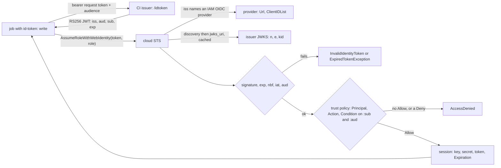

# Short-Lived Credentials: OIDC From CI to the Cloud

*A CI job proves who it is with a signed five-minute token; the cloud trusts it only as far as the trust policy pins sub and aud.*

## Metadata

| Field | Value |
|---|---|
| Type | Build |
| Languages | Python |
| Prerequisites | [A Pipeline Is a Graph of Jobs in Clean Rooms](https://cloudcaptain.io/learn/cicd/pipeline-runner), [kubectl auth can-i Is a Function You Can Write](https://cloudcaptain.io/learn/orchestration/rbac-authorizer) |
| Time | 90 minutes |
| Tools | GitHub Actions, aws, moto, openssl |

<Quiz stage="pre" />

## The Problem

In March 2025 the `tj-actions/changed-files` action was compromised: its version tags were moved to a commit that dumped the runner's memory, secrets included, into the job log, and on public repositories those logs are public. One of the repositories that ran it held `AWS_ACCESS_KEY_ID` and `AWS_SECRET_ACCESS_KEY` as repository secrets: an IAM user key created three years earlier for "deploy", with `AdministratorAccess`, copied into nine other repositories since. The key was valid until somebody deleted it. Nobody could say which of the nine copies had leaked, so rotation meant breaking every pipeline at once on a Friday.

The team moved to OIDC the following week. They created the IAM OIDC provider for `token.actions.githubusercontent.com` and pasted a trust policy from a blog post with `"StringLike": {"token.actions.githubusercontent.com:sub": "repo:octo-org*"}`. Three weeks later CloudTrail showed `AssumeRoleWithWebIdentity` calls whose subject was `repo:octo-org-tools/...`, an organization nobody at the company owned. An older role from another team was worse: its trust policy checked only `aud`. IAM refuses to save a policy like that for GitHub's issuer today, but the check runs when a policy is created or updated, and that role had been saved before the check existed. Any workflow in any GitHub repository could ask GitHub for a token with audience `sts.amazonaws.com` and assume it.

OIDC replaces the stored secret with a signed statement about one job, valid for minutes. The signature proves that GitHub minted the token. It says nothing about whether the job is yours, because every repository on GitHub gets tokens from the same issuer, signed with the same keys. What separates "a job on GitHub" from "the deploy job of `octo-org/octo-repo` in environment `prod`" is the set of claims the cloud checks, and the cloud checks only what the trust policy names. You are going to write `minioidc`, both halves of the exchange: the issuer (discovery document, JWKS, RS256 tokens with GitHub's claims and subject rules, the runner's token endpoint) and the verifier a cloud runs (JWKS cache, signature, issuer, audience, time, trust policy conditions, a session that expires). Its signatures are checked against RFC 7515 and `openssl`, its decisions against AWS, GitHub and GitLab documentation and against moto, and its audit finds the two trust policies above.

## The Concept

Think of a visitor badge. The front desk of a shared office building (the CI provider) prints a badge for every visitor: name, company, the floor they are visiting, valid until 12:05, stamped with the desk's seal. A tenant's door (the cloud) checks that the seal is the desk's, that the badge is for this door, and that it has not expired. Then it checks its own list: only people from our company, visiting our floor. The building has a thousand tenants and one desk, so a perfect seal on a badge for another company opens nothing, unless the door forgot to read the company line. Inside, the door hands out a key card that stops working in an hour. The badge itself is never stored anywhere.

**The issuer.** GitHub's OIDC provider has RSA key pairs. It publishes a discovery document at `https://token.actions.githubusercontent.com/.well-known/openid-configuration` that names the issuer and a `jwks_uri`, and at that URI a JSON Web Key Set: each public key's modulus `n`, exponent `e` and key ID `kid`. A job that has `permissions: id-token: write` gets two environment variables, `ACTIONS_ID_TOKEN_REQUEST_URL` and `ACTIONS_ID_TOKEN_REQUEST_TOKEN`. The second is a bearer token that tells GitHub which job is asking, so a step can request an ID token for any audience it names. Without the permission the variables are not set and no token can be requested.

**The token.** A JWT is three base64url strings joined by dots: a header (`alg` `RS256`, `kid`, `typ`), the claims, and the signature over the first two. RS256 means RSASSA-PKCS1-v1_5 with SHA-256. GitHub's claims include `iss`, `aud` (the requested audience, `https://github.com/OWNER` by default), `exp`, `iat`, `nbf`, `jti`, and the job's context: `repository`, `repository_owner`, `ref`, `environment`, `event_name`, `workflow_ref`, `job_workflow_ref` and their numeric IDs. The subject `sub` is assembled from them with fixed precedence: `repo:ORG/REPO:environment:NAME` when the job names an environment, otherwise `repo:ORG/REPO:pull_request` for a pull request event, otherwise `repo:ORG/REPO:ref:refs/heads/BRANCH` or `ref:refs/tags/TAG`. Colons in values become `%3A`. Repositories created after July 15, 2026 (or that opt in) get an immutable form, `repo:OWNER@OWNER-ID/REPO@REPO-ID:...`, so a deleted and re-registered name cannot inherit trust. An organization can change the template with `include_claim_keys`, for example to put `job_workflow_ref` into `sub`. In GitHub's documented example token, `exp` is 300 seconds after `iat`.

**The verifier.** `sts:AssumeRoleWithWebIdentity` needs no AWS credentials, only the token, a role ARN and a session name. STS finds the IAM OIDC provider whose URL matches the token's `iss` (none: `InvalidIdentityToken`), fetches the discovery document and the JWKS and caches them, picks the key named by `kid`, and verifies the signature. It then checks the times (`ExpiredTokenException` after `exp`) and that the audience is in the provider's `ClientIDList` (if the token has `azp`, that value is used instead of `aud`). Only then does it evaluate the role's trust policy: `Principal` must name the provider's ARN, `Action` must cover `sts:AssumeRoleWithWebIdentity`, and every `Condition` must hold over the condition keys AWS maps from the token. For an OIDC provider those are `HOST:sub`, `HOST:aud`, `HOST:oaud`, `HOST:amr` and `HOST:email`, plus a few provider-specific ones. A claim that AWS does not map, such as `repository_owner` from GitHub, is a missing key. A failing trust policy gives `AccessDenied`. Success returns an access key, a secret, a session token and an `Expiration` between 900 seconds and the role's `MaxSessionDuration` away.



The signature answers "did the issuer mint this?" and nothing else. Because many tenants share one issuer, the trust policy's conditions are the tenancy check. IAM calls these required claims identity-provider controls: for GitHub's issuer it now refuses to create or update a trust policy without a `token.actions.githubusercontent.com:sub` (or `:job_workflow_ref`) condition whose value is more than a wildcard, and returns `MalformedPolicyDocument`. GitLab, HCP Terraform, Buildkite and other shared issuers get the same treatment. Roles saved before the check keep working as written.

## Build It

`code/main.py` is `minioidc`, standard library only. Keys are generated at run time and never committed. `code/fixtures/` holds public data: the RS256 example of RFC 7515 Appendix A.2 (public key and signed token only), the thumbprint example of RFC 7638, GitHub's real discovery document and JWKS fetched on 2026-11-01, eleven job contexts in `jobs.json`, IAM provider documents in the shape `aws iam get-open-id-connect-provider` prints, twelve trust policies, and `aws-doc-cases.json`: 27 trust decisions taken from AWS, GitHub and GitLab documentation, each with its source URL.

### Step 1: base64url and the three parts of a JWT

```python
def b64url_encode(data: bytes) -> str:
    return base64.urlsafe_b64encode(data).rstrip(b"=").decode("ascii")


def b64url_decode(text: Any) -> bytes:
    if not isinstance(text, str) or not B64URL.match(text) or len(text) % 4 == 1:
        raise ValueError(f"not base64url without padding: {str(text)[:24]!r}")
    return base64.urlsafe_b64decode(text + "=" * (-len(text) % 4))


def encode_jwt(claims: Dict[str, Any], key: RsaKey, header: Optional[Dict[str, Any]] = None) -> str:
    head: Dict[str, Any] = {"typ": "JWT", "alg": ALGORITHM, "kid": key.kid}
    head.update(header or {})
    signing_input = b64url_encode(compact_json(head)) + "." + b64url_encode(compact_json(claims))
    return signing_input + "." + b64url_encode(rsa_sign(key, signing_input.encode("ascii")))
```

base64url swaps `+/` for `-_` and drops the padding, so a token fits in a URL or an HTTP header. The signature covers the encoded header and payload exactly as they appear, which is why `decode_jwt()` keeps `signing_input` as bytes instead of re-serializing the JSON it parsed: two JSON encoders never agree on spacing.

### Step 2: RSA keys from pow() and Miller-Rabin

```python
def is_probable_prime(n: int, rounds: int = 40, bases: Optional[Sequence[int]] = None) -> bool:
    if n < 2:
        return False
    for p in SMALL_PRIMES:
        if n % p == 0:
            return n == p
    d, s = n - 1, 0
    while d % 2 == 0:
        d //= 2
        s += 1
    witnesses = list(bases) if bases is not None else [2 + secrets.randbelow(n - 3) for _ in range(rounds)]
    for a in witnesses:
        x = pow(a, d, n)
        if x in (1, n - 1):
            continue
        for _ in range(s - 1):
            x = pow(x, 2, n)
            if x == n - 1:
                break
        else:
            return False
    return True
```

Trial division by the primes below 2000 removes most candidates cheaply. Each Miller-Rabin round with a random base catches a composite with probability at least 3/4. The bases must be random: 3825123056546413051 passes every prime base up to 31 and fails 37, and the test proves both. `generate_key()` draws two primes with their top two bits set (so `n` has exactly the requested length), skips any `p` with `p mod 65537 = 1`, and computes `d` as the inverse of `e` modulo the Carmichael function, plus the CRT values `dp`, `dq` and `qi`:

```python
        carmichael = (p - 1) * (q - 1) // math.gcd(p - 1, q - 1)
        d = pow(PUBLIC_EXPONENT, -1, carmichael)
        key = RsaKey(n, PUBLIC_EXPONENT, "", d, p, q, d % (p - 1), d % (q - 1), pow(q, -1, p))
        key.kid = kid or jwk_thumbprint(key.public_jwk())
```

The tests use 1024-bit keys because they are fast. `keygen` defaults to 2048 bits, the size GitHub publishes, and production keys should be at least that.

### Step 3: RS256 is PKCS#1 v1.5 over SHA-256

```python
def emsa_pkcs1_v15(message: bytes, length: int) -> bytes:
    digest_info = SHA256_DIGEST_INFO + hashlib.sha256(message).digest()
    padding = length - len(digest_info) - 3
    if padding < 8:
        raise InputError(f"a {length * 8}-bit modulus is too small for SHA-256 PKCS#1 v1.5")
    return b"\x00\x01" + b"\xff" * padding + b"\x00" + digest_info


def rsa_verify(key: RsaKey, message: bytes, signature: bytes) -> bool:
    if len(signature) != key.size:
        return False
    s = bytes_int(signature)
    if s >= key.n:
        return False
    return hmac.compare_digest(int_bytes(pow(s, key.e, key.n), key.size), emsa_pkcs1_v15(message, key.size))
```

Signing is `pow(EM, d, n)` and verifying is `pow(s, e, n)`. `rsa_verify()` rebuilds the whole expected encoding and compares every byte. Verifiers that instead parsed the decoded block, looking for `00 01 FF ... 00` and then reading the hash, were forged with exponent 3 keys (Bleichenbacher, 2006), because the parser ignored garbage after the hash. PKCS#1 v1.5 signatures are deterministic: the same key and message always give the same bytes, so the RFC 7515 Appendix A.2 example token verifies byte for byte. Signing uses the CRT values and then checks `pow(s, e, n)` before releasing the signature, because one faulty CRT half reveals a prime factor of `n`:

```python
    if pow(s, key.e, key.n) != m:
        raise RuntimeError(f"the RSA private operation with key {key.kid} gave a wrong result; a faulty CRT signature leaks the key, so it is not released")
```

### Step 4: publish the key as a JWK, a kid and a PEM

```python
def jwk_thumbprint(jwk: Dict[str, Any]) -> str:
    canonical = json.dumps({"e": jwk["e"], "kty": jwk["kty"], "n": jwk["n"]}, separators=(",", ":"), sort_keys=True)
    return b64url_encode(hashlib.sha256(canonical.encode("utf-8")).digest())


def spki_der(key: RsaKey) -> bytes:
    rsa_public = der(0x30, der_integer(key.n) + der_integer(key.e))
    algorithm = der(0x30, der(0x06, RSA_ENCRYPTION_OID) + der(0x05, b""))
    return der(0x30, algorithm + der(0x03, b"\x00" + rsa_public))
```

The JWKS carries `n` and `e` as base64url big-endian integers. When a key has no `kid` of its own, `minioidc` uses the RFC 7638 thumbprint: the SHA-256 of the required members in sorted order, which reproduces the RFC's `NzbLsXh8uDCcd-6MNwXF4W_7noWXFZAfHkxZsRGC9Xs`. `openssl` wants the same numbers as a DER SubjectPublicKeyInfo in PEM, so `jwk-to-pem` writes one and `pem-to-jwk` reads one back, which lets the smoke test verify in both directions. `private_jwk()` adds `d`, `p`, `q`, `dp`, `dq` and `qi`, and those must never appear in a published JWKS.

### Step 5: the issuer mints GitHub's claims and serves the runner

```python
def subject_context(job: Dict[str, Any]) -> str:
    if job["environment"]:
        return "environment:" + escape_subject(job["environment"])
    if job["event_name"] == "pull_request":
        return "pull_request"
    return "ref:" + escape_subject(job["ref"])
```

`github_claims()` builds the full claim set from a job context: `aud` defaults to `https://github.com/OWNER`, `exp` is `iat + 300`, `nbf` is `iat - 600` as in GitHub's example, `job_workflow_ref` names the reusable workflow when there is one, and `github_subject()` walks `include_claim_keys` (default `repo`, `context`) with the immutable `OWNER@ID/REPO@ID` form when the job opts in. `Issuer` serves three routes over `http.server`: the discovery document, the JWKS with `Cache-Control: public, max-age=3600` as GitHub's JWKS has, and the endpoint the runner calls:

```python
    def id_token(self, query: Dict[str, List[str]]) -> None:
        scheme, _, bearer = self.headers.get("Authorization", "").partition(" ")
        entry = self.server.issuer.jobs.get(bearer.strip()) if scheme.lower() == "bearer" else None
        if entry is None:
            self.note("GET /idtoken 401")
            self.send_json(401, {"message": "missing or unknown bearer token: the runner sets ACTIONS_ID_TOKEN_REQUEST_TOKEN only for jobs with permissions: id-token: write"})
            return
        name, job = entry
        token = self.server.issuer.mint(job, (query.get("audience") or [""])[0])
```

`serve --jobs FILE --env-dir DIR` registers every job with its own random bearer token and writes `DIR/NAME.env` with the two variables a runner would set, so `curl -H "Authorization: bearer $ACTIONS_ID_TOKEN_REQUEST_TOKEN" "$ACTIONS_ID_TOKEN_REQUEST_URL&audience=sts.amazonaws.com"` works exactly as in GitHub's documentation. Whoever holds the bearer token can mint tokens for that job with any audience, for as long as the job runs.

### Step 6: the verifier fetches keys first, then checks the signature, then the claims

```python
    def key(self, kid: str) -> RsaKey:
        with self.lock:
            now = self.clock()
            if self.fetched_at is None or now - self.fetched_at >= self.ttl:
                self.refresh()
            elif kid not in self.keys and now - self.fetched_at >= self.min_refresh:
                self.refresh()
            if kid not in self.keys:
                raise StsError("InvalidIdentityToken", f"no key with kid {kid!r} in the JWKS of {self.issuer} (it has {', '.join(sorted(self.keys)) or 'none'})")
            return self.keys[kid]
```

`JwksCache` fetches the discovery document, refuses it if its `issuer` is not the expected one, follows `jwks_uri`, and keeps the keys for an hour. An unknown `kid` means either rotation (the issuer published a new key and signs with it) or garbage. It triggers a refetch at most once a minute, so a stream of tokens with random `kid` values cannot turn the verifier into a flood against the issuer. `parse_jwks()` refuses a JWKS that publishes private members, with the message STS uses (`Couldn't retrieve verification key from your identity provider...`), and one with more than 100 RSA keys. Then `verify()` runs in a fixed order:

```python
        jwt = decode_jwt(token)
        alg = jwt.header.get("alg")
        if alg != ALGORITHM:
            raise StsError("InvalidIdentityToken", f"unsupported alg {alg!r}: only {ALGORITHM} is accepted, so 'none' and HMAC tokens are refused before any key is chosen")
        kid = jwt.header.get("kid")
        if not isinstance(kid, str) or not kid:
            raise StsError("InvalidIdentityToken", "the token header has no kid, so no published key can be chosen")
        issuer = jwt.claims.get("iss")
        provider = self.providers.get(issuer) if isinstance(issuer, str) else None
        if provider is None:
            raise StsError("InvalidIdentityToken", f"No OpenIDConnect provider found in your account for {issuer}")
        key = self.cache_for(provider).key(kid)
        if not rsa_verify(key, jwt.signing_input, jwt.signature):
            raise StsError("InvalidIdentityToken", f"the signature does not verify against key {kid} of {issuer}")
        self.check_time(jwt.claims)
        self.check_audience(jwt.claims, provider)
```

The algorithm comes from configuration, never from the token. A verifier that trusted `alg` would accept `none`, or `HS256` with the RSA public key used as the HMAC secret, and the tests forge both. Keys come only from the provider's JWKS: a `jwk` or `jku` in the header is ignored. `iss` is read before the signature because it says where the keys live, and it is checked against the configured providers, so an unknown issuer never causes a fetch. Times must be integers, and `exp`, `nbf` and `iat` get a 60-second leeway for clock skew. The audience must be in `ClientIDList`, and `azp` wins over `aud`.

### Step 7: trust policy conditions over mapped claims

```python
def key_holds(operator: str, wanted: Sequence[str], present: Sequence[str]) -> bool:
    qualifier, base, if_exists = parse_operator(operator)
    if base == "Null":
        return any((value.lower() == "true") == (not present) for value in wanted)
    if not present:
        if if_exists or qualifier == "ForAllValues":
            return True
        if qualifier == "ForAnyValue":
            return False
        return base in NEGATED
```

This is AWS's condition logic cut down to the String operators and `Null` that web identity trust policies use; you will build AWS's full evaluation logic, every operator and policy type, in the Cloud phase. The authorizer idea is the one from the RBAC lesson: a pure function from a request and a policy to allow or deny, with the reason. Values listed for one key are ORed. A negated operator (`StringNotEquals`, `StringNotLike`) passes when no listed value matches, so it allows everything it does not list. `StringLike` turns `*` into "any characters, colons and slashes included" and `?` into one character, case-sensitively. The other half is `request_context()`, which decides which claims exist as condition keys at all:

```python
    for claim in condition_claims(provider.url):
        if claim == "aud":
            values: List[Any] = audiences(claims)
        elif claim == "oaud":
            values = as_list(claims.get("aud"))
        else:
            values = as_list(claims.get(claim))
```

`condition_claims()` is AWS's default mapping (`amr`, `aud`, `email`, `oaud`, `sub`) plus the extras AWS documents per provider: `job_workflow_ref` for GitHub's issuer, which the identity-provider controls table accepts in place of `sub`, and `namespace_id`, `project_id` and seven more for `gitlab.com`. A condition on `token.actions.githubusercontent.com:repository_owner` sees a missing key: `StringEquals` on it never matches, and `StringEqualsIfExists` always does. `evaluate_trust()` then checks `Principal` against the provider ARN and `Action` against `sts:AssumeRoleWithWebIdentity`, and an explicit Deny wins over any Allow.

### Step 8: the session is the only credential, and it expires

```python
            role = self.roles.get(role_arn)
            if role is None:
                raise StsError("AccessDenied", NOT_AUTHORIZED)
            if duration > role.max_session:
                raise StsError("ValidationError", TOO_LONG)
            outcome.verified = self.verifier.verify(token)
            outcome.trust = evaluate_trust(role.trust_policy, outcome.verified.claims, outcome.verified.provider)
            if not outcome.trust.allowed:
                raise StsError("AccessDenied", NOT_AUTHORIZED)
            outcome.session = mint_session(role_arn, session_name, outcome.verified, duration, int(self.clock()), self.secret)
```

A role that does not exist and a trust policy that says no give the same `AccessDenied`, so a caller cannot probe for role names. `RoleSessionName` must match `[\w+=,.@-]{2,64}` and `DurationSeconds` must lie between 900 and the role's maximum (one hour by default, at most 12). `mint_session()` returns an `ASIA...` access key ID, a secret, and a session token that is an HMAC over the assumed-role ARN, the subject and the expiry, so `session_identity()` can play `GetCallerIdentity` and refuse it after `Expiration`. The assumed-role ARN drops the role's path: `role/ci/deploy/cc-deploy` becomes `assumed-role/cc-deploy/SESSION`. The response has the fields AWS returns: `Credentials`, `SubjectFromWebIdentityToken`, `AssumedRoleUser`, `Provider` and `Audience`.

### Step 9: the threat audit

`audit` reads a trust policy (and optionally the provider) and reports what lets other repositories in. Every row is also a decision in `aws-doc-cases.json`, so the audit and the evaluator agree:

| Trust policy mistake | Who gets in | Case that proves it | `audit` finding |
|---|---|---|---|
| no `:sub` condition, only `:aud` | any repository on GitHub | aud-only policy, a stranger's repository | `missing-subject` CRITICAL |
| `StringLike` `repo:octo-org*` | an organization named `octo-org-evil` | owner-prefix policy, look-alike organization | `wildcard-owner` HIGH |
| `StringNotEquals` on `:sub` | every subject it does not list | negated sub policy | `missing-subject`, `negated-subject` HIGH |
| a condition on an unmapped claim with `IfExists` | everyone: the key is always missing | unmapped claim with IfExists | `unmapped-key-passes` HIGH |
| `repo:octo-org/*` | every repository of the organization, including new ones | any-repo policy | `wildcard-repository` MEDIUM |
| `repo:octo-org/octo-repo:*` | pull_request runs, every branch and environment | any-ref policy, pull_request run | `wildcard-context` MEDIUM |
| no `:aud`, provider with two client IDs, or a verifier that skips `aud` | tokens minted for another service | provider with two audiences; provider without client IDs | `missing-audience`, `provider-any-audience` |

The wildcard checks parse the GitHub subject into owner, repository and context:

```python
    rest = value[len("repo:"):]
    owner, slash, after = rest.partition("/")
    if not slash or any(c in owner for c in "*?"):
        example = "repo:" + re.sub(r"[*?].*", "", owner) + "-lookalike/any"
        return [Finding("HIGH", "wildcard-owner", where, f"{value!r} has a wildcard in the owner name: anyone who registers a matching organization ({example}) can assume the role", "end the owner name with a slash: repo:OWNER/REPO:...")]
```

`audit` exits 1 when it finds anything HIGH or CRITICAL, so it can gate a pull request that changes a trust policy.

### Step 10: run it

```bash
F=code/fixtures
W=$(mktemp -d)
python3 code/main.py cases $F/aws-doc-cases.json                       # 27/27 cases as documented, keys generated now
python3 code/main.py keygen --kid lab-1 --out $W/issuer.json           # 2048-bit private JWK, mode 0600, never committed
python3 code/main.py jwks --key $W/issuer.json > $W/jwks.json          # what the issuer publishes
TOKEN=$(python3 code/main.py mint --key $W/issuer.json --jobs $F/jobs.json --job feature-push --audience sts.amazonaws.com)
python3 code/main.py decode "$TOKEN"                                   # header and claims, marked UNVERIFIED
python3 code/main.py assume --token "$TOKEN" --role-arn arn:aws:iam::123456789012:role/cc-deploy \
  --trust-policy $F/trust-policies/github-branch.json --provider $F/providers/github.json --jwks $W/jwks.json; echo "exit $?"
python3 code/main.py audit --trust-policy $F/trust-policies/github-no-sub.json --provider $F/providers/github.json
```

The denial names the condition that failed and the value the token carried:

```text
AssumeRoleWithWebIdentity arn:aws:iam::123456789012:role/cc-deploy as GitHubActions
  token      iss https://token.actions.githubusercontent.com  kid lab-1
             sub repo:octo-org/octo-repo:ref:refs/heads/feature/login  aud sts.amazonaws.com  exp 2026-11-01T12:05:00Z
  verified   signature RS256, issuer has an IAM OIDC provider, audience in ClientIDList, exp/nbf/iat
  statement 0 (Allow)  principal ok  action ok  does not apply
    pass  StringEquals token.actions.githubusercontent.com:aud sts.amazonaws.com  <- sts.amazonaws.com
    FAIL  StringEquals token.actions.githubusercontent.com:sub repo:octo-org/octo-repo:ref:refs/heads/main  <- repo:octo-org/octo-repo:ref:refs/heads/feature/login
  trust      implicitDeny
  An error occurred (AccessDenied) when calling the AssumeRoleWithWebIdentity operation: Not authorized to perform sts:AssumeRoleWithWebIdentity
exit 1
```

Exit codes are 0 for a session, 1 for any STS error or a HIGH audit finding, and 2 for input that is not JSON, a bad key size or a policy with an unknown operator. `--json` prints the AWS response shape plus a `minioidc` block with the claims, the condition context and every statement's checks.

<RunTests />

## Use It

**The workflow.** The job asks for `id-token: write` and nothing else it does not need. `aws-actions/configure-aws-credentials` requests a token with audience `sts.amazonaws.com`, calls `AssumeRoleWithWebIdentity` with session name `GitHubActions` by default, and exports the session for later steps. Pin actions by commit SHA, the lesson of the `tj-actions` compromise; the comments name the release each SHA belongs to:

```yaml
name: deploy
on:
  push:
    branches: [main]
permissions:
  contents: read
jobs:
  deploy:
    runs-on: ubuntu-latest
    environment: prod
    permissions:
      contents: read
      id-token: write
    steps:
      - uses: actions/checkout@3d3c42e5aac5ba805825da76410c181273ba90b1 # v7.0.1
      - uses: aws-actions/configure-aws-credentials@e1253824e5c10ff9df46874f81ed3ec929e19cfd # v6.3.0
        with:
          role-to-assume: arn:aws:iam::123456789012:role/cc-deploy
          role-duration-seconds: 900
          aws-region: eu-central-1
      - run: aws sts get-caller-identity
```

`environment: prod` is what puts `environment:prod` into `sub`. Give the environment protection rules (required reviewers, deployment branches limited to `main`), because the trust policy can only check what the token says, and the environment rules decide which runs get that `sub` in the first place.

**The AWS side.** One provider per account, one role per deployable thing:

```bash
aws iam create-open-id-connect-provider --url https://token.actions.githubusercontent.com --client-id-list sts.amazonaws.com
aws iam create-role --role-name cc-deploy --max-session-duration 3600 \
  --assume-role-policy-document file://code/fixtures/trust-policies/github-environment.json
aws iam create-role --role-name cc-open \
  --assume-role-policy-document file://code/fixtures/trust-policies/github-no-sub.json           # MalformedPolicyDocument: no :sub condition
aws iam get-open-id-connect-provider --open-id-connect-provider-arn \
  arn:aws:iam::123456789012:oidc-provider/token.actions.githubusercontent.com > provider.json   # Url, ClientIDList, ThumbprintList
aws iam get-role --role-name cc-deploy --query Role.AssumeRolePolicyDocument > trust.json
python3 code/main.py audit --trust-policy trust.json --provider provider.json                   # no findings
```

Older guides compute a SHA-1 thumbprint of the provider's TLS certificate with `openssl s_client`. AWS now verifies the JWKS endpoint's certificate against its library of trusted root CAs and uses thumbprints only as a fallback, so `--thumbprint-list` is optional. Inside a job, the action does the equivalent of this, which also works by hand in any `run:` step:

```bash
TOKEN=$(curl -sS -H "Authorization: bearer $ACTIONS_ID_TOKEN_REQUEST_TOKEN" "$ACTIONS_ID_TOKEN_REQUEST_URL&audience=sts.amazonaws.com" | jq -r .value)
aws sts assume-role-with-web-identity --role-arn arn:aws:iam::123456789012:role/cc-deploy \
  --role-session-name "gha-$GITHUB_RUN_ID" --web-identity-token "$TOKEN" --duration-seconds 900 \
  --query '[AssumedRoleUser.Arn, SubjectFromWebIdentityToken, Credentials.Expiration]'
```

When it fails, the error code says which half failed. `InvalidIdentityToken` covers the provider, keys, signature and audience: `No OpenIDConnect provider found in your account for ...` (wrong account or URL) or `Incorrect token audience` (the step asked for a different audience). `ExpiredTokenException` means the token was older than about five minutes, for example one fetched early in a long job. `AccessDenied` with `Not authorized to perform sts:AssumeRoleWithWebIdentity` means the trust policy, almost always a `sub` that does not match: decode the token (or use the `github/actions-oidc-debugger` action) and compare it with the condition character by character. `minioidc assume` prints that comparison. CloudTrail records every `AssumeRoleWithWebIdentity` call with the token's subject, so the audit question "which workflows used this role?" has an answer.

**The same exchange without an AWS account.** moto in server mode emulates IAM and STS. `code/smoke.sh` runs this against `minioidc serve` posing as GitHub's issuer on 127.0.0.1:

```bash
python3 -m venv .venv && .venv/bin/pip install 'moto[server]==5.2.5'
.venv/bin/moto_server -H 127.0.0.1 -p 5000 > moto.log 2>&1 &
export AWS_ENDPOINT_URL=http://127.0.0.1:5000 AWS_ACCESS_KEY_ID=lab AWS_SECRET_ACCESS_KEY=lab AWS_DEFAULT_REGION=us-east-1
W=$(mktemp -d)
python3 code/main.py keygen --out $W/issuer.json
python3 code/main.py serve --key $W/issuer.json --issuer https://token.actions.githubusercontent.com \
  --jobs code/fixtures/jobs.json --env-dir $W/env --port 8080 --port-file $W/port &
until [ -s $W/port ]; do sleep 0.1; done
source $W/env/deploy-prod.env                                         # the two variables a runner sets
TOKEN=$(curl -sS -H "Authorization: bearer $ACTIONS_ID_TOKEN_REQUEST_TOKEN" "$ACTIONS_ID_TOKEN_REQUEST_URL&audience=sts.amazonaws.com" | jq -r .value)
aws iam create-open-id-connect-provider --url https://token.actions.githubusercontent.com --client-id-list sts.amazonaws.com
aws iam create-role --role-name cc-deploy --assume-role-policy-document file://code/fixtures/trust-policies/github-environment.json
aws sts assume-role-with-web-identity --role-arn arn:aws:iam::123456789012:role/cc-deploy \
  --role-session-name GitHubActions --web-identity-token "$TOKEN" --duration-seconds 900
aws iam get-open-id-connect-provider --open-id-connect-provider-arn \
  arn:aws:iam::123456789012:oidc-provider/token.actions.githubusercontent.com > provider.json
python3 code/main.py assume --token "$TOKEN" --role-arn arn:aws:iam::123456789012:role/cc-deploy \
  --trust-policy code/fixtures/trust-policies/github-environment.json --provider provider.json \
  --discovery-url http://127.0.0.1:8080/.well-known/openid-configuration
```

`--discovery-url` is the lab's stand-in for DNS: the token says `iss` is GitHub's URL, and the keys come from 127.0.0.1. moto returns credentials, and the assumed-role ARN has the same shape as `minioidc`'s. But moto's `AssumeRoleWithWebIdentity` never reads the token. The smoke test sends it a token for a feature branch, a token from a stranger's repository, an expired token and a string that is not a JWT, and moto returns credentials for all of them. It is an emulator of the API, not of the trust decision:

| Behaviour | AWS STS and IAM | moto 5.2.5 | `minioidc` |
|---|---|---|---|
| signature, `iss`, `aud`, `exp` of the token | verified | the token is never parsed | verified |
| trust policy conditions on `:sub`, `:aud` | evaluated | not evaluated; the role need not exist | evaluated |
| trust policy without a `:sub` condition | `MalformedPolicyDocument` on create or update | accepted | `audit`: `missing-subject` |
| `DurationSeconds` above `MaxSessionDuration` | `ValidationError` | accepted | `ValidationError` |
| response fields | `SubjectFromWebIdentityToken`, `Provider`, `Audience` included | `Credentials` and `AssumedRoleUser` only | all of them |
| assumed-role ARN | `arn:aws:sts::ACCOUNT:assumed-role/ROLE/SESSION` | the same | the same |

So the trust decisions are checked against the 27 documented cases, and the signatures against `openssl`:

```bash
python3 code/main.py jwk-to-pem --jwks http://127.0.0.1:8080/.well-known/jwks > pub.pem
printf '%s' "${TOKEN%.*}" > input.txt                                  # header.payload, the signed bytes
python3 -c 'import base64,sys; s=sys.argv[1]; sys.stdout.buffer.write(base64.urlsafe_b64decode(s + "=" * (-len(s) % 4)))' "${TOKEN##*.}" > sig.bin
openssl dgst -sha256 -verify pub.pem -signature sig.bin input.txt     # Verified OK
openssl genpkey -algorithm RSA -pkeyopt rsa_keygen_bits:2048 -out other.pem && openssl pkey -in other.pem -pubout -out other.pub
python3 code/main.py pem-to-jwk other.pub --kid other > other-jwks.json   # then sign header.payload with openssl dgst -sign and verify with --jwks
```

**Azure.** Workload identity federation attaches a federated credential to a user-assigned managed identity (or an app registration). The subject and audience must match the token exactly; wildcard matching through claims-matching expressions is in preview. `azure/login` with `client-id`, `tenant-id` and `subscription-id` requests a token with audience `api://AzureADTokenExchange`:

```bash
az identity create --name cc-deploy --resource-group cc-rg
az identity federated-credential create --name github-prod --identity-name cc-deploy --resource-group cc-rg \
  --issuer https://token.actions.githubusercontent.com --subject repo:octo-org/octo-repo:environment:prod \
  --audiences api://AzureADTokenExchange
```

**Google Cloud.** Workload Identity Federation maps claims to attributes in a pool provider, admits tokens through a CEL attribute condition, and grants roles to `principalSet://` members built from those attributes. `google-github-actions/auth` requests a token whose audience is the provider's resource name:

```bash
gcloud iam workload-identity-pools create github --location=global
gcloud iam workload-identity-pools providers create-oidc octo-repo --location=global --workload-identity-pool=github \
  --issuer-uri=https://token.actions.githubusercontent.com \
  --attribute-mapping="google.subject=assertion.sub,attribute.repository=assertion.repository,attribute.repository_owner=assertion.repository_owner" \
  --attribute-condition="assertion.repository_owner == 'octo-org'"
gcloud storage buckets add-iam-policy-binding gs://cc-artifacts --role=roles/storage.objectViewer \
  --member="principalSet://iam.googleapis.com/projects/123456789/locations/global/workloadIdentityPools/github/attribute.repository/octo-org/octo-repo"
```

Google can condition on any mapped claim, `repository_owner` included, which AWS cannot. Always set an attribute condition: without one the pool admits every repository on GitHub, the same hole as a missing `:sub`.

**GitLab.** A job declares the tokens it wants under `id_tokens`, each with its audience. GitLab's subject is `project_path:GROUP/PROJECT:ref_type:branch:ref:main`, and on `gitlab.com` AWS also maps `namespace_id` and `project_id`, which survive renames (`code/fixtures/trust-policies/gitlab-branch.json`):

```yaml
deploy:
  id_tokens:
    AWS_TOKEN:
      aud: sts.amazonaws.com
  script:
    - aws sts assume-role-with-web-identity --role-arn "$ROLE_ARN" --role-session-name "gitlab-$CI_PIPELINE_ID" --web-identity-token "$AWS_TOKEN" --duration-seconds 900
```

| What you built | Real tool | Note |
|---|---|---|
| `Issuer.discovery()`, `jwks()` | `token.actions.githubusercontent.com/.well-known/openid-configuration` and `/jwks` | GitHub publishes several keys at once so rotation never breaks verification |
| `IssuerHandler.id_token()`, `request` | the runner's `ACTIONS_ID_TOKEN_REQUEST_URL`, `core.getIDToken()` | only with `permissions: id-token: write` |
| `github_claims()`, `github_subject()` | GitHub's OIDC token and `sub` templates | `include_claim_keys`, immutable subjects for repositories created after July 15, 2026 |
| `rsa_sign()`, `rsa_verify()` | RS256 in every JOSE library, `openssl dgst -sha256` | the same bytes: the smoke test verifies both ways |
| `JwksCache` | STS's key retrieval | refuses a JWKS with private members or more than 100 RSA keys |
| `Verifier.verify()` | `AssumeRoleWithWebIdentity` token validation | `InvalidIdentityToken`, `ExpiredTokenException` |
| `evaluate_trust()`, `request_context()` | the role trust policy and AWS's OIDC condition keys | Azure: exact subject and audience; Google: CEL attribute conditions |
| `audit` | IAM identity-provider controls, review of trust policies | IAM blocks only a missing or wildcard-only `:sub`; the other rows are yours to catch |
| `mint_session()` | STS session credentials | 900 seconds to `MaxSessionDuration`; moto does not check the bound |
| `cases` with documented decisions | AWS, GitHub and GitLab documentation | the reference where moto cannot be one |

<Quiz stage="check" />

## Ship It

Two artifacts in `outputs/`:

- **`skill-ci-cloud-federation.md`**: a runbook for moving a pipeline from stored cloud keys to OIDC federation, and for triaging a failing token exchange. It inventories the long-lived keys and where they are used, creates the provider and one role per deployable thing with a pinned `sub` and `aud`, wires the workflow with `id-token: write` and SHA-pinned actions, proves the exchange from one job, audits the trust policies, deletes the old keys, and maps every STS error to its cause and fix. It ends with a fixed report.
- **`prompt-review-oidc-trust-policy.md`**: paste a trust policy (and optionally the provider, the workflow and a decoded token) and get a verdict, each finding with the subject that would get in, and a corrected policy for AWS, plus the matching Azure federated credential or Google attribute condition when asked.

<ShipIt />

## Exercises

### Easy

Add a `mutable-subject` LOW finding to `audit`: a GitHub `:sub` condition that names `repo:OWNER/REPO` without the immutable `OWNER@ID/REPO@ID` form trusts a name that can be deleted and registered again by someone else. Write the tests first: `github-branch.json` gets the finding, `github-immutable.json` does not, a customized subject that starts with `job_workflow_ref:` does not, and the documented least-privilege test is updated to allow LOW findings only of this code.

### Medium

Support ES256, which STS also accepts. Implement ECDSA verification over P-256 from the published curve parameters (point addition and doubling in affine or Jacobian coordinates, `pow(x, -1, p)` for inverses), read EC JWKs (`kty` `EC`, `crv` `P-256`, `x`, `y`), and remember that a JWS carries the signature as the 64-byte `r || s`, not as DER. Tests first: the ES256 example in RFC 7515 Appendix A.3 verifies with its public key, a signature with `s` replaced by `n - s` is handled as your policy decides, a point not on the curve is refused, and a token signed by `openssl dgst -sha256 -sign` with a P-256 key (DER converted to `r || s`) verifies.

### Hard

Serve STS itself. Answer the Query protocol on `http.server`: a form-encoded `POST` with `Action=AssumeRoleWithWebIdentity`, `Version=2011-06-15`, `RoleArn`, `RoleSessionName`, `WebIdentityToken` and `DurationSeconds`, returning the XML response in the `https://sts.amazonaws.com/doc/2011-06-15/` namespace, or an `ErrorResponse` with the right `Code` and HTTP status (400 for `InvalidIdentityToken`, 403 for `AccessDenied`). Add `GetCallerIdentity`, which checks the session token with `session_identity()`. Tests first: start the server on port 0 in a thread, call it with `urllib`, and assert that every case in `aws-doc-cases.json` gives the same code over HTTP; then point `aws sts assume-role-with-web-identity --endpoint-url` at it in `smoke.sh` and show the CLI printing your `AccessDenied`.

<Quiz stage="post" />

## Key Terms

| Term | Common misconception | Precise definition |
|---|---|---|
| OIDC issuer | "The token proves the job belongs to my organization." | The service that signs ID tokens and publishes its keys through a discovery document. A shared issuer such as GitHub's signs tokens for every tenant with the same keys, so the signature proves only who minted the token. |
| JWKS and `kid` | "The verifier can use the key in the token header." | The JSON Web Key Set at the discovery document's `jwks_uri`, with each public key's `n`, `e` and key ID. The token's `kid` selects one of those keys; keys or key URLs inside the token are ignored. |
| RS256 | "RS256 encrypts the token." | RSASSA-PKCS1-v1_5 with SHA-256: a deterministic signature over `base64url(header).base64url(payload)`. The claims are readable by anyone; only their integrity is protected. |
| `sub` claim | "It is the repository name." | The subject, built from the job: `repo:ORG/REPO:environment:NAME`, `:pull_request` or `:ref:REF` by GitHub's precedence, or a custom template. It is the claim a trust policy must pin. |
| `aud` claim | "The audience is always the cloud." | The audience the requesting step asked for (`https://github.com/OWNER` by default). STS requires it in the provider's `ClientIDList`; a token minted for another service must not be accepted. |
| `id-token: write` | "It lets the workflow write to the cloud." | The workflow permission that makes the runner set `ACTIONS_ID_TOKEN_REQUEST_URL` and `_TOKEN`, so steps can request ID tokens. It grants nothing in any cloud by itself. |
| Trust policy | "The role's permissions policy decides who may assume it." | The role's resource policy for `sts:AssumeRoleWithWebIdentity`: `Principal` names the IAM OIDC provider and `Condition` restricts mapped claims such as `HOST:sub` and `HOST:aud`. |
| Identity-provider controls | "IAM makes every federated role safe." | Claims that IAM requires a trust policy to check for shared issuers (`sub` or `job_workflow_ref` for GitHub). Enforced when a policy is created or updated; older policies are not re-checked, and wildcards inside the subject are not blocked. |
| `AssumeRoleWithWebIdentity` | "It needs AWS credentials to call." | The unsigned STS call that trades a token, a role ARN and a session name for temporary credentials after verifying the token and the trust policy. |
| Session credentials | "OIDC gives the job a permanent key." | An access key ID, secret and session token that stop working at `Expiration`, 900 seconds to the role's `MaxSessionDuration` after issue. Nothing long-lived is stored in CI. |
| Leeway | "Clock skew is the issuer's problem." | The seconds a verifier allows on `exp`, `nbf` and `iat` for clocks that differ. Too little rejects valid tokens; too much extends a stolen token's life. |

## Further Reading

- [GitHub Actions Fundamentals](https://cloudcaptain.io/docs/tools/github-actions/fundamentals): workflows, jobs, permissions and secrets, the setting this lesson changes.
- [AWS Security & IAM](https://cloudcaptain.io/docs/cloud/aws/security-iam): roles, trust policies and federation in the wider AWS security model.
- [DevSecOps Fundamentals](https://cloudcaptain.io/docs/tools/devsecops/fundamentals): where secretless CI fits among pipeline security controls.
- [GitHub: OpenID Connect reference](https://docs.github.com/en/actions/reference/security/oidc): every claim, the subject formats, immutable subjects, `include_claim_keys` and the token request.
- [GitHub: Configuring OpenID Connect in Amazon Web Services](https://docs.github.com/en/actions/how-tos/secure-your-work/security-harden-deployments/oidc-in-aws): the trust policies the fixtures copy.
- [AWS: Configuring a role for GitHub OIDC identity provider](https://docs.aws.amazon.com/IAM/latest/UserGuide/id_roles_create_for-idp_oidc.html#idp_oidc_Create_GitHub): the `sub` check IAM performs and the wildcard examples.
- [AWS: Identity-provider controls for shared OIDC providers](https://docs.aws.amazon.com/IAM/latest/UserGuide/id_roles_providers_oidc_secure-by-default.html): which issuers are shared and which claims each must check.
- [AWS: Create an OpenID Connect identity provider in IAM](https://docs.aws.amazon.com/IAM/latest/UserGuide/id_roles_providers_create_oidc.html): audiences, thumbprints, JWKS limits and the private-key error.
- [AWS STS: AssumeRoleWithWebIdentity](https://docs.aws.amazon.com/STS/latest/APIReference/API_AssumeRoleWithWebIdentity.html): parameters, durations, response fields and error codes.
- [AWS: Available keys for OIDC federation](https://docs.aws.amazon.com/IAM/latest/UserGuide/reference_policies_iam-condition-keys.html#condition-keys-wif): the claim-to-condition-key mapping `request_context()` implements.
- [RFC 7519: JSON Web Token](https://www.rfc-editor.org/rfc/rfc7519), [RFC 7515: JSON Web Signature](https://www.rfc-editor.org/rfc/rfc7515) and [RFC 7638: JWK Thumbprint](https://www.rfc-editor.org/rfc/rfc7638): the formats and the test vectors used here.
- [RFC 8017: PKCS #1 v2.2](https://www.rfc-editor.org/rfc/rfc8017): RSASSA-PKCS1-v1_5, EMSA encoding and the CRT private operation.
- [OpenID Connect Discovery 1.0](https://openid.net/specs/openid-connect-discovery-1_0.html): the discovery document and why its `issuer` must match.
- [Microsoft Entra workload identity federation](https://learn.microsoft.com/en-us/entra/workload-id/workload-identity-federation) and [Google Cloud: Workload Identity Federation with deployment pipelines](https://cloud.google.com/iam/docs/workload-identity-federation-with-deployment-pipelines): the Azure and Google models from their sources.
- [GitLab: OpenID Connect in AWS](https://docs.gitlab.com/ci/cloud_services/aws/): `id_tokens`, GitLab's subject and the extra condition keys on `gitlab.com`.
- [moto's STS responses at 5.2.5](https://github.com/getmoto/moto/blob/5.2.5/moto/sts/responses.py): the source that shows why moto returns credentials for any token.
