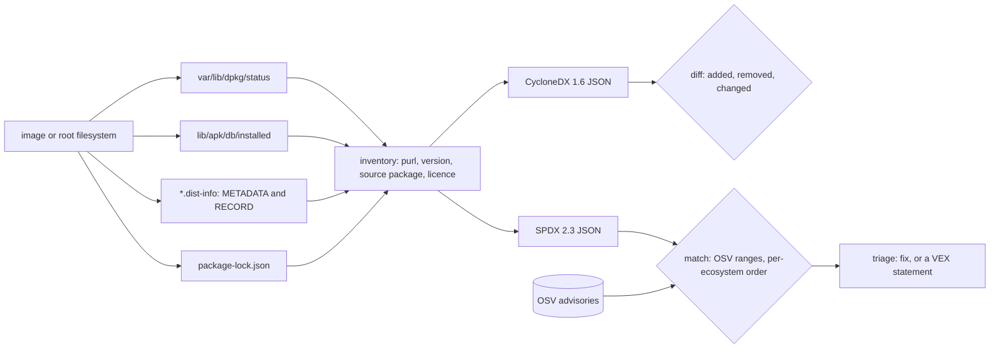

# An SBOM Is an Inventory You Can Diff

*An SBOM writes down the package databases already in an image; diff two to review a change, match one against advisories to triage it.*

## Metadata

| Field | Value |
|---|---|
| Type | Build |
| Languages | Python |
| Prerequisites | [Images Are Just Layers](https://cloudcaptain.io/learn/containers/image-layers) |
| Time | 75 minutes |
| Tools | syft, docker, docker buildx, grype, osv-scanner |

<Quiz stage="pre" />

## The Problem

Tuesday, 09:10. An advisory lands for `idna`, the Python library behind every `requests` call: versions before 3.7 can be pushed into a CPU-bound loop by a crafted hostname. Security asks a simple question in the platform channel: which of our 140 production images ship `idna` older than 3.7, and since when? The first answers come from grep. `requirements.txt` in the API repository says `requests>=2.31`, which names neither `idna` nor a version. The worker image has no Python requirements at all, yet it ships `idna` through a Debian package that a base image pulled in. Someone runs a scanner against the `latest` tag of each repository, but production runs digests from three, five and nine releases ago, and two of those tags have since been overwritten.

The same week, a pull request changes one line of a Dockerfile, `FROM python:3.12-slim-bookworm` to `FROM python:3.12-slim-trixie`. The reviewer approves a one-line diff. The image underneath changed 60 packages: a newer OpenSSL, a different `libc6`, and a few packages the old base pulled in and the new one does not. Nothing in the pull request shows any of it, so nobody reviewed it, and when a C extension starts failing in production nobody can say what changed between the two digests without pulling both and diffing filesystems by hand.

The answer to both questions was inside every image all along. Debian's `dpkg` keeps `var/lib/dpkg/status`, Alpine's `apk` keeps `lib/apk/db/installed`, every pip install leaves a `*.dist-info/METADATA` and a `RECORD` with file hashes, and npm leaves a lock file. A software bill of materials (SBOM) is those databases read at build time and written down in a standard format, stored next to the image digest. With it, "who ships `idna` 3.6" is a query over stored documents, not a rescan, and "what did this pull request change" is a diff of two documents. You are going to build `minisbom`, which reads all four databases from a directory or a `docker export` tarball, writes CycloneDX 1.6 and SPDX 2.3, diffs two SBOMs, and matches packages against OSV advisories with each ecosystem's own version order; then run syft on the same images and prove the inventories agree.

## The Concept

Think of a container image as a warehouse, and of the package managers as the clerks who already keep a ledger of every item they shelved. Nobody needs to walk the aisles and guess what a box contains; you copy the ledgers. An SBOM is that copy, in a format every other tool can read. Where no clerk shelved an item (a binary fetched with `curl` and untarred, a vendored copy of a library, a static Go binary with no metadata), the ledger is silent and a scanner can only guess from file contents. That is the first rule: an SBOM is exactly as good as the package metadata it read.

Three ideas make the copy useful.

**Identity is a package URL.** `pkg:deb/debian/login@1:4.13%2Bdfsg1-1?arch=amd64&distro=debian-12` names a type (`deb`), a namespace (the vendor, `debian`), a name, a version, and qualifiers that distinguish otherwise identical names. Two tools that agree on purls agree on the inventory, whatever document format they wrote. Distribution packages have a second name that matters even more: the **source package**. Debian builds `login` and `passwd` from the source `shadow`, `libssl3` from `openssl`; Alpine builds `busybox-binsh` and `ssl_client` from the origin `busybox`. Distribution security trackers file advisories against the source, so a matcher that only looks at binary names finds nothing.

**Order is per ecosystem.** "Is the installed version below the fixed one" sounds like a string comparison and is not. dpkg sorts `~` before the end of a string (`1.0~rc1` is older than `1.0`) and lets an epoch (`1:`) override everything after it. apk knows that `_rc1` comes before a release and `_p1` after it, and that `-r10` follows `-r9`. Python's PEP 440 puts `1.0.dev0` before `1.0a1` and treats `1.0` and `1.0.0` as equal. SemVer puts `1.0.0-beta.11` after `1.0.0-beta.2` because numeric identifiers compare as numbers. One comparator for all four is wrong in each.

**Advisories are ranges, not lists.** An OSV record says, per ecosystem and package, a list of events: `introduced`, `fixed`, `last_affected`, `limit`. Walk them in version order; a version is affected if the last event at or below it was an introduction. Matching is therefore three steps: same ecosystem and release (`Debian:12` is not `Debian:13`), same name (binary or source), and an affected range under that ecosystem's order.



Two consequences shape how SBOMs are used in CI/CD. An SBOM is a snapshot tied to one digest and never changes; vulnerability data changes daily. So you generate the SBOM once, at build time, store it with the image (as a registry attestation or an artifact), and re-match stored SBOMs whenever advisories change, instead of re-scanning every image you ever shipped. And an SBOM made during the build can see what a later scan cannot: the lock file the build used, the build stages that never reached the final image, and the exact digest it describes.

## Build It

`code/main.py` is `minisbom`. The filesystem readers are behind a small `Tree` interface (a directory, a tar file or a tar on stdin), and everything after reading is pure functions over dataclasses, so the tests run on macOS without Docker. `code/fixtures/` holds two Debian 12 trees (`debian-v1`, `debian-v2`) with a dpkg status file, two pip-installed packages and an npm lock file, an Alpine 3.19 apk database, five real OSV records trimmed to the fields the matcher reads (the enumerated `versions` lists and most references removed), and `version-pairs.json`, the tricky comparisons that `code/smoke.sh` replays against `dpkg`, `apk`, pip's `packaging` and npm's `semver`.

### Step 1: read the tree, never the host

A root filesystem is full of symlinks, and many are absolute: `/etc/os-release` points at `../usr/lib/os-release` on Debian, and Debian images contain absolute ones such as `/etc/localtime -> /usr/share/zoneinfo/Etc/UTC`. If a scanner opens `ROOT/etc/os-release` with the operating system's resolver, an absolute link is followed on the host, and the SBOM of an Alpine image says "Ubuntu" because that is what the CI runner runs. `minisbom` resolves every path itself, one component at a time, inside the tree:

```python
while pending:
    part = pending.pop(0)
    if part == "..":
        if done:
            done.pop()
        continue
    kind, target = self.kind("/".join(done + [part]))
    if kind != "link":
        done.append(part)
        continue
    hops += 1
    if hops > MAX_SYMLINKS:
        raise InputError(f"{self.label}: more than {MAX_SYMLINKS} symlinks while resolving {path}")
    if target.startswith("/"):
        done = []
    pending = [p for p in target.split("/") if p not in ("", ".")] + pending
```

An absolute target restarts at the tree's root, `..` at the root stays at the root, and a loop stops after 40 hops. `DirTree` asks `os.path.islink` and `os.readlink`; `TarTree` asks the archive's member table, so a `docker export` tarball is scanned without extracting it and without root (file modes and owners in the archive do not matter). `open_tree("-")` spools stdin to a temporary file, so `docker export ID | minisbom scan -` works. A `docker save` archive is refused with a hint: it holds a manifest and layer tarballs, not a filesystem, and a layer deleted later (a whiteout) would still look installed if you read the layers naively.

### Step 2: dpkg status is stanzas, and installed is a state

`var/lib/dpkg/status` is a list of RFC 822 style stanzas separated by blank lines, with continuation lines indented by a space. Removing a package with `apt-get remove` keeps its configuration files, and its stanza stays with `Status: deinstall ok config-files` (`rc` in `dpkg -l`): the files are gone, so it is not in the inventory. The `Source` field carries the source package and, after a binary-only rebuild, its version in parentheses:

```python
state = (stanza.get("Status") or "install ok installed").split()[-1]
if not name or not version or state in DPKG_GONE_STATES:
    continue
source, source_version = name, version
match = SOURCE_FIELD.match(stanza.get("Source", ""))
if match:
    source, source_version = match.group(1), match.group(2) or version
```

Distroless images have no `status` file; they ship one stanza per package in `var/lib/dpkg/status.d/`, next to `*.md5sums` files that `minisbom` skips. Debian does not record licences in the status file. They live in `usr/share/doc/PACKAGE/copyright`, and only the machine-readable (DEP-5) form, which starts with `Format:`, has `License:` fields a program can trust. `minisbom` reads those and maps Debian's short names to SPDX identifiers where the mapping is exact (`GPL-2+` is `GPL-2.0-or-later`, `Expat` is `MIT`); anything else stays a free-text name.

### Step 3: apk and Python keep their own ledgers

`lib/apk/db/installed` uses one-letter keys: `P:` name, `V:` version, `A:` architecture, `L:` licence (already SPDX in current Alpine), `o:` origin, and one `R:` line per installed file. The origin is Alpine's source package, which is why one busybox advisory hits three binary packages. `apk add --virtual NAME` records a virtual package that owns no files (the official Python images keep `.python-rundeps`); `minisbom` reports it because it is in the database, and the smoke leaves names starting with `.` out of its comparisons. `minisbom` also checks `usr/lib/apk/db/installed` and de-duplicates by resolved path, so a merged-`/usr` layout is read once.

A Python distribution's `METADATA` is an email-style header block, so `email.parser.HeaderParser` reads it. The licence comes from `License-Expression` (newer metadata), then a short `License` field, then classifiers. `Classifier: License :: OSI Approved :: BSD License` does not say which BSD licence, so the SPDX document says `NOASSERTION` rather than guess. `RECORD` lists every installed file with a SHA-256 in unpadded URL-safe base64, which turns an SBOM entry into something you can verify:

```python
for relative, digest in entries:
    algorithm, _, expected = digest.partition("=")
    if not expected or algorithm not in hashlib.algorithms_guaranteed:
        continue
    data = tree.read(f"{site}/{relative}" if site else relative)
    if data is None:
        changed.append(f"{relative} (missing)")
        continue
    actual = base64.urlsafe_b64encode(hashlib.new(algorithm, data).digest()).rstrip(b"=").decode("ascii")
    if actual != expected:
        changed.append(relative)
```

`scan --verify-records` hashes every listed file and exits 1 if one differs: a package that says `idna 3.6` but whose `__init__.py` was edited after installation is not `idna 3.6`, whatever the metadata claims. Entries without a hash (`.pyc` files, `RECORD` itself) are skipped, as pip does.

### Step 4: npm lock files, and the file nobody committed

Lock file version 2 and 3 have a flat `packages` map keyed by install path. The key `""` is the project itself, `node_modules/debug/node_modules/ms` is a nested copy, and `link: true` entries point at a workspace folder that has its own entry:

```python
for key, entry in sorted(packages.items()):
    if not key or not isinstance(entry, dict) or entry.get("link") or not entry.get("version"):
        continue
    name = entry.get("name") or key.rsplit("node_modules/", 1)[-1]
    found.append(npm_package(name, str(entry["version"]), entry.get("license"), bool(entry.get("dev")), location))
```

`name` inside an entry wins over the path because of aliases (`"node_modules/string-width-cjs": {"name": "string-width"}`). Version 1 lock files nest `dependencies` recursively and are walked the same way. The fixture app uses `npm-shrinkwrap.json`, the same format under the name npm uses when the lock must ship with a package, because this repository's `.gitignore` drops every `package-lock.json`. That is a small version of a real failure: a lock file ignored in Git never reaches the build context, so an SBOM made from the source tree has no npm section at all and nobody notices.

### Step 5: a purl is the identity both tools agree on

```python
def make_purl(kind: str, namespace: str, name: str, version: str, qualifiers: Mapping[str, str]) -> str:
    text = f"pkg:{kind}/"
    if namespace:
        text += "/".join(quote(part, safe=":") for part in namespace.split("/")) + "/"
    text += quote(name, safe=":")
    if version:
        text += "@" + quote(version, safe=":")
    pairs = [f"{key}={quote(value, safe=':/')}" for key, value in sorted(qualifiers.items()) if value]
    return text + ("?" + "&".join(pairs) if pairs else "")
```

The purl specification percent-encodes each component, never encodes `:`, and sorts qualifiers by key, so `2.36-9+deb12u4` becomes `2.36-9%2Bdeb12u4` and an npm scope becomes `%40babel`. Each type adds rules: PyPI names are lowercased with `_` turned into `-`, npm scopes are the namespace. Debian and Alpine packages carry `arch` and `distro` (`debian-12`, `alpine-3.19.1`, from `etc/os-release`), and `upstream` when the source package differs from the binary:

```python
found = {"arch": self.arch, "distro": self.distro}
if self.source and self.source_version and self.source_version != self.version:
    found["upstream"] = f"{self.source}@{self.source_version}"
elif self.source and self.source != self.name:
    found["upstream"] = self.source
```

`upstream` is syft's convention, not part of the purl type definition, and it is what lets the matcher in Step 9 find the source name in any SBOM, including one written by a different tool. Readers must decode rather than compare strings: other tools may encode the epoch colon as `%3A` or order qualifiers differently, and `parse_purl()` accepts both.

### Step 6: CycloneDX and SPDX are two envelopes for the same list

A CycloneDX 1.6 component is the purl plus display fields, licences and free-form properties; `bom-ref` must be unique, so `merge()` keeps one package per purl and collects every location where it was found:

```python
item: Dict[str, Any] = {"type": "library", "bom-ref": package.purl, "name": package.display, "version": package.version, "purl": package.purl}
```

The operating system becomes a component of type `operating-system`, and `metadata.tools` names `minisbom`. SPDX 2.3 wraps the same list as `packages`, each with an `SPDXID` (letters, digits, `.` and `-` only, unique in the document), `downloadLocation` and copyright set to `NOASSERTION` because a filesystem scan cannot know them, `licenseDeclared` as an SPDX expression or `NOASSERTION`, the purl in `externalRefs` with category `PACKAGE-MANAGER`, and a `DESCRIBES` relationship from the document to the scanned subject plus `CONTAINS` from the subject to each package. Both documents are reproducible: the timestamp comes from `--timestamp` or `SOURCE_DATE_EPOCH`, and the CycloneDX `serialNumber` and SPDX `documentNamespace` are a UUID derived from the name, the timestamp and the sorted purls, so scanning the same image twice gives byte-identical files that can be signed and compared.

### Step 7: diff is set arithmetic plus a version order

```python
for key in sorted(set(before) | set(after)):
    was, now = before.get(key, {}), after.get(key, {})
    gone = [was[v] for v in sorted(set(was) - set(now))]
    came = [now[v] for v in sorted(set(now) - set(was))]
    if len(gone) == 1 and len(came) == 1:
        changed.append(Change(gone[0], came[0], direction(key[0], gone[0].version, came[0].version)))
    else:
        removed.extend(gone)
        added.extend(came)
```

The key is (type, namespace, normalised name), not the purl: a purl contains the version and the distro release, so keying on it would turn every upgrade into a removal plus an addition. Each key maps to a set of versions, because npm installs two versions of the same package side by side (`ms` 2.1.2 under `debug`, 2.1.3 at the top). `direction()` labels a change `upgrade`, `downgrade` or `equivalent` with the ecosystem's comparator, which is how a reviewer spots a base image that quietly went backwards. `diff` reads CycloneDX, SPDX, `minisbom --json`, in-toto statements and DSSE envelopes (what `docker buildx` and cosign attach) or two filesystems directly, and exits 1 when anything changed, like `diff(1)`.

### Step 8: four version orders

dpkg compares epoch numerically, then the upstream version and the revision with the same algorithm: alternate runs of non-digits and digits, digits numerically, non-digits character by character with this weight:

```python
def dpkg_order(char: str) -> int:
    if not char or is_digit(char):
        return 0
    if is_alpha(char):
        return ord(char)
    if char == "~":
        return -1
    return ord(char) + 256
```

`~` weighs less than the end of the string, so `1.0~rc1` and Debian's backport suffix `~deb12u2` sort below the plain version; letters weigh less than punctuation, so `1.0a` sorts below `1.0+`. apk-tools tokenises instead: digits, an optional letter, suffixes from two lists (`alpha`, `beta`, `pre`, `rc` before the release; `cvs`, `svn`, `git`, `hg`, `p` after it), then `-rN`. `compare_apk()` is a port of `apk_version_compare()`; when one version runs out of tokens first, the longer one wins unless what follows is a pre-release suffix:

```python
if kind_a == APK_SUFFIX and apk_token(kind_a, a, pos_a)[0] < 0:
    return -1
if kind_b == APK_SUFFIX and apk_token(kind_b, b, pos_b)[0] < 0:
    return 1
return -1 if kind_a > kind_b else 1
```

PEP 440 versions become a sort key the way pip's `packaging` builds one: epoch, release with trailing zeros removed, then pre, post, dev and local, each with a sentinel for "absent" that sorts where the specification says (a bare `.dev` release sorts before every pre-release of the same version):

```python
if has_pre:
    pre = (0, PEP440_PRE[match.group("pre_l").lower()], int(match.group("pre_n") or 0))
elif not has_post and has_dev:
    pre = (-1, "", 0)
else:
    pre = (1, "", 0)
```

SemVer ignores build metadata after `+`, sorts a version with a pre-release below the same version without one, and compares dot-separated identifiers numerically when they are digits and as ASCII otherwise:

```python
identifiers = tuple((0, int(part), "") if part.isdigit() else (1, 0, part) for part in match.group(4).split("."))
return core, (0, identifiers)
```

| Ecosystem | Pair | Order | Why |
|---|---|---|---|
| dpkg | `1:1.0`, `2.0` | `>` | the epoch wins |
| dpkg | `3.0.11-1~deb12u2`, `3.0.11-1` | `<` | `~` sorts before the end |
| dpkg | `2.36-9+deb12u4`, `2.36-9+deb12u10` | `<` | digits compare as numbers |
| apk | `1.2.3_rc1-r1`, `1.2.3-r0` | `<` | the suffix is compared before the revision |
| apk | `1.2.3_git20240101`, `1.2.3` | `>` | `_git` is a post-release suffix |
| PyPI | `1.0.dev0`, `1.0a1` | `<` | a dev release precedes every pre-release |
| PyPI | `1!0.1`, `2.0` | `>` | the epoch wins here too |
| npm | `1.0.0-beta.11`, `1.0.0-beta.2` | `>` | numeric identifiers |
| npm | `1.0.0+build.5`, `1.0.0` | `=` | build metadata is ignored |

### Step 9: an OSV range is a walk over sorted events

```python
for kind, value in sorted((e for e in typed if e[0] != "limit"), key=functools.cmp_to_key(order)):
    if kind == "introduced" and (value == "0" or compare(version, value) >= 0):
        affected = True
    elif kind == "fixed" and compare(version, value) >= 0:
        affected = False
    elif kind == "last_affected" and compare(version, value) > 0:
        affected = False
```

This is the evaluation the OSV schema specifies: `introduced: "0"` sorts first, several introduced and fixed pairs in one range describe several affected windows (the `semver` advisory has three), `last_affected` closes a window inclusively, and a `limit` caps the whole range. A version listed in `versions` is affected regardless of ranges. `SEMVER` ranges use the SemVer order, `ECOSYSTEM` ranges use the package's own. Before any range is evaluated, `match()` chooses candidates:

```python
upstream_name, upstream_version = component.upstream()
candidates = [(component.display, component.version)]
if upstream_name:
    candidates.append((upstream_name, upstream_version or component.version))
```

A Debian advisory for `shadow` is checked against `login` and `passwd` under their source name, and only when the advisory's ecosystem (`Debian:12`) matches the release in the package's `distro` qualifier; an advisory for `Alpine:v3.19` says nothing about the same package on 3.22. A version that does not parse under its ecosystem's rules becomes a note, not a silent pass.

### Step 10: run it

```bash
cd curriculum/phases/08-cicd/04-sbom
F=code/fixtures
python3 code/main.py scan $F/debian-v1                                   # 14 packages: deb 6, pypi 2, npm 6
python3 code/main.py scan $F/debian-v1 --format cyclonedx --timestamp 2026-01-01T00:00:00Z -o v1.cdx.json
python3 code/main.py scan $F/debian-v2 --format spdx -o v2.spdx.json
python3 code/main.py diff v1.cdx.json v2.spdx.json; echo "exit $?"      # 10 changes; formats can differ
python3 code/main.py match $F/debian-v1 --advisories $F/advisories; echo "exit $?"
python3 code/main.py match $F/alpine --advisories $F/advisories          # one busybox advisory, three binary packages
python3 code/main.py compare deb 3.0.11-1~deb12u2 3.0.11-1               # <
(cd $F && tar -cf - -C debian-v1 .) | python3 code/main.py scan - --json | head -20
```

The diff of the two fixture trees:

```text
+ deb   less 590-2.1~deb12u2
- deb   tzdata 2024a-0+deb12u1
- pypi  six 1.16.0
~ deb   libc6 2.36-9+deb12u4 -> 2.36-9+deb12u10 (upgrade)
~ deb   libssl3 3.0.11-1~deb12u2 -> 3.0.15-1~deb12u1 (upgrade)
~ deb   login 1:4.13+dfsg1-1 -> 1:4.13+dfsg1-1+deb12u1 (upgrade)
~ deb   passwd 1:4.13+dfsg1-1 -> 1:4.13+dfsg1-1+deb12u1 (upgrade)
~ pypi  idna 3.6 -> 3.7 (upgrade)
~ npm   @babel/traverse 7.23.1 -> 7.23.2 (upgrade)
~ npm   semver 7.5.1 -> 7.5.4 (upgrade)
10 changes: 1 added, 2 removed, 7 changed
```

And the first finding of the match, which shows the source package at work:

```text
DEBIAN-CVE-2023-29383  CVSS:3.1/AV:L/AC:L/PR:L/UI:N/S:U/C:N/I:L/A:N  deb login 1:4.13+dfsg1-1 (source shadow 1:4.13+dfsg1-1)  fixed in 1:4.13+dfsg1-1+deb12u1
    Debian:12 ECOSYSTEM range: introduced 0, fixed 1:4.13+dfsg1-1+deb12u1
```

`debian-v1` has five findings (`login` and `passwd` through `shadow`, `idna`, `semver` and `@babel/traverse`) and `debian-v2` has none. Exit codes: `scan` 0 (1 when `--verify-records` finds a modified file), `diff` 0 for identical and 1 for different, `match` 0 for no findings and 1 for findings, and 2 for input that cannot be read, with the reason on stderr.

<RunTests />

## Use It

The real tools split the job the same way: syft writes SBOMs, grype and OSV-Scanner match them. Install a pinned syft release and verify it against the published checksums (the smoke does exactly this):

```bash
V=1.55.0
curl -fsSLO https://github.com/anchore/syft/releases/download/v$V/syft_${V}_linux_amd64.tar.gz
curl -fsSLO https://github.com/anchore/syft/releases/download/v$V/syft_${V}_checksums.txt
grep " syft_${V}_linux_amd64.tar.gz$" syft_${V}_checksums.txt | sha256sum -c -
tar -xzf syft_${V}_linux_amd64.tar.gz syft && ./syft version
```

Two images that differ by a few packages, then both tools on both:

```bash
mkdir -p /tmp/sbom-lab && cd /tmp/sbom-lab
printf 'FROM python:3.12-slim-trixie\nRUN pip install --no-cache-dir idna==3.6 six==1.17.0\n' > v1.Dockerfile
printf 'FROM python:3.12-slim-trixie\nRUN apt-get update && apt-get install -y --no-install-recommends less && rm -rf /var/lib/apt/lists/*\nRUN pip install --no-cache-dir idna==3.7\n' > v2.Dockerfile
docker build -q -t sbom-lab:v1 -f v1.Dockerfile . && docker build -q -t sbom-lab:v2 -f v2.Dockerfile .
syft scan docker:sbom-lab:v1 -o cyclonedx-json=syft-v1.cdx.json -o spdx-json=syft-v1.spdx.json
syft scan docker:sbom-lab:v2 -o cyclonedx-json=syft-v2.cdx.json
syft scan docker:sbom-lab:v1 -o table | head -20                        # NAME, VERSION, TYPE (deb, python, binary)
docker create --name sbom-v1 sbom-lab:v1 && docker export sbom-v1 -o v1.tar && docker rm sbom-v1
python3 ~/CloudCaptain/curriculum/phases/08-cicd/04-sbom/code/main.py scan v1.tar --format cyclonedx -o mini-v1.cdx.json
python3 ~/CloudCaptain/curriculum/phases/08-cicd/04-sbom/code/main.py diff syft-v1.cdx.json syft-v2.cdx.json
syft convert mini-v1.cdx.json -o spdx-json=converted.spdx.json         # syft reads minisbom's CycloneDX
```

`code/smoke.sh` builds this pair on Debian and on Alpine, then asserts that minisbom's package set equals syft's for every dpkg, apk and Python package (name and version, parsed from both JSON documents, never compared as text), that both equal what `dpkg-query -W`, `apk list --installed` and `pip list` report inside the images, that minisbom's diff of its own SBOMs equals its diff of syft's SBOMs and contains exactly the planted Python changes, and that the fixture advisory for `idna` matches 3.6 in v1 and nothing in v2. syft prints more rows than minisbom: its binary classifiers recognise the `python` interpreter and other executables from their bytes and report them with type `binary` and purls such as `pkg:generic/python@3.12.12`. That is the part of an inventory no package database records, and the reason syft keeps a catalogue of file signatures.

Image scans and directory scans use different catalogers. `syft scan docker:IMAGE` reads what is installed (dpkg, apk, `dist-info`, `node_modules/*/package.json`); `syft scan dir:.` adds the declared side (`package-lock.json`, `requirements.txt`, `poetry.lock`, `go.mod`). Lock file development dependencies are left out unless you set `SYFT_JAVASCRIPT_INCLUDE_DEV_DEPENDENCIES=true`. `syft cataloger list` shows which catalogers each source uses, and `--scope all-layers` catalogues every layer instead of the squashed filesystem, which finds packages that a later layer deleted.

Matching is a separate job with a separate lifetime. grype matches an SBOM against its own database (built from NVD, GitHub advisories and distribution trackers, downloaded on first run):

```bash
grype sbom:./syft-v1.cdx.json                       # idna 3.6 with the GHSA id and the fixed version
grype sbom:./syft-v1.cdx.json --only-fixed --fail-on high
grype sbom:./syft-v1.cdx.json --vex ./vex.json      # suppress what you have analysed as not affected
osv-scanner scan image sbom-lab:v1                  # OSV-Scanner, against the same data minisbom's fixtures came from
osv-scanner scan -L package-lock.json               # a lock file, the declared side
```

The smoke does not run grype or OSV-Scanner: both need a vulnerability database of a few hundred megabytes from the network, and their answers change every day, which is exactly why the lesson's matcher runs against committed advisories instead. The behaviours you built are the ones to look for in their output: Debian and Alpine findings name the binary package you have and the source package the advisory names, and "fixed in" is evaluated with the distribution's order.

**An SBOM from the build.** BuildKit can run a scanner on the final stage while it builds and attach the result as an in-toto attestation:

```bash
docker buildx create --name sbom-builder --driver docker-container --use
docker buildx build --sbom=true --output type=local,dest=out -f v2.Dockerfile .
ls out/sbom.spdx.json                                                     # an in-toto statement whose predicate is SPDX
docker buildx build --sbom=true -t REGISTRY/sbom-lab:v2 --push -f v2.Dockerfile .
docker buildx imagetools inspect REGISTRY/sbom-lab:v2 --format '{{ json .SBOM.SPDX }}'
```

The default scanner plugin is built on syft. `ARG BUILDKIT_SBOM_SCAN_STAGE=true` in a build stage and `BUILDKIT_SBOM_SCAN_CONTEXT=true` extend it to intermediate stages and the build context, the declared dependencies a scan of the finished image can never see. Attaching the SBOM to the digest in the registry answers the Tuesday question directly: list the digests running in production, fetch their attestations, match. `minisbom diff` reads the attestation as it is (it unwraps the in-toto statement), and the smoke compares buildx's SBOM with minisbom's scan of the exported filesystem. Signing that attestation, so a consumer can tell who produced it, is the next lesson.

**SPDX or CycloneDX.** Both describe the same packages and both carry purls, so either works for diffing and matching. SPDX (a Linux Foundation project, standardised as ISO/IEC 5962) grew out of licence compliance and is strongest on files, licences and relationships; SPDX 3.0 restructures the model into profiles. CycloneDX (an OWASP project, standardised as ECMA-424) grew out of security and also models services, cryptographic assets, and vulnerability and VEX data in the same document. Pick the one your consumers ask for; converting between them loses some fields (`syft convert` documents which).

**VEX for "not affected".** A match is a hypothesis: the vulnerable function may not be reachable, the affected feature may be compiled out, the package may be present but never loaded. A Vulnerability Exploitability eXchange document records that analysis so the same finding does not page someone every day. OpenVEX is a small JSON format:

```json
{
  "@context": "https://openvex.dev/ns/v0.2.0",
  "@id": "https://example.com/vex/sbom-lab-2026-001",
  "author": "platform-security@example.com",
  "timestamp": "2026-11-01T09:00:00Z",
  "version": 1,
  "statements": [
    {
      "vulnerability": {"name": "GHSA-jjg7-2v4v-x38h"},
      "products": [{"@id": "pkg:oci/sbom-lab@sha256:REPLACE_WITH_DIGEST", "subcomponents": [{"@id": "pkg:pypi/idna@3.6"}]}],
      "status": "not_affected",
      "justification": "vulnerable_code_not_in_execute_path",
      "impact_statement": "the service never calls idna.encode on user input; hostnames come from a fixed allow-list"
    }
  ]
}
```

The statuses are `not_affected` (which requires a justification or an impact statement), `affected`, `fixed` and `under_investigation`. CycloneDX carries the same idea in `vulnerabilities[].analysis.state`. A VEX statement is a claim someone must be able to defend; give each one an owner and a review date.

**Why the build beats a later scan.** The build knows the lock file it installed from, the stages that were thrown away, and the digest it produced. A scan of the finished image sees only what survived, and only when the metadata survived: a Dockerfile that runs `rm -rf /var/lib/apk /var/lib/dpkg` to save space, or copies a binary in from another stage, produces an image whose scan is empty or partial. That is a reason to treat a shrinking SBOM as a review finding, not a cleanup.

| What you built | Real tool | Note |
|---|---|---|
| `Tree.resolve()` inside the root | syft's file resolver, `--base-path` | both refuse to follow links out of the scanned tree |
| `dpkg_packages()`, `status.d`, DEP-5 licences | syft `dpkg-db-cataloger` | `rc` stanzas are not installed; distroless uses `status.d` |
| `apk_packages()` with `o:` origin | syft `apk-db-cataloger` | the origin becomes `upstream` in the purl |
| `python_packages()`, `--verify-records` | syft `python-installed-package-cataloger`, `pip show -f` | syft lists the RECORD files; minisbom also re-hashes them |
| `npm_packages()` from lock files | syft `javascript-lock-cataloger` (directory scans) | image scans read `node_modules/*/package.json` instead |
| not built: binary classifiers | syft `binary-classifier-cataloger` | recognises interpreters and static binaries with no package metadata |
| `make_purl()`, `parse_purl()` | purl in every SBOM format | decode before comparing; encodings of `:` and `+` vary |
| `cyclonedx()`, `spdx()` | `syft -o cyclonedx-json`, `-o spdx-json`, `syft convert` | reproducible with `SOURCE_DATE_EPOCH` |
| `diff` | no syft command; `diff` on sorted `jq` output, or a CI step | keyed on name, not purl, so upgrades are changes |
| `match` with OSV ranges | grype, OSV-Scanner | real databases, updated daily; findings change, SBOMs do not |
| `compare` | `dpkg --compare-versions`, `apk version -t`, `packaging.version`, npm `semver` | the smoke checks every fixture pair against them |
| `unwrap()` for in-toto and DSSE | `docker buildx build --sbom=true`, `cosign attest` | an SBOM attached to the digest in the registry |
| not built: VEX | OpenVEX, CycloneDX VEX, `grype --vex` | the Hard exercise |

<Quiz stage="check" />

## Ship It

Two artifacts in `outputs/`:

- **`skill-sbom-review.md`**: a runbook with two entry points. For a pull request that changes an image, it generates SBOMs for the old and new digest, diffs them, classifies every change (base image drift, intended, unexplained, downgrade, removed package metadata), matches both against current advisories and reports what the change fixed and introduced. For a new advisory, it queries the stored SBOMs of every running digest, checks ecosystem, source package and version order by hand for the hits, and writes a VEX statement or a fix ticket for each. It ends with a fixed report.
- **`prompt-explain-vulnerability-match.md`**: paste a scanner finding with the SBOM component and, if you have it, the advisory JSON; the model explains which name matched (binary or source), walks the range events under the right version order, says whether the match is real, names the fixed version and the smallest upgrade that reaches it, and drafts a VEX statement only when the evidence supports one.

<ShipIt />

## Exercises

### Easy

Add Rust: parse `Cargo.lock` (`[[package]]` tables with `name`, `version` and `source`; a package without `source` is a workspace member and is skipped) and emit `pkg:cargo/NAME@VERSION`. Write the tests first with a lock file that has a registry crate, a Git crate (`source = "git+https://..."`) and a workspace member, and assert the purls and that the workspace member is absent. Use only string parsing; the format is a small subset of TOML and Python 3.9 has no `tomllib`.

### Medium

Read `docker save` archives instead of refusing them. Parse `manifest.json` (or `index.json` and the OCI blobs), apply the layers in order to an in-memory map of path to (layer, member), treat `.wh.NAME` as a deletion and `.wh..wh..opq` as "empty this directory", then hand the result to the existing parsers. Record which layer last wrote each package database and add it as a CycloneDX property, so the report can say "this package arrived in the layer made by `RUN pip install`". Tests first: a two-layer archive built with `tarfile` in which the second layer whites out a dist-info directory, and assert the package is absent.

### Hard

Add `match --vex FILE` for OpenVEX documents. A statement suppresses a finding when its vulnerability name equals the advisory id or one of its aliases and one of its products or subcomponents has the finding's purl (compare type, namespace, name and version, ignore qualifiers). `not_affected` without a justification or impact statement is an error, `under_investigation` keeps the finding but marks it, `fixed` suppresses only if the version in the SBOM is at or above the advisory's fixed version, and a statement older than a `--vex-max-age` in days is reported as stale. Write the tests first, then run `grype sbom:... --vex` on the same files in the smoke and compare which findings each tool suppresses.

<Quiz stage="post" />

## Key Terms

| Term | Common misconception | Precise definition |
|---|---|---|
| SBOM | "A scan report of vulnerabilities." | An inventory of the components in one artifact (name, version, purl, licence, relationships) in a standard format such as CycloneDX or SPDX. It contains no vulnerabilities; matching is a separate step. |
| Package URL (purl) | "A download link." | `pkg:type/namespace/name@version?qualifiers#subpath`, a percent-encoded identifier for one package version in one ecosystem, used as the join key between SBOMs, advisories and tools. |
| Source package | "The same as the package name." | The name a distribution builds binaries from (`shadow` for `login` and `passwd`, `openssl` for `libssl3`, origin `busybox` for `ssl_client`). Debian and Alpine advisories are filed against it. |
| Epoch | "Part of the version you can drop." | The number before `:` in a dpkg version (or `!` in PEP 440) that overrides everything after it; `1:1.0` is newer than `2.0`, so dropping it inverts comparisons. |
| Tilde | "A typo in the version." | In dpkg versions, `~` sorts before everything, even the end of the string; `1.0~rc1` and backports such as `3.0.11-1~deb12u2` are older than `1.0` and `3.0.11-1`. |
| OSV range | "A list of affected versions." | A list of `introduced`, `fixed`, `last_affected` and `limit` events evaluated in the ecosystem's version order; a version is affected when the latest event at or below it is an introduction. |
| CycloneDX and SPDX | "One is for security, the other is obsolete." | Two maintained SBOM standards (ECMA-424 and ISO/IEC 5962) that both list components with purls; CycloneDX also models services and VEX, SPDX is strongest on licences and files. |
| VEX | "A way to hide scanner noise." | A Vulnerability Exploitability eXchange statement that a product is `not_affected`, `affected`, `fixed` or `under_investigation` for a vulnerability, with a justification someone can audit. |
| Declared versus installed | "The lock file is what runs." | Declared dependencies come from manifests and lock files; installed ones from package databases in the final filesystem. An image scan sees only installed ones, a source scan only declared ones. |

## Further Reading

- [DevSecOps Fundamentals](https://cloudcaptain.io/docs/tools/devsecops/fundamentals): where SBOM generation, image scanning and policy gates sit in a secure pipeline.
- [Docker Security in Production](https://cloudcaptain.io/docs/tools/docker/security-production): image hardening, minimal bases and scanning, the context in which an SBOM is produced.
- [Kubernetes Security](https://cloudcaptain.io/docs/tools/kubernetes/security): admission control and image policy, where a stored SBOM or attestation is enforced at deploy time.
- [CycloneDX 1.6 JSON reference](https://cyclonedx.org/docs/1.6/json/): every field of the document `minisbom` writes, including `licenses`, `properties` and the vulnerability and VEX sections.
- [SPDX 2.3 specification](https://spdx.github.io/spdx-spec/v2.3/): packages, `externalRefs`, relationships and the licence expression syntax.
- [Package URL specification](https://github.com/package-url/purl-spec): the encoding rules and the definitions of the `deb`, `apk`, `pypi` and `npm` types.
- [OSV schema](https://ossf.github.io/osv-schema/): the advisory format, ecosystem names such as `Debian:12` and `Alpine:v3.19`, and the range evaluation algorithm in Step 9.
- [Debian Policy: the Version field](https://www.debian.org/doc/debian-policy/ch-controlfields.html#version): epochs, upstream versions, revisions and the comparison algorithm with `~`.
- [Python version specifiers (PEP 440)](https://packaging.python.org/en/latest/specifications/version-specifiers/): normalisation and ordering of pre, post, dev and local versions.
- [Recording installed projects](https://packaging.python.org/en/latest/specifications/recording-installed-packages/): the `dist-info` directory and the `RECORD` hash format.
- [Semantic Versioning 2.0.0](https://semver.org/): the precedence rules behind `compare_semver()`.
- [Docker SBOM attestations](https://docs.docker.com/build/metadata/attestations/sbom/): `--sbom=true`, the scanner plugin, scanning build stages and the in-toto format.
- [syft](https://github.com/anchore/syft): sources, catalogers, output formats and `syft convert`.
- [OpenVEX specification](https://github.com/openvex/spec): statuses, justifications and how products and subcomponents are identified.
