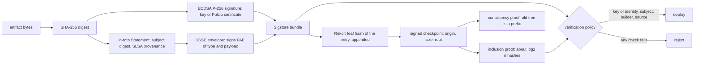

# Signing Is a Hash, a Key and a Public Log

*A signature binds a digest to a key, provenance binds it to a build, and a public log makes both impossible to hide or rewrite.*

## Metadata

| Field | Value |
|---|---|
| Type | Build |
| Languages | Python |
| Prerequisites | [An SBOM Is an Inventory You Can Diff](https://cloudcaptain.io/learn/cicd/sbom), [Pull an Image With Plain HTTP](https://cloudcaptain.io/learn/containers/registry-pull) |
| Time | 120 minutes |
| Tools | cosign, openssl, gh |

<Quiz stage="pre" />

## The Problem

Tuesday, 09:10. Security forwards a customer report: the `billing-agent` 2.8.1 tarball on the download page opens a reverse shell. The release checklist says every artifact is signed, and it is: `cosign verify-blob --key release.pub` prints `Verified OK`. The signing key had been a repository secret for three years, readable by every workflow in the repository, and a compromised third-party action in the docs workflow printed it into a build log nine days ago. The attacker built the tarball on a laptop and signed it with the real key. The signature is valid. It just never said what everyone assumed it said.

The incident review then needs answers the signature cannot give. Which build produced 2.8.0, the last good release: which commit, which workflow, which runner? Nobody recorded it, so nobody can prove the good builds are good either, and every release since the key was created becomes suspect. Was the stolen key used anywhere else? There is no record of signing events, so the only honest answer is "we don't know". Rotating the key means telling every customer who pinned `release.pub`, through a website the attacker may also control.

Three mechanisms close those gaps, and none of them is exotic. A signature over a SHA-256 digest proves that the holder of a key approved those exact bytes, nothing more. Provenance is a signed statement that names the artifact by digest and records the builder, the source commit and the parameters, so a policy can demand "built by our release workflow from `main`" instead of "signed by some key we own". A transparency log is an append-only Merkle tree that records every signature, where any reader can check with a few hashes that an entry is included and that the log never rewrote its past; a stolen key then leaves public evidence every time it is used. You are going to build all three in `minisign`, from the P-256 curve equation up, and check them against cosign, OpenSSL and real Rekor entries.

## The Concept

Think of a notary, a shipping manifest and a ledger in the town square. The notary's stamp says one person approved these exact pages; it says nothing about who wrote them. A manifest stamped by the factory says which line built the goods, from which parts, on which shift. A public ledger with numbered pages, each page summarising the one before, means nobody can stamp a document in secret or quietly tear out last month's page. Supply-chain signing is these three things done with hashes.

**The signature.** A P-256 private key is a random integer d between 1 and n-1, where n is the order of the curve's group, and the public key is the point Q = d·G: the fixed generator G added to itself d times on the curve y² = x³ - 3x + b, with all arithmetic modulo a 256-bit prime p. Adding two points costs a few multiplications and one modular inverse, and d·G takes about 256 doublings and 128 additions; getting d back from Q is the elliptic-curve discrete logarithm, which nobody can compute at this size. To sign, SHA-256 the message into an integer z, pick a nonce k, and publish r = x(k·G) mod n and s = k⁻¹(z + r·d) mod n. The verifier holds only Q, computes u1 = z·s⁻¹ and u2 = r·s⁻¹, and checks that u1·G + u2·Q has the x-coordinate r. Everything rests on k: sign two messages with the same k and anyone can solve the two equations for d, which is how the PlayStation 3's signing key was recovered. RFC 6979 takes the random number generator out of the question by deriving k from d and z with HMAC-SHA-256, so the same key and message always give the same signature and two messages never share a nonce.

**The bundle.** A signature is about 70 bytes of DER. A Sigstore bundle is one JSON file that carries it with what a verifier needs: the digest it covers, the verification material (a hint naming a key, or a short-lived certificate) and, if the signature was published, the transparency log entry and its proof. It never carries a trusted key. A key that travels with the signature proves nothing, so the verifier brings the key, or the identity it expects, from somewhere else.

**Provenance.** A signature says who approved bytes; provenance says how they came to exist. An in-toto Statement names one or more subjects by digest, a `predicateType` and a predicate. The SLSA provenance v1 predicate records a `buildType`, the `externalParameters` a user controlled (the workflow file, the ref), the `resolvedDependencies` (the source commit and anything else fetched) and `runDetails` with the `builder.id` that ran the build. The Statement travels inside a DSSE envelope, which signs `PAE(payloadType, payload)`: a length-prefixed concatenation, so the signature also authenticates what kind of document this is and no byte can move between the two fields. A verifier checks the envelope signature before it parses a single field, then checks that a subject digest is the artifact in hand and that the builder and source are the expected ones.

**The log.** Rekor turns each entry (the digest, the signature, the public key or certificate) into a leaf hashed as `SHA-256(0x00 || entry)`; two subtrees combine as `SHA-256(0x01 || left || right)`. The different prefixes stop anyone from passing an inner node off as a leaf. The log regularly signs a checkpoint: its name, the tree size and the root hash. An inclusion proof is the list of sibling hashes from a leaf to the root, about log₂(n) of them, so one entry in a tree of 25 million is checked with 25 hashes. A consistency proof shows that the tree of size m is a prefix of the tree of size n; a client that remembered yesterday's checkpoint learns that nothing it saw has changed. Monitors watch the log for entries made with their keys or identities, and witnesses co-sign checkpoints so the log cannot show different histories to different readers.

**Keyless.** Long-lived keys were the weak point of The Problem, and Sigstore's keyless flow removes them. The signer generates a key pair in memory, proves an identity to Fulcio with an OIDC token (in CI, the token the platform gives the workflow), and receives a certificate valid for ten minutes that binds the public key to that identity. The signature goes into Rekor and the private key is thrown away. Verification then pins an identity and an issuer, for example a workflow path in a repository and `https://token.actions.githubusercontent.com`, instead of a key, and the log's timestamp shows the signature was made while the certificate was valid.



## Build It

`code/main.py` is `minisign`, a cosign-shaped command-line tool in about 1,500 lines of standard library Python (no relation to Frank Denis's minisign, a real Ed25519 signing tool with its own format; the name here only means "mini cosign"). Every primitive is checked against published data: the RFC 6979 vectors, the certificate-transparency Merkle test vectors, the DSSE specification example, signatures made by OpenSSL in `code/fixtures/openssl/`, and real bundles from the Sigstore public-good and staging instances in `code/fixtures/sigstore/` (`sources.json` in each folder says where every file comes from). The code is for learning: its arithmetic is not constant-time, so its timing leaks information about the key. Use it with throwaway keys and keep production keys in cosign, a KMS or keyless signing.

### Step 1: points on the curve

The constants `P`, `A`, `B`, `N` and `G` at the top of the file are the P-256 parameters from SEC 2 and FIPS 186; `openssl ecparam -name prime256v1 -param_enc explicit -text -noout` prints the same numbers. A point is a pair `(x, y)` and `None` is the point at infinity, the group's zero. Adding two points draws the line through them, finds the third point where it meets the curve and mirrors it; doubling uses the tangent:

```python
def point_add(left: Point, right: Point) -> Point:
    if left is None:
        return right
    if right is None:
        return left
    (x1, y1), (x2, y2) = left, right
    if x1 == x2 and (y1 + y2) % P == 0:
        return None
    if x1 == x2:
        slope = (3 * x1 * x1 + A) * pow(2 * y1, -1, P) % P
    else:
        slope = (y2 - y1) * pow(x2 - x1, -1, P) % P
    x3 = (slope * slope - x1 - x2) % P
    return x3, (slope * (x1 - x3) - y1) % P


def scalar_mult(k: int, point: Point) -> Point:
    result: Point = None
    addend = point
    k %= N
    while k:
        if k & 1:
            result = point_add(result, addend)
        addend = point_add(addend, addend)
        k >>= 1
    return result
```

`pow(x, -1, P)` is the modular inverse (Python 3.8 and later). The tests check that G is on the curve, that `(n-1)·G` is `-G` and adding G to it gives infinity, and that `(a+b)·G` equals `a·G + b·G`. Double-and-add branches on the bits of k, which is exactly the timing leak mentioned above.

### Step 2: ECDSA with RFC 6979 nonces

The nonce generator is the HMAC-DRBG from RFC 6979 section 3.2, seeded with the private key and the digest. It is a generator because the RFC continues the same stream if a candidate is out of range or gives `r = 0` or `s = 0`:

```python
def rfc6979_nonces(d: int, digest: bytes) -> Iterator[int]:
    x = d.to_bytes(32, "big")
    h1 = (bits_to_int(digest) % N).to_bytes(32, "big")
    k = b"\x00" * 32
    v = b"\x01" * 32
    for separator in (b"\x00", b"\x01"):
        k = hmac.new(k, v + separator + x + h1, hashlib.sha256).digest()
        v = hmac.new(k, v, hashlib.sha256).digest()
    while True:
        v = hmac.new(k, v, hashlib.sha256).digest()
        candidate = bits_to_int(v)
        if 1 <= candidate < N:
            yield candidate
        k = hmac.new(k, v + b"\x00", hashlib.sha256).digest()
        v = hmac.new(k, v, hashlib.sha256).digest()
```

Signing and verification are the two formulas from The Concept:

```python
def sign_digest(key: PrivateKey, digest: bytes) -> Tuple[int, int]:
    z = bits_to_int(digest)
    for k in rfc6979_nonces(key.d, digest):
        x, _ = scalar_mult(k, G)
        r = x % N
        s = pow(k, -1, N) * (z + r * key.d) % N
        if r and s:
            return r, s
    raise AssertionError("the nonce generator never ends")


def verify_digest(public: PublicKey, digest: bytes, r: int, s: int) -> bool:
    if not (0 < r < N and 0 < s < N) or not on_curve(public.point):
        return False
    w = pow(s, -1, N)
    point = point_add(scalar_mult(bits_to_int(digest) * w % N, G), scalar_mult(r * w % N, public.point))
    return point is not None and point[0] % N == r
```

The RFC's appendix A.2.5 key gives, for the messages `sample` and `test`, the exact k, r and s values that `test_nonces_and_signatures_match_the_published_p256_sha256_vectors` checks, and `openssl dgst -sha256 -sign key.pem -sigopt nonce-type:1` (OpenSSL 3.2 and later) produces the same bytes. One property surprises people: if `(r, s)` verifies, so does `(r, n - s)`, a different byte string for the same signature. That is signature malleability, and it is why logs and deduplication key on the digest and the key, never on signature bytes; Bitcoin goes further and only accepts the "low s" form.

### Step 3: keys and signatures are DER

Nothing on disk is a raw number. A signature is the DER encoding of `SEQUENCE { INTEGER r, INTEGER s }`, and DER integers are signed, so a value with the top bit set needs a leading zero byte:

```python
def der_integer(value: int) -> bytes:
    return der_tlv(0x02, value.to_bytes(value.bit_length() // 8 + 1, "big"))
```

That is why P-256 signatures are 70, 71 or 72 bytes. The parser is strict: trailing bytes, a negative integer, a superfluous leading zero and a long-form length for a short value are all rejected, because a lax parser is how two different byte strings come to verify as one signature. A public key is a SubjectPublicKeyInfo, the `PUBLIC KEY` block that cosign, OpenSSL and every TLS library read:

```python
def spki_der(public: PublicKey) -> bytes:
    return der_tlv(0x30, algorithm_identifier() + der_tlv(0x03, b"\x00" + encode_point(public)))
```

For P-256 it is always 91 bytes, and the first 26 never change (`3059301306072a8648ce3d020106082a8648ce3d030107034200`: two OIDs, `id-ecPublicKey` and `prime256v1`, then the bit string header); the rest is `04 || x || y`. `decode_point()` also accepts the 33-byte compressed form OpenSSL writes with `-conv_form compressed`, recovering y with a square root that is one `pow()` because p ≡ 3 mod 4, and it refuses any point that is not on the curve. Private keys are written as PKCS#8 `PRIVATE KEY` with mode `0600`; SEC1 `EC PRIVATE KEY` from `openssl ecparam -genkey` is read too. A key with another algorithm is refused by name (`algorithm 1.3.101.112 (Ed25519) is not an EC key`), and a cosign key gets an explanation: cosign encrypts it with scrypt and NaCl secretbox under the `ENCRYPTED SIGSTORE PRIVATE KEY` label. P-256 is cosign's default and a sound production choice; RSA keys would need 2048 bits or more.

### Step 4: a bundle carries a hint, never the key

`sign-blob` writes the same Sigstore bundle v0.3 that `cosign sign-blob --bundle` writes for a key-based signature:

```python
def message_bundle(public: PublicKey, signature: bytes, digest: bytes) -> Dict[str, Any]:
    return {
        "mediaType": BUNDLE_V03,
        "verificationMaterial": {"publicKey": {"hint": b64(public.log_id)}},
        "messageSignature": {"messageDigest": {"algorithm": "SHA2_256", "digest": b64(digest)}, "signature": b64(signature)},
    }
```

The hint is the SHA-256 of the SPKI, a name for the key and nothing to verify with. `verify_blob()` takes the trusted keys from the command line, verifies the signature over the artifact first, and only then compares `messageDigest` with the artifact's digest:

```python
    candidates = candidate_keys(bundle, keys, options, report)
    signer = next((key for key in candidates if verify(key, artifact, bundle.signature)), None)
```

The digest in the bundle is an unauthenticated convenience (sigstore-go's source says the same), useful for a clear error message and never as evidence. For a keyless bundle `candidate_keys()` reads the certificate instead: `parse_certificate()` walks the X.509 DER to the SubjectPublicKeyInfo, the subjectAltName (the identity) and the Fulcio issuer extension, and the report checks them against `--certificate-identity` and `--certificate-oidc-issuer`. minisign does not verify the certificate chain to Fulcio's root, so a keyless verification fails with `certificate-chain` unless you pass `--insecure-ignore-chain`, named after cosign's `--insecure-ignore-tlog` because it says what you give up.

### Step 5: DSSE envelopes carrying SLSA provenance

`provenance` writes an in-toto Statement v1 with a SLSA provenance v1 predicate; `attest` signs the statement file's bytes unchanged. DSSE signs the pre-authentication encoding, not the JSON:

```python
def pae(payload_type: str, payload: bytes) -> bytes:
    kind = payload_type.encode("utf-8")
    return b"DSSEv1 %d %s %d %s" % (len(kind), kind, len(payload), payload)
```

The DSSE specification's own example, `DSSEv1 29 http://example.com/HelloWorld 11 hello world`, is a test. Because the lengths are part of the signed bytes, changing `payloadType` from `application/vnd.in-toto+json` to anything else breaks the signature, and there is no canonical-JSON problem: the verifier checks the exact bytes it received. `verify_attestation()` refuses to look inside an envelope it could not verify:

```python
    signer = envelope_signer(envelope, candidates)
    if not report.check("envelope-signature", signer is not None, f"DSSE signature over PAE(payloadType, payload) verifies with {signer.fingerprint}" if signer else "no trusted key verifies the DSSE signature; the payload was not read"):
        return report, None
```

After that it checks `payloadType`, the Statement `_type` (v1, or v0.1, which cosign still writes when it wraps a predicate for you), the `predicateType`, and that one subject carries the artifact's SHA-256.

### Step 6: the policy pins the builder

`provenance_facts()` pulls the three facts a policy decides on, from either predicate version. SLSA v0.2 called the inputs `materials` and kept the builder at `predicate.builder.id`; v1 moved them to `buildDefinition.resolvedDependencies` and `runDetails.builder.id`:

```python
    definition = predicate.get("buildDefinition") or {}
    run = predicate.get("runDetails") or {}
    sources = [d.get("uri", "") for d in definition.get("resolvedDependencies") or []]
    return {"builder": (run.get("builder") or {}).get("id", ""), "buildType": definition.get("buildType", ""), "sources": sources}
```

A policy is a JSON object with `builderId`, `predicateType`, `buildType`, `source` and `signers` (allowed key fingerprints); unknown fields are an error, because a misspelt `builderID` would otherwise turn a check off. The builder is mandatory:

```python
    if not policy.builder_id:
        raise InputError("policy: builderId is required; provenance without a pinned builder accepts a statement anyone with a key can write")
```

Provenance is only as good as the party that signs it. If the build script itself holds the signing key, any step of the build can write any provenance, which is SLSA Build L1. The builder check is worth something when the builder identity is something a build step cannot forge: a keyless certificate for a specific workflow, or a build platform that keeps the key out of user code. Source matching accepts an exact URI or the URI without its `@ref`:

```python
def source_matches(expected: str, uris: Sequence[str]) -> bool:
    return any(uri == expected or uri.rpartition("@")[0] == expected for uri in uris)
```

### Step 7: an RFC 6962 Merkle tree

The tree hash is defined recursively: split n leaves at the largest power of two smaller than n, hash each side, combine. An inclusion path is the root of the other side at every level:

```python
def leaf_hash(entry: bytes) -> bytes:
    return sha256(b"\x00" + entry)


def node_hash(left: bytes, right: bytes) -> bytes:
    return sha256(b"\x01" + left + right)


def split_point(size: int) -> int:
    k = 1
    while k << 1 < size:
        k <<= 1
    return k


def merkle_root(leaves: Sequence[bytes]) -> bytes:
    if not leaves:
        return sha256(b"")
    if len(leaves) == 1:
        return leaves[0]
    k = split_point(len(leaves))
    return node_hash(merkle_root(leaves[:k]), merkle_root(leaves[k:]))


def inclusion_path(leaves: Sequence[bytes], index: int) -> List[bytes]:
    if len(leaves) <= 1:
        return []
    k = split_point(len(leaves))
    if index < k:
        return inclusion_path(leaves[:k], index) + [merkle_root(leaves[k:])]
    return inclusion_path(leaves[k:], index - k) + [merkle_root(leaves[:k])]
```

The tests compare the roots of trees of 0 to 8 leaves with the test vectors of the certificate-transparency reference implementation, then check every inclusion proof and every consistency proof in those trees. A consistency proof between sizes m and n follows RFC 6962's `SUBPROOF`: descend towards the old tree's right edge and collect the roots of the subtrees the new tree added.

```python
    def subproof(m: int, part: Sequence[bytes], complete: bool) -> List[bytes]:
        if m == len(part):
            return [] if complete else [merkle_root(part)]
        k = split_point(len(part))
        if m <= k:
            return subproof(m, part[:k], complete) + [merkle_root(part[k:])]
        return subproof(m - k, part[k:], False) + [merkle_root(part[:k])]
```

### Step 8: verifying a proof without the tree

A verifier has one leaf, its index, the tree size and the sibling hashes. RFC 9162 section 2.1.3.2 turns index and size into the left-or-right decision at each level with two counters:

```python
def root_from_inclusion(leaf: bytes, index: int, size: int, proof: Sequence[bytes]) -> Optional[bytes]:
    if not 0 <= index < size:
        return None
    fn, sn, root = index, size - 1, leaf
    for sibling in proof:
        if sn == 0:
            return None
        if fn & 1 or fn == sn:
            root = node_hash(sibling, root)
            while fn and not fn & 1:
                fn, sn = fn >> 1, sn >> 1
        else:
            root = node_hash(root, sibling)
        fn, sn = fn >> 1, sn >> 1
    return root if sn == 0 else None
```

An odd `fn` means the current node is a right child, so the sibling goes on the left. `fn == sn` means the node is the last one on its level and has no right sibling there, so the walk climbs until it does. `verify_consistency()` is section 2.1.4.2 with the same counters, carrying the old root and the new root up together. One subtlety is a test of its own: for leaves in a complete left subtree the proof for a tree of 3 is identical to the proof for a tree of 4, so the tree size alone does not pin a proof. Only the signed checkpoint, which binds size and root together, does.

### Step 9: signed checkpoints and a log on disk

A checkpoint is a signed note in the C2SP format Rekor uses: an origin line, the tree size, the base64 root, a blank line, then signature lines that start with the character U+2014 (an em dash) and a space, followed by the signer's name and base64 of a four-byte key hint plus the signature. For ECDSA the hint is the first four bytes of the log ID, the SHA-256 of the log's SPKI:

```python
def checkpoint_body(origin: str, size: int, root: bytes) -> str:
    return f"{origin}\n{size}\n{b64(root)}\n"


def sign_checkpoint(key: PrivateKey, origin: str, size: int, root: bytes) -> str:
    body = checkpoint_body(origin, size, root)
    signature = key.public.log_id[:4] + sign(key, body.encode("utf-8"))
    return f"{body}\n{NOTE_SIGNATURE_PREFIX}{origin} {b64(signature)}\n"
```

`TransparencyLog` keeps `entries/00000000.json` (the canonical entry body, the leaf), `checkpoints/<size>.txt` and `log.json` (origin, log ID, integrated times and signed entry timestamps). `log add` behaves like Rekor: it verifies the signature before accepting it, records a `hashedrekord` entry for a message signature (digest, signature, PEM public key) or a `dsse` entry for an envelope (payload hash, envelope hash, signatures), signs a promise and a new checkpoint, and returns the entry in the bundle's `TransparencyLogEntry` shape. The promise, Rekor's signed entry timestamp, is a signature over canonical JSON:

```python
def promise_payload(body_b64: str, integrated_time: int, log_id: bytes, index: int) -> bytes:
    return canonical_json({"body": body_b64, "integratedTime": integrated_time, "logID": log_id.hex(), "logIndex": index})
```

`verify_tlog_entry()` checks five things and reports each: the entry's log ID is the trusted log key's, the promise verifies, the inclusion proof leads from `SHA-256(0x00 || canonicalizedBody)` to the proof's root, the checkpoint is signed by the log key and states the same size and root, and the entry records this bundle's digest and signature (a valid entry for somebody else's signature proves nothing about yours). A promise says the log will include the entry; only a proof against a signed checkpoint shows it did. Rekor's entries carry two indexes, a global `logIndex` and the `inclusionProof.logIndex` inside one tree shard, and only the second one belongs in the Merkle walk. `log audit` is what a monitor does with full storage: recompute the root for every stored checkpoint and compare.

### Step 10: run it

```bash
mkdir -p /tmp/sign && cd /tmp/sign && printf 'app 1.4.2\n' > app.tar.gz
L=~/CloudCaptain/curriculum/phases/08-cicd/05-signing-provenance
python3 $L/code/main.py keygen --output-key-prefix ci
python3 $L/code/main.py sign-blob --key ci.key --bundle app.sigstore.json --output-signature app.sig app.tar.gz
python3 $L/code/main.py verify-blob --key ci.pub --bundle app.sigstore.json app.tar.gz
base64 -d < app.sig > app.sig.der && openssl dgst -sha256 -verify ci.pub -signature app.sig.der app.tar.gz
printf 'app 1.4.3\n' > app.tar.gz && python3 $L/code/main.py verify-blob --key ci.pub --bundle app.sigstore.json app.tar.gz; echo "exit $?"
```

```text
blob sha256:ed25af507e34819976ea7469a436ec19dbdc133d29e0693e771a78dbb74aa84b
  PASS  signature            ECDSA P-256 SHA-256 signature verifies with sha256:10816f4a5e04...
  PASS  message-digest       bundle digest equals sha256(artifact)
  SKIP  tlog                 not checked (no --log-key); like cosign --insecure-ignore-tlog, nothing shows the signature was ever published
Verified OK
Verified OK
blob sha256:a1f6e56725b05baa8ed44d21fc890e4507ab6cb085e854fc669f6193401f9702
  FAIL  signature            no trusted key verifies this signature over this artifact (1 tried)
  FAIL  message-digest       bundle says sha256:ed25af50..., artifact is sha256:a1f6e567...
Verification FAILED: 2 check(s) failed
exit 1
```

The second `Verified OK` is OpenSSL's, on minisign's signature with minisign's key. Now provenance, a policy and a log:

```bash
printf 'app 1.4.2\n' > app.tar.gz
python3 $L/code/main.py provenance --subject app.tar.gz --builder-id https://ci.example/builders/release@v1 \
  --source git+https://git.example/acme/app@refs/heads/main --commit 1f0c3e5d9a7b2c4e6f8a0b1c2d3e4f5a6b7c8d9e \
  --param workflow=.ci/release.yml --invocation-id https://ci.example/runs/4211 --output provenance.json
python3 $L/code/main.py attest --key ci.key --statement provenance.json --bundle app.att.sigstore.json
python3 $L/code/main.py verify-attestation --key ci.pub --bundle app.att.sigstore.json --artifact app.tar.gz \
  --builder-id https://ci.example/builders/release@v1 --source git+https://git.example/acme/app
python3 $L/code/main.py keygen --output-key-prefix log
python3 $L/code/main.py log init --log tlog --key log.key --origin rekor.cc.test
python3 $L/code/main.py log add --log tlog --key log.key --bundle app.sigstore.json --public-key ci.pub --output app.tlog.json
python3 $L/code/main.py log add --log tlog --key log.key --bundle app.att.sigstore.json --public-key ci.pub
python3 $L/code/main.py verify-blob --key ci.pub --bundle app.sigstore.json --log-key log.pub --tlog-entry app.tlog.json app.tar.gz
cp tlog/checkpoints/1.txt remembered.txt
python3 $L/code/main.py log consistency --log tlog --old 1 --output cons.json > /dev/null
python3 $L/code/main.py log verify-consistency --log-key log.pub --proof cons.json --trusted-checkpoint remembered.txt
python3 $L/code/main.py log audit --log tlog --log-key log.pub
```

```text
attestation for sha256:ed25af507e34819976ea7469a436ec19dbdc133d29e0693e771a78dbb74aa84b
  PASS  envelope-signature   DSSE signature over PAE(payloadType, payload) verifies with sha256:6102485b1eb2...
  PASS  payload-type         payloadType 'application/vnd.in-toto+json'
  PASS  statement            _type 'https://in-toto.io/Statement/v1'
  PASS  predicate-type       predicateType 'https://slsa.dev/provenance/v1'; want https://slsa.dev/provenance/v1
  PASS  subject              subject 'app.tar.gz' has sha256:ed25af507e34...
  PASS  builder              builder.id https://ci.example/builders/release@v1; want https://ci.example/builders/release@v1
  PASS  source               sources git+https://git.example/acme/app@refs/heads/main; want git+https://git.example/acme/app
  SKIP  tlog                 not checked (no --log-key); ...
Verified OK
...
  PASS  tlog-promise         signed entry timestamp: the log promised entry 0 at integratedTime 1793571352
  PASS  tlog-inclusion       leaf 0 of 1: 0 sibling hashes lead to the proof's root QFESJftsUrhL...
  PASS  tlog-checkpoint      checkpoint 'rekor.cc.test' size 1 is signed by the log key
  PASS  tlog-entry-matches   the logged hashedrekord holds this digest and signature
```

Edit any file under `tlog/entries/` and run `log audit` again: every checkpoint from that entry on fails, and a consistency proof from `remembered.txt` to a checkpoint signed after the edit fails too, which is exactly what a rewritten history looks like from outside. Finally, a real bundle from the Sigstore staging instance, verified offline down to its inclusion proof in a tree of 25,901,138 entries:

```bash
F=$L/code/fixtures/sigstore
python3 $L/code/main.py inspect $F/bundle_v3.txt.sigstore.json
SIGNER=$(python3 $L/code/main.py inspect --json $F/bundle_v3.txt.sigstore.json | python3 -c 'import json,sys; print(json.load(sys.stdin)["certificate"]["subjectAltNames"][0])')
python3 $L/code/main.py verify-blob --bundle $F/bundle_v3.txt.sigstore.json \
  --certificate-identity "$SIGNER" --certificate-oidc-issuer https://github.com/login/oauth \
  --insecure-ignore-chain --log-key $F/rekor-staging.pub $F/bundle_v3.txt
```

```text
  PASS  identity             certificate SAN ...; want ...
  PASS  issuer               certificate OIDC issuer https://github.com/login/oauth; want https://github.com/login/oauth
  SKIP  certificate-chain    NOT verified (--insecure-ignore-chain): nothing here proves Fulcio issued this certificate
  PASS  signature            ECDSA P-256 SHA-256 signature verifies with sha256:f3da318961ad...
  PASS  message-digest       bundle digest equals sha256(artifact)
  PASS  tlog-log-id          entry logId 0y8wo8MtY5wr...; the trusted log key's id is 0y8wo8MtY5wr...
  PASS  tlog-promise         signed entry timestamp: the log promised entry 25915956 at integratedTime 1712085549
  PASS  tlog-inclusion       leaf 25901137 of 25901138: 11 sibling hashes lead to the proof's root iGAoHccJIyFe...
  PASS  tlog-checkpoint      checkpoint 'rekor.sigstage.dev - 8050909264565447525' size 25901138 is signed by the log key
  PASS  tlog-entry-matches   the logged hashedrekord holds this digest and signature
Verified OK
```

The certificate in that bundle is valid from 19:19:09 to 19:29:09: Fulcio's ten minutes. Exit codes are 0 for verified, 1 for a failed check and 2 for input minisign cannot use (a missing file, an unknown bundle media type, a policy without a builder); every command takes `--json`.

<RunTests />

## Use It

cosign is the reference implementation of everything above. Install a pinned release and check it against the published checksums (the checksum file has its own Sigstore bundle next to it, `cosign_checksums.txt.sigstore.json`, for when you already have a verifier you trust):

```bash
COSIGN_VERSION=3.1.4
BASE=https://github.com/sigstore/cosign/releases/download/v$COSIGN_VERSION
curl -fsSLO $BASE/cosign-linux-amd64
curl -fsSLO $BASE/cosign_checksums.txt
grep ' cosign-linux-amd64$' cosign_checksums.txt | sha256sum -c -
sudo install -m 0755 cosign-linux-amd64 /usr/local/bin/cosign
cosign version
```

**Keys and blobs, offline.** cosign 3 writes Sigstore bundles by default, and by default it reads a signing config from the Sigstore TUF repository that tells it to upload to Rekor. For a private, offline signature you give it a signing config with no services (`cosign signing-config create` builds richer ones; the old `--tlog-upload=false` flag is deprecated in its favour). Without a log entry, verification needs `--insecure-ignore-tlog`, a flag whose name states the cost:

```bash
export COSIGN_PASSWORD='from-your-secret-store'
cosign generate-key-pair                          # cosign.key (encrypted), cosign.pub (SPKI PEM, ECDSA P-256)
echo '{"mediaType": "application/vnd.dev.sigstore.signingconfig.v0.2+json"}' > offline-signing.json
cosign sign-blob --yes --key cosign.key --signing-config offline-signing.json --bundle app.sigstore.json app.tar.gz
cosign verify-blob --key cosign.pub --bundle app.sigstore.json --insecure-ignore-tlog app.tar.gz      # Verified OK
python3 $L/code/main.py verify-blob --key cosign.pub --bundle app.sigstore.json app.tar.gz          # same bundle, minisign
python3 $L/code/main.py sign-blob --key ci.key --bundle mini.sigstore.json --output-signature mini.sig app.tar.gz
cosign verify-blob --key ci.pub --bundle mini.sigstore.json --insecure-ignore-tlog app.tar.gz        # cosign accepts minisign's bundle
cosign verify-blob --key ci.pub --signature mini.sig --insecure-ignore-tlog app.tar.gz              # and a bare base64 signature
```

**Attestations.** `attest-blob` either wraps a predicate for you (`--predicate` with `--type slsaprovenance1`, which writes a Statement with `_type` v0.1 and the file's base name as the subject) or signs a complete Statement byte for byte (`--statement`). `verify-blob-attestation` checks the envelope signature, that a subject matches the blob's digest and the predicate type. It does not check the builder or the source: that is the policy's job.

```bash
cosign attest-blob --yes --key cosign.key --statement provenance.json --signing-config offline-signing.json --bundle cosign.att.sigstore.json app.tar.gz
cosign verify-blob-attestation --key cosign.pub --bundle cosign.att.sigstore.json --type slsaprovenance1 --insecure-ignore-tlog app.tar.gz
cosign verify-blob-attestation --key ci.pub --bundle app.att.sigstore.json --type slsaprovenance1 --insecure-ignore-tlog app.tar.gz
python3 $L/code/main.py verify-attestation --key cosign.pub --bundle cosign.att.sigstore.json --artifact app.tar.gz \
  --builder-id https://ci.example/builders/release@v1 --source git+https://git.example/acme/app
```

`code/smoke.sh` runs every direction on Linux with the pinned cosign: cosign signs and minisign and OpenSSL verify; minisign signs and cosign verifies the bundle and the bare signature; minisign's DSSE provenance passes `cosign verify-blob-attestation`, cosign's passes minisign's policy, and both tools reject a different artifact. It also puts cosign's bundles into minisign's log and verifies their inclusion proofs.

**Keyless in CI.** Inside GitHub Actions cosign finds the workflow's OIDC token by itself; the job needs `id-token: write`:

```yaml
permissions:
  contents: read
  id-token: write
steps:
  - run: cosign sign-blob --yes --bundle app.sigstore.json app.tar.gz
```

```bash
cosign verify-blob --bundle app.sigstore.json \
  --certificate-identity https://github.com/acme/app/.github/workflows/release.yml@refs/heads/main \
  --certificate-oidc-issuer https://token.actions.githubusercontent.com app.tar.gz
```

The certificate identity is the workflow file at a ref, so a laptop, a fork or another workflow in the same repository cannot produce a signature that passes. Verification uses the trusted root (Fulcio's CA certificates, Rekor's and the timestamp authorities' keys) that cosign fetches through TUF, or that you pass with `--trusted-root` in an air-gapped environment. Current trusted roots also list Rekor v2 instances: tile-based logs whose checkpoints are signed with Ed25519 (visible in the staging trusted root) and which issue no signed entry timestamps, so their bundles rely on an inclusion proof plus a timestamp from a timestamp authority.

**GitHub artifact attestations.** `actions/attest` (`actions/attest-build-provenance` is now a wrapper around it) generates SLSA provenance, signs it keyless and stores it with the repository. Its predicate uses `buildType: https://actions.github.io/buildtypes/workflow/v1`, a `builder.id` that is the workflow ref URL, a `resolvedDependencies` entry `git+https://github.com/OWNER/REPO@REF` with the `gitCommit`, and the run URL as `invocationId`:

```yaml
permissions:
  contents: read
  id-token: write
  attestations: write
  artifact-metadata: write
steps:
  - uses: actions/attest@<full-commit-sha-of-a-v4-release>
    with:
      subject-path: dist/app.tar.gz
```

```bash
gh attestation verify dist/app.tar.gz --repo acme/app --signer-workflow acme/app/.github/workflows/release.yml
gh attestation verify dist/app.tar.gz --repo acme/app --deny-self-hosted-runners --source-ref refs/heads/main
gh attestation download dist/app.tar.gz --repo acme/app          # the bundles as JSON lines, for offline checks with --bundle
```

`gh attestation verify` enforces `https://slsa.dev/provenance/v1` by default (`--predicate-type` for others). In minisign terms the same policy is `--builder-id https://github.com/acme/app/.github/workflows/release.yml@refs/heads/main --source git+https://github.com/acme/app@refs/heads/main` on a keyless bundle.

**SLSA build levels** grade the platform that produced the provenance, not the file. Build L1: provenance exists and describes the build, even if the build wrote it itself (minisign's `provenance` signed by a key in the build). L2: a hosted build platform generates and signs it, so tampering after the build is detectable. L3: the platform is hardened, runs are isolated from each other and the signing material is out of reach of user-defined build steps. The same predicate can sit at L1 or L3; the policy decides how much to trust it by pinning the builder.

**Enforcement at admission.** For images, the same checks run in the cluster: Kyverno's `verifyImages` rules and Sigstore's policy-controller (`ClusterImagePolicy`) verify signatures and attestations by key or by keyless identity before a pod is admitted. A signature covers a digest, so admission must resolve the tag to the digest it verified and run exactly that; Kyverno can rewrite the image reference to the digest for you. Pulling by tag after verifying by digest reopens the gap the previous lesson's registry protocol showed.

| What you built | Real tool | Note |
|---|---|---|
| `sign()` and `verify()` with RFC 6979 nonces | cosign, `openssl dgst -sha256 -sign/-verify`, Go `crypto/ecdsa` | real libraries are constant-time; Go mixes randomness into the nonce instead of using pure RFC 6979 |
| `spki_der()`, `pkcs8_der()`, `parse_der_signature()` | `openssl pkey`, `openssl asn1parse` | cosign keys add scrypt and secretbox encryption on top |
| `message_bundle()`, `verify_blob()` | `cosign sign-blob --bundle`, `cosign verify-blob --key` | the same v0.3 JSON; the key comes from the verifier, never the bundle |
| `candidate_keys()` for certificates | `--certificate-identity`, `--certificate-oidc-issuer`, `--trusted-root` | cosign verifies the Fulcio chain and the SCT; minisign does not |
| `pae()`, `sign_envelope()` | DSSE inside `cosign attest-blob`, in-toto attestation | sigstore requires exactly one signature per envelope |
| `provenance_statement()` | `actions/attest`, `docker buildx build --provenance`, SLSA GitHub generator | the builder that signs decides the SLSA level |
| `verify_attestation()` with `Policy` | `cosign verify-blob-attestation --type`, `gh attestation verify --signer-workflow`, Kyverno, policy-controller | cosign alone checks subject and type, not the builder |
| `TransparencyLog`, `sign_checkpoint()` | Rekor v1 (Trillian), Rekor v2 (tiles) | Rekor shards its log; the proof's `logIndex` is per shard |
| `verify_tlog_entry()` | sigstore-go bundle verification inside cosign | promise and inclusion proof checked offline against trusted keys |
| `verify_consistency_proof()`, `audit_log()` | rekor-monitor, witnesses | the defence against a log that rewrites or forks history |

<Quiz stage="check" />

## Ship It

Two artifacts in `outputs/`:

- **`skill-artifact-verification.md`**: a runbook for the moment before you deploy, install or mirror an artifact: identify what kind of signature material you have, fetch the trust roots from somewhere other than the artifact's own location, verify the signature or the keyless identity, check the provenance against a policy that pins subject, builder and source, check the transparency log entry, and decide from a table. It includes the steps for a suspected key compromise and ends with a fixed report.
- **`prompt-explain-provenance.md`**: paste an in-toto Statement, a bundle, `minisign inspect --json` or `gh attestation verify --format json` output and get back what was built, by which builder from which commit, what the attestation proves and what it does not, the exact policy flags to pin, and the red flags.

<ShipIt />

## Exercises

### Easy

Add `--low-s` to `sign-blob` and `--require-low-s` to `verify-blob`: signing replaces s with n - s when s is greater than n / 2, and verification with the flag rejects a signature whose s is in the upper half. Write the tests first: the RFC 6979 `sample` vector has a high s (`F7CB...`), so `--low-s` must return `n - s` for it and still verify, the original signature must fail only under `--require-low-s`, and `(r, s)` and `(r, n - s)` must verify without the flag. Finish with two sentences on why a log or a cache that deduplicates by signature bytes needs this.

### Medium

Write `minisign log monitor --log DIR --log-key PUB --state monitor.json --watch sha256:FINGERPRINT`. It loads the last checkpoint it trusted from the state file, verifies the newest checkpoint and a consistency proof from the trusted one, reports every new entry whose recorded public key has a watched fingerprint (the stolen-key alarm from The Problem), and only then advances the state. Tests first: entries by other keys are ignored, a new entry by the watched key is reported with its index, a rewritten history raises an alert and leaves the state unchanged, and a first run with no state trusts the current checkpoint and says so.

### Hard

Add Ed25519 so minisign can verify Rekor v2 checkpoints. Implement RFC 8032 verification from the curve parameters (the twisted Edwards curve over 2^255 - 19, SHA-512, point decoding with the square-root trick) and check it against the RFC 8032 section 7.1 test vectors, then read the C2SP signed-note specification to work out how an Ed25519 key hint is derived, which differs from the ECDSA hint used here. Prove it on sigstore-python's public test asset `staging-rekor-v2.txt.sigstore.json` with the Ed25519 log key from the staging trusted root: its inclusion proof and checkpoint must verify, and one flipped bit in either must not.

<Quiz stage="post" />

## Key Terms

| Term | Common misconception | Precise definition |
|---|---|---|
| Digest | "A checksum for corrupted downloads." | The SHA-256 of the exact bytes. Signatures, provenance subjects, log entries and image references all name an artifact by it, so it is the identity everything else hangs on. |
| ECDSA signature | "It encrypts the file with the private key." | A pair (r, s) computed from the digest, the private scalar and a one-time nonce k; anyone with the public point can check it, and a reused or predictable k reveals the private key. |
| RFC 6979 nonce | "Deterministic signatures are weaker." | k derived with HMAC-SHA-256 from the private key and the digest: unique per message without trusting a random number generator, and reproducible for tests. |
| Sigstore bundle | "The bundle contains the key, so it verifies itself." | One JSON document with the signature or DSSE envelope, the digest, a key hint or a certificate, and optional log entries and timestamps; the verifier supplies the trusted key or identity. |
| DSSE envelope | "A signed JSON object." | A payload, its type and signatures over `PAE(type, payload)`, a length-prefixed encoding; the bytes are signed as received, so no JSON canonicalisation is involved. |
| SLSA provenance | "Proof the build is secure." | A signed in-toto predicate describing how a subject was built: build type, parameters, resolved dependencies and builder; it is only as trustworthy as the builder identity that signed it. |
| Keyless signing | "There is no key." | An ephemeral key certified for about ten minutes by Fulcio to an OIDC identity, with the signature recorded in Rekor; verification pins identity and issuer instead of a long-lived key. |
| Transparency log | "A database of signatures." | An append-only Merkle tree with RFC 6962 hashing whose operator signs checkpoints; clients verify inclusion and consistency themselves, so the operator cannot hide or rewrite entries undetected. |
| Signed checkpoint | "A timestamp." | The log's signature over its origin, tree size and root hash; every inclusion and consistency proof is meaningful only relative to one. |
| Inclusion proof | "The log says the entry is there." | The sibling hashes from a leaf to the root, about log₂ n of them, that let a client recompute the checkpoint's root from the entry it holds. |
| Consistency proof | "Proof the log is online." | Hashes showing that the tree of an older checkpoint is a prefix of a newer one, so nothing the client saw before has been changed or removed. |
| Signed entry timestamp | "Same as an inclusion proof." | Rekor v1's signed promise to include an entry at a given time; it is evidence of upload, not of inclusion, and Rekor v2 does not issue one. |

## Further Reading

- [DevSecOps Fundamentals](https://cloudcaptain.io/docs/tools/devsecops/fundamentals): where signing and provenance sit in a pipeline next to SAST, SCA and container scanning.
- [Kubernetes Security](https://cloudcaptain.io/docs/tools/kubernetes/security): image signing with cosign and admission control, the place these checks are enforced.
- [GitHub Actions Fundamentals](https://cloudcaptain.io/docs/tools/github-actions/fundamentals): permissions and the workflow context that keyless identities are built from.
- [Docker Security and Production](https://cloudcaptain.io/docs/tools/docker/security-production): pulling by digest, the reference a signature actually covers.
- [RFC 6979: Deterministic ECDSA](https://www.rfc-editor.org/rfc/rfc6979): the nonce derivation and the appendix A.2.5 test vectors the tests use.
- [RFC 9162: Certificate Transparency 2.0](https://www.rfc-editor.org/rfc/rfc9162): Merkle tree hashing and the inclusion and consistency verification algorithms implemented in Step 8.
- [DSSE protocol](https://github.com/secure-systems-lab/dsse/blob/master/protocol.md): the PAE definition, the signing and verification rules and the HelloWorld example.
- [in-toto attestation framework](https://github.com/in-toto/attestation/blob/main/spec/README.md): Statement, subject, predicate type and the layering DSSE wraps.
- [SLSA provenance v1](https://slsa.dev/spec/v1.0/provenance) and [SLSA build levels](https://slsa.dev/spec/v1.0/levels): every predicate field, and what L1, L2 and L3 require of the platform.
- [Sigstore bundle format](https://docs.sigstore.dev/about/bundle/): the JSON minisign writes and reads, including verification material and log entries.
- [Signing blobs with cosign](https://docs.sigstore.dev/cosign/signing/signing_with_blobs/): key-based and keyless `sign-blob`, bundles and verification flags.
- [Rekor overview](https://docs.sigstore.dev/logging/overview/): what the public-good log records, its API and how bundles carry its proofs.
- [C2SP tlog-checkpoint](https://github.com/C2SP/C2SP/blob/main/tlog-checkpoint.md) and [signed note](https://github.com/C2SP/C2SP/blob/main/signed-note.md): the checkpoint text format and key hints.
- [Using artifact attestations](https://docs.github.com/en/actions/security-for-github-actions/using-artifact-attestations/using-artifact-attestations-to-establish-provenance-for-builds) and [`gh attestation verify`](https://cli.github.com/manual/gh_attestation_verify): GitHub's provenance and its verification flags.
- [Kyverno image verification](https://kyverno.io/docs/policy-types/cluster-policy/verify-images/sigstore/) and [Sigstore policy-controller](https://docs.sigstore.dev/policy-controller/overview/): enforcing signature and provenance policy at admission.
