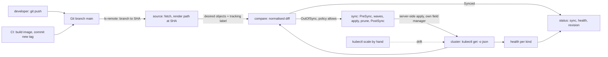

# GitOps Is a Reconciler Whose Desired State Is a Commit

*Nobody deploys: a loop in the cluster renders one commit, diffs it with the live objects, applies the difference and reports health.*

## Metadata

| Field | Value |
|---|---|
| Type | Build |
| Languages | Python |
| Prerequisites | [Reconcilers From Scratch](https://cloudcaptain.io/learn/orchestration/reconciler), [A Pipeline Is a Graph of Jobs in Clean Rooms](https://cloudcaptain.io/learn/cicd/pipeline-runner) |
| Time | 120 minutes |
| Tools | git, kubectl, kustomize, Argo CD, kind |

<Quiz stage="pre" />

## The Problem

The shop team deploys from CI. The last job of the pipeline holds a cluster-admin kubeconfig in a CI secret and runs `kubectl apply -k overlays/prod`. It works for a year, and then three things happen in one quarter. During a Saturday incident an engineer runs `kubectl scale deploy/prod-web --replicas=8` and `kubectl set env` to switch off a feature; the incident ends, nobody writes it down, and Monday's pipeline run silently puts both back, which restarts the incident. In March someone deletes `legacy-flags.yaml` from the repository; `kubectl apply` only creates and updates, so the old ConfigMap and a CronJob that read it keep running for five months, and the CronJob is still sending emails when an auditor asks why. In May a third-party action used by an unrelated workflow is compromised, the CI secrets are dumped, and the attacker has cluster-admin on production for the hours it takes to rotate one kubeconfig.

The fourth problem is the one nobody can answer during any of these: what is running right now, and how does it differ from what is in Git? The pipeline knows what it pushed at the moment it pushed it. It does not watch afterwards, it cannot tell a field that someone changed by hand from a field the API server filled in with a default, and it applies everything at once, so the Deployment that reads a ConfigMap sometimes arrives first and its pods sit in `CreateContainerConfigError` for a minute. A database migration that must finish before the new pods start lives in a shell step with a `sleep 30`.

GitOps turns the direction around. The cluster runs a controller that pulls: it resolves a branch to a commit, renders the manifests of one application path at that commit, compares them field by field with the live objects, applies the difference with a known field manager, deletes the objects it once created that have left Git, and reports Synced or OutOfSync, Healthy or Degraded, and the commit it is at. CI only builds an image and commits a new tag. You are going to write `minigitops`, which does exactly that with `git`, `kubectl` and the Python standard library, and then run Argo CD against the same repository and watch it make the same decisions.

## The Concept

Think of a building and its blueprint. The blueprint lives in the architect's office and is the only place a change is made. A facilities manager walks the building on a schedule with the latest approved revision in hand, compares each room with the drawing, puts back what someone moved, removes furniture that carries the building's asset tag but is no longer on the drawing, and leaves alone anything without the tag. Rooms are fixed in a fixed order, foundations before walls, and a room counts as done only when it is usable, not when the paint is on. The architect never needs a key to the building.

A GitOps controller is that manager. It is the [reconcile loop](https://cloudcaptain.io/learn/orchestration/reconciler) you already wrote, with Git as the store of desired state instead of the API server, and four parts around it:

- **Source.** `git ls-remote` turns a branch into a commit SHA. The commit is fetched into a local cache and the application path is rendered at exactly that commit, either as plain manifests or through a Kustomize overlay. Rendered manifests are cached by SHA, so an unchanged branch costs one `ls-remote` per poll.
- **Compare.** Each desired object is fetched live and diffed field by field. Only fields that Git sets are compared, because everything else on a live object is a default, a status or another controller's business. A field that the controller set last time and Git no longer has is found through the object's `managedFields`, the API server's record of which manager owns which field.
- **Sync.** PreSync hooks run first and must succeed. Resources are applied in sync waves, lowest first, and within a wave in kind order (namespaces and ConfigMaps before the Deployments that use them); the next wave starts only when the current one is healthy. In `minigitops` every apply is server-side apply under its own field manager, as in Flux; Argo CD does the same with `ServerSideApply=true`. Objects that carry the app's tracking label but are no longer rendered are pruned, if pruning is allowed. PostSync hooks run last; SyncFail hooks run if anything failed.
- **Assess.** Health is computed per kind from status: a Deployment is Healthy when the controller has observed the latest generation and every replica is updated and available, a Job when it has a `Complete` condition, a LoadBalancer Service when it has an address. The app's health is the worst of its resources.



What decides whether a difference is acted on is the **sync policy**. Without automation the controller only reports OutOfSync. With automated sync it syncs once for every new commit SHA, and only once: if the sync of a commit fails, it waits for the next commit rather than retrying in a loop (unless a retry policy with backoff says otherwise). Prune is a separate switch, because deleting is the dangerous half. Self-heal is a third switch: it makes the controller sync again at the same commit when the live state drifts, which is what reverts a `kubectl scale` made by hand.

Two vocabularies describe one app, and they are independent:

| Sync status | Health status | What it means |
|---|---|---|
| Synced | Healthy | the cluster has what the commit says and it works |
| OutOfSync | Healthy | someone changed the cluster, or a new commit has not been applied yet; the old version is serving |
| Synced | Degraded | the commit was applied faithfully and is broken; the fix is a new commit, not another sync |
| OutOfSync | Missing | the objects were never created, or were deleted by hand |

| Failure in The Problem | What removes it |
|---|---|
| a hand edit silently reverted days later | self-heal reverts it within one poll, and without self-heal the status says OutOfSync with the field and both values |
| deleted files leave objects running | prune by tracking label: anything the app created and Git no longer renders is deleted |
| CI holds cluster-admin | the controller runs inside the cluster with its own ServiceAccount and needs only read access to Git; CI needs push access to one repository |
| Deployment before ConfigMap, migration by `sleep` | sync waves, kind order and a PreSync hook Job that must reach `Complete` |
| "what is running?" | the status: commit SHA, Synced or OutOfSync per resource, health per resource |

## Build It

`code/main.py` is `minigitops`. Git access goes through the `git` command line, cluster access through `kubectl`, and both behind injectable runners, so the tests drive real temporary Git repositories against an in-memory cluster (`FakeCluster`) that implements server-side apply's field ownership. `code/fixtures/app/` is the application used everywhere: a `base/` with a ConfigMap, a Deployment, a Service, a PreSync migration Job and a `legacy-flags` ConfigMap, and an `overlays/prod/` that adds a `prod-` prefix, a `team: shop` label, the image tag and a patch.

### Step 1: a branch is a pointer, a commit is the desired state

The controller never reads "main". It asks the Git host what `main` points to, and from then on works with the SHA, which cannot change under it:

```python
full = ref if ref.startswith("refs/") else f"refs/heads/{ref}"
code, out, err = self.call(["ls-remote", self.url, full])
if code != 0:
    raise GitError(f"cannot read {self.url}: {err.strip() or f'git ls-remote exit {code}'}")
for line in out.splitlines():
    sha, _, name = line.partition("\t")
    if name == full:
        return sha
```

`fetch()` brings missing commits into a bare cache repository (`git fetch +refs/heads/*:refs/remotes/origin/*`) only when `git cat-file -e SHA^{commit}` says the commit is not there yet. `GitTree` then reads files at that commit without a working copy: `git ls-tree -r --name-only SHA` lists the paths once and `git cat-file blob SHA:path` reads each file. Old commits stay readable, which is what makes a rollback a matter of pointing at an earlier SHA or committing a revert. `Source` caches rendered manifests per SHA, the same trick Argo CD's repo-server uses to keep a poll cheap:

```python
def manifests(self, revision: str) -> List[Obj]:
    if revision not in self.cache:
        self.git.fetch(revision)
        self.cache[revision] = render(GitTree(self.git, revision), self.path)
    return copy.deepcopy(self.cache[revision])
```

### Step 2: render a path, plain or with a kustomization

`render()` looks for `kustomization.yaml`. Without one, every `.yaml`, `.yml` and `.json` file in the directory is a manifest (multi-document files and `List` objects included), which is Argo CD's plain directory source. With one, `kustomize()` loads `resources` (files, or directories that have their own kustomization, recursively, with a cycle check), then runs the transformers in the order Kustomize runs its built-in ones:

```python
for entry in as_list(spec.get("patches"), where, "patches"):
    apply_patch(objects, tree, path, where, entry)
if spec.get("namespace"):
    for obj in objects:
        if obj["kind"] not in CLUSTER_SCOPED:
            obj["metadata"]["namespace"] = spec["namespace"]
if spec.get("namePrefix") or spec.get("nameSuffix"):
    rename(objects, str(spec.get("namePrefix") or ""), str(spec.get("nameSuffix") or ""))
```

`labels` and then `images` run last (Step 4). Patches first means a patch in the overlay names the base's object as `web`, not `prod-web`. The YAML comes from a small parser that follows YAML 1.2's core schema: `true` and `false` are booleans, `yes` is a string, `3.10` is the float 3.1 and `"3.10"` is a string. Anchors, aliases and tags are refused with the line number. Anything the subset does not do (`configMapGenerator`, `components`, Helm charts, remote bases, JSON 6902 patches) is an error that names the field, never a silent skip, because a renderer that ignores what it does not understand applies something nobody wrote.

### Step 3: strategic merge and name references

A strategic merge patch is a partial object. Maps merge recursively, `null` deletes a key, and lists are the interesting part: a list of containers is merged by `name`, a list of ports by `containerPort` (or `port` in a Service), and any list without a merge key is replaced whole:

```python
keys = merge_keys(names)
if keys and all(isinstance(i, dict) for i in base + patch):
    merged_list = copy.deepcopy(base)
    for item in patch:
        index = next((i for i, have in enumerate(merged_list) if item_key(have, keys) == item_key(item, keys)), None)
        if item.get("$patch") == "delete":
            if index is not None:
                del merged_list[index]
        elif index is None:
            merged_list.append(strip_directives(item))
        else:
            merged_list[index] = strategic_merge(merged_list[index], item, names)
```

That is why the fixture's patch can say only `containers: [{name: web, env: [...]}]` and keep the image, ports and `envFrom` of the base container, and why the same patch with `args: [...]` would replace the args instead of appending. `rename()` adds the prefix and then rewrites references to the renamed objects, but only to objects inside this kustomization: `envFrom[].configMapRef`, `env[].valueFrom.configMapKeyRef` and `secretKeyRef`, `volumes[].configMap`, `volumes[].secret`, `persistentVolumeClaim.claimName`, `serviceAccountName` and `imagePullSecrets`. In the fixture, `envFrom` follows `web-config` to `prod-web-config`; a reference to a Secret created outside Git keeps its name.

### Step 4: labels and images

`labels` adds pairs to `metadata.labels` of every object. Selectors are left alone unless `includeSelectors: true`, and pod templates unless `includeTemplates: true` (or `includeSelectors`). `commonLabels` is the older field that always writes into selectors. The newer `labels` field exists because a Deployment's `spec.selector` is immutable: adding one label to `commonLabels` turns the next sync into an error that only a delete and recreate fixes. `minigitops` accepts `commonLabels` and treats it as `includeSelectors: true`.

`images` rewrites containers whose image name, the part before the tag or digest, equals `name`. `split_image()` finds the tag after the last `:` that comes after the last `/`, so `localhost:5000/team/app` has no tag. A tag that the YAML parser read as a number is refused rather than turned into `pause:3.1`:

```python
for key in ("newName", "newTag", "digest"):
    if entry.get(key) is not None and not isinstance(entry[key], str):
        raise InputError(f"{where}: images {entry['name']} {key} must be a string; quote it (\"3.10\" is a tag, 3.10 is the number 3.1)")
```

The `images` block is also the contract with CI: the pipeline builds `registry.example/web:3.10`, runs `kustomize edit set image` or `sed` on `newTag`, and commits. That commit is the deployment.

### Step 5: the diff compares only what Git says

A live Deployment has fifty fields the manifest never mentioned: `strategy`, `revisionHistoryLimit`, `imagePullPolicy`, `terminationMessagePath`, the `protocol` of every port, the whole `status`, `uid`, `resourceVersion`, `generation`, `managedFields`. A diff of whole objects is OutOfSync forever. `minigitops` flattens the desired object into leaf paths, written in the API server's own `fieldsV1` notation (`f:` for a field, `k:` for a list item identified by its merge key), and resolves each path in the live object:

```python
if isinstance(value, list) and value:
    keys = merge_keys(names)
    if keys and all(isinstance(i, dict) and all(k in i for k in keys) for i in value):
        out = {}
        for item in value:
            segment = "k:" + json.dumps({k: item[k] for k in keys}, sort_keys=True, separators=(",", ":"))
            out.update(leaf_paths(item, path + (segment,), names))
        return out
return {path: value}
```

A container is found by `name`, not by position, so reordering containers in Git is not drift. A leaf that resolves to a different value is `changed`, one that does not resolve is `missing`. `normalise()` drops `status`, the server-managed metadata and the annotations controllers write (`deployment.kubernetes.io/revision`, `kubectl.kubernetes.io/last-applied-configuration`), and `same_value()` compares resource quantities by value, because the API server stores `cpu: 0.5` as `500m` and `1024Mi` as `1Gi`. Without that one rule an app that requests half a CPU is OutOfSync for as long as it exists.

### Step 6: fields deleted from Git, and who owns a field

"Compare only what Git says" has a blind spot: a field removed from Git is not in the desired object, so nothing compares it, and it stays live. Server-side apply closes the gap. Every object carries `metadata.managedFields`: for each field manager, the operation (`Apply` or `Update`) and the set of fields it owns, in `fieldsV1`. `kubectl get -o json` hides it unless you add `--show-managed-fields`, so `KubectlCluster.get()` and `list()` pass that flag; without it this check silently finds nothing. `minigitops` applies as field manager `minigitops`, so the fields it owns that the new commit no longer sets are exactly the removed ones:

```python
for owned in owned_paths(live, manager):
    if is_key_field(owned) or covered(owned, want):
        continue
```

`covered()` matches by prefix in both directions, because the API server records some fields as atomic (`f:selector` with nothing under it) where the manifest has leaves, and it matches list keys by subset, because the server adds defaulted key fields: the manifest's port `k:{"containerPort":8080}` is recorded as `k:{"containerPort":8080,"protocol":"TCP"}`. A removed env var is reported once, at `env[name=LEGACY]`, not once per subfield. The same ownership explains drift. `kubectl scale` writes `spec.replicas` through the `scale` subresource under a field manager of its own with operation `Update`, and an `Update` that changes a field moves ownership of that field away from `minigitops`. The next apply that sets `replicas: 2` is then a conflict, and `FakeCluster.apply()` refuses it the way the API server does:

```python
conflicts = [(other, path) for other, (_, owned) in owners.items() if other != manager for path, value in paths.items()
             if path in owned and resolve(current, path) is not MISSING and not same_value(path, value, resolve(current, path))]
if conflicts and not force:
    raise Conflict("Apply failed with %d conflict(s): %s" % (len(conflicts), "; ".join(f'conflict with "{m}": .{pretty_path(p)}' for m, p in conflicts)))
```

A GitOps controller is the declared owner of everything it renders, so it applies with `--force-conflicts` and takes the field back. A field that another controller is supposed to own, `replicas` under a HorizontalPodAutoscaler for example, must therefore not be in Git at all; otherwise the two loops fight every few seconds.

### Step 7: health per kind

`assess()` reads status the way `kubectl rollout status` does. For a Deployment the order of the checks matters, because a status that has not caught up with the spec must never look Healthy:

```python
if (obj.get("metadata") or {}).get("generation", 0) > status.get("observedGeneration", 0):
    return "Progressing", "Waiting for rollout to finish: observed deployment generation less than desired generation"
progressing = condition(obj, "Progressing")
replicas, updated = spec.get("replicas", 1), status.get("updatedReplicas", 0)
if progressing and progressing.get("reason") == "ProgressDeadlineExceeded":
    return "Degraded", f"Deployment {obj['metadata']['name']!r} exceeded its progress deadline"
if updated < replicas:
    return "Progressing", f"Waiting for rollout to finish: {updated} out of {replicas} new replicas have been updated..."
```

Then old replicas still terminating and updated replicas not yet available are Progressing too. `spec.paused` is Suspended. A Job is Degraded with a `Failed` condition, Healthy with `Complete`, Progressing otherwise; a Pod in `CrashLoopBackOff` or `ImagePullBackOff` is Degraded; a PersistentVolumeClaim is Healthy when Bound; a LoadBalancer Service needs an address; everything else is Healthy once it exists and Missing before. `worst()` rolls them up in the order Healthy, Suspended, Progressing, Missing, Degraded, Unknown.

### Step 8: sync in phases and waves, then prune by tracking label

`prepare()` adds the tracking label `app.kubernetes.io/instance: APP` to every rendered object and fills in the destination namespace. Hooks are objects with `argocd.argoproj.io/hook`; they are not diffed or pruned but created at their phase, after deleting the previous run when the policy is `BeforeHookCreation`, which is also the default. Waves come from `argocd.argoproj.io/sync-wave`, so the same repository means the same thing to `minigitops` and to Argo CD:

```python
for wave in sorted({wave_of(r.desired) for r in comparison.resources} | {wave_of(h) for h in sync_hooks}):
    batch = sorted((r for r in comparison.resources if wave_of(r.desired) == wave), key=lambda r: sync_key(r.desired))
    for resource in batch:
        if resource.status == "OutOfSync":
            self.cluster.apply(resource.desired, self.app.field_manager, True)
            self.record(op, resource.desired, f"wave {wave}", "created" if resource.live is None else "configured")
```

`sync_key` is wave, then the position of the kind in an install order (Namespace, ServiceAccount, Secret, ConfigMap, PersistentVolumeClaim, roles, Service, then the workloads), then name. Only OutOfSync resources are applied, which is Argo CD's `ApplyOutOfSyncOnly`. `wait_healthy()` then polls every object of the wave and fails the sync as soon as one is Degraded; the next wave never starts. Prune candidates come from one `kubectl get KINDS -l app.kubernetes.io/instance=APP`: everything labelled for this app that the commit did not render. They are deleted after all waves, highest wave first, and skipped when prune is off or the object says `argocd.argoproj.io/sync-options: Prune=false`. The label is the asset tag from The Concept: an object without it is never deleted, whatever its name.

### Step 9: the loop and its policy

`reconcile()` is one pass: resolve the branch, compare, let `decide()` choose, sync, compare again, write the status. A revision that is already Synced counts as synced even when this process did not sync it, so a watcher that restarts on a healthy app calls the next commit a new revision and treats drift at the same commit as self-heal.

```python
if comparison.sync_status == "Synced":
    self.last_attempt = comparison.revision
    return None
if not self.app.automated:
    self.note = "automated sync is off; run sync"
    return None
if not comparison.out_of_sync and not self.app.prune:
    self.note = f"{len(comparison.prune)} resource(s) need pruning; automated prune is off"
    return None
if comparison.revision != self.last_attempt:
    return "initial sync" if self.last_attempt is None else "new revision"
if self.app.self_heal:
    return "self-heal"
```

`last_attempt` is set before a sync starts, so a commit whose sync failed is not retried until a new commit arrives (or self-heal is on). `watch()` repeats `reconcile()` every `--interval` seconds and writes the status to `--status-file`, and reads it back on start, so a restarted watcher remembers what it already synced, the job `Application.status` does for Argo CD.

### Step 10: run it

```bash
cd curriculum/phases/08-cicd/06-gitops-reconciler
python3 code/main.py render --dir code/fixtures/app --path overlays/prod
python3 code/main.py demo
```

`demo` creates a bare repository, pushes the fixture, and drives four reconciles against `FakeCluster`: the first commit, a commit that changes `newTag` from `"3.9"` to `"3.10"`, a commit that deletes `legacy-flags.yaml`, and a `kubectl scale --replicas=5` by hand:

```
t=03  ---- new commit: image tag 3.9 -> 3.10
t=03  compare   fbd6b1a   OutOfSync/Healthy; syncing (new revision)
t=03  drift     Deployment/prod-web                spec.template.spec.containers[name=web].image: Git "registry.k8s.io/pause:3.10", live "registry.k8s.io/pause:3.9"
t=03  sync      PreSync   Job/prod-migrate                   hook created
t=04  sync      PreSync   Job/prod-migrate                   hook Healthy
t=04  sync      wave 0    Deployment/prod-web                configured
t=06  ---- new commit: legacy-flags.yaml removed
t=06  drift     ConfigMap/prod-legacy-flags        live with app.kubernetes.io/instance=shop, not in Git
t=07  sync      prune     ConfigMap/prod-legacy-flags        pruned
t=07  ---- drift: kubectl scale --replicas=5
t=07  drift     Deployment/prod-web                spec.replicas: Git 2, live 5
t=08  sync      wave 0    Deployment/prod-web                configured
managedFields on prod-web after kubectl scale: kubectl (Update, owns spec.replicas), minigitops (Apply)
managedFields on prod-web after self-heal: minigitops (Apply, owns spec.replicas)
```

Against a real cluster the same commands take a repository and a namespace. A bare repository on disk is enough for a Git host:

```bash
git init --bare /tmp/shop.git
cp -R code/fixtures/app /tmp/shop-src
git -C /tmp/shop-src init -q && git -C /tmp/shop-src add -A && git -C /tmp/shop-src commit -qm "initial app"
git -C /tmp/shop-src push -q /tmp/shop.git HEAD:main
kubectl create namespace shop
A=(--repo /tmp/shop.git --path overlays/prod --app shop --namespace shop)
python3 code/main.py status "${A[@]}"; echo "exit $?"
python3 code/main.py sync "${A[@]}" --prune
python3 code/main.py watch "${A[@]}" --prune --self-heal --interval 5 --status-file status.json
```

`status` exits 1 until the app is Synced and Healthy and prints each differing field under its resource; `sync` prints the operation step by step; `watch` runs until you stop it. Exit code 2 means input `minigitops` cannot use: a YAML error with its line, an unsupported kustomization field, a path outside the repository.

<RunTests />

## Use It

Argo CD (<ToolVersion name="argo-cd" />) is the same loop as a set of Kubernetes components: the **repo-server** clones repositories and renders manifests (plain, Kustomize, Helm, plugins) with a cache keyed by commit, the **application-controller** compares, syncs and assesses health for every `Application`, and Redis caches both. The headless "core" install has those plus the ApplicationSet controller, no API server and no UI, and is configured only through Kubernetes objects. Install it on a kind cluster with the pinned manifest; the CRDs are too large for client-side apply, so it must be server-side:

```bash
kind create cluster --name cc-lab
kubectl create namespace argocd
kubectl -n argocd apply --server-side --force-conflicts \
  -f https://raw.githubusercontent.com/argoproj/argo-cd/v3.5.6/manifests/core-install.yaml
kubectl -n argocd rollout status statefulset/argocd-application-controller --timeout=300s
kubectl -n argocd rollout status deployment/argocd-repo-server --timeout=300s
```

Push `code/fixtures/app` to a repository the cluster can reach. A public GitHub repository works as it is. Offline, `code/smoke.sh` serves the bare repository over smart HTTP with `git http-backend`, the CGI program Git ships for serving repositories over HTTP, on the kind network's gateway address, which pods can reach. Then declare the app. An `AppProject` limits which repositories and destinations its apps may use; the `Application` names the source and the destination and turns on automation. Save both as `shop-app.yaml`:

```yaml
apiVersion: argoproj.io/v1alpha1
kind: AppProject
metadata:
  name: shop
  namespace: argocd
spec:
  sourceRepos:
    - https://github.com/YOU/gitops-lab.git
  destinations:
    - server: https://kubernetes.default.svc
      namespace: shop
---
apiVersion: argoproj.io/v1alpha1
kind: Application
metadata:
  name: shop
  namespace: argocd
spec:
  project: shop
  source:
    repoURL: https://github.com/YOU/gitops-lab.git
    targetRevision: main
    path: overlays/prod
  destination:
    server: https://kubernetes.default.svc
    namespace: shop
  syncPolicy:
    automated:
      prune: true
      selfHeal: true
```

```bash
kubectl create namespace shop
kubectl apply -f shop-app.yaml
kubectl -n argocd get application shop -w
kubectl -n argocd get application shop -o jsonpath='{.status.sync.status} {.status.health.status} {.status.sync.revision}{"\n"}'
kubectl -n argocd get application shop -o jsonpath='{range .status.resources[*]}{.kind}/{.name} {.status} {.health.status}{"\n"}{end}'
kubectl -n argocd get application shop -o jsonpath='{.status.operationState.phase}: {.status.operationState.message}{"\n"}'
kubectl -n shop get deploy prod-web -o jsonpath='{.metadata.annotations.argocd\.argoproj\.io/tracking-id}{"\n"}'
kubectl -n shop get jobs
```

The status fields are the ones `minigitops status --json` prints: `sync.status` and `sync.revision`, `health.status`, one entry per resource, and `operationState` with the phase and message of the last sync. The PreSync Job ran first and completed; the ConfigMap in wave -1 was applied before the Deployment. Tracking is the one visible difference: Argo CD's default is the annotation `argocd.argoproj.io/tracking-id: shop:apps/Deployment:shop/prod-web` rather than a label. Label tracking with `app.kubernetes.io/instance` is still available (`application.resourceTrackingMethod: label` in `argocd-cm`) and was the default in older releases; the annotation wins because label values are limited to 63 characters, Helm charts set `app.kubernetes.io/instance` themselves, and operators copy labels onto the objects they create, which then look like app resources and can be pruned. Now break it the same way:

```bash
kubectl -n shop scale deployment prod-web --replicas=5
kubectl -n shop get deployment prod-web -w
kubectl -n argocd get application shop -o jsonpath='{.status.operationState.operation.initiatedBy}{"\n"}'
kubectl -n argocd get application shop -o jsonpath='{range .status.history[*]}{.id} {.revision} {.deployedAt}{"\n"}{end}'
```

The replicas go back to 2 within seconds, the history has a new entry at the same revision, and the last operation's `initiatedBy` says `automated: true`. Without `selfHeal` the app would stay OutOfSync until the next commit. New commits are noticed when the controller next refreshes the app, about every two minutes by default (`timeout.reconciliation`, plus jitter), or immediately when the Git host calls Argo CD's webhook; `minigitops` simply polls every `--interval`.

Everything `minigitops` reads is an Argo CD annotation, and the options you will reach for next are a few more of them:

- `argocd.argoproj.io/sync-wave: "-1"` and `argocd.argoproj.io/hook: PreSync` with `argocd.argoproj.io/hook-delete-policy: BeforeHookCreation | HookSucceeded | HookFailed`. Argo CD also waits a short delay between waves so other controllers can update status before health is read.
- `argocd.argoproj.io/sync-options: Prune=false` on an object, and `syncOptions: [PruneLast=true, ApplyOutOfSyncOnly=true, ServerSideApply=true, CreateNamespace=true]` on the app. Argo CD prunes in reverse wave order; `PruneLast=true` moves pruning after every other wave, which is what `minigitops` always does.
- `ignoreDifferences` with `jsonPointers`, `jqPathExpressions` or `managedFieldsManagers`, for fields another controller owns, and the sync option `RespectIgnoreDifferences=true` so a sync does not overwrite them either. The HPA case from Step 6 is `jsonPointers: [/spec/replicas]`.
- Diffing: the default strategy is a three-way diff against the `last-applied-configuration` annotation; `argocd.argoproj.io/compare-options: ServerSideDiff=true` asks the API server for a dry-run apply and diffs its answer, so admission webhooks and defaults take part. Health checks for custom resources are Lua scripts under `resource.customizations.health.<group>_<kind>` in `argocd-cm`.
- With the `argocd` CLI in core mode (`argocd login --core`), `argocd app diff shop` prints the same per-field differences as `minigitops status`, and `argocd app sync shop --prune` is `minigitops sync --prune`.

Flux is the other mainstream design. It splits the loop into a **source-controller** that polls Git and stores each revision as an artifact, and a **kustomize-controller** that builds a `Kustomization` from that artifact and applies it, always with server-side apply under its own field manager:

```yaml
apiVersion: source.toolkit.fluxcd.io/v1
kind: GitRepository
metadata:
  name: shop
  namespace: flux-system
spec:
  interval: 1m
  url: https://github.com/YOU/gitops-lab.git
  ref:
    branch: main
---
apiVersion: kustomize.toolkit.fluxcd.io/v1
kind: Kustomization
metadata:
  name: shop
  namespace: flux-system
spec:
  interval: 10m
  sourceRef:
    kind: GitRepository
    name: shop
  path: ./overlays/prod
  targetNamespace: shop
  prune: true
  wait: true
  timeout: 3m
```

Flux re-applies on every `interval`, so drift is always corrected; there is no separate self-heal switch. It records what it applied in an inventory in the Kustomization's status, labels the objects with the Kustomization's name and namespace, and prunes against the inventory. It has no hooks or waves: within one Kustomization it applies cluster-wide definitions such as CRDs and Namespaces before everything else, ordering between groups of objects is `dependsOn` between Kustomizations, and `wait: true` makes health (computed with the kstatus conventions) part of readiness.

Two patterns scale this past one app. **App of apps** is an Application whose path contains more Application manifests, so one root app syncs the others. **ApplicationSets** generate Applications from a template and a generator: one per directory under `apps/` (the Git directory generator), one per registered cluster, one per pull request. The core install ships the ApplicationSet controller too; the smoke test leaves it out because nothing here uses it.

The direction of the arrows is the point of all of it. With push, CI holds credentials that can change the cluster, every pipeline run is a moment where Git and the cluster agree, and nothing compares them afterwards. With pull, the controller holds the credentials inside the cluster, CI only needs to push to a repository, every minute is a comparison, and the Git log is the deployment history: `git revert` is the rollback and `git log overlays/prod` is the audit trail. A cluster behind NAT or in another account needs no inbound access at all.

| What you built | Real tool | Note |
|---|---|---|
| `Git.resolve()`, `fetch()`, `GitTree` | repo-server's `git ls-remote` and fetch | Argo CD caches by commit; credentials come from Repository Secrets, not the app |
| `Source.manifests()` cache by SHA | repo-server manifest cache | `argocd app get --hard-refresh` bypasses it |
| `kustomize()`, `strategic_merge()`, `rename()`, `set_image()` | `kustomize build` inside the repo-server, `kubectl kustomize` | the real one adds generators with content hashes, components, replacements, Helm charts |
| tracking label in `prepare()` | `argocd.argoproj.io/tracking-id` annotation; Flux inventory | label tracking still exists; Flux prunes from its inventory, not from a selector |
| `diff()` over leaf paths, `normalise()` | legacy three-way diff, ServerSideDiff, `ignoreDifferences` | both ignore status and server metadata; quantities and defaults need normalising |
| `owned_paths()` and `managedFields` | structured-merge-diff in the API server | `kubectl get -o yaml --show-managed-fields` shows the same data |
| `Kubectl.apply()` with `--force-conflicts` | `ServerSideApply=true`; Flux always | Argo CD's default sync is client-side apply with a last-applied annotation |
| waves, hooks, `delete_policies()` | sync waves, resource hooks, hook delete policies | Argo CD adds `PreDelete`, `PostDelete` and a delay between waves |
| `assess()`, `worst()` | built-in health checks, Lua customisations; kstatus in Flux | custom resources need a check or they never report Degraded |
| `decide()` with prune and self-heal | `syncPolicy.automated` `prune`, `selfHeal`, retry with backoff | self-heal in Argo CD backs off after repeated attempts |
| `watch()` polling with `--interval` | `timeout.reconciliation` plus webhooks; Flux `interval` | polling every few seconds does not scale to thousands of apps; webhooks do |
| `--status-file` | `Application.status`, `Kustomization.status` | the status lives in the cluster, so `kubectl` and alerts can read it |

<Quiz stage="check" />

## Ship It

Two artifacts in `outputs/`:

- **`skill-gitops-sync-triage.md`**: a runbook for an app that is OutOfSync, Degraded, stuck syncing or flapping, in Argo CD or Flux. It checks which commit the controller is at against the branch, separates comparison errors (Git access, render failures) from real drift, classifies every OutOfSync field by who owns it in `managedFields` (a hand edit, another controller, a defaulted or normalised field, a removal), reads the failed operation down to the hook or wave that stopped it, and ends with a decision table and a fixed report.
- **`prompt-explain-outofsync.md`**: paste an Application's status, `argocd app diff` or `minigitops status` output and optionally the live object with managed fields, and get every difference explained: what Git says, what is live, who wrote it, whether it is drift or an artefact, what the sync policy will do next, and the single change in Git or in the app spec that ends it.

<ShipIt />

## Exercises

### Easy

Add `ignoreDifferences` to `App`: a list of entries with `kind`, optional `name`, and `jsonPointers` such as `/spec/replicas`. Write the tests first: a Deployment whose replicas an HPA changed is Synced when `/spec/replicas` is ignored for its kind, still OutOfSync for an image change, and an entry for another kind does not apply. Then add `--respect-ignore-differences`, which drops the ignored fields from the object before it is applied, and show with `FakeCluster` that the HPA's field manager keeps ownership of `spec.replicas` afterwards.

### Medium

Implement `configMapGenerator` with `literals` and `files`. Kustomize appends a hash of the content to the generated name (`web-config-7c9fk2m5bh`) and rewrites every reference, so changing one value creates a new ConfigMap name, a changed pod template and therefore a rollout. Tests first: the same content gives the same name in two renders, one changed literal changes the name and the Deployment's `envFrom`, and with prune on the old ConfigMap is deleted only after the new Deployment is Healthy. Explain in two sentences why a ConfigMap updated in place does not restart the pods that read it.

### Hard

Turn `minigitops` into an ApplicationSet with a Git directory generator: `watch --apps-dir apps/` renders one app per subdirectory, each with its own name, namespace (the directory name) and tracking label value, and keeps a status per app. Write the failing tests first: adding `apps/payments/` creates a third app without restarting the watcher; a sync failure in one app does not block the others; deleting a directory removes that app's objects only when `--prune-apps` is set, and otherwise reports the app as orphaned. Then make the apps sync in waves of their own, read from an annotation on the directory's kustomization, and write a paragraph on why app-of-apps ordering is easy to get wrong when one app installs CRDs another app uses.

<Quiz stage="post" />

## Key Terms

| Term | Common misconception | Precise definition |
|---|---|---|
| GitOps | "CI running `kubectl apply` from a Git repository." | Desired state is declared in Git and versioned; an agent in the target environment pulls it, compares it continuously with the live state and converges the two. CI never writes to the cluster. |
| Revision | "The branch the app tracks." | The commit SHA the branch pointed to when the controller resolved it. Rendering, sync and status all refer to the SHA; the branch is only how to find the next one. |
| Sync status | "Synced means healthy." | Whether the live objects match the rendered commit (Synced) or not (OutOfSync), field by field, including objects that should be pruned. It says nothing about whether the app works; that is health. |
| Drift | "Any difference between a live object and the YAML file." | A difference in a field that Git sets, or in a field the controller set before and Git no longer has. Defaults, status and fields other managers own are not drift. |
| Self-heal | "Automated sync." | Syncing again at the same commit because the live state changed. Automated sync without it acts only on new commits, so a hand edit stays until the next commit. |
| Prune | "Sync deletes whatever is not in Git." | Deleting objects that carry the app's tracking label or inventory entry and are no longer rendered. Objects the app never created are untouched, and pruning is its own switch. |
| Field manager | "The user who ran kubectl." | The name recorded in `managedFields` for each set of fields a client wrote, with `Apply` or `Update`. Server-side apply uses it to detect conflicts and to remove fields a manager stopped applying. |
| Sync wave | "A delay between resources." | An integer annotation that orders resources within a sync phase; a wave starts only when every resource of the previous wave is healthy. |
| Hook | "A resource applied first." | A resource created, not applied, at a phase (PreSync, Sync, PostSync, SyncFail), waited on until healthy, never diffed or pruned, and deleted by its delete policy. |
| Health | "The pods are Running." | A per-kind reading of status: observed generation and updated, available replicas for a Deployment, a `Complete` condition for a Job, an address for a LoadBalancer. The app's health is the worst of its resources. |

## Further Reading

- [GitOps](https://cloudcaptain.io/docs/tools/cicd/gitops): repository layouts, Argo CD and Flux setup, and the push versus pull comparison from the Reference layer.
- [Kubernetes Workloads & Scheduling](https://cloudcaptain.io/docs/tools/kubernetes/workloads): the Deployment rollout fields that health checks read.
- [Git Fundamentals](https://cloudcaptain.io/docs/tools/git/fundamentals): refs, commits and remotes, the parts of Git a controller relies on.
- [OpenGitOps principles](https://opengitops.dev/): the four principles (declarative, versioned and immutable, pulled automatically, continuously reconciled) as the CNCF working group wrote them.
- [Server-Side Apply](https://kubernetes.io/docs/reference/using-api/server-side-apply/): field management, conflicts, `--force-conflicts` and how Update transfers ownership.
- [Argo CD sync phases and waves](https://argo-cd.readthedocs.io/en/stable/user-guide/sync-waves/): hooks, delete policies and wave ordering, including prune order.
- [Argo CD automated sync policy](https://argo-cd.readthedocs.io/en/stable/user-guide/auto_sync/): prune, self-heal, and the rule that a commit is synced once.
- [Argo CD resource health](https://argo-cd.readthedocs.io/en/stable/operator-manual/health/): the built-in checks and how to write Lua checks for custom resources.
- [Kustomize reference](https://kubectl.docs.kubernetes.io/references/kustomize/kustomization/): every field of a kustomization, including the ones `minigitops` refuses.
- [Flux Kustomization](https://fluxcd.io/flux/components/kustomize/kustomizations/): the other design, with inventory-based pruning, `dependsOn` and health assessment.
- [git http-backend](https://git-scm.com/docs/git-http-backend): the smart HTTP server program the smoke test uses as a Git host.
