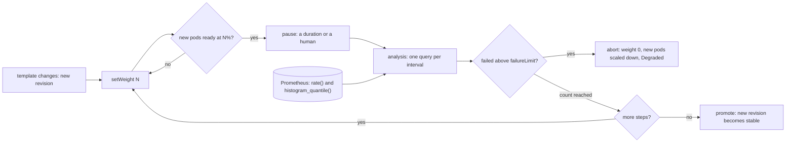

# A Rollout Is a Loop That Watches a Metric

*A canary is a weight, a wait and a query; the step sizes and the analysis interval decide how many users meet a bad version.*

## Metadata

| Field | Value |
|---|---|
| Type | Build |
| Languages | Python |
| Prerequisites | [GitOps Is a Reconciler Whose Desired State Is a Commit](https://cloudcaptain.io/learn/cicd/gitops-reconciler), [A Service Is a Virtual IP and a Rewrite Rule](https://cloudcaptain.io/learn/orchestration/services-dns) |
| Time | 90 minutes |
| Tools | kubectl, kind, Argo Rollouts, kubectl-argo-rollouts, Prometheus, curl |

<Quiz stage="pre" />

## The Problem

Thursday, 14:05. Argo CD syncs `checkout` v2.31 and the Deployment does what it always does: `maxSurge: 25%`, `maxUnavailable: 25%`, one new pod at a time, each one admitted as soon as `/healthz` answers. Ninety seconds later `kubectl rollout status` says `successfully rolled out`. The new build reads a renamed configuration key on the card-payment path only, so 8% of checkout requests now return 500. `/healthz` never touches that path. The error-rate alert has `for: 5m`, fires at 14:12, and the on-call engineer runs `kubectl rollout undo` at 14:19. Fourteen minutes at 100% of traffic, about 400 requests per second: roughly 27,000 failed checkouts.

The postmortem action item says "use canaries". Someone adds a second Deployment `checkout-canary` with 1 replica next to 9 stable ones and calls it 10%. The next bad build goes there first. Nobody is assigned to watch it; the dashboard everybody looks at averages both versions, where 8% errors on a tenth of the traffic shows up as 0.8%, under the 1% alert line. The canary runs for an afternoon, gets scaled up by hand, and the outage happens anyway, only slower. In another service the same pattern runs on 3 replicas, where "1 canary pod" is a third of all connections, not a tenth.

Nothing in that setup watched the new version. A progressive delivery controller is the missing loop: move a known share of traffic to the new version, wait, query a metric that selects only the new version, compare it with a threshold, count failures, then move forward or put the weight back to zero. It is the reconciler from the GitOps lesson with one more input, a metric, and it turns the question "is the new version good?" into numbers you choose in advance: the step weights, the pause, the analysis interval, the initial delay and the failure limit. You are going to build `minirollout`, which reads Argo Rollouts' own `Rollout` and `AnalysisTemplate` objects, splits traffic by whole pods through `kubectl` or by exact weights through its own proxy, measures with PromQL, and aborts or promotes. Then you run the same canary with Argo Rollouts on kind and watch it reach the same verdict from the same query.

## The Concept

A kitchen changing a recipe serves the new dish to one table in four, asks those tables every few minutes how it tastes, and goes back to the old recipe for the whole room the moment the answers are bad. It never asks the whole room, because the people eating the old dish would drown the complaint. It also decides before service how many complaints are enough, and how long to wait before the first question, because a dish nobody has tasted yet has no complaints.

A rollout controller is that procedure as a loop. Its input is a **Rollout**: a pod template (the version), a replica count and a strategy. When the template changes, the hash of the template is a new **revision** and the controller starts walking the strategy's steps:

- **setWeight N** sends N% of traffic to the new revision. Without a traffic router, the only lever is the number of pods behind one Service: kube-proxy picks an endpoint per connection, so 1 new pod next to 3 stable ones gets about 25% of connections. With a traffic router (a proxy, a mesh, an HTTPRoute with weighted `backendRefs`) the share is exact and independent of pod counts.
- **pause** waits for a duration, or until a human promotes.
- **analysis** starts an **AnalysisRun** from one or more AnalysisTemplates. Each metric is a query to a metrics provider, taken every `interval`, `count` times, after an `initialDelay`. Each **measurement** is Successful, Failed, Inconclusive or Error depending on `successCondition` and `failureCondition`. A metric fails when its failed measurements exceed `failureLimit`, errors when consecutive errors exceed `consecutiveErrorLimit` (default 4), and the worst metric decides the run.

When an analysis fails, the controller **aborts**: the weight goes back to 0, the new pods are scaled down, the stable version gets its full replica count back, and the Rollout is `Degraded` with a message that names the metric. When every step is done, it **promotes**: the new revision becomes the stable one. Blue/green is the same loop with two weights: bring the new version up at full size with no live traffic (the preview), analyse it, optionally wait for a human, switch 100% at once, analyse again, and switch back if that fails.



The metric is the part teams get wrong. An application exports counters (`http_requests_total` by status code and version) and a latency histogram; Prometheus scrapes them; the analysis asks for a ratio of two `rate()`s and a `histogram_quantile()`, filtered by a label that only the new version carries. Three details decide whether the loop works. The query must select the canary, or the stable traffic dilutes the signal, as in the dashboard above. A ratio whose numerator has no series (a healthy canary has no 5xx series at all) returns an empty vector, not zero, so a condition on `result[0]` cannot be evaluated and the measurement is an Error. And the window inside `rate(...[1m])` must be filled with canary traffic, which is what `initialDelay` is for.

Exposure follows from those numbers. A bad version at weight w, behind traffic of r requests per second, is detected no earlier than pod start plus `initialDelay` plus `failureLimit` intervals, and in that time it serves about r times w times that many seconds of requests. Halving the first step halves the exposure; doubling the interval doubles it; a `failureLimit` of 2 adds two intervals. Without analysis the exposure is everything until a human notices.

## Build It

`code/main.py` is `minirollout`, one standard-library file with ten subcommands: `plan`, `run`, `promote`, `abort`, `status`, `simulate`, `query`, and three servers (`app`, `proxy`, `load`). It reads the JSON form of Argo Rollouts' objects (`kubectl` applies JSON as well as YAML), so `code/fixtures/rollout.json` and `code/fixtures/analysis.json` are fed unchanged to minirollout in the tests and to Argo Rollouts in the smoke test. Kubernetes access goes through an injectable `kubectl` runner, so the tests run on any laptop with fake clusters, real sockets and a fake clock.

### Step 1: the Rollout is the spec, and every strategy is a list of steps

`parse_rollout()` implements the subset of `argoproj.io/v1alpha1` Rollout that matters here: `replicas`, `selector`, `template`, `strategy.canary.steps` with `setWeight`, `pause` and `analysis`, background analysis with `startingStep`, and `maxSurge`. Any other step (`setCanaryScale`, `setHeaderRoute`, `experiment`) is rejected with its step number rather than silently skipped. Blue/green is compiled into the same step list, so one loop runs both strategies:

```python
    steps = [Step("preview")]
    if blue.get("prePromotionAnalysis"):
        steps.append(analysis_step(blue["prePromotionAnalysis"], f"rollout {name}: prePromotionAnalysis", "prePromotionAnalysis"))
    if blue.get("autoPromotionEnabled", True) is False:
        steps.append(Step("pause", reason="BlueGreenPause"))
    elif blue.get("autoPromotionSeconds"):
        steps.append(Step("pause", duration=float(blue["autoPromotionSeconds"]), reason="BlueGreenPause"))
    steps.append(Step("setWeight", 100, note=f"switch {blue['activeService']} to the new version"))
    if blue.get("postPromotionAnalysis"):
        steps.append(analysis_step(blue["postPromotionAnalysis"], f"rollout {name}: postPromotionAnalysis", "postPromotionAnalysis"))
```

The revision is the first ten hex digits of the SHA-256 of the pod template's canonical JSON, the same idea as `pod-template-hash`: any change to the template, an image, an environment variable, a label, starts a new rollout, and the same template is the same revision.

### Step 2: without a traffic router, a weight is a number of whole pods

Argo Rollouts' basic canary turns a weight into pod counts by trying the floor and ceiling of `replicas * weight / 100`, with and without one surge pod when `maxSurge` allows it, never leaving either side empty for weights between 1 and 99 once there are two pods to work with (a surge pod counts), and keeping the option closest to the requested weight. `canary_counts()` is a port of that function (`approximateWeightedCanaryStableReplicaCounts` in the Argo Rollouts source):

```python
def canary_counts(replicas: int, weight: int, max_surge: int) -> Tuple[int, int]:
    if replicas <= 0:
        return 0, 0
    exact = replicas * weight / 100
    ceil_count, floor_count = math.ceil(exact), math.floor(exact)
    zero_allowed = weight in (0, 100) or (replicas == 1 and max_surge == 0)
    options: List[Tuple[int, int]] = []
    if ceil_count < replicas or zero_allowed:
        options.append((ceil_count, replicas))
    if not floor_ceiling_tied(weight, replicas) and (floor_count != 0 or zero_allowed):
        options.append((floor_count, replicas))
    if max_surge > 0:
        options.append((ceil_count, replicas + 1))
        if not floor_ceiling_tied(weight, replicas + 1) and (floor_count != 0 or zero_allowed):
            options.append((floor_count, replicas + 1))
    if not options:
        return 0, replicas
    best = min(options, key=lambda option: abs(100 * option[0] / option[1] - weight))
    return best[0], best[1] - best[0]
```

| replicas, weight, maxSurge | new + stable pods | share of connections |
|---|---|---|
| 4, 25%, 1 | 1 + 3 | 25% |
| 3, 10%, 1 | 1 + 3 (one surge pod) | 25% |
| 3, 10%, 0 | 1 + 2 | 33% |
| 10, 5%, 0 | 1 + 9 | 10% |
| 1, 50%, 0 | 1 + 0 | 100% |

"10%" on three replicas is a quarter or a third of your users. The share is also per connection, not per request: kube-proxy chooses an endpoint when a TCP connection opens, so a client that keeps one connection alive talks to one version for its lifetime. The load generator in this lesson opens a connection per request for that reason.

### Step 3: with a traffic router, the weight is exact

`minirollout proxy` is a reverse proxy with a stable and a canary upstream and an admin endpoint, `POST /admin/config` with `{"stable": URL, "canary": URL, "weight": N}`. The split is deterministic: of every 100 requests exactly N go to the canary, spread evenly, which makes the tests exact and the smoke test's numbers reproducible:

```python
    def next(self) -> bool:
        with self.lock:
            self.count += 1
            if math.floor(self.count * self.share + 1e-9) > self.hits:
                self.hits += 1
                return True
            return False
```

A request with `X-Canary: always` goes to the canary whatever the weight, which is how a blue/green preview receives test traffic while live users see none. The same `ExactShare` makes `minirollout app --error-rate 0.5` fail exactly every second request, an error on demand you can also change at runtime with `POST /admin/errors?rate=0.2`. The proxy labels every request it forwards with the upstream and the `X-Version` header the backend returned.

### Step 4: the app counts requests the way Prometheus expects

Every server in the file shares one `Registry`: a counter of requests by labels plus status code, and a latency histogram per label set with the client libraries' default buckets (5 ms to 10 s):

```python
    def observe(self, labels: Dict[str, str], code: Any, seconds: float, times: int = 1) -> None:
        if times <= 0:
            return
        with self.lock:
            key = freeze(dict(labels, code=str(code)))
            self.requests[key] = self.requests.get(key, 0.0) + times
            histogram = self.latency.setdefault(freeze(labels), Histogram([0.0] * (len(self.buckets) + 1)))
            histogram.counts[bisect.bisect_left(self.buckets, seconds)] += times
            histogram.total += seconds * times
```

`/metrics` renders it in the Prometheus text exposition format, where buckets are cumulative (`le` means "less than or equal") and the `+Inf` bucket equals `_count`:

```text
# TYPE http_requests_total counter
http_requests_total{code="200",version="v3"} 10
http_requests_total{code="500",version="v3"} 10
# TYPE http_request_duration_seconds histogram
http_request_duration_seconds_bucket{version="v3",le="0.005"} 18
http_request_duration_seconds_bucket{version="v3",le="0.01"} 20
http_request_duration_seconds_bucket{version="v3",le="+Inf"} 20
http_request_duration_seconds_sum{version="v3"} 0.0683
http_request_duration_seconds_count{version="v3"} 20
```

`parse_exposition()` reads that format back, label escapes (`\"`, `\\`, `\n`), optional millisecond timestamps, `NaN` and `+Inf` included, and names the line it could not parse. The proxy's `--scrape URL` uses it to pull an app's own `/metrics` into the same database, labelled with `instance` and with an `up` series, the way Prometheus scrapes a target.

### Step 5: a tiny Prometheus stores samples and extrapolates rates

The proxy and the load generator take a snapshot of their counters every second into a `TSDB`: one list of `(timestamp, value)` points per series. A counter only goes up, so its rate over a window is the increase divided by the window. Prometheus does not divide the raw difference between the first and last sample by the window; it extrapolates the increase to the edges of the window when the samples reach close to them, by only half a sample interval when they do not, and never back past the point where the counter would have been zero, which keeps a series that started inside the window from looking busier than it is. `extrapolated_increase()` is that rule:

```python
def extrapolated_increase(points: Sequence[Tuple[float, float]], range_start: float, range_end: float) -> Optional[float]:
    if len(points) < 2:
        return None
    sampled = points[-1][0] - points[0][0]
    if sampled <= 0:
        return None
    delta = counter_increase(points)
    average = sampled / (len(points) - 1)
    threshold = average * 1.1
    to_start, to_end = points[0][0] - range_start, range_end - points[-1][0]
    if to_start >= threshold:
        to_start = average / 2
    if delta > 0 and points[0][1] >= 0:
        to_start = min(to_start, sampled * points[0][1] / delta)
    if to_end >= threshold:
        to_end = average / 2
    return delta * (sampled + to_start + to_end) / sampled
```

`counter_increase()` adds the differences between neighbouring points and treats a drop as a restart from zero, so a pod restart in the middle of an analysis does not produce a negative rate. A series with fewer than two points in the window is missing from the result, which is why a canary that has just started has no rate at all.

### Step 6: the PromQL subset an analysis needs

`QueryParser` parses enough PromQL for canary analysis: selectors with `=`, `!=`, `=~` and `!~` (regular expressions are anchored, and a missing label matches the empty string), `rate()` and `increase()` over a range, `sum`, `avg`, `min`, `max` and `count` with `by (...)`, the arithmetic operators, `histogram_quantile()`, `vector()` and `or`. Two operands of `/` are matched on identical label sets, which is why both sides of a ratio are wrapped in `sum()`. `evaluate_query()` walks the tree:

```python
    if node.function in ("rate", "increase"):
        selector = node.args[0]
        out: Vector = []
        for labels, points in db.select(selector.name, selector.matchers, at - selector.window, at):
            value = extrapolated_increase(points, at - selector.window, at)
            if value is not None:
                out.append((labels, value / selector.window if node.function == "rate" else value))
        return out
```

The two queries in `code/fixtures/analysis.json` are the success rate and the 95th percentile latency of one version:

```text
sum(rate(http_requests_total{version="v2",code=~"2.."}[20s])) / sum(rate(http_requests_total{version="v2"}[20s]))
histogram_quantile(0.95, sum by (le) (rate(http_request_duration_seconds_bucket{version="v2"}[20s])))
```

The success rate has a numerator for every version that serves anything. The error-rate form, `sum(rate(...{code=~"5.."}[1m])) / sum(rate(...[1m]))`, has no numerator series for a healthy version, so the division returns an empty vector; the test `test_an_error_ratio_without_errors_is_empty_until_or_vector_zero` shows it and shows the fix, `(... or vector(0)) / ...`. `histogram_quantile()` finds the bucket whose cumulative count reaches 95% of the total and interpolates linearly inside it, so its answer is only as precise as the bucket edges: with buckets at 250 ms and 500 ms, every p95 between them is a straight-line guess.

`minirollout query URL EXPR` sends a query to any Prometheus-compatible API, and the proxy and the load generator serve `GET` and `POST /api/v1/query` with Prometheus' response format (`{"status": "success", "data": {"resultType": "vector", "result": [...]}}`, values as strings, `400` with `errorType: bad_data` for a bad query). That format is what lets Argo Rollouts' Prometheus provider query the load generator in the smoke test.

### Step 7: a measurement is a query plus two conditions

A metric's query returns a vector, which reaches the conditions as a list of floats named `result`, exactly as in Argo Rollouts. `Condition` compiles the expression language subset analysis templates use (`result[0] >= 0.95`, `&&`, `||`, `!`, arithmetic, `isNaN()`, `isInf()`, `len()`, `asFloat()`, `asInt()`), and `evaluate_result()` combines the two conditions with Argo Rollouts' rules:

```python
def evaluate_result(value: Any, spec: MetricSpec) -> str:
    outcomes: Dict[str, bool] = {}
    for which, condition in (("successCondition", spec.success), ("failureCondition", spec.failure)):
        if condition is None:
            continue
        try:
            outcomes[which] = condition.evaluate(value)
        except ConditionError as exc:
            if value is None or value == []:
                raise ConditionError(f'could not evaluate {which} "{condition.text}": metric result is nil or empty: no data returned from the metric provider')
            raise ConditionError(f'could not evaluate {which} "{condition.text}": {exc}')
    if not outcomes:
        return SUCCESSFUL
    success = outcomes.get("successCondition", not outcomes.get("failureCondition", False))
    failure = outcomes.get("failureCondition", not outcomes.get("successCondition", True))
    if failure:
        return FAILED
    if not success:
        return INCONCLUSIVE
    return SUCCESSFUL
```

With only a success condition, anything else is a failure; with only a failure condition, anything else is a success; with both, the band between them is Inconclusive, which pauses the rollout for a human instead of deciding. A condition that cannot be evaluated, `result[0]` on an empty vector, is an Error measurement, not a failure.

### Step 8: when a metric is done, and how it fails

`AnalysisRun.tick()` takes a measurement for every metric that is due (first at `initialDelay`, then every `interval`, ten seconds after an error) and asks `assess_metric()` for the metric's phase:

```python
def assess_metric(run: MetricRun) -> Tuple[str, str]:
    spec = run.spec
    phase, message = "", ""
    failed, inconclusive, errors = run.tally(FAILED), run.tally(INCONCLUSIVE), run.consecutive_errors()
    if spec.failure_limit >= 0 and failed > spec.failure_limit:
        phase, message = FAILED, f"failed ({failed}) > failureLimit ({spec.failure_limit})"
    if inconclusive > spec.inconclusive_limit:
        phase, message = INCONCLUSIVE, f"inconclusive ({inconclusive}) > inconclusiveLimit ({spec.inconclusive_limit})"
    if errors > spec.consecutive_error_limit:
        phase, message = ERROR, f"consecutiveErrors ({errors}) > consecutiveErrorLimit ({spec.consecutive_error_limit})"
    if phase:
        return phase, message
    if spec.count is not None and run.counted() >= spec.count:
        return SUCCESSFUL, ""
    return RUNNING, ""
```

Errors do not count towards `count`, and a metric with an `interval` but no `count` runs until the rollout ends, which is what a background analysis wants. Once one metric is Failed, Error or Inconclusive the run terminates, the metrics still running are marked Successful, and the worst phase wins with the message `Metric "success-rate" assessed Failed due to failed (1) > failureLimit (0)`, the same sentence Argo Rollouts writes into the AnalysisRun and the Rollout.

### Step 9: the loop

`Controller.reconcile(now)` is one pass of the control loop. It compares the template's revision with the stable one, starts or restarts a rollout when they differ, and walks the steps until one of them has to wait:

```python
        while st.step < len(spec.steps):
            step = spec.steps[st.step]
            if st.step_started is None:
                st.step_started = now
            if self.run_step(step, now) != DONE:
                return st
            self.event(now, "RolloutStepCompleted", f"Rollout step {st.step + 1}/{len(spec.steps)} completed ({step.label})")
            st.step += 1
            st.step_started = None
        return self.promote(now)
```

A `setWeight` step is done when the target reports the new state in place (the new pods are ready); a `pause` when its duration has passed or `minirollout promote` was run; an `analysis` when its run is Successful. A failed run calls `abort()`:

```python
    def abort(self, now: float, reason: str) -> None:
        st = self.status
        self.finish_runs()
        st.abort, st.weight, st.preview, st.paused_at = True, 0, False, None
        st.phase = DEGRADED
        st.message = f"RolloutAborted: Rollout aborted update to revision {st.revision}" + (f": {reason}" if reason else "")
        self.event(now, "RolloutAborted", st.message)
        self.sync(now)
```

Three rules come from Argo Rollouts and are easy to forget. The first version of a Rollout skips the steps: there is nothing to compare it with. A new template during a rollout, or after an abort, restarts the steps for the newer revision. And an aborted rollout stays `Degraded` until the template changes; setting the template back to the stable revision makes it Healthy again without touching a pod. The status (phase, message, revision, step, weight, events, finished analysis runs) is saved to `--state` after every pass, the equivalent of the Rollout's `status`, so `run` can stop at a pause and resume later.

### Step 10: two ways to move traffic

Every target implements `sync(desired, now)`: make the world look like this, and say whether it already does. `ProxyTarget` posts the weight to the proxy and is done at once. `KubeTarget` keeps two Deployments, `NAME-stable` and `NAME-canary`, whose pods carry the Rollout's labels plus `track`, behind one Service that selects only the Rollout's labels. It applies them with server-side apply and the field manager `minirollout`, and is done when both report the desired number of updated and ready replicas:

```python
        if desired.canary:
            canary_count, stable_count = canary_counts(replicas, desired.weight, self.spec.max_surge)
            canary = self.manifest("canary", desired.canary_template or desired.stable_template, desired.canary, canary_count)
        else:
            canary_count, stable_count = 0, replicas
            canary = self.manifest("canary", desired.stable_template, desired.stable, 0)
        self.apply({"stable": self.manifest("stable", desired.stable_template, desired.stable, stable_count), "canary": canary}, live)
        after = self.observe()
        canary_revision = canary["metadata"]["annotations"][REVISION_ANNOTATION]
        return settled(after.get("stable"), stable_count, desired.stable) and settled(after.get("canary"), canary_count, canary_revision)
```

Promotion copies the new template into `NAME-stable`, waits for that Deployment's own rolling update to finish, and only then scales `NAME-canary` to zero, so the new version never runs on fewer pods than it had. This is Flagger's design (a `-primary` Deployment that receives the promoted spec, and the target Deployment scaled to zero); Argo Rollouts instead owns the ReplicaSets itself and relabels which one is stable. The kube target refuses blue/green with a message: a preview needs a second Service and a selector switch, which is this lesson's hard exercise.

### Step 11: the simulator counts who met the bad version

`simulate()` runs the real controller, the real analysis and the real PromQL against a fake clock: every second it sends `--rps` requests, splits them by the target's live weight (exact, or whole pods with `--replicas` and a pod start delay with `--ready-delay`), fails `--error-rate` of the new version's requests, and records them in a `Registry` that a `TSDB` samples:

```python
        promoted = status.stable == spec.revision
        split.set((100.0 if promoted else target.live) / 100)
        carry += rps * tick
        count = int(carry + 1e-9)
        carry -= count
        served = {"new": [0, 0], "old": [0, 0]}
        for _ in range(count):
            side = "new" if split.next() else "old"
            failed = (errors_new if side == "new" else errors_old).next()
            served[side][1 if failed else 0] += 1
```

A bad version that gets promoted keeps serving everyone until the end of `--duration`, which stands for the time until a human notices.

### Step 12: run it

```bash
F=code/fixtures
python3 code/main.py plan $F/rollout.json --analysis $F/analysis.json
# 1     setWeight: 25                1           3      25%    25%
#         success-rate: every 3s x2 after 5s; success when result[0] >= 0.95; failureLimit 0
python3 code/main.py plan $F/rollout.json --analysis $F/analysis.json --replicas 3      # 25% stays 1+3 thanks to the surge pod
python3 code/main.py simulate $F/rollout.json --analysis $F/analysis.json --error-rate 0.3 \
  --plan 100 --plan "5%,analysis,25%,analysis,50%,analysis" --plan "50%,pause=1m,100%"
# plan                                         outcome       at   to new  errors   share
# 25%,analysis,50%,pause=2s,analysis           aborted       5s       62      18   20.7%
# 100                                          promoted      0s    30050    9015    100%
# 5%,analysis,25%,analysis,50%,analysis        aborted       5s       12       3      4%
# 50%,pause=1m,100%                            promoted      1m    28550    8565     95%
python3 code/main.py simulate $F/rollout.json --analysis $F/analysis.json --replicas 3 --ready-delay 5 --plan "10%,analysis"
```

The fixture's own steps cost 62 bad requests, a plain rolling update 30,050, and a pause without analysis only delays the same outage by a minute. Now the live version, four terminals, all on localhost:

```bash
python3 code/main.py app --version v1 --port 8001 &
python3 code/main.py app --version v2 --port 8002 &
python3 code/main.py app --version v3 --port 8003 --error-rate 0.5 &
python3 code/main.py proxy --stable http://127.0.0.1:8001 --listen 127.0.0.1:8000 --scrape http://127.0.0.1:8003/metrics &
python3 code/main.py load --url http://127.0.0.1:8000/ --rps 40 &
sed -e 's/"v2"/"v1"/g' $F/rollout.json > /tmp/rollout-v1.json
sed -e 's/"v2"/"v3"/g' $F/rollout.json > /tmp/rollout-v3.json
RUN="python3 code/main.py run --analysis $F/analysis.json --target proxy --proxy http://127.0.0.1:8000 --prometheus-url http://127.0.0.1:8000 --state /tmp/demo.json"
$RUN /tmp/rollout-v1.json --canary-url http://127.0.0.1:8001                 # first version: Healthy, no steps
$RUN $F/rollout.json --canary-url http://127.0.0.1:8002; echo "exit $?"       # 25%, analysis, 50%, pause, analysis, promoted: exit 0
$RUN /tmp/rollout-v3.json --canary-url http://127.0.0.1:8003; echo "exit $?"  # measurement success-rate = [0.5] Failed ... RolloutAborted: exit 1
curl -s http://127.0.0.1:8000/admin/config                                    # {"stable": "http://127.0.0.1:8002", "canary": "http://127.0.0.1:8003", "weight": 0}
python3 code/main.py query http://127.0.0.1:8000 'sum by (version, code) (increase(http_requests_total{instance=""}[2m]))'
python3 code/main.py status --state /tmp/demo.json
```

`run` exits 0 when the rollout is Healthy, 1 when it was aborted, 2 for input it cannot use, and 3 when it stops at a pause that needs `minirollout promote --state FILE` (or `--full`, which skips the remaining steps) or `minirollout abort --state FILE`. The same command with `--target kube --namespace NS --context CTX` drives the two Deployments on a cluster; `code/smoke.sh` does that on kind.

<RunTests />

## Use It

Argo Rollouts is the controller minirollout imitates: a `Rollout` CRD that replaces a Deployment, `AnalysisTemplate` and `AnalysisRun` CRDs, and a kubectl plugin. Install it on kind (the smoke test pins v1.10.1, checks the plugin against the release's `argo-rollouts-checksums.txt` and `install.yaml` against a pinned sha256, because the release publishes no checksum for the manifest):

```bash
V=v1.10.1
kubectl create namespace argo-rollouts
curl -fsSLO https://github.com/argoproj/argo-rollouts/releases/download/$V/install.yaml
kubectl apply -n argo-rollouts --server-side -f install.yaml        # five CRDs, RBAC and the controller
kubectl -n argo-rollouts rollout status deployment/argo-rollouts --timeout=180s
curl -fsSLo kubectl-argo-rollouts https://github.com/argoproj/argo-rollouts/releases/download/$V/kubectl-argo-rollouts-linux-amd64
chmod +x kubectl-argo-rollouts && sudo mv kubectl-argo-rollouts /usr/local/bin/
kubectl argo rollouts version
```

The CRDs carry large OpenAPI schemas, so server-side apply avoids the size limit of the `last-applied-configuration` annotation. Then the same objects minirollout reads: the AnalysisTemplate, whose Prometheus provider points at any Prometheus-compatible API (in the smoke test, the load generator's `/api/v1/query`), and the Rollout, shown here without its probe, resources and the ConfigMap volume that holds `main.py` (the full object is `code/fixtures/rollout.json`):

```yaml
apiVersion: argoproj.io/v1alpha1
kind: AnalysisTemplate
metadata:
  name: success-rate
spec:
  args:
    - name: version
  metrics:
    - name: success-rate
      interval: 3s
      count: 2
      initialDelay: 5s
      failureLimit: 0
      successCondition: result[0] >= 0.95
      provider:
        prometheus:
          address: http://loadgen.cc-progressive-delivery.svc.cluster.local:9090
          query: |
            sum(rate(http_requests_total{version="{{args.version}}",code=~"2.."}[20s]))
            / sum(rate(http_requests_total{version="{{args.version}}"}[20s]))
---
apiVersion: argoproj.io/v1alpha1
kind: Rollout
metadata:
  name: demo
spec:
  replicas: 4
  selector:
    matchLabels: {app: demo}
  template:
    metadata:
      labels: {app: demo}
    spec:
      containers:
        - name: app
          image: python:3.12-alpine
          command: ["python3", "/app/main.py", "app", "--host", "0.0.0.0", "--port", "8080"]
          env:
            - {name: APP_VERSION, value: v2}
            - {name: ERROR_RATE, value: "0"}
  strategy:
    canary:
      steps:
        - setWeight: 25
        - analysis:
            templates: [{templateName: success-rate}]
            args: [{name: version, value: v2}]
        - setWeight: 50
        - pause: {duration: 2s}
        - analysis:
            templates: [{templateName: success-rate}]
            args: [{name: version, value: v2}]
```

```bash
kubectl argo rollouts get rollout demo --watch            # steps, weights, ReplicaSets, AnalysisRuns, live
kubectl apply -f rollout-v6.json                           # the fixture with APP_VERSION v6 and ERROR_RATE 0.5, as code/smoke.sh writes it
kubectl get rollout demo -o jsonpath='{.status.phase}{"\n"}{.status.message}{"\n"}'
# Degraded
# RolloutAborted: Rollout aborted update to revision 2: Metric "success-rate" assessed Failed due to failed (1) > failureLimit (0)
kubectl get analysisruns
kubectl get analysisrun -o jsonpath='{.items[-1:].status.metricResults[0].measurements[0].value}'   # [0.5]
kubectl argo rollouts promote demo                        # skip the current pause or accept an Inconclusive run
kubectl argo rollouts promote demo --full                 # skip every remaining step
kubectl argo rollouts abort demo                          # weight 0 now
kubectl argo rollouts retry rollout demo                  # run the steps again for the aborted revision
kubectl argo rollouts undo demo                           # set the template back to the previous revision
kubectl argo rollouts set image demo app=REGISTRY/app:TAG # the usual way a new revision starts
```

`retry` is not `undo`: after an abort the Rollout's template is still the bad one, so the GitOps tool that applied it keeps reporting it as Synced while the cluster runs the old pods. The fix lands in Git, as a revert, and the controller sees a new template. In production the provider address is your Prometheus, and the query selects the canary by the label your instrumentation already has; Argo Rollouts passes `{{args.NAME}}` from the step, and an arg can also come from `valueFrom.podTemplateHashValue: Latest`, the new ReplicaSet's hash, when metrics carry a pod label.

Basic canary moves whole pods behind one Service, with the rounding from Step 2. For exact weights, give the strategy a `canaryService`, a `stableService` and `trafficRouting`; Argo Rollouts then sets weights on a mesh, an ingress or a Gateway API `HTTPRoute` (through the Gateway API traffic router plugin registered in the `argo-rollouts-config` ConfigMap) and can scale the canary independently with `setCanaryScale` or route testers by header with `setHeaderRoute`. With traffic routing, an abort keeps the canary pods for `abortScaleDownDelaySeconds` (30 by default) after the weight is back at zero. The Gateway API side is just weighted `backendRefs`, the same rule you built a proxy for in the Gateway API lesson:

```yaml
apiVersion: gateway.networking.k8s.io/v1
kind: HTTPRoute
metadata:
  name: demo
spec:
  parentRefs: [{name: web}]
  rules:
    - backendRefs:
        - {name: demo-stable, port: 8080, weight: 90}
        - {name: demo-canary, port: 8080, weight: 10}
```

**Flagger** is the other controller, part of the Flux project. You keep a normal Deployment; Flagger creates `NAME-primary`, sends traffic there, scales your Deployment to zero, and on every change to it runs the analysis below through a mesh, an ingress controller or Gateway API. `threshold` is the number of failed checks before rollback, the role `failureLimit` plays in Argo Rollouts, and the built-in `request-success-rate` and `request-duration` metrics are percentage and milliseconds:

```yaml
apiVersion: flagger.app/v1beta1
kind: Canary
metadata:
  name: checkout
spec:
  targetRef: {apiVersion: apps/v1, kind: Deployment, name: checkout}
  service: {port: 8080}
  analysis:
    interval: 1m
    threshold: 5
    stepWeight: 10
    maxWeight: 50
    metrics:
      - {name: request-success-rate, thresholdRange: {min: 99}, interval: 1m}
      - {name: request-duration, thresholdRange: {max: 500}, interval: 1m}
```

**The baseline** is a plain Deployment. `maxSurge` and `maxUnavailable` decide how many pods change at a time, a readiness probe decides when a pod gets traffic, and `progressDeadlineSeconds` (600 by default) marks the rollout `Progressing=False` with reason `ProgressDeadlineExceeded` when pods stop becoming ready. None of that reads an error rate, and nothing rolls back by itself; `kubectl rollout undo deployment/NAME` is a human action. `kubectl rollout pause` and `resume` give you a manual canary with all the problems of the opening story.

**Feature flags** are the alternative when the risk is a code path, not a build. The new code ships dark in the old version's release, and a flag (OpenFeature is the vendor-neutral API) turns it on for a percentage of users chosen by hashing a user ID, so one user always sees the same behaviour, unlike a per-connection canary. Turning it off takes no deploy. Flags cannot protect a change to the runtime, the base image, a dependency or the configuration the process reads at start; that is what a canary is for, and teams that do both canary the build and flag the feature.

| What you built | Real tool | Note |
|---|---|---|
| `parse_rollout()`, `Step` | Argo Rollouts `Rollout` `strategy.canary.steps`, `strategy.blueGreen` | `setCanaryScale`, `setHeaderRoute`, `experiment` and `plugin` steps are rejected by minirollout |
| `canary_counts()` | basic canary without `trafficRouting` | a port of Argo Rollouts' rounding; kube-proxy balances connections, not requests |
| `ExactShare`, `minirollout proxy` | `trafficRouting`, Gateway API weighted `backendRefs`, a mesh | exact shares need a router; `X-Canary: always` is a crude `setHeaderRoute` |
| `Registry`, `/metrics` | Prometheus client libraries, the exposition format | the same counters and default histogram buckets |
| `TSDB`, `extrapolated_increase()`, `QueryParser` | Prometheus `rate()`, `increase()`, `histogram_quantile()`, `/api/v1/query` | a subset of PromQL; Argo Rollouts' Prometheus provider queries the load generator in the smoke test |
| `Condition`, `evaluate_result()` | `successCondition`, `failureCondition` (expr language) | `result` is a list for a vector, so conditions index `result[0]` |
| `AnalysisRun`, `assess_metric()` | `AnalysisRun`, `failureLimit`, `consecutiveErrorLimit`, `inconclusiveLimit` | the same assessment messages; errors retry after 10 s |
| `Controller.reconcile()`, `--state` | the Argo Rollouts controller, the Rollout's `status` | Degraded on abort, first revision skips the steps |
| `minirollout promote`, `abort` | `kubectl argo rollouts promote`, `promote --full`, `abort` | marker files picked up by the running loop |
| `KubeTarget` with `NAME-stable` and `NAME-canary` | Flagger's `NAME-primary` | Argo Rollouts owns ReplicaSets instead of Deployments |
| `simulate()` | none: the exposure arithmetic you do before choosing steps | run it against your own traffic and error rates |
| exit code 1 and the abort message | `kubectl argo rollouts status`, the `Degraded` phase | the GitOps tool still shows Synced: fix it in Git |

<Quiz stage="check" />

## Ship It

Two artifacts in `outputs/`:

- **`skill-rollout-review.md`**: a runbook with two halves. Before merge, it reviews a Rollout and its AnalysisTemplates: pod rounding per step, a query that selects only the new version, the empty-numerator trap, a window filled by `initialDelay`, and the exposure arithmetic, with the commands that check each point (`minirollout plan`, `simulate`, a query against Prometheus). During an incident, it triages a rollout that aborted, hangs or promoted a bad version, using `kubectl argo rollouts get rollout`, the AnalysisRun's measurements and the Rollout's events, and ends with a fixed report.
- **`prompt-design-canary-analysis.md`**: give a model your traffic, SLO, replica count, traffic router and metric names, and get back canary steps, an AnalysisTemplate with the PromQL, a table of how many requests a bad version would reach at each step, and the failure modes the design accepts.

<ShipIt />

## Exercises

### Easy

Add `consecutiveSuccessLimit` to metrics: a metric becomes Successful as soon as that many measurements in a row were Successful, even before `count` is reached; with both `count` and `consecutiveSuccessLimit`, reaching `count` without the streak is Inconclusive while `failureLimit` was not exceeded, as Argo Rollouts documents. Write the tests first: a streak of three after one failure with `failureLimit: 1` ends the run early, a run that reaches `count` without the streak is Inconclusive, and a streak broken by an Error measurement does not count.

### Medium

Implement the `setHeaderRoute` step for the proxy target: `{"setHeaderRoute": {"name": "testers", "match": [{"headerName": "X-Team", "headerValue": {"exact": "qa"}}]}}` makes the proxy send matching requests to the canary whatever the weight, and a later `setHeaderRoute` with only a name removes the route. Extend `/admin/config` with a list of header routes, label the forwarded requests with the route name, and test that QA traffic reaches the canary at weight 0, that the routes are cleared on abort and promotion, and that the kube target rejects the step with a clear message.

### Hard

Add blue/green to the kube target. Create `activeService` and `previewService` selectors that include `track`, bring `NAME-canary` up at full size for the preview step, switch the active Service's selector with a JSON patch for the `setWeight: 100` step, keep the old pods for `scaleDownDelaySeconds` (30 by default) so that an abort during that window is a selector switch and not a scale-up, and switch back on a failed `postPromotionAnalysis`. Test it against `FakeKube` extended with Services: the order of patches, the preview Service pointing at the new pods before the switch, and an abort inside the delay that never waits for a pod.

<Quiz stage="post" />

## Key Terms

| Term | Common misconception | Precise definition |
|---|---|---|
| Canary | "Any small extra Deployment of the new version." | A new revision that receives a chosen share of live traffic while an analysis compares its metrics with thresholds, with automatic abort; without the analysis it is only a slower rollout. |
| Traffic weight | "setWeight 10 means 10% of requests." | The share the controller asks for. Without a traffic router it becomes whole pods behind one Service, balanced per connection (10% on 3 replicas is 25% or 33%); a proxy, mesh or weighted `HTTPRoute` makes it exact per request. |
| AnalysisRun | "A one-off check of a dashboard." | An object that takes measurements of one or more metrics at `initialDelay`, then every `interval`, `count` times, and ends Successful, Failed, Error or Inconclusive; the worst metric decides. |
| failureLimit | "The error rate the canary may have." | The number of Failed measurements a metric tolerates; the metric fails at `failureLimit + 1`. The error-rate threshold lives in `successCondition` or `failureCondition`. |
| Error measurement | "The canary is erroring." | The query or the condition could not produce a verdict: the provider was unreachable, or the result was empty. Errors retry and only fail the metric after `consecutiveErrorLimit` (default 4) in a row. |
| Abort | "Rollback to the previous Git commit." | The controller puts the weight back to 0, scales the new pods down and marks the Rollout `Degraded`; the template in the cluster and in Git is still the bad one until someone changes it. |
| Promotion | "Deleting the old pods." | Making the new revision the stable one at full size after the last step; in Flagger the spec is copied into `NAME-primary`, in Argo Rollouts the new ReplicaSet is relabelled stable. |
| `rate()` | "Requests in the window divided by the window." | The per-second increase of a counter over a range, with counter resets handled and the result extrapolated to the window edges; a series with fewer than two samples in the window has no rate. |
| Blue/green | "A canary with two colours." | The new version runs at full size with no live traffic, is analysed through a preview, then receives 100% at once; the old version stays up for a delay so switching back is instant. |

## Further Reading

- [CI/CD Fundamentals](https://cloudcaptain.io/docs/tools/cicd/fundamentals): blue/green, canary and rolling deployments side by side, and where they sit in a delivery pipeline.
- [Kubernetes Workloads](https://cloudcaptain.io/docs/tools/kubernetes/workloads): Deployment rolling updates, `maxSurge`, `maxUnavailable` and the hand-built canary pattern this lesson replaces with a loop.
- [Kubernetes in Production](https://cloudcaptain.io/docs/tools/kubernetes/production-operations): blue/green and canary on a production cluster, with probes and rollback procedures.
- [Observability and SRE](https://cloudcaptain.io/docs/tools/observability): the metrics, SLOs and alerting that an analysis template turns into a gate.
- [Argo Rollouts: Canary](https://argo-rollouts.readthedocs.io/en/stable/features/canary/): every canary field, including `maxSurge`, `trafficRouting`, `setCanaryScale` and `abortScaleDownDelaySeconds`.
- [Argo Rollouts: Analysis and Progressive Delivery](https://argo-rollouts.readthedocs.io/en/stable/features/analysis/): measurements, limits, background analysis, args and `valueFrom`, the rules `assess_metric()` implements.
- [Argo Rollouts: Prometheus metric provider](https://argo-rollouts.readthedocs.io/en/stable/analysis/prometheus/): the provider the smoke test points at minirollout's query API, with authentication and range queries.
- [Prometheus HTTP API](https://prometheus.io/docs/prometheus/latest/querying/api/): the `/api/v1/query` request and response format the stub reproduces.
- [Prometheus query functions](https://prometheus.io/docs/prometheus/latest/querying/functions/): `rate()`, `increase()` and `histogram_quantile()`, including extrapolation and bucket interpolation.
- [Prometheus exposition formats](https://prometheus.io/docs/instrumenting/exposition_formats/): the text format `parse_exposition()` reads.
- [Flagger: how it works](https://docs.flagger.app/usage/how-it-works): the primary/canary Deployment design, `threshold`, `stepWeight` and webhooks.
- [Gateway API traffic splitting](https://gateway-api.sigs.k8s.io/guides/traffic-splitting/): weighted `backendRefs` for exact canary weights.
- [Google SRE Workbook: Canarying Releases](https://sre.google/workbook/canarying-releases/): how to choose canary size, duration and metrics, and why the comparison must be against a control.
- [OpenFeature](https://openfeature.dev/docs/reference/intro): the vendor-neutral feature flag API, for changes that belong behind a flag instead of a canary.
