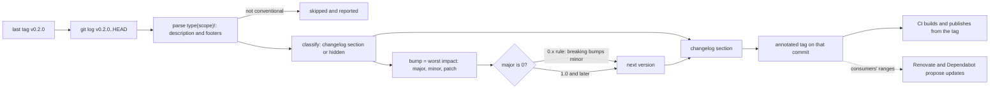

# A Release Is a Version, a Changelog and a Tag

*The next version is a function of the commits since the last tag: compute it, write it down for humans, and tag the commit it names.*

## Metadata

| Field | Value |
|---|---|
| Type | Build |
| Languages | Python |
| Prerequisites | [Pipeline Runner](https://cloudcaptain.io/learn/cicd/pipeline-runner) |
| Time | 75 minutes |
| Tools | git, git-cliff, release-please, semantic-release, Renovate, Dependabot |

<Quiz stage="pre" />

## The Problem

The platform team publishes `inventory-client`, a Python and npm library that forty services depend on. On Friday someone cuts 2.4.0: they skim the merged pull request titles, see "fix" and "add", pick a minor bump, type a changelog entry that says "misc fixes and improvements", and push a lightweight tag. One of those pull requests renamed a response field. The title said "refactor: tidy the item model"; the breaking part was a sentence in the body. Every service with `"inventory-client": "^2.3.0"` in `package.json` or `inventory-client~=2.3` in `requirements.txt` picked up 2.4.0 on its next lockfile refresh, and the nightly deploys of six of them failed on a `KeyError`.

Monday is worse. The on-call engineer wants to know which commits are in 2.4.0 and finds two tags pointing at different commits: the first push was rejected by a hook, so the release was re-tagged locally and force-pushed, and two CI runs published two different wheels under the same version. Nobody can say from the changelog what changed, nobody can say from the version whether it was safe, and the tag does not even name one commit. In the same week a CVE lands in a base image: the service Dockerfiles still say `python:3.10-slim`, the workflows use `actions/checkout@v2`, and the update the scanner proposes jumps three minor versions and two majors at once, because no tool had been proposing the small steps every week.

All three failures have the same root: release facts that live in someone's head instead of in the history. Conventional Commits put the impact of every change into the commit message in a form a program can read. Semantic Versioning turns the largest impact since the last tag into the next number. A changelog is the same data grouped for people, and an annotated tag binds that number to exactly one commit. You are going to write `minirelease`, which reads `git log` since the last tag, parses Conventional Commits, computes the next SemVer version (pre-releases and the 0.x rule included), writes a Keep a Changelog section and creates the annotated tag; and a dependency checker in the spirit of Renovate and Dependabot that reads the version pins in `requirements.txt`, Dockerfiles, workflows and `package.json` and proposes updates grouped by major, minor and patch. Then you run git-cliff on the same repository and check that it agrees.

## The Concept

A version number is a promise to the people who depend on you. SemVer writes the promise as `MAJOR.MINOR.PATCH`: a patch fixes behaviour without changing the interface, a minor adds to the interface without breaking it, a major may break it. Consumers act on that promise automatically: `^2.3.0` in npm and `~=2.3` in pip both mean "give me any 2.x from 2.3 up", so a lockfile refresh installs your next minor without anyone reading it. Choosing the number is therefore not taste. It is a single question asked of every change since the last release, "what is the worst thing this does to a consumer?", with the answer for the whole release being the worst answer.

Conventional Commits make each commit answer that question in its first line. `fix:` is a patch, `feat:` is a minor, a `!` after the type or a `BREAKING CHANGE:` footer is a major, and types such as `docs`, `ci` or `chore` change nothing a consumer sees. The rest of the release follows from the same parse: the commits that would appear in the changelog decide the bump, the changelog groups them under Added, Changed, Deprecated, Removed, Fixed and Security, and the tag records which commit the version names. A tag is a ref, `refs/tags/v2.4.0`. An annotated tag is also an object with a tagger, a date, a message and optionally a signature, and it is what `git describe` and release tooling look for.



Three details decide whether the number is right. **Precedence**: `1.0.0-rc.1` sorts before `1.0.0`, numeric pre-release identifiers compare as numbers (`beta.2` before `beta.11`) and alphanumeric ones as text (`alpha` before `beta` before `rc`), and build metadata after `+` is ignored. **The 0.x rule**: SemVer says that in `0.y.z` anything may change at any time, so the convention (Cargo, git-cliff's bump settings, release-please's `bump-minor-pre-major`) is that a breaking change in 0.y.z bumps the minor and a feature bumps the patch; leaving 0.x is a decision you make, not something a commit does by accident. **Pre-releases**: a release candidate for the next version counts its own number on its channel, `1.5.0-rc.1`, `1.5.0-rc.2`, and promoting it means releasing `1.5.0` from the commits since the last stable tag.

Dependency updates read the same promise from the consumer's side. Your ranges say which promises you trust (`^` trusts minors and patches, `~` only patches, `==` nothing), and an update checker compares what you allow with what exists: an update inside the range needs only a lockfile refresh, one outside it needs an edit, and a new major is a separate, reviewed change. In 0.x the compatibility line is the leftmost non-zero number, so `^0.4.1` allows 0.4.3 but not 0.5.0.

## Build It

`code/main.py` is `minirelease`. Everything that touches Git goes through `git()` and an injectable `runner`, so the tests feed recorded `git log` and `git for-each-ref` output to the pure functions and also drive a real repository in a temporary directory. `code/cliff.toml` is the git-cliff configuration with the same rules, used in Use It. `code/fixtures/deps/` is a small service tree with planted pins and `code/fixtures/available.json` is the list of versions that "exist".

### Step 1: read the history in a format you can split

Two Git commands give everything: the tags reachable from `HEAD`, and the commits in each range between them. Both are asked for in formats designed to be parsed:

```python
LOG_FORMAT = "--format=%H%x1f%an%x1f%cI%x1f%B%x1e"
TAG_FORMAT = "--format=%(refname) %(objecttype) %(objectname) %(*objectname)"
```

`%x1f` and `%x1e` are the ASCII unit and record separators, which do not occur in ordinary commit messages, so a body with blank lines and colons splits cleanly. `%B` is the raw message, subject and body together. In the tag format `%(*objectname)` is the commit an annotated tag points to (the tag object itself is `%(objectname)`); a lightweight tag has no peeled value. Tag names cannot contain spaces, so a space is a safe separator there. `parse_tags()` keeps only `PREFIX + SemVer` names and sorts them by precedence, not by text, so `v0.10.0` comes after `v0.9.0` and `nightly` or `app/v2.0.0` are ignored.

`load_history()` then logs one range per tag: `refs/tags/v0.1.0`, `refs/tags/v0.1.0..refs/tags/v0.2.0`, and `refs/tags/v0.2.0..HEAD` for the unreleased commits. When the latest tag is a pre-release it also logs `LAST_STABLE..HEAD`, because the next stable version is computed from everything since the last stable one.

### Step 2: parse a Conventional Commit

The header is one regular expression; the body must start after one blank line, and the footers are the trailing paragraph block that starts with a `token: value` or `token #value` line:

```python
HEADER = re.compile(r"(?P<type>[A-Za-z]+)(?:\((?P<scope>[^()\r\n]+)\))?(?P<bang>!)?: (?P<description>\S.*)")
FOOTER = re.compile(r"(?P<token>BREAKING CHANGE|BREAKING-CHANGE|[A-Za-z][A-Za-z0-9-]*)(?P<separator>: | #)(?P<value>.*)")
```

A line that does not start a footer is appended to the value of the previous one, so a `BREAKING CHANGE:` explanation can span lines. The specification makes types case-insensitive, so `type` is lowercased, but `BREAKING CHANGE` must be upper case: `breaking change:` is an ordinary footer. A commit is breaking when either signal is present:

```python
breaking=bang or bool(breaking_footers),
breaking_description=breaking_footers[0].value if breaking_footers else (description if bang else ""),
```

When the header does not parse, `header_problem()` says why (`no type: description header`, `the colon must be followed by a space`, `an autosquash commit`, `a merge commit`), which is exactly what a commit-lint check in CI should print.

### Step 3: sections are rules, first match wins

The changelog section of a commit is decided by an ordered table, the same shape as git-cliff's `commit_parsers`:

```python
SECTION_RULES: Tuple[Tuple[str, str, Optional[str]], ...] = (
    ("type", r"(build|chore|ci|docs|style|test)$", None),
    ("scope", r"security$", "Security"),
    ("description", r"(?i:deprecate)", "Deprecated"),
    ("description", r"(?i:remove|drop)", "Removed"),
    ("type", r"feat$", "Added"),
    ("type", r"fix$", "Fixed"),
    ("type", r"(perf|refactor|revert)$", "Changed"),
)
```

`None` means hidden: the commit is real but nothing a consumer sees, so it is left out of the changelog and does not trigger a release. Order matters: `docs: remove the old guide` is hidden before the `remove` rule can see it, and `fix(security): ...` lands in Security before the `fix` rule. One exception is hard-coded in `section_for()`: a breaking commit is never hidden. `chore!: require Node 22` skips the hidden rule and falls through to the next match or to Changed, because a breaking change missing from the changelog is the Friday incident again.

### Step 4: SemVer precedence

`parse_semver()` uses the regular expression from the SemVer specification (no leading zeros, identifiers of letters, digits and dashes). Comparison is a key: the numeric core, then the pre-release identifiers, where an empty pre-release sorts after every non-empty one:

```python
def prerelease_key(pre: Sequence[str]) -> Tuple[Any, ...]:
    if not pre:
        return (1, ())
    return (0, tuple((0, int(part), "") if part.isdigit() else (1, 0, part) for part in pre))
```

Numeric identifiers get `0` in front so they sort before alphanumeric ones, and Python's tuple comparison gives "a longer list of equal identifiers is greater" for free. The test sorts the specification's own example, `1.0.0-alpha < 1.0.0-alpha.1 < 1.0.0-alpha.beta < 1.0.0-beta < 1.0.0-beta.2 < 1.0.0-beta.11 < 1.0.0-rc.1 < 1.0.0`, and checks that `+build` metadata changes nothing.

### Step 5: the bump is the worst impact, with the 0.x rule

```python
def bump_level(commits: Sequence[Commit], current: SemVer, policy: Policy) -> Tuple[Optional[str], str]:
    visible = [c for c in commits if c.section and c.conventional]
    if not visible:
        return None, "no commit since the last release would appear in the changelog"
    breaking = any(c.conventional.breaking for c in visible)
    feature = any(c.conventional.type == "feat" for c in visible)
    zero = current.major == 0
    if breaking and (not zero or policy.breaking_always_bump_major):
        return "major", "a breaking change bumps the major version"
    if feature and (not zero or policy.features_always_bump_minor):
        return "minor", "a new feature bumps the minor version"
    if breaking and current.minor > 0:
        return "minor", "a breaking change in 0.y.z bumps the minor version (the 0.x rule)"
```

Only commits that would appear in the changelog count, so a release that contains nothing but `docs:` and `ci:` commits is no release at all, and non-conventional commits are reported instead of guessed at. The two policy switches have the names of git-cliff's `[bump]` options so you can set both tools the same way. The remaining branches handle 0.0.z, where a breaking change only bumps the patch (in Cargo's reading every 0.0.z release may break), and a feature in 0.y.z, which bumps the patch.

### Step 6: pre-releases and promotion

`decide()` turns the level into a version. With `--pre rc` it computes the stable target first and then counts the existing tags with the same core on the same channel:

```python
    if channel:
        numbers = [int(t.version.pre[1]) for t in tags if t.version.core == target.core and len(t.version.pre) == 2 and t.version.pre[0] == channel and t.version.pre[1].isdigit()]
        target = SemVer(*target.core, pre=(channel, str(max(numbers, default=0) + 1)))
```

After `v1.4.0` and `v1.5.0-rc.1`, a fix gives `1.5.0-rc.2`; a breaking change gives `2.0.0-rc.1`; releasing without `--pre` promotes to `1.5.0` even when no commit landed after the last candidate, because the level is computed from the commits since `v1.4.0`. A new version must sort after the latest tag, so switching from `rc` back to `beta` on the same core is refused with the reason, not silently tagged.

### Step 7: the changelog and the annotated tag

`render_release()` prints `## [0.3.0] - 2026-11-01` (or `## [Unreleased]`), then each non-empty section in Keep a Changelog order with one line per commit: `- **BREAKING** **api:** rename /items to /inventory`. The release date is the UTC day of the tagged commit, the same day git-cliff prints. `render_changelog()` adds the standard header and, with `--compare-url`, the comparison links at the bottom.

`release` writes the changelog, optionally commits it as `chore(release): v0.3.0` (a hidden type, so it never appears in the next changelog), and tags:

```python
git(runner, args.repo, "tag", "-s" if args.sign else "-a", "--cleanup=whitespace", "-m", message, release.tag)
```

`--cleanup=whitespace` is not decoration. Git's default cleanup for tag messages is `strip`, which deletes every line starting with `#` as a comment, and every `### Added` heading would vanish from the tag. `-s` makes the same annotated tag with a signature, using whatever `gpg.format` and `user.signingkey` say (GPG, SSH or X.509).

### Step 8: dependency updates are the same contract, read from the other side

`deps ROOT --available FILE` walks a tree, extracts every pin, and compares it with a fixture of versions that exist. Each ecosystem gets its own extractor and its own version scheme: PEP 440 for pip (`1.0.dev0 < 1.0a1 < 1.0rc1 < 1.0 < 1.0.post1`, epochs, `~=`, `==1.4.*`), node-semver for npm (`^`, `~`, x-ranges, hyphen ranges, `||`), Docker tags where the suffix and the number of components must match (`3.12-slim` moves to `3.13-slim`, never to `3.13-alpine` or `3.13.1-slim`), and action refs where a floating `@v4` moves to `@v5` and a SHA pin with a `# v6.9.0` comment moves to the new tag's SHA with a new comment. npm ranges are desugared into comparators exactly as node-semver does it:

```python
    if op == "^":
        if minor is None:
            return [(">=", SemVer(major, 0, 0)), ("<", SemVer(major + 1, 0, 0, zero))]
        if patch is None:
            upper = SemVer(major + 1, 0, 0, zero) if major else SemVer(0, minor + 1, 0, zero)
            return [(">=", SemVer(major, minor, 0)), ("<", upper)]
        upper = SemVer(major + 1, 0, 0, zero) if major else SemVer(0, minor + 1, 0, zero) if minor else SemVer(0, 0, patch + 1, zero)
        return [(">=", SemVer(major, minor, patch, pre)), ("<", upper)]
```

The `-0` pre-release on the upper bound keeps `2.0.0-beta.1` out of `^1.2.3`, and `npm_satisfies()` adds node's rule that a pre-release only matches a range that names a pre-release of the same core. Proposals follow Renovate's default of separating majors from the rest, with the 0.x rule applied through the compatibility line, the leftmost non-zero number:

```python
    line = compatibility_line(current.release)
    for compatible_line in (True, False):
        bucket = [(v, d) for v, d in newer if (compatibility_line(v.release) == line) == compatible_line]
        if bucket:
            best, digest = max(bucket, key=lambda item: item[0].key)
            updates.append(make_update(dep, current, best, digest))
```

So `^0.4.1` gets two proposals, 0.4.3 (patch, an automerge candidate) and 0.5.0 (breaking by the 0.x rule, grouped with the majors). Every proposal says whether the current range already allows it (then a lockfile refresh is enough and the manifest stays as it is), what to write instead (`^4.18.2` becomes `^5.1.0`, `==2.31.0` becomes `==2.32.3`), and what else needs doing: regenerate `--hash` lines, re-pin a digest, or rewrite a multi-comparator range by hand.

### Step 9: run it

```bash
cd curriculum/phases/08-cicd/08-release-versioning
python3 code/main.py log --repo ~/src/inventory                 # each commit since the last tag, its section or why it is skipped
python3 code/main.py next --repo ~/src/inventory                # v0.3.0 on stdout, the reason on stderr
python3 code/main.py next --repo ~/src/inventory --pre rc       # v0.3.0-rc.1
python3 code/main.py changelog --repo ~/src/inventory --bump --compare-url https://github.com/acme/inventory
python3 code/main.py release --repo ~/src/inventory --changelog CHANGELOG.md --commit --dry-run
python3 code/main.py release --repo ~/src/inventory --changelog CHANGELOG.md --commit
python3 code/main.py deps code/fixtures/deps --available code/fixtures/available.json
```

On the history the smoke test builds (two tags, then a fix, a breaking feature, a non-conventional commit, a scoped `perf`, a security fix, a deprecation, a breaking `refactor!: drop ...` and a `chore(deps)`), `log` prints:

```text
8 commit(s) since v0.2.0
  bcc9d62   fix: close the database pool on shutdown                      Fixed
  63d6174 ! feat(api)!: rename /items to /inventory                       Added
  ef9ff16   Update README                                                 not conventional: no `type: description` header
  c4a083e   perf(db): batch inserts                                       Changed
  6d7a5bc   fix(security): escape item names in log lines                 Security
  b37e7fd   feat: deprecate the v1 export format                          Deprecated
  6a9afce ! refactor!: drop support for Python 3.8                        Removed
  2cd8ccd   chore(deps): bump requests                                    hidden type `chore`
```

and `next` answers `v0.3.0` because of the 0.x rule, or `v1.0.0` with `--breaking-always-bump-major`. `next` exits 1 when there is nothing to release, which makes `if NEXT=$(python3 code/main.py next); then ...` a usable release gate. `deps` exits 1 when it proposes anything and 2 on input it cannot read.

<RunTests />

## Use It

**git-cliff** does the version and changelog half as one static binary, configured by a `cliff.toml` whose `commit_parsers` are the same ordered rules as `SECTION_RULES`. `code/cliff.toml` mirrors `minirelease`: hidden types skipped, `filter_unconventional = true`, `protect_breaking_commits = true` (a breaking commit is never skipped), `filter_commits = true`, and the 0.x rule through `[bump]`:

```toml
commit_parsers = [
    { message = '^(build|chore|ci|docs|style|test)(\(.*\))?!?:', skip = true },
    { message = '^[a-z]+\(security\)!?:', group = "<!-- 5 -->Security" },
    { message = '^feat(\(.*\))?!?:', group = "<!-- 0 -->Added" },
    { message = '^fix(\(.*\))?!?:', group = "<!-- 4 -->Fixed" },
]

[bump]
features_always_bump_minor = false
breaking_always_bump_major = false
```

The `<!-- N -->` prefixes only order the sections; the template removes them with `striptags`. Install a pinned release from GitHub and verify its published `.sha512` file before running it, then ask the same questions:

```bash
V=2.14.2; A=git-cliff-$V-x86_64-unknown-linux-musl.tar.gz
curl -fsSLO https://github.com/orhun/git-cliff/releases/download/v$V/$A
curl -fsSLO https://github.com/orhun/git-cliff/releases/download/v$V/$A.sha512
sha512sum -c $A.sha512 && tar -xzf $A && export PATH=$PWD/git-cliff-$V:$PATH
CLIFF=$PWD/code/cliff.toml
cd ~/src/inventory
git-cliff --config $CLIFF --offline --bumped-version            # v0.3.0, the same as minirelease next
git-cliff --config $CLIFF --offline --unreleased                # the Unreleased section only
git-cliff --config $CLIFF --offline --bump -o CHANGELOG.md      # whole file, unreleased renamed to the bumped version
git-cliff --config $CLIFF --offline --context | python3 -m json.tool | head -40
git-cliff --config $CLIFF --offline --latest                    # the section of the newest tag
git tag -a --cleanup=whitespace v0.3.0 -m "$(git-cliff --config $CLIFF --offline --unreleased --bump --strip all)"
```

`--context` prints the data model behind the template: one object per release with `version`, `commit_id`, `timestamp` and `commits`, each commit with `group`, `scope`, `message`, `breaking` and `footers`. `code/smoke.sh` builds the history above, runs both tools, parses both changelogs into `{version: {section: set of entries}}` and asserts they are equal, compares `--bumped-version` with `next` under both bump policies, creates the release with `minirelease release --sign` (an SSH-signed annotated tag), checks it with `git tag -v` and `git-cliff --latest --context`, confirms that a later `feat:` in 0.3.0 gives 0.3.1 in both tools (the feature half of the 0.x rule), and checks `pip_satisfies()` and `npm_satisfies()` against `packaging` and node-semver on every fixture range and version.

**release-please and semantic-release** run the same computation as a hosted workflow. release-please (`googleapis/release-please-action`) keeps a release pull request open that updates `CHANGELOG.md` and the version files on every push to `main`; merging it creates the tag and the GitHub release, so a human still decides when. Its `release-please-config.json` has the 0.x switches as `bump-minor-pre-major` and `bump-patch-for-minor-pre-major`. semantic-release has no release pull request: every push to a release branch that contains a releasable commit is published at once, a branch configured with `prerelease: true` produces `2.0.0-beta.1`, `2.0.0-beta.2`, and its first release is 1.0.0 by design. Both read Conventional Commits; commitlint with `@commitlint/config-conventional` in CI is what keeps the input parseable, the job `minirelease log --strict` does here.

**Renovate and Dependabot** run the dependency half against the real registries and open pull requests. Renovate is configured in `renovate.json`:

```json
{
  "$schema": "https://docs.renovatebot.com/renovate-schema.json",
  "extends": ["config:recommended", "helpers:pinGitHubActionDigests"],
  "schedule": ["before 6am on monday"],
  "minimumReleaseAge": "3 days",
  "packageRules": [
    { "matchUpdateTypes": ["minor", "patch"], "groupName": "non-major dependencies" },
    { "matchUpdateTypes": ["patch"], "automerge": true }
  ]
}
```

`rangeStrategy` decides what happens to a range when the new version is inside or outside it (`bump`, `replace`, `widen`, `update-lockfile`, `pin`), the choice `new_value()` makes for you. `helpers:pinGitHubActionDigests` rewrites `@v4` to `@<sha> # v4` and keeps the SHA and the comment in step on every update, and `minimumReleaseAge` waits before proposing a version, which gives a registry time to pull a malicious release. Dependabot lives in `.github/dependabot.yml`:

```yaml
version: 2
updates:
  - package-ecosystem: "pip"
    directory: "/"
    schedule:
      interval: "weekly"
    groups:
      non-major:
        update-types: ["minor", "patch"]
  - package-ecosystem: "github-actions"
    directory: "/"
    schedule:
      interval: "weekly"
  - package-ecosystem: "docker"
    directory: "/"
    schedule:
      interval: "weekly"
```

Dependabot has no built-in automerge: a workflow that reads `dependabot/fetch-metadata` and runs `gh pr merge --auto` on patch updates is the usual pattern, and branch protection with required checks is what makes automerge safe in either tool.

**SemVer or CalVer.** SemVer is for things with consumers who pin ranges: libraries, APIs, CLIs. CalVer (`YYYY.MM.MICRO`, Ubuntu's `24.04`, pip's `25.1`) says when something was released and nothing about compatibility; it fits applications deployed by their own team and products on a fixed cadence. A service that nobody imports can use either; a library that uses CalVer forces every consumer to pin exactly.

**Signing tags.** `git tag -s` signs the tag object. With SSH keys it is three settings and a check:

```bash
git config gpg.format ssh
git config user.signingkey ~/.ssh/release_ed25519.pub
git tag -s v0.3.0 -m "Release v0.3.0"
echo "release@example.com $(cat ~/.ssh/release_ed25519.pub)" > allowed_signers
git -c gpg.ssh.allowedSignersFile=allowed_signers tag -v v0.3.0   # Good "git" signature for release@example.com
git push origin v0.3.0                                            # or git push --follow-tags
```

GitHub marks a tag Verified when the public key is registered as a signing key on the tagger's account. gitsign does the same keylessly through Sigstore, the model you meet in the signing and provenance lesson. A signed tag proves who named the commit; it says nothing about what CI built from it.

| What you built | Real tool | Note |
|---|---|---|
| `parse_message()`, `header_problem()` | git-cliff's conventional parser, commitlint | commitlint fails the pull request; git-cliff and `minirelease` skip and report |
| `SECTION_RULES`, first match wins | `commit_parsers` in `cliff.toml` | git-cliff matches regular expressions on the raw message; a protected breaking commit that matched a `skip` rule keeps no group there, `minirelease` puts it in the next matching section |
| `bump_level()` with the two switches | git-cliff `[bump]`, release-please `bump-minor-pre-major` | git-cliff counts every commit left after filtering; with these settings that is the same set |
| `decide()` with `--pre rc` | semantic-release prerelease branches | git-cliff increments the last pre-release identifier when the latest tag is a pre-release and cannot start a channel |
| `render_changelog()`, Keep a Changelog | `git-cliff -o CHANGELOG.md`, release-please's release PR | compare parsed sections, never the text: dates, spacing and ordering inside a section differ |
| `release` with `--cleanup=whitespace` | `git tag -a`, `git tag -s`, gitsign | the default `strip` cleanup deletes `#` lines from tag messages |
| `deps` proposals, grouped | Renovate `packageRules`, Dependabot `groups` | the real tools read lockfiles and registries; this one reads `available.json` |
| `compatibility_line()` | Renovate's separate major updates, Cargo's caret rules | 0.y minors are breaking and grouped with majors |
| `npm_satisfies()`, `pip_satisfies()` | node-semver, `packaging.specifiers` | the smoke compares both against the reference libraries on every fixture range |

<Quiz stage="check" />

## Ship It

Two artifacts in `outputs/`:

- **`skill-release-checklist.md`**: a runbook for cutting a release from a branch with Conventional Commits. It lints the commits since the last tag, computes the next version with the bump and 0.x settings written down, checks the version against the public interface diff, generates and reviews the changelog section, creates a signed annotated tag on the release commit, verifies what CI published from it, and handles pre-releases, hotfixes and the mistakes (wrong tag pushed, wrong version published). It ends with the release record a team posts.
- **`prompt-write-release-notes.md`**: paste `git log --format='%h %s%n%b' vX..HEAD` (or git-cliff's `--context`) and the previous version, and get the next version with the rule that decided it, a Keep a Changelog section, upgrade notes for every breaking change written for the consumer, and a list of commits that could not be classified.

<ShipIt />

## Exercises

### Easy

Handle reverts the way the specification suggests: a `revert:` commit with a `Refs: <sha>` footer that names a commit in the same unreleased range removes both commits from the changelog and from the bump, while a revert of an already released commit stays in Changed. Write the tests first: `feat: add export` followed by its revert is no release at all, and the same revert after the feature was tagged produces a patch.

### Medium

Add `deps --write`, which applies every non-major proposal in place: change only the version text on the reported line, keep comments, extras, markers, quotes and indentation, update the `# vX.Y.Z` comment next to a SHA pin, and leave lines with `--hash` or a digest alone with a message. Test on copies of `code/fixtures/deps` in a temporary directory, then assert that a second `deps` run reports only the majors and the lines that need a human.

### Hard

Make `minirelease` work in a monorepo: `--path services/api --tag-prefix api/v` limits every `git log` to that path (`git log RANGE -- PATH`), so each package gets its own version, changelog and tags. Add a test repository in which one commit touches two packages and another touches only one, and prove that the versions differ correctly. Then reproduce the result with git-cliff's `--include-path` and `--tag-pattern` and extend `code/smoke.sh` to compare both tools per package.

<Quiz stage="post" />

## Key Terms

| Term | Common misconception | Precise definition |
|---|---|---|
| Semantic Versioning | "The version reflects how big the change was." | `MAJOR.MINOR.PATCH` as a statement about the public interface: a major may break consumers, a minor only adds, a patch only fixes. The size of the diff is irrelevant. |
| Conventional Commit | "A naming style for commit messages." | A machine-readable header `type(scope)!: description`, an optional body after one blank line and optional footers; `!` or a `BREAKING CHANGE:` footer marks a breaking change. |
| Precedence | "Versions sort as text." | The SemVer ordering: numeric core first, a pre-release before its release, numeric identifiers as numbers, alphanumeric ones as ASCII, build metadata ignored. |
| Pre-release | "A beta is just a smaller version number." | A version with a `-identifier` suffix that sorts before the release it leads to and is excluded from ranges unless the range names a pre-release of the same core. |
| The 0.x rule | "0.x versions follow the same bump rules." | In 0.y.z SemVer promises nothing, so by convention a breaking change bumps the minor and a feature the patch; caret ranges treat the leftmost non-zero number as the major. |
| Annotated tag | "A tag is a tag." | A tag object with tagger, date, message and optional signature, referenced by `refs/tags/NAME`; a lightweight tag is only the ref, and neither should ever move once published. |
| Changelog | "The git log, pasted." | A curated, per-release list of user-visible changes grouped by kind (Added, Changed, Deprecated, Removed, Fixed, Security); hidden commits and internal detail are left out. |
| Version range | "`^1.2.3` means 1.2.3." | A set of versions a consumer accepts: `^1.2.3` is `>=1.2.3 <2.0.0-0`, `~1.2.3` is `>=1.2.3 <1.3.0-0`, `~=1.2.3` in pip is `>=1.2.3, ==1.2.*`; a lockfile records which one is installed. |
| Automerge | "Merging without review." | Merging an update automatically after required checks pass, usually only for patch updates of well-tested dependencies, with branch protection as the actual gate. |

## Further Reading

- [Git Advanced](https://cloudcaptain.io/docs/tools/git/advanced): rebasing, tags and history rewriting, the operations a release process depends on.
- [CI/CD Fundamentals](https://cloudcaptain.io/docs/tools/cicd/fundamentals): where the release job sits in a delivery pipeline and what it hands to deployment.
- [GitHub Actions Fundamentals](https://cloudcaptain.io/docs/tools/github-actions/fundamentals): triggers on tags and the workflow syntax release-please and Dependabot automerge use.
- [DevSecOps Fundamentals](https://cloudcaptain.io/docs/tools/devsecops/fundamentals): dependency scanning and why small, frequent updates are the cheap path.
- [Semantic Versioning 2.0.0](https://semver.org/spec/v2.0.0.html): the eleven rules, precedence and the FAQ entry on 0.y.z.
- [Conventional Commits 1.0.0](https://www.conventionalcommits.org/en/v1.0.0/): the grammar `minirelease` parses, including footers and case rules.
- [Keep a Changelog 1.1.0](https://keepachangelog.com/en/1.1.0/): the six sections and the arguments against dumping the git log.
- [git-cliff documentation](https://git-cliff.org/docs/): `commit_parsers`, `[bump]`, `--context` and the template model.
- [git-tag manual](https://git-scm.com/docs/git-tag): annotated, signed and lightweight tags, `--cleanup` modes and why you should not re-tag.
- [Renovate configuration options](https://docs.renovatebot.com/configuration-options/): `packageRules`, `rangeStrategy`, `minimumReleaseAge` and automerge.
- [Dependabot options reference](https://docs.github.com/en/code-security/dependabot/working-with-dependabot/dependabot-options-reference): ecosystems, schedules and `groups`.
- [PEP 440](https://peps.python.org/pep-0440/): Python version ordering and specifiers, including the pre-release and post-release exclusions `pip_one()` implements.
- [node-semver ranges](https://github.com/npm/node-semver#ranges): caret, tilde, x-ranges and the pre-release rule that `desugar()` and `npm_satisfies()` copy.
