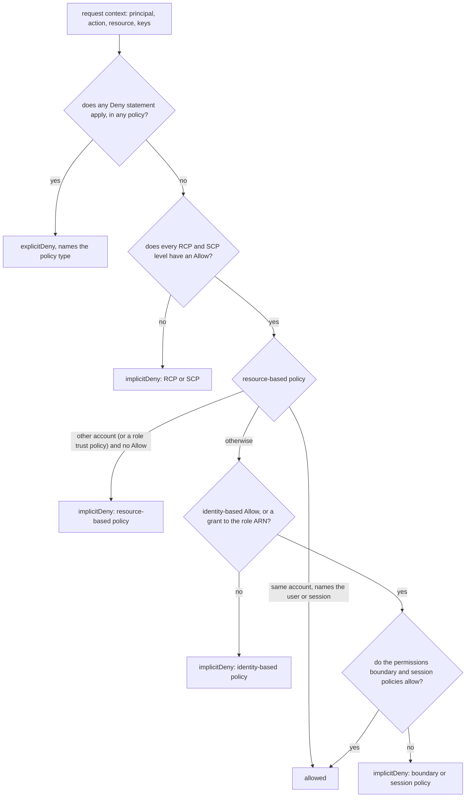

# Every AWS API Call Is a Policy Evaluation

*AWS walks every policy type in a fixed order: a Deny anywhere ends it, every gate must allow, and AccessDenied names the gate that failed.*

## Metadata

| Field | Value |
|---|---|
| Type | Build |
| Languages | Python |
| Prerequisites | [kubectl auth can-i Is a Function You Can Write](https://cloudcaptain.io/learn/orchestration/rbac-authorizer) |
| Time | 90 minutes |
| Tools | aws, moto |

<Quiz stage="pre" />

## The Problem

Tuesday, 09:10. The nightly export in the `analytics` account failed at 02:00 with `AccessDenied` on `s3:PutObject` into the reporting bucket in the `data` account. The release that touched IAM went out at 18:00 the evening before. The engineer on call reads the first half of the message, `User: arn:aws:sts::111111111111:assumed-role/export/nightly is not authorized to perform: s3:PutObject`, attaches `AdministratorAccess` to the `export` role and reruns the job. Same error. Someone on the data team turns off the bucket's Block Public Access settings and changes the bucket policy's principal to `"*"` "to rule it out". The job runs. The bucket now accepts writes from anyone, anonymous callers included.

The second half of the message said `because no resource-based policy allows the s3:PutObject action`. Nothing attached to the `export` role could have fixed that. A request into another account is decided twice, once by the caller's account and once by the resource's account, and only the resource's account had stopped saying yes. The release had deleted and recreated `export` under the same name. The bucket policy had named the old role, and IAM had already replaced that ARN in the stored policy with the old role's unique ID, an `AROA...` string that no new role will ever match. The fix was to put the role's ARN back into the bucket policy. Instead, `AdministratorAccess` is still attached and the bucket is open to every account, and both will still be there at the next audit.

Each of those moves treats AWS authorization as a box with a red light. It is a documented, deterministic function. A principal, an action, a resource and a request context go in. AWS checks every policy that applies (the organization's SCPs and RCPs, the resource's policy, the identity-based policies, a permissions boundary, session policies) in a fixed order. Out comes allowed, explicit deny or implicit deny, and when access is denied, the message names the policy type that stopped it. You are going to write `iameval`, that function in Python. It names the statement that decided, prints the AccessDenied text AWS would print, reads the account dump `aws iam get-account-authorization-details` produces, and is checked against AWS's own documented examples and against moto's IAM enforcement.

## The Concept

Picture a request as a form that must get through a row of desks. Any desk may tear it up, and once torn it stays torn: that is an explicit deny. Some desks only check that the form is inside their limits and add nothing, such as the organization's levels, the permissions boundary and the session policy, and every one of them must agree. One desk has to actually say "yes, this person may do this", and that desk is either the resource's own policy or the caller's identity-based policies. A form nobody approved is refused without any policy saying "no". That refusal is the implicit deny, and it is the default for everything.

Before any policy is read, AWS turns the API call into a **request context**. The principal is an IAM user (`arn:aws:iam::ACCOUNT:user/NAME`), a role session (`arn:aws:sts::ACCOUNT:assumed-role/ROLE/SESSION`), a federated user, the account root user, or nobody (anonymous). The action is a `service:Operation` name such as `s3:GetObject`. The resource is an ARN, and S3's ARNs carry no account, which is why "whose bucket is this" is a separate fact. Then come the condition keys: global ones such as `aws:SourceIp`, `aws:SecureTransport`, `aws:PrincipalArn` (for a session, this is the role's ARN), `aws:PrincipalTag/team` and `aws:CurrentTime`, and service ones such as `s3:prefix` or `sts:ExternalId`. Policies only ever see this context, never the raw request.

A **statement** applies when four things match. The action must match `Action`, or must not match `NotAction`. Action matching is case-insensitive and supports `*` and `?`. The resource must match `Resource`, or must not match `NotResource`. Resource matching is case-sensitive, and a `*` stays inside one colon-separated segment of the ARN unless it is the segment's last character. In resource-based policies, the caller must match `Principal`. Finally the `Condition` must hold. Inside a condition, operators are ANDed, keys within one operator are ANDed, and the values listed for one key are ORed, except for negated operators such as `StringNotEquals`, which NOR them. When a key is missing from the request, positive operators fail and negated ones pass. `...IfExists` passes, `ForAnyValue` fails, and `ForAllValues` passes, which is the trap in many tag policies. Policy variables such as `${aws:username}` are filled in from the context before matching, but only in policies with `"Version": "2012-10-17"`.

The evaluation order comes straight from AWS's documentation and is what `iameval` implements:



Three details in that picture cause most real incidents. **Same account, resource policy:** if a bucket, key or queue policy names the IAM user or the exact role session (or `"*"`), that grant stands on its own. If it names the role's ARN, the caller's identity-based policies are not needed, but its boundary and session policy still apply. If it names the account (`arn:aws:iam::ACCOUNT:root` or the bare ID), it grants nothing by itself and hands the decision to identity-based policies. Role trust policies and KMS key policies must always allow explicitly, even within one account. **Cross-account:** the caller's account must allow (identity-based policies, boundary, session, its SCPs) and the resource's account must allow (its resource-based policy, its RCPs). **Organizations:** SCPs limit the principals of member accounts and RCPs limit their resources. Every level from the root down to the account must have an Allow, which is why each level normally carries `FullAWSAccess`. Neither SCPs nor RCPs ever grant anything.

`aws iam simulate-principal-policy` runs this same function without sending the request. The AccessDenied message is the function's output for a request that did happen: `with an explicit deny in a ...` or `because no ... allows the ... action` names the gate that failed.

## Build It

`code/main.py` is `iameval`, standard library only. It reads policies from files, from inline JSON or from the dump that `aws iam get-account-authorization-details` prints, and everything after loading is pure functions over dataclasses. The tests use three fixtures. `code/fixtures/account.json` is an account with four users, a group, two roles and a boundary, the same account the smoke test builds in moto, with each policy also saved in `code/fixtures/policies/`. `code/fixtures/aws-doc-scenarios.json` holds 47 decisions taken from AWS's documentation, each with its source URL. `code/fixtures/aws-doc-conditions.json` holds 47 rows of the condition tables in the IAM User Guide.

### Step 1: two kinds of wildcard

```python
def compile_glob(pattern: str, context: Context, variables: bool, arn: bool = False, ignore_case: bool = False) -> Optional["re.Pattern[str]"]:
    pieces = tokens(pattern, context, variables)
    if pieces is None:
        return None
    regex: List[str] = []
    for position, (text, literal) in enumerate(pieces):
        if literal:
            regex.append(re.escape(text))
        elif text == "*":
            ends_segment = position + 1 == len(pieces) or pieces[position + 1] == (":", False)
            regex.append(".*" if not arn or ends_segment else "[^:]*")
        elif text == "?":
            regex.append("[^:]" if arn else ".")
        else:
            regex.append(re.escape(text))
    return re.compile("".join(regex), re.DOTALL | (re.IGNORECASE if ignore_case else 0))
```

`action_matches()` calls this with `ignore_case=True`, because `s3:getobject` and `s3:GetObject` are the same action. `resource_matches()` calls it with `arn=True`, and ARNs are case-sensitive: `user/Bob` is not `user/bob`. Inside a segment, `*` matches anything except a colon. A `*` that ends a segment may run on past colons, so `arn:aws:s3:*` covers every S3 ARN. A `/` is just another character, so `arn:aws:s3:::bucket/*/test/*` matches `bucket/1/2/test/x.jpg` and `bucket//test/x.jpg`, but not `bucket/test/x.jpg`. The first test walks every example from the Resource element page of the IAM User Guide.

### Step 2: policy variables are substituted before matching

```python
def resolve_variable(body: str, context: Context) -> Optional[str]:
    name, _, default = body.partition(",")
    name = name.strip()
    if name in SPECIAL_VARIABLES:
        return SPECIAL_VARIABLES[name]
    values = context.get(name)
    if values and name.lower() not in MULTIVALUED_KEYS:
        return values[0]
    default = default.strip()
    if len(default) >= 2 and default[0] == default[-1] == "'":
        return default[1:-1]
    return None
```

`tokens()` splits a pattern into characters and `${...}` variables. A variable's value is escaped, so a `*` in a user's name is never a wildcard, and `${*}`, `${?}` and `${$}` produce those characters literally. Write `${aws:PrincipalTag/team, 'company-wide'}` and you get a default for principals without the tag. An unresolved variable makes the whole pattern unmatchable (`None`). A role session has no `aws:username`, so `home/${aws:username}/*` never matches it. Negated operators do match the missing value, as the documentation says. With `"Version": "2008-10-17"`, or with no Version at all, `Policy.variables` is false and `${aws:username}` is matched as the literal text `${aws:username}`.

### Step 3: a condition is AND, OR and NOR

```python
def key_holds(operator: str, key: str, wanted: Sequence[str], context: Context, variables: bool) -> bool:
    qualifier, base, if_exists = parse_operator(operator)
    present = context.get(key)
    if base == "Null":
        absent = not present
        return any((value.lower() == "true") == absent for value in wanted)
    if not present or (qualifier == "ForAllValues" and all(value == "" for value in present)):
        if if_exists or qualifier == "ForAllValues":
            return True
        if qualifier == "ForAnyValue":
            return False
        return base in NEGATED
    negated = base in NEGATED
    positive = NEGATED.get(base, base)
    use_variables = variables and positive.startswith(("String", "Arn"))

    def one(value: str) -> bool:
        hit = any(value_matches(positive, value, item, context, use_variables) for item in wanted)
        return not hit if negated else hit

    if qualifier == "ForAllValues":
        return all(one(value) for value in present)
    if qualifier == "ForAnyValue":
        return any(one(value) for value in present)
    return all(one(value) for value in present) if negated else any(one(value) for value in present)
```

`parse_operator()` splits `ForAllValues:StringLikeIfExists` into a set qualifier, a base operator and the IfExists flag, and rejects anything it does not know, as IAM does when you save the policy. A negated operator is evaluated as "no listed value matches", which is the NOR the documentation describes. `value_matches()` holds one comparison per family: exact and case-folded strings, globs, numbers, ISO 8601 or epoch dates, `Bool`, base64 `BinaryEquals`, CIDR with IPv4 and IPv6, and ARNs compared segment by segment. Only string and ARN operators substitute variables. `condition_result()` ANDs every operator and key and records the keys the request lacked, the way the simulator reports `MissingContextValues`. All 47 rows of the documented condition tables pass, including the one that surprises people: `ForAllValues:ArnLike` with no key in the request is a match.

### Step 4: who is asking, and how a resource policy names them

```python
def principal_value_grant(key: str, value: str, principal: Principal) -> str:
    if key != "AWS":
        return "service" if value == principal.arn else ""
    if value == "*":
        return "wildcard"
    if principal.kind == "Anonymous":
        return ""
    if ACCOUNT_ID.match(value):
        value = f"arn:aws:iam::{value}:root"
    match = PRINCIPAL_ARN.match(value)
    if not match or match.group("account") != principal.account:
        return ""
    resource = match.group("resource")
    if resource == "root":
        return "account"
    if resource.startswith("user/") and principal.kind == "User" and resource.rsplit("/", 1)[-1] == principal.name:
        return "user"
    if resource.startswith("role/") and principal.kind == "AssumedRole" and resource.rsplit("/", 1)[-1] == principal.name:
        return "role"
    if resource.startswith(("assumed-role/", "federated-user/")) and value == principal.arn:
        return "session"
    return ""
```

`parse_principal()` turns the caller's ARN into a `Principal`. A session `arn:aws:sts::A:assumed-role/reader/s1` belongs to the role `reader`, and its `aws:PrincipalArn` is the role ARN, not the session ARN. The function above tells the evaluator how a `Principal` element names the caller, because the kind of name decides what else must allow. A `*` or the user or session itself is a direct grant. The role's ARN grants the session but leaves the boundary and session policy in force. The account delegates to identity-based policies. A unique ID such as `AROAEXAMPLEREADER001` is what IAM shows once the named role has been deleted, and it matches nothing. `principal_grant()` ranks several names in one statement and keeps the most direct.

### Step 5: one statement, four checks

```python
def statement_applies(policy: Policy, index: int, statement: dict, request: Request, principal: Principal, context: Context, has_boundary: bool, missing: List[str]) -> Optional[Match]:
    if "NotAction" in statement:
        if any(action_matches(p, request.action) for p in as_list(statement["NotAction"])):
            return None
    elif not any(action_matches(p, request.action) for p in as_list(statement.get("Action"))):
        return None
    variables = policy.variables
    if "NotResource" in statement:
        if any(resource_matches(p, request.resource, context, variables) for p in as_list(statement["NotResource"])):
            return None
    elif "Resource" in statement:
        if not any(resource_matches(p, request.resource, context, variables) for p in as_list(statement["Resource"])):
            return None
    elif policy.kind != "trust":
        return None
    grant = ""
    if policy.kind in ("resource", "trust"):
        if "Principal" in statement:
            grant = principal_grant(statement["Principal"], principal)
        elif "NotPrincipal" in statement:
            if statement.get("Effect") == "Deny" and has_boundary:
                grant = "boundary-notprincipal"
            elif not principal_grant(statement["NotPrincipal"], principal):
                grant = "wildcard"
        if not grant:
            return None
    holds, absent, _ = condition_result(statement.get("Condition"), context, variables)
    missing.extend(key for key in absent if key not in missing)
    return Match(policy, index, statement, grant) if holds else None
```

`NotAction` and `NotResource` turn a list into "everything except". A Deny with `NotResource` blocks every resource but the listed ones and grants nothing. An Allow with `NotAction` grants every action not listed, including actions AWS adds next year. Only role trust policies may omit `Resource`. `Principal` is checked only in resource-based and trust policies; in identity-based policies the validator rejects it. The `NotPrincipal` line encodes a documented oddity: a Deny with `NotPrincipal` denies any principal that has a permissions boundary, even one it lists.

### Step 6: the order is the algorithm

```python
    denies = run.find(everything, "Deny")
    if denies:
        run.step("explicit deny", "explicit deny", denies[0].describe())
        return run.finish("explicitDeny", denies[0].policy.kind, denies[0])
```

Every policy that could apply is searched for a Deny first, sorted so the reported type follows AWS's order (SCP, RCP, resource-based, identity-based, boundary, session). When several types deny, AWS names only one of them, and so does `iameval`, while `MatchedStatements` lists them all. Next come the organization gates, one level at a time:

```python
    for name, kind, levels in (("resource control policies", "rcp", scenario.rcps), ("service control policies", "scp", scps)):
        stopped = run.organization_gate(name, kind, levels)
        if stopped:
            return stopped
```

Each `--scp` is one level (root, an OU, the account) and may hold several policies. Within a level the policies are a union; across levels every one must allow. Then the resource-based policy: a direct grant in the same account ends the evaluation with `allowed`. A cross-account request, or an `sts:AssumeRole` without a trust policy that allows it, ends with `implicitDeny`. Any other grant is noted and the walk continues. Then the identity-based policies, the boundary and the session:

```python
    identity = [ROOT_ALLOW] if principal.kind == "Account" else run.find(scenario.identity, "Allow")
    if identity:
        run.step("identity-based policies", "pass", identity[0].describe())
    elif cross or not via_role:
        run.step("identity-based policies", "implicit deny", f"no Allow for {request.action} in {len(scenario.identity)} identity-based policies")
        return run.finish("implicitDeny", "identity")
    else:
        run.step("identity-based policies", "skip", "not needed: the resource-based policy grants the role")
```

The root user passes this gate without any policy, but SCPs and explicit denies still apply to it. The boundary is an intersection: it never grants and only caps. Session policies cap a role session the same way. A federated user from `GetFederationToken` without a session policy gets nothing. Every gate leaves a `Step`, so the output shows which ones passed, which one stopped the request and which were never reached.

### Step 7: read the account the way simulate-principal-policy does

```python
    if principal.kind == "User":
        detail = directory.users.get(principal.name)
        if detail is None:
            return [], None, [f"user {principal.name} is not in the dump"]
        policies = inline(detail.get("UserPolicyList"), f"user/{principal.name}") + attached(detail.get("AttachedManagedPolicies"), "attached to the user")
        for group in detail.get("GroupList") or []:
            if group not in directory.groups:
                warnings.append(f"group {group} is not in the dump")
                continue
            entry = directory.groups[group]
            policies += inline(entry.get("GroupPolicyList"), f"group/{group}") + attached(entry.get("AttachedManagedPolicies"), f"via group {group}")
```

A user's identity-based policies are its inline policies, its attached managed policies, and the inline and attached policies of every group it belongs to. A role session gets the role's policies. Both get their permissions boundary (a managed policy's default version) and their tags, which become `aws:PrincipalTag/...` keys. For `sts:AssumeRole` on a role in the dump, `with_trust()` loads the role's trust policy as the resource-based policy. moto's dump omits `PolicyName` on managed policies, so the loader falls back to the ARN. A managed policy missing from the dump becomes a warning, not a silent allow.

### Step 8: the message AWS would print

```python
def access_denied_message(principal_arn: str, action: str, resource: str, decision: str, kind: str) -> str:
    text = f"User: {principal_arn} is not authorized to perform: {action}"
    if resource and resource != "*":
        text += f" on resource: {resource}"
    if decision == "explicitDeny":
        return f"{text} with an explicit deny in {KIND_ARTICLES.get(kind, 'a')} {KIND_LABELS[kind]}"
    return f"{text} because no {KIND_LABELS[kind]} allows the {action} action"
```

This is the format in the IAM User Guide's "Troubleshoot access denied error messages", and eight of the documented scenarios assert it word for word. "User:" is literal even when the caller is a role session. Recent messages can append the denying policy's ARN after a colon, and `explain` reads that too. Not every service uses this format, and some say only `Access Denied`.

### Step 9: lint and explain

`validate` is a small subset of IAM Access Analyzer's policy validation, using the same finding types: `ERROR` for structural problems (`Effect` misspelt, `Action` and `NotAction` together, `Principal` in an identity-based policy, an unknown condition operator), `SECURITY_WARNING` for grants that are too wide (`*` on `*`, Allow with `NotAction` or `NotResource`, a public principal without a condition, `ForAllValues` in an Allow without a `Null` check), and `WARNING` for policies that will not behave as written (variables without Version 2012-10-17, set operators on single-valued keys, unique IDs left by deleted principals). `explain` takes an AccessDenied message or a whole CloudTrail event and returns the principal, action, resource, explicit or implicit, the policy type, and where to look next.

### Step 10: run it

```bash
F=code/fixtures/account.json
P=code/fixtures/policies
A=arn:aws:iam::123456789012
python3 code/main.py eval --principal $A:user/alice --action s3:GetObject --resource arn:aws:s3:::cc-data/public/a.txt --auth-details $F    # allowed by ReadData via group readers
python3 code/main.py eval --principal $A:user/alice --action s3:GetObject --resource arn:aws:s3:::cc-data/secret/b.txt --auth-details $F    # explicitDeny: NoSecrets
python3 code/main.py eval --principal arn:aws:sts::123456789012:assumed-role/reader/s1 --action s3:GetObject --resource arn:aws:s3:::cc-data/public/a.txt --auth-details $F   # the boundary
python3 code/main.py eval --principal $A:user/alice --action sts:AssumeRole --resource $A:role/reader --auth-details $F -c sts:ExternalId=cc-42   # the trust policy names alice
python3 code/main.py eval --principal $A:user/carol --action s3:ListBucket --resource arn:aws:s3:::cc-data --auth-details $F -c s3:prefix=home/bob/   # implicitDeny: the condition
python3 code/main.py eval --principal $A:user/erin --action s3:GetObject --resource arn:aws:s3:::cc-logs/app/x.txt --auth-details $F --resource-policy $P/logs-bucket-policy.json   # the bucket policy alone
python3 code/main.py eval --principal $A:user/erin --action s3:GetObject --resource arn:aws:s3:::cc-logs/app/x.txt --resource-policy $P/logs-bucket-policy.json -c aws:SecureTransport=false   # TlsOnly
python3 code/main.py eval --principal $A:user/bob --action s3:PutObject --action s3:DeleteObject --resource arn:aws:s3:::cc-data/tmp/x --auth-details $F --json
python3 code/main.py scenarios code/fixtures/aws-doc-scenarios.json    # 47/47 decisions as documented
python3 code/main.py validate $P/bob-poweruser.json                    # SECURITY_WARNING allow-with-notaction
python3 code/main.py explain "User: $A:user/John is not authorized to perform: codedeploy:ListDeployments because no permissions boundary allows the codedeploy:ListDeployments action"
```

A denial reads like this:

```text
implicitDeny  s3:GetObject on arn:aws:s3:::cc-data/public/a.txt
  principal arn:aws:sts::123456789012:assumed-role/reader/s1 (AssumedRole, account 123456789012)
  1. explicit deny              pass           no Deny statement applies (2 policies)
  2. resource control policies  skip           none apply
  3. service control policies   skip           none apply
  4. resource-based policy      skip           none given
  5. identity-based policies    pass           statement "ReadData" (Allow) in identity-based policy role/reader/read
  6. permissions boundary       implicit deny  arn:aws:iam::123456789012:policy/ListOnly sets the maximum and does not allow s3:GetObject
  7. session policies           not evaluated
  AccessDenied: User: arn:aws:sts::123456789012:assumed-role/reader/s1 is not authorized to perform: s3:GetObject on resource: arn:aws:s3:::cc-data/public/a.txt because no permissions boundary allows the s3:GetObject action
```

<RunTests />

## Use It

You do not need an AWS account for the first half of this section. moto in server mode emulates IAM, STS, S3 and SQS behind one endpoint, and once switched on it checks every request's SigV4 signature against the access keys it issued and enforces those principals' identity-based policies. It is an emulator, not AWS's authorizer. The point is to see exactly where the two agree and where they do not. moto's current releases need Python 3.10 or newer.

```bash
python3 -m venv .venv && .venv/bin/pip install 'moto[server]==5.2.5'
.venv/bin/moto_server -H 127.0.0.1 -p 5000 > moto.log 2>&1 &
export AWS_ENDPOINT_URL=http://127.0.0.1:5000 AWS_ACCESS_KEY_ID=setup AWS_SECRET_ACCESS_KEY=setup AWS_DEFAULT_REGION=us-east-1
P=code/fixtures/policies
A=arn:aws:iam::123456789012
aws s3api create-bucket --bucket cc-data
aws s3api put-object --bucket cc-data --key secret/b.txt --body docs/en.md
aws iam create-policy --policy-name ReadData --policy-document file://$P/read-data.json
aws iam create-policy --policy-name ListOnly --policy-document file://$P/list-only.json
aws iam create-group --group-name readers
aws iam attach-group-policy --group-name readers --policy-arn $A:policy/ReadData
aws iam create-user --user-name alice --tags Key=team,Value=data
aws iam add-user-to-group --group-name readers --user-name alice
aws iam put-user-policy --user-name alice --policy-name deny-secret --policy-document file://$P/alice-deny-secret.json
aws iam put-user-policy --user-name alice --policy-name assume-roles --policy-document file://$P/alice-assume-roles.json
aws iam create-role --role-name reader --assume-role-policy-document file://$P/reader-trust.json --permissions-boundary $A:policy/ListOnly
aws iam put-role-policy --role-name reader --policy-name read --policy-document file://$P/reader-read.json
aws iam create-access-key --user-name alice > alice-key.json
aws iam get-account-authorization-details > account.json               # the dump iameval reads
curl -X POST -H 'Content-Type: text/plain' --data-binary 0 http://127.0.0.1:5000/moto-api/reset-auth   # enforcement on: only issued keys work now
export AWS_ACCESS_KEY_ID=$(jq -r .AccessKey.AccessKeyId alice-key.json) AWS_SECRET_ACCESS_KEY=$(jq -r .AccessKey.SecretAccessKey alice-key.json)
aws s3api get-object --bucket cc-data --key secret/b.txt b.txt          # AccessDenied: the NoSecrets Deny
aws iam list-users                                                      # AccessDenied: User: ...alice is not authorized to perform: iam:ListUsers
aws sts assume-role --role-arn $A:role/reader --role-session-name s1 --external-id cc-42   # allowed by the trust policy
python3 code/main.py eval --principal $A:user/alice --action iam:ListUsers --auth-details account.json   # the same deny, with the reason
```

`AWS_ENDPOINT_URL` sends every CLI and SDK call to moto, the same as `--endpoint-url`. `code/smoke.sh` builds the whole lesson account this way (four users, the group, both roles, the bucket policy, an SQS queue), checks that the exported dump is identical to `code/fixtures/account.json`, then sends 26 requests through moto with each principal's real keys and session credentials and compares every answer with `iameval`. In 20 of them moto enforces the same decision. The other 6 are where an emulator stops being an authorizer:

| Behaviour | AWS | moto 5.2.5 |
|---|---|---|
| Explicit deny, `Action` and `NotAction`, groups, managed policies, S3 and SQS resource ARNs | evaluated | evaluated the same way |
| `${aws:username}` in a Resource | substituted | not substituted: carol cannot write her own home prefix |
| Conditions in identity-based policies | evaluated | ignored: carol may list `home/bob/` |
| Bucket policies | can grant on their own, conditions apply | never grant; on object requests their Deny statements apply with conditions ignored, so `TlsOnly` blocks erin |
| Permissions boundaries | cap the role | stored, returned in the dump, not enforced |
| Session policies passed to AssumeRole | cap the session | ignored |
| Trust policy conditions and principals | every operator; a missing `sts:ExternalId` fails `StringEquals` | only `StringEquals`, a missing key passes; principals match by exact ARN, so an account principal never matches a user |
| SCPs and RCPs | enforced for member accounts | Organizations API emulated, nothing enforced |
| `aws iam simulate-custom-policy` | the simulator | not implemented (HTTP 500) |

With credentials for a real account, the simulator answers the same questions without making the request. It evaluates identity-based policies, a boundary, SCPs for member accounts, and a resource-based policy you pass in. It does not evaluate RCPs and it takes no session policies:

```bash
A=arn:aws:iam::123456789012
aws iam simulate-principal-policy --policy-source-arn $A:user/alice \
  --action-names s3:GetObject s3:PutObject --resource-arns arn:aws:s3:::cc-data/secret/b.txt \
  --query 'EvaluationResults[].[EvalActionName,EvalDecision,MatchedStatements[0].SourcePolicyId]' --output table
aws iam simulate-custom-policy --policy-input-list file://code/fixtures/policies/carol-home.json \
  --action-names s3:ListBucket --resource-arns arn:aws:s3:::cc-data \
  --context-entries ContextKeyName=s3:prefix,ContextKeyValues=home/bob/,ContextKeyType=string ContextKeyName=aws:username,ContextKeyValues=carol,ContextKeyType=string
aws iam simulate-custom-policy --policy-input-list file://code/fixtures/policies/reader-read.json \
  --permissions-boundary-policy-input-list file://code/fixtures/policies/list-only.json \
  --action-names s3:GetObject --resource-arns arn:aws:s3:::cc-data/public/a.txt
aws iam simulate-principal-policy --policy-source-arn $A:user/erin --action-names s3:GetObject \
  --resource-arns arn:aws:s3:::cc-logs/app/x.txt --resource-policy file://code/fixtures/policies/logs-bucket-policy.json \
  --resource-owner $A:root
```

`EvalDecision` is `allowed`, `explicitDeny` or `implicitDeny`, the same three words `iameval` prints, and `MissingContextValues` lists the keys your policies used that you did not supply. Recent CLI versions also accept `--ordered-organization-policy-input-list` on `simulate-custom-policy`: one entry per level from the root to the account, each with its SCPs. That is the shape `--scp` uses.

Before a policy is merged, lint it. Access Analyzer's checks are the real version of `iameval validate`:

```bash
aws accessanalyzer validate-policy --policy-type IDENTITY_POLICY --policy-document file://code/fixtures/policies/bob-poweruser.json \
  --query 'findings[].[findingType,issueCode]' --output table
aws accessanalyzer validate-policy --policy-type RESOURCE_POLICY --validate-policy-resource-type AWS::S3::Bucket \
  --policy-document file://code/fixtures/policies/logs-bucket-policy.json
python3 code/main.py validate code/fixtures/policies/bob-poweruser.json
```

After the fact, CloudTrail holds the denials. `lookup-events` covers management events from the last 90 days. Object-level S3 calls such as `GetObject` are data events, and they appear only if a trail or event data store records data events. EC2 returns `UnauthorizedOperation` with an encoded message that `aws sts decode-authorization-message` turns back into the request context (the caller needs `sts:DecodeAuthorizationMessage`):

```bash
aws cloudtrail lookup-events --lookup-attributes AttributeKey=Username,AttributeValue=alice --max-results 50 --output json \
  | jq -r '.Events[].CloudTrailEvent | fromjson | select(.errorCode != null) | [.eventTime, .eventName, .errorCode, .errorMessage] | @tsv'
aws sts decode-authorization-message --encoded-message "$ENCODED" --query DecodedMessage --output text | jq .
aws cloudtrail lookup-events --lookup-attributes AttributeKey=EventName,AttributeValue=AssumeRole --max-results 1 --query 'Events[0].CloudTrailEvent' --output text > event.json
python3 code/main.py explain - < event.json
```

Azure and Google Cloud answer the same question with different models. Azure RBAC grants through role assignments: a principal, a role definition (`Actions`, `NotActions`, `DataActions`), and a scope (management group, subscription, resource group, resource) that the assignment inherits downward. Deny assignments are checked first, and Azure creates them for you (for managed applications and deployment stacks, for example) rather than letting you write them directly. Google Cloud IAM binds roles to members in allow policies on the organization, folder, project or resource, inherited downward and additive. IAM deny policies are checked before them, and both can carry IAM Conditions written in CEL:

```bash
az role assignment list --assignee alice@contoso.com --all --include-inherited --output table
az role definition list --name "Storage Blob Data Reader" --query '[].permissions'
gcloud projects get-iam-policy my-project --flatten='bindings[].members' --filter='bindings.members:user:alice@example.com' --format='table(bindings.role)'
gcloud policy-intelligence troubleshoot-policy iam //cloudresourcemanager.googleapis.com/projects/my-project --principal-email=alice@example.com --permission=storage.objects.get
```

| What you built | Real tool | Azure | Google Cloud |
|---|---|---|---|
| `evaluate()` | the authorizer behind every AWS endpoint; `aws iam simulate-principal-policy` and `simulate-custom-policy` | RBAC role assignments evaluated at the request's scope | allow policies on the resource hierarchy |
| explicit deny first | a `Deny` in any policy type | deny assignments, checked before role assignments | IAM deny policies, checked before allow policies |
| `--scp`, `--rcp` levels | AWS Organizations SCPs (principals) and RCPs (resources) | management-group scope; Azure Policy governs resource properties, not callers | deny policies on folders and the organization; Organization Policy constraints govern configuration |
| `--boundary` | IAM permissions boundary | no equivalent; the role definition is the maximum | no equivalent |
| `--session-policy` | `aws sts assume-role --policy` or `--policy-arns` | no equivalent | Credential Access Boundaries on downscoped tokens |
| `condition_result()` | `Condition` operators over the request context | ABAC conditions on role assignments | IAM Conditions (CEL) |
| `--resource-policy` | bucket, key, queue and trust policies | none: assign the role at the resource's scope | an allow policy set on the resource itself |
| `Decision.message`, `explain` | AccessDenied text; CloudTrail `errorCode` and `errorMessage` | `AuthorizationFailed`; Activity Log | `PERMISSION_DENIED`; Policy Troubleshooter |
| `validate` | IAM Access Analyzer `validate-policy` | schema checks when a role definition is created | IAM Recommender flags unused grants |
| comparison with moto | moto enforces identity-based policies only | no emulator enforces Azure RBAC | no emulator enforces IAM |

<Quiz stage="check" />

## Ship It

Two artifacts in `outputs/`:

- **`skill-iam-least-privilege.md`**: a runbook for reviewing a principal's access or an IAM change in a pull request. Dump the account, establish the exact principal (user, role session, account), list the policy types that apply, run Access Analyzer validation, take the actions actually used from CloudTrail or the access advisor (`last-accessed` data), write the smallest statements with conditions, prove the before and after with a simulator or `iameval` matrix, and check the resource-based side for cross-account access.
- **`prompt-explain-access-denied.md`**: paste an AccessDenied message, a CloudTrail event, or an encoded EC2 authorization message decoded with `sts decode-authorization-message`, plus any policies you have. You get the principal and request context, the policy type that decided and why, the smallest fix in the right policy, and the fixes not to apply (`AdministratorAccess`, `Principal: "*"`, removing an SCP).

<ShipIt />

## Exercises

### Easy

Add VPC endpoint policies as one more gate. With `--vpce-policy FILE`, a request that came through an endpoint must also be allowed by the endpoint policy. Its `Principal` is checked like a resource-based policy's, but it never grants on its own. A missing Allow produces `because no VPC endpoint policy allows the ACTION action`, and a Deny produces `with an explicit deny in a VPC endpoint policy`. Write the tests first, against the troubleshooting page's VPC endpoint examples: with an endpoint policy that allows only `s3:*`, John's `codedeploy:ListDeployments` is an implicit deny naming the endpoint policy; with one that denies it, the message is the documented explicit deny; and a request without `--vpce-policy` is unchanged.

### Medium

Add `who-can ACTION RESOURCE --auth-details FILE`, the reverse query IAM does not have. For every user, and every role as a session, in the dump, evaluate the request and list the ones that are allowed, with the deciding statement and the policy it came from. Report separately the ones that are allowed by identity-based policies but stopped by a boundary, and roles that are reachable because their trust policy names a principal from the first list. Tests first, on `code/fixtures/account.json`: `s3:GetObject` on `cc-data/public/a.txt` returns alice (via group readers) and bob (NotAction), lists `reader` as stopped by `ListOnly`, and finds that alice can reach `auditor` through its trust policy.

### Hard

Serve the simulator API from `iameval`. Use `http.server` to answer the IAM Query protocol's `SimulateCustomPolicy` and `SimulatePrincipalPolicy` actions (form-encoded POSTs, XML responses in the `https://iam.amazonaws.com/doc/2010-05-08/` namespace), so that `aws iam simulate-custom-policy --endpoint-url http://127.0.0.1:PORT` works against your evaluator. Map `PolicyInputList`, `PermissionsBoundaryPolicyInputList`, `ResourcePolicy`, `ResourceOwner`, `CallerArn`, `ContextEntries` (with their `ContextKeyType`) and `OrderedOrganizationPolicyInputList` onto a `Scenario`. Return `EvaluationResults` with `EvalDecision`, `MatchedStatements` and `MissingContextValues`. Tests first: start the server on port 0 in a thread, call it with `urllib`, and assert that the documented scenarios give the same decisions over HTTP; then run the AWS CLI against it in `smoke.sh`.

<Quiz stage="post" />

## Key Terms

| Term | Common misconception | Precise definition |
|---|---|---|
| Implicit deny | "Something in a policy said no." | The default answer when no applicable statement allows the request, or when a gate that must allow (SCP or RCP level, boundary, session policy, cross-account resource policy) has no Allow. No policy contains it. The message says `because no ... allows`. |
| Explicit deny | "A more specific Allow can override it." | A `Deny` statement whose action, resource, principal and condition all match. It ends evaluation in every policy type and in either account. The message says `with an explicit deny in ...`. |
| Identity-based policy | "Admin on the role fixes every AccessDenied." | Inline or managed policies on a user, a group the user belongs to, or a role. Within an account, they or a resource-based policy can grant. Cross-account, they are necessary but never sufficient. |
| Resource-based policy | "It only adds restrictions to a resource." | A policy on the resource (bucket, key, queue, topic, secret, role trust) with a `Principal`. In the same account it can grant on its own when it names the user or session. Naming the account delegates to identity-based policies, and a role trust policy must always allow. |
| Permissions boundary | "It grants the permissions it lists." | A managed policy set as the maximum for a user or role. The effective permissions are the intersection with identity-based policies. It grants nothing, and it does not limit a same-account resource-based grant that names the user or the session directly. |
| Session policy | "Assuming a role gives you everything the role has." | A policy passed to `AssumeRole` or `GetFederationToken` (`--policy`, `--policy-arns`) that caps that session's permissions to its intersection with the role's or user's policies. |
| SCP and RCP | "SCPs grant access across the organization." | Organizations policies that only limit. SCPs cap the principals of member accounts, RCPs cap their resources. Every level from the root to the account must allow, and the management account is not affected by them. |
| Request context | "Conditions read the request body." | The principal, action, resource and condition keys (`aws:SourceIp`, `aws:PrincipalArn`, `aws:PrincipalTag/...`, `s3:prefix`, ...) that AWS assembles before evaluation. A missing key fails positive operators and passes negated ones and `ForAllValues`. |
| `NotAction`, `NotResource` | "They are deny lists." | They match everything except the listed items. With Allow they grant everything not listed, including future actions. With Deny they block everything not listed and grant nothing. |
| Policy variable | "`${aws:username}` works in any policy." | A placeholder substituted from the request context in `Resource` and in string and ARN conditions, only under `"Version": "2012-10-17"`. If it is unresolved, the pattern cannot match. Defaults are written `${key, 'value'}`. |

## Further Reading

- [AWS Security & IAM](https://cloudcaptain.io/docs/cloud/aws/security-iam): IAM policies, KMS and the security services, the context this evaluator sits in.
- [AWS Certification Prep](https://cloudcaptain.io/docs/cloud/aws/exam-prep): the policy-evaluation questions in the associate and security exams, which this lesson's order answers.
- [Cloud Security Fundamentals](https://cloudcaptain.io/docs/cloud/cloud-security/fundamentals): least privilege and identity across providers.
- [Azure Security & Identity](https://cloudcaptain.io/docs/cloud/azure/security-identity) and [GCP Fundamentals](https://cloudcaptain.io/docs/cloud/gcp/fundamentals): the RBAC and IAM models in the comparison table.
- [How AWS enforcement code logic evaluates requests](https://docs.aws.amazon.com/IAM/latest/UserGuide/reference_policies_evaluation-logic_policy-eval-denyallow.html): the order `evaluate()` implements, including the same-account resource-policy rules per principal type.
- [Cross-account policy evaluation logic](https://docs.aws.amazon.com/IAM/latest/UserGuide/reference_policies_evaluation-logic-cross-account.html): the two-account evaluation and the example the first fixture scenario reproduces.
- [IAM JSON policy elements: Condition operators](https://docs.aws.amazon.com/IAM/latest/UserGuide/reference_policies_elements_condition_operators.html): every operator, IfExists, Null and the tables in `aws-doc-conditions.json`.
- [Troubleshoot access denied error messages](https://docs.aws.amazon.com/IAM/latest/UserGuide/troubleshoot_access-denied.html): the message formats `access_denied_message()` and `explain` follow.
- [IAM policy testing with the IAM policy simulator](https://docs.aws.amazon.com/IAM/latest/UserGuide/access_policies_testing-policies.html): what the simulator evaluates, what it does not (RCPs), and how it fills context keys.
- [IAM Access Analyzer policy validation](https://docs.aws.amazon.com/IAM/latest/UserGuide/access-analyzer-policy-validation.html): the full set of checks behind `validate-policy`.
- [moto: IAM-like access control](https://docs.getmoto.org/en/latest/docs/iam.html): how moto's enforcement is switched on and what it covers, which explains the six rows where it differs.
- [Azure RBAC overview](https://learn.microsoft.com/en-us/azure/role-based-access-control/overview) and [Google Cloud IAM deny policies](https://cloud.google.com/iam/docs/deny-overview): the other two models, from their sources.
