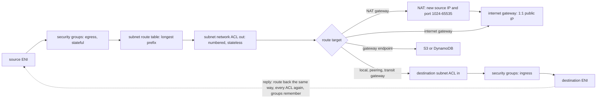

# A VPC Is Route Tables and Rules You Can Evaluate

*Every packet in a VPC crosses a security group, a network ACL and a route table, there and back; the drop is one rule you can name.*

## Metadata

| Field | Value |
|---|---|
| Type | Build |
| Languages | Python |
| Prerequisites | [A Container's Network Is a veth Pair, a Bridge and Three NAT Rules](https://cloudcaptain.io/learn/containers/container-networking) |
| Time | 90 minutes |
| Tools | aws, moto |

<Quiz stage="pre" />

## The Problem

Tuesday, 09:10. The nightly batch job in the private subnet failed again, and so did the retry, and the retry after that worked. Inside the job, `pip install` and the calls to the payment provider time out on roughly every second connection; from the same instance, by hand, `curl` works three times in a row and then hangs. The on-call engineer widens the instance's security group to allow all outbound traffic, which changes nothing because it already did. Someone suggests the NAT gateway is overloaded and replaces it; the new one has a new Elastic IP, the payment provider's allowlist does not know it, and now every call fails. At the same time the analytics team reports that their ETL job in the peered VPC cannot reach the Postgres database at all, although the database's security group allows `10.1.0.0/16` on 5432 and the network ACL has a rule for exactly that. The VPC flow log for the database interface shows an `ACCEPT` record for the incoming SYN and a `REJECT` record for the SYN-ACK going back.

Both outages came from one change three weeks earlier. A security review replaced the default network ACLs, which allow everything, with custom ones, and the inbound rule for return traffic was copied from AWS's documentation example: TCP 32768-65535. A Linux instance picks its client ports from 32768-60999, so the web servers in the public subnet never noticed. A NAT gateway picks source ports from 1024-65535, and it lives in that public subnet: replies to about half of its connections arrive on a port below 32768, match no numbered rule, and the `*` rule drops them. The private subnet's ACL had outbound rules for HTTPS and for replies to the web tier, and nothing for replies to `10.1.0.0/16`, because network ACLs are stateless and nobody wrote the second half. No security group was ever involved, which is why widening one did nothing.

The console shows every one of these objects on a separate page. What nobody had was the path: the source interface's security groups, its subnet's route table, its subnet's ACL on the way out, the NAT gateway and its own subnet's ACL in both directions, the internet gateway, and then all of it again for the reply. You are going to write `vpcpath`, which reads the JSON that `aws ec2 describe-*` prints, walks that path hop by hop for a question like "can batch reach the internet on TCP 443", checks the return path with the client's real port range, and answers reachable, blocked or partial with the exact rule that decided, using Reachability Analyzer's explanation codes. You will build the same network in moto with the AWS CLI and get the same answers from its describe output.

## The Concept

Think of an office building. Each apartment has a doorman (the security group) who checks people against a list of who may come in and go out, and remembers everyone he let through, so a visitor's reply is never stopped. Each floor has a gate guard (the network ACL) with a numbered list of allow and deny lines, who reads it top down for every envelope in either direction and remembers nothing. The mail room (the route table) sends each envelope to the most specific address range it knows. Some exits rewrite the envelope: the internet gateway swaps a private return address for a public one, one to one; the NAT gateway gives every letter its own return address and box number.

A VPC is that building, and every piece is a JSON document you can read:

- **Security groups** attach to network interfaces (ENIs). Rules are allow-only and the rules of all groups on an ENI are unioned. They are stateful: once a request is allowed, its reply passes in the other direction whatever the rules say. A rule can name a CIDR, a prefix list or another security group, and a group reference matches only the private IPs of that group's members, on same-VPC or peered paths.
- **Network ACLs** attach to subnets, exactly one per subnet. Rules are numbered 1-32766, evaluated lowest first, and the first match decides, allow or deny; the `*` rule denies what is left. They are stateless: the reply is a new packet whose destination port is the client's ephemeral port, and it must match a rule of its own. They apply only where traffic enters or leaves a subnet, never inside it.
- **Route tables** attach to subnets, one per subnet, either by explicit association or through the VPC's main table. The most specific route that covers the destination wins (longest prefix); on an identical prefix a static route beats a prefix-list route, which beats a propagated one. Every table has a `local` route for the VPC's CIDRs.
- **Targets** decide what happens next: `local` delivers to the ENI that has the address; an internet gateway translates between an ENI's private IP and its public IP and drops anything without one; a NAT gateway rewrites the source to its own address and port; a peering connection carries packets only between the two VPCs' CIDRs; a transit gateway forwards by its own route table, which by default holds every attached VPC's CIDRs; a gateway endpoint (a prefix-list route) takes S3 or DynamoDB traffic off the internet path.



The reply is where most real outages live. The security groups need nothing more. Every ACL crossed on the way there is crossed again on the way back, with source and destination swapped and the client's port range as the destination port. And the destination subnet's route table must send the reply back through the component the request came through: a reply to an internet client that leaves through a NAT gateway instead of the internet gateway arrives from the wrong address, and the client drops it.

## Build It

`code/main.py` is `vpcpath`. It reads a snapshot (a directory of `aws ec2 describe-*` outputs) into dataclasses, and everything after loading is pure functions. `code/fixtures/shop/` is a hand-built snapshot in exactly that format: a `shop` VPC with a public and a private subnet, an internet gateway, a NAT gateway and an S3 gateway endpoint, a peered `analytics` VPC, and a `legacy` VPC behind a transit gateway. `code/fixtures/questions.json` holds 17 questions about it, each with the verdict and the AWS documentation rule it follows from.

### Step 1: a snapshot is the union of describe outputs

Every `describe-*` call prints an object with one top-level list (`Vpcs`, `Subnets`, `RouteTables`, `NetworkAcls`, ...), and no two calls use the same key. So a snapshot is every list from every file, concatenated by key:

```python
def read_documents(paths: Sequence[str]) -> Dict[str, List[Any]]:
    merged: Dict[str, List[Any]] = {}
    files: List[str] = []
    for path in paths:
        if path != "-" and os.path.isdir(path):
            files.extend(os.path.join(path, n) for n in sorted(os.listdir(path)) if n.endswith(".json"))
        else:
            files.append(path)
```

`build_snapshot()` then reads the fields that matter. Security groups come from each ENI's `Groups`, not from the instance, because they belong to the interface (moto, for one, leaves an instance's `SecurityGroups` empty when it was launched with `--network-interfaces`). Public IPs come from each private IP's `Association.PublicIp`, which covers auto-assigned addresses and Elastic IPs alike. Name tags come from `describe-instances`, because `describe-network-interfaces` calls its tags `TagSet` and rarely has a Name. Prefix lists need their CIDRs (`describe-prefix-lists` prints them in `Cidrs`); IPv6 entries are skipped, since this lesson covers IPv4 only.

### Step 2: the route table is a longest prefix match with a tie-break

```python
def lookup(snap: Snapshot, table: RouteTable, dest: Address) -> Optional[Tuple[Route, Network, List[str]]]:
    candidates = []
    for route in table.routes:
        matching = [n for n in route_networks(snap, route) if dest in n]
        if matching:
            best = max(matching, key=lambda n: n.prefixlen)
            candidates.append((best.prefixlen, route.rank, route, best))
    if not candidates:
        return None
    candidates.sort(key=lambda c: (-c[0], -c[1]))
    winner = candidates[0]
    return winner[2], winner[3], [c[2].describe() for c in candidates[1:]]
```

A prefix-list route (`DestinationPrefixListId`) stands for every CIDR in the list, so it competes with the most specific one that covers the address. `Route.rank` is the tie-break from AWS's route priority rules: 2 for a static CIDR route, 1 for a prefix-list route, 0 for a propagated one (`Origin: EnableVgwRoutePropagation`). The losers are kept, so the hop can say that `172.16.0.0/12 -> tgw-0core` won over `0.0.0.0/0 -> nat-0shop`. A route in state `blackhole` still wins the match and then drops the packet, which is exactly what a deleted NAT gateway does to every subnet that pointed at it.

### Step 3: a network ACL decides port ranges, not just ports

For the request, one destination port goes in and one rule comes out. For the reply, the destination port is whatever ephemeral port the client picked, so the honest question is about the whole range. `acl_decide()` walks the rules in number order and hands each one the part of the range it covers:

```python
for entry in acl.entries:
    if entry.egress != egress or not entry.matches(protocol, remote):
        continue
    span = (0, 65535) if entry.protocol == -1 else (entry.low, entry.high)
    left: List[Ports] = []
    for low, high in remaining:
        cut_low, cut_high = max(low, span[0]), min(high, span[1])
        if cut_low > cut_high:
            left.append((low, high))
            continue
        decided.append((cut_low, cut_high, entry))
        if low < cut_low:
            left.append((low, cut_low - 1))
        if cut_high < high:
            left.append((cut_high + 1, high))
    remaining = left
    if not remaining:
        break
decided.extend((low, high, asterisk(egress)) for low, high in remaining)
```

Whatever no numbered rule claimed goes to `asterisk()`, the `*` deny. moto prints custom ACLs without their `*` entries and real AWS prints them as rule 32767; both end the same way. `entry.matches()` compares the rule's CIDR with the remote address: the destination for an outbound rule, the source for an inbound one. That is why a leg needs only one address for both directions: the reply's inbound rule on the same subnet matches the same remote host as a source.

### Step 4: security groups are a union of allow rules

```python
def match_peer(self, perm: Permission, remote: Address, counterpart: Optional[Interface], references: Tuple[str, str]) -> Tuple[str, bool]:
    for cidr in perm.cidrs:
        if remote in cidr:
            return str(cidr), False
    for pl in perm.prefix_lists:
        if pl not in self.snap.prefix_lists:
            self.snap.warnings.append(f"a security group rule references {pl}, whose CIDRs are not in the snapshot")
        elif any(remote in c for c in self.snap.prefix_lists[pl][1]):
            return pl, False
    member = counterpart is not None and any(g in counterpart.groups for g in perm.groups)
    if member and not references[0] and counterpart is not None and remote in counterpart.private_ips:
        return next(g for g in perm.groups if g in counterpart.groups), False
    return "", member
```

`sg_check()` tries every rule of every group on the ENI whose protocol and port cover the packet (`Permission.covers()`: `-1` is everything, TCP and UDP compare `FromPort`-`ToPort`, ICMP compares the type) and stops at the first that matches the peer. A group reference needs three things: the other interface is a member, the packet carries that member's private IP, and the path preserves membership. `references` says when it does not: through a NAT or internet gateway (`SG_REFERENCES_NOT_PRESERVED`), outbound across a transit gateway, or inbound across one whose security group referencing support is off (`SG_REFERENCING_SUPPORT`). When a group rule would have matched but cannot, the denial says so instead of reporting a plain mismatch. A group with no rules at all in that direction gives `SG_HAS_NO_RULES`.

### Step 5: the forward walk, one leg per subnet boundary

`from_interface()` checks the source ENI's egress rules, looks up its subnet's route table, and records a leg for every subnet boundary the packet crosses:

```python
def leg(self, subnet_id: str, outbound: bool, remote: Address) -> None:
    acl = self.snap.acl_for(subnet_id)
    self.legs.append(Leg(subnet_id, outbound, remote, self.reply_ports()))
    entry = acl_decide(acl, outbound, self.protocol, (self.port, self.port), remote)[0][2]
    kind = "nacl-out" if outbound else "nacl-in"
    text = f"{self.snap.label(acl.id)} on {subnet_id}: {entry.describe()} decides {self.what} {'to' if outbound else 'from'} {remote}"
    self.add("forward", kind, acl.id, ALLOW if entry.allow else DENY, text, "" if entry.allow else "SUBNET_ACL_RESTRICTION")
```

`reply_ports()` stores the source port range the packet has at this point, which becomes the destination port range of the reply on the same boundary. Then the route's target decides the next function: `deliver()` for `local` (with no leg at all when both ENIs share a subnet), `peering()`, `transit()`, `nat_egress()`, `internet_egress()` or `endpoint()`. Each one checks its own rules and ends in `deliver()` or leaves AWS. `peering()` refuses a destination outside the peer VPC's CIDRs (`PCX_REQUIRES_ADDRESS_IN_VPC_CIDR`): peering is not transitive, so a peer can never use your NAT gateway or your internet gateway. `transit()` forwards to the attachment whose VPC contains the address, assuming the default setup in which every VPC attachment propagates its CIDRs into one transit gateway route table. `deliver()` records which way the reply must leave: through the VPC router for `local`, the same peering connection, the same transit gateway, or an internet gateway.

### Step 6: gateways rewrite the packet

```python
if nat.subnet != eni.subnet:
    self.leg(nat.subnet, False, source)
self.source_ports = NAT_PORTS
translated = nat.private_ip or source
self.add("forward", "nat", nat_id, ALLOW, f"{nat_id} translates the source {source} to {translated} and picks a source port in {show_ports(NAT_PORTS)}")
table = self.snap.route_table_for(nat.subnet)
route = self.route_hop("forward", table, dst.address)
if route.kind != "igw":
    self.add("forward", "route", table.id, DENY, f"a public NAT gateway reaches the internet through an internet gateway route in its own subnet; {table.id} sends {dst.address} to {route.target}", "NO_ROUTE_TO_DESTINATION")
self.leg(nat.subnet, True, dst.address)
self.internet_egress(route.target, nat.vpc, nat.public_ip, translated, dst, nat_id, eni)
```

A NAT gateway is an ENI in a public subnet, so its subnet's ACL is checked twice: inbound from the private client, then outbound toward the internet. From that point on the source port is in 1024-65535, which is the range the reply must be allowed back on. `internet_egress()` drops a packet for a private (RFC 1918) destination (`IGW_DESTINATION_ADDRESS_NOT_IN_RFC1918_EGRESS`) and a source without a public IP (`IGW_PUBLIC_IP_ASSOCIATION_FOR_EGRESS`): an instance in a "public" subnet without a public IP has no internet access, whatever its route table says. From the internet, only a public IP that maps to an ENI is accepted (`IGW_PRIVATE_IP_ASSOCIATION_FOR_INGRESS` otherwise), and `internet_ingress()` translates it to that ENI's private IP. If the destination is the public IP of another ENI in the snapshot, the walk continues inbound with the translated source, which is how a "hairpin" through the internet loses its security group references.

### Step 7: the return path

```python
for leg in reversed(self.legs):
    acl = self.snap.acl_for(leg.subnet)
    segments = acl_decide(acl, not leg.outbound, self.protocol, leg.reply_ports, leg.remote)
    allowed = [s for s in segments if s[2].allow]
    denied = [s for s in segments if not s[2].allow]
```

`return_path()` first notes that the security groups that allowed the request pass the reply. Then it checks the reply's route from the destination subnet: if the request arrived through the internet gateway but the subnet's `0.0.0.0/0` points at a NAT gateway, the reply leaves with the wrong source address (`VPCPATH_ASYMMETRIC_RETURN`, a vpcpath code; Reachability Analyzer has no single code for it). Then it replays every leg in reverse with `acl_decide()` over the reply port range. All allowed is a pass, all denied is a block, and a mix is `partial`: some connections work and some time out, depending on the port the client happened to pick, with the share printed. For ICMP the reply is an echo reply (type 0), which needs its own ACL rule as well.

### Step 8: run it

```bash
S="--snapshot code/fixtures/shop"
python3 code/main.py subnets $S                                       # route table, 0.0.0.0/0 target, ACL, public or not
python3 code/main.py check internet web --port 443 $S                 # REACHABLE, through igw-0shop both ways
python3 code/main.py check batch internet --port 443 $S; echo "exit $?"
#   partial  nacl-in   acl-0public (public) on subnet-0public-a, reply tcp ports 1024-65535 from 198.51.100.10:
#                      1024-32767 denied by rule * deny all from 0.0.0.0/0; 32768-65535 allowed by rule 120 ...;
#                      about 49% of connections fail, depending on the source port [SUBNET_ACL_RESTRICTION]
# exit 1
python3 code/main.py check etl db --port 5432 $S                      # allowed in, blocked on the way back by acl-0private rule *
python3 code/main.py check worker internet --port 443 $S              # IGW_PUBLIC_IP_ASSOCIATION_FOR_EGRESS
python3 code/main.py check batch com.amazonaws.eu-central-1.s3 --port 443 $S   # the prefix-list route beats 0.0.0.0/0: no NAT
python3 code/main.py check web internet --port 443 --ephemeral 1025-5000 $S    # an old Windows client: the reply is blocked
python3 code/main.py check batch ldap --port 636 $S --json            # SG_REFERENCING_SUPPORT, the hops as JSON
python3 code/main.py matrix --questions code/fixtures/questions.json $S        # 17/17 as expected
```

Sources and destinations are instance ids, ENI ids, Name tags, private or public IPs, prefix list ids or names, or `internet` (198.51.100.10, a documentation address). Exit codes are 0 for reachable, 1 for blocked, partial or unknown (a route to a VPN gateway or an appliance, which vpcpath does not follow), and 2 for input that is not a usable snapshot.

<RunTests />

## Use It

AWS's own analyser needs an account, so first run the real EC2 API locally. moto implements the EC2 control plane (VPCs, subnets, route tables, gateways, security groups, ACLs, instances) well enough that the AWS CLI cannot tell the difference, and `describe-*` prints what AWS prints. It does not forward packets and does not implement Reachability Analyzer, which is exactly the gap `vpcpath` fills.

```bash
python3 -m venv .venv && .venv/bin/pip install 'moto[server]==5.2.5'       # moto 5.2 needs Python 3.10 or later
.venv/bin/moto_server -H 127.0.0.1 -p 5000 &
export AWS_ACCESS_KEY_ID=test AWS_SECRET_ACCESS_KEY=test AWS_DEFAULT_REGION=eu-central-1
aws() { command aws --endpoint-url http://127.0.0.1:5000 "$@"; }

VPC=$(aws ec2 create-vpc --cidr-block 10.0.0.0/16 --query Vpc.VpcId --output text)
PUB=$(aws ec2 create-subnet --vpc-id $VPC --cidr-block 10.0.1.0/24 --query Subnet.SubnetId --output text)
PRIV=$(aws ec2 create-subnet --vpc-id $VPC --cidr-block 10.0.2.0/24 --query Subnet.SubnetId --output text)
IGW=$(aws ec2 create-internet-gateway --query InternetGateway.InternetGatewayId --output text)
aws ec2 attach-internet-gateway --internet-gateway-id $IGW --vpc-id $VPC
RT_PUB=$(aws ec2 create-route-table --vpc-id $VPC --query RouteTable.RouteTableId --output text)
aws ec2 create-route --route-table-id $RT_PUB --destination-cidr-block 0.0.0.0/0 --gateway-id $IGW
aws ec2 associate-route-table --route-table-id $RT_PUB --subnet-id $PUB
EIP=$(aws ec2 allocate-address --domain vpc --query AllocationId --output text)
NAT=$(aws ec2 create-nat-gateway --subnet-id $PUB --allocation-id $EIP --query NatGateway.NatGatewayId --output text)
RT_PRIV=$(aws ec2 create-route-table --vpc-id $VPC --query RouteTable.RouteTableId --output text)
aws ec2 create-route --route-table-id $RT_PRIV --destination-cidr-block 0.0.0.0/0 --nat-gateway-id $NAT
aws ec2 associate-route-table --route-table-id $RT_PRIV --subnet-id $PRIV
ACL=$(aws ec2 create-network-acl --vpc-id $VPC --query NetworkAcl.NetworkAclId --output text)
aws ec2 create-network-acl-entry --network-acl-id $ACL --ingress --rule-number 120 --protocol tcp --port-range From=32768,To=65535 --cidr-block 0.0.0.0/0 --rule-action allow
```

`code/smoke.sh` builds the whole fixture network this way (the peered VPC, the transit gateway, the S3 endpoint, six security groups, both custom ACLs, seven instances and an Elastic IP), then exports it and asks the same 17 questions:

```bash
mkdir moto-export
for call in describe-vpcs describe-subnets describe-route-tables describe-security-groups describe-network-acls \
  describe-network-interfaces describe-instances describe-internet-gateways describe-nat-gateways \
  describe-vpc-peering-connections describe-transit-gateways describe-transit-gateway-attachments \
  describe-vpc-endpoints describe-prefix-lists; do
  aws ec2 $call --output json > moto-export/$call.json
done
aws ec2 get-managed-prefix-list-entries --prefix-list-id pl-...      # moto leaves Cidrs out of describe-prefix-lists; the smoke merges them in
python3 code/main.py matrix --snapshot moto-export --questions code/fixtures/questions.json   # 17/17, the same verdicts as the fixture
```

The same snapshot works against a real account: run the loop without `--endpoint-url`, with read-only credentials (`ec2:Describe*` is enough), and add `--filters Name=vpc-id,Values=...` if the account is large.

Read the hops by hand, which is what you do when there is no tool:

```bash
aws ec2 describe-route-tables --filters Name=association.subnet-id,Values=$PRIV --query 'RouteTables[0].Routes[]'
aws ec2 describe-route-tables --filters Name=vpc-id,Values=$VPC --query 'RouteTables[?Associations[?Main]].RouteTableId'   # what unassociated subnets use
aws ec2 describe-network-acls --filters Name=association.subnet-id,Values=$PUB --query 'NetworkAcls[0].Entries[?Egress==`false`] | sort_by(@, &RuleNumber)'
aws ec2 describe-security-groups --group-ids sg-... --query 'SecurityGroups[0].[IpPermissions,IpPermissionsEgress]'
aws ec2 describe-network-interfaces --filters Name=addresses.private-ip-address,Values=10.0.2.20 --query 'NetworkInterfaces[0].[SubnetId,Groups,Association]'
aws ec2 replace-network-acl-entry --network-acl-id $ACL --ingress --rule-number 120 --protocol tcp --port-range From=1024,To=65535 --cidr-block 0.0.0.0/0 --rule-action allow   # the fix
```

**Reachability Analyzer** is AWS's version of `vpcpath check`, run against your real configuration (it is a static analysis too: no packet is sent, and each analysis is billed). A path names a source, a destination, a protocol and a port; an analysis answers `NetworkPathFound` with the forward and return components, or the explanation codes `vpcpath` borrows:

```bash
NIP=$(aws ec2 create-network-insights-path --source i-0etl --destination i-0db --protocol tcp --destination-port 5432 --query NetworkInsightsPath.NetworkInsightsPathId --output text)
NIA=$(aws ec2 start-network-insights-analysis --network-insights-path-id $NIP --query NetworkInsightsAnalysis.NetworkInsightsAnalysisId --output text)
aws ec2 describe-network-insights-analyses --network-insights-analysis-ids $NIA \
  --query 'NetworkInsightsAnalyses[0].[Status,NetworkPathFound,Explanations[].ExplanationCode]'        # SUBNET_ACL_RESTRICTION
aws ec2 describe-network-insights-analyses --network-insights-analysis-ids $NIA --query 'NetworkInsightsAnalyses[0].ReturnPathComponents'
```

It does not support an internet gateway as an intermediate hop (`IGW_NAT_REFLECTION`): analyse the two halves separately. **Network Access Analyzer** asks the opposite question, for a whole account: which paths exist that should not, for example every ENI reachable from an internet gateway on a port other than 443. You describe a scope (`create-network-insights-access-scope --match-paths ... --exclude-paths ...`), run `start-network-insights-access-scope-analysis`, and read `get-network-insights-access-scope-analysis-findings`. `vpcpath matrix` with `expect` values is the same idea for a fixed list of questions, cheap enough to run in CI on every Terraform plan.

**Flow logs** show what actually happened, after the fact. In the default format (`version account-id interface-id srcaddr dstaddr srcport dstport protocol packets bytes start end action log-status`) a reply dropped by a stateless ACL shows up as two records on the ENI, an `ACCEPT` for the request and a `REJECT` for the reply, while a request dropped by a security group is a single `REJECT`. That pair is the fingerprint of the Problem's database outage:

```bash
aws ec2 create-flow-logs --resource-type VPC --resource-ids $VPC --traffic-type ALL \
  --log-destination-type s3 --log-destination arn:aws:s3:::my-flow-logs
aws ec2 describe-flow-logs --filter Name=resource-id,Values=$VPC
```

Azure and Google Cloud have the same pieces with different defaults. Azure network security groups are stateful like security groups but hold numbered allow and deny rules like an ACL, and attach to a subnet, a NIC or both; there is no stateless layer. Google Cloud's VPC firewall rules are stateful, have priorities and both actions, and target instances by network tag or service account; routes are VPC-wide with priorities. Both have a static analyser: Azure Network Watcher (IP flow verify, next hop, connection troubleshoot) and Google's Connectivity Tests.

| What you built | Real tool | Azure | GCP |
|---|---|---|---|
| `read_documents()` over `describe-*` JSON | AWS Config, `aws ec2 describe-*`, the VPC console | Resource Graph, `az network` | Cloud Asset Inventory, `gcloud compute` |
| `lookup()`: longest prefix, static over prefix list over propagated | VPC route tables, route priority | route tables (UDR) over system routes, effective routes, Network Watcher next hop | VPC routes with priority, policy-based routes |
| `acl_decide()`: numbered, stateless, port ranges | network ACLs | no stateless equivalent; NSG rules are numbered but stateful | no stateless equivalent |
| `sg_check()`: allow-only union, group references | security groups | NSGs and application security groups (priorities, allow and deny) | VPC firewall rules and firewall policies (priorities, allow and deny, tags or service accounts) |
| `internet_egress()`, `nat_egress()` | internet gateway, NAT gateway | public IPs, NAT Gateway (Microsoft recommends an explicit outbound method over default outbound access) | external IPs, Cloud NAT |
| `peering()`, `transit()` | VPC peering, Transit Gateway | VNet peering, Virtual WAN | VPC Network Peering, Network Connectivity Center |
| `endpoint()` with prefix lists | gateway endpoints for S3 and DynamoDB | service endpoints, Private Endpoint | Private Google Access, Private Service Connect |
| `trace()` with explanation codes | Reachability Analyzer | Network Watcher IP flow verify and connection troubleshoot | Connectivity Tests |
| `matrix` with `expect` | Network Access Analyzer scopes | Network Watcher connection monitor (active probes instead of analysis) | Network Analyzer in Network Intelligence Center |
| the `ACCEPT` and `REJECT` pair | VPC flow logs | NSG and VNet flow logs | VPC Flow Logs, Firewall Rules Logging |

<Quiz stage="check" />

## Ship It

Two artifacts in `outputs/`:

- **`skill-vpc-connectivity-triage.md`**: a runbook for "A cannot reach B" or "it works sometimes" in a VPC. It pins the question down (source ENI, destination address, protocol, port, client OS), exports a snapshot with read-only `describe-*` calls, runs `vpcpath` or Reachability Analyzer, confirms the deciding rule with one describe command and the flow-log pattern, maps each explanation code to the change that fixes it, proves the fix with the same question before and after, and ends with a fixed report.
- **`prompt-explain-sg-nacl.md`**: paste security group rules, network ACL entries, a route table and the question, and get the forward path, the return path with the client's real ephemeral range, the first rule that blocks, whether a security group or an ACL is responsible, and the smallest rule change, without widening anything to `0.0.0.0/0` on all ports.

<ShipIt />

## Exercises

### Easy

Add `vpcpath routes`, a report of every route that can only drop traffic: state `blackhole`, a target that is not in the snapshot (a NAT gateway that was deleted, an internet gateway that was detached), a peering connection that is not `active`, and a prefix-list route whose list has no CIDRs. Each finding names the table, the destination, the target and the subnets that use the table, explicitly or through the main table. Write the tests first: delete `nat-0shop` from the fixture and `rtb-0private`'s default route must be reported with `subnet-0private-a`, and an untouched fixture must report nothing.

### Medium

Add `vpcpath flowlog`, which reads VPC flow log records in the default format for one ENI and pairs each `ACCEPT` with the record for the reverse 5-tuple. An `ACCEPT` whose reverse is `REJECT` is a stateless ACL dropping the reply; a lone `REJECT` inbound is a security group or an ACL on the way in. For every pair, run `trace()` with the record's addresses and ports and print whether vpcpath agrees and which rule it blames. Tests first, with fixture lines modelled on AWS's flow log examples: the ICMP ping that produces `ACCEPT` then `REJECT`, an SSH connection that produces two `ACCEPT` records, and an RDP attempt with a single `REJECT`.

### Hard

Replace the transit gateway shortcut with real transit gateway route tables. Read `describe-transit-gateway-route-tables`, the associations and propagations (`get-transit-gateway-route-table-associations`, `get-transit-gateway-route-table-propagations`) and the routes (`search-transit-gateway-routes` with `--filters Name=state,Values=active,blackhole`), route each packet through the table associated with the attachment it entered from, and apply longest prefix, static over propagated and blackhole routes. Then prove a spoke-isolation design with matrix questions: two spokes reach a shared-services VPC and not each other. Test first: with one table associated with both spokes the spokes reach each other; with a spoke table that only has the shared-services route, they get `NO_ROUTE_TO_DESTINATION` at the transit gateway.

<Quiz stage="post" />

## Key Terms

| Term | Common misconception | Precise definition |
|---|---|---|
| Security group | "A firewall on the subnet; a deny rule blocks an attacker." | A set of allow-only rules attached to network interfaces. Rules of all groups on an ENI are unioned, and connection tracking lets the reply of an allowed request through in the other direction. |
| Network ACL | "A second security group." | An ordered list of numbered allow and deny rules attached to a subnet (exactly one per subnet). The first matching rule decides, the `*` rule denies the rest, and each packet is judged alone in each direction, at the subnet boundary only. |
| Ephemeral port | "Replies come back on the service port." | The source port the client picked, which is the reply's destination port: 32768-60999 on Linux by default, 49152-65535 on current Windows, 1024-65535 for a NAT gateway, a load balancer or Lambda. An ACL must allow the reply on that range. |
| Longest prefix match | "Routes are evaluated top to bottom." | The route with the most specific destination that contains the address wins; on an identical prefix a static route beats a prefix-list route, which beats a propagated route. Order in the table means nothing. |
| Main route table | "A subnet without a route table has no routes." | The table every subnet without an explicit association uses. Changing it changes every such subnet at once, which is why many teams leave it with only the `local` route. |
| Public subnet | "A subnet where instances are reachable from the internet." | A subnet whose route table sends traffic to an internet gateway. An instance there still needs a public IPv4 address or Elastic IP, and its security group and ACL must allow the traffic. |
| NAT gateway | "It lets the internet reach private instances." | A managed device in a public subnet that rewrites the source of outbound connections to its own address and a port in 1024-65535. It never accepts connections that start outside, and its own subnet's ACL sees the traffic twice each way. |
| VPC peering | "Peered VPCs share each other's gateways." | A connection that carries packets between the two VPCs' CIDRs only. It is not transitive: no third VPC, no NAT gateway, no internet gateway on the other side. Both sides need routes, in the request's direction and in the reply's. |
| Gateway endpoint | "An interface with an IP address in the subnet." | A route target for an AWS-managed prefix list (S3 or DynamoDB). The prefix-list route is more specific than `0.0.0.0/0`, so that traffic skips the NAT gateway; the endpoint policy then applies as IAM. |
| Reachability Analyzer | "It sends test traffic." | A static analysis of the configuration between a source and a destination that returns the forward and return path or the explanation codes for the first blocking component. No packet is sent, so it can check a path before any traffic depends on it. |

## Further Reading

- [AWS Compute & Networking](https://cloudcaptain.io/docs/cloud/aws/compute-networking): the VPC architecture, security groups versus NACLs, peering and flow logs in the Reference layer.
- [Network Fundamentals](https://cloudcaptain.io/docs/tools/networking/fundamentals): CIDR blocks, prefixes and the TCP handshake that the return path has to carry.
- [Network Security](https://cloudcaptain.io/docs/tools/networking/security): stateful and stateless filtering in general, before AWS gave them names.
- [AWS Certification Prep](https://cloudcaptain.io/docs/cloud/aws/exam-prep): the VPC questions on the Solutions Architect exams are exactly this lesson's 17 questions in prose.
- [How route priority works](https://docs.aws.amazon.com/vpc/latest/userguide/route-tables-priority.html): longest prefix, static over prefix list over propagated, the source of `Route.rank`.
- [Custom network ACLs and ephemeral ports](https://docs.aws.amazon.com/vpc/latest/userguide/custom-network-acl.html): the example rules this lesson's outage copies, and the list of client port ranges per operating system and service.
- [Security group rules and referencing](https://docs.aws.amazon.com/vpc/latest/userguide/security-group-rules.html): allow-only rules, the default outbound rule, and when a group reference matches.
- [Reachability Analyzer explanation codes](https://docs.aws.amazon.com/vpc/latest/reachability/explanation-codes.html): every code vpcpath prints, with AWS's definition.
- [Flow log record examples](https://docs.aws.amazon.com/vpc/latest/userguide/flow-logs-records-examples.html): the `ACCEPT` and `REJECT` pair of a stateless reply drop, and what a NAT gateway's interface records.
- [NAT gateways](https://docs.aws.amazon.com/vpc/latest/userguide/vpc-nat-gateway.html): public and private connectivity, Elastic IPs and the routes each kind needs.
- [Azure network security groups](https://learn.microsoft.com/en-us/azure/virtual-network/network-security-groups-overview) and [Google Cloud VPC firewall rules](https://cloud.google.com/firewall/docs/firewalls): the same questions with priorities, deny rules and no stateless layer.
- [moto server mode](https://docs.getmoto.org/en/latest/docs/server_mode.html): running the AWS API locally for any SDK or the CLI.
