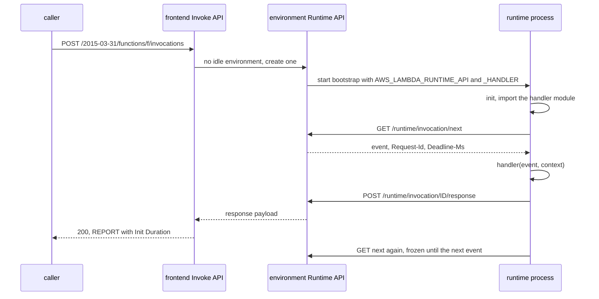

# A Function Is a Process the Platform Starts for You

*Your handler lives in a process the platform starts, freezes and kills; cold starts, timeouts and throttles are steps in that lifecycle.*

## Metadata

| Field | Value |
|---|---|
| Type | Build |
| Languages | Python |
| Prerequisites | [PID 1: Why Your Container Ignores Ctrl-C](https://cloudcaptain.io/learn/linux/pid1-supervisor) |
| Time | 90 minutes |
| Tools | docker, curl, aws-lambda-rie, aws |

<Quiz stage="pre" />

## The Problem

Monday, 08:05. The checkout API runs on Lambda behind API Gateway. Median latency is 40 ms, but about one request in fifty takes 2.4 seconds, always in the first minutes after traffic ramps up. The team blames the database, doubles memory, and adds a client retry after 1 second. The retries make it worse: each one is a second concurrent request, which needs a second execution environment, which needs another 2.4-second start. At 08:20 the payment webhook, a different function in the same account, starts failing with `TooManyRequestsException`. Nobody changed it. Its logs show nothing at all for the failed calls.

In the afternoon the report function "randomly" times out at its default 3 seconds. Someone notices that the request right after each timeout is also slow, even though the previous one had warmed it up, and concludes that Lambda is flaky.

Every one of these is written in the `REPORT` lines nobody reads. The slow checkout requests are exactly the ones whose `REPORT` carries `Init Duration: 2311.40 ms`: the module imports a large SDK and fetches secrets at import time, once per new environment. The webhook was throttled because the checkout burst used up the account's unreserved concurrency, and a throttled request never reaches a process, so it cannot log anything. The slow request after a timeout has a long `Duration` and no `Init Duration`: the timeout killed the process, and the next request paid for starting a new one inside its own invocation. You are going to build the machine that writes those lines: `minilambda`, a platform that starts a runtime process per execution environment, hands it events over the Lambda Runtime API, freezes it between requests, kills it at the deadline and counts concurrency, plus the custom runtime (`bootstrap`) on the other side of that API. Then you run the same bootstrap under AWS's own Runtime Interface Emulator and compare.

## The Concept

A Lambda function is not code that AWS calls. It is a process that asks for work. Picture a courier at a depot: they knock on the dispatcher's window, wait until a parcel is ready, deliver it, come back and knock again. Between parcels they are not paid and not moving. Hiring a new courier takes time; a courier who collapses mid-delivery is replaced; the dispatcher refuses new parcels when every courier allowed for that route is out.

- **Execution environment.** One isolated sandbox (on AWS, a Firecracker microVM) holding your code, the runtime and a private HTTP endpoint, the **Runtime API**, whose address is in `AWS_LAMBDA_RUNTIME_API`. With the default capacity it serves one invocation at a time; Lambda Managed Instances, a newer capacity type, let one environment take several at once, up to `AWS_LAMBDA_MAX_CONCURRENCY`.
- **Init phase.** On a cold start Lambda starts the runtime process (your `bootstrap`, or the managed runtime's), which imports the handler module and runs all module-level code. Init ends when the process first calls `GET /2018-06-01/runtime/invocation/next`. It is limited to 10 seconds for on-demand environments; if it fails or runs out of time, Lambda retries it inside the first invocation, against the function timeout.
- **Invoke.** That `next` call is a long poll. Its response is the event, with headers for the request ID, the deadline in Unix milliseconds, the function ARN, the trace ID and an invocation ID. The runtime calls the handler and posts `.../invocation/ID/response` or `.../invocation/ID/error`, then calls `next` again, which tells the platform it is ready.
- **Freeze and reuse.** While the runtime waits in `next`, the environment is frozen: no CPU at all, so a background thread started by the handler stops mid-step and resumes on the next invocation, or never. The next request routed to this environment is **warm**: module state, open connections and `/tmp` are still there.
- **Reset.** A timeout or a crash leaves the process in an unknown state, so Lambda kills it. The environment is reused, but the next invocation first starts a new runtime process inside its own time budget. This is a **suppressed init**: no `Init Duration` field, a long `Duration`.
- **Concurrency.** The number of environments busy at once. Reserved concurrency caps a function (and sets that capacity aside for it); `0` turns the function off. When the cap or the account's pool is used up, the frontend answers `429 TooManyRequestsException` before any process is involved. Provisioned concurrency runs the init phase ahead of time; SnapStart restores an initialised environment from a snapshot.
- **The bill.** `Billed Duration` is `Duration` plus `Init Duration`, rounded up to the millisecond, times the memory size. Since 1 August 2025 the init phase is billed for every runtime and package type.



Each failure has a fixed signature. A handler exception is still HTTP 200 with `X-Amz-Function-Error: Unhandled` and the runtime's error JSON as the body; the environment stays warm. A timeout is `Sandbox.Timedout` with `Task timed out after 3.00 seconds`, `Status: timeout` in `REPORT`, and a reset. A process that exits mid-invocation is `Runtime.ExitError` with `Runtime exited with error: exit status 1`, and a reset. An import error is reported by the runtime to `/runtime/init/error` and becomes the response of the invocation that triggered the cold start, with two `INIT_REPORT` lines because init is tried twice. A throttle is a 429 that the function's logs never mention.

## Build It

`code/main.py` is `minilambda`, both halves of the Runtime API. `serve` is the platform: an Invoke API on one port (the RIE's `/2015-03-31/functions/function/invocations` and the AWS CLI's `/2015-03-31/functions/NAME/invocations`), and per execution environment a runtime process plus its own Runtime API server on a private `127.0.0.1` port. `bootstrap` is a custom runtime that loads a Python handler and loops over that API; it uses only `urllib`, so it also runs under the real emulator. `code/fixtures/function/app.py` is the demo function: it counts invocations in module state (`cold` is true only on the first call in a process) and can fail, sleep, exit, return too much, or start a background thread, depending on the event. The tests start real runtime processes on macOS or Linux, with no Docker.

### Step 1: an execution environment is a process with a private Runtime API

The platform owns the process and decides its environment. These are the variables a custom runtime gets on Lambda; nothing else from the parent leaks in except `PATH` and `LANG`:

```python
values.update({
    "AWS_LAMBDA_RUNTIME_API": f"127.0.0.1:{env.port}",
    "_HANDLER": config.handler,
    "LAMBDA_TASK_ROOT": os.path.abspath(config.task_root),
    "LAMBDA_RUNTIME_DIR": os.path.dirname(THIS_FILE),
    "AWS_LAMBDA_FUNCTION_NAME": config.name,
    "AWS_LAMBDA_FUNCTION_VERSION": "$LATEST",
    "AWS_LAMBDA_FUNCTION_MEMORY_SIZE": str(config.memory_mb),
```

```python
process = subprocess.Popen(config.command, cwd=config.task_root, env=self.platform.runtime_environment(self, initialization_type), stdin=subprocess.DEVNULL, stdout=subprocess.PIPE, stderr=subprocess.STDOUT, start_new_session=True)
```

`start_new_session=True` puts the runtime and anything it forks into its own process group, so one `killpg` reaches all of it, the job PID 1 did for you in the prerequisite lesson. A thread reads the process's stdout line by line and attributes each line to the invocation in flight, which is how Lambda knows which log lines belong between `START` and `END`. If the command does not exist, the invocation fails with `Runtime.InvalidEntrypoint` and `Couldn't find valid bootstrap(s)`, the error a container image with a wrong `ENTRYPOINT` produces.

### Step 2: init ends when the runtime first asks for work

There is no "ready" call. The first `GET next` is the signal, and every later one means "the previous invocation is done, including whatever I did after posting the response":

```python
self.current = None
if not self.initialized:
    self.initialized, self.init_done_at = True, time.monotonic()
if self.claimed is not None and self.claimed.finished:
    self.claimed = None
    self.last_used = time.monotonic()
cond.notify_all()
if self.pending is None and self.claimed is None and self.platform.config.freeze:
    self.freeze()
cond.wait_for(lambda: self.pending is not None or self.closing or self.generation != generation or not self.alive)
```

`freeze()` sends `SIGSTOP` to the process group and `thaw()` sends `SIGCONT` just before the event is returned: a cruder mechanism than Lambda's, with the same effect on your code. `test_an_idle_environment_is_frozen_so_background_threads_stop` starts a thread that appends to a file every 50 ms and shows the file stops growing between invocations, then grows again during the next one. `claimed` is the invocation the platform has given this environment; it is released only by that next `GET next`, so an environment still running code after its response counts against concurrency, as on Lambda. The first `next` also has to return the event to a runtime that may have been waiting: the response carries `Lambda-Runtime-Aws-Request-Id`, `Lambda-Runtime-Deadline-Ms`, `Lambda-Runtime-Invoked-Function-Arn`, `Lambda-Runtime-Trace-Id` and `Lambda-Runtime-Invocation-Id`. A `response` with another request ID is `400 InvalidRequestID`; a second response for the same ID, or an `init/error` after init, is `403 InvalidStateTransition`.

### Step 3: placement is warm, reinit, cold or throttle

```python
def place(envs: Sequence[EnvView], reserved: Optional[int], account_limit: int) -> Placement:
    in_flight = sum(1 for env in envs if env.status == "busy")
    if reserved is not None and in_flight >= reserved:
        return Placement("throttle", reason="ReservedFunctionConcurrentInvocationLimitExceeded")
    if in_flight >= account_limit:
        return Placement("throttle", reason="ConcurrentInvocationLimitExceeded")
    for status, action in (("idle", "warm"), ("reset", "reinit")):
        candidates = [env for env in envs if env.status == status]
        if candidates:
            chosen = max(candidates, key=lambda env: (env.provisioned, env.last_used, -env.id))
            return Placement(action, chosen.id)
    return Placement("cold")
```

Concurrency is busy environments, not requests per second: 50 requests a second that each take 200 ms need 10 environments. A throttle returns before any process is touched, with `{"Reason": "...", "Type": "User", "message": "Rate Exceeded."}` and `X-Amzn-ErrorType: TooManyRequestsException`, so it writes no function log line (`test_reserved_concurrency_throttles_with_429_and_no_function_logs`). Provisioned environments are preferred, then the most recently used one. One choice is minilambda's own: if the only candidate is an environment that has answered but not yet called `next`, the frontend waits up to 250 ms for it instead of starting a new one, which keeps back-to-back calls from one client on one environment.

### Step 4: the deadline is enforced by killing the process

```python
def dispatch(self, env: Environment, invocation: Invocation, deadline: float) -> None:
    with self.cond:
        invocation.deadline_ms = int((time.time() + max(0.0, deadline - time.monotonic())) * 1000)
        env.assign(invocation)
        self.cond.wait_for(lambda: invocation.finished, timeout=max(0.0, deadline - time.monotonic()))
        if invocation.finish(json_bytes(timeout_error(self.config.timeout, invocation.request_id)), "Sandbox.Timedout", "timeout"):
            env.current = env.pending = None
            env.kill()
```

The runtime learns the deadline from a header and computes `context.get_remaining_time_in_millis()` from it, but nothing depends on its cooperation: the platform waits until the deadline and then sends `SIGKILL` to the process group. `finish()` succeeds only once, so a response that arrives a millisecond late loses the race and is refused with 403. The environment is now `reset`. A watcher thread per process handles the other way a process ends: `exit_error()` turns a return code into `Runtime exited with error: exit status 3` or `signal: killed`, worded the way Lambda words it.

### Step 5: init can fail, and the next try happens inside the invocation

```python
if decision.action == "cold":
    init_ms, failure = self.initialize(env, "on-demand", "init", config.init_timeout, "", invocation)
    needs_init = failure is not None
self.platform_event("platform.start", {"requestId": invocation.request_id, "version": "$LATEST"}, f"START RequestId: {invocation.request_id} Version: $LATEST", invocation)
began = time.monotonic()
deadline = began + config.timeout
if needs_init:
    _, failure = self.initialize(env, "on-demand", "invoke", deadline - time.monotonic(), invocation.request_id, invocation)
```

A cold start runs init in its own phase with its own limit (10 seconds), logs `START` only after it, and reports `Init Duration`. A reset environment, or a cold start whose first init failed, runs init again after `START`, inside the invocation's deadline: that is the suppressed init, with no `Init Duration` field. `await_init()` returns one of four outcomes: the runtime called `next`, it posted to `/runtime/init/error` (its payload becomes the response), it exited (`Runtime.ExitError`), or the time ran out (`Sandbox.Timedout`). A failure logs `INIT_REPORT Init Duration: ... Phase: init Status: error Error Type: ...`. The error type in that line is the `Lambda-Runtime-Function-Error-Type` header normalised the way the platform does it: anything that does not look like `Runtime.Something` or `Function.Something` becomes `Runtime.Unknown`, which is why a `KeyError` at import shows as `Runtime.Unknown` in `INIT_REPORT` but as `KeyError` in the response body.

### Step 6: the runtime is a loop over GET next

The other half is what AWS ships as the runtime interface client. `run_runtime()` loads the handler once, then:

```python
try:
    context = LambdaContext(headers, environ, clock)
    try:
        event = json.loads(body.decode("utf-8"))
    except ValueError as exc:
        raise FaultError("Runtime.UnmarshalError", f"Unable to unmarshal input: {exc}")
    result = handler(event, context)
    try:
        payload = json.dumps(result).encode("utf-8")
    except (TypeError, ValueError) as exc:
        raise FaultError("Runtime.MarshalError", f"Unable to marshal response: {exc}")
except Exception as exc:
    error = error_payload(exc, request_id)
```

An error becomes `{"errorMessage", "errorType", "requestId", "stackTrace"}`, with the traceback starting at the user's frame, posted to `/invocation/ID/error`, and the loop continues: a handled error does not cost a cold start. `load_handler()` uses the Python runtime's error types and messages: `Runtime.MalformedHandlerName` for `handler` without a dot, `Runtime.ImportModuleError` with `Unable to import module 'broken': No module named '...'`, `Runtime.UserCodeSyntaxError`, `Runtime.HandlerNotFound`. Any other exception at import keeps its Python type. Init failures go to `/runtime/init/error` and the process exits 1. Logging uses the runtime's text format, `[INFO]	2026-11-01T08:05:01.123Z	REQUEST_ID	message`, or JSON with `requestId` when `AWS_LAMBDA_LOG_FORMAT=JSON`; as on Lambda, the text format leaves the root logger at `WARNING` unless `AWS_LAMBDA_LOG_LEVEL` says otherwise.

### Step 7: REPORT lines are the bill

```python
def billed_ms(duration_ms: float, init_ms: Optional[float] = None) -> int:
    return int(math.ceil(round(duration_ms + (init_ms or 0.0), 6)))
```

`report_line()` writes `REPORT RequestId: ID	Duration: 250.06 ms	Billed Duration: 351 ms	Memory Size: 1024 MB	Max Memory Used: 350 MB	Init Duration: 100.77 ms`, adding `Status: timeout` or `Status: error	Error Type: Runtime.ExitError` after a reset, which is the format AWS documents. `Max Memory Used` is the process's peak RSS (`VmHWM` in `/proc/PID/status` on Linux, `ps` elsewhere); memory is reported, not enforced. With `--log-format JSON` the same facts are `platform.start` and `platform.report` records. `minilambda report FILE` parses all of these, plus the RIE's lines, and summarises cold-start rate, init and duration percentiles, billed milliseconds and init failures.

### Step 8: run it

```bash
python3 code/main.py serve --handler app.handler --task-root code/fixtures/function --timeout 1 --reserved-concurrency 2 &
python3 code/main.py invoke --payload '{"name": "cc"}'           # {"message": "hello cc", "cold": true, "invocations": 1}
python3 code/main.py invoke --payload '{"name": "cc"}'           # cold false, invocations 2: same process
python3 code/main.py invoke --payload '{"action": "fail"}'       # ValueError body; HTTP 200, function error Unhandled; exit 1
python3 code/main.py invoke --payload '{"name": "cc"}'           # cold false, invocations 4: errors do not reset
python3 code/main.py invoke --payload '{"action": "sleep", "seconds": 3}'   # Sandbox.Timedout: Task timed out after 1.00 seconds
python3 code/main.py invoke --payload '{"name": "cc"}' --log-tail          # cold true, invocations 1; REPORT has no Init Duration
python3 code/main.py invoke --payload '{"action": "exit"}'       # Runtime.ExitError: Runtime exited with error: exit status 3
curl -s http://127.0.0.1:9000/minilambda/state                   # environments, their status and whether they are frozen
kill %1
```

The platform's log goes to stderr (or `--log-file`): `START`, the handler's `[INFO]` lines with the request ID, `END`, and `REPORT` with `Init Duration` only on the first line. To see the protocol with nothing in between, be the runtime yourself. Start a platform whose "runtime" is a process that never calls the API, invoke in one terminal, and answer by hand in another:

```bash
python3 code/main.py serve --handler app.handler --task-root code/fixtures/function --runtime "sleep 3600" --runtime-api-port 9001 --timeout 60 &
curl -s -XPOST http://127.0.0.1:9000/2015-03-31/functions/function/invocations -d '{"name": "curl"}' &
curl -si http://127.0.0.1:9001/2018-06-01/runtime/invocation/next          # the event, Lambda-Runtime-Aws-Request-Id, Deadline-Ms
curl -s -XPOST http://127.0.0.1:9001/2018-06-01/runtime/invocation/REQUEST_ID/response -d '{"answer": "from curl"}'   # 202; the first curl returns
python3 code/main.py report code/fixtures/cloudwatch-reports.txt             # cold starts 4 of 7, init p50 80.00 ms, init failures init:timeout
```

The `Init Duration` of that invocation is however long you took to type the `next` request, which is the definition: init lasts until the runtime asks for work. `--provisioned 2` initialises two environments before the first request and logs an `INIT_REPORT` for each, `--idle-ttl 30` destroys environments idle for 30 seconds, `--log-format JSON` switches every line to JSON, and `--no-freeze` lets background threads run between invocations. Exit codes: `invoke` returns 0 for a success and 1 for a function error, throttle or HTTP error; every command returns 2 for bad input.

<RunTests />

## Use It

AWS publishes the platform half for local use: the Runtime Interface Emulator (`aws-lambda-rie`), built into every `public.ecr.aws/lambda/*` base image. Pin a dated tag, like any image you test against. The emulator listens on 8080 inside the container and starts the image's runtime on the first request:

```bash
IMAGE=public.ecr.aws/lambda/python:3.12.2026.10.15.13
docker pull $IMAGE
docker run -d --name cc-aws -p 127.0.0.1:9001:8080 -v "$PWD/code/fixtures/function:/var/task:ro" \
  -e AWS_LAMBDA_FUNCTION_TIMEOUT=1 $IMAGE app.handler
URL=http://127.0.0.1:9001/2015-03-31/functions/function/invocations
curl -s -XPOST $URL -d '{"name": "cc"}'                    # {"message": "hello cc", "cold": true, "invocations": 1}
curl -s -XPOST $URL -d '{"name": "cc"}'                    # cold false, invocations 2
curl -s -XPOST $URL -d '{"action": "fail"}'                # {"errorMessage": "bad input: fail", "errorType": "ValueError", "requestId": ..., "stackTrace": [...]}
curl -s -XPOST $URL -d '{"action": "sleep", "seconds": 3}' # Task timed out after 1.00 seconds
curl -s -XPOST $URL -d '{"name": "cc"}'                    # cold true, invocations 1: the timeout reset the environment
docker logs cc-aws 2>&1 | grep -E '^(START|END|REPORT)'
docker logs cc-aws > aws.txt 2>&1; python3 code/main.py report aws.txt
```

The image's entrypoint, `/lambda-entrypoint.sh`, exports `_HANDLER` from its argument and runs `aws-lambda-rie /var/runtime/bootstrap`, which starts `/var/lang/bin/python3.12 /var/runtime/bootstrap.py`, AWS's runtime interface client. Replace that last step with yours: the emulator accepts any command after its own name.

```bash
docker run -d --name cc-mini -p 127.0.0.1:9002:8080 \
  -v "$PWD/code/fixtures/function:/var/task:ro" -v "$PWD/code:/opt/minilambda:ro" \
  -e AWS_LAMBDA_FUNCTION_TIMEOUT=1 --entrypoint /usr/local/bin/aws-lambda-rie \
  $IMAGE /var/lang/bin/python3.12 /opt/minilambda/main.py bootstrap app.handler
curl -s -XPOST http://127.0.0.1:9002/2015-03-31/functions/function/invocations -d '{"name": "cc"}'
python3 code/main.py invoke --url http://127.0.0.1:9002 --payload '{"action": "fail"}'
docker run -d --name cc-broken -p 127.0.0.1:9003:8080 -v "$PWD/code/fixtures/function:/var/task:ro" $IMAGE broken.handler
curl -s -w ' HTTP %{http_code}\n' -XPOST http://127.0.0.1:9003/2015-03-31/functions/function/invocations -d '{}'   # Runtime.ImportModuleError
docker rm -f cc-aws cc-mini cc-broken
```

Your bootstrap, AWS's runtime and minilambda return the same bodies for the same events and the same `errorType` and `errorMessage` for the handler error and the import error; `code/smoke.sh` checks all three side by side. Where the emulator and Lambda differ is the platform half, and the differences are worth knowing before you trust a local test:

- One environment, one invocation at a time: no concurrency, no throttling, no reserved or provisioned concurrency, no freezing between requests.
- A timeout comes back as HTTP 200 with the plain text `Task timed out after 1.00 seconds`; Lambda returns JSON with `errorType: Sandbox.Timedout` and `X-Amz-Function-Error`. Response headers are dropped, so `X-Amz-Function-Error` never appears. A crash or an init failure is HTTP 502 in the emulator's current source, with the error JSON as the body; on Lambda it is 200 with the function-error header.
- `Init Duration` is printed on the first request only and measures the emulator's own setup, a fraction of a millisecond; the real runtime start is inside the first `Duration`. `Billed Duration` excludes init, and `Max Memory Used` repeats the configured memory size.
- After a timeout the emulator resets the runtime and the next request re-runs init inside its own duration, like Lambda's suppressed init, and also without an `Init Duration` field. A handler error does not reset it.

On AWS the knobs from Build It are function configuration. Point the AWS CLI at minilambda first, since it speaks the same Invoke API (any credentials will do; minilambda does not check signatures):

```bash
export AWS_ACCESS_KEY_ID=test AWS_SECRET_ACCESS_KEY=test AWS_DEFAULT_REGION=us-east-1
echo '{"name": "cli"}' > event.json
aws lambda invoke --endpoint-url http://127.0.0.1:9000 --function-name minilambda \
  --payload fileb://event.json --log-type Tail out.json --query LogResult --output text | base64 -d
aws lambda update-function-configuration --function-name checkout --timeout 10 --memory-size 1024 \
  --logging-config LogFormat=JSON,ApplicationLogLevel=INFO,SystemLogLevel=INFO
aws lambda put-function-concurrency --function-name payment-webhook --reserved-concurrent-executions 50
aws lambda publish-version --function-name checkout
aws lambda put-provisioned-concurrency-config --function-name checkout --qualifier live --provisioned-concurrent-executions 20
aws lambda update-function-configuration --function-name report --snap-start ApplyOn=PublishedVersions
aws cloudwatch get-metric-statistics --namespace AWS/Lambda --metric-name Throttles --dimensions Name=FunctionName,Value=payment-webhook \
  --start-time 2026-11-01T08:00:00Z --end-time 2026-11-01T09:00:00Z --period 60 --statistics Sum
```

Reserved concurrency would have saved the webhook in The Problem: 50 environments set aside that the checkout burst cannot take, at the price of a hard cap of 50. Lambda always keeps 100 units of the account's pool (1,000 by default per Region) unreserved, and each function can add at most 1,000 environments every 10 seconds. Provisioned concurrency applies to a version or alias, not `$LATEST`; its environments run init ahead of time with `AWS_LAMBDA_INITIALIZATION_TYPE=provisioned-concurrency`, they are billed while allocated, and excess traffic spills over to on-demand cold starts. SnapStart (Java 11+, Python 3.12+, .NET 8+) runs init once when a version is published and restores later environments from a snapshot, so `REPORT` shows `Restore Duration` instead of `Init Duration`; anything unique per environment, such as random seeds or connections, must be re-created in an after-restore hook. The cheapest fix of all is often moving work out of module scope. To measure which applies, this CloudWatch Logs Insights query reads the same fields `minilambda report` does:

```text
filter @type = "REPORT"
| stats count(*) as invocations, count(@initDuration) as coldStarts, pct(@initDuration, 50) as initP50, pct(@initDuration, 99) as initP99, pct(@duration, 99) as p99 by bin(5m)
```

| What you built | Real tool | Note |
|---|---|---|
| `Environment`, one process and one Runtime API per environment | Lambda execution environment (Firecracker microVM), `aws-lambda-rie` | Azure: a Functions host instance; GCP: a Cloud Run functions instance |
| `bootstrap`, `run_runtime()`, `load_handler()` | `/var/runtime/bootstrap`, the runtime interface clients (`awslambdaric` for Python) | Azure custom handlers are the push version: the host POSTs to your web server on `FUNCTIONS_CUSTOMHANDLER_PORT`; GCP's Functions Framework runs your function behind `$PORT` |
| `next_invocation()` long poll, `respond()`, `fail()`, `init_failed()` | Runtime API `2018-06-01`: `invocation/next`, `response`, `error`, `init/error` | Lambda pulls; Azure Functions and Cloud Run push HTTP requests to the instance |
| `freeze()` with `SIGSTOP`, `thaw()` with `SIGCONT` | the environment freeze between invocations | Cloud Run throttles CPU outside requests unless instance-based billing is on |
| `dispatch()` deadline, `Sandbox.Timedout`, reset | function timeout (3 s default, 900 s maximum) | Azure: `functionTimeout` in `host.json`; GCP: `--timeout` |
| `initialize()`, `INIT_REPORT`, suppressed init | the init phase (10 s on demand), init retried inside the invoke | Azure and GCP: instance start; startup CPU boost (`--cpu-boost`) on Cloud Run |
| `place()`, `--reserved-concurrency`, 429 | reserved concurrency, `TooManyRequestsException`, the `Throttles` metric | Azure: `maximumInstanceCount` on Flex Consumption; GCP: `--max-instances` |
| `prewarm()`, `--provisioned` | provisioned concurrency, SnapStart | Azure: always-ready instances (Flex Consumption), pre-warmed (Premium); GCP: `--min-instances` |
| `report_line()`, `billed_ms()`, `minilambda report` | `REPORT` lines, Logs Insights `@initDuration`, JSON log format | Azure: Application Insights; GCP: Cloud Logging and Cloud Monitoring |
| `--log-tail`, `X-Amz-Log-Result` | `aws lambda invoke --log-type Tail` | the last 4 KB of the invocation's log, base64-encoded |
| `InvokeHandler` 400/404/429, `X-Amz-Function-Error` | the Invoke API (`lambda:InvokeFunction`) | 6 MB synchronous payload limit; `Function.ResponseSizeTooLarge` above it |

<Quiz stage="check" />

## Ship It

Two artifacts in `outputs/`:

- **`skill-cold-start-triage.md`**: a runbook for "Lambda is slow sometimes", timeouts and throttles. It pulls `REPORT` and `INIT_REPORT` lines, splits latency into init, suppressed init and handler time, finds what module-level code costs (with `python -X importtime` and an init timer), separates throttles from errors by metric, decides with a table between moving work out of init, more memory, provisioned concurrency, SnapStart and reserved concurrency, verifies the change with the same query, and files a fixed report.
- **`prompt-review-lambda-config.md`**: paste a function's configuration (`aws lambda get-function-configuration`, concurrency settings, the handler's module-level code and a sample of `REPORT` lines) and get a review of timeout against the callers' timeouts, memory against `Max Memory Used`, init work, concurrency settings against the account pool, retries and idempotency, and logging, each finding with the one change that fixes it.

<ShipIt />

## Exercises

### Easy

Write `code/fixtures/bash-runtime/bootstrap`, a custom runtime in Bash with `curl`, the shape of AWS's own tutorial: read `_HANDLER` as `file.function`, source the file once, then loop over `GET next`, capture the request ID from the headers, call the function with the event, and POST its output to `response` or, when the function returns non-zero, a JSON error to `error`. Write the test first: a `Platform` with `command=["bash", path]` returns the function's output and a `Unhandled` error for a failing call, skipped when `bash` or `curl` is missing. Then run it under the RIE with `--entrypoint /usr/local/bin/aws-lambda-rie` and see the same results.

### Medium

Make `X-Amz-Invocation-Type: Event` behave like Lambda's asynchronous invocation instead of a fire-and-forget thread: an internal queue, 202 to the caller, up to two retries on a function error or timeout with a delay between attempts, a maximum event age, and an on-failure destination that appends a record (`requestContext` with `condition` and `approximateInvokeCount`, the original event, the response) to a JSON Lines file. Tests first: a handler that fails twice and then succeeds is invoked three times and produces no failure record; one that always fails produces exactly one record with `approximateInvokeCount: 3`; a throttled async event is retried rather than dropped.

### Hard

Enforce `--memory` on Linux with cgroup v2, the mechanism from the cgroups lesson: create one cgroup per environment under a delegated parent, write `memory.max`, start the runtime inside it, read `memory.peak` for `Max Memory Used`, and when `memory.events` shows an `oom_kill`, report the invocation as a crash whose `REPORT` says the memory limit was the cause rather than a generic exit. Keep the logic behind an injectable cgroup root so the tests run on a fake tree on macOS, and add one Linux-only test that allocates past a 128 MB limit with the fixture's `big` action and checks the outcome.

<Quiz stage="post" />

## Key Terms

| Term | Common misconception | Precise definition |
|---|---|---|
| Execution environment | "Lambda runs my function on a shared server per request." | An isolated sandbox with the runtime process, the code and a private Runtime API. With the default capacity it handles one invocation at a time and is reused for later ones until it is reset or destroyed. |
| Runtime API | "AWS calls my handler." | The HTTP API at `AWS_LAMBDA_RUNTIME_API` that the runtime polls: `GET invocation/next` for an event, `POST invocation/ID/response` or `/error` for the result, `POST init/error` for a failed init. The runtime pulls; nothing is pushed into it. |
| Cold start | "The first request of the day." | An invocation that needed a new environment: the init phase (start the runtime, import the handler, run module-level code) ran first, shown as `Init Duration` in `REPORT`. It happens on every scale-out, not only after idle time. |
| Suppressed init | "After a timeout the next call is warm." | The init that runs inside an invocation after a reset (timeout or crash) or a failed init: billed and timed as part of that invocation's `Duration`, with no `Init Duration` field. |
| Freeze | "Background threads keep running between requests." | Between invocations the environment gets no CPU. Work started after the response resumes only when the next event arrives, or never if the environment is destroyed. |
| Reserved concurrency | "It makes the function faster." | A cap on concurrent environments for one function that also sets that capacity aside from the account pool. `0` stops all invocations; excess requests get 429. |
| Provisioned concurrency | "It removes cold starts for every request." | Environments initialised ahead of time for a version or alias. Requests beyond the provisioned number spill over to on-demand environments and cold-start as usual. |
| Throttle | "A throttled request shows up as an error in the function's logs." | A `429 TooManyRequestsException` from the frontend when a concurrency limit is reached. No process runs, so only the `Throttles` metric and the caller see it. |
| Billed Duration | "Only the handler's time is billed." | `Duration` plus `Init Duration`, rounded up to the next millisecond, charged at the configured memory size; init has been billed for all runtimes since 1 August 2025. |
| Runtime Interface Emulator | "Passing locally under RIE means it works on Lambda." | A local proxy for the Runtime API that runs one environment. It checks the runtime contract and the handler's behaviour, not concurrency, throttling, freezing, limits or the real init timings. |

## Further Reading

- [AWS Compute and Networking](https://cloudcaptain.io/docs/cloud/aws/compute-networking): the Lambda section with limits, cold starts and the API Gateway pattern; billing has been per millisecond since December 2020, whatever older notes say.
- [AWS Cheat Sheet](https://cloudcaptain.io/docs/cloud/aws/cheatsheet): the `aws lambda` commands next to the rest of the CLI.
- [AWS Exam Prep](https://cloudcaptain.io/docs/cloud/aws/exam-prep): where concurrency, timeouts and provisioned concurrency show up in certification questions.
- [Docker Fundamentals](https://cloudcaptain.io/docs/tools/docker/fundamentals): entrypoints and commands, which is all the RIE trick in Use It relies on.
- [Using the Lambda runtime API for custom runtimes](https://docs.aws.amazon.com/lambda/latest/dg/runtimes-api.html): every endpoint, header and response code that `minilambda` implements.
- [Understanding the Lambda execution environment lifecycle](https://docs.aws.amazon.com/lambda/latest/dg/lambda-runtime-environment.html): init, invoke, shutdown, the reset after a failure and the `REPORT` formats.
- [Lambda concurrency](https://docs.aws.amazon.com/lambda/latest/dg/lambda-concurrency.html) and [scaling behavior](https://docs.aws.amazon.com/lambda/latest/dg/scaling-behavior.html): the concurrency formula, reserved and provisioned concurrency, and the scaling rate.
- [aws-lambda-runtime-interface-emulator](https://github.com/aws/aws-lambda-runtime-interface-emulator): the emulator's source; `internal/lambda/rie/handlers.go` shows exactly how it answers timeouts and failures.
- [aws-lambda-python-runtime-interface-client](https://github.com/aws/aws-lambda-python-runtime-interface-client): the runtime inside the Python base images, the reference for `bootstrap`'s error types and log format.
- [AWS Lambda standardizes billing for INIT phase](https://aws.amazon.com/blogs/compute/aws-lambda-standardizes-billing-for-init-phase/): why `Billed Duration` includes `Init Duration`.
- [Firecracker](https://firecracker-microvm.github.io/): the microVM monitor behind each execution environment.
- [Azure Functions custom handlers](https://learn.microsoft.com/en-us/azure/azure-functions/functions-custom-handlers) and [Functions Framework for Python](https://github.com/GoogleCloudPlatform/functions-framework-python): the push-model counterparts on Azure and Google Cloud.
