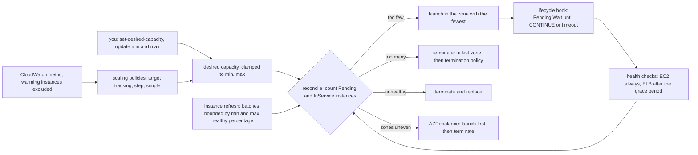

# An Auto Scaling Group Is a Reconciler With a Health Check

*An ASG counts healthy instances per zone and closes the gap to desired; health checks decide what counts, policies decide the number.*

## Metadata

| Field | Value |
|---|---|
| Type | Build |
| Languages | Python |
| Prerequisites | [A Controller Is a Loop That Compares](https://cloudcaptain.io/learn/orchestration/reconciler) |
| Time | 90 minutes |
| Tools | aws, moto |

<Quiz stage="pre" />

## The Problem

Thursday, 19:10. The checkout tier is an Auto Scaling group of six instances across three Availability Zones, with a target tracking policy at 50% average CPU and the default health check type, `EC2`. A release ships as a new launch template version through an instance refresh with default preferences. The new image has a typo in the reverse proxy configuration, so every request to it returns 502. The refresh replaces one instance at a time, each new instance passes the EC2 status checks, the refresh reports `Successful` after twenty minutes, and the load balancer has zero healthy targets. The instances serve nothing, so their CPU drops to 2%, and target tracking scales the group in to its minimum of two. The on-call engineer raises desired capacity to twelve by hand. Ten new instances launch from the same broken version and also serve nothing.

The post-mortem finds two older surprises in the same group. During last month's zone event the group ran nine instances in two zones, and when the third zone recovered it "randomly" terminated healthy instances while launching others, at a moment when it was already at its maximum size. And a scheduled job that sets desired capacity to four every morning had been quietly undoing the scaling policy's decisions for weeks, because the policy and the job are two writers of the same number.

None of this is random. An Auto Scaling group is the reconciler from the orchestration phase with different nouns: desired capacity is the spec, running instances are the world, and a loop launches or terminates the difference. What counts as "running" is decided by the health check type, which is why `EC2` health checks waved the broken release through. Desired capacity has several writers (you, scaling policies, scheduled actions), each with its own rules about warmup and cooldown. Zones are part of the diff, so a group that is short in one zone launches there before it terminates elsewhere. You are going to write `miniasg`, that loop on a virtual clock: capacity across zones, EC2 and ELB health checks with grace periods, replacement of unhealthy instances, target tracking, step and simple scaling, lifecycle hooks, instance refresh, and the activity log that `describe-scaling-activities` prints. Then you run the real API against the moto emulator and see which parts of the loop an emulator implements and which it does not.

## The Concept

Picture a security company contracted to keep a number of guards on duty at three gates of a site. A supervisor walks the gates every few minutes and counts. A guard who has gone home, or who is asleep at the post, does not count. If the count is short, the supervisor calls in replacements and sends them to the gate with the fewest guards. If it is long, they send someone home from the gate with the most. The client can change the number at any time, and so can a rule like "add guards when the queue at the gates is long". The supervisor never needs to know why the count is wrong. They compare and act.

That supervisor is the Auto Scaling group's control loop, and it is level-triggered in exactly the sense of the reconciler lesson: every pass compares desired with actual and acts on the difference. Four inputs decide what the loop does.

| Input | Who writes it | What the loop does with it |
|---|---|---|
| Desired capacity, clamped to `MinSize`..`MaxSize` | you (`set-desired-capacity`, `update-auto-scaling-group`), scaling policies, scheduled actions | launch or terminate the difference between desired and the instances in `Pending`, `Pending:Wait` or `InService` |
| Availability Zones of the group's subnets | you | launch into the zone with the fewest instances; terminate from the zone with the most; rebalance uneven zones by launching first |
| Health status of each instance | EC2 status checks always; Elastic Load Balancing checks if the group's health check type is `ELB`; `set-instance-health` | an `Unhealthy` instance is terminated and replaced; load balancer failures are ignored during the grace period after the instance enters `InService` |
| Launch template version | you, or an instance refresh | new instances use the current version; the default termination policy prefers removing instances on older versions |

Two clocks shape every decision. The **health check grace period** starts when an instance enters `InService` and protects it from load balancer health checks while it boots. It does not protect it from EC2: an instance that stops running is unhealthy at once. **Instance warmup** starts at the same moment and keeps the instance out of the group's aggregated metrics, so a scaling policy does not read the CPU of an instance that has not received traffic yet. While anything is warming up, policy-driven scale-in is blocked. The older **cooldown** is a third clock that only gates simple scaling policies.



The mapping to Kubernetes is close enough to reuse your vocabulary. A group is a ReplicaSet whose pods are virtual machines. Its desired capacity is `spec.replicas`. Instance refresh is a Deployment rollout: `MinHealthyPercentage` plays the role of `maxUnavailable` and `MaxHealthyPercentage` the role of `maxSurge`. The grace period is a readiness gate. Target tracking is the Horizontal Pod Autoscaler's formula. The difference that bites people is that the group's idea of healthy is configurable and, by default, blind to your application.

## Build It

`code/main.py` is `miniasg`. Everything runs in memory on a virtual clock: one tick is ten simulated seconds, an instance boots in sixty and drains for thirty. Scenarios are JSON documents in `code/scenarios/` that use the field names of the AWS API (`MinSize`, `HealthCheckGracePeriod`, `TargetTrackingConfiguration`, `StepAdjustments`), so the policies you get from `aws autoscaling describe-policies` can be fed straight in. The tests in `code/tests/` drive the scenarios and assert on the event log.

### Step 1: one loop over desired, live and the difference

`Asg.reconcile()` is one pass of the supervisor. The order matters: lifecycle states advance first, policies may change desired, health checks decide who counts, and only then does the capacity diff run:

```python
def reconcile(self) -> None:
    self.advance_lifecycle()
    self.evaluate_policies()
    self.check_health()
    self.replace_unhealthy()
    self.step_refresh()
    self.rebalance()
    self.converge()
    self.settle_cooldown()
    self.sample()
```

`converge()` is the ReplicaSet controller again. `live()` returns instances in `Pending`, `Pending:Wait` or `InService`; an instance in `Terminating` no longer counts, which is why a replacement can launch while its predecessor is still draining. `allowance` is the number of extra instances a rebalance or a refresh is allowed to hold above desired:

```python
def converge(self) -> None:
    live = self.live()
    want = self.group.desired + self.allowance
    if len(live) < want:
        self.launch(want - len(live))
    elif len(live) > want:
        before = len(live)
        for victim in self.choose_victims(before - want):
```

Desired capacity has bounds, and the API enforces them. A group created with desired outside `MinSize`..`MaxSize` is refused, and so is `set-desired-capacity`:

```python
if not group.min_size <= group.desired <= group.max_size:
    raise AsgError("ValidationError", f"Desired capacity:{group.desired} must be between the specified min size:{group.min_size} and max size:{group.max_size}")
```

`update_group()` follows the `UpdateAutoScalingGroup` rule instead of refusing: a new `MaxSize` below the current desired capacity lowers desired to it, and a new `MinSize` above it raises desired. Every change of desired goes through `set_desired()`, which records the sentence that later becomes the start of an activity's `Cause`, such as `a user request explicitly set group desired capacity changing the desired capacity from 3 to 5.`

### Step 2: launch into the emptiest zone, terminate from the fullest

For each launch, `launch()` sorts the group's zones by how many live instances they hold and takes the first one that can launch. A zone that is down records a `Failed` activity and the loop moves on to the next zone, which is how a group keeps its capacity during a zone failure:

```python
for candidate in sorted(self.group.zones, key=lambda z: (counts.get(z, 0), self.group.zones.index(z))):
    if candidate in self.down_zones:
        ...
        continue
    zone = candidate
    break
```

Scale-in mirrors it. `choose_victims()` picks one instance at a time: only healthy, unprotected instances are candidates, and only those in the zone (or zones) with the most instances. The termination policy is consulted after that, inside the fullest zone:

```python
remaining = [i for i in self.live() if i not in chosen]
pool = [i for i in (candidates if candidates is not None else remaining) if i in remaining and not i.protected and i.health == "Healthy"]
if not pool:
    break
counts = self.zone_counts(remaining)
top = max(counts[i.zone] for i in pool)
pool = [i for i in pool if counts[i.zone] == top]
chosen.append(pick_victim(pool, self.group.termination_policies, self.group.version, self.now))
```

This is the rule behind "it terminated a new instance instead of the old one": zone balance takes precedence over the termination policy, so `OldestInstance` picks the oldest instance in the fullest zone, not the oldest in the group. `test_zone_balance_beats_the_termination_policy` builds exactly that case. Instances with `ProtectedFromScaleIn` are skipped, and a zone whose instances are all protected is not a candidate at all.

### Step 3: termination policies narrow the pool, then the default policy finishes the job

`pick_victim()` applies the group's policies in order and stops as soon as one instance is left, falling back to `Default` and finally to the lowest instance ID where AWS would pick at random:

```python
def pick_victim(pool: List[Instance], policies: Sequence[str], current_version: str, now: int) -> Instance:
    for policy in list(policies) + ["Default"]:
        pool = narrow(pool, policy, current_version, now)
        if len(pool) == 1:
            return pool[0]
    return min(pool, key=lambda i: i.id)
```

The default policy is two filters: instances launched from an outdated configuration first (an older launch template version here; on AWS also a different template or a deprecated launch configuration), then the instance closest to its next billing hour:

```python
if policy == "Default":
    outdated = [i for i in pool if i.version != current_version]
    if outdated:
        oldest = min(version_key(i.version) for i in outdated)
        pool = [i for i in outdated if version_key(i.version) == oldest]
    return narrow(pool, "ClosestToNextInstanceHour", current_version, now)
```

Most EC2 usage is billed per second today, so the billing-hour rule is mostly a tie-breaker. Run `python3 code/main.py run spread` to watch the whole chain: five instances spread 2/2/1, a sixth launched on version 2 into the zone with one, and a scale-in from 6 to 2 that removes three version-1 instances from the full zones before the version-2 instance is ever considered.

### Step 4: health checks, and the grace period that only applies to one of them

`check_health()` looks at every `InService` instance that is still healthy. An instance whose EC2 state is no longer `running` is unhealthy immediately, grace period or not. A failing load balancer target counts only if the group's health check type is `ELB` and the grace period since `InService` has passed:

```python
def check_health(self) -> None:
    for instance in self.instances:
        if instance.state != "InService" or instance.health != "Healthy":
            continue
        if instance.ec2_state != "running":
            self.mark_unhealthy(instance, "an EC2 health check indicating it has been terminated or stopped")
        elif self.group.health_check_type == "ELB" and not instance.elb_ok and not self.in_grace(instance):
            self.mark_unhealthy(instance, "an ELB system health check failure")
```

`replace_unhealthy()` terminates unhealthy instances, and the capacity diff in the same pass launches their replacements. AWS replaces instances that stopped running, or that you marked with `set-instance-health`, at once. Load balancer failures are replaced gradually, at most 10% of desired capacity at a time (at least one), waiting for each replacement to pass its checks; a misconfigured health check therefore cannot terminate the whole group in one pass:

```python
urgent = [i for i in unhealthy if "ELB" not in i.unhealthy_reason]
gradual = [i for i in unhealthy if "ELB" in i.unhealthy_reason]
warmup = self.group.default_warmup or 0
in_flight = len([i for i in self.instances if i.purpose == "replace" and i in self.warming(warmup)])
budget = max(1, self.group.desired * 10 // 100) - in_flight - self.owed
for instance in urgent + gradual[: max(0, budget)]:
```

`python3 code/main.py run self-heal` shows all three paths. A stopped instance is replaced at `00:05:00`, the moment it stops. Its replacement enters service at `00:06:00`, its load balancer check fails at `00:06:10`, and nothing happens until `00:08:00`, when the 120-second grace period ends. A target that fails after its grace period is replaced on the next pass, and `set-instance-health` acts at once. Note what the scenario does not contain: with `HealthCheckType: EC2`, the two load balancer failures would never be noticed at all (`test_ec2_health_checks_ignore_the_load_balancer`).

### Step 5: rebalancing launches before it terminates

Zones drift out of balance when a zone fails, when you terminate or detach instances by hand, or when a zone that had no capacity recovers. When the group is otherwise quiet and the busiest usable zone has more than one instance more than the emptiest, `rebalance()` raises the allowance, launches into the emptiest zones and, once the new instances are `InService`, terminates the surplus from the fullest zone. To make that possible at the top of the range, AWS lets the group exceed `MaxSize` by 10% or one instance, whichever is greater:

```python
moves = moves_to_balance(len(self.live()) - stranded, usable, zones)
limit = self.group.max_size + max(1, self.group.max_size // 10)
batch = min(moves, max(0, limit - len(self.live())))
if batch <= 0:
    return
```

`python3 code/main.py run az-outage` is last month's incident. Six instances run 2/2/2. Zone `us-east-1b` fails at `00:10:00`: its two instances stop, are replaced at once, and the launch attempts in `us-east-1b` fail and move on, ending at 3/0/3. When the zone recovers at `00:30:00`, the group launches into `us-east-1b` first, waits for `InService`, then terminates in a full zone, twice. The checkpoint for that period reads `min-serving 6`, `peak 7`: the "random terminations" were the second half of a launch-first move, and the group was briefly one above its maximum on purpose. If you need instances to stay put, suspend the `AZRebalance` process; the group then stays unbalanced until something else changes it.

### Step 6: target tracking is one line of arithmetic and two alarms

Target tracking keeps a metric near a target by assuming the metric is proportional to the load per instance: if four instances run at 75% and the target is 50%, six instances would run at 50%. The AWS user guide says it rounds conservatively, adding enough and removing too little rather than the other way round. Rounding up in both directions does exactly that:

```python
def target_tracking_capacity(current: int, metric: float, target: float) -> int:
    if target <= 0:
        raise InputError(f"TargetValue must be positive, got {target}")
    return math.ceil(round(current * metric / target, 6))
```

`current` is the number of instances that have finished warming up, and the metric is aggregated over the same instances. AWS creates two CloudWatch alarms per policy, `TargetTracking-GROUP-AlarmHigh-...` and `TargetTracking-GROUP-AlarmLow-...`. The high alarm needs a few datapoints above the target and the low alarm many more below it (`HIGH_DATAPOINTS = 3` and `LOW_DATAPOINTS = 15` one-minute datapoints in `miniasg`; read `EvaluationPeriods` and `Threshold` of your own group's alarms with `describe-alarms`, because AWS manages and may change them), so the group scales out in minutes and in over a quarter of an hour. `track()` scales out if any target tracking policy wants more, and scales in only when every policy that allows scale-in agrees and nothing is warming up:

```python
if out:
    proposed, policy, value, formula = max(out, key=lambda o: o[0])
    new = min(self.group.max_size, proposed)
...
voters = [p for p in tracking if not p.disable_scale_in]
if inward and len(inward) == len(voters):
    proposed, policy, value, formula = max(inward, key=lambda o: o[0])
    warming = self.warming(max(self.effective_warmup(p) for p in voters))
    if warming:
```

The `target-tracking` scenario uses a `demand` metric: the values are the total load in percent of one instance, so the CPU each instance reports is the load divided by the ready instances, capped at 100. That closed loop shows a trap the formula hides:

```bash
python3 code/main.py run target-tracking | grep -E 'policy|no-change'
# 00:17:00  policy      cpu50: ceil(2 x 100 / 50) = 4, desired 2 -> 4
# 00:18:00  no-change   cpu50: ceil(2 x 100 / 50) = 4: desired 4 already counts the instances still warming up
# 00:23:00  policy      cpu50: ceil(4 x 75 / 50) = 6, desired 4 -> 6
# 00:59:00  policy      cpu50: ceil(6 x 20 / 50) = 3, desired 6 -> 3
# 01:00:00  no-change   cpu50: ceil(3 x 40 / 50) = 3: removing an instance would push the metric above 50
```

The real demand needs six instances, but CPU cannot read above 100%, so the first step only doubles the group and the second step has to wait for the warmup to end. A saturated metric under-reports, and the warmup sets the pace. Scale-in waits for fifteen low datapoints and then stops at three, because removing a fourth would put the metric at 60%.

### Step 7: step scaling, simple scaling and the cooldown that only one of them uses

Step and simple scaling act on an alarm you define. A step policy's bounds are relative to the alarm threshold, and the user guide fixes which end is inclusive: above the threshold the lower bound is inclusive, below it the upper bound is:

```python
diff = value - threshold
above = diff > 0 or (diff == 0 and scale_out)
for step in steps:
    if above:
        fits = (step.lower is None or diff >= step.lower) and (step.upper is None or diff < step.upper)
    else:
        fits = (step.lower is None or diff > step.lower) and (step.upper is None or diff <= step.upper)
```

`PercentChangeInCapacity` has its own rounding table: values above 1 round down, values between 0 and 1 become 1, values between -1 and 0 become -1, values below -1 round toward zero. `MinAdjustmentMagnitude` raises small changes to a floor:

```python
def round_percent_change(delta: float) -> int:
    delta = round(delta, 6)
    if delta >= 1:
        return math.floor(delta)
    if delta > 0:
        return 1
    if delta > -1 and delta < 0:
        return -1
    if delta <= -1:
        return math.ceil(delta)
    return 0
```

The `step-scaling` and `step-warmup` scenarios are the two worked examples from the user guide, and `code/fixtures/expected-decisions.json` holds the decisions the guide states. A metric of 60 adds 10% of 10, so 11. A metric of 70 after the warmup adds 30% of 11, which is 3.3 and rounds to 3, so 14. 40 removes 10% of 14, so 13, and 30 removes 30% of 13, so 10. In the warmup example, 62 during warmup computes 10 + 1 = 11, which is already desired, so nothing happens. 70 computes 30% of the 10 warmed instances, 13, so only two more launch: steps are not cumulative while instances warm up. A scale-in alarm during that warmup is logged as `blocked`.

A simple scaling policy applies one adjustment and then waits. The cooldown starts when the last instance of the activity finishes launching, not when the policy fires, so `alarm_policy()` arms it and `settle_cooldown()` starts the clock once nothing is pending:

```python
if self.cooldown_pending is None:
    return
if any(i.state in ("Pending", "Pending:Wait") + GOING for i in self.instances):
    return
self.cooldown_until = self.now + self.cooldown_pending
```

Under a sustained alarm the `simple-cooldown` scenario scales at `t=600, 960, 1320, 1680`: sixty seconds of launch plus three hundred of cooldown between steps. Target tracking and step scaling ignore the cooldown; their brake is the warmup. A manual `set-desired-capacity` ignores it too unless you pass `--honor-cooldown`, in which case it is refused with `ScalingActivityInProgress` during the cooldown.

### Step 8: lifecycle hooks are wait states with a timeout and a default

A launch hook parks a new instance in `Pending:Wait` before it enters service; a termination hook parks a leaving instance in `Terminating:Wait`. Something outside the group, such as a bootstrap script, a Lambda function or a drain job, finishes its work and calls `complete-lifecycle-action`. If nothing does, the heartbeat timeout (3600 seconds by default) applies the default result, which is `ABANDON` unless you say otherwise:

```python
if hook.respond_after is not None and hook.respond_after < hook.heartbeat_timeout:
    instance.wait_until, instance.wait_result = self.now + hook.respond_after, hook.respond_with
else:
    instance.wait_until, instance.wait_result = self.now + min(hook.heartbeat_timeout, 48 * 3600), None
```

At launch, `CONTINUE` puts the instance in service and starts its grace period and warmup; `ABANDON` terminates it, and the capacity diff launches another. At termination either result terminates; the hook only buys time. An instance in `Pending:Wait` counts toward desired capacity, so the group does not launch a second one while the first is being prepared. `python3 code/main.py run lifecycle-hook` shows a launch that nobody completes: it sits in `Pending:Wait` for 300 seconds, is abandoned at `00:16:00`, its launch activity ends `Cancelled`, and a replacement starts in the same pass.

### Step 9: instance refresh is a rolling update with a floor and a ceiling

An instance refresh replaces every instance with one launched from a target version, in batches. With `MaxHealthyPercentage` at 100 (the default) it terminates first and lets the capacity diff launch the replacements. `MinHealthyPercentage` (90 by default) sets how many may be gone at once, and a batch is never smaller than one. With `MaxHealthyPercentage` above 100, or `MinHealthyPercentage` at 100, it launches first and terminates old instances only after the new ones are healthy and warmed up:

```python
if refresh.max_healthy > 100 or refresh.min_healthy == 100:
    batch = min(len(old), max(1, desired * refresh.max_healthy // 100 - desired))
    refresh.extra = batch
    self.allowance += batch
...
healthy = len(self.ready(refresh.warmup))
batch = min(len(old), max(1, healthy - math.ceil(desired * refresh.min_healthy / 100)))
```

Between batches `step_refresh()` waits until every new instance is `InService`, healthy and past the refresh warmup (the default instance warmup if set, otherwise the grace period), and until nothing is still terminating. If no batch completes within an hour, the refresh fails, which is what AWS does when replacements keep failing health checks. Now replay Thursday:

```bash
python3 code/main.py run refresh | sed -n '/^summary/,$p'                       # 4 of 4 replaced, never fewer than 3 serving
python3 code/main.py run refresh-surge | grep -E 'peak|min_serving'            # 100/150: launch 2 first, peak 6, never below 4
python3 code/main.py run refresh-broken | grep -E 'refresh|min_serving'        # ELB checks: Failed after one hour, 3 still serving
python3 code/main.py run refresh-broken --health-check-type EC2 | grep -E 'refresh|serving'   # Successful, serving 0
```

The last line is the incident. The broken version never passes the load balancer check, but the group never asks the load balancer, so every instance "passes", the refresh succeeds and nothing serves. With `ELB` health checks the same refresh replaces one instance, keeps replacing that one replacement, never takes a second old instance, and fails with three of four still serving.

### Step 10: activities, scenarios and plans

Every launch and termination is an activity in the shape of `describe-scaling-activities`: an `ActivityId`, a `Description` such as `Launching a new EC2 instance: i-00000000000000004`, a `Cause` that chains the change of desired capacity to the action it caused, a `StatusCode` and `Details` with the zone. Two commands bring in the real API's documents. `--policies` replaces a scenario's policy definitions, by name, with the output of `describe-policies`. `plan --describe` reads `describe-auto-scaling-groups` output and runs one reconcile pass and then the loop until it settles, so you can ask "what will this group do next?" of any group:

```bash
cd curriculum/phases/09-cloud/05-autoscaling-groups
python3 code/main.py list
python3 code/main.py run step-scaling --policies code/fixtures/describe-policies-moto.json
python3 code/main.py plan --describe code/fixtures/describe-asg-moto.json
# group cc-web: desired 5 (min 1, max 6), 5 instance(s): 1a=5 1b=0 1c=0
#   unhealthy: i-bdd307ff7b13a37eb
# first reconcile pass:
#   terminate i-bdd307ff7b13a37eb   us-east-1a  At 2026-11-01T09:00:00Z an instance was taken out of service in response to a health check (HealthStatus Unhealthy in the describe output).
#   launch    i-00000000000000001   us-east-1b  At 2026-11-01T09:00:00Z an instance was started in response to a difference between desired and actual capacity, increasing the capacity from 4 to 5.
# zones are unbalanced: AZRebalance needs 3 launch(es) in the emptier zones, each followed by a termination in the fullest
# settled after 150s: 5 instance(s): 1a=2 1b=2 1c=1
```

Both fixtures are real moto output. The group in `describe-asg-moto.json` has all five instances in one zone and one instance moto marked `Unhealthy` and kept in service; the plan says what AWS would do with that state. Exit codes are 0 for a clean run, 1 when an operation was refused (`ValidationError`, `ScalingActivityInProgress`), and 2 for input that is not JSON or not a valid scenario.

<RunTests />

## Use It

The AWS API is the real tool, and the moto emulator lets you call it without an account. moto implements the API surface of Auto Scaling and much less of its control loop, which makes it a good place to see the difference between the two. Start it in a virtual environment (moto 5.2.x needs Python 3.10 or later):

```bash
python3 -m venv ~/.venvs/moto && ~/.venvs/moto/bin/pip install 'moto[server]==5.2.5' awscli
~/.venvs/moto/bin/moto_server -H 127.0.0.1 -p 5000 > /tmp/moto.log 2>&1 &
export AWS_ACCESS_KEY_ID=test AWS_SECRET_ACCESS_KEY=test AWS_DEFAULT_REGION=us-east-1 AWS_PAGER=""
awsm() { aws --endpoint-url http://127.0.0.1:5000 "$@"; }
```

A group needs subnets in the zones it should use and a launch template. Then create it and read it back:

```bash
VPC=$(awsm ec2 create-vpc --cidr-block 10.40.0.0/16 --query Vpc.VpcId --output text)
A=$(awsm ec2 create-subnet --vpc-id "$VPC" --cidr-block 10.40.1.0/24 --availability-zone us-east-1a --query Subnet.SubnetId --output text)
B=$(awsm ec2 create-subnet --vpc-id "$VPC" --cidr-block 10.40.2.0/24 --availability-zone us-east-1b --query Subnet.SubnetId --output text)
C=$(awsm ec2 create-subnet --vpc-id "$VPC" --cidr-block 10.40.3.0/24 --availability-zone us-east-1c --query Subnet.SubnetId --output text)
AMI=$(awsm ec2 describe-images --owners amazon --query 'Images[0].ImageId' --output text)
awsm ec2 create-launch-template --launch-template-name web --launch-template-data "{\"ImageId\":\"$AMI\",\"InstanceType\":\"t3.micro\"}"
awsm autoscaling create-auto-scaling-group --auto-scaling-group-name web \
  --launch-template 'LaunchTemplateName=web,Version=$Latest' --min-size 1 --max-size 6 --desired-capacity 3 \
  --vpc-zone-identifier "$A,$B,$C" --health-check-type ELB --health-check-grace-period 120
awsm autoscaling describe-auto-scaling-groups --auto-scaling-group-names web \
  --query 'AutoScalingGroups[0].{min:MinSize,max:MaxSize,desired:DesiredCapacity,hc:HealthCheckType,grace:HealthCheckGracePeriod,cooldown:DefaultCooldown,instances:Instances[].[InstanceId,AvailabilityZone,LifecycleState,HealthStatus]}'
```

moto launches the three instances, but all into the first subnet: it does not implement zone balancing. Save the describe output and ask `miniasg` what AWS would do with that group:

```bash
awsm autoscaling describe-auto-scaling-groups --auto-scaling-group-names web > web.json
python3 code/main.py plan --describe web.json
```

Now the operations from Build It, against the API:

```bash
awsm autoscaling set-desired-capacity --auto-scaling-group-name web --desired-capacity 5
awsm autoscaling set-desired-capacity --auto-scaling-group-name web --desired-capacity 9     # AWS: ValidationError (above MaxSize); moto accepts it
awsm autoscaling set-desired-capacity --auto-scaling-group-name web --desired-capacity 5
I=$(awsm autoscaling describe-auto-scaling-instances --query 'AutoScalingInstances[0].InstanceId' --output text)
awsm autoscaling set-instance-health --instance-id "$I" --health-status Unhealthy
awsm autoscaling describe-auto-scaling-instances --instance-ids "$I"                     # HealthStatus Unhealthy, still InService in moto
awsm autoscaling terminate-instance-in-auto-scaling-group --instance-id "$I" --no-should-decrement-desired-capacity
awsm autoscaling terminate-instance-in-auto-scaling-group --should-decrement-desired-capacity \
  --instance-id "$(awsm autoscaling describe-auto-scaling-instances --query 'AutoScalingInstances[0].InstanceId' --output text)"
awsm autoscaling update-auto-scaling-group --auto-scaling-group-name web --max-size 3      # desired follows the new max
awsm autoscaling describe-scaling-activities --auto-scaling-group-name web
```

On AWS, `set-instance-health` alone is enough: the `ReplaceUnhealthy` process terminates the instance and a replacement launches. moto records the status and leaves the instance in service, so the second command does by hand what AWS does by itself. `--no-should-decrement-desired-capacity` keeps desired, so a replacement launches; `--should-decrement-desired-capacity` lowers desired by one, so none does. `describe-scaling-activities` returns an empty list in moto. On AWS it returns one activity per launch and termination, sorted by start time with activities still in progress first, and the `Cause` field reads like the ones `miniasg` writes: `At 2026-... a user request explicitly set group desired capacity changing the desired capacity from 3 to 5.  At 2026-... an instance was started in response to a difference between desired and actual capacity, increasing the capacity from 3 to 5.` Reading the first sentence of a cause tells you which writer changed desired capacity; that is how you find a scheduled action or a forgotten script fighting a scaling policy.

Scaling policies are stored by moto and returned by `describe-policies`, which is all `miniasg` needs to replay a metric through them:

```bash
awsm autoscaling update-auto-scaling-group --auto-scaling-group-name web --max-size 20
awsm autoscaling put-scaling-policy --auto-scaling-group-name web --policy-name cpu50 --policy-type TargetTrackingScaling \
  --estimated-instance-warmup 300 --target-tracking-configuration '{"PredefinedMetricSpecification":{"PredefinedMetricType":"ASGAverageCPUUtilization"},"TargetValue":50.0}'
awsm autoscaling put-scaling-policy --auto-scaling-group-name web --policy-name step-out --policy-type StepScaling \
  --adjustment-type PercentChangeInCapacity --estimated-instance-warmup 300 \
  --step-adjustments MetricIntervalLowerBound=0,MetricIntervalUpperBound=10,ScalingAdjustment=0 MetricIntervalLowerBound=10,MetricIntervalUpperBound=20,ScalingAdjustment=10 MetricIntervalLowerBound=20,ScalingAdjustment=30
awsm autoscaling put-scaling-policy --auto-scaling-group-name web --policy-name step-in --policy-type StepScaling \
  --adjustment-type PercentChangeInCapacity --estimated-instance-warmup 300 \
  --step-adjustments MetricIntervalLowerBound=-10,MetricIntervalUpperBound=0,ScalingAdjustment=0 MetricIntervalLowerBound=-20,MetricIntervalUpperBound=-10,ScalingAdjustment=-10 MetricIntervalUpperBound=-20,ScalingAdjustment=-30
awsm autoscaling describe-policies --auto-scaling-group-name web > policies.json
python3 code/main.py run step-scaling --policies policies.json
python3 code/main.py run target-tracking --policies policies.json
```

On AWS, `put-scaling-policy` for target tracking returns the two alarms it created; moto returns none and evaluates nothing. A step policy needs an alarm you create with `aws cloudwatch put-metric-alarm`, whose `--alarm-actions` is the policy ARN; in `miniasg` that alarm is the scenario's `alarms` entry. The commands that only make sense on a real account are the ones that need the loop running:

```bash
aws cloudwatch describe-alarms --alarm-name-prefix TargetTracking-web --query 'MetricAlarms[].[AlarmName,Threshold,EvaluationPeriods,Period,StateValue]'
aws autoscaling start-instance-refresh --auto-scaling-group-name web \
  --preferences '{"MinHealthyPercentage":90,"MaxHealthyPercentage":100,"InstanceWarmup":120,"SkipMatching":true}'
aws autoscaling describe-instance-refreshes --auto-scaling-group-name web --query 'InstanceRefreshes[0].[Status,PercentageComplete,StatusReason]'
aws autoscaling put-lifecycle-hook --auto-scaling-group-name web --lifecycle-hook-name bootstrap \
  --lifecycle-transition autoscaling:EC2_INSTANCE_LAUNCHING --heartbeat-timeout 300 --default-result ABANDON
aws autoscaling complete-lifecycle-action --auto-scaling-group-name web --lifecycle-hook-name bootstrap \
  --instance-id i-0123456789abcdef0 --lifecycle-action-result CONTINUE
aws autoscaling set-instance-protection --auto-scaling-group-name web --instance-ids i-0123456789abcdef0 --protected-from-scale-in
aws autoscaling suspend-processes --auto-scaling-group-name web --scaling-processes AZRebalance
```

`start-instance-refresh` with `"AutoRollback": true` and an alarm specification turns a failed refresh into a rollback to the previous configuration, which is the safety net Thursday's release lacked; `SkipMatching` leaves instances that already run the target version alone. The emulator's limits, measured with moto 5.2.5 in `code/smoke.sh`:

| Behaviour | AWS | moto 5.2.5 |
|---|---|---|
| Spreading launches over the group's zones | launches into the zone with the fewest instances, rebalances | every instance in the first subnet |
| `set-desired-capacity` above `MaxSize` | `ValidationError` | accepted |
| `set-instance-health --health-status Unhealthy` | instance terminated and replaced | status recorded, instance kept |
| Instance terminated outside the group, `terminate-instance-in-auto-scaling-group` | replacement launched | replacement launched |
| `update-auto-scaling-group --max-size` below desired | desired lowered to the new max | desired lowered to the new max |
| `describe-scaling-activities` | one activity per launch and termination | empty list |
| Target tracking alarms, step alarms, cooldowns, warmup | evaluated | policies stored and returned, never evaluated |
| Lifecycle hooks | wait states, timeout, default result | stored with the documented defaults (3600 s, `ABANDON`), instances go straight to `InService` |
| `start-instance-refresh` | rolling replacement | not implemented (HTTP 500) |

Everything in the right column that differs is checked against the user guide's own examples instead, in `code/fixtures/expected-decisions.json`.

**On Kubernetes.** Node groups on EKS are usually Auto Scaling groups, and the two node autoscalers treat them differently. cluster-autoscaler keeps the group as the unit: it simulates pending pods against a template node per group, calls `SetDesiredCapacity` to grow it, and scales down with `TerminateInstanceInAutoScalingGroup` and the decrement flag, so the group's own loop does the launching. Karpenter bypasses groups: it computes an instance shape from the pending pods and its NodePool constraints and launches instances itself through the EC2 Fleet API, replacing the group's zone balancing and termination policy with its own consolidation. The Horizontal Pod Autoscaler uses target tracking's formula, `desiredReplicas = ceil(currentReplicas * currentMetricValue / desiredMetricValue)`, with a tolerance of 10% around the target and a five-minute default stabilization window for scale-down, which is its version of the slow low alarm.

| What you built | Real tool | Azure | GCP | Note |
|---|---|---|---|---|
| `Asg.reconcile()`, `converge()` | the Auto Scaling group's control loop | Virtual Machine Scale Set | managed instance group (MIG) | level-triggered: desired vs instances that count |
| `launch()` and `choose_victims()` by zone | zone balancing, `AZRebalance` | zone balancing on a zonal scale set | regional MIG target distribution shape (`EVEN`, `BALANCED`, `ANY`), proactive redistribution | AWS may exceed `MaxSize` by 10% or one instance to rebalance |
| `pick_victim()`, `narrow()` | termination policies (`Default`, `OldestInstance`, `NewestInstance`, `OldestLaunchTemplate`, ...), scale-in protection | scale-in policy (`Default`, `NewestVM`, `OldestVM`), instance protection | autoscaler scale-in controls | zones first, then the policy |
| `check_health()`, `in_grace()` | EC2 and ELB health checks, health check grace period | automatic instance repairs with a grace period, Application Health extension or load balancer probe | autohealing health check with an initial delay | the default AWS check type `EC2` ignores your application |
| `replace_unhealthy()` | `ReplaceUnhealthy` process, instance maintenance policy | automatic repairs | autohealing | load balancer failures replaced 10% at a time |
| `target_tracking_capacity()`, `track()` | target tracking scaling policy | Azure Monitor autoscale rules on a metric | autoscaler target utilization | warmup instead of cooldown on AWS; GCP calls it the initialization period |
| `matching_step()`, `round_percent_change()` | step scaling policy with a CloudWatch alarm | autoscale rules with scale actions | (no step policies; utilization targets and schedules) | bounds relative to the alarm threshold |
| `settle_cooldown()` | simple scaling cooldown, `DefaultCooldown` | autoscale rule cool down | stabilization period for scale-in | AWS applies it to simple scaling only |
| `wait()`, `finish_wait()` | lifecycle hooks, `complete-lifecycle-action` | terminate notifications through Scheduled Events | shutdown scripts and graceful shutdown | default result `ABANDON`, default timeout one hour |
| `step_refresh()` | instance refresh with min and max healthy percentage | rolling upgrade policy (`maxBatchInstancePercent`, `maxUnhealthyInstancePercent`) | rolling update (`maxSurge`, `maxUnavailable`) | the same floor and ceiling as a Deployment rollout |
| `activity()` | `describe-scaling-activities` | activity log | MIG instance actions and logs | the `Cause` names the writer of desired capacity |

<Quiz stage="check" />

## Ship It

Two artifacts in `outputs/`:

- **`skill-asg-review.md`**: a runbook for reviewing an Auto Scaling group before an incident finds the gaps, or while one is under way. It dumps the group, its instances, policies, alarms, hooks, refreshes and recent activities; checks the health check type and grace period against the boot time; checks the zone spread, the termination policy and protection; reads the scaling policies for saturated metrics, missing warmup and conflicting writers of desired capacity; checks lifecycle hooks for defaults that abandon launches; checks instance refresh preferences and rollback; and ends with a decision table and a fixed report.
- **`prompt-explain-scaling-activity.md`**: paste `describe-scaling-activities` output, optionally with the group description and policies, and get each activity explained: which writer changed desired capacity, what the loop did about it, whether it was a health replacement, a rebalance, a refresh or a policy, and what to check next.

<ShipIt />

## Exercises

### Easy

Add the `Standby` state. Write the tests first: `enter-standby` with `ShouldDecrementDesiredCapacity: true` moves an instance out of the capacity count and lowers desired by one; without the flag a replacement launches; health checks skip an instance in `Standby`; `exit-standby` puts it back in service, raises desired by one and starts its grace period again. Add both ops to `apply()` and a scenario that uses `Standby` to patch one instance without the group replacing it.

### Medium

Add scheduled actions. A scenario gets `scheduled` entries with `StartTime` (seconds on the virtual clock), `Recurrence` (every N seconds) and any of `MinSize`, `MaxSize`, `DesiredCapacity`, applied through `update_group()` with the sentence `a scheduled action update of AutoScalingGroup constraints`. Tests first: a scheduled desired of 4 every morning overrides a target tracking policy that had scaled to 8, and the next datapoints scale it back. Then add a check to `plan` that flags a group whose recent activity causes alternate between a scheduled action and a policy, the second writer from The Problem.

### Hard

Add warm pools. A warm pool keeps stopped or running pre-initialized instances outside the group's capacity, up to `MaxGroupPreparedCapacity`, and a scale-out takes instances from the pool before launching new ones, which skips the boot and the launch hook's work. Tests first: with a pool of 3 stopped instances, the `target-tracking` scenario's first scale-out reaches `InService` in the pool's resume time instead of the full boot time, the pool refills in the background, and an instance refresh replaces pool instances after `InService` ones, as the user guide describes. Report the change in minutes of saturated CPU between the two runs.

<Quiz stage="post" />

## Key Terms

| Term | Common misconception | Precise definition |
|---|---|---|
| Desired capacity | "The number of instances the group is running." | The number the group's loop works towards, bounded by `MinSize` and `MaxSize` and written by you, scaling policies and scheduled actions. The running count lags it while instances launch or terminate. |
| Health check type | "The group knows when my app is broken." | `EC2` (the default) only checks that the instance is running and its status checks pass. `ELB` adds the load balancer's target health, so an instance that boots but does not serve is replaced. |
| Health check grace period | "New instances are not health checked at all for a while." | The time after an instance enters `InService` during which load balancer (and similar) failures are ignored. An instance that stops running is unhealthy at once, grace period or not. It is 0 when a group is created through the API unless you set it. |
| Instance warmup | "The same thing as the cooldown." | The time after `InService` during which an instance's metrics are excluded from the group's aggregate and it counts toward desired but not current capacity; while anything warms up, policy scale-in is blocked. It applies to target tracking, step scaling and instance refresh. |
| Cooldown | "Every scaling policy waits 300 seconds between actions." | A pause after a scaling activity finishes, applied only to simple scaling policies (and to manual changes made with `--honor-cooldown`). Target tracking and step scaling use warmup instead. |
| Target tracking | "It adds one instance at a time when the metric is high." | A policy that sets desired to `ceil(current * metric / target)` using instances that finished warming up, scaling out after a few high datapoints and in after many low ones. It assumes the metric is proportional to load per instance, so a saturated or non-proportional metric misleads it. |
| Termination policy | "`OldestInstance` always removes the oldest instance in the group." | The tie-breaker used inside the Availability Zone that has the most instances. Zone balance is decided first; `Default` then prefers outdated launch configurations or template versions, then the instance closest to its next billing hour. |
| AZRebalance | "The group terminates instances at random." | The process that evens out instance counts across zones by launching in the emptiest zone first and terminating in the fullest afterwards, temporarily exceeding `MaxSize` by up to 10% or one instance. |
| Lifecycle hook | "A notification that something happened." | A wait state (`Pending:Wait`, `Terminating:Wait`) that holds an instance until `complete-lifecycle-action` or the heartbeat timeout, after which the default result applies. `ABANDON` at launch terminates and replaces the instance. |
| Instance refresh | "It replaces everything at once." | A rolling replacement towards a target configuration in batches bounded by `MinHealthyPercentage` (how many must stay healthy) and `MaxHealthyPercentage` (how far the group may surge), waiting for health and warmup between batches and failing if it cannot make progress. |

## Further Reading

- [AWS Compute and Networking](https://cloudcaptain.io/docs/cloud/aws/compute-networking): EC2, load balancers and the Auto Scaling group section in the Reference layer, with the CLI commands in context.
- [AWS Certification Prep](https://cloudcaptain.io/docs/cloud/aws/exam-prep): scaling policies, health checks and termination policies are staple questions on the Solutions Architect and SysOps exams.
- [Kubernetes in Production](https://cloudcaptain.io/docs/tools/kubernetes/production-operations): node autoscaling with cluster-autoscaler and Karpenter on top of the groups you just built.
- [Target tracking scaling policies](https://docs.aws.amazon.com/autoscaling/ec2/userguide/as-scaling-target-tracking.html): the proportional assumption, conservative rounding, warmup and the rule for several policies at once.
- [Step and simple scaling policies](https://docs.aws.amazon.com/autoscaling/ec2/userguide/as-scaling-simple-step.html): the two worked examples `miniasg` reproduces, the bound rules and the rounding table.
- [Health checks for instances in an Auto Scaling group](https://docs.aws.amazon.com/autoscaling/ec2/userguide/health-checks-overview.html): what each check type looks at and how replacements are paced.
- [Configure termination policies](https://docs.aws.amazon.com/autoscaling/ec2/userguide/ec2-auto-scaling-termination-policies.html): the default policy step by step and why zone balance comes first.
- [How an instance refresh works](https://docs.aws.amazon.com/autoscaling/ec2/userguide/instance-refresh-overview.html): minimum and maximum healthy percentage, warmup, checkpoints and skip matching.
- [How lifecycle hooks work](https://docs.aws.amazon.com/autoscaling/ec2/userguide/lifecycle-hooks-overview.html): the wait states and what happens when nobody completes the action.
- [Horizontal Pod Autoscaling, algorithm details](https://kubernetes.io/docs/tasks/run-application/horizontal-pod-autoscale/#algorithm-details): the same proportional formula with a tolerance and stabilization window.
- [Autoscaling groups of instances (Google Cloud)](https://cloud.google.com/compute/docs/autoscaler) and [Overview of autoscale with Azure Virtual Machine Scale Sets](https://learn.microsoft.com/azure/virtual-machine-scale-sets/virtual-machine-scale-sets-autoscale-overview): the same loop on the other two clouds.
