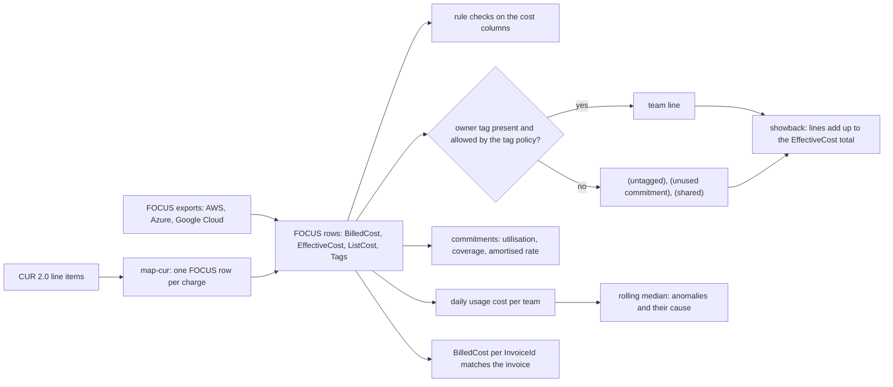

# The Bill Is a Join Between Usage and a Price List

*Every cost row is usage times a price; showback groups the same rows by owner, and it is only right when it adds up to the bill to the cent.*

## Metadata

| Field | Value |
|---|---|
| Type | Build |
| Languages | Python |
| Prerequisites | [An Auto Scaling Group Is a Reconciler With a Health Check](https://cloudcaptain.io/learn/cloud/autoscaling-groups) |
| Time | 75 minutes |
| Tools | aws-cli, moto, duckdb |

<Quiz stage="pre" />

## The Problem

The second working day of November. The October invoice from AWS says 412,380.17 USD. The showback sheet the platform team sends to finance every month, built from Cost Explorer grouped by the `team` tag, says payments 141,000, search 96,000 and platform 88,000. That is 325,000. Nobody can say where the other 87,000 went, so the sheet goes out with a line called "other" and finance books it to the platform team, who did not spend it.

Then the arguments start. Payments is charged 31,000 for "Savings Plans", because the account that bought the plan is theirs, although the plan's discount is spread over every team's EC2. Platform's database reservation shows a quarter of its hours unused, and that waste lands on whichever team owns the account it was bought in. Cost Explorer's amortised view and the invoice differ by 18,000, because the reservation's upfront fee was paid in January and October only carries its monthly share. Search ran a re-index job from the 3rd to the 12th at about 3,100 USD a day; the first person to notice was the finance analyst reading the invoice. And when the shares are rounded to cents one by one, the sheet's total is 3 cents off the bill, which is enough for an accountant to reject the journal entry.

None of this is mysterious once you stop reading the bill as a total. A bill is rows: each one is a quantity of usage times a price, with the period it covers, the resource, the tags and, when a commitment paid for it, which commitment and whether the commitment was used. The FinOps Open Cost and Usage Specification (FOCUS) gives those rows the same columns on AWS, Azure and Google Cloud. You are going to write `billjoin`: it reads FOCUS rows (or a CUR 2.0 export it maps onto FOCUS), checks the rules the columns must obey, charges every cent of EffectiveCost to a team or to an explicit untagged, unused-commitment or shared line, measures commitment utilisation, coverage and amortisation, divides by business units, flags daily spikes against a rolling median, and proves that the showback adds up to the bill. Then you will run the same questions with SQL over the same file, with Cost Explorer and the tagging APIs on an AWS emulator.

## The Concept

Think of a prepaid card at a canteen. Buying the card is a payment, but you have not eaten anything yet. Each lunch you pay for with the card costs you nothing at the till, yet it is the lunch that consumed the money. If the card expires with money on it, that money was spent on nothing. Your bank statement (the payment) and your food diary (the consumption) are both correct and they disagree in every single month.

A cloud bill has both views on every row, and FOCUS names them:

- **BilledCost** is what the invoice charges for this row in this billing period: the cash view. A commitment purchase has its price here; usage covered by a commitment has 0.
- **EffectiveCost** is what the row consumed, with the commitment's cost moved onto the usage it covered: the accrual view. The commitment purchase has 0 here; each covered hour carries its share; the hours nobody used appear as their own rows with `CommitmentDiscountStatus` set to `Unused`.
- **ListCost** is the same usage at the public on-demand price. The gap between ListCost and EffectiveCost is the saving.

`ChargeCategory` says what kind of row it is (`Usage`, `Purchase`, `Tax`, `Credit`, `Adjustment`), and `Tags` is a JSON object with the resource's finalised tags. Allocation is a GROUP BY over EffectiveCost on one tag key, with three lines that are not teams: rows with no valid owner tag go to `(untagged)`, unused commitment rows to `(unused commitment)`, and tax, credits and adjustments to `(shared)`. Nothing is dropped, so the lines must add up to the sum of EffectiveCost, and the sum of BilledCost per `InvoiceId` must match the invoice.



Commitments are where the two views part. **Utilisation** asks how much of what you bought you used: used over used plus unused, in the commitment's unit (hours for a reservation, currency for a spend plan). **Coverage** asks how much of the usage that could have been discounted was: the on-demand equivalent of covered usage over the on-demand equivalent of all usage in that service category. High coverage with low utilisation means you bought too much; full utilisation with low coverage means you could buy more. **Amortisation** spreads a purchase over the hours it covers: a one-year plan paid upfront is its price divided by 8,760 hours, and every hour in the export must carry exactly that much EffectiveCost across its used and unused rows. If an hour carries more, part of the purchase was paid outside the file you are reading (an upfront fee from an earlier month); if it carries less, rows are missing.

The specification is versioned. This lesson follows FOCUS 1.4, published in June 2026, the current release; providers export earlier versions. AWS Data Exports offers FOCUS 1.0 and FOCUS 1.2 tables, Azure Cost Management exports FOCUS 1.0, 1.0r2 and a 1.2 preview, and Google Cloud exports FOCUS to BigQuery. The columns `billjoin` relies on have been stable since 1.0. One rename matters: `ProviderName` was replaced by `ServiceProviderName` in 1.3 and removed in 1.4, so a reader has to accept both.

## Build It

`code/main.py` is `billjoin`, five subcommands over one row type: `report` (rule checks, showback, commitments, coverage, unit costs, invoices), `anomalies`, `map-cur`, `tags` (audit the Resource Groups Tagging API output) and `ce-diff` (compare with Cost Explorer). Everything after reading the CSV is pure functions over dataclasses. `code/fixtures/` holds:

- `focus-spec-flexible-spend-plan-75pct.csv` and `focus-spec-reservation-partial-upfront.csv`: two of the commitment examples published with the FOCUS 1.4 specification, copied unchanged (CC BY 4.0, FinOps Open Cost and Usage Specification contributors). They still carry the `ProviderName` and `PublisherName` columns.
- `focus-month.csv`: fourteen days of an October export for three teams (198 rows): a Compute Savings Plan, four RDS reservations of which three are used, on-demand EC2, S3, a NAT gateway, an orphaned volume tagged `Platform` instead of `platform`, an untagged load balancer, data transfer, tax and a credit. Prices are round numbers so you can check every result by hand.
- `cur-month.csv`: the same fourteen days as CUR 2.0 line items (212 lines), `tag-policy.json`, `units.json` and `ce-amortized-by-team.json`, a Cost Explorer response for the same period.

### Step 1: money is a Decimal, and a null is a null

Cost exports carry six or more decimal places and are summed over millions of rows. Binary floats cannot represent 0.10 exactly, so `billjoin` parses every cost as a `Decimal` and refuses anything that is not a finite decimal, naming the line:

```python
def decimal_of(text: str, column: str, line: int, default: Optional[Decimal] = None) -> Decimal:
    if text == "":
        if default is None:
            raise InputError(f"line {line}: {column} is empty; it must be a decimal")
        return default
    try:
        number = Decimal(text)
    except InvalidOperation:
        raise InputError(f"line {line}: {column} is not a decimal: {text!r}")
    if not number.is_finite():
        raise InputError(f"line {line}: {column} is not a finite decimal: {text!r}")
    return number
```

`value()` treats an empty cell and the literal `null` (some published examples use it) as null. Timestamps are ISO 8601 with `Z`, converted to UTC, and `ChargePeriodEnd` is exclusive. A file with more than one `BillingCurrency` is refused: sums across currencies are meaningless, and FOCUS keeps the original currency in the `PricingCurrency*` columns for exactly that reason. A CUR file passed to `report` fails with the hint to run `map-cur` first.

### Step 2: the rules the cost columns obey

Allocation is only as good as the columns it sums, so `rule_findings()` checks the requirements of the specification that the rest of the tool depends on:

```python
    if charge.category == "Purchase" and charge.commitment and charge.effective != 0:
        found.append(("EffectiveCost", "MUST be 0 for a Purchase that covers other charges; the Used and Unused rows carry its cost"))
    if charge.category == "Usage" and not charge.commitment and charge.effective != charge.billed:
        found.append(("EffectiveCost", "MUST equal BilledCost for Usage that no commitment covers"))
    if charge.category in ("Tax", "Credit") and charge.effective != charge.billed:
        found.append(("EffectiveCost", "MUST equal BilledCost when ChargeCategory is Tax or Credit"))
```

The others: `ChargeCategory` is one of the five allowed values, `CommitmentDiscountStatus` is `Used` or `Unused`, is null when `CommitmentDiscountId` is null and is set on every Usage row that has one, an Unused row has a BilledCost of 0, the charge period ends after it starts, and `Tags` is a JSON object. The first rule is the one that matters most: a commitment purchase with a non-zero EffectiveCost is counted twice, once when it is bought and once in the usage it covers. The official FOCUS validator checks several hundred rules; these are the ones whose violation would make the showback wrong.

### Step 3: every row has exactly one owner

```python
def owner(charge: Charge, key: str, policy: Optional[TagPolicy] = None) -> Tuple[str, str]:
    found, reason = tag_value(charge.tags, key)
    if found is not None:
        if policy is None or policy.allows(found):
            return found, "tagged"
        return UNTAGGED, f"value {found!r} not allowed by the tag policy"
    if reason:
        return UNTAGGED, reason
    if charge.status == "Unused":
        return UNUSED, "unused commitment"
    if charge.category in SHARED_CATEGORIES:
        return SHARED, charge.category.lower()
    return UNTAGGED, f"no {key} tag"
```

The tag wins when there is one, so a reservation tagged `team=platform` charges its own waste to platform; untagged commitments put theirs on `(unused commitment)`, where it is visible instead of hidden in a team's line. `tag_value()` reports a key that differs only in case (`Team` instead of `team`) and a valueless tag (`true`, which FOCUS uses for tags without values) as reasons, because tag keys are case-sensitive in AWS and Cost Explorer treats `Team` and `team` as two keys. With `--tag-policy`, the allowed values come from an AWS Organizations tag policy, the same JSON you attach to the organization:

```python
    def allows(self, text: str) -> bool:
        return not self.allowed or any(re.fullmatch(re.escape(p).replace(r"\*", ".*"), text) for p in self.allowed)
```

`load_tag_policy()` uses the policy's `tag_key` `@@assign` as the canonical spelling of the key and its `tag_value` `@@assign` list as the allowed values, with `*` as a wildcard. Without a policy, `Platform` and `platform` are two teams; with it, the orphaned volume's 33.60 moves to `(untagged)` with the reason attached.

### Step 4: shares that add up to the cent

Rounding each line to cents on its own can lose or invent a cent per line. `allocate()` keeps exact sums, and `reconcile_cents()` rounds with the largest-remainder method: floor every line, then give the leftover cents to the lines with the largest fractions, so the rounded lines always sum to the rounded total:

```python
def reconcile_cents(values: Dict[str, Decimal], total: Decimal) -> Dict[str, Decimal]:
    floors = {name: amount.quantize(CENT, rounding=ROUND_FLOOR) for name, amount in values.items()}
    leftover = int((total - sum(floors.values(), ZERO)) / CENT)
    order = sorted(values, key=lambda name: (-(values[name] - floors[name]), name))
    for name in order[: max(0, min(leftover, len(order)))]:
        floors[name] += CENT
    return floors
```

A third of 1.00 three ways is 0.34, 0.33 and 0.33, not 0.33 three times. `--spread-shared` moves `(unused commitment)` and `(shared)` onto the teams in proportion to their direct cost, the fully loaded view a chargeback needs. `(untagged)` is never spread: spreading it would make the tagging problem invisible, and the cost belongs to whoever owns the resources, which is the question the untagged list answers.

### Step 5: commitments, utilisation and the amortised rate

`commitments()` gathers each `CommitmentDiscountId`: purchases, used and unused quantities and costs, and the on-demand equivalent of what it covered. The amortisation check takes every distinct charge period of the Used and Unused rows and asks which purchases in the file cover it:

```python
def hourly_rate(purchases: Iterable[Charge], start: datetime, end: datetime) -> Decimal:
    rate = ZERO
    for purchase in purchases:
        span = hours_between(purchase.start_at, purchase.end_at)
        if span > 0 and purchase.start_at <= start and end <= purchase.end_at:
            rate += purchase.billed / span
    return rate
```

Check it against the specification's own examples by hand. The Flexible Spend Plan is one purchase of 459,024.00 covering 2026-02-01 to 2027-02-01, 8,760 hours, so 52.40 per hour; the sample has 18 Used and 6 Unused hours, each carrying 52.40, so the 24 hours carry 1,257.60 and the gap is 0.00. Utilisation is 18 × 52.40 over 24 × 52.40, 75%, and the waste is the 314.40 on the Unused rows. The partial-upfront reservation has two purchases: 220,007.40 over the year (25.115 per hour) and 16,877.28 for February's 672 hours (25.115 per hour), so each hour must carry 50.23, and 24 hours carry 1,205.52, which is what the rows say.

In `focus-month.csv` the Savings Plan bills 28.80 a day and its covered usage carries 28.80 a day: gap 0. The reservations' recurring part bills 14.40 a day but the rows carry 28.80 a day, so the report says 201.60 over 14 days "was paid outside this file": the upfront half, paid when the reservations were bought. A negative gap means the opposite: the purchases imply more cost than the rows carry, which is what an export without its Unused rows looks like, and why utilisation computed from such an export is always 100%.

### Step 6: coverage and the effective savings rate

```python
        entry.effective += charge.effective
        if charge.status == "Unused":
            continue
        entry.list_cost += charge.list_cost
        if charge.status == "Used":
            entry.covered_list += charge.list_cost
```

Per `ServiceCategory`, coverage is covered on-demand equivalent over all on-demand equivalent. The effective savings rate (ESR) is the saving over the on-demand equivalent with the unused commitment counted as cost, which is why it falls when you over-buy. In the month: Compute has 48.00 a day of covered EC2 and 12.00 on demand, 80% coverage, and costs 40.80 instead of 60.00, ESR 32%; Databases is 100% covered, but the unused quarter of the reservation brings its ESR down to 20%. The Flexible Spend Plan example saves a third on every covered hour, but with 6 of 24 hours unused its ESR is 11.11%.

### Step 7: a CUR 2.0 export onto FOCUS

The legacy CUR and CUR 2.0 describe the same charges with line item types and per-type columns instead of FOCUS's two cost columns. `map_cur_row()` turns each type into FOCUS rows:

```python
    if kind == "SavingsPlanCoveredUsage":
        effective = amount("savings_plan_savings_plan_effective_cost")
        return [charge("Usage", "Usage-Based", "Committed", ZERO, effective, public, **commitment(sp, "Spend", "Savings Plan", "Used", effective, "USD"))], ""
    if kind == "SavingsPlanNegation":
        return [], ""
```

A `SavingsPlanCoveredUsage` line carries the on-demand price as its unblended cost and a `SavingsPlanNegation` line subtracts it again, so on the invoice they net to zero; in FOCUS the covered row has a BilledCost of 0 and the plan's rate as EffectiveCost, and the negation disappears. A `SavingsPlanRecurringFee` becomes a Purchase, plus an Unused row when the hour's total commitment exceeds the used commitment. A `DiscountedUsage` line has an unblended cost of 0 and the reservation's amortised cost in `reservation_effective_cost`; an `RIFee` line becomes a Purchase plus an Unused row from `reservation_unused_recurring_fee` and `reservation_unused_amortized_upfront_fee_for_billing_period`. `resource_tags` keys lose the `user_` prefix CUR 2.0 puts on user-defined tags. Types the mapper does not know (`EdpDiscount`, `Refund`, ...) are booked as Adjustment and listed, so the totals still reconcile. Real CUR exports book the RI recurring fee once per month; the fixture spreads it per day to keep the daily arithmetic visible, which changes nothing in the sums.

`map-cur` ends by proving the mapping lost nothing: the sum of BilledCost over the FOCUS rows equals the sum of `line_item_unblended_cost` over the CUR lines.

### Step 8: unit costs and the invoice

A team's cost going up is not news if its business went up as much. `--units units.json` divides each line by a business quantity (`{"payments": {"unit": "1k payments", "quantity": 840}}`). With `--spread-shared` the result is the fully loaded unit cost. `--invoice ID=AMOUNT` compares the sum of BilledCost for that `InvoiceId` with the invoice total, using the tolerance FOCUS 1.4 defines for exports with more precision than the invoice:

```python
def invoice_tolerance(rows: int, currency: str) -> Decimal:
    subunit = CURRENCY_SUBUNITS.get(currency, CENT)
    return max(HUNDRED * subunit, Decimal(rows).sqrt() * Decimal("0.5") * subunit)
```

At least 100 subunits (1.00 USD), growing with the square root of the row count: 5.00 USD for a million rows. The allocation itself has no tolerance: its lines must equal the EffectiveCost total exactly.

### Step 9: anomalies against a rolling median

`find_anomalies()` sums Usage EffectiveCost per day for each team (or `--by service`, `--by account`), and compares each day with the median of the previous seven. Purchases, tax and credits are left out: they are not usage. A day is flagged only when it crosses both thresholds, an absolute increase and a percentage, the same two thresholds AWS Cost Anomaly Detection alert subscriptions offer:

```python
        for index in range(window, len(days)):
            day, history = days[index], days[index - window:index]
            baseline = statistics.median([totals[d] for d in history])
            impact = totals[day] - baseline
            if impact < min_impact or (baseline > 0 and impact * HUNDRED < threshold_pct * baseline):
                continue
```

The median ignores a single earlier spike that a mean would carry into the baseline for a week. For each flagged day `contributors()` repeats the comparison per resource and names the ones that grew most, which turns "search is up 533%" into "`i-0search-reindex` is new and cost 96.00".

### Step 10: run it

```bash
F=code/fixtures
python3 code/main.py report $F/focus-month.csv --tag-policy $F/tag-policy.json --units $F/units.json --invoice INV-2026-10-0001=1077.28
# totals: BilledCost 1077.28  EffectiveCost 1278.88  on-demand equivalent of usage 1596.00
# showback by tag team (EffectiveCost)
#   payments                  403.20   31.53%
#   platform                  369.60   28.90%
#   search                    252.00   19.70%
#   (untagged)                100.80    7.88%
#   (unused commitment)       100.80    7.88%
#   (shared)                   52.48    4.10%
#   total                    1278.88  reconciles with the EffectiveCost total 1278.88
#        50.40  arn:aws:elasticloadbalancing:...:loadbalancer/app/legacy-web/0a1b2c3d4e5f  (no team tag)
#        33.60  vol-0orphan01  (value 'Platform' not allowed by the tag policy)
#   arn:aws:rds:us-east-1:111111111111:ri:ri-db-platform  Reserved Instance
#     utilisation 75.00%  used 1008 Hours  unused 336 Hours  waste 100.80
#   Compute     on-demand     840.00  covered  80.00%  effective     571.20  ESR  32.00%
#   payments: 403.20 / 840 1k payments = 0.48 per 1k payments
# invoice INV-2026-10-0001: 198 rows, BilledCost 1077.28, invoice 1077.28, difference 0.00, tolerance 1.00: ok
python3 code/main.py report $F/focus-month.csv --tag-policy $F/tag-policy.json --spread-shared      # payments 463.51, platform 424.88, search 289.69, untagged stays 100.80
python3 code/main.py report $F/focus-spec-flexible-spend-plan-75pct.csv                             # 75.00%, waste 314.40, amortised 52.40/h: they match
python3 code/main.py map-cur $F/cur-month.csv -o /tmp/cur-focus.csv                                  # sum of BilledCost 1077.28 = sum of line_item_unblended_cost 1077.28
python3 code/main.py anomalies $F/focus-month.csv --tag-policy $F/tag-policy.json; echo "exit $?"   # none, exit 0
python3 code/main.py report $F/focus-month.csv --json > month.json && head -30 month.json
```

BilledCost (1,077.28) is less than EffectiveCost (1,278.88) because 201.60 of the reservations' cost was paid before this period, and tax and the credit are in both. Exit codes are 0 when everything reconciles, 1 for rule findings, an invoice mismatch, anomalies, a tag audit with resources to fix or a Cost Explorer difference, and 2 for input that is not what it claims to be.

<RunTests />

## Use It

### The exports: CUR 2.0 and FOCUS from AWS Data Exports

AWS writes cost and usage data to S3 through Data Exports. An export is a SQL `SELECT` over one table (`COST_AND_USAGE_REPORT` for CUR 2.0, `FOCUS_1_0_AWS` or `FOCUS_1_2_AWS` for FOCUS) plus table configurations. The FOCUS tables add AWS-specific `x_` columns such as `x_ServiceCode` and `x_Operation`, and `Tags` is a map of strings. From the management account:

```bash
aws bcm-data-exports list-tables --query 'Tables[].TableName'
aws bcm-data-exports get-table --table-name FOCUS_1_2_AWS --query 'Schema[].Name'
cat > focus-export.json <<'EOF'
{
  "Name": "focus-daily",
  "DataQuery": {
    "QueryStatement": "SELECT BillingAccountId, SubAccountId, InvoiceId, ChargeCategory, ChargePeriodStart, ChargePeriodEnd, ServiceName, ServiceCategory, ResourceId, ListCost, BilledCost, EffectiveCost, BillingCurrency, CommitmentDiscountId, CommitmentDiscountStatus, CommitmentDiscountQuantity, CommitmentDiscountUnit, Tags FROM FOCUS_1_2_AWS",
    "TableConfigurations": {"FOCUS_1_2_AWS": {"TIME_GRANULARITY": "DAILY"}}
  },
  "DestinationConfigurations": {
    "S3Destination": {
      "S3Bucket": "acme-billing-exports",
      "S3Prefix": "focus",
      "S3Region": "us-east-1",
      "S3OutputConfigurations": {"OutputType": "CUSTOM", "Format": "PARQUET", "Compression": "PARQUET", "Overwrite": "OVERWRITE_REPORT"}
    }
  },
  "RefreshCadence": {"Frequency": "SYNCHRONOUS"}
}
EOF
aws bcm-data-exports create-export --export file://focus-export.json
aws bcm-data-exports list-executions --export-arn ARN_FROM_THE_OUTPUT
```

The Data Exports query language selects, filters and renames; it does not aggregate. Aggregation happens where the files land: Athena or Redshift on AWS, BigQuery for Google Cloud's FOCUS export, Microsoft Fabric or Data Explorer for Azure's (the FinOps toolkit's FinOps hubs ingest it). DuckDB runs the same SQL on a laptop, so the smoke test asks `billjoin`'s showback, utilisation and coverage questions in SQL over `focus-month.csv` and compares the answers to the cent. The first two:

```sql
SELECT CASE
         WHEN json_extract_string(Tags, '$.team') IN ('payments', 'search', 'platform') THEN json_extract_string(Tags, '$.team')
         WHEN json_extract_string(Tags, '$.team') IS NOT NULL THEN '(untagged)'
         WHEN CommitmentDiscountStatus = 'Unused' THEN '(unused commitment)'
         WHEN ChargeCategory IN ('Tax', 'Credit', 'Adjustment') THEN '(shared)'
         ELSE '(untagged)'
       END AS line,
       sum(CAST(EffectiveCost AS DECIMAL(18, 6))) AS effective
FROM read_csv('code/fixtures/focus-month.csv', header = true, all_varchar = true)
GROUP BY line ORDER BY effective DESC;

SELECT CommitmentDiscountId,
       100 * sum(CAST(CommitmentDiscountQuantity AS DECIMAL(18, 6))) FILTER (WHERE CommitmentDiscountStatus = 'Used')
           / sum(CAST(CommitmentDiscountQuantity AS DECIMAL(18, 6))) AS utilisation
FROM read_csv('code/fixtures/focus-month.csv', header = true, all_varchar = true)
WHERE ChargeCategory = 'Usage' AND CommitmentDiscountStatus IS NOT NULL
GROUP BY CommitmentDiscountId;
```

In Athena over the Parquet export, `Tags` is a map, so the key is `element_at(Tags, 'team')` instead of `json_extract_string`. Casting to DECIMAL is the SQL version of Step 1. Before you trust a provider's export, or your own `map-cur` output, run the FinOps Foundation's validator over it: `focus-validator --data-file focus.csv --validate-version 1.2` checks every rule of that version and tells you which ones a provider does not meet yet.

### Cost Explorer: the same numbers, grouped

Cost Explorer is a query API over the same data. `AmortizedCost` corresponds to EffectiveCost and `UnblendedCost` to BilledCost; grouped by a tag, the rows without the tag come back under the key `team$`, with nothing after the dollar sign:

```bash
aws ce get-cost-and-usage --time-period Start=2026-10-01,End=2026-10-15 --granularity MONTHLY \
  --metrics AmortizedCost UnblendedCost --group-by Type=TAG,Key=team > ce.json
python3 code/main.py ce-diff /tmp/cur-focus.csv --cost-explorer ce.json      # every team$ group against the FOCUS rows, to the cent
aws ce get-cost-and-usage --time-period Start=2026-10-01,End=2026-10-15 --granularity DAILY --metrics AmortizedCost \
  --filter '{"Tags": {"Key": "team", "MatchOptions": ["ABSENT"]}}' --group-by Type=DIMENSION,Key=SERVICE   # what is untagged, per service
aws ce get-savings-plans-utilization --time-period Start=2026-10-01,End=2026-10-15
aws ce get-savings-plans-coverage --time-period Start=2026-10-01,End=2026-10-15 --granularity DAILY
aws ce get-reservation-utilization --time-period Start=2026-10-01,End=2026-10-15
aws ce get-reservation-coverage --time-period Start=2026-10-01,End=2026-10-15
```

`team$` is the sum of `(untagged)`, `(unused commitment)` and `(shared)`: Cost Explorer has no notion of the last two, which is one reason a showback built straight from it hands one team the unexplained remainder. Cost Anomaly Detection runs a model over the same data; you choose what it watches and when it alerts:

```bash
aws ce create-anomaly-monitor --anomaly-monitor '{"MonitorName": "by-service", "MonitorType": "DIMENSIONAL", "MonitorDimension": "SERVICE"}'
aws ce create-anomaly-subscription --anomaly-subscription '{"SubscriptionName": "finops-daily", "MonitorArnList": ["MONITOR_ARN"], "Frequency": "DAILY",
  "Subscribers": [{"Type": "EMAIL", "Address": "finops@example.com"}],
  "ThresholdExpression": {"And": [
    {"Dimensions": {"Key": "ANOMALY_TOTAL_IMPACT_ABSOLUTE", "MatchOptions": ["GREATER_THAN_OR_EQUAL"], "Values": ["20"]}},
    {"Dimensions": {"Key": "ANOMALY_TOTAL_IMPACT_PERCENTAGE", "MatchOptions": ["GREATER_THAN_OR_EQUAL"], "Values": ["25"]}}]}}'
aws ce get-anomalies --date-interval StartDate=2026-10-01,EndDate=2026-10-15
```

The two impact thresholds are the `--min-impact` and `--threshold-pct` of `billjoin anomalies`; the detection behind them is AWS's model rather than a rolling median.

### Tags: activation, policy and enforcement

A tag on a resource reaches the bill only after its key is activated as a cost allocation tag in the management account, and only for usage after that (Cost Explorer can be asked to backfill). Then decide which values are valid, and enforce them where resources are created:

```bash
aws ce list-cost-allocation-tags --status Inactive --query 'CostAllocationTags[].TagKey'
aws ce update-cost-allocation-tags-status --cost-allocation-tags-status TagKey=team,Status=Active
aws organizations enable-policy-type --root-id ROOT_ID --policy-type TAG_POLICY
aws organizations create-policy --name team-tag --type TAG_POLICY --description "allowed values of the team tag" --content file://code/fixtures/tag-policy.json
aws organizations attach-policy --policy-id POLICY_ID --target-id ROOT_ID
aws resourcegroupstaggingapi get-compliance-summary
aws resourcegroupstaggingapi get-resources --tag-filters Key=team --resource-type-filters ec2:instance > tagged.json
aws resourcegroupstaggingapi get-resources --resource-type-filters ec2:instance > resources.json
python3 code/main.py tags --resources resources.json --tag-policy code/fixtures/tag-policy.json --bill focus.csv   # resources to fix, largest cost first
```

A tag policy standardises the key's spelling and the allowed values, and with `enforced_for` it rejects tagging operations that would set a noncompliant value on the listed resource types. It does not make the tag mandatory by itself: `report_required_tag_for` declares required tags that the CloudFormation, Terraform and Pulumi integrations validate at deploy time, and a service control policy with an `aws:RequestTag/team` condition on the create calls blocks untagged creation outright. The AWS Config managed rule `required-tags` finds what slipped through. One trap the smoke test demonstrates: `get-resources` returns only resources that are or were tagged, so a resource created with no tags at all is not in its output. The bill still charges it, which is why `billjoin`'s untagged list, built from the bill, is the inventory to work from.

Azure has the same pieces under other names: tag inheritance in Cost Management, Azure Policy to require or append tags, and FOCUS exports from Cost Management. Google Cloud uses labels, organization policies and the BigQuery billing export. Inside Kubernetes the bill only sees the nodes; splitting a node's cost by namespace is OpenCost's job, built from scratch in [The Cost of a Token Is a Capacity Plan](https://cloudcaptain.io/learn/ai-infra/ai-finops), and FOCUS 1.3 added the `Allocated*` columns so such splits can travel in the same file as the bill.

### What the smoke test runs, and what the emulator cannot do

`code/smoke.sh` runs `billjoin` on the specification's examples, on the month and on the mapped CUR, injects a spike and checks it is flagged, then installs DuckDB 1.4.5 and moto 5.1.22 in a venv. With the AWS CLI pointed at moto it creates an organization, stores and attaches the tag policy and uses the stored copy; launches EC2 instances with a compliant tag, a capitalised value, only a `Name` tag and no tags at all, and checks that `get-resources` omits the never-tagged one while the bill charges it to `(untagged)`; and calls `ce get-cost-and-usage` grouped by tag and compares it with the mapped CUR. Moto does not track cost: its Cost Explorer returns whatever result you queue through its `/moto-api/static/ce/cost-and-usage-results` endpoint, so the smoke queues `ce-amortized-by-team.json`, hand-derived from the CUR fixture with Cost Explorer's grouping rules, and what it tests is the request, the response format and the `team$` convention. Moto implements neither Data Exports, nor CUR generation, nor anomaly detection, nor tag policy enforcement, nor cost allocation tag activation; those commands above are for a real management account.

| What you built | Real tool | Azure | Google Cloud | Note |
|---|---|---|---|---|
| `load_focus()` over FOCUS 1.4 columns | AWS Data Exports `FOCUS_1_2_AWS` | Cost Management FOCUS export | FOCUS export to BigQuery | providers lag the specification; read `ProviderName` and `ServiceProviderName` |
| `map-cur` | CUR 2.0 (`COST_AND_USAGE_REPORT`) | cost details (actual and amortized) | standard and detailed BigQuery export | negation lines and RI fees become BilledCost and EffectiveCost |
| `rule_findings()` | FOCUS validator (`focus-validator`) | the same validator | the same validator | billjoin checks the rules allocation needs, the validator all of them |
| `allocate()` with `(untagged)` | Cost Explorer `--group-by Type=TAG` (`team$`), Cost Categories | Cost analysis grouped by tag, cost allocation rules | reports grouped by label | the remainder must be a visible line, not "other" |
| `--tag-policy`, `tags` | Organizations tag policies, `resourcegroupstaggingapi`, Config `required-tags` | Azure Policy, tag inheritance | organization policies, labels | `get-resources` cannot see never-tagged resources |
| `commitments()`, `coverage()` | `ce get-savings-plans-utilization`, `get-reservation-coverage` | reservation and savings plan utilization | committed use discount reports | utilisation is about what you bought, coverage about what you ran |
| amortisation check | amortized cost in CUR and Cost Explorer | amortized cost view | CUD fees and credits in the export | Billed and Effective differ by purchases outside the period |
| `find_anomalies()` | Cost Anomaly Detection | Cost Management anomaly alerts | Cloud Billing cost anomalies | the same two impact thresholds; the detector is a model |
| `--invoice` tolerance | the invoice PDF and `InvoiceId` | invoice ID in exports | invoice month in BigQuery | FOCUS 1.4 defines the rounding tolerance |
| DuckDB SQL in the smoke | Athena, Redshift | Fabric, Data Explorer, FinOps hubs | BigQuery | cast money to DECIMAL before summing |

<Quiz stage="check" />

## Ship It

Two artifacts in `outputs/`:

- **`skill-cost-allocation-review.md`**: a runbook for the monthly showback. It checks that the export is complete and in one currency, runs the rule checks, reconciles BilledCost to the invoice and the showback to the EffectiveCost total, works the untagged list from largest to smallest with the command that names an owner for each, reviews commitment utilisation, coverage and the amortisation gap, and ends with a fixed report finance can sign.
- **`prompt-explain-cost-spike.md`**: paste an anomaly (or a "why did our bill go up" question) with the daily FOCUS rows for the team or service, and get the spike decomposed into rate, quantity and new resources, separated from commitment and accounting effects that are not spend at all, with the commands that confirm the cause and the owner who can stop it.

<ShipIt />

## Exercises

### Easy

Handle corrections. FOCUS marks a row that corrects an already closed billing period with `ChargeClass` set to `Correction`. Make `report` total corrections separately (count and EffectiveCost) and make `find_anomalies()` leave them out, so a refund booked in October for a September overcharge is neither a negative spike nor part of October's baseline. Write the tests first: a month with a Correction row of -30.00 on the 10th reports one correction of -30.00, produces no anomaly, and the showback still reconciles to the EffectiveCost total including it.

### Medium

Add allocation rules for what tags cannot reach, as AWS Cost Categories and Azure cost allocation rules do. `--rules rules.json` holds an ordered list of `{"match": {"SubAccountId": "333333333333"}, "line": "platform"}` and `{"match": {"ServiceName": "AWS Data Transfer"}, "split": {"payments": 50, "search": 50}}` rules applied only to rows that would otherwise be `(untagged)`. Tests first: the dev account's load balancer moves 50.40 to platform, data transfer is split 8.40 and 8.40, the orphaned volume stays untagged because no rule matches it, every rule application is listed with its amount, and the showback still adds up to 1,278.88.

### Hard

Recommend a commitment. From the hourly (or daily) on-demand EffectiveCost of eligible Compute usage, find the hourly spend commitment that maximises net savings for a given discount (for example 28% off on-demand): every hour, usage up to the commitment is charged at the discounted rate, the rest at on-demand, and unused commitment is waste. Print the net savings curve over candidate commitments, the optimum, and the utilisation and coverage it would produce, then compare the optimum with buying at the minimum hourly usage. Prove it with tests on a curve where buying at the peak loses money and the optimum is strictly between the minimum and the peak, and check that adding the recommended commitment to `focus-month.csv` as synthetic Purchase, Used and Unused rows yields the predicted utilisation in `report`.

<Quiz stage="post" />

## Key Terms

| Term | Common misconception | Precise definition |
|---|---|---|
| FOCUS | "Each cloud's bill needs its own parser forever." | The FinOps Open Cost and Usage Specification: one set of cost and usage columns with defined semantics, exported by AWS, Azure, Google Cloud and others. Version 1.4 is current; providers export earlier versions. |
| BilledCost | "The cost of what I used this month." | The amount invoiced for the row in its billing period: commitment purchases carry their price, usage covered by a commitment carries 0. The sum per `InvoiceId` matches the invoice. |
| EffectiveCost | "A different estimate of the same bill." | The cost of what the row consumed, with commitment purchases amortised onto the usage they covered and unused commitment on its own rows; purchases that cover other charges carry 0. Allocation sums this column. |
| ListCost | "What we pay." | The usage priced at the public list price, the on-demand equivalent. ListCost minus EffectiveCost is the saving from discounts and commitments. |
| Commitment utilisation | "High utilisation means we bought the right amount." | Used over used plus unused, in the commitment's unit. 100% can still mean you should buy more; it says nothing about the usage left on demand. |
| Commitment coverage | "The same thing as utilisation." | The share of eligible usage, at on-demand prices, that a commitment covered. Low coverage with full utilisation means under-buying; high coverage with low utilisation means over-buying. |
| Amortisation | "An accounting trick that hides the real cost." | Spreading a purchase over the periods it covers: a one-year upfront payment divided by 8,760 hours, carried by each hour's used and unused rows. It is why EffectiveCost and BilledCost differ in any given month. |
| Untagged line | "Spread it over the teams so the sheet adds up." | The EffectiveCost of rows with no valid owner tag, kept as its own line with the resources behind it, because spreading it makes the tagging problem invisible. |
| Tag policy | "It forces every resource to have the tag." | An AWS Organizations policy that fixes a tag key's spelling and its allowed values, can reject noncompliant values for listed resource types, and can declare required tags for infrastructure-as-code checks; preventing untagged creation needs an SCP condition. |
| Cost anomaly | "Any day that costs more than yesterday." | A day whose usage cost exceeds a baseline (here the median of the previous seven days) by both an absolute and a relative threshold, reported with the resources that caused the increase. |

## Further Reading

- [FinOps Fundamentals](https://cloudcaptain.io/docs/cloud/finops/fundamentals): the inform, optimise and operate lifecycle, tagging strategy, and showback versus chargeback, the practice this lesson's numbers feed.
- [FinOps Interview Questions](https://cloudcaptain.io/docs/cloud/finops/interview-questions): commitments, allocation and anomaly questions you can now answer from the columns up.
- [AWS Cheat Sheet](https://cloudcaptain.io/docs/cloud/aws/cheatsheet): the CLI patterns for tags and resources used in the tagging section.
- [FOCUS Specification 1.4](https://focus.finops.org/docs/specification/v1-4/): every column, its allowed values and nullability, and the appendices with the commitment examples copied into the fixtures.
- [FOCUS specification repository](https://github.com/FinOps-Open-Cost-and-Usage-Spec/FOCUS_Spec): the Markdown source and the example CSVs, including the commitment, correction and invoice scenarios.
- [FOCUS validator](https://github.com/finopsfoundation/focus-spec-validator): the official rule checker; run it on any export or mapping before building reports on it.
- [AWS Data Exports: FOCUS 1.2 with AWS columns](https://docs.aws.amazon.com/cur/latest/userguide/table-dictionary-focus-1-2-aws.html): the column list and types AWS exports, including the `x_` columns.
- [Understanding Savings Plans in CUR](https://docs.aws.amazon.com/cur/latest/userguide/cur-sp.html): the covered usage, negation and recurring fee line items that `map-cur` translates.
- [Tag policy syntax](https://docs.aws.amazon.com/organizations/latest/userguide/orgs_manage_policies_example-tag-policies.html): `tag_key`, `tag_value`, `enforced_for`, wildcards and `report_required_tag_for`.
- [GetResources](https://docs.aws.amazon.com/resourcegroupstagging/latest/APIReference/API_GetResources.html): the Tagging API call, and the sentence that it returns only tagged or previously tagged resources.
- [Cost and usage details (FOCUS) schema for Azure](https://learn.microsoft.com/en-us/azure/cost-management-billing/dataset-schema/cost-usage-details-focus): Microsoft's FOCUS columns and versions, for the same report on Azure.
