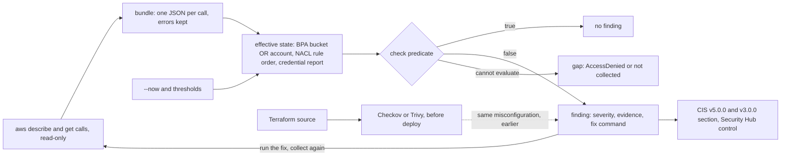

# Secure Defaults Are Checks You Can Run

*Every benchmark line is a predicate over describe output: write each one as a function and the security audit becomes a command.*

## Metadata

| Field | Value |
|---|---|
| Type | Build |
| Languages | Python |
| Prerequisites | [Every AWS API Call Is a Policy Evaluation](https://cloudcaptain.io/learn/cloud/iam-policy-evaluator), [A VPC Is Route Tables and Rules You Can Evaluate](https://cloudcaptain.io/learn/cloud/vpc-reachability) |
| Time | 90 minutes |
| Tools | aws, moto, checkov, prowler, tofu |

<Quiz stage="pre" />

## The Problem

A customer's security questionnaire arrives on a Tuesday: "Do you follow the CIS AWS Foundations Benchmark? Attach evidence." The platform team has Checkov in every Terraform pipeline and it is green, so the answer goes out as yes. Three weeks later a researcher reports that `analytics-exports` serves customer CSV files to anyone with an AWS account. Nobody wrote that bucket in Terraform. It was made by hand for a partner demo, with a bucket policy that allows `s3:GetObject` to `"*"` "but only from our VPCs", written as `StringLike` on `aws:SourceVpc` with the value `vpc-*`. A request straight from the internet carries no `aws:SourceVpc` and was refused, so the demo looked private. But S3 sets that key on every request that arrives through a VPC endpoint, in any VPC of any account, and every VPC ID matches `vpc-*`: the researcher created a VPC and a gateway endpoint in their own account and downloaded the files. S3's own rules call that policy public.

The incident review finds the rest in an afternoon of clicking. The bastion's security group has allowed `0.0.0.0/0` on port 22 since a "temporary" change in the console. A report-builder instance accepts IMDSv1, so any server-side request forgery bug in it hands out its role credentials with a plain GET. The root user has an access key from 2019 that a backup tool still uses, and no MFA. CloudTrail has one trail, in `us-east-1`, while the workloads run in `eu-central-1`; the trail that was meant to cover every Region was created and never started. Every one of these was invisible to the pipeline because none of them is in the code, and half of them (key age, `IsLogging`, root MFA) do not exist until the account is running.

A benchmark is a list of facts about the account that should be true, and every fact can be read from an API. Posture is not a dashboard you look at once before an audit; it is the output of a function over what `aws ... describe-*` and `get-*` return. You are going to write `posture`, that function: one read-only collection of describe outputs into a bundle, then 27 checks over it, each finding with a severity, the evidence that proves it, the command that fixes it, and the section number in CIS AWS Foundations Benchmark v5.0.0 and v3.0.0. Against an emulated account in moto, the fix commands it prints clear its own findings, and on the same misconfigurations written in Terraform it agrees with Checkov wherever both can see.

## The Concept

Start with what a security finding is: a statement about configuration ("this bucket's policy lets anyone read objects"), backed by the exact API output that shows it, plus how bad it is and how to make it false. The CIS AWS Foundations Benchmark is a numbered list of such statements, each written as a recommendation with an audit procedure that is, almost always, a CLI call and a comparison. AWS Security Hub CSPM implements most of them as controls with stable IDs (`EC2.53`, `IAM.9`); Prowler implements them as open-source checks. A posture scanner is three steps: collect, evaluate, report.

**Collect once, evaluate as often as you like.** Collection is the only part that touches AWS, and it only reads: list the buckets, then for each one get its Block Public Access configuration, its ACL and its policy; describe the security groups, network ACLs, volumes, instances and flow logs; download the IAM credential report; describe the trails and ask each one whether it is logging. The result is a bundle, a snapshot of the account as JSON. Evaluation is a pure function of the bundle, a clock and a few thresholds, so the same bundle gives the same findings tomorrow, a teammate can re-run your audit without credentials, and next week's bundle can be compared with this week's.

**Errors are data, but not all errors mean the same thing.** `NoSuchPublicAccessBlockConfiguration` means the bucket has no Block Public Access settings, which is a finding. `NoSuchBucketPolicy` means there is no policy. `AccessDenied` means the scanner does not know, and a scanner that treats "I could not look" as "nothing found" produces a clean report for an account it never saw. `posture` keeps every error in the bundle and reports the calls it could not use as gaps.

**Effective state, not stored state.** S3 combines four Block Public Access settings at the bucket level with the same four at the account level (and the organization level when one applies) and enforces the most restrictive combination. A bucket with a public ACL is not public while `IgnorePublicAcls` is on anywhere above it; a public policy is fenced in while `RestrictPublicBuckets` is on. Severity follows: the same grant is critical when it works and low when a compensating control neutralises it, and the evidence must say which. Network ACLs are the opposite kind of trap: they are evaluated in rule-number order and the first match wins, so "an allow from `0.0.0.0/0` on port 22 exists" is not the same as "the internet reaches port 22" when a lower-numbered deny sits in front of it. Security groups are allow-only and stateful, so any one rule from `0.0.0.0/0` that covers port 22, by port range or by `IpProtocol -1`, opens it.

**"Public" is a rule about the policy text.** S3 does not decide publicness by evaluating requests. It assumes a bucket policy is public and clears it only if every statement that allows a wildcard principal is pinned by a fixed value (no `*`, no `?`, no policy variable) of a short list of condition keys: `aws:SourceVpc`, `aws:SourceVpce`, `aws:SourceArn`, `aws:SourceAccount`, `aws:SourceOwner`, `aws:PrincipalOrgID` and friends, or `aws:SourceIp` with ranges no broader than `/8` for IPv4 and `/32` for IPv6. That is why `StringLike vpc-*` is public. The policy evaluator from the [IAM lesson](https://cloudcaptain.io/learn/cloud/iam-policy-evaluator) still has a job: a TLS requirement is a question about requests ("is a plain-HTTP `GetObject` explicitly denied for every principal?"), so `posture` runs a small version of it with `aws:SecureTransport` set to `false`.

**Benchmark numbers move; say which version.** CIS AWS Foundations v5.0.0 dropped "security questions are registered" from section 1, so every IAM recommendation moved up by one: root MFA is 1.5 in v3.0.0 and 1.4 in v5.0.0. EBS default encryption moved from 2.2.1 to 5.1.1, and the security group rules from 5.2 and 5.3 to 5.3 and 5.4. Security Hub's control IDs did not change. A finding that says "CIS 1.4" without a version is ambiguous; `posture` carries both numbers and the control ID, and prints the version it uses.

**Before deploy and after deploy are different questions.** Checkov and Trivy read Terraform before anything exists and catch a public ACL in review, which is cheaper than any fix later. They cannot see the console change, the key that is 400 days old, the trail that is not logging, or root's MFA. A posture scanner sees exactly those, and nothing that has not been deployed yet. You need both, and on the misconfigurations they share they must agree.



## Build It

`code/main.py` is `posture`, standard library only. `posture collect` runs the AWS CLI through an injectable runner and writes the bundle; `posture scan` evaluates it; `posture checks` prints the catalogue. The tests use fake runners, inline bundles and `code/fixtures/moto-bundle.json`, a bundle that `posture collect` produced from moto 5.2.5 after the setup that `code/smoke.sh` runs.

### Step 1: collect once, keep every answer

The first pass is a fixed list of account-wide calls; later calls follow from their outputs (each bucket, each trail, each user's keys, each customer managed key):

```python
COLLECT_CALLS = (
    ("sts", "get-caller-identity"),
    ("s3api", "list-buckets"),
    ("ec2", "describe-vpcs"),
    ("ec2", "describe-security-groups"),
    ("ec2", "describe-network-acls"),
    ("ec2", "describe-flow-logs"),
    ("ec2", "describe-volumes"),
    ("ec2", "describe-instances"),
    ("ec2", "get-ebs-encryption-by-default"),
    ("iam", "list-users"),
    ("iam", "get-account-summary"),
    ("iam", "get-account-password-policy"),
    ("cloudtrail", "describe-trails"),
    ("configservice", "describe-configuration-recorders"),
    ("configservice", "describe-configuration-recorder-status"),
    ("kms", "list-keys"),
    ("kms", "list-aliases"),
)
```

Every result is stored under the command that produced it, so the bundle doubles as an audit trail: the key `s3api get-bucket-acl --bucket cc-public-acl` is the command a reviewer runs to see the same thing.

```python
def record_call(runner: Runner, argv: Sequence[str]) -> dict:
    result = runner(list(argv))
    if result.returncode == 0:
        text = result.stdout.strip()
        try:
            return {"ok": True, "output": json.loads(text) if text else {}}
        except ValueError:
            return {"ok": False, "error": "UnparsableOutput", "message": text[:300]}
    match = ERROR_CODE.search(result.stderr)
    return {"ok": False, "error": match.group(1) if match else "CommandFailed", "message": result.stderr.strip()[-300:]}
```

The AWS CLI prints errors as `An error occurred (CODE) when calling the Operation`; the code is the stable token, the message is not. The credential report is asynchronous: `generate-credential-report` returns `STARTED` and `posture` polls it, with an injected `sleep`, until `COMPLETE`. IAM only generates a new report when the last one is more than four hours old, so its contents can be that stale; the bundle's `collected_at` records when you asked.

### Step 2: a finding is a check, evidence and a fix

```python
@dataclass(frozen=True)
class Check:
    id: str
    severity: str
    title: str
    cis5: str = ""
    cis3: str = ""
    securityhub: str = ""
```

```python
    Check("sg-admin-ipv4", "high", "Security group allows 0.0.0.0/0 to an admin port", "5.3", "5.2", "EC2.53"),
    Check("root-mfa-off", "critical", "Root user has no MFA device", "1.4", "1.5", "IAM.9"),
    Check("ebs-default-encryption-off", "medium", "EBS encryption by default is off in this Region", "5.1.1", "2.2.1", "EC2.7"),
    Check("s3-public-policy", "critical", "Bucket policy is public", securityhub="S3.2, S3.3"),
```

The CIS numbers come from the control mapping table in the Security Hub CSPM documentation and from Prowler's `cis_5.0_aws` and `cis_3.0_aws` compliance files, which agree. Where the benchmark has no requirement (a public bucket policy is what 2.1.4 prevents, not a numbered item; an unencrypted volume is Security Hub `EC2.3` but not CIS), the field stays empty rather than borrowing a nearby number. `posture checks --benchmark 3.0.0` prints the table with v3.0.0 numbers. A `Finding` adds the resource, a human name, the evidence lines, a fix sentence and `commands`: argument lists after `aws` that make the finding false, where one exists.

### Step 3: absent is a value, unknown is a gap

```python
    def read(self, *argv: str, absent: Iterable[str] = ()) -> Optional[dict]:
        key = shlex.join(argv)
        entry = self.calls.get(key)
        if entry is None:
            self.gaps.append({"call": key, "reason": "not collected"})
            return None
        if entry.get("ok"):
            output = entry.get("output")
            return output if isinstance(output, dict) else {}
        if entry.get("error") in set(absent):
            return {}
        self.gaps.append({"call": key, "reason": f"{entry.get('error')}: {entry.get('message', '')}".strip()})
        return None
```

Each check names the error codes that mean "not configured" for its call (`NoSuchPublicAccessBlockConfiguration`, `NoSuchBucketPolicy`, `NoSuchEntity` for a missing password policy) and gets an empty document for them; anything else returns `None` and the check skips that resource. A role without `ec2:DescribeSecurityGroups` produces a gap line in the report, not a clean bill of health for the network.

### Step 4: S3 Block Public Access is bucket OR account

```python
def effective_bpa(bucket: Optional[Dict[str, bool]], account: Optional[Dict[str, bool]]) -> Dict[str, bool]:
    return {flag: bool((bucket or {}).get(flag)) or bool((account or {}).get(flag)) for flag in BPA_FLAGS}
```

`check_bucket()` computes the effective flags once and uses them three times. If any of the four is off, the bucket gets `s3-bucket-bpa-off` (CIS 2.1.4, Security Hub `S3.8`). A grant to the `AllUsers` or `AuthenticatedUsers` group in the ACL is `s3-public-acl`, critical, unless `IgnorePublicAcls` is effectively on, in which case it is reported as low with a line saying it is neutralised until someone turns that setting off. A public policy is critical unless `RestrictPublicBuckets` is on. Real S3 returns the effective ACL from `GetBucketAcl`, so with `IgnorePublicAcls` on you would not even see the public grant; moto returns the stored one, which is why the neutralised case exists in the tests at all. The account-level settings come from `aws s3control get-public-access-block --account-id ID`, a different service with a different endpoint scheme, and are reported once as `s3-account-bpa-off` (`S3.1`).

### Step 5: what "public" means for a bucket policy

```python
def condition_restricts(condition: object) -> bool:
    for operator, block in (condition or {}).items() if isinstance(condition, dict) else []:
        name = operator.lower()
        if name.startswith("forallvalues:") or name.endswith("ifexists") or "not" in name.split(":")[-1]:
            continue
        base = name.split(":")[-1]
        for key, values in (block or {}).items():
            wanted = as_list(values)
            if not wanted:
                continue
            if key.lower() == "aws:sourceip" and base == "ipaddress" and all(narrow_cidr(v) for v in wanted):
                return True
            if key.lower() in FIXED_VALUE_KEYS and base in EQUALITY_OPERATORS and all(fixed_value(v) for v in wanted):
                return True
    return False


def statement_is_public(statement: dict) -> bool:
    return statement.get("Effect") == "Allow" and principal_is_anyone(statement) and not condition_restricts(statement.get("Condition"))
```

A statement is public when it allows `"*"`, `{"AWS": "*"}`, any principal ARN containing a wildcard, or uses `NotPrincipal` with `Allow`, and no condition pins it. Negated operators (`StringNotEquals`, `NotIpAddress`), `...IfExists` (true when the key is missing, and an anonymous request has no `aws:SourceVpce`) and `ForAllValues:` (true for an empty set) do not pin anything. `aws:userid` is left out of the restricting keys, which errs towards "public". The tests replay the three example policies from the S3 documentation, including the `vpc-*` one from The Problem.

Requiring TLS is a different kind of question, so it uses evaluation rather than the static rule:

```python
def tls_gap(policy: dict, bucket: str) -> Optional[str]:
    context = {"aws:securetransport": ["false"]}
    for action, suffix in TLS_PROBES:
        resource = f"arn:aws:s3:::{bucket}{suffix}"
        denied = any(
            s.get("Effect") == "Deny" and s.get("Principal") in ("*", {"AWS": "*"}) and statement_applies(s, action, resource, context)
            for s in statements(policy)
        )
        if not denied:
            return f"{action} on {resource} over plain HTTP (aws:SecureTransport=false) is not explicitly denied"
    return None
```

`statement_applies()` is the IAM lesson's matcher in miniature: `Action`/`NotAction` with case-insensitive wildcards, `Resource`/`NotResource`, and the condition operators with AWS's rule for missing keys (positive operators fail, negated operators and `IfExists` pass). Three probes (`GetObject` and `PutObject` on an object, `ListBucket` on the bucket) must each hit an explicit deny for every principal, which is what the `s3-bucket-ssl-requests-only` Config rule behind `S3.5` expects. A deny scoped to `arn:aws:s3:::bucket/*` alone leaves `ListBucket` over HTTP, and the evidence says so.

### Step 6: ports, protocols and rule order

```python
def covers_port(protocol: object, low: object, high: object, port: int) -> bool:
    proto = str(protocol).lower()
    if proto in ("-1", "all"):
        return True
    if proto not in ("tcp", "6", "udp", "17") or low is None or high is None:
        return False
    return int(low) <= port <= int(high)
```

Security Hub's `EC2.53` and `EC2.54` check ports 22 and 3389 over TCP, UDP or all protocols, from `0.0.0.0/0` and `::/0` respectively; `posture` does the same, so `IpProtocol -1` and `tcp 20-30` both count, `tcp 443` does not. The fix revokes exactly the offending range of the offending permission, so a rule that also lists the office CIDR keeps it:

```python
revoke = clean_permission({**permission, "IpRanges": [], "Ipv6Ranges": [], "UserIdGroupPairs": [], "PrefixListIds": [], range_key: [{cidr_key: WORLD[family]}]})
commands.append(["ec2", "revoke-security-group-ingress", "--group-id", gid, "--ip-permissions", compact_json([revoke])] + scan.region_args())
```

Network ACLs need the order the VPC uses:

```python
def nacl_exposure(entries: List[dict], port: int, family: int) -> Optional[dict]:
    key = "CidrBlock" if family == 4 else "Ipv6CidrBlock"
    for entry in sorted((e for e in entries if not e.get("Egress")), key=lambda e: int(e.get("RuleNumber", 0))):
        if entry.get(key) != WORLD[family]:
            continue
        span = entry.get("PortRange") or {}
        if covers_port(entry.get("Protocol"), span.get("From"), span.get("To"), port):
            return entry if entry.get("RuleAction") == "allow" else None
    return None
```

Only rules for the whole internet decide whether the whole internet gets in; a deny for one `/24` in front of an allow-all still leaves everyone else through, and the loop skips it. The fix inserts denies with free rule numbers just below the allow (`free_rule_numbers()`), rather than deleting an allow that may carry all inbound traffic. Default network ACLs are skipped, as `EC2.21` skips them: every VPC gets one that allows everything, and the security groups are the filter that matters there. The VPC lesson's `vpcpath` asks the question for one packet; this asks it for "anyone" and two ports.

### Step 7: identity, on a clock you choose

```python
    uses = [(column, parse_time(root.get(column))) for column in ("password_last_used", "access_key_1_last_used_date", "access_key_2_last_used_date")]
    recent = [(column, when) for column, when in uses if when is not None and days_since(when, now) is not None and days_since(when, now) < scan.settings.root_used_days]
```

The credential report is a base64 CSV with one row per user and a `<root_account>` row; its values mix timestamps with `N/A`, `no_information` and `not_supported`, and `parse_time()` turns everything that is not a timestamp into `None`. Root gets `root-access-key` (1.3), `root-mfa-off` (1.4) and `root-used` (1.6, a manual requirement in the benchmark that the report makes measurable). moto's report has no root row, so `posture` falls back to `iam get-account-summary` (`AccountMFAEnabled`, `AccountAccessKeysPresent`) and records `root-used` as a gap. Users get `user-console-no-mfa`, `user-two-active-keys`, and two age checks built from `list-access-keys` and `get-access-key-last-used`: a key older than 90 days (1.13) and a credential unused for 45 days (1.11). Ages are relative to `Settings.now`, which defaults to the bundle's collection time, and `--now +120d` asks what the same account looks like four months later. That is how the tests age moto's brand-new keys without waiting.

### Step 8: a trail that exists is not a trail that logs

```python
def logs_all_management(trail: dict, selectors: Optional[dict]) -> bool:
    if not trail.get("HasCustomEventSelectors"):
        return True
    for selector in (selectors or {}).get("EventSelectors") or []:
        if selector.get("IncludeManagementEvents") and selector.get("ReadWriteType", "All") == "All":
            return True
    for advanced in (selectors or {}).get("AdvancedEventSelectors") or []:
        fields = {f.get("Field"): f for f in advanced.get("FieldSelectors") or []}
        if (fields.get("eventCategory") or {}).get("Equals") == ["Management"] and "readOnly" not in fields:
            return True
    return False
```

CIS 3.1 is about the account: at least one multi-Region trail that `get-trail-status` says `IsLogging: true` and that records read and write management events. A trail without custom selectors records all management events; one with `ReadWriteType: WriteOnly` does not. Validation (3.2) and KMS encryption (3.5) are per trail. If a multi-Region trail exists but is stopped, the fix is `start-logging`; if only single-Region trails exist, it is `update-trail --is-multi-region-trail` and `start-logging`. AWS Config must have a recorder that is recording every supported type (3.3). KMS rotation (3.6) only applies to enabled, customer managed, symmetric keys with KMS key material; keys whose alias starts with `aws/` are AWS managed and rotate on their own. VPC flow logs (3.7) count when they are `ACTIVE` and capture `ALL` or `REJECT` traffic.

### Step 9: run it

```bash
python3 code/main.py checks                                                  # 27 checks with CIS v5.0.0 sections and Security Hub controls
python3 code/main.py checks --benchmark 3.0.0                                # the same table with v3.0.0 numbers
F=code/fixtures/moto-bundle.json
python3 code/main.py scan $F; echo "exit $?"                                 # exit 1: findings at or above --fail-on high
python3 code/main.py scan $F --now +120d --min-severity medium               # four months on: the keys are old and unused
python3 code/main.py scan $F --json | python3 -m json.tool | head -40        # evidence, fix and commands as data
python3 code/main.py scan $F --markdown                                      # a table for a review or a pull request
python3 code/main.py scan $F --fail-on critical --benchmark 3.0.0            # a gentler gate, older numbering
```

A finding reads like this:

```text
MEDIUM   nacl-admin-open             cc-wide-range             CIS 5.2 [EC2.21]
  Network ACL lets the whole internet reach an admin port
  evidence: port 22 from 0.0.0.0/0: the first matching inbound rule is 100 allow tcp 0-65535
  evidence: port 3389 from 0.0.0.0/0: the first matching inbound rule is 100 allow tcp 0-65535
  fix: Insert deny rules for the admin ports with lower rule numbers than the allow (rules are evaluated in order), or narrow the allow's CIDR.
  run: aws ec2 create-network-acl-entry --network-acl-id acl-... --ingress --rule-number 99 --protocol 6 --port-range From=22,To=22 --cidr-block 0.0.0.0/0 --rule-action deny --region us-east-1
```

<RunTests />

## Use It

Start an account you can break. moto in server mode answers the AWS APIs locally; the siblings in this phase pin `moto[server]==5.2.5`, which needs Python 3.10 or newer:

```bash
python3 -m venv .venv && .venv/bin/pip install 'moto[server]==5.2.5'
.venv/bin/moto_server -H 127.0.0.1 -p 5000 &
export AWS_ACCESS_KEY_ID=test AWS_SECRET_ACCESS_KEY=test AWS_DEFAULT_REGION=us-east-1
printf '[default]\ns3 =\n  addressing_style = path\n' > aws-config && export AWS_CONFIG_FILE=$PWD/aws-config
EP=http://localhost:5000                                                     # localhost, not 127.0.0.1: s3control puts the account ID in the host name
aws --endpoint-url $EP s3api create-bucket --bucket cc-public-acl
aws --endpoint-url $EP s3api put-bucket-ownership-controls --bucket cc-public-acl --ownership-controls 'Rules=[{ObjectOwnership=BucketOwnerPreferred}]'
aws --endpoint-url $EP s3api put-bucket-acl --bucket cc-public-acl --acl public-read
```

On real AWS the last command fails on a new bucket, because since April 2023 new buckets start with all four Block Public Access settings on and ACLs disabled (`BucketOwnerEnforced`); you would first have to `delete-public-access-block` and change the ownership controls, two deliberate steps. `code/smoke.sh` builds the whole scenario this way: four buckets, two VPCs, four security groups, three network ACLs, volumes, two instances, three IAM users, two KMS keys and two trails. Then ask the account the benchmark's questions by hand:

```bash
A="aws --endpoint-url $EP"
$A ec2 describe-security-groups --filters Name=ip-permission.cidr,Values=0.0.0.0/0 Name=ip-permission.from-port,Values=22 --query 'SecurityGroups[].GroupName'
$A ec2 describe-network-acls --filters Name=default,Values=false Name=entry.cidr,Values=0.0.0.0/0 Name=entry.rule-action,Values=allow --query 'NetworkAcls[].Tags[?Key==`Name`]|[].Value'
$A ec2 describe-volumes --filters Name=encrypted,Values=false --query 'Volumes[].[VolumeId,State]'
$A ec2 describe-instances --query 'Reservations[].Instances[?MetadataOptions.HttpTokens!=`required`][].InstanceId'
$A iam generate-credential-report && $A iam get-credential-report --query Content --output text | base64 -d | cut -d, -f1,4,8
$A s3api get-bucket-policy-status --bucket cc-public-policy
$A cloudtrail get-trail-status --name cc-org-trail --query IsLogging
```

Each answer is right for the question it asks and wrong for the question you meant. The `from-port=22` filter finds `cc-ssh-open` and misses `cc-all-open`, whose all-traffic rule has no port at all. The network ACL filter lists `cc-ssh-denied-first`, because a filter cannot know that rule 90 denies before rule 100 allows. `get-bucket-policy-status` is the API S3 itself uses; on real AWS it applies the rules from Step 5, but moto 5.2.5 reports any policy with a `Condition` as not public, including the `vpc-*` one AWS documents as public, which is why the tests check `statement_is_public()` against AWS's documented examples rather than against the emulator. Now the same questions as one command:

```bash
python3 code/main.py collect --endpoint-url $EP -o bundle.json               # about 50 read-only calls, errors kept
python3 code/main.py scan bundle.json --now +120d
python3 code/main.py scan bundle.json --json > findings.json
python3 -c 'import json; [print("aws", " ".join(c)) for f in json.load(open("findings.json"))["findings"] for c in f["commands"]]'
```

Run the printed commands against the emulator, collect again and scan again: every finding whose commands ran disappears, except the two public policies, which drop to low because `RestrictPublicBuckets` now fences them in while the statements are still there. That is what `code/smoke.sh` asserts, fix by fix.

In a real account you collect with a role that can only read. The AWS managed policy `SecurityAudit` is designed for this kind of review and reads configuration and metadata; `ReadOnlyAccess` also reads data, such as object contents, which a posture scanner does not need. Any call it lacks shows up as a gap, not as a pass. The tools you would run there:

```bash
pip install prowler && prowler aws --list-compliance                         # framework names such as cis_5.0_aws
prowler aws --compliance cis_5.0_aws                                         # every CIS v5.0.0 check, CSV under output/compliance/
aws securityhub batch-enable-standards --standards-subscription-requests StandardsArn=arn:aws:securityhub:us-east-1::standards/cis-aws-foundations-benchmark/v/5.0.0
aws securityhub get-findings --filters '{"ComplianceSecurityControlId":[{"Value":"EC2.53","Comparison":"EQUALS"}],"ComplianceStatus":[{"Value":"FAILED","Comparison":"EQUALS"}]}'
aws configservice put-config-rule --config-rule '{"ConfigRuleName":"s3-bucket-ssl-requests-only","Source":{"Owner":"AWS","SourceIdentifier":"S3_BUCKET_SSL_REQUESTS_ONLY"}}'
aws configservice get-compliance-details-by-config-rule --config-rule-name s3-bucket-ssl-requests-only --compliance-types NON_COMPLIANT
```

Security Hub CSPM runs most controls as AWS Config rules (`EC2.53` is `vpc-sg-port-restriction-check`, `S3.8` is `s3-bucket-level-public-access-prohibited`), so Config must be recording first; that is why CIS 3.3 matters beyond the checkbox. Controls run on configuration change or on a schedule, and enabling a new standard version can take hours to produce findings.

Before deploy, the same misconfigurations are visible in Terraform. `code/smoke.sh` writes them as `main.tf` (the same names, with `-` turned into `_`) and runs Checkov 3.3.29, installed from a wheel whose sha256 it checks against PyPI's published digest:

```bash
pip download --no-deps checkov==3.3.29 -d dl && sha256sum dl/checkov-3.3.29-py3-none-any.whl
pip install dl/checkov-3.3.29-py3-none-any.whl
checkov -d infra --framework terraform --compact                             # source, before plan
tofu plan -out plan.out && tofu show -json plan.out > plan.json && checkov -f plan.json   # the plan, with module values resolved
trivy config infra/                                                          # Trivy's misconfiguration scanner, which absorbed tfsec's checks
```

On 17 pairs of checks the two scanners flag exactly the same resources (`sg-admin-*` and `CKV_AWS_24`/`CKV_AWS_25`, `s3-public-acl` and `CKV_AWS_20`, `s3-bucket-bpa-off` and `CKV2_AWS_6`, `ebs-default-encryption-off` and `CKV_AWS_106`, `kms-rotation-off` and `CKV_AWS_7`, and so on). They differ in two places, and both are worth knowing. `CKV_AWS_67` fails every single-Region trail, while CIS 3.1 asks whether the account has one multi-Region trail that is logging, which only the running account can answer. And Checkov 3.3.29's network ACL checks test `if from_port and to_port` in `AbsNACLUnrestrictedIngress.check_rule`, so a rule for ports `0-65535` never matches (zero is false in Python): `cc-wide-range` lets the internet reach 22 and 3389 and passes `CKV_AWS_231` and `CKV_AWS_232`. Read the source of the scanner you gate on.

| What you built | Real tool | Azure / GCP | Note |
|---|---|---|---|
| `collect()` into a bundle | the describe APIs; AWS Config configuration items | Azure Resource Graph; Cloud Asset Inventory | Config keeps history per resource; a bundle is one snapshot you can diff |
| `CHECKS` with CIS v5.0.0 and v3.0.0 numbers | Security Hub CSPM CIS standards; `prowler aws --compliance cis_5.0_aws` | Defender for Cloud regulatory compliance (CIS Microsoft Azure Foundations); Security Command Center compliance (CIS Google Cloud Platform Foundation) | Security Hub control IDs stay stable while CIS numbers move |
| `check_bucket()` and `statement_is_public()` | Block Public Access, `get-bucket-policy-status`, IAM Access Analyzer for S3, `S3.1`/`S3.2`/`S3.3`/`S3.8` | storage account anonymous blob access; Cloud Storage public access prevention | publicness is a rule over policy text, not a request test |
| `tls_gap()` | `s3-bucket-ssl-requests-only` (`S3.5`) | storage account "secure transfer required" | a deny with `aws:SecureTransport` false for every principal |
| `check_security_groups()`, `check_nacls()` | `EC2.53`, `EC2.54`, `EC2.21`, `EC2.2`; Network Access Analyzer | Network security group rules; VPC firewall rules (Security Health Analytics `OPEN_SSH_PORT`, `OPEN_RDP_PORT`) | ACLs in rule order, security groups as a union |
| `check_root()`, `check_users()` | credential report; `IAM.4`, `IAM.9`, `IAM.5`, `IAM.3`, `IAM.22` | Entra ID MFA and sign-in reports; IAM recommender and service account key age | ages depend on `--now`; root has no IAM policy to limit it |
| `check_logging()` | `CloudTrail.1`, `CloudTrail.2`, `CloudTrail.4`, `Config.1`, `KMS.4`, `EC2.6` | Activity Log diagnostic settings; Cloud Audit Logs | `IsLogging` and selectors, not the trail's existence |
| `commands` and the smoke's fix loop | Config remediation with SSM Automation; Security Hub automation rules | Defender quick fixes; Security Command Center remediation | a fix you can run and re-scan, instead of a link to a guide |
| gaps for `AccessDenied` | Security Hub `NOT_AVAILABLE` status; Prowler's errors per check | the same idea in every scanner | "could not look" must never print as "passed" |
| `--fail-on` exit code | Checkov or Trivy in the pipeline, before deploy | the same tools read Azure and GCP Terraform | posture finds what the code never had |

<Quiz stage="check" />

## Ship It

Two artifacts in `outputs/`:

- **`skill-cloud-security-review.md`**: a runbook for a posture review of one AWS account: collect with a read-only `SecurityAudit` role in every Region you use, scan with the benchmark version stated, list the gaps before the findings, triage by exposure (public now, one step from compromise, missing guardrail, hygiene) with a decision table, cross-check against Security Hub CSPM or Prowler, apply fixes in a safe order, re-collect to prove each one, and report with evidence and owners.
- **`prompt-prioritise-findings.md`**: paste `posture scan --json` output (or Security Hub or Prowler findings) and a few lines of context about the account, and get back the attack paths that combine findings, a prioritised fix plan in waves with the commands and their blast radius, what to accept with an owner and expiry, and what the scan could not see.

<ShipIt />

## Exercises

### Easy

Add `sg-risky-port`: Security Hub `EC2.19` lists the high-risk ports it checks from `0.0.0.0/0` and `::/0` (20, 21, 22, 23, 25, 110, 135, 143, 445, 1433, 1434, 3000, 3306, 3389, 4333, 5000, 5432, 5500, 5601, 8080, 8088, 8888, 9200, 9300). Report each security group with any of them open, excluding 22 and 3389 (already `sg-admin-*`), with severity critical for databases (1433, 1434, 3306, 5432, 9200, 9300) and high for the rest, and no CIS section. Write the tests first: `tcp 3306` from the world is critical, `tcp 8000-8100` is high because it covers 8080 and 8088, `tcp 443` passes, and `IpProtocol -1` reports every port in one finding.

### Medium

Add `posture diff OLD NEW`: compare two scans of bundles from the same account and print what is new, what is resolved, and what changed severity, keyed by check and resource rather than by name. Exit 1 only when something at or above `--fail-on` is new, so a nightly job can page on regressions without paging on old debt. Tests first: copy the fixture, edit one bucket's ACL to private and add a security group with port 22 open, then assert one resolved `s3-public-acl`, one new `sg-admin-ipv4`, and the `s3-public-policy` that turned low after `RestrictPublicBuckets` listed as changed, not resolved.

### Hard

Make severity depend on reachability. Collect `ec2 describe-route-tables`, `describe-subnets`, `describe-internet-gateways` and `describe-network-interfaces`, and for every `sg-admin-*` finding work out whether some network interface in that group has a public IP, sits in a subnet whose route table sends `0.0.0.0/0` to an internet gateway, and is not blocked by its subnet's network ACL on that port, reusing the evaluation from the VPC lesson. Raise the finding to critical with the interface ID and route as evidence when all three hold, lower it to medium with the missing link named when any fails, and keep it high when the data is missing. Test it with inline bundles for a public subnet, a private subnet behind a NAT gateway, and a public subnet whose ACL denies port 22, then extend the smoke so moto has all three.

<Quiz stage="post" />

## Key Terms

| Term | Common misconception | Precise definition |
|---|---|---|
| Security posture | "A score in a console." | The configuration state of an account as its APIs report it, judged against a list of expectations; it can be collected as data and evaluated by a program at any time. |
| CIS AWS Foundations Benchmark | "Section numbers are permanent IDs." | A versioned, numbered list of recommendations with audit and remediation steps. Numbers move between versions (root MFA is 1.5 in v3.0.0 and 1.4 in v5.0.0), so a section number means nothing without its version. |
| Security Hub CSPM control | "The same thing as a CIS requirement." | An AWS check with a stable ID such as `EC2.53`, run as an AWS Config rule, that may map to requirements in several standards and versions at once. |
| Block Public Access | "A bucket setting." | Four independent settings at the access point, bucket, account and organization level; S3 enforces the most restrictive combination, so the effective value is an OR across levels. |
| Public bucket policy | "Any policy with a condition is restricted." | A policy S3 treats as public unless every statement that allows a wildcard principal is pinned by fixed values of specific keys (`aws:SourceVpce`, `aws:PrincipalOrgID`, a narrow `aws:SourceIp`, ...). `StringLike vpc-*` pins nothing. |
| Credential report | "Live data." | A CSV that IAM regenerates only when the previous one is more than four hours old, with one row per user and a `<root_account>` row: password, MFA, and access key state and last use. |
| IMDSv2 | "A different metadata endpoint." | The same `169.254.169.254` service requiring a session token obtained with a PUT; `HttpTokens: required` stops a plain GET (the usual SSRF primitive) from reading role credentials. |
| Gap | "No findings means secure." | A check that could not run because a call failed or was not collected. A report must list gaps separately, or missing permissions look like a clean account. |
| Neutralised finding | "Fixed." | A misconfiguration still present but blocked by another control, such as a public ACL under `IgnorePublicAcls`; it is reported at low severity because removing the control revives it. |
| Static scan versus runtime scan | "One replaces the other." | Checkov and Trivy evaluate code before deploy; a posture scan evaluates the running account. Only the second sees console changes, key ages and `IsLogging`; only the first stops a mistake before it exists. |

## Further Reading

- [AWS Security and IAM](https://cloudcaptain.io/docs/cloud/aws/security-iam): the IAM, KMS, CloudTrail and Security Hub material this lesson's checks are built on.
- [Cloud Security Fundamentals](https://cloudcaptain.io/docs/cloud/cloud-security/fundamentals): the shared responsibility model and where posture management sits in it.
- [DevSecOps Fundamentals](https://cloudcaptain.io/docs/tools/devsecops/fundamentals): IaC scanning in the pipeline, the "before deploy" half of this lesson.
- [CIS AWS Foundations Benchmark in Security Hub CSPM](https://docs.aws.amazon.com/securityhub/latest/userguide/cis-aws-foundations-benchmark.html): the control-to-requirement table for v5.0.0, v3.0.0, v1.4.0 and v1.2.0 that `CHECKS` follows.
- [Blocking public access to your Amazon S3 storage](https://docs.aws.amazon.com/AmazonS3/latest/userguide/access-control-block-public-access.html): the four settings, how levels combine, and the exact meaning of "public" that Step 5 implements.
- [Getting credential reports for your AWS account](https://docs.aws.amazon.com/IAM/latest/UserGuide/id_credentials_getting-report.html): every column of the report and its special values.
- [Configure the instance metadata options](https://docs.aws.amazon.com/AWSEC2/latest/UserGuide/configuring-instance-metadata-options.html): IMDSv2, `HttpTokens`, and account-level defaults for new instances.
- [CIS Amazon Web Services Benchmarks](https://www.cisecurity.org/benchmark/amazon_web_services): the benchmark itself, free to download after registration, with the audit procedure for every section.
- [Prowler compliance frameworks](https://docs.prowler.com/user-guide/cli/tutorials/compliance): running an open-source scanner against a named CIS version and reading its mapping files.
- [Checkov](https://www.checkov.io/): the policy index and how to read a check's source, which is how the port-zero difference above was found.
