# A Metric Is a Name, Labels and a Number Over Time

*A series is one name plus one exact label set; every new label value is another series in memory, so your labels decide the cost.*

## Metadata

| Field | Value |
|---|---|
| Type | Build |
| Languages | Python |
| Prerequisites | [USE Before You Guess](https://cloudcaptain.io/learn/linux/performance-basics), [HTTP/1.1 Is Text Over a Socket](https://cloudcaptain.io/learn/networking/http-server) |
| Time | 90 minutes |
| Tools | prometheus, promtool, node_exporter, docker, curl |

<Quiz stage="pre" />

## The Problem

Tuesday, 09:10. The login team ships a release that adds one label to an existing counter: `logins_total{user_id="..."}`, "so support can see who failed to log in". By 11:00 the Prometheus that watches the whole platform has gone from 600 thousand to 7 million series in its head block. Resident memory climbs past the container limit, the kernel kills the process, and Kubernetes restarts it. On start, Prometheus replays its write-ahead log to rebuild those 7 million series, which takes eighteen minutes. During that time nothing is scraped and no alert rule is evaluated. The checkout outage that started at 11:05 pages nobody, because the only thing that could have paged was busy reading its own log.

The first responders look in the wrong places. `up` was 1 for the login service the whole morning, so "the scrape is fine". Someone shortens retention from 15 days to 7 so Prometheus "uses less memory". That frees disk and nothing else: the memory is held by the head, which keeps every series seen in the last couple of hours, whatever the retention. Someone else doubles the memory limit. The next restart then takes thirty minutes, because there is more log to replay.

The fix is to drop one label, and finding it took four hours because nobody on call could say what a series is, why a label value creates one, what the head keeps, or how to ask Prometheus which label is the problem. In this lesson you write `minitsdb`, a small Prometheus. It parses the text exposition format and OpenMetrics, scrapes targets with the same relabelling, `honor_labels` and staleness rules, and appends samples through a write-ahead log into Gorilla-compressed chunks. It also prints the cardinality report that would have named `user_id` at 09:15. Then you run Prometheus on the same targets and check that both store the same series.

## The Concept

Picture a huge spreadsheet where every row is a series and every column is a moment in time. A row is not named "logins". It is named by the metric name *and every label value together*: `logins_total{instance="10.0.0.7:8080", job="auth", code="200"}` is one row and the same thing with `code="500"` is another. Prometheus never stores "a metric". It stores rows, and each row costs memory for its labels, its index entries and its open chunk, whether or not the number in it ever changes. Adding a label multiplies the rows by the number of values that label takes. With `user_id`, that number is your user count.

Each cell is a sample: a timestamp in milliseconds and a 64-bit float. Everything else is convention. A *counter* is a series that only goes up, until the process restarts. A *gauge* goes up and down. A *histogram* is not one series but N+2: one `_bucket` series per upper bound `le` (cumulative counts, ending with `le="+Inf"`) plus `_sum` and `_count`. A *summary* is precomputed quantiles plus `_sum` and `_count`. The application exposes these as text on `/metrics`, in the classic text format or in OpenMetrics, its stricter successor.

Prometheus pulls. For every target it keeps a scrape loop: every `scrape_interval` it GETs `/metrics` within `scrape_timeout`, parses the page, attaches the target's labels (`job`, `instance` and whatever relabelling added), runs `metric_relabel_configs` over each sample, and appends the samples with the scrape's timestamp. It also writes five series of its own per target, starting with `up` (1 if the scrape worked, 0 if not) and `scrape_duration_seconds`. A series that was in the last scrape and is missing from this one, or every series of a target whose scrape failed, gets a *staleness marker*: a NaN with one specific bit pattern, so queries stop returning it at once instead of carrying the last value forward for five minutes.

```mermaid
flowchart LR
  T["target /metrics"] -->|"GET every scrape_interval"| P["parse text or OpenMetrics"]
  D["static_configs and service discovery"] --> R1["relabel_configs: keep, drop, add target labels"]
  R1 --> T
  P --> M["attach job and instance, honor_labels"]
  M --> R2["metric_relabel_configs"]
  R2 --> A["append: label set to series ref, postings index"]
  P -->|"series gone or scrape failed"| S["staleness marker"]
  S --> A
  A --> W["WAL: series and samples records, CRC32C"]
  W --> H["head: one open chunk per series, 120 samples, Gorilla XOR"]
  H -->|"every 2h"| B["immutable blocks on disk"]
  B -->|"retention time or size"| X["whole blocks deleted"]
```



Storage has two layers. The *head* is in memory and holds the most recent hours. Every append goes first to the write-ahead log (WAL), a sequence of 128 MiB segment files made of 32 KiB pages of checksummed records, so a crash loses nothing that was acknowledged. Then the sample goes into the series' open chunk. A chunk holds about 120 samples encoded with the scheme from Facebook's Gorilla paper: timestamps as delta-of-delta, so a target scraped on time costs one bit per sample, and values XORed with the previous value, so an unchanged value costs one bit too. That is how Prometheus stores 1 to 2 bytes per sample instead of 16. Every two hours the oldest part of the head is written out as an immutable *block*, and retention deletes whole blocks. That is why retention shrinks the disk but not the memory: memory is head series, and head series are cardinality.

## Build It

`code/main.py` is `minitsdb`, standard library only. The tests use fake fetchers, a virtual clock and temporary directories, so they run anywhere. `minitsdb demo` serves a `/metrics` page with known values, so you can scrape something real on your laptop.

### Step 1: an exposition is lines of text

A sample line is a metric name, an optional label set in braces, a value, and an optional timestamp. Label values are quoted, and only three escapes exist: backslash, double quote and newline. The text format keeps an unknown escape literally. OpenMetrics rejects it:

```python
def read_quoted(text: str, pos: int, where: Optional[int], strict: bool) -> Tuple[str, int]:
    out: List[str] = []
    pos += 1
    while pos < len(text):
        char = text[pos]
        if char == '"':
            return "".join(out), pos + 1
        if char == "\\" and pos + 1 < len(text):
            escaped = text[pos + 1]
            if escaped in LABEL_ESCAPES:
                out.append(LABEL_ESCAPES[escaped])
                pos += 2
                continue
            if strict:
                raise complain(where, f"invalid escape \\{escaped} in a label value (only \\\\, \\\" and \\n are allowed)")
        out.append(char)
        pos += 1
    raise complain(where, "unterminated label value: a closing quote is missing")
```

After the labels come the value and the timestamp. Values are Go floats, so `+Inf`, `-Inf` and `NaN` are legal and `1_000` is not (Python's `float()` would accept it, which is why `FLOAT_TEXT` checks first). The text format's timestamp is integer milliseconds; OpenMetrics uses seconds with a fraction:

```python
    fields = rest.split()
    if not fields:
        raise ParseError(number, f"{name} has no value")
    if len(fields) > 2:
        hint = " (exemplars need the OpenMetrics format)" if "#" in fields[1:] else ""
        raise ParseError(number, f"unexpected {fields[2]!r} after the timestamp{hint}")
    value = parse_float(fields[0], number)
    stamp = parse_timestamp(fields[1], number, openmetrics) if len(fields) == 2 else None
```

Every error carries its line number, because the person reading it has a 4,000-line page from an exporter.

### Step 2: types are conventions over name suffixes

`# TYPE http_request_duration_seconds histogram` declares a *family*. The samples on the page are named `http_request_duration_seconds_bucket`, `_sum` and `_count`, so the parser has to map each sample name back to its family:

```python
def resolve_family(name: str, families: Dict[str, Family], openmetrics: bool) -> Optional[Family]:
    if name in families:
        return families[name]
    table = OPENMETRICS_SUFFIXES if openmetrics else TEXT_SUFFIXES
    for suffix in ALL_SUFFIXES:
        if name.endswith(suffix):
            base = families.get(name[: -len(suffix)])
            if base is not None and suffix in table.get(base.type, ()):
                return base
    return None
```

The family's type changes what the parser stores. Prometheus 3 normalises the `le` label of classic histograms and the `quantile` label of summaries to one float spelling, so `le="1"` is stored as `le="1.0"` no matter which format delivered it. Before that change the same bucket could be two different series depending on the scrape protocol. `minitsdb` does the same with Go's shortest float formatting:

```python
def normalise_labels(family: Family, labels: Dict[str, str]) -> Dict[str, str]:
    key = "le" if family.type == "histogram" else "quantile" if family.type == "summary" else ""
    if key and key in labels:
        try:
            labels[key] = format_openmetrics_float(float(labels[key]))
        except ValueError:
            pass
    return labels
```

`format_openmetrics_float(1)` is `"1.0"`, `1e6` is `"1e+06"` and `0.25` stays `"0.25"`. An untyped sample with an `le` label keeps it as written, because only the declared type makes `le` special.

`validate()` checks what the scraper never checks: a classic histogram whose buckets are not cumulative, one without a `+Inf` bucket, or one whose `_count` differs from its `+Inf` bucket. Prometheus stores such a histogram happily and `histogram_quantile()` then returns nonsense, so you want this before the data exists:

```bash
python3 code/main.py parse code/fixtures/bad-histogram.prom
# problem: line 4: job_duration_seconds{queue="a"} has no le="+Inf" bucket
# problem: line 4: job_duration_seconds{queue="a"} bucket le=5.0 holds 3, less than 5 in le=1.0; buckets are cumulative
# problem: line 9: job_duration_seconds{queue="b"} _count is 3 but the +Inf bucket holds 2
# problem: line 12: counter jobs_failed_total is negative (-1)
```

### Step 3: OpenMetrics is the strict dialect

OpenMetrics (`application/openmetrics-text`) differs in ways you can test. The page must end with `# EOF`, so a truncated response is an error instead of a silently shorter page. A counter family is declared without `_total`, and its samples are `NAME_total` and `NAME_created` (the time the counter started from zero). Timestamps are seconds. There are no blank lines or free comments, and a family's lines must be contiguous. Samples can carry *exemplars*, a label set (usually a trace ID) with a value and a time, written after ` # `:

```python
    if openmetrics and " # " in rest:
        rest, exemplar_text = rest.split(" # ", 1)
        exemplar = parse_exemplar(exemplar_text, number)
```

Exemplars are allowed only on counter `_total` and histogram `_bucket` samples, and their labels may not exceed 128 characters. They are how a latency bucket links to one slow trace. `parse_exposition()` raises for each of these violations and names the line.

### Step 4: lint the way `promtool check metrics` does

`promtool check metrics` runs the `promlint` rules from client_golang over a text-format page. `lint_family()` ports all nine rules with their exact messages, so you can compare the two outputs line by line:

```python
    if family.help is None:
        out.append("no help text")
    unit = metric_unit(name)
    if unit and unit[0] != unit[1]:
        out.append(f'use base unit "{unit[1]}" instead of "{unit[0]}"')
    if kind == "counter" and not name.endswith("_total"):
        out.append('counter metrics should have "_total" suffix')
    elif kind not in ("counter", "untyped") and name.endswith("_total"):
        out.append('non-counter metrics should not have "_total" suffix')
```

The others cover reserved `_bucket`, `_count` and `_sum` suffixes, an `le` or `quantile` label on the wrong type, the type name inside the metric name, a colon, camelCase metric and label names, abbreviated units (`_ms`, `_sec`, `_kb`) and duplicate series. The demo page breaks three rules on purpose:

```bash
python3 code/main.py demo --port 18481 &
curl -s 127.0.0.1:18481/metrics > demo.prom
python3 code/main.py lint demo.prom
# cc_build_info no help text
# cc_cache_latency_milliseconds use base unit "seconds" instead of "milliseconds"
# cc_jobs_processed counter metrics should have "_total" suffix
```

### Step 5: targets come from relabelling

A target starts as *discovered labels*: `__address__` from `static_configs` (or service discovery), the group's labels, and defaults for `job`, `__scheme__`, `__metrics_path__`, `__scrape_interval__` and `__scrape_timeout__`. Then `relabel_configs` run in order. Each rule joins its `source_labels` with `;`, matches a regex anchored at both ends, and acts:

```python
    if action == "replace":
        if value == "" and rule.regex == "(.*)" and "$" not in rule.target_label and "$" not in rule.replacement:
            set_label(labels, rule.target_label, rule.replacement)
            return True
        match = rule.pattern.fullmatch(value)
        if match is None:
            return True
        target = expand_template(rule.target_label, match)
        if target:
            set_label(labels, target, expand_template(rule.replacement, match))
```

`expand_template()` follows Go's `regexp.Expand`, which has a trap: `$1x` means the group named `1x`, which does not exist, so it expands to nothing. Write `${1}x`. A replacement that expands to the empty string deletes the target label. `keep` and `drop` decide whether the target lives at all. `labelmap` copies labels whose *names* match into new names (`__meta_kubernetes_pod_label_(.+)` becomes `$1`), `labeldrop` and `labelkeep` filter names, and `hashmod` shards targets by an MD5 of the value. After relabelling, `build_target()` removes `__meta_*` labels, defaults `instance` to `__address__`, builds the URL from `__scheme__`, `__address__`, `__metrics_path__` and any `__param_*` labels, and keeps only labels without the `__` prefix as target labels.

The config is JSON. JSON is valid YAML, so the same file feeds Prometheus unchanged:

```bash
python3 code/main.py targets --config code/fixtures/prometheus.json
# active   demo         http://127.0.0.1:18481/metrics  {env="lab", instance="127.0.0.1:18481", job="demo", port="18481", team="payments"}
# active   demo-honor   http://127.0.0.1:18481/metrics  {instance="127.0.0.1:18481", job="demo-honor"}
# dropped  demo         127.0.0.1:9                     {__address__="127.0.0.1:9", ..., env="skip", job="demo"}
```

### Step 6: one scrape, its report series and its staleness markers

Before parsing, Prometheus 3 checks the response's `Content-Type`. Version 2 guessed the text format when the header was missing or unknown. Version 3 fails the scrape unless `fallback_scrape_protocol` names a protocol, so an exporter that sends `application/json` shows `up` 0 after an upgrade. `scrape_protocol()` does the same.

Each parsed sample then gets the target's labels. When they collide, `honor_labels` decides who wins. The default (`false`) keeps the target's value and moves the scraped one to `exported_<name>`, adding another `exported_` until the name is free. `true` keeps the scraped value. You want `true` for federation and the Pushgateway, where the scraped `job` is the real one:

```python
def sample_labels(sample: Sample, target: Target) -> Optional[Dict[str, str]]:
    labels = {k: v for k, v in sample.labels.items() if v != ""}
    labels["__name__"] = sample.name
    if target.config.honor_labels:
        for name, value in sorted(target.labels.items()):
            if name not in labels:
                set_label(labels, name, value)
    else:
        conflicts = sorted(((name, labels[name]) for name in sorted(target.labels) if labels.get(name)), key=lambda item: len(item[0]))
        for name, value in sorted(target.labels.items()):
            set_label(labels, name, value)
        for name, value in conflicts:
            renamed = name
            while True:
                renamed = "exported_" + renamed
                if not labels.get(renamed):
                    labels[renamed] = value
                    break
    return relabel(labels, target.config.metric_relabel_configs)
```

A label with an empty value does not exist, which is why `labels.get(name)` and not `name in labels` decides a conflict. `metric_relabel_configs` run last, per sample, and are the cheapest place to drop a series: it never reaches the TSDB.

The scrape then compares this scrape's series with the last one. Every series that disappeared gets a staleness marker at this scrape's timestamp. Then the five report series are added:

```python
        stale = sorted(target.tracked - tracked)
        rows.extend((key, timestamp, STALE_NAN) for key in stale)
        added = len(tracked - target.tracked)
        values = (1.0 if not error else 0.0, duration, float(len(samples)), float(kept), float(added))
        for name, value in zip(REPORT_METRICS, values):
            rows.append((freeze(dict(target.labels, __name__=name)), timestamp, value_bits(value)))
```

A failed scrape (connection refused, a non-200 status, a parse error, a body later than `scrape_timeout`) has no samples, so every series of the target goes stale and `up` is 0. `STALE_NAN` is `0x7ff0000000000002`, a NaN that no arithmetic produces. A NaN that an application really exposes is stored as `0x7ff8000000000001`, so the two never mix. `minitsdb` carries values as 64-bit integers from parse to chunk for exactly this reason: some CPUs quietly change a NaN's payload when it passes through a float register. Samples with an explicit timestamp are not tracked for staleness, because their owner (a federation source, say) decides their time.

`scrape_samples_scraped` counts every sample on the page and `scrape_samples_post_metric_relabeling` counts what survived your rules. The difference between them is what your drop rules saved.

### Step 7: series refs, the postings index and the write-ahead log

`TSDB.commit()` turns each label set into a series ref (a small integer) on first sight. It records `(name, value) -> {refs}` in the postings index, writes the WAL, and only then appends to the chunks:

```python
        if self.wal is not None:
            if created:
                self.wal.log(encode_series_record(created))
            if accepted:
                self.wal.log(encode_samples_record([(s.ref, t, b) for s, t, b in accepted]))
            self.wal.flush()
        for series, t, bits in accepted:
            series.append(t, bits)
```

The records use Prometheus's layout: a type byte (1 for series, 2 for samples), then refs and timestamps as deltas from the first sample in signed varints, with values as raw 8-byte floats. `WAL.log()` frames each record the way Prometheus's WAL does. A 7-byte header holds the fragment type (full, first, middle, last), the length and a CRC32 Castagnoli checksum. Fragments never cross a 32 KiB page, and the leftover bytes of a page are zero padding:

```python
        while first or data:
            room = PAGE_SIZE - (self.offset + len(out)) % PAGE_SIZE
            if room < RECORD_HEADER:
                out += bytes(room)
                continue
            part, data = data[:room - RECORD_HEADER], data[room - RECORD_HEADER:]
            kind = (REC_FULL if not data else REC_FIRST) if first else (REC_LAST if not data else REC_MIDDLE)
            out += bytes([kind]) + len(part).to_bytes(2, "big") + crc32c(part).to_bytes(4, "big") + part
            first = False
```

On start, `read_wal()` replays every record. If the process died mid-write, the last record is torn: its header or body is short, or its checksum fails. Replay stops there. When `minitsdb scrape` opens the same directory, it truncates the segment at that offset and starts a new segment, which is what Prometheus's WAL repair does. The replay time you saw in The Problem is this loop, run over every record of the last two or three hours.

### Step 8: Gorilla chunks, delta-of-delta and XOR

A chunk stores its first timestamp as a varint and its first value as 64 raw bits, and the second timestamp as a delta. From the third sample on it stores the *change in the delta*. A target scraped every 15 s has a delta-of-delta of 0, which costs one bit. Jitter of a millisecond costs 16 bits. Prometheus uses wider buckets than the paper (14, 17 and 20 bits) because its timestamps are milliseconds, not seconds:

```python
    def write_dod(self, dod: int) -> None:
        if dod == 0:
            self.stream.write_bit(0)
            return
        for prefix, width, size in DOD_BUCKETS:
            if -((1 << (size - 1)) - 1) <= dod <= 1 << (size - 1):
                self.stream.write_bits(prefix, width)
                self.stream.write_bits(dod & ((1 << size) - 1), size)
                return
        self.stream.write_bits(0b1111, 4)
        self.stream.write_bits(dod & MASK64, 64)
```

Values are XORed with the previous value. An unchanged value gives 0 and costs one bit. Otherwise the XOR has a run of leading and trailing zero bits. If the meaningful bits fit inside the previous window, only those bits are written after a `10` prefix. If not, the new window is written: 5 bits of leading zeros, 6 bits of length, then the bits:

```python
        if self.leading != 0xFF and leading >= self.leading and trailing >= self.trailing:
            self.stream.write_bit(0)
            self.stream.write_bits(delta >> self.trailing, 64 - self.leading - self.trailing)
            return
```

`minitsdb encode` shows what each sample costs:

```bash
python3 code/main.py encode 1700000000000:1 1700000015000:1 1700000030000:1 1700000045001:1 1700000060000:2.5 1700000075000:2.5
#   #      timestamp      value    delta      dod  t bits  v bits
#   0  1700000000000          1                        48      64
#   1  1700000015000          1    15000               16       1
#   2  1700000030000          1    15000        0       1       1
#   3  1700000045001          1    15001        1      16       1
#   4  1700000060000        2.5    14999       -2      16      26
#   5  1700000075000        2.5    15000        1      16       1
# 28 bytes for 6 samples (2-byte header included); raw: 96 bytes
```

The first sample costs 14 bytes and the steady state costs 2 bits. Chunks are cut at 120 samples, so the per-chunk header is spread over two hours of 60-second scrapes.

### Step 9: lookback, staleness and retention at query time

An instant query at time `t` returns, for each matching series, the newest sample in the window `(t - 5m, t]`. Prometheus 3 made that window open on the left. If the newest sample is a staleness marker, the series is not returned:

```python
    def instant(self, matchers: Sequence[Matcher], at_ms: int, lookback_ms: int = LOOKBACK_MS) -> List[Tuple[Labels, int, float]]:
        out = []
        for series in self.select(matchers):
            window = series.samples(at_ms - lookback_ms + 1, at_ms)
            if window and window[-1][1] != STALE_NAN:
                out.append((series.labels, window[-1][0], bits_float(window[-1][1])))
        return out
```

`select()` first intersects the postings of every non-empty `=` matcher, then checks the remaining matchers series by series. That is why `{job="api"}` is cheap and `{path=~".*login.*"}` alone has to look at every series. Retention drops whole chunks whose newest sample is older than the cutoff, and drops a series when nothing is left of it. Prometheus does the same with whole two-hour (and larger, compacted) blocks, so data a little older than the retention can still be queried.

### Step 10: the cardinality report, then run it all

`cardinality()` counts what costs memory: series per metric name, distinct values per label name, the most common label pairs, and the offenders. An offender is a label with many values or a name that looks unbounded (`*_id`, `email`, `session`, `ip`, `url`), reported with the number of series it carries and how many series each new value adds:

```python
            carrying = [dict(s.labels) for s in self.series.values() if name in dict(s.labels)]
            offenders.append({
                "label": name,
                "values": len(seen),
                "series": len(carrying),
                "share": round(len(carrying) / total, 4) if total else 0.0,
                "series_per_value": round(len(carrying) / len(seen), 2),
                "metrics": sorted({labels.get("__name__", "") for labels in carrying}),
            })
```

Scrape two demo apps, hide a series, stop one app, and look at what was stored:

```bash
python3 code/main.py demo --port 18481 & A=$!
python3 code/main.py demo --port 18482 & B=$!
python3 code/main.py scrape --config code/fixtures/prometheus.json --data /tmp/mtsdb --duration 30 &
sleep 8; curl -s -X POST '127.0.0.1:18481/hide?queue=batch'          # one series disappears from the page
sleep 8; kill $B                                                     # a whole target disappears
sleep 16
python3 code/main.py query --data /tmp/mtsdb 'up'                    # 127.0.0.1:18482 => 0
python3 code/main.py query --data /tmp/mtsdb 'cc_queue_depth{job="demo"}'                     # no batch, nothing from :18482
python3 code/main.py dump --data /tmp/mtsdb --match 'cc_queue_depth{queue="batch",job="demo",instance="127.0.0.1:18481"}' | tail -2
# ... 17 1793581518960
# ... stale 1793581520962
python3 code/main.py cardinality --data /tmp/mtsdb --top 3
#     50 cc_user_logins_total
#     36 cc_http_request_duration_seconds_bucket
#     10 cc_http_requests_total
# Worst offenders:
#   user_id: 25 values, 50 series (34.2% of all) in cc_user_logins_total; each new value adds 2 series
python3 code/main.py chunks --data /tmp/mtsdb
python3 code/main.py series --data /tmp/mtsdb --retention 5s | grep -c 18482                  # 0: B's chunks are older than the cutoff
kill $A
```

Twenty-five users make a third of all series. Exit codes: 0 for success, 1 when `parse` or `lint` find problems, 2 for unreadable input, a broken config or a data directory without a WAL.

<RunTests />

## Use It

Run Prometheus <ToolVersion name="prometheus" /> against the same two demo apps with the same file. The container runs as `nobody`, so make the config readable:

```bash
mkdir -p lab && cp code/fixtures/prometheus.json lab/prometheus.yml && chmod 0755 lab && chmod 0644 lab/prometheus.yml
python3 code/main.py demo --port 18481 & python3 code/main.py demo --port 18482 &
docker run -d --name prom --network host -v "$PWD/lab:/etc/cc:ro" prom/prometheus:v3.15.1 \
  --config.file=/etc/cc/prometheus.yml --storage.tsdb.path=/prometheus \
  --web.listen-address=127.0.0.1:9090 --web.enable-admin-api
curl -s 127.0.0.1:9090/-/ready
```

The JSON file is this YAML, which is how you would normally write it:

```yaml
global:
  scrape_interval: 2s
  scrape_timeout: 1s
scrape_configs:
  - job_name: demo
    static_configs:
      - targets: ["127.0.0.1:18481", "127.0.0.1:18482"]
        labels: {env: lab, __meta_team: payments}
      - targets: ["127.0.0.1:9"]
        labels: {env: skip}
    relabel_configs:
      - {source_labels: [env], regex: skip, action: drop}
      - {action: labelmap, regex: "__meta_(.+)", replacement: "$1"}
      - {source_labels: [__address__], regex: '.*:(\d+)', target_label: port, replacement: "$1"}
    metric_relabel_configs:
      - {source_labels: [__name__], regex: "cc_debug_.*", action: drop}
  - job_name: demo-honor
    honor_labels: true
    static_configs:
      - targets: ["127.0.0.1:18481"]
    metric_relabel_configs:
      - {source_labels: [__name__], regex: cc_build_info, action: keep}
```

Targets, their relabelled labels and the dropped one, the same shape `minitsdb targets --json` prints:

```bash
curl -s 127.0.0.1:9090/api/v1/targets | python3 -m json.tool > targets.json
python3 -c 'import json; d=json.load(open("targets.json"))["data"]; print([t["labels"] for t in d["activeTargets"]]); print([t["discoveredLabels"]["__address__"] for t in d["droppedTargets"]])'
docker run --rm -v "$PWD/lab:/etc/cc:ro" --entrypoint promtool prom/prometheus:v3.15.1 check config /etc/cc/prometheus.yml
```

The series set and the `honor_labels` rename. `cc_build_info` exists twice from job `demo` with `exported_job="batch-runner"`, and once with `job="batch-runner"` from `demo-honor`:

```bash
curl -s --get --data-urlencode 'match[]=cc_build_info' 127.0.0.1:9090/api/v1/series
curl -s --get --data-urlencode 'match[]={__name__=~"cc_debug_.*"}' 127.0.0.1:9090/api/v1/series      # empty: dropped by metric_relabel_configs
curl -s --get --data-urlencode 'query=scrape_samples_scraped - scrape_samples_post_metric_relabeling' 127.0.0.1:9090/api/v1/query
```

Staleness, the same experiment as Step 10. After the hide, the instant query returns nothing within one scrape, while `/api/v1/series` still lists the series because it still has samples in the head:

```bash
curl -s --get --data-urlencode 'query=cc_queue_depth{queue="batch"}' 127.0.0.1:9090/api/v1/query
curl -s -X POST '127.0.0.1:18481/hide?queue=batch'; sleep 5
curl -s --get --data-urlencode 'query=cc_queue_depth{queue="batch"}' 127.0.0.1:9090/api/v1/query      # "result":[]
curl -s --get --data-urlencode 'query=cc_queue_depth{queue="batch"}[1m]' 127.0.0.1:9090/api/v1/query  # the samples before the marker; range selectors skip the marker itself
```

Linting an exporter before it ships, and the per-family series count of a page:

```bash
curl -s 127.0.0.1:18481/metrics | docker run --rm -i --entrypoint promtool prom/prometheus:v3.15.1 check metrics            # exit 3 = lint problems
curl -s 127.0.0.1:18481/metrics | docker run --rm -i --entrypoint promtool prom/prometheus:v3.15.1 check metrics --extended
```

Cardinality, live and from a block. `/api/v1/status/tsdb` reports the head. `promtool tsdb analyze` reads a block, and a fresh server has no block yet, so take a snapshot (which writes the head out as a block) and analyse that:

```bash
curl -s 127.0.0.1:9090/api/v1/status/tsdb | python3 -m json.tool | head -40          # seriesCountByMetricName, labelValueCountByLabelName
SNAP=$(curl -s -X POST 127.0.0.1:9090/api/v1/admin/tsdb/snapshot | python3 -c 'import json,sys; print(json.load(sys.stdin)["data"]["name"])')
docker exec prom promtool tsdb analyze "/prometheus/snapshots/$SNAP"
# Highest cardinality labels:
# 25 user_id
# 17 __name__
# ...
# Highest cardinality metric names:
# 50 cc_user_logins_total
# 36 cc_http_request_duration_seconds_bucket
```

Host metrics come from node_exporter, which reads `/proc` and `/sys` (the files from the performance-basics lesson) and serves them on `/metrics`. It needs the host's PID namespace and the root filesystem mounted read-only:

```bash
docker run -d --name node --network host --pid host -v /:/host:ro,rslave prom/node-exporter:v1.12.1 \
  --path.rootfs=/host --web.listen-address=127.0.0.1:9100
python3 code/main.py scrape --target 127.0.0.1:9100 --job node --interval 1s --scrapes 2 --data /tmp/node
python3 code/main.py cardinality --data /tmp/node --top 5            # node_cpu_seconds_total: CPUs x 8 modes
docker rm -f prom node
```

**Why a `user_id` label is an outage.** Cardinality multiplies. `logins_total` with `code` (3 values) on 4 instances is 12 series. Add `user_id` for 2 million users and it is 24 million series, each holding memory in the head for its labels, its postings entries and its open chunk. That is tens of gigabytes before a single query runs, and every restart replays it from the WAL. Retention does not help, because it deletes blocks on disk, not head series. Retention is set with `storage.tsdb.retention` in the config file in current releases (the `--storage.tsdb.retention.time` flag still works but is deprecated). Sharding does not help much either, because each shard still holds every series of its targets. What helps:

| Problem | Fix | Where |
|---|---|---|
| a label with unbounded values | remove it in the code; until then `labeldrop` it | `metric_relabel_configs: [{action: labeldrop, regex: user_id}]` |
| a whole debug metric nobody queries | drop it before it is stored | `metric_relabel_configs` with `action: drop` on `__name__` |
| a target that can explode at any release | cap it: the whole scrape fails (`up` 0) above the limit | `sample_limit`, `label_limit`, `label_value_length_limit` in the scrape config |
| per-user or per-request detail | logs (one line per event) or traces, linked from a bucket with an exemplar | the log and tracing lessons of this phase |
| an expensive but needed breakdown | a recording rule that aggregates it, then drop the raw series at the source | the PromQL lesson |

| What you built | Real tool | Note |
|---|---|---|
| `parse_exposition()` text and OpenMetrics | Prometheus's `textparse` (promparse, openmetricsparse) | v3 normalises `le` and `quantile`, refuses unknown Content-Types without `fallback_scrape_protocol` |
| `validate()` | nothing at scrape time | Prometheus stores broken classic histograms; check exporters before they ship |
| `lint()` | `promtool check metrics` (promlint) | same nine rules and messages; promtool exits 3 on problems |
| `discover()`, `relabel()` | `relabel_configs`, `/api/v1/targets` | real service discovery adds `__meta_*` labels per provider (Kubernetes, EC2, Consul) |
| `sample_labels()` | `honor_labels`, `metric_relabel_configs` | `exported_` prefixes on conflicts |
| `Scraper.scrape()` | the scrape loop | Prometheus offsets each target inside its interval to spread load, and negotiates protobuf for native histograms |
| `STALE_NAN` markers | staleness handling | also written when a target leaves discovery; `track_timestamps_staleness` covers explicit timestamps |
| `WAL`, `read_wal()`, `repair_wal()` | `wal/` segments, WAL repair on start | Prometheus compresses records (snappy by default), checkpoints and truncates segments after head compaction |
| `XORChunk` | `tsdb/chunkenc` XOR chunks | the default float encoding; current releases add an opt-in `xor2` variant |
| `apply_retention()` on chunks | retention on whole blocks | time and size limits; head memory is unaffected |
| `cardinality()` | `/api/v1/status/tsdb`, `promtool tsdb analyze` | analyze needs a block: snapshot the head or wait for compaction |
| `minitsdb demo` | your application or node_exporter | client libraries render this page for you |

<Quiz stage="check" />

## Ship It

Two artifacts in `outputs/`:

- **`skill-cardinality-review.md`**: a runbook for a Prometheus whose memory, series count or WAL replay time is growing. It measures the head with `/api/v1/status/tsdb`, `prometheus_tsdb_head_series` and `promtool tsdb analyze` on a snapshot. It traces the worst label to its target and its commit, then picks a fix from a decision table: `labeldrop`, a drop rule, `sample_limit`, a recording rule, or moving the data to logs or traces. It verifies the fix with `scrape_samples_post_metric_relabeling` and ends with a fixed report.
- **`prompt-explain-metric-type.md`**: paste a piece of a `/metrics` page and get, per family, its type, what each series means, the PromQL that is correct for that type (`rate` for counters, `histogram_quantile` over `rate` of buckets, never averaging summary quantiles), the series count it costs, and any lint or cardinality problem.

<ShipIt />

## Exercises

### Easy

Add `sample_limit` and `label_limit` to the scrape config. When a scrape has more samples than `sample_limit` after metric relabelling, Prometheus fails the whole scrape: no samples are stored, `up` is 0, and the error says the limit was exceeded. `label_limit` does the same for a series with too many labels. Write the tests first: a page of 10 samples with `sample_limit: 5` stores only the report series, marks the previous scrape's series stale, and reports `scrape_samples_scraped` 10.

### Medium

Add a WAL checkpoint. After `apply_retention()`, write `wal/checkpoint.NNNNNNNN/` holding one series record for every live series and one samples record with their remaining samples, then delete the segments older than the checkpoint. Teach `TSDB.open()` to load the newest checkpoint before the segments after it. Test first: after retention and a checkpoint, a reopened TSDB holds exactly the same series and samples as before, and the WAL directory is smaller.

### Hard

Make `minitsdb` replay a real Prometheus WAL. Prometheus compresses records with snappy by default, so write a snappy block decompressor (a varint length, then literal and copy elements with 1-, 2- and 4-byte offsets) and handle the compression flag bits in the fragment type. Skip record types you do not model (metadata, exemplars, histograms, tombstones) instead of failing on them. Test first with a WAL you build by hand, compressed and uncompressed. Then run it against `docker cp prom:/prometheus/wal` and check that the series count equals `prometheus_tsdb_head_series`.

<Quiz stage="post" />

## Key Terms

| Term | Common misconception | Precise definition |
|---|---|---|
| Series | "A metric is one time series." | One metric name plus one exact set of label values, identified by the sorted label set. Each distinct label combination is its own series with its own index entries and chunk. |
| Cardinality | "It is the number of samples per second." | The number of distinct series, for a metric or for the whole head. It grows with the product of the value counts of the labels and decides head memory and WAL replay time. |
| Sample | "Prometheus stores events." | A (timestamp in milliseconds, float64) pair appended to one series at scrape time. Counts and durations are numbers in samples, not individual events. |
| Staleness marker | "A series that stops being scraped stays visible for 5 minutes." | A NaN with the bit pattern `0x7ff0000000000002`, appended when a series vanishes from a scrape or a scrape fails. Queries treat the series as absent from that point on. |
| Head block | "Retention controls how much memory Prometheus uses." | The in-memory part of the TSDB that holds recent hours: series, postings and open chunks. It is backed by the WAL and cut into immutable blocks every two hours. Retention deletes blocks, not head series. |
| Write-ahead log | "It is a backup of the data on disk." | Append-only segments of checksummed series and samples records, written before the head changes. It is replayed on start to rebuild the head, so its size sets restart time. |
| Gorilla (XOR) chunk | "Prometheus compresses data with gzip." | Up to about 120 samples encoded with delta-of-delta timestamps and XORed float values. A regular scrape of an unchanged value costs 2 bits. |
| Relabelling | "relabel_configs change the metrics." | Ordered regex rules over label sets. `relabel_configs` decide which targets exist and what their labels are; `metric_relabel_configs` rewrite or drop each scraped sample before it is stored. |
| honor_labels | "It merges labels from both sides." | On a conflict between a target label and a scraped label, `false` keeps the target's value and renames the scraped one to `exported_<name>`, while `true` keeps the scraped value. |
| Histogram bucket `le` | "Buckets count the observations in each range." | Cumulative counts of observations less than or equal to the bound, ending with `le="+Inf"`, which equals `_count`. Prometheus 3 stores the bound as a normalised float string (`1.0`). |

## Further Reading

- [Observability & SRE](https://cloudcaptain.io/docs/tools/observability): where Prometheus sits next to Grafana, Alertmanager and tracing in the Reference layer.
- [SRE learning path](https://cloudcaptain.io/docs/learning-paths/sre): the order in which the rest of this phase (PromQL, alerting, SLOs) builds on these series.
- [Kubernetes in Production](https://cloudcaptain.io/docs/tools/kubernetes/production-operations): installing kube-prometheus-stack, the setup where cardinality problems usually show up first.
- [Prometheus data model](https://prometheus.io/docs/concepts/data_model/): metric names, labels and samples as Prometheus defines them.
- [Exposition formats](https://prometheus.io/docs/instrumenting/exposition_formats/): the text format grammar, escaping and the example page in `code/fixtures/sample.prom`.
- [OpenMetrics specification](https://github.com/prometheus/OpenMetrics/blob/main/specification/OpenMetrics.md): `# EOF`, `_created`, exemplars and the strictness rules `parse_exposition()` enforces.
- [Gorilla: A Fast, Scalable, In-Memory Time Series Database](https://www.vldb.org/pvldb/vol8/p1816-teller.pdf): the paper behind delta-of-delta timestamps and XOR floats, with the 1.37 bytes per sample measurement.
- [TSDB chunk format](https://github.com/prometheus/prometheus/blob/main/tsdb/docs/format/chunks.md) and [WAL format](https://github.com/prometheus/prometheus/blob/main/tsdb/docs/format/wal.md): the on-disk layouts `XORChunk` and `WAL` follow.
- [Prometheus storage](https://prometheus.io/docs/prometheus/latest/storage/): the head, blocks, compaction, retention and how to estimate disk.
- [Configuration: relabel_config](https://prometheus.io/docs/prometheus/latest/configuration/configuration/): every relabel action, `honor_labels`, `sample_limit` and `fallback_scrape_protocol`.
- [Querying basics: staleness](https://prometheus.io/docs/prometheus/latest/querying/basics/): the lookback delta and when staleness markers are written.
- [promtool](https://prometheus.io/docs/prometheus/latest/command-line/promtool/): `check metrics`, `check config` and `tsdb analyze`.
- [Prometheus 3 migration guide](https://prometheus.io/docs/prometheus/latest/migration/): the Content-Type, `le` normalisation and left-open lookback changes this lesson reproduces.
- [Metric and label naming](https://prometheus.io/docs/practices/naming/): the base units and suffixes that `promtool check metrics` enforces.
