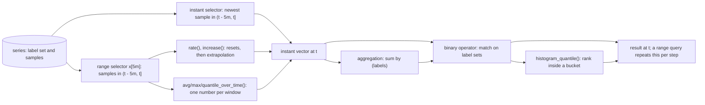

# PromQL Is Vector Arithmetic Over Time Windows

*Every PromQL answer is a set of labelled numbers at one instant; lookback, windows, extrapolation and label matching decide which numbers.*

## Metadata

| Field | Value |
|---|---|
| Type | Build |
| Languages | Python |
| Prerequisites | [A Metric Is a Name, Labels and a Number Over Time](https://cloudcaptain.io/learn/observability/metrics-tsdb) |
| Time | 90 minutes |
| Tools | Prometheus, promtool, Docker, curl |

<Quiz stage="pre" />

## The Problem

Monday, 10:12. The checkout dashboard's request-rate panel jumps from 2,600 to 5,100 requests per second for five minutes, then drops back. At 10:47 it happens again, and the capacity alert built on the same series pages the on-call engineer. The load balancer logs show flat traffic. Both spikes line up with a pod restart. The panel reads `rate(job:checkout_requests:sum[5m])`, where `job:checkout_requests:sum` is a recording rule someone added last quarter to make the dashboard faster: it sums the per-pod counters. When one pod restarts, its counter starts again from zero, the sum falls by that pod's total, and `rate()` treats the fall as a reset of the whole sum. It adds the previous total back and reports traffic that never happened.

The review of that rule turns up two more. A new service's latency panel has been empty since the upgrade to Prometheus 3: it uses `rate(...[1m])` with a one-minute scrape interval, which used to catch two samples in the window and now catches one, so there is no rate at all. And the SLO report that joins error rates with an info metric to get the owning team fails with `many-to-many matching not allowed` every time a rollout briefly reports two versions of one instance. Nobody can say what the engine does with a window, a counter reset or a label set, so each query was edited until the graph looked plausible.

PromQL is small enough to build. You are going to write `miniql`. It loads the same OpenMetrics data the previous lesson's TSDB stored, selects samples the way Prometheus does (a five-minute lookback for instant selectors, left-open windows for ranges), computes `rate()` with Prometheus' reset and extrapolation rules, aggregates, joins vectors on label sets, computes `histogram_quantile()`, runs range queries, explains which samples produced each number, and serves the same HTTP API. Then you backfill the same file into Prometheus with `promtool`, send both of them 48 queries at fixed times, and require the answers to agree.

## The Concept

Picture every series as one row of a table, keyed by its label set, with one cell per scrape. PromQL never draws a line through a row. At one evaluation instant it does one of two things to each row: take the newest cell that is less than five minutes old, or take every cell in a window that ends at that instant. Everything after that is arithmetic on sets of labelled numbers. A function turns each window into one number. An aggregation collapses rows that share some labels. A binary operator pairs the rows of two sets the way a database join pairs rows on a key, and the key is a label set.

The pieces, in the order the engine applies them:

- **Instant vector selector** (`cc_http_requests_total{code="200"}`): for each matching series, the newest sample in the half-open interval `(t - 5m, t]`. Five minutes is the lookback delta (`--query.lookback-delta`). A series that stopped reporting stays visible for up to five minutes unless a staleness marker ends it; Prometheus writes those markers when a scrape no longer returns a series, and backfilled data has none.
- **Range vector selector** (`x[5m]`): every sample in `(t - 5m, t]`. Since Prometheus 3 both intervals are left-open: a sample exactly at the start is outside. `offset 10m` moves the instant back, `@ 1767226500` pins it to a Unix time, `@ start()` and `@ end()` pin it to the ends of a range query.
- **`rate()` and `increase()`**: a counter only goes up, so a drop means the process restarted, and the value before the drop is added back. The first and last samples rarely sit on the window edges, so Prometheus extrapolates the observed increase: all the way to an edge when the gap is under 1.1 times the average spacing between samples, half a spacing when it is larger (the series starts or ends inside the window), and never back past the point where the counter would have been zero. `increase()` is that number and `rate()` divides it by the window, which is why `increase()` of an integer counter can return 555.56. `irate()` uses only the last two samples.
- **Aggregation**: `sum by (code)` keeps only `code`; `sum without (instance)` keeps everything except `instance` and the metric name.
- **Binary operators**: a scalar applies to every element. Two vectors match elements whose label sets are equal once `__name__` is removed; `on (...)` and `ignoring (...)` change the key. Every key must be unique on the "one" side, and `group_left` or `group_right` allows many elements on the other side and copies labels from the one side. Comparisons filter unless you add `bool`. Arithmetic drops the metric name, because `errors / requests` is neither metric.
- **`histogram_quantile()`**: a classic histogram is one counter per bucket upper bound `le`, cumulative. Take the rate of every bucket, find the bucket where the rank `q x total` falls, and interpolate linearly inside it.
- **Range query**: the same instant query evaluated at `start`, `start + step`, and so on. Each point is computed on its own.



The classic mistakes follow from these rules. `rate()` of a gauge reads every decrease as a reset and reports growth for a queue that shrank. Summing counters before taking the rate turns one instance's restart into a reset of the sum, the spike in the opening story; take `rate()` per series and aggregate afterwards. A window shorter than two scrape intervals holds one sample, and one sample has no rate. A join fails when the side you declared as "one" has two elements with the same key, which is a property of the data at that instant, not of the query: it can work for a month and fail during a rollout.

## Build It

`code/main.py` is `miniql`, one standard-library file with seven subcommands: `query`, `range`, `serve`, `compare`, `generate`, `test` and `stats`. It reads OpenMetrics (timestamps in seconds, ends with `# EOF`) or the Prometheus text format with millisecond timestamps, the same files `promtool tsdb create-blocks-from openmetrics` backfills, so the smoke test feeds one file to both. `code/fixtures/queries.json` is the table of queries that `compare` sends to miniql and to any Prometheus-compatible API, and `code/fixtures/rules.json` with `rules-test.json` are a recording-rule file and its unit test in the JSON form of promtool's format (JSON is YAML, so promtool reads the same files).

### Step 1: the store answers two questions, newest sample and window

Each `Series` keeps sorted timestamps (milliseconds), values and a stale flag per sample. An instant selector asks for the newest sample at or before the reference time that is younger than the lookback; a range selector asks for the samples after the window start and up to its end. Both bounds are exclusive at the old end, the Prometheus 3 rule:

```python
    def latest(self, ref: int, lookback_ms: int) -> Optional[Tuple[int, float]]:
        i = bisect.bisect_right(self.times, ref) - 1
        if i < 0 or self.times[i] <= ref - lookback_ms or self.stale[i]:
            return None
        return self.times[i], self.values[i]

    def window(self, after: int, until: int) -> List[Tuple[int, float]]:
        first = bisect.bisect_right(self.times, after)
        last = bisect.bisect_right(self.times, until)
        return [(self.times[i], self.values[i]) for i in range(first, last) if not self.stale[i]]
```

A stale marker that is the newest sample hides the series even though an older sample is inside the lookback; range windows skip stale markers. `load_exposition()` names the file and line of anything it cannot use (no timestamp, out-of-order or duplicate samples), drops empty label values, which PromQL treats as absent, and rewrites `le` and `quantile` values to the canonical float form Prometheus 3 stores (`le="1"` becomes `le="1.0"`).

### Step 2: the parser knows precedence and types

PromQL has six precedence levels, `^` binds right to left, and unary minus sits just below `^`, so `-2 ^ 2` is `-4`:

```python
PRECEDENCE = {"or": 1, "and": 2, "unless": 2, "==": 3, "!=": 3, "<": 3, ">": 3, "<=": 3, ">=": 3, "+": 4, "-": 4, "*": 5, "/": 5, "%": 5, "atan2": 5, "^": 6}
```

```python
    def parse_expr(self, min_precedence: int) -> Any:
        left = self.parse_unary()
        while True:
            op = self.binary_operator()
            if op is None or PRECEDENCE[op] < min_precedence:
                return left
            token = self.next()
            return_bool, matching = self.parse_binary_modifiers(op)
            right = self.parse_expr(PRECEDENCE[op] if op == "^" else PRECEDENCE[op] + 1)
            left = self.make_binary(op, left, right, return_bool, matching, token)
```

Every node has a type (scalar, instant vector, range vector, string), and the parser rejects what Prometheus rejects, with the same words: `rate(sum(x)[5m])` is "ranges only allowed for vector selectors", `rate(x)` is "expected type range vector in call to function "rate", got instant vector", `1 > 2` needs `bool`, `{job=~".*"}` needs "at least one non-empty matcher", and `group_left` without `on` or `ignoring` is an error. Regex matchers are anchored (`job=~"api"` does not match `apiserver`) and `.` matches newlines. Subqueries and the functions outside the subset are rejected by name rather than misread.

### Step 3: offset and @ move the reference time, not the result

The evaluator takes an evaluation time `t` and, per selector, computes the reference time its samples are read at. `@` replaces `t`, `offset` subtracts from whatever is left, and `start()` and `end()` are the range query's ends (for an instant query both are `t`):

```python
    def reference_time(self, selector: VectorSelector, t: int) -> int:
        if selector.at == "start":
            base = self.start_ms
        elif selector.at == "end":
            base = self.end_ms
        elif selector.at is not None:
            base = go_round(float(selector.at) * 1000)
        else:
            base = t
        return base - selector.offset_ms
```

The output still carries the evaluation time: `x offset 5m` at 10:15 is a sample from 10:10 reported at 10:15, which is what makes `x - x offset 1h` a one-hour change.

### Step 4: rate() adds back resets, then extrapolates

`extrapolate()` is a line-by-line port of `extrapolatedRate()` in Prometheus' `promql/functions.go`, down to the order of the floating-point operations, which is why the rule unit tests, where promtool compares floats exactly, pass on both:

```python
    duration_to_start = (first_t - range_start) / 1000
    duration_to_end = (range_end - last_t) / 1000
    sampled = (last_t - first_t) / 1000
    average = sampled / (len(points) - 1)
    threshold = average * 1.1
    start_rule = end_rule = "edge"
    if duration_to_start >= threshold:
        duration_to_start = average / 2
        start_rule = "half"
    if is_counter and result > 0 and first_v >= 0:
        duration_to_zero = sampled * (first_v / result)
        if duration_to_zero < duration_to_start:
            duration_to_start = duration_to_zero
            start_rule = "zero"
    if duration_to_end >= threshold:
        duration_to_end = average / 2
        end_rule = "half"
    factor = (sampled + duration_to_start + duration_to_end) / sampled
    if is_rate:
        factor /= range_ms / 1000
```

Before that, `result` is the last value minus the first plus, for every drop between neighbours, the value before the drop. Work through `increase(cc_http_requests_total{instance="b",code="200"}[5m])` at 00:22 in the generated data: ten samples 30 s apart from 2,600 to 260, with a restart at 00:20 where the counter fell from 2,840 to 20. The raw difference is -2,340; adding back 2,840 gives 500. The samples cover 270 s of a 300 s window, the gap at the start is 30 s (under 1.1 x 30 s), so the increase is stretched to 300 s: 500 x 300 / 270 = 555.56. A counter is not exact after a restart: the requests between the last scrape before the crash and the crash are gone, and PromQL cannot know about them. `delta()` is the same function without reset handling, for gauges. `irate()` takes the last two samples only, and treats a drop as a reset to the new value.

### Step 5: functions over windows

`avg_over_time`, `min_over_time`, `max_over_time`, `sum_over_time`, `count_over_time`, `last_over_time` and `quantile_over_time` reduce each window to one number and drop the metric name, except `last_over_time`, which keeps it. Sums and averages use the compensated (Kahan) summation Prometheus uses, and `quantile_over_time` interpolates between the two nearest ranks:

```python
def quantile(q: float, values: Sequence[float]) -> float:
    if not values or math.isnan(q):
        return math.nan
    if q < 0:
        return -math.inf
    if q > 1:
        return math.inf
    ordered = sorted(values, key=lambda v: (not math.isnan(v), v))
    n = float(len(ordered))
    rank = q * (n - 1)
    lower = max(0.0, math.floor(rank))
    upper = min(n - 1, lower + 1)
    weight = rank - math.floor(rank)
    return ordered[int(lower)] * (1 - weight) + ordered[int(upper)] * weight
```

### Step 6: aggregation is grouping by a label subset

The group key is the label set after `by` or `without`; `without` always removes `__name__` as well:

```python
def group_key(labels: Labels, grouping: Sequence[str], without: bool) -> Labels:
    if without:
        dropped = set(grouping) | {NAME}
        return tuple(pair for pair in labels if pair[0] not in dropped)
    kept = set(grouping)
    return tuple(pair for pair in labels if pair[0] in kept)
```

`sum`, `avg`, `count`, `min` and `max` produce one sample per group with the group key as its labels. `topk` and `bottomk` are different: they keep the original series, labels and all, the `k` largest or smallest per group, which is why `topk(5, rate(...))` in a range query can return more than five series in total, a different five at each step.

### Step 7: binary operators are a join on label sets

The match key is the label set restricted by `on (...)`, or the label set minus `ignoring (...)` and minus the metric name:

```python
def signature(labels: Labels, on: bool, names: Sequence[str]) -> Labels:
    if on:
        return tuple(pair for pair in labels if pair[0] in names)
    return tuple(pair for pair in labels if pair[0] != NAME and pair[0] not in names)
```

The "one" side is indexed by key first, and a duplicate there is an execution error with Prometheus' wording: `found duplicate series for the match group {instance="a"} on the right hand-side of the operation: [...];many-to-many matching not allowed: matching labels must be unique on one side`. Then every element of the other side looks up its partner. In one-to-one matching a second element with the same key is "many-to-one matching must be explicit (group_left/group_right)". The result's labels come from `result_labels()`: the "many" side's labels, without the metric name for arithmetic, restricted to the `on` labels or stripped of the `ignoring` labels in one-to-one matching, plus the labels `group_left (...)` copies from the one side:

```python
    other = dict(one)
    for name in matching.include:
        if other.get(name):
            labels[name] = other[name]
        else:
            labels.pop(name, None)
```

That is the info-metric join: `sum by (instance) (rate(cc_http_requests_total[5m])) * on (instance) group_left (version, zone) cc_build_info` multiplies by 1 and adds two labels. Comparisons without `bool` keep the left value and the metric name and drop what is false; with `bool` they return 0 or 1 and drop the name. `and`, `or` and `unless` match on the same key but never compute: they keep or remove whole elements. Division by zero follows Go's floats (`1 / 0` is `+Inf`, `0 / 0` is `NaN`) instead of raising.

### Step 8: histogram_quantile() interpolates inside one bucket

`histogram_quantile()` groups the input by every label except `le`, sorts each group's buckets by bound, merges duplicate bounds, forces the counts to be monotonic (a rate can be slightly non-monotonic after a reset), finds the first bucket whose cumulative count reaches `q x total`, and interpolates linearly from the previous bound:

```python
    rank = q * observations
    index = len(merged) - 1
    for i in range(len(merged) - 1):
        if merged[i][1] >= rank:
            index = i
            break
```

```python
    start = 0.0
    end = merged[index][0]
    count = merged[index][1]
    if index > 0:
        start = merged[index - 1][0]
        count -= merged[index - 1][1]
        rank -= merged[index - 1][1]
    value = start + (end - start) * (rank / count)
```

When the rank lands in the `+Inf` bucket the answer is the highest finite bound: `histogram_quantile(0.99, ...)` can never say more than "at least 1 s" if 1 s is your last bucket. No `+Inf` bucket, or zero observations in the window, gives `NaN`. The precision is the bucket width: every p90 between 250 ms and 500 ms is a straight-line guess.

### Step 9: a range query is the instant query at every step

There is no special engine for graphs. `range_query()` evaluates the parsed expression at `start`, `start + step`, ... and collects the samples per label set:

```python
    t = start_ms
    while t <= end_ms:
        value = evaluator.eval(node, t)
        for sample in ([Sample((), value.value)] if isinstance(value, Scalar) else value):
            series.setdefault(sample.labels, []).append((t, sample.value))
        t += step_ms
```

So the window inside `rate(...[5m])` and the step are independent: a 1 h step with a 5 m window samples five minutes out of every hour and misses everything in between. `api_query()` turns results into Prometheus' JSON (`resultType` `vector`, `matrix`, `scalar` or `string`, values as strings, `400 bad_data` for a query that does not parse, `422 execution` for one that fails while running, `infos` for annotations such as "metric might not be a counter"), and `miniql serve` puts that behind `/api/v1/query` and `/api/v1/query_range`.

### Step 10: explain shows the samples behind every number

With `--explain`, every sample carries the lines that produced it: the series and samples a selector read (timestamps relative to the evaluation time), the reset correction and both extrapolation decisions for a rate, the group an aggregation formed, the pair a binary operator matched, the buckets and the rank for a quantile. Series that were dropped are listed with the reason, which is how you find out why a panel is empty:

```text
$ python3 code/main.py query --series /tmp/series.om --at +15m --explain 'rate(cc_http_requests_total{instance="a"}[30s])'
rate(cc_http_requests_total{instance="a"}[30s]) at 2026-01-01T00:15:00Z
(empty vector)
dropped:
  rate(cc_http_requests_total{code="200",instance="a",job="api"}[30s]): 1 sample in the window: two are needed, so this series has no result
  rate(cc_http_requests_total{code="500",instance="a",job="api"}[30s]): 1 sample in the window: two are needed, so this series has no result
```

### Step 11: recording rules and their unit tests

A recording rule is a query evaluated on a schedule whose result is written back as new series: the result's labels, `__name__` set to the rule's `record`, and the rule's `labels` on top. Rules in one group run in order, so a later rule sees an earlier rule's output from the same evaluation, and a series that disappears from a rule's output gets a staleness marker:

```python
                    for sample in samples:
                        labels = dict(sample.labels)
                        labels[NAME] = rule.record
                        labels.update(rule.labels)
```

`miniql test` runs the `promql_expr_test` cases of a promtool unit-test file: it expands `input_series` notation (`0+60x20` is 0, 60, ... 1200, one per `interval`; `_` is a missing scrape; `stale` is a staleness marker), evaluates every rule group from time 0 to the last `eval_time` every `evaluation_interval`, then compares each expression's result with `exp_samples` exactly, as promtool does. The fixture records the sum of counters as `job:cc_requests:sum` and shows the opening story in numbers: `sum(rate(cc_requests_total[5m]))` is 2.6 per second at 12 minutes, `rate(job:cc_requests:sum[5m])` is 5.075, because instance `b` restarted at 10 minutes.

### Step 12: run it

```bash
python3 code/main.py generate -o /tmp/series.om
python3 code/main.py stats --series /tmp/series.om
# 26 series, 2036 samples, 2026-01-01T00:00:00Z .. 2026-01-01T00:40:00Z
python3 code/main.py query --series /tmp/series.om --at +15m 'sum by (code) (rate(cc_http_requests_total[5m]))'
python3 code/main.py query --series /tmp/series.om --at +22m --explain 'increase(cc_http_requests_total{instance="b",code="200"}[5m])'
python3 code/main.py query --series /tmp/series.om --at +28m20s \
  'sum by (instance) (rate(cc_http_requests_total[5m])) * on (instance) group_left (version, zone) cc_build_info'
python3 code/main.py query --series /tmp/series.om --at +15m --explain \
  'histogram_quantile(0.9, sum by (le) (rate(cc_http_request_duration_seconds_bucket[5m])))'
python3 code/main.py range --series /tmp/series.om --start +15m --end +30m --step 1m 'sum by (instance) (rate(cc_http_requests_total[5m]))'
python3 code/main.py test code/fixtures/rules-test.json
python3 code/main.py serve --series /tmp/series.om --listen 127.0.0.1:9095 &
curl -sG 127.0.0.1:9095/api/v1/query --data-urlencode 'query=rate(cc_queue_depth[5m])' --data-urlencode time=1767226800
python3 code/main.py compare --series /tmp/series.om --queries code/fixtures/queries.json --url http://127.0.0.1:9095
```

The generated data is 40 minutes of 30-second scrapes starting 2026-01-01T00:00:00Z: request counters for instances `a` and `b` (which restarts at 00:20) and `c` (which appears at 00:25 and stops at 00:30), a latency histogram, a queue-depth gauge and a `cc_build_info` info metric. `--at +15m` means fifteen minutes after the first sample. `query`, `range`, `compare` and `test` exit 0 on success, 1 when a query fails while running or answers differ, 2 for input they cannot parse.

<RunTests />

## Use It

Prometheus is the engine miniql imitates. The smoke test pins `prom/prometheus:v3.15.1` (the tracked release is <ToolVersion name="prometheus" />); the image contains `promtool` as well. Backfill the generated file into a TSDB block and start a server on it. The server needs no scrape targets, and the long retention keeps it from deleting a block that is older than the default fifteen days:

```bash
mkdir -p /tmp/promql && python3 code/main.py generate -o /tmp/promql/series.om
IMAGE=prom/prometheus:v3.15.1
docker run --rm --user "$(id -u):$(id -g)" -v /tmp/promql:/work --entrypoint /bin/promtool $IMAGE \
  tsdb create-blocks-from openmetrics /work/series.om /work/data
printf 'global:\n  scrape_interval: 1m\n' > /tmp/promql/prometheus.yml
docker run -d --name promql --user "$(id -u):$(id -g)" -p 127.0.0.1:9090:9090 -v /tmp/promql:/work $IMAGE \
  --config.file=/work/prometheus.yml --storage.tsdb.path=/work/data --storage.tsdb.retention.time=36500d
curl -s 127.0.0.1:9090/-/ready
cat /tmp/promql/data/*/meta.json    # "numSeries": 26, "numSamples": 2036: the counts miniql stats printed
```

The backfill input must be OpenMetrics with a timestamp in seconds on every sample and `# EOF` at the end, one block of families after another. Running both containers as your own user lets them write to the bind-mounted directory without changing its permissions.

**The query API** is what Grafana, alerting and every client use. `time` takes Unix seconds or RFC3339; `query_range` takes `start`, `end` and `step`:

```bash
curl -sG 127.0.0.1:9090/api/v1/query \
  --data-urlencode 'query=increase(cc_http_requests_total{instance="b",code="200"}[5m])' \
  --data-urlencode 'time=2026-01-01T00:22:00Z'
# {"status":"success","data":{"resultType":"vector","result":[{"metric":{"code":"200","instance":"b","job":"api"},"value":[1767226920,"555.5555555555555"]}]}}
curl -sG 127.0.0.1:9090/api/v1/query_range --data-urlencode 'query=sum by (instance) (rate(cc_http_requests_total[5m]))' \
  --data-urlencode start=2026-01-01T00:15:00Z --data-urlencode end=2026-01-01T00:30:00Z --data-urlencode step=60
curl -sG 127.0.0.1:9090/api/v1/query --data-urlencode 'query=rate(cc_queue_depth[5m])' --data-urlencode time=1767226800
# ... "infos":["PromQL info: metric might not be a counter, name does not end in _total/_sum/_count/_bucket: \"cc_queue_depth\" ..."]
docker exec promql promtool query instant --time 2026-01-01T00:15:00Z http://127.0.0.1:9090 \
  'rate(cc_http_requests_total{instance="a",code="200"}[5m])'
python3 code/main.py compare --series /tmp/promql/series.om --queries code/fixtures/queries.json --url http://127.0.0.1:9090
# agree  lookback is left-open                  +2100s                 0 series
# agree  extrapolated rate                      +900s                  1 series
# agree  increase across the reset              +1320s                 2 series
# agree  group_left join                        +1700s                 3 series
# agree  sum before rate is a parse error       +900s                  both rejected it; miniql: parse error at char 33: ...
# agree  range: rate per instance               +900s..+1800s/60s      3 series, 37 points
# 48 of 48 queries agree
```

`compare` sends every query in the table to both engines at the same fixed times and compares the parsed JSON: the same series (label sets, with `le` compared as numbers), the same timestamps, values within a relative tolerance of 1e-9, and for queries that should fail, a failure on both sides.

**The expression browser** at `http://127.0.0.1:9090/query` runs the same API. In the Table tab, set the evaluation time to 2026-01-01 00:22:00 UTC to see the numbers above; the Graph tab is a range query whose step follows the zoom level. Prometheus 3's UI can also show a query as a tree of its sub-expressions with the number of series each one returns, the quickest way to find the node where a join loses its series.

**Recording rules** precompute expensive or widely used expressions. The name convention is `level:metric:operations`, and a rule must record `sum(rate())`, never the sum of raw counters. The YAML form of `code/fixtures/rules.json`, loaded with `rule_files` in `prometheus.yml`:

```yaml
rule_files:
  - /etc/prometheus/rules/cc-requests.yml
---
groups:
  - name: cc-requests
    interval: 1m
    rules:
      - record: instance:cc_requests:rate5m
        expr: sum by (instance) (rate(cc_requests_total[5m]))
      - record: job:cc_requests_errors:ratio_rate5m
        expr: sum by (job) (rate(cc_requests_total{code="500"}[5m])) / sum by (job) (rate(cc_requests_total[5m]))
```

`promtool` checks the file and runs its unit tests, here the same JSON files miniql reads:

```bash
docker run --rm -v "$PWD/code/fixtures:/fixtures:ro" --entrypoint /bin/promtool $IMAGE check rules /fixtures/rules.json
# Checking /fixtures/rules.json
#   SUCCESS: 3 rules found
docker run --rm -v "$PWD/code/fixtures:/fixtures:ro" --entrypoint /bin/promtool $IMAGE test rules /fixtures/rules-test.json
# Unit Testing:  /fixtures/rules-test.json
#   SUCCESS
python3 code/main.py test code/fixtures/rules-test.json
```

Change one `value` in a copy of the test file and both report `FAILED` with the expected and the actual samples. A new recording rule has no history; `promtool tsdb create-blocks-from rules --start ... --end ... --url http://127.0.0.1:9090 rules.yml` evaluates it against a running server for a past range and writes the results as blocks.

**The classic mistakes**, each one in the query table and the rule tests:

| Mistake | What PromQL computes | Fix |
|---|---|---|
| `rate(cc_queue_depth[5m])` on a gauge | every decrease is read as a reset, so a queue that shrank shows a positive rate; Prometheus 3 adds an info annotation | `delta()` for the change over the window, `deriv()` for a slope; `rate()` only for counters |
| `rate()` of a recording rule that sums counters | one instance's restart lowers the sum, and the drop is read as a reset of the whole sum: 5.075 per second instead of 2.6 in the fixture | rate per series, then aggregate: record `sum(rate(x[5m]))` |
| `rate(sum(x)[5m])` | a parse error: a range applies only to a selector | the same: `sum(rate(x[5m]))` |
| `rate(x[1m])` with a 1 m scrape interval | one sample in a left-open window, so no result; before Prometheus 3 the closed window often caught two | a window of at least four scrape intervals, or Grafana's `$__rate_interval` |
| an error ratio when nothing failed | the numerator has no series, so the division returns nothing | `(sum(rate(x{code=~"5.."}[5m])) or vector(0)) / sum(rate(x[5m]))` |
| `group_left` against an info metric that briefly has two versions | `found duplicate series for the match group` | reduce the one side first: `max by (instance, version) (info)`, or match on more labels |

| What you built | Real tool | Note |
|---|---|---|
| `Series.latest()`, `Series.window()` | the TSDB querier, `--query.lookback-delta` | left-open intervals as in Prometheus 3; staleness markers end a series early |
| `Parser`, `value_type()` | `promql/parser` | the same precedence and type errors; no subqueries, no native histograms, no `label_replace` |
| `reference_time()` | `offset`, `@`, `start()`, `end()` | Prometheus rewrites `@` into an offset from the query start; the effect is the same |
| `extrapolate()` | `extrapolatedRate()` in `promql/functions.go` | same operations in the same order, so promtool's exact float comparisons pass on both |
| `quantile()`, `over_time()` | `*_over_time` functions | Kahan summation as in Prometheus |
| `group_key()`, `eval_aggregate()` | `sum`, `avg`, `count`, `min`, `max`, `topk`, `bottomk` | `quantile`, `stddev`, `count_values` and `limitk` are rejected by name |
| `signature()`, `result_labels()` | vector matching, `on`, `ignoring`, `group_left`, `group_right` | the same error messages for ambiguous matches |
| `bucket_quantile()` | `histogram_quantile()` over classic buckets | native histograms carry their buckets in one sample instead |
| `range_query()`, `api_query()`, `miniql serve` | `/api/v1/query`, `/api/v1/query_range` | no `/api/v1/series` or `/api/v1/labels` |
| `--explain` | the UI's tree view | miniql shows the samples and arithmetic, the UI shows series per node |
| `evaluate_rules()`, `miniql test` | the rule manager, `promtool test rules` | recording rules only; alerting rules are the next lesson |
| `miniql compare` | none: a conformance check | point it at Thanos, Mimir or VictoriaMetrics to see where they differ |

<Quiz stage="check" />

## Ship It

Two artifacts in `outputs/`:

- **`skill-promql-review.md`**: a runbook for reviewing a PromQL expression, a recording rule or a dashboard panel before it ships, and for explaining a panel that shows something impossible (a spike after a restart, a flat line, nothing at all). It checks counter versus gauge, the order of `rate()` and aggregation, the window against the scrape interval, the join cardinality, empty numerators, histogram bucket edges and label cardinality of the result, with the commands that prove each point (`miniql query --explain`, `curl /api/v1/query`, `promtool test rules`) and a fixed report.
- **`prompt-explain-promql.md`**: give a model a PromQL expression with what you know about the metrics (types, labels, scrape interval) and get back the evaluation step by step, what the result's labels and units are, the traps it falls into, and a corrected query with a promtool unit test that proves the difference.

<ShipIt />

## Exercises

### Easy

Add `resets()` and `changes()`: the number of counter resets and the number of value changes inside the window, one sample per series, metric name dropped. Write the tests first on the series `0+60x7 0+60x2`: at 10 minutes `resets(x[5m])` is 1 and `changes(x[5m])` is 4, at 6 minutes they are 0 and 4; a stale marker is neither a reset nor a change; and both reject an instant vector argument with Prometheus' type error.

### Medium

Implement subqueries, `expr[range:step]`. The inner expression is evaluated at every multiple of `step` since the Unix epoch inside `(t - range, t]` (Prometheus aligns subquery steps to absolute time, not to `t`), with the step defaulting to the global evaluation interval, and the result is a range vector. Test first that `max_over_time(rate(x_total[5m])[30m:1m])` matches hand-computed values, that the alignment makes the points independent of the query time inside one step, and that `rate(sum(x_total)[5m:30s])` across one series' reset shows the same false spike as the recording rule in Step 11.

### Hard

Add `miniql lint FILE.json` for rule files and a `--lint` flag for `query`. It flags `rate()`, `increase()` and `irate()` over a metric whose `# TYPE` in the series file is not counter (or whose name lacks a counter suffix when there is no type), `rate()` over a recorded series whose name or expression shows it aggregates counters, windows shorter than four times the scrape interval it infers from the median sample spacing, ratios whose numerator can be empty without an `or vector(0)`, and `group_left` joins whose one side is not unique per key at any point in the file. Test each rule with a passing and a failing example, and print the line of the rule file and a corrected expression for each finding.

<Quiz stage="post" />

## Key Terms

| Term | Common misconception | Precise definition |
|---|---|---|
| Instant vector | "The current value of a metric." | One sample per series at one evaluation time: the newest sample in `(t - lookback, t]`, reported with the evaluation time, not the sample's time. |
| Range vector | "A graph of the metric." | All samples per series in `(t - range, t]`; only functions can turn it into numbers, and a range query does not produce one. |
| Lookback delta | "How far back a graph goes." | How old a sample may be and still answer an instant selector, five minutes by default; it is why a dead target's last value lingers. |
| Staleness marker | "A NaN value in the data." | A special NaN Prometheus writes when a scrape or rule no longer returns a series; the series then disappears at once instead of after the lookback. |
| Extrapolation | "rate() is (last - first) / window." | `rate()` and `increase()` stretch the observed increase to the window edges (fully, by half a sample spacing, or to the counter's zero point), so `increase()` of an integer counter is rarely an integer. |
| Counter reset | "The counter is broken." | A decrease between two samples, read as a restart from zero; the value before the drop is added back. On a gauge or a sum of counters it produces spikes. |
| Vector matching | "Prometheus joins on instance." | Elements pair when their label sets without `__name__` are equal, or equal on the `on` labels; the one side must be unique per key, and `group_left` or `group_right` allows many on the other side. |
| `histogram_quantile()` | "It returns a measured percentile." | An estimate: linear interpolation inside the bucket where `q x total` falls, never above the highest finite bound, as precise as the bucket edges. |
| Recording rule | "A cached query result." | A query evaluated on a schedule whose result is stored as new series named by `record`; it has no history before it was deployed unless you backfill it. |
| Range query | "A different kind of query." | The same instant query evaluated at every step from start to end; the step and the window inside `rate()` are independent. |

## Further Reading

- [Observability and SRE](https://cloudcaptain.io/docs/tools/observability): the Reference-layer overview of Prometheus, Grafana and the SRE practices that turn these queries into dashboards, alerts and SLOs.
- [SRE learning path](https://cloudcaptain.io/docs/learning-paths/sre): where PromQL fits among the monitoring, incident and reliability skills of the role.
- [Prometheus: querying basics](https://prometheus.io/docs/prometheus/latest/querying/basics/): selectors, matchers, the lookback delta, staleness, `offset` and `@`, the rules Steps 1 to 3 implement.
- [Prometheus: operators](https://prometheus.io/docs/prometheus/latest/querying/operators/): precedence, vector matching with `on`, `ignoring`, `group_left` and `group_right`, and the set operators.
- [Prometheus: functions](https://prometheus.io/docs/prometheus/latest/querying/functions/): `rate()`, `increase()`, `irate()`, the `_over_time` family and `histogram_quantile()`, with their documented edge cases.
- [promql/functions.go](https://github.com/prometheus/prometheus/blob/main/promql/functions.go): `extrapolatedRate()` and `instantValue()`, the source `extrapolate()` and `instant_rate()` are ported from.
- [Prometheus: HTTP API](https://prometheus.io/docs/prometheus/latest/querying/api/): the request parameters, result types and error types `api_query()` reproduces.
- [Prometheus: unit testing for rules](https://prometheus.io/docs/prometheus/latest/configuration/unit_testing_rules/): the test file format, the expanding notation of `input_series`, and `promql_expr_test`.
- [Prometheus: backfilling from OpenMetrics](https://prometheus.io/docs/prometheus/latest/storage/#backfilling-from-openmetrics-format): `promtool tsdb create-blocks-from openmetrics` and `create-blocks-from rules`, with their limits.
- [Prometheus 3 migration guide](https://prometheus.io/docs/prometheus/latest/migration/): the left-open range selectors and lookback, and the `le` normalization this lesson relies on.
- [Prometheus: histograms and summaries](https://prometheus.io/docs/practices/histograms/): how to choose bucket edges so `histogram_quantile()` is precise where your SLO is.
