# An Alert Is a Query With a Clock and a Router

*An alert is a query that must stay true for a while; then a tree decides who hears about it: grouped, deduplicated, or not at all.*

## Metadata

| Field | Value |
|---|---|
| Type | Build |
| Languages | Python |
| Prerequisites | [PromQL Is Vector Arithmetic Over Time Windows](https://cloudcaptain.io/learn/observability/promql) |
| Time | 90 minutes |
| Tools | Prometheus, promtool, Alertmanager, amtool, Docker, curl |

<Quiz stage="pre" />

## The Problem

Saturday, 03:10. The API servers of the `eu1` cluster become unreachable for twenty minutes. The on-call engineer's phone receives 140 pages: one per service whose error rate rose, one per pod whose readiness probe failed, one per Postgres replica that lost its leader, and a fresh copy of most of them every five minutes. Somewhere in the stream is the only page that needs a human after the cluster comes back: the primary database's data volume is 97% full, and the WAL growth during the outage will fill it within the hour. Nobody sees it until 05:40, when the disk is full.

The review finds four causes, none of them in the code. The alert rules have no `for`, so every blip that one evaluation happens to catch pages. Every alert routes to the same pager receiver, grouped by `instance`, so a cluster outage is 140 groups instead of a handful. Nothing tells Alertmanager that the symptoms of a dead cluster are not news while the cluster is down. And the silence someone added for "the search maintenance" matched `team="search"`, which the new certificate alerts do not carry, so they paged as well. Each rule looked reasonable in its pull request. Nobody could say, for a given alert, when it would fire, which receiver it would reach, what it would be grouped with, or what would keep it quiet.

Alerting is two small machines. Prometheus evaluates a query on a clock and keeps a state per result; Alertmanager walks a tree, groups, mutes and deduplicates on another clock. You are going to build `minialert`: the rule evaluator with `for`, `keep_firing_for` and templated labels, the router with grouping, inhibition, silences and the notification log, and the webhook JSON it sends. Then you run the same rules through `promtool test rules`, the same configuration through `amtool`, and the same scripted sequence of alerts through a real Alertmanager, and require the same webhooks.

## The Concept

An alerting rule is a PromQL expression that Prometheus evaluates every evaluation interval. Every element the expression returns is a candidate alert, identified by its label set plus the rule's labels and `alertname`. The rule keeps a small state machine per label set. The first time an element appears, its alert is **pending**. If it is still returned after the `for` duration, it becomes **firing**. When the expression stops returning it, a pending alert is dropped without a trace, and a firing alert becomes **resolved**, unless `keep_firing_for` holds it in the firing state until the condition has been false for that long. The expression is the condition, `for` is the patience before speaking, `keep_firing_for` is the patience before going quiet.

Prometheus does not notify anyone. It sends every firing and recently resolved alert to Alertmanager, again every minute (the resend delay), with an `endsAt` a few intervals in the future, so an alert whose Prometheus vanished resolves on its own. Alertmanager then answers three questions per alert:

- **Who?** The routing tree. The root matches everything; each child has matchers. Alertmanager walks depth first and the first matching child wins, unless it has `continue: true`, in which case its later siblings are tried too. If no child of a node matches, the node itself is the destination. Children inherit the receiver, `group_by` and the timers.
- **With whom?** Grouping. Within one route, alerts with the same values of the `group_by` labels form one group, and a group produces one notification that lists all its alerts. `group_wait` delays the first notification so the rest of a burst can join; `group_interval` is the minimum time between notifications about changes in a group; `repeat_interval` resends an unchanged group.
- **Whether?** Muting and the notification log. An inhibition rule mutes target alerts while a source alert with equal values of chosen labels is firing. A silence mutes alerts that match its matchers between two times. At each flush, the notification log compares what is left with what this receiver was last told about this group, and sends only if there are new firing alerts, newly resolved ones, or the repeat interval has passed.

```mermaid
flowchart LR
  E["expr evaluated every interval"] --> P["pending: true for less than for"]
  P --> F["firing"]
  F --> K["firing (kept): false for less than keep_firing_for"]
  K --> R["resolved"]
  F --> S["sent to Alertmanager every 1m, endsAt in the future"]
  K --> S
  R --> S
  S --> T["routing tree: matchers, first match, continue"]
  T --> G["group by labels: group_wait, group_interval"]
  G --> M["inhibition rules and silences mute alerts"]
  M --> N["notification log: new, resolved or repeat_interval"]
  N --> W["webhook JSON to the receiver"]
```



The 03:10 story maps onto this. `for: 5m` on the symptom alerts would have ignored the blips. `group_by: [alertname, cluster]` would have made one page per kind of problem per cluster. An inhibition rule with source `alertname="ClusterDown"`, targets `severity=~"page|ticket"` and `equal: [cluster]` would have muted the symptoms while the cause was firing. And a silence is a matcher like any other: it mutes what carries the label, not what you meant.

## Build It

`code/main.py` is `minialert`, one standard-library file with ten subcommands. The rule side is `rules check`, `rules eval` and `rules test`; the Alertmanager side is `check-config`, `routes test`, `simulate`, `serve`, `receiver`, `drive` and `compare`. Rule files and Alertmanager configurations are the JSON forms of the YAML files Prometheus and Alertmanager read (JSON is YAML), so the smoke test hands the same files in `code/fixtures/` to `promtool` and `amtool`: `rules.json` with four alerting rules, `rules-test.json` and `rules-test-wrong.json` in promtool's unit-test format, `alertmanager.json` with a routing tree, an inhibition rule and five receivers, `route-cases.json` with nine label sets and the receivers they reach, and `scenario.json`, a 34-second script of alerts, a silence and resolutions.

### Step 1: a rule is a state machine per label set

`Rule.evaluate()` runs the expression at time `at` (a small PromQL subset: selectors, arithmetic, comparisons, `sum`/`avg`/`min`/`max`/`count` with `by` or `without`, `absent()` and the `_over_time` functions). Each result element gets the rule's templated labels and `alertname`, and its label set is the key into `self.active`. An element seen again keeps its state and only updates value and annotations; a new one starts pending. Then every alert the expression did not return is handled:

```python
        for key, alert in list(self.active.items()):
            if key not in fresh:
                keep = False
                if alert.state == FIRING and self.keep_firing_for > 0:
                    if alert.keep_firing_since is None:
                        alert.keep_firing_since = at
                    keep = at - alert.keep_firing_since < self.keep_firing_for
                if alert.state == PENDING or (alert.resolved_at is not None and at - alert.resolved_at > RESOLVED_RETENTION):
                    del self.active[key]
                if alert.state != INACTIVE and not keep:
                    alert.state, alert.resolved_at = INACTIVE, at
                if not keep:
                    continue
            else:
                alert.keep_firing_since = None
            if alert.state == PENDING and at - alert.active_at >= self.hold:
                alert.state, alert.fired_at = FIRING, at
```

Three consequences are worth reading twice. A pending alert that misses one evaluation is deleted, so its `for` clock starts again from zero: a condition that flickers never fires, however long it flickers. A firing alert that misses one evaluation is resolved at once unless `keep_firing_for` is set; with it, the alert stays firing (and keeps its last value in the annotations) until the condition has been false for the whole duration. And a resolved alert stays in the table for fifteen minutes (`RESOLVED_RETENTION`), so Prometheus keeps telling Alertmanager it is over.

`rules eval` prints the transitions over a unit-test file's input series. The fixture's error ratio is above 5% from minute 3 to 10, dips at 11, is high again from 12 to 14 and low after that; the rule has `for: 5m` and `keep_firing_for: 10m`:

```text
$ python3 code/main.py rules eval code/fixtures/rules-test.json
  time  alert            state             value  labels
    3m  HighErrorRate    pending            0.08  {job="checkout", severity="page", team="payments"}
    8m  HighErrorRate    firing             0.08  {job="checkout", severity="page", team="payments"}
   11m  HighErrorRate    firing (kept)      0.08  {job="checkout", severity="page", team="payments"}
   12m  HighErrorRate    firing             0.09  {job="checkout", severity="page", team="payments"}
   15m  HighErrorRate    firing (kept)      0.09  {job="checkout", severity="page", team="payments"}
   25m  HighErrorRate    resolved           0.09  {job="checkout", severity="page", team="payments"}
```

Pending at 3 minutes, firing five minutes later, not resolved by the one-minute dip, resolved ten minutes after the condition last held. Without `keep_firing_for` the alert would resolve at 11 and fire again at 12 minutes, two notifications about nothing.

### Step 2: labels and annotations are Go templates

Rule labels and annotations are expanded per alert with Go's `text/template` syntax and Prometheus' variables: `$labels` (the element's labels), `$value` (its value), `$externalLabels` and `$externalURL`, with `.Labels` and `.Value` as aliases. `expand_template()` finds each action, runs its pipeline (`{{ $value | humanizePercentage }}` passes the value as the last argument of the function) and honours `{{-` and `-}}` trimming. The functions are the ones alert templates use most:

```python
TEMPLATE_FUNCTIONS: Dict[str, Callable[..., Any]] = {
    "humanize": humanize,
    "humanizePercentage": lambda v: go_g4(to_float(v) * 100) + "%",
    "printf": lambda fmt, *args: go_printf(str(fmt), *args),
    "toUpper": lambda s: str(s).upper(),
    "toLower": lambda s: str(s).lower(),
    "index": lambda mapping, key: mapping.get(str(key), "") if isinstance(mapping, dict) else "",
}
```

Numbers print the way Go prints a `float64` (`go_float()`: `150`, not `150.0`; `1e+21`), because promtool compares annotations as exact strings. An undefined variable or function does not crash the evaluation: Prometheus puts `<error expanding template: ...>` into the annotation, and so does minialert, while `load_rules()` rejects the file up front the way `promtool check rules` does. A label template changes the alert's identity: `team: "{{ $labels.queue }}-owners"` gives each queue its own alert and its own route. Never put `$value` into a label: every new value is a new alert, and the old one resolves.

### Step 3: what Prometheus sends to Alertmanager

`Rule.sends()` is the notifier's view of the table. Pending alerts are never sent. A firing alert is sent when it is new or the resend delay (one minute by default) has passed; a resolved alert is sent when it resolved after its last send, and then once per resend delay while it is retained:

```python
            alert.last_sent_at = at
            ends = alert.resolved_at if alert.resolved_at is not None else at + 4 * max(interval, resend)
            out.append({"at": at, "labels": dict(sorted(alert.labels.items())), "annotations": dict(sorted(alert.annotations.items())), "startsAt": alert.fired_at, "endsAt": ends, "status": "resolved" if alert.resolved_at is not None else "firing"})
```

The `endsAt` of a firing alert is four times the larger of the evaluation interval and the resend delay into the future. If Prometheus dies, the resends stop, the `endsAt` passes, and Alertmanager resolves the alert by itself: that is why a crashed Prometheus produces "resolved" notifications instead of silence, and why you need a separate always-firing `Watchdog` alert to notice a dead pipeline. `rules eval --show-sends` lists every send.

### Step 4: unit tests are evaluations at fixed times

`rules test` reads promtool's format: `input_series` in expanding notation (`0.08x7` is eight samples, `_` a missed scrape, `stale` a staleness marker), and `alert_rule_test` cases with an `eval_time`, an `alertname` and the expected firing alerts with all their labels and annotations. It evaluates every rule every `evaluation_interval` from time 0 and, at each case's time, compares the set of firing alerts:

```python
            for case in test.cases:
                if at <= case["at"] < at + evaluation:
                    got = firing_now(test, case["alertname"])
                    want = sorted(case["exp"], key=alert_key)
                    if [alert_key(a) for a in got] != [alert_key(a) for a in want]:
```

Only firing alerts count: a pending alert is "no alert" to promtool, which is exactly why `rules-test-wrong.json`, which expects `HighErrorRate` at 3 minutes because the ratio is already high then, fails on both tools. The fixture also shows the lookback trap for `absent()`: with a stale marker after the last `up` sample, `TargetMissing` (`for: 2m`) fires at 6 minutes; without one, the last sample stays visible for the five-minute lookback and the alert fires at 10. `--emit-expected FILE` writes a promtool test file with minialert's prediction at every evaluation for every alert rule (196 cases for the fixture), which the smoke test then hands to promtool: every `for`, `keep_firing_for`, label and annotation, minute by minute.

### Step 5: the routing tree

`load_config()` builds `Route` objects with inherited settings and rejects what `amtool check-config` rejects (an undefined receiver, matchers on the root, `...` mixed with other `group_by` labels, a zero `group_interval`). Matching is a short recursion:

```python
    def match(self, labels: Dict[str, str]) -> List["Route"]:
        if not all_match(self.matchers, labels):
            return []
        found: List[Route] = []
        for child in self.routes:
            matched = child.match(labels)
            found.extend(matched)
            if matched and not child.proceed:
                break
        return found or [self]
```

Matchers are `=`, `!=`, `=~` and `!~`; regular expressions are anchored (`team=~"db"` does not match `dbx`), and a missing label is the empty string, so `env!="prod"` matches an alert without `env`. `routes test` prints the receivers the way `amtool config routes test` does, and `--explain` shows the walk and the group each receiver puts the alert in:

```text
$ python3 code/main.py routes test --config code/fixtures/alertmanager.json --explain alertname=QueueFull severity=page team=storage
route {}: match, receiver default-chat
  route.routes[0] {alertname="Watchdog"}: no match (alertname="QueueFull" fails alertname="Watchdog")
  route.routes[1] {severity="page"}: match, receiver pager
    route.routes[1].routes[0] {team="db"}: no match (team="storage" fails team="db")
    no child matched, so route.routes[1] itself receives the alert
  continue: true on route.routes[1], trying the next sibling
  route.routes[2] {team=~"db|storage"}: match, receiver db-chat
  -> pager: group {alertname="QueueFull"}, key {}/{severity="page"}:{alertname="QueueFull"}, group_by [alertname, service], group_wait 2s, group_interval 6s, repeat_interval 9s
  -> db-chat: group {alertname="QueueFull"}, key {}/{team=~"db|storage"}:{alertname="QueueFull"}, group_by [alertname, cluster], group_wait 2s, group_interval 6s, repeat_interval 1h
pager,db-chat
```

The `Watchdog` route comes first and has no `continue`, so a `Watchdog` alert never reaches the pager whatever other labels it carries; its receiver `blackhole` has no integrations, which is Alertmanager's way of dropping on purpose.

### Step 6: a group is a route plus the values of its group_by labels

`Dispatcher.post()` stores each alert by fingerprint, matches it against the tree, and adds it to one group per matched route. The group key is the route's matcher path plus the group labels, exactly the string Alertmanager puts into `groupKey`:

```python
    def group_alert(self, alert: StoredAlert, route: Route, now: float) -> None:
        labels = group_labels(alert.labels, route)
        slot = (route.idx, fingerprint(labels))
        group = self.groups.get(slot)
        if group is not None:
            group.alerts[alert.fp] = alert
            return
        self.sequence += 1
        group = Group(route, labels, group_key(route, labels), {alert.fp: alert}, now + route.group_wait, now, self.sequence)
        if alert.starts_at + route.group_wait < now:
            group.next_flush = now
```

A new group flushes after `group_wait`, or at once if the alert that created it started longer ago than that (a restarted Alertmanager does not wait again for old news). After each flush the next one is `group_interval` later. A group whose alerts are all resolved and notified is deleted after the flush. The fingerprint is the same FNV-1a hash Prometheus and Alertmanager use, over the sorted label names and values separated by the byte `0xff`; the tests check it against the vectors in Prometheus' `common/model` package and against a fingerprint Alertmanager 0.34.2 returned.

### Step 7: inhibition and silences are checked at every flush

Muting happens when a group flushes, not when an alert arrives, so a silence created between two flushes mutes alerts that were already waiting:

```python
    def inhibited_by(self, labels: Dict[str, str], now: float) -> Optional[str]:
        for rule in self.config.inhibit_rules:
            if not all_match(rule.target, labels):
                continue
            both_sides = all_match(rule.source, labels)
            sources = []
            for fp, candidate in self.alerts.items():
                if candidate.resolved_at(now) or not all_match(rule.source, candidate.labels):
                    continue
                if any(candidate.labels.get(n, "") != labels.get(n, "") for n in rule.equal):
                    continue
                if both_sides and all_match(rule.target, candidate.labels):
                    continue
                sources.append(fp)
            if sources:
                return min(sources)
        return None
```

The source must be firing, must match the source matchers, and must have the same value for every `equal` label (a missing label counts as empty, so two alerts without `cluster` are "equal"). An alert that matches both sides cannot be inhibited by another such alert, which keeps `ClusterDown` (it has `severity="page"`, a target) from muting itself. A silence is active while `startsAt <= now < endsAt`; expiring it sets `endsAt` to now. `snapshot()` reports each alert the way `GET /api/v2/alerts` does: `state` `active` or `suppressed`, with `inhibitedBy` (source fingerprints) and `silencedBy` (silence IDs).

### Step 8: the notification log decides whether to send

What is left after muting is split into firing and resolved fingerprints and compared with the log entry for this group, receiver and integration:

```python
def needs_update(entry: Optional[LogEntry], firing: Set[str], resolved: Set[str], repeat: float, now: float, send_resolved: bool) -> str:
    if entry is None:
        return REASON_FIRST if firing else REASON_NONE
    if not firing <= entry.firing:
        return REASON_FIRST if not entry.firing else REASON_NEW_ALERTS
    if not firing:
        return REASON_ALL_RESOLVED if entry.firing else REASON_NONE
    if send_resolved and not resolved <= entry.resolved:
        return REASON_NEW_RESOLVED
    if entry.timestamp < now - repeat:
        return REASON_REPEAT
    return REASON_NONE
```

The reasons are the strings Alertmanager 0.34 puts into the webhook's `notification_reason`. Two consequences surprise people. A muted alert is invisible to the log, so when inhibition ends, an alert the receiver was already told about is not news: the log still holds the old entry, and the next notification waits for `repeat_interval`. And an alert that resolves while muted produces no "resolved" message to a receiver that never heard it fire.

### Step 9: the payload is Alertmanager's webhook JSON, version 4

`render()` builds the body Alertmanager POSTs to a webhook: `receiver`, `status` (`firing` if any alert in it fires), `alerts` with `status`, `labels`, `annotations`, `startsAt`, `endsAt` (`0001-01-01T00:00:00Z` while firing), `generatorURL` and `fingerprint`, then `groupLabels`, `commonLabels` and `commonAnnotations` (what all alerts share), `externalURL`, `version: "4"`, `groupKey`, `truncatedAlerts` (alerts dropped by `max_alerts`) and `notification_reason`. Alerts are sorted by `job`, then `instance`, then the full label set, as Alertmanager sorts them.

### Step 10: run it

```bash
python3 code/main.py rules check code/fixtures/rules.json
python3 code/main.py rules test code/fixtures/rules-test.json            # SUCCESS, exit 0
python3 code/main.py rules test code/fixtures/rules-test-wrong.json      # FAILED at HighErrorRate 3m and InstanceDown 11m, exit 1
python3 code/main.py rules eval code/fixtures/rules-test.json --show-sends
python3 code/main.py check-config code/fixtures/alertmanager.json
python3 code/main.py routes test --config code/fixtures/alertmanager.json --explain alertname=DiskFull severity=page team=db cluster=eu1
python3 code/main.py simulate code/fixtures/scenario.json --config code/fixtures/alertmanager.json
```

`simulate` replays the scenario on a virtual clock with the fixture's short timers (`group_wait` 2 s, `group_interval` 6 s, `repeat_interval` 1 h, 9 s for pages) and prints every event. The interesting part:

```text
  10.0s  firing ClusterDown{cluster="eu1"} -> pager
  12.0s  db-pager {alertname="DiskFull", service="postgres"}: DiskFull{service="postgres", instance="pg-0"} inhibited by ClusterDown{cluster="eu1"}
  12.0s  NOTIFY pager {alertname="ClusterDown"} firing (first notification): ClusterDown{cluster="eu1"}
  14.0s  default-chat {alertname="CertExpiring", service="search"}: CertExpiring{service="search", instance="search-1"} silenced by search-maintenance
  15.0s  silence search-maintenance expired
  20.0s  NOTIFY default-chat {alertname="CertExpiring", service="search"} firing (new alerts added): CertExpiring{service="search", instance="search-0"}, CertExpiring{service="search", instance="search-1"}
  21.0s  resolved ClusterDown{cluster="eu1"} -> pager
  24.0s  NOTIFY db-pager {alertname="DiskFull", service="postgres"} firing (repeat interval elapsed): DiskFull{service="postgres", instance="pg-0"}
  24.0s  db-chat {alertname="DiskFull", cluster="eu1"}: nothing new (last notified at 6.0s)
  24.0s  NOTIFY pager {alertname="ClusterDown"} resolved (all alerts resolved): resolved ClusterDown{cluster="eu1"}
summary: 12 notification(s) to db-chat, db-pager, default-chat, pager; smallest gap between a step and a flush: 1.0s
```

While `ClusterDown` fires, the database alerts and the checkout pages are muted. When it resolves, `db-pager` hears about `DiskFull` again only because its 9 s repeat interval has passed; `db-chat`, with a one-hour repeat interval, stays quiet, because the log says it was told at 6 s. The last line matters for the comparison with a real Alertmanager: a step and a flush that are close together can swap places when a machine stalls for a moment, so the live comparison needs a gap well above its time tolerance.

`serve` puts the same dispatcher behind the Alertmanager API v2 subset (`POST` and `GET /api/v2/alerts`, `POST /api/v2/silences`, `DELETE /api/v2/silence/ID`) on a real clock and POSTs the webhooks; `receiver` records every webhook it receives as one JSON line; `drive` plays a scenario against any Alertmanager API in real time (silences through `amtool` if you pass `--amtool`) and records the silence IDs and snapshots; `compare` matches the simulation against the recorded webhooks per receiver and group key: status, group labels, common labels, alerts, fingerprints, notification reason, and time within one second. Every command exits 0 on success, 1 when a test or comparison fails, 2 for input it cannot read.

<RunTests />

## Use It

The real pipeline is Prometheus and Alertmanager. Prometheus (<ToolVersion name="prometheus" /> in this phase; the smoke test pins `prom/prometheus:v3.15.1`, whose image contains `promtool`) evaluates the rules; Alertmanager has its own releases, and the smoke test pins `prom/alertmanager:v0.34.2`, whose image contains `amtool`.

**Alerting rules** are a rule file in YAML, loaded by `rule_files` in `prometheus.yml`, with the Alertmanagers to send to under `alerting`. The first rule of `code/fixtures/rules.json`:

```yaml
groups:
  - name: checkout
    interval: 1m
    rules:
      - alert: HighErrorRate
        expr: job:request_errors:ratio_rate5m{job="checkout"} > 0.05
        for: 5m
        keep_firing_for: 10m
        labels:
          severity: page
          team: payments
        annotations:
          summary: "{{ $labels.job }} is failing {{ $value | humanizePercentage }} of requests"
          runbook_url: https://runbooks.example.com/checkout/high-error-rate
---
rule_files: [/etc/prometheus/rules/checkout.yml]
alerting:
  alertmanagers:
    - static_configs:
        - targets: ["127.0.0.1:9093"]
```

`promtool` checks the file and runs the unit tests, on the same JSON files minialert reads:

```bash
PROM_IMAGE=prom/prometheus:v3.15.1
promtool() { docker run --rm -v "$PWD/code/fixtures:/f:ro" -w /f --entrypoint /bin/promtool "$PROM_IMAGE" "$@"; }
promtool check rules rules.json
# Checking rules.json
#   SUCCESS: 4 rules found
promtool test rules rules-test.json
#   SUCCESS
promtool test rules rules-test-wrong.json
#   FAILED:
#     name: wrong: expects firing as soon as the expression is true,
#     alertname: HighErrorRate, time: 3m,
#         exp:[
#             0:
#               Labels:{alertname="HighErrorRate", job="checkout", severity="page", team="payments"}
#               Annotations:{runbook_url="https://runbooks.example.com/checkout/high-error-rate", summary="checkout is failing 8% of requests"}
#             ],
#         got:[]
```

A running Prometheus shows the same states on its Alerts page and as the `ALERTS{alertstate="pending|firing"}` series. It also writes `ALERTS_FOR_STATE`, the time each alert became active, so a restart in the middle of a `for` does not start the clock again (`--rules.alert.for-outage-tolerance` and `--rules.alert.for-grace-period` tune that). `--rules.alert.resend-delay` is the one-minute resend from Step 3.

**Alertmanager's configuration** is checked and its tree queried with `amtool`, without a running server. `--tree` draws the path the label set takes:

```bash
AM_IMAGE=prom/alertmanager:v0.34.2
amtool() { docker run --rm --network host -v "$PWD/code/fixtures:/f:ro" --entrypoint /bin/amtool "$AM_IMAGE" "$@"; }
amtool check-config /f/alertmanager.json
# Checking '/f/alertmanager.json'  SUCCESS
# Found:
#  - global config
#  - route
#  - 1 inhibit rules
#  - 5 receivers
#  - 0 templates
amtool config routes test --config.file=/f/alertmanager.json --tree alertname=QueueFull severity=page team=storage
# Matching routes:
# .
# └── default-route
#     ├── {severity="page"}  receiver: pager
#     └── {team=~"db|storage"}  receiver: db-chat
#
# pager,db-chat
amtool config routes test --config.file=/f/alertmanager.json --verify.receivers=db-pager,db-chat alertname=DiskFull severity=page team=db
```

`--verify.receivers` exits 1 when the answer differs, which makes a table of label sets and expected receivers a CI test for the routing tree; the smoke test runs `code/fixtures/route-cases.json` through both tools and requires the same answer for all nine.

**A running Alertmanager** with the fixture's tree, a webhook recorder and the API (on Linux, where `--network host` shares the host's loopback):

```bash
python3 code/main.py receiver --listen 127.0.0.1:9099 --out /tmp/hooks.jsonl &
docker run -d --name cc-alerting-am --network host -v "$PWD/code/fixtures/alertmanager.json:/etc/alertmanager/alertmanager.yml:ro" "$AM_IMAGE" \
  --config.file=/etc/alertmanager/alertmanager.yml --web.listen-address=127.0.0.1:9093 --cluster.listen-address=
curl -s -X POST -H 'Content-Type: application/json' 127.0.0.1:9093/api/v2/alerts \
  -d '[{"labels": {"alertname": "DiskFull", "service": "postgres", "severity": "page", "team": "db", "cluster": "eu1", "instance": "pg-0"}}]'
amtool --alertmanager.url=http://127.0.0.1:9093 alert query
amtool --alertmanager.url=http://127.0.0.1:9093 silence add service=search --duration=1h --comment="certificate rotation" --author=oncall
# 6d6b2f5e-...   (the silence ID)
amtool --alertmanager.url=http://127.0.0.1:9093 silence query
amtool --alertmanager.url=http://127.0.0.1:9093 silence expire 6d6b2f5e-...
curl -s 127.0.0.1:9093/api/v2/alerts | python3 -m json.tool     # status.state, inhibitedBy, silencedBy per alert
tail -n 1 /tmp/hooks.jsonl | python3 -m json.tool               # the webhook body: groupKey, notification_reason, alerts
docker rm -f cc-alerting-am
```

`--cluster.listen-address=` turns off the gossip that a highly available pair uses to share silences and the notification log; a single test instance has no peers to talk to.

**The same scenario, both ways.** The smoke test starts that Alertmanager and `minialert serve` side by side, each with its own recorder, and plays `scenario.json` against both at once. It first stretches every scripted time, the silence's duration and every route timer three times (the 34 s script takes 102 s, `group_wait` becomes 6 s), which predicts the same twelve notifications at three times the offsets and leaves at least 3 s between any step and any flush, against a comparison tolerance of 1 s. A shared CI machine that stalls for a second then cannot reorder events or fail the timing check. By hand, at the fixture's own speed:

```bash
python3 code/main.py drive code/fixtures/scenario.json --alertmanager http://127.0.0.1:9093 \
  --amtool "amtool --alertmanager.url=http://127.0.0.1:9093" --out /tmp/driven.json
python3 code/main.py simulate code/fixtures/scenario.json --config code/fixtures/alertmanager.json --json > /tmp/sim.json
python3 code/main.py compare --simulated /tmp/sim.json --driven /tmp/driven.json --webhook /tmp/hooks.jsonl
#    sim   real  receiver      status    reason                   alerts  group
#   12.0s  12.0s  pager         firing    first notification            1  {}/{severity="page"}:{alertname="ClusterDown"}
#   24.0s  24.0s  pager         resolved  all alerts resolved           1  {}/{severity="page"}:{alertname="ClusterDown"}
#   20.0s  20.1s  default-chat  firing    new alerts added              2  {}:{alertname="CertExpiring", service="search"}
#   ...
# snapshot cluster-down: 8 active alert(s), 6 suppressed in minialert; 8 and 6 in the driven run
# same notifications and snapshots
```

All twelve webhooks match in receiver, group key, alerts, fingerprints, status and reason, within the tolerance of the predicted time (typically a tenth of a second), and the two snapshots agree on which alerts are inhibited by which source and silenced by which silence (`compare` maps amtool's silence IDs back to the scenario's names).

**Alert fatigue** is the failure mode all of this exists to prevent, and no router fixes bad rules. What good alerts have in common:

- **Symptom-based.** Page on what users feel (error ratio, latency, availability against an SLO, the next lesson), not on causes (CPU at 90%, one pod restarting). Causes go to dashboards or ticket-level alerts.
- **Actionable.** Every page has something a human must do now, written in a `runbook_url` annotation. If the only action is "wait", it is not a page. If it is always "restart X", automate it.
- **Owned.** A `team` or `service` label routes it to the people who can act; an alert that lands in a shared channel nobody owns is noise.
- **Patient and stable.** `for` long enough to ignore blips; `keep_firing_for` so a dip does not resolve and re-page; group by the labels a responder works on (`alertname`, `cluster`, `service`), not `instance`.
- **Quiet when the cause is known.** Inhibit symptoms during a known cause, silence planned work with matchers on labels the alerts really carry, and check a silence with `amtool silence query` and the `silencedBy` field before relying on it.
- **Watched.** An always-firing `Watchdog` routed to an external dead man's switch that pages when it stops arriving.

| What you built | Real tool | Note |
|---|---|---|
| `Rule.evaluate()`, `ActiveAlert` | Prometheus rule manager, `rules/alerting.go` | same pending, firing, kept and resolved states; no `ALERTS_FOR_STATE` restore after restart |
| `expand_template()` | Go `text/template` with Prometheus' functions | a subset: variables, pipelines, `humanize*`, `printf`, `toUpper`, `toLower`, `index`; no `if`, `range` or `query` |
| `Rule.sends()` | the notifier, `--rules.alert.resend-delay` | same resend rule and `endsAt` of four intervals |
| `rules test`, `--emit-expected` | `promtool test rules` | alert cases only; `promql_expr_test` belongs to the PromQL lesson's miniql |
| `load_config()`, `check-config` | `amtool check-config` | JSON or YAML-as-JSON only; no templates or time intervals |
| `Route.match()`, `routes test --explain` | `amtool config routes test --tree` | the same receivers for every case in the fixture table |
| `group_alert()`, `flush()` | the dispatcher's aggregation groups | same group keys, `group_wait` skip for old alerts, deletion of resolved groups |
| `inhibited_by()`, `silenced_by()` | inhibitor and silences, `amtool silence` | silences are not persisted or gossiped |
| `needs_update()` | the notification log (nflog) and dedup stage | same `notification_reason` strings; no HA peer wait |
| `render()` | webhook payload version 4 | same fields and fingerprints; other integrations are not rendered |
| `serve`, `drive`, `compare` | `/api/v2`, a conformance check | point `drive` at any Alertmanager-compatible API to compare it |

<Quiz stage="check" />

## Ship It

Two artifacts in `outputs/`:

- **`skill-alert-review.md`**: a runbook for reviewing an alerting rule and its route before it ships, and for explaining why an alert did or did not page. It checks the rule (symptom or cause, `for`, `keep_firing_for`, labels that change identity, annotations with a runbook, `absent()` and lookback) and the route (receiver, grouping, timers, inhibition, silences), proves each point with `promtool test rules`, `amtool config routes test --verify.receivers` and `GET /api/v2/alerts`, decides with a table and ends with a fixed report.
- **`prompt-write-alert-rule.md`**: give a model the symptom you want to page on, the metrics you have, the owning team and your routing labels, and get back an alerting rule with `for` and `keep_firing_for` chosen and justified, templated annotations with a runbook link, the route it needs, a `promtool` unit test that proves when it fires and when it does not, and an `amtool` routes test line.

<ShipIt />

## Exercises

### Easy

Add Prometheus' `humanizeDuration` template function: seconds in, `1h 1m 1s` style out, with leading zero units dropped, and milliseconds or microseconds for values under one second. Write the tests first: `3661` gives `1h 1m 1s`, `90` gives `1m 30s`, `86400` gives `1d 0h 0m 0s`, `1.5` gives `1.5s`, `0.25` gives `250ms`, and a string that is not a number gives `<error expanding template: ...>` in the annotation instead of an exception. Then use it in an annotation of `InstanceDown` and update the unit test.

### Medium

Implement `time_intervals` and `mute_time_intervals` on routes: named intervals with `times`, `weekdays` and a `location`, and a route that does not notify while a mute interval is active (the alerts are still grouped and the log is not written). Test first with `simulate --start` on a Saturday and a Monday: a `weekends` mute on the `default-chat` route suppresses `CertExpiring` on Saturday and not on Monday, the group still exists, and the first notification after the interval ends has the reason `first notification`. Then check the same configuration with `amtool check-config`.

### Hard

Make `serve` highly available. Run two dispatchers that gossip their notification logs and silences over HTTP, and give each a position: the peer at position `n` waits `n` times a peer timeout before sending, and skips the notification if the log it received in the meantime already covers it. Test first with two in-process dispatchers on a virtual clock: each group is notified once, a silence created on one peer mutes the alert on the other, and when peer 0 is stopped, peer 1 notifies after its wait. Then run the scenario against two real Alertmanagers clustered with `--cluster.peer` and compare with `compare`.

<Quiz stage="post" />

## Key Terms

| Term | Common misconception | Precise definition |
|---|---|---|
| Alerting rule | "Prometheus sends an alert when the query is true." | A PromQL expression evaluated every interval; each element it returns is an alert keyed by its labels, which goes through pending and firing states before Prometheus sends it to Alertmanager. |
| `for` | "The alert fires after the condition was true for that long in total." | The time an alert must stay pending without a single false evaluation; one miss deletes the pending alert and its clock starts again. |
| `keep_firing_for` | "A delay before the alert resolves." | How long a firing alert stays firing after the expression stops returning it; if the condition returns within that time, the alert never resolved. |
| Group key | "Alerts are grouped by alertname." | The route's matcher path plus the values of the route's `group_by` labels; one group, one notification stream, one `groupKey` in the webhook. |
| `group_wait`, `group_interval`, `repeat_interval` | "Three ways of saying how often you get paged." | The delay before a new group's first notification, the minimum gap between notifications about changes in a group, and the time after which an unchanged group is sent again. |
| Inhibition | "A dependency between alerts that Alertmanager discovers." | A configured rule that mutes alerts matching the target matchers while a firing alert matches the source matchers and has equal values for the `equal` labels. |
| Silence | "Silencing an alert by name." | Matchers with a start and an end; any alert that matches all of them during that window is muted at flush time, whatever its name. |
| Notification log | "Alertmanager remembers which alerts it sent." | Per group, receiver and integration, the sets of firing and resolved fingerprints last sent and when; a flush sends only if something is new, resolved or older than `repeat_interval`. |
| `resolve_timeout` | "How long until a resolved alert disappears." | The `endsAt` Alertmanager assigns to an alert that arrived without one; Prometheus always sets `endsAt`, so it matters for other clients. |
| Fingerprint | "A random alert ID." | FNV-1a 64 over the sorted label names and values with `0xff` separators; the same labels give the same fingerprint in Prometheus, Alertmanager and minialert. |

## Further Reading

- [Observability and SRE](https://cloudcaptain.io/docs/tools/observability): the Reference-layer overview of Prometheus, Alertmanager, Grafana and the on-call practices this lesson builds on.
- [SRE practices](https://cloudcaptain.io/docs/learning-paths/sre-practices): where alerting sits next to SLOs, incident response and postmortems.
- [Prometheus: alerting rules](https://prometheus.io/docs/prometheus/latest/configuration/alerting_rules/): `for`, `keep_firing_for`, labels, annotations and the template variables Steps 1 and 2 implement.
- [Prometheus: unit testing for rules](https://prometheus.io/docs/prometheus/latest/configuration/unit_testing_rules/): the test file format, `alert_rule_test` and the expanding notation of `input_series`.
- [Alertmanager: configuration](https://prometheus.io/docs/alerting/latest/configuration/): the route, inhibition rule, receiver and webhook payload reference behind Steps 5 to 9.
- [Alertmanager: concepts](https://prometheus.io/docs/alerting/latest/alertmanager/): grouping, inhibition, silences and high availability in one page.
- [alertmanager/dispatch/dispatch.go](https://github.com/prometheus/alertmanager/blob/main/dispatch/dispatch.go) and [notify/notify.go](https://github.com/prometheus/alertmanager/blob/main/notify/notify.go): the aggregation groups and the dedup stage that `group_alert()` and `needs_update()` follow.
- [Prometheus: alerting best practices](https://prometheus.io/docs/practices/alerting/): alert on symptoms, keep alerts simple, and what to page on.
- [Google SRE book: Monitoring Distributed Systems](https://sre.google/sre-book/monitoring-distributed-systems/): the four golden signals and the case for pages that are urgent, actionable and rare.
