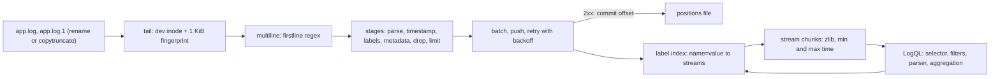

# A Log Pipeline Is Tail, Parse, Label, Ship

*Commit the offset only after the push succeeds; a log store is a label index over compressed chunks, and each label value is a new stream.*

## Metadata

| Field | Value |
|---|---|
| Type | Build |
| Languages | Python |
| Prerequisites | [File Descriptors: Too Many Open Files Is a Leak, Not a Limit](https://cloudcaptain.io/learn/linux/file-descriptors) |
| Time | 90 minutes |
| Tools | docker, loki, alloy, opentelemetry-collector, curl |

<Quiz stage="pre" />

## The Problem

Friday, 02:10. The payments service threw `UpstreamTimeout` for four minutes during a card-network blip, and the on-call engineer opens the log UI to count how many charges failed. The count is 212. Finance's count from the database is 230. Somebody notices that `logrotate` ran at 02:00 with `copytruncate`, and that the shipper had read up to byte 9.1 MB of a 9.3 MB file when the copy was made and the original was emptied. The shipper saw the file shrink, decided it was a new file, started from byte 0 of the empty original and never looked at `payments.log.1`, because the glob was `payments.log`. Eighteen errors were in those 200 KB. On the checkout side the opposite happened: the glob was `checkout.log*`, rotation was by rename, and a shipper that tracked files by path read `checkout.log.1` as a new file from the beginning. Every line of the previous hour is in the store twice.

The same night, the error search itself took 40 seconds and then timed out. Six weeks ago someone added `user_id` and `request_path` as labels "to make searching faster". The store now has 1.4 million streams, each with a handful of lines in its own tiny chunk; a query for `{app="checkout"}` has to open hundreds of thousands of chunks, and the ingester's memory is mostly stream bookkeeping. The stack traces do not help either: every `Traceback` arrived as seven separate entries, so `|= "UpstreamTimeout"` finds the last line of each trace and none of the frames.

None of this is exotic. A log pipeline has four jobs (tail, parse, label, ship) and each has one mechanism that decides whether you lose lines, duplicate them, or make the store unusable. You are going to build `minilog`: a shipper that tracks files by device and inode with a content fingerprint, survives both rotation styles and its own restarts without losing or repeating a line, joins multiline entries, parses JSON, logfmt and regex, extracts timestamps, labels, drops and rate-limits, and pushes in batches with retries; and a store that keeps label-indexed streams of compressed chunks and answers a LogQL subset over Loki's HTTP API. Then you ship the same files to Grafana Loki, run the same queries against both, and check that the answers are identical.

## The Concept

Think of a mail room that receives letters from many offices. Each office keeps a logbook and writes a line for every letter sent. The courier walks the logbooks and remembers, for each physical book, the page and line he last copied. When an office starts a new book and moves the old one to the shelf, he must recognise the old book by its cover, not by where it lies, and finish it. When an office photocopies its book and erases the original, he must find the photocopy and continue there at the line he had reached. And he must only write down "copied up to line 40" after the letters are actually in the van.

**Tail** is that courier. A file's identity is its device and inode (`st_dev:st_ino`), not its path: a rename keeps the inode, so the shipper keeps reading the renamed file through its open descriptor and starts a new position for the new file at the same path. `copytruncate` keeps the path and the inode but throws the content away; the only thing that identifies the copy is its content, so the shipper fingerprints the first kilobyte of every file and hands its old offset over to the new file whose first bytes match. The positions file stores the *committed* offset per inode: the end of the last line whose batch the store accepted.

**Parse and label** turn a line into an entry: a timestamp, the line, a small set of *labels* that pick the stream, and optionally *structured metadata*, per-entry key-values that are stored next to the line but not indexed. Labels are the only index. A stream is the set of entries with exactly the same labels, and the store keeps each stream in its own chunks. A label with a few values (`app`, `level`, `namespace`) gives a few streams with big, well-compressed chunks. A label with unbounded values (`user_id`, `trace_id`, a URL path) gives one stream per value, each with a nearly empty chunk, an index entry and memory in the ingester: the store gets slower as it gets bigger, and the shipper is the last place that can stop it.

**Ship and query.** Batches go to a push API; 429, 5xx and connection errors are retried with doubling backoff, other 4xx are not, because the same body will be refused again. The store selects streams through its label index (an inverted index from `name=value` to streams), skips chunks whose time range misses the query, decompresses the rest, and only then runs line filters, parsers and label filters on each line. That is the Loki trade: a small index and cheap ingestion, paid for with brute force at query time, so the selector and the time range decide the cost of every query.



## Build It

`code/main.py` is `minilog`, one file with five subcommands: `generate` writes numbered log lines and rotates them by rename or copytruncate; `ship` tails files and pushes to any Loki-compatible URL (repeat `--push` to fan out); `serve` runs the store; `query` and `cardinality` talk to Loki or to `minilog`'s store. Clocks, sleeps, HTTP transport and warnings are injectable, so the tests drive rotation, retries and multiline timeouts in temp directories without real time passing.

### Step 1: a file is a device and an inode, and its first kilobyte

```python
def file_key(st: os.stat_result) -> str:
    return f"{st.st_dev}:{st.st_ino}"


def compare_prefix(new: bytes, known: bytes) -> str:
    if not new or not known:
        return "different"
    size = min(len(new), len(known))
    if new[:size] != known[:size]:
        return "different"
    if size >= MIN_FINGERPRINT or len(known) <= len(new):
        return "same"
    return "maybe"
```

Every poll globs each source's pattern, skips compressed rotations (`.gz`, `.zst` and friends: `logrotate`'s `compress` produces them and their bytes are not lines) and directories, and keys what it finds by `st_dev:st_ino`. A known key whose path changed was renamed: the open descriptor keeps reading it, and the `origin` (the path it was first seen at) stays the same, so its entries keep the `filename` label of the live file and land in the same stream. A key that disappeared from the glob is drained through its descriptor to the end, including a last line without a newline, and closed.

The fingerprint is the first `FINGERPRINT_BYTES` (1024) bytes. Two prefixes are `same` when one is a prefix of the other and at least 64 bytes long, `maybe` when the shorter one is too short to tell, and `different` otherwise. Inode numbers are reused as soon as a file is deleted, so a stored position is trusted only if the file under that inode still starts with the stored fingerprint; otherwise it is a new file from offset 0.

### Step 2: copytruncate is detected by shrinking and repaired by fingerprint

```python
def rewritten(self, state: FileState) -> bool:
    size = os.fstat(state.fd).st_size
    if size < state.offset or size < len(state.prefix):
        return True
    return bool(state.prefix) and os.pread(state.fd, len(state.prefix), 0) != state.prefix
```

A file that shrank below the read offset, or whose first bytes changed, was truncated or rewritten. Its state becomes a *candidate*: a position looking for a new home. Every new inode found in the same poll is fingerprinted, and a candidate whose prefix matches hands over its offset:

```python
for candidate in candidates:
    if candidate.key == key or candidate.source is not source:
        continue
    verdict = compare_prefix(prefix, candidate.prefix)
    if verdict == "same":
        candidates.remove(candidate)
        self.close(candidate)
        candidate.key, candidate.path, candidate.fd = key, path, fd
        self.states[key] = candidate
        self.stats["copies"] += 1
        return
```

So `payments.log.1` continues at exactly the byte where the shipper stopped in `payments.log`, and the lines written between the last read and the copy are read from the copy. Two races remain, and `adopt()` handles both. If the copy appears before the truncate (`cp` takes time), it matches a file that is still live; reading it would duplicate everything, so it is counted as a `pending_copy` and skipped until the original shrinks. If a truncated file has unread bytes and no copy matches (the glob does not include the rotated name), the bytes are gone; the tailer counts them in `lost_bytes` and warns with the fix. The same handover works across a restart: a position loaded from disk whose inode was truncated while the shipper was down finds its copy the same way.

### Step 3: read whole lines, commit only what the store accepted

```python
cut = chunk.rfind(b"\n")
if cut < 0:
    if final or len(chunk) == MAX_READ:
        state.offset += len(chunk)
        lines.append(Line(chunk.decode("utf-8", "replace"), state.offset))
        continue
    break
pos = state.offset
for raw in chunk[:cut].split(b"\n"):
    pos += len(raw) + 1
    lines.append(Line(raw.decode("utf-8", "replace"), pos))
state.offset += cut + 1
```

`os.pread()` reads from an offset without moving a shared file position, so one descriptor can be re-read safely. A partial last line waits for its newline unless the file is being drained. Each `Line` remembers the byte offset where it ends. Two offsets are kept per file: `offset`, how far the tailer has read, and `committed`, how far the store has accepted. Only the second is written to the positions file, after a batch has been delivered:

```python
for item in items:
    if item.state is not None:
        item.state.committed = max(item.state.committed, item.end)
if self.dry_run is None:
    self.tailer.save()
```

`save()` writes the positions to a temporary file and `os.replace()`s it, so a crash leaves the old file or the new one, never half of one. When the shipper is stopped while a push is still retrying, the batch is marked interrupted and its offsets are not committed: the next run reads those lines again. That is at-least-once delivery, and Step 7 shows why it does not turn into duplicates.

### Step 4: a stack trace is one entry

```python
if state.block and (state.source.firstline.search(line.text) or len(state.block) >= state.source.max_lines):
    self.flush_block(state)
state.block.append(line)
state.block_since = now
```

A source with `multiline.firstline` collects lines into a block until the next line that matches the regex (`^ts=` for the payments app), `max_lines` is reached, or `max_wait` seconds pass with nothing new, which is how the last trace in a quiet file gets out. The block's end offset is that of its last line, so a block that is still open is never committed; if the shipper stops, the whole trace is read again on restart instead of being split.

### Step 5: parse into fields, then choose what becomes a label

Stages run in order on each entry and write into a map of extracted fields. `json` flattens nested objects with `_` (`{"req": {"user-agent": "curl"}}` becomes `req_user_agent`), keeps numbers as their original text and skips arrays and nulls, as Loki's `| json` does. `logfmt` follows Loki's decoder, including quoted values with escapes and bare keys. `regex` needs named groups (Go's `(?<name>...)` is accepted too). Then the stages that decide where the entry goes:

```python
elif kind == "timestamp":
    parsed = parse_timestamp_value(extracted.get(stage["source"], ""), stage["format"])
    if parsed is None:
        self.stats["timestamp_failures"] += 1
    else:
        ts = parsed
elif kind in ("labels", "structured_metadata"):
    target = labels if kind == "labels" else metadata
    for name in stage["names"]:
        if extracted.get(name):
            target[name] = extracted[name]
```

The timestamp stage replaces the time the shipper read the line with the time the application wrote it (RFC 3339 with any fraction, or Unix seconds, milliseconds, microseconds, nanoseconds). That matters for more than accuracy: an entry re-read after a restart gets the same timestamp as the first time, which is what lets the store recognise it. `labels` promotes fields to stream labels; `structured_metadata` attaches them to the entry only. `drop` (by value, regex or length) and `limit` (a token bucket per stage: `rate` entries per second, `burst` at once) discard entries, but their offsets still advance, so a dropped line is not read again.

### Step 6: warn before a label becomes a cardinality incident

```python
def observe(self, labels: Dict[str, str]) -> None:
    for name, value in labels.items():
        seen = self.values.setdefault(name, set())
        if len(seen) <= self.limit:
            seen.add(value)
        if len(seen) > self.limit and name not in self.warned:
            self.warned.add(name)
            self.warn(f"label {name!r} has more than {self.limit} distinct values; every value is a new stream with its own chunks. Keep it in the line or send it as structured metadata")
```

There are two warnings. At config load, any label whose name looks like an identifier (`user_id`, `trace_id`, `session`, `path`, `ip` and similar) is flagged. At run time, `Cardinality` counts distinct values per label name, capped so it stays cheap, and warns once when a label passes `max_label_values` (25 by default). The smoke labels `user_id` on purpose and watches 3 checkout streams turn into 540.

### Step 7: batch, push, back off

```python
if 200 <= status < 300:
    return "ok", ""
detail = f"HTTP {status}: {text.strip()[:300]}" if status else f"connection failed: {text}"
if status and status != 429 and status < 500:
    return "rejected", detail
if attempt >= self.max_retries:
    return "gave up", detail
if self.should_stop():
    return "interrupted", detail
attempt += 1
self.stats[url]["retries"] += 1
self.sleep(delay)
delay = min(delay * 2, self.max_backoff)
```

Entries are grouped into streams in Loki's push format, `{"streams": [{"stream": {labels}, "values": [["<unix ns>", "<line>", {metadata}]]}]}`, and a batch is sent when it reaches `batch_bytes` or `batch_wait` seconds. 429 and 5xx mean "later", so they are retried with doubling backoff from `min_backoff` to `max_backoff`; 400 means "never", so it is reported and the batch is counted as undelivered, not retried forever. With several `--push` URLs the same body goes to each, which is how the smoke feeds Loki and `minilog`'s store from one shipper.

### Step 8: the store is a label index over compressed chunks

```python
def stream_for(self, labels: Dict[str, str]) -> Stream:
    key = label_string(labels)
    stream = self.streams.get(key)
    if stream is None:
        stream = self.streams[key] = Stream(key, dict(labels))
        for name, value in labels.items():
            self.postings.setdefault(name, {}).setdefault(value, set()).add(key)
    return stream
```

A stream's identity is its sorted label set. `postings` maps every `name=value` to the streams that carry it, so `{app="checkout", level="error"}` is a set intersection. Lines are not indexed at all. `append()` enforces two of Loki's rules: an entry more than an hour older than the newest entry in its stream is refused with `entry too far behind` (Loki's out-of-order window is half of `max_chunk_age`, one hour by default), and an entry with the same timestamp and the same line as one already in the stream is silently dropped. That second rule is why at-least-once shipping with extracted timestamps does not produce duplicates. When the head of a stream holds `chunk_bytes` of lines, it is cut into a chunk:

```python
def cut(self) -> None:
    if not self.head:
        return
    rows = sorted(self.head, key=lambda e: e[0])
    raw = "\n".join(json.dumps([ts, line, md], ensure_ascii=False, separators=(",", ":")) for ts, line, md in rows).encode("utf-8")
    self.chunks.append(Chunk(rows[0][0], rows[-1][0], len(rows), len(raw), zlib.compress(raw, 6)))
    self.head, self.head_bytes = [], 0
```

A chunk knows its first and last timestamp, so a query skips chunks outside its range without decompressing them. Log lines from one stream look alike, which is why they compress well; the smoke's store reports ratios around 6 to 7.

### Step 9: LogQL runs the pipeline on each line

`parse_query()` is a small recursive-descent parser for the subset: a selector with `=`, `!=`, `=~`, `!~`; line filters `|=`, `!=`, `|~`, `!~`; `| json`, `| logfmt`, `| regexp`; label filters with strings or numbers joined by `,` or `and`; `| line_format` with `{{.label}}`; the range functions `count_over_time`, `rate`, `bytes_over_time`, `bytes_rate`; and `sum`, `avg`, `min`, `max`, `count` with `by` or `without`. Anything else is refused with a message that names it. Two rules come straight from Loki. A selector must contain a matcher that does not match the empty string, because `{app=~".*"}` would select every stream in the store:

```python
if not matchers or all(m.matches("") for m in matchers):
    raise QueryError(EMPTY_COMPATIBLE)
```

And a parsed field never overwrites a stream label or metadata; it gets the `_extracted` suffix, so `| json` on a line containing `"level"` in a stream labelled `level` yields both `level` and `level_extracted`:

```python
for key, value in fields.items():
    parsed[key + "_extracted" if key in base or key in metadata else key] = value
```

A numeric label filter on a value that is not a number does not drop the line: it sets `__error__=LabelFilterErr`, and a metric query refuses to aggregate entries with errors until you add `| __error__=""`. Range functions count entries in the left-open window `(t - range, t]` with two binary searches over sorted timestamps:

```python
lo, hi = bisect.bisect_right(stamps, t - node.range_ns), bisect.bisect_right(stamps, t)
if hi > lo:
    count, total = hi - lo, sizes[hi] - sizes[lo]
    values[t] = {"count_over_time": count, "rate": count / seconds, "bytes_over_time": total, "bytes_rate": total / seconds}[node.function]
```

Every response carries `stats.minilog`: streams matched, chunks scanned and pruned, bytes decompressed, entries scanned and returned. Those numbers are the cost model of the whole design.

### Step 10: run it

```bash
cp code/fixtures/pipeline.json . && mkdir logs
T0=$(python3 -c 'import time; print(time.strftime("%Y-%m-%dT%H:%M:00Z", time.gmtime((int(time.time()) // 60 - 20) * 60)))')
python3 code/main.py serve --port 3101 --chunk-bytes 4096 &
python3 code/main.py ship --config pipeline.json --push http://127.0.0.1:3101 --positions pos.json &
SHIP=$!
python3 code/main.py generate logs/checkout.log --format json --count 300 --start $T0 --rotate-every 100 --rotate rename --pace 0.005
python3 code/main.py generate logs/payments.log --format logfmt --count 200 --start $T0 --rotate-every 80 --rotate copytruncate --traceback-every 75 --pace 0.005
sleep 2; kill -TERM $SHIP; wait $SHIP
```

```text
wrote 300 entries (seq 1-300) from 2026-11-09T15:56:00Z with 2 rename rotations: checkout.log, checkout.log.1, checkout.log.2
wrote 200 entries (seq 1-200) from 2026-11-09T15:56:00Z with 2 copytruncate rotations: payments.log, payments.log.1, payments.log.2
shipped 470 entries from 512 lines in 4 batches; dropped 30 by stage, 0 by limit; rotation {'files': 6, 'renamed': 4, 'truncated': 2, 'copies': 2, 'pending_copies': 0, 'closed': 0, 'lost_bytes': 0}
```

512 lines became 470 entries: 30 `debug` lines dropped, and two seven-line tracebacks joined into two entries. Two copytruncate rotations were handed over by fingerprint and nothing was lost. Now query it (paths shortened):

```bash
python3 code/main.py query --url http://127.0.0.1:3101 '{app="payments"} |= "Traceback"' --limit 1
python3 code/main.py query --url http://127.0.0.1:3101 'sum by (app, level) (count_over_time({job="minilog"}[1h]))' --instant
python3 code/main.py query --url http://127.0.0.1:3101 '{app="checkout", level="info"} |= "POST"' --start 2026-11-09T15:57:00Z --end 2026-11-09T15:57:10Z --limit 2
python3 code/main.py query --url http://127.0.0.1:3101 '{app=~".*"}'; echo "exit $?"
python3 code/main.py cardinality --url http://127.0.0.1:3101 --match '{job="minilog"}'
```

```text
2026-11-09T15:57:14.75Z {app="payments", filename=".../logs/payments.log", job="minilog", level="error"} ts=2026-11-09T15:57:14.750Z level=error seq=150 msg="charge failed" status=502 duration_ms=590 card=visa
Traceback (most recent call last):
  File "/app/payments.py", line 42, in charge
...
gateway.UpstreamTimeout: card network did not answer in 900 ms
1 entries in 1 streams
stats: streams_matched=3, chunks_scanned=0, chunks_pruned=0, bytes_decompressed=0, entries_scanned=200, entries_returned=1

{app="checkout", level="error"} 12
{app="checkout", level="info"} 246
{app="checkout", level="warn"} 12
{app="payments", level="error"} 8
{app="payments", level="info"} 184
{app="payments", level="warn"} 8

stats: streams_matched=1, chunks_scanned=1, chunks_pruned=11, bytes_decompressed=6365, entries_scanned=26, entries_returned=2

minilog: HTTP 400 from http://127.0.0.1:3101: queries require at least one regexp or equality matcher that does not have an empty-compatible value
exit 2
```

The ten-second query opened one chunk of twelve: the selector picked one stream through the index and the time range pruned the rest. The entries of the rotated files kept `filename=".../payments.log"`, because the label comes from the origin path, so rotation does not create new streams.

<RunTests />

## Use It

**Grafana Loki** does the store's job. Run it as a single binary with filesystem storage. The two `limits_config` lines turn off Loki 3's automatic `service_name` label and `detected_level` metadata, so its streams carry only the labels you send, as `minilog`'s do:

```bash
mkdir -p /tmp/loki && cat > /tmp/loki/config.yaml <<'EOF'
auth_enabled: false
server:
  http_listen_port: 3100
common:
  instance_addr: 127.0.0.1
  path_prefix: /loki
  storage:
    filesystem:
      chunks_directory: /loki/chunks
      rules_directory: /loki/rules
  replication_factor: 1
  ring:
    kvstore:
      store: inmemory
schema_config:
  configs:
    - from: 2020-10-24
      store: tsdb
      object_store: filesystem
      schema: v13
      index:
        prefix: index_
        period: 24h
limits_config:
  allow_structured_metadata: true
  discover_service_name: []
  discover_log_levels: false
EOF
docker run -d --name loki -p 127.0.0.1:3100:3100 -v /tmp/loki/config.yaml:/etc/loki/config.yaml:ro \
  grafana/loki:3.7.9 -config.file=/etc/loki/config.yaml
until curl -fsS http://127.0.0.1:3100/ready; do sleep 1; done
```

Push one line with structured metadata by hand, read it back, and list what is indexed:

```bash
NOW=$(python3 -c 'import time; print(time.time_ns())')
curl -s -w '%{http_code}\n' -H 'Content-Type: application/json' -X POST http://127.0.0.1:3100/loki/api/v1/push \
  --data "{\"streams\":[{\"stream\":{\"job\":\"curl\",\"app\":\"smoke\"},\"values\":[[\"$NOW\",\"hello\",{\"trace_id\":\"abc123\"}]]}]}"
curl -s -G http://127.0.0.1:3100/loki/api/v1/query_range --data-urlencode 'query={job="curl"} | trace_id="abc123"' | python3 -m json.tool
curl -s http://127.0.0.1:3100/loki/api/v1/labels
```

The push answers `204`. The query result's stream carries `trace_id` next to `app` and `job`, because structured metadata is returned like a label, but `/labels` lists only `app` and `job`: `trace_id` is stored per entry, not in the index, so it costs no stream. That is what structured metadata is for: high-cardinality values you want to filter on without paying for a stream per value.

Now feed both stores from one shipper. Stop the Step 10 shipper and store, delete `logs/` and `pos.json`, and rerun Step 10 with a second `--push http://127.0.0.1:3100` on the `ship` line, so both stores receive the same batches while the files rotate. (Starting a new shipper on files that were already rotated would not do: it cannot know that `payments.log.1` used to be `payments.log`, so the rotated files get their own `filename` values and their own streams. Set `"filename_label": false` in the pipeline if that matters to you.) `minilog query` speaks Loki's API, so `--url` decides which store answers:

```bash
for url in http://127.0.0.1:3101 http://127.0.0.1:3100; do
  python3 code/main.py query --url $url 'sum by (app, level) (count_over_time({job="minilog"}[1h]))' --instant
  python3 code/main.py query --url $url '{app="checkout"} | json | status >= 500 | line_format "{{.status}} {{.method}} {{.path}}"' --limit 3
done
python3 code/main.py cardinality --url http://127.0.0.1:3100 --match '{job="minilog"}'
```

Loki returns the same counts and the same lines. The smoke test does this with 17 queries (log queries with line filters, parsers, label filters and `line_format`; instant and range metric queries with `sum by`, `rate` and `bytes_over_time`) and compares parsed results, not text. It also checks that across a SIGTERM restart, three rename rotations and three copytruncate rotations, both stores hold every sequence number exactly once and each traceback as one seven-line entry.

**Grafana Alloy** is the shipper Grafana maintains. Promtail, the original Loki shipper, is deprecated and reached end of life on 2 March 2026; its configuration converts with `alloy convert --source-format=promtail`. The same pipeline in Alloy's configuration language:

```text
loki.source.file "payments" {
  targets    = [{"__path__" = "/logs/payments.log*", "app" = "payments", "job" = "alloy"}]
  forward_to = [loki.process.payments.receiver]
  file_match {
    enabled = true
  }
}

loki.process "payments" {
  stage.multiline {
    firstline     = "^ts="
    max_wait_time = "2s"
  }
  stage.regex {
    expression = "^ts=(?P<ts>\\S+) level=(?P<level>\\w+)"
  }
  stage.timestamp {
    source = "ts"
    format = "RFC3339Nano"
  }
  stage.labels {
    values = {level = ""}
  }
  forward_to = [loki.write.local.receiver]
}

loki.write "local" {
  endpoint {
    url = "http://loki:3100/loki/api/v1/push"
  }
}
```

```bash
docker network create logs && docker network connect logs loki
docker run -d --name alloy --network logs -v "$PWD/logs:/logs:ro" -v "$PWD/config.alloy:/etc/alloy/config.alloy:ro" \
  grafana/alloy:v1.21.3 run --storage.path=/var/lib/alloy/data /etc/alloy/config.alloy
```

The stages map one to one onto `minilog`'s. In the smoke, Alloy reads the finished, rotated files and Loki ends up with the same entry count per app, the same two whole tracebacks and the same `(timestamp, line)` pairs as `minilog` shipped. Alloy keeps its read positions under `--storage.path`; start it with an empty storage path and it reads everything again, which is harmless only because the timestamp stage makes every re-sent entry an exact duplicate that Loki drops.

**Fluent Bit** is the other common shipper. Its `tail` input keeps offsets per inode in an SQLite file (`DB`), keeps reading a rotated file for `Rotate_Wait` seconds, and joins stack traces with `multiline.parser python` or a custom parser; its `loki` output sets labels with `labels` and `label_keys`. **The OpenTelemetry Collector** is the vendor-neutral option: the contrib distribution's `filelog` receiver identifies files by a fingerprint of their first bytes (`fingerprint_size`, 1 KiB by default, the same idea as Step 1), joins lines with `multiline.line_start_pattern`, keeps offsets across restarts when you give it a `storage` extension, and its `otlphttp` exporter can send to Loki's native OTLP endpoint (`http://loki:3100/otlp`), where resource attributes such as `service.name` become labels and the rest become structured metadata.

Two lessons carry over to all of them. Rotation: include the rotated name in the glob (`app.log*`) but not compressed rotations, and prefer rename over `copytruncate`; copytruncate always has a window between the copy and the truncate in which lines written by the application are in neither file, and no shipper can recover those. Cardinality: Loki limits label names per series (15 by default) and active streams per tenant, and pushes over the limit are refused. Keep labels to where the logs come from (`namespace`, `app`, `container`, `level`) and put request, user and trace identifiers in the line or in structured metadata, then find them with a line filter or `| trace_id="..."`.

| What you built | Real tool | Note |
|---|---|---|
| `Tailer` with `dev:inode` keys and positions | Alloy `loki.source.file`, Fluent Bit `tail` with `DB`, Collector `filelog` with `storage` | all of them commit offsets only after delivery; check that the positions file lives on a persistent volume |
| `compare_prefix()` fingerprint handover | Collector `filelog` `fingerprint_size` | Alloy and Fluent Bit restart a truncated file at 0 and read a copy that matches the glob as a new file; only extracted timestamps make that re-read harmless |
| multiline `firstline`, `max_lines`, `max_wait` | Alloy `stage.multiline`, Fluent Bit `multiline.parser`, Collector `multiline.line_start_pattern` | join in the shipper; the store cannot rebuild a split trace |
| `json`, `logfmt`, `regex`, `timestamp`, `labels`, `structured_metadata`, `drop`, `limit` stages | Alloy `stage.json`, `stage.logfmt`, `stage.regex`, `stage.timestamp`, `stage.labels`, `stage.structured_metadata`, `stage.drop`, `stage.limit` | Alloy has many more (`stage.match`, `stage.template`, `stage.metrics`) |
| `Cardinality` warnings and `minilog cardinality` | `logcli series --analyze-labels`, Loki's per-tenant stream limits | Loki enforces at the store; the shipper is the cheaper place to stop it |
| `Pusher` with backoff and fan-out | `loki.write` with several `endpoint` blocks | its experimental write-ahead log keeps entries on disk while Loki is down |
| `Store` streams, postings, zlib chunks | Loki ingesters (head blocks, compressed chunks, TSDB index) and object storage | chunks are flushed to S3, GCS or a filesystem; the index stays small |
| `evaluate_pipeline()` and `evaluate_metric()` | Loki queriers, split by time and sharded | `\| __error__=""` and the `_extracted` suffix behave the same |

<Quiz stage="check" />

## Ship It

Two artifacts in `outputs/`:

- **`skill-log-pipeline-review.md`**: a runbook for reviewing a log pipeline before it hurts: find each source's rotation style and check the glob and positions storage against it, look for lines lost or duplicated with sequence numbers or timestamps, check multiline and timestamp extraction, measure label cardinality with `logcli series --analyze-labels` or `minilog cardinality`, move identifiers to structured metadata, check retries and limits, and report findings with evidence.
- **`prompt-write-logql.md`**: describe what you want to find in plain words, with the labels you have and two sample lines, and get a LogQL query that selects narrowly, filters lines before parsing, handles parser errors, and comes with the expected cost and a check that the answer is right.

<ShipIt />

## Exercises

### Easy

Add an `older_than` option to the `drop` stage that drops entries whose extracted timestamp is more than a given duration behind the shipper's wall clock, the way Alloy's `stage.drop` does. Write the tests first: with `older_than: "1h"` and a fixed `wall` of `T0`, an entry stamped `T0 - 2h` is dropped and counted in `dropped_by_stage`, one stamped `T0 - 30m` is shipped, an entry without a parsed timestamp is kept, and the dropped entry's offset is still committed. Then explain why this stage prevents `entry too far behind` errors after a shipper has been down for hours.

### Medium

Implement the `| pattern "<ip> - - [<_>] \"<method> <path> <_>\" <status> <_>"` parser. The pattern is literal text with `<name>` captures, `<_>` skips a field, and a capture runs until the literal that follows it. Tests first: a combined access-log line yields `ip`, `method`, `path` and `status`; a line that does not match yields no fields and no error; a pattern with two consecutive captures is a parse error. Then add an access-log source to the smoke's pipeline and assert that `sum by (status) (count_over_time({app="web"} | pattern "..." [10m]))` gives the same result in Loki and in `minilog`.

### Hard

Give the store a write-ahead log. Every accepted push is appended to a segment file and `fsync`ed before the `204` goes out; on start the store replays the segments, rebuilds streams, postings and heads, and deletes segments whose entries are all in chunks it has written to disk. Write the tests first: push, kill the store without shutdown (simulate with a fresh `Store` reading the same directory), restart, and every entry is queryable exactly once; a torn last record (truncate the segment mid-record) is ignored, not fatal; replaying twice is idempotent thanks to the duplicate rule. Measure pushes per second with and without `fsync` and explain the number in terms of Loki's own WAL settings.

<Quiz stage="post" />

## Key Terms

| Term | Common misconception | Precise definition |
|---|---|---|
| Stream | "A stream is a log file." | All entries with exactly the same label set; the store keeps each stream in its own chunks, so one file can feed several streams (by `level`) and several files one stream (rotations with the same `filename` origin). |
| Label | "Labels make search faster, so add more." | The only indexed part of an entry; each new value creates a new stream, so labels must have few, stable values (`app`, `namespace`, `level`). |
| Structured metadata | "Just another label." | Per-entry key-values stored next to the line and returned like labels, but not indexed and not part of the stream identity; the place for `trace_id` or `user_id`. |
| Chunk | "Loki indexes every word in the line." | A compressed block of one stream's entries with its first and last timestamp; queries prune chunks by time and decompress the rest, then filter lines by brute force. |
| Positions file | "It records how far the shipper has read." | The committed offset per file identity: the end of the last line the store accepted; written atomically, so a restart re-reads at most one batch. |
| `copytruncate` | "The same as rotation by rename." | Copy the live file, then truncate it in place; the inode stays, the content moves, and lines written between the copy and the truncate are in neither file. |
| Fingerprint | "The inode is enough to identify a file." | A hash or prefix of the first bytes of a file; it survives a copy and detects a reused inode, so it complements `dev:inode`. |
| Multiline firstline | "Stack traces can be joined at query time." | A regex that marks the first line of an entry; the shipper joins every following non-matching line into the same entry before it is shipped. |
| Empty-compatible matcher | "`{app=~".*"}` selects everything I have." | A matcher that also matches the empty string; Loki needs at least one matcher that does not, so every query starts from a bounded set of streams. |
| `__error__` | "A line that fails to parse is dropped." | The label a parser or label filter sets on failure; the line stays in log queries, and metric queries refuse to aggregate it until `\| __error__=""` filters it out. |

## Further Reading

- [Observability & SRE](https://cloudcaptain.io/docs/tools/observability): where logs sit next to metrics and traces, and the core tools of each signal.
- [SRE learning path](https://cloudcaptain.io/docs/learning-paths/sre): the path this phase belongs to, from SLIs to incident response.
- [Linux administration](https://cloudcaptain.io/docs/tools/linux/administration): `logrotate`, journald and the files the shipper reads.
- [Loki labels best practices](https://grafana.com/docs/loki/latest/get-started/labels/bp-labels/): which labels to use, why cardinality matters, and the static versus dynamic label rule.
- [Loki structured metadata](https://grafana.com/docs/loki/latest/get-started/labels/structured-metadata/): when to use it, how it is queried, and its limits.
- [LogQL log queries](https://grafana.com/docs/loki/latest/query/log_queries/) and [metric queries](https://grafana.com/docs/loki/latest/query/metric_queries/): the full grammar this lesson implements a subset of, including `__error__` and the `_extracted` rule.
- [Loki HTTP API](https://grafana.com/docs/loki/latest/reference/loki-http-api/): push, query, query_range, labels and series, with the parameters `minilog` mirrors.
- [Alloy `loki.source.file`](https://grafana.com/docs/alloy/latest/reference/components/loki/loki.source.file/) and [`loki.process`](https://grafana.com/docs/alloy/latest/reference/components/loki/loki.process/): positions, file matching and every pipeline stage.
- [OpenTelemetry Collector filelog receiver](https://github.com/open-telemetry/opentelemetry-collector-contrib/tree/main/receiver/filelogreceiver): fingerprints, multiline, operators and storage for offsets.
- [logrotate(8)](https://man7.org/linux/man-pages/man8/logrotate.8.html): `copytruncate`, `create`, `delaycompress` and why each changes what the shipper sees.
- [PromQL Is Vector Arithmetic Over Time Windows](https://cloudcaptain.io/learn/observability/promql): range vectors, `rate` and `sum by`, which LogQL's metric queries borrow almost unchanged.
