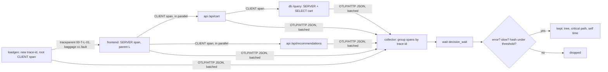

# A Trace Is a Tree Stitched Together by Context

*One header carries the trace through every hop; parent IDs rebuild the tree, and the sampler decides which trees exist when you need them.*

## Metadata

| Field | Value |
|---|---|
| Type | Build |
| Languages | Python |
| Prerequisites | [HTTP/1.1 Is Text Over a Socket Until It Is Not](https://cloudcaptain.io/learn/networking/http-server) |
| Time | 90 minutes |
| Tools | docker, opentelemetry-collector, jaeger, opentelemetry-instrument |

<Quiz stage="pre" />

## The Problem

Tuesday, 11:20. Checkout p99 went from 280 ms to 2.4 s right after the api team shipped. The frontend dashboard shows `GET /api/cart` as the slow call. The api team's dashboard shows their `/api/cart` handler at 40 ms p99 and they say, correctly, that it is not them. The database graphs are flat. Someone opens the tracing UI to settle it and finds three things. The frontend's traces end at a long `GET /api/cart` client span with nothing under it. There are thousands of short traces whose root is an api span with no parent. And of the roughly 300 slow checkouts in the incident window, the backend kept eleven traces, nine of them fast.

Each of those is one mechanism failing quietly. The release moved the api's request handling onto a worker pool, and the code that hands a request to the pool did not pass the extracted context along, so every api server span started a new trace. The frontend's trees now ended at its client span, and the api's spans, with the database calls under them, became thousands of parentless trees. The 2.3 seconds were spent in the pool's queue, between the frontend's client span starting and the api's server span starting: exactly the gap that no single tree showed any more. The sampler at the edge kept 5% of traces, decided by the trace ID before the request had done anything, so it kept the same 5% of slow requests as of fast ones, and most of what it kept was healthy traffic. And when the team compared a complete trace from before the release, the waterfall showed two calls running in parallel under checkout; they spent an hour shaving the one with the longer bar, which had started earlier and also finished earlier, so it was not the one that decided how long the request took.

A trace is a tree that nobody stores as a tree. Every service writes its own spans, each carrying a trace ID and the ID of its parent, and the backend rebuilds the tree afterwards from those two fields. The only thing that connects one service's spans to the next is a header forwarded on every call. You are going to write `minitrace`: W3C Trace Context and baggage parsed and generated by the rules, a tracer, three small HTTP services (frontend, api, db) that propagate context the way an SDK does, OTLP/HTTP JSON export, and a collector that assembles traces, applies head and tail sampling, and computes each trace's critical path and self time per service. Then you run the OpenTelemetry Collector with the same tail-sampling policy on the same spans and check that it keeps exactly the same traces.

## The Concept

Think of a relay race where every runner fills in a card: the race number, their own runner number, the number of the runner who handed them the baton, and when they started and finished. Nobody keeps the whole race on one card. Afterwards the organisers sort the cards by race number and lay them out by "who handed to whom", and the race reappears. If one runner forgets to pass on the race number, the rest of the race is filed as a different race. If the organisers decide to throw away 95% of the cards at the start line, before anyone has run, the cards for the race where someone fell are probably gone too.

**Context** is the card's header. W3C Trace Context puts it in `traceparent: 00-TRACEID-PARENTID-FLAGS`: a version, a 16-byte trace ID shared by every span of the request, the 8-byte ID of the span that made this call, and flags whose lowest bit says whether the caller is recording (sampled). `tracestate` carries vendor-specific values next to it (up to 32 `key=value` members), and `baggage` carries application key-values, such as a tenant or a test flag, that every downstream service can read. The receiving service makes the incoming parent its span's parent, and when it calls onward it sends its own client span's ID as the new parent ID.

**A span** is one operation in one service: a name, a kind, a start and an end, attributes, events (timestamped things that happened inside it, such as an exception), a status (unset, ok, error) and optional links to spans in other traces. The kind encodes the hop. A `CLIENT` span in the caller and a `SERVER` span in the callee are two halves of one call, and the gap between them is the network and the queue in front of the server. `INTERNAL` spans are work inside a service; `PRODUCER` and `CONSUMER` are the asynchronous version of client and server.

**Sampling** decides which trees exist. *Head sampling* happens when the root span starts: a sampler looks at the trace ID and decides, the decision travels in the sampled flag, and parent-based samplers downstream follow it, so every service agrees without talking to each other. It is cheap, because unsampled requests record nothing, and blind, because nobody knows yet whether the request will fail. *Tail sampling* happens in the collector: it buffers spans by trace ID, waits for the trace to finish (a fixed decision wait), and then keeps it if any span is an error, if the whole trace is slow, or if a hash of the trace ID falls under a threshold. It sees the outcome, at the cost of buffering every span and needing all spans of a trace on the same collector instance.



Two numbers come out of a kept tree. The **critical path** is the chain of work that decided the end-to-end latency: start at the root's end and walk backwards, at each moment following the child that finished last, and charge the gaps between children to the parent. Work on a parallel branch that finished earlier is not on it, and making it faster changes nothing. **Self time** is a span's duration minus the time covered by its children: the time the service spent on its own code rather than waiting for someone else. Summed per service, it answers "whose code is slow" where the waterfall only answers "who was waiting".

## Build It

`code/main.py` is `minitrace`, one file with six subcommands: `context` parses headers and prints what the next hop would send; `serve frontend|api|db` runs a traced service; `load` sends requests whose faults travel in baggage; `collector` receives OTLP/HTTP JSON and tail-samples; `analyze` rebuilds trees from OTLP files; `export` replays them to any OTLP endpoint. Every network call goes through an injectable function, so the tests run the services on localhost and the parsers on fixture text.

### Step 1: `traceparent` is four fields and five rules

```python
def parse_traceparent(header: str) -> SpanContext:
    value = header.strip(" \t")
    match = TRACEPARENT_FORMAT.match(value)
    if not match:
        if TRACEPARENT_FORMAT.match(value.lower()):
            raise ContextError(f"traceparent {header!r} uses uppercase hex; only lowercase is valid")
        raise ContextError(f"traceparent {header!r} is not VERSION-TRACEID-PARENTID-FLAGS (2, 32, 16 and 2 lowercase hex digits)")
    version, trace_id, span_id, flags, rest = match.groups()
    if version == "ff":
        raise ContextError("traceparent version ff is forbidden")
    if version == "00" and rest:
        raise ContextError("traceparent version 00 has exactly four fields; found more after the flags")
    if trace_id == INVALID_TRACE_ID:
        raise ContextError("trace-id is all zeros, which is invalid")
    if span_id == INVALID_SPAN_ID:
        raise ContextError("parent-id is all zeros, which is invalid")
    return SpanContext(trace_id, span_id, int(flags, 16), (), True)
```

The pattern is `^([0-9a-f]{2})-([0-9a-f]{32})-([0-9a-f]{16})-([0-9a-f]{2})(-.*)?$`. Version `ff` is forbidden; version `00` has exactly four fields; a higher version is parsed by its first four fields and anything after a dash is ignored, which is how the format stays forward compatible. All-zero IDs and uppercase hex are invalid. An invalid header is not an error to the caller: the service starts a new trace, and it must not read `tracestate` from the same request, because vendor data that belongs to a trace you could not identify is meaningless. Outgoing headers are always version `00`, and only the sampled bit is copied, because Level 1 says unknown flags are sent as zero:

```python
def format_traceparent(context: SpanContext) -> str:
    return f"00-{context.trace_id}-{context.span_id}-{context.flags & FLAG_SAMPLED:02x}"
```

The Level 2 draft defines bit `0x02` as "random", a promise that the right-most 7 bytes of the trace ID are random, which newer samplers rely on; `minitrace` generates random IDs anyway but does not set the flag.

### Step 2: `tracestate` belongs to vendors, `baggage` belongs to you

`parse_tracestate()` joins repeated headers with commas, ignores empty members, and validates each key (lowercase, or `tenant@system`) and value (printable ASCII without `,` or `=`, no trailing space). Like the OpenTelemetry SDKs, it discards the whole header on a bad or duplicate member or more than 32 members, rather than guessing. A vendor that changes its own entry moves it to the front, and the list is truncated from the right, long entries first:

```python
def update_tracestate(entries: Sequence[Tuple[str, str]], key: str, value: str) -> List[Tuple[str, str]]:
    if not TRACESTATE_KEY.match(key) or not TRACESTATE_VALUE.match(value):
        raise ContextError(f"cannot set tracestate {key}={value}: invalid key or value")
    updated = [(key, value)] + [(k, v) for k, v in entries if k != key]
    while len(updated) > TRACESTATE_MAX_MEMBERS:
        long_members = [i for i, (k, v) in enumerate(updated) if i > 0 and len(k) + 1 + len(v) > TRACESTATE_LONG_MEMBER]
        updated.pop(long_members[-1] if long_members else -1)
    return updated
```

Baggage is `key=value;property` members separated by commas, values percent-encoded. A receiver must pass on everything up to 64 members and 8192 bytes; beyond that it may drop members, but never send half of one:

```python
def format_baggage(entries: Iterable[BaggageEntry]) -> str:
    members: List[str] = []
    size = 0
    for entry in entries:
        text = f"{entry.key}={urllib.parse.quote(entry.value, safe=BAGGAGE_SAFE)}" + "".join(";" + prop for prop in entry.properties)
        added = len(text.encode("utf-8")) + (1 if members else 0)
        if len(members) == BAGGAGE_MAX_MEMBERS or size + added > BAGGAGE_MAX_BYTES:
            continue
        members.append(text)
        size += added
    return ",".join(members)
```

The services use baggage for fault injection: the load generator sends `baggage: cc.fault=db-slow` and only the db reads it, three hops later, without the frontend or api knowing. Every service also copies baggage into its span attributes, which is what OpenTelemetry's baggage span processor does and why baggage must never hold anything you would not print in a log: it is sent on every outgoing request, including to third-party APIs.

### Step 3: a span is sampled at birth

```python
def trace_id_ratio(ratio: float) -> Sampler:
    if not 0.0 <= ratio <= 1.0:
        raise ValueError(f"sampling ratio must be between 0 and 1, got {ratio}")
    bound = round(ratio * (MAX_UINT64 + 1))

    def sample(parent: Optional[SpanContext], trace_id: str) -> bool:
        return int(trace_id[16:], 16) < bound

    return sample


def parent_based(root: Sampler) -> Sampler:
    def sample(parent: Optional[SpanContext], trace_id: str) -> bool:
        if parent is None:
            return root(parent, trace_id)
        return parent.sampled

    return sample
```

The ratio sampler compares the low 64 bits of the trace ID with `ratio × 2^64`, exactly as the OpenTelemetry Python SDK's `TraceIdRatioBased` does, so the decision is a pure function of the ID and any service holding the same ID reaches the same answer. `make_sampler()` accepts the `OTEL_TRACES_SAMPLER` names (`always_on`, `traceidratio`, `parentbased_traceidratio` and so on). `Tracer.start_span()` asks the sampler once, when the span starts:

```python
trace_id = parent.trace_id if parent else self.ids.trace_id()
decision = self.sampler(parent, trace_id) if sampled is None else sampled
context = SpanContext(trace_id, self.ids.span_id(), FLAG_SAMPLED if decision else 0, parent.tracestate if parent else ())
```

An unsampled span still gets a fresh span ID and still propagates, with flags `00`; it just records nothing and is never exported. `Span.set_status()` ignores `UNSET`, treats `OK` as final, and keeps a message only for `ERROR`; `record_exception()` adds an `exception` event with `exception.type` and `exception.message`.

### Step 4: a hop is inject on one side and extract on the other

The client side of every call starts a `CLIENT` span as a child of the current span and injects that span's context, so the callee's parent is the client span, not the caller's server span:

```python
span = self.tracer.start_span(f"GET {template}", KIND_CLIENT, parent.context, {"http.request.method": "GET", "url.full": url, "url.template": template, "server.address": target.hostname or "", "server.port": target.port or 80})
try:
    status, payload = self.http_get(url, inject(span.context, baggage))
```

The server side extracts, starts a `SERVER` span named `GET /api/cart` (method and route, never the raw URL, because a span name with IDs in it has unbounded cardinality), and sets the HTTP attributes from the semantic conventions. Status follows the conventions' rule, which differs by kind: a 404 is the client's problem, so the server leaves its span unset while the client marks its own span as an error:

```python
def http_span_status(kind: int, status: int) -> int:
    if status >= 500 or status < 100:
        return STATUS_ERROR
    if status >= 400 and kind == KIND_CLIENT:
        return STATUS_ERROR
    return STATUS_UNSET
```

The frontend calls `/api/cart` and `/api/recommendations` in parallel threads, passing the parent span explicitly. That explicit argument is the whole fix for the incident above: context does not cross a thread pool or a queue on its own. With `--untrusted`, the frontend refuses to continue an incoming trace and starts a new root with a link to the caller's context instead, which is how an edge service stops the internet from choosing its trace IDs and forcing its sampling decisions.

### Step 5: OTLP/HTTP JSON, in batches, with retries

Finished spans go into a bounded queue; a background thread exports them every 200 ms in batches; a full queue drops spans and counts them rather than blocking the request:

```python
def on_end(self, span: Span) -> None:
    with self.lock:
        if len(self.queue) >= self.max_queue:
            self.dropped += 1
            return
        self.queue.append(span)
```

`to_otlp()` groups spans by service into `resourceSpans` (the resource carries `service.name`), with hex IDs, timestamps as decimal strings and enums as integers, as the OTLP JSON mapping requires. `post_otlp()` sends `POST /v1/traces` with `Content-Type: application/json`, optionally gzip, and retries only what the OTLP specification calls retryable:

```python
if status not in RETRYABLE or attempt > retries:
    break
sleep(retry_after({k.lower(): v for k, v in response_headers.items()}.get("retry-after"), delay))
delay *= 2
```

`RETRYABLE` is 429, 502, 503, 504 and a refused connection; a 400 means the payload is wrong and sending it again cannot help. A 200 can still carry `partialSuccess.rejectedSpans`, which the exporter reports instead of treating as success. `--export` can be repeated, so the same spans go to `minitrace`'s collector and to the OpenTelemetry Collector at once.

### Step 6: the collector waits, then decides

`TailSampler.add()` buffers spans by trace ID and remembers when the first one arrived. `tick()` decides every trace whose decision wait has passed, using the same three policies as the Collector's `tail_sampling` processor:

```python
def tail_reasons(trace_id: str, spans: Sequence[Span], policy: TailPolicy) -> List[str]:
    reasons: List[str] = []
    if policy.keep_errors and any(span.status_code == STATUS_ERROR for span in spans):
        reasons.append("errors")
    if policy.latency_ms is not None and spans:
        window_ns = max(span.end_ns for span in spans) - min(span.start_ns for span in spans)
        if window_ns // 1_000_000 >= policy.latency_ms:
            reasons.append("slow")
    if policy.sample_percent > 0 and trace_hash(trace_id, policy.hash_salt) <= probabilistic_threshold(policy.sample_percent):
        reasons.append("sample")
    return reasons
```

Latency is the earliest start to the latest end across all spans, truncated to whole milliseconds, as the processor computes it. The probabilistic policy hashes the salt followed by the 16 trace-ID bytes with 64-bit FNV-1a and keeps the trace when the hash is at most `percentage / 100 × (2^64 - 1)`:

```python
def fnv1a_64(data: bytes) -> int:
    value = FNV_OFFSET_64
    for byte in data:
        value = ((value ^ byte) * FNV_PRIME_64) & MAX_UINT64
    return value
```

`probabilistic_threshold()` reproduces the processor's Go `big.Float` arithmetic (a 64-bit mantissa, then truncation), so with the same `hash_salt` both collectors keep the same traces bit for bit. Spans that arrive after the decision follow it: a kept trace's late spans are written out, a dropped trace's are discarded and counted. Kept traces are appended to `--out` as OTLP JSON lines, the same shape the Collector's file exporter writes, so `analyze` reads both.

### Step 7: critical path and self time

```python
def walk_critical(span: Span, until_ns: int, children: Dict[str, List[Span]], segments: List[Segment]) -> None:
    cursor = min(span.end_ns, until_ns)
    for child in sorted(children.get(span.span_id, []), key=lambda c: (c.end_ns, c.start_ns), reverse=True):
        if child.start_ns >= cursor or child.end_ns <= span.start_ns:
            continue
        child_end = min(child.end_ns, cursor)
        if child_end < cursor:
            segments.append(Segment(span.span_id, span.service, span.name, child_end, cursor))
        walk_critical(child, child_end, children, segments)
        cursor = max(child.start_ns, span.start_ns)
        if cursor <= span.start_ns:
            break
    if cursor > span.start_ns:
        segments.append(Segment(span.span_id, span.service, span.name, span.start_ns, cursor))
```

The walk starts at the root's end with a cursor. The child that finished last before the cursor is on the path; the gap after it is the parent's own time; the cursor jumps to that child's start and the search continues among children that were still running then. A child that outlived its parent (fire and forget) is clipped to the parent's end. The segments always add up to the root's duration, which the tests check. Self time is the span's duration minus the union of its children's intervals, clipped to the span:

```python
def self_time_ns(span: Span, children: Sequence[Span]) -> int:
    clipped = [(max(c.start_ns, span.start_ns), min(c.end_ns, span.end_ns)) for c in children]
    return span.duration_ns - covered_ns((start, end) for start, end in clipped if end > start)
```

`trace_roots()` treats a span whose parent ID is not in the trace as a root and reports the missing ID. A trace with one root and no missing parents is a single tree; anything else means some hop received the context but its spans never arrived, or never sent the context at all.

### Step 8: run it

`code/fixtures/checkout.otlp.jsonl` holds three recorded traces: a checkout with a slow database query, one where the database fails, and one whose frontend span names a parent that was never exported (a proxy that forwarded the header but sends its spans elsewhere).

```bash
python3 code/main.py context --traceparent 00-4bf92f3577b34da6a3ce929d0e0e4736-00f067aa0ba902b7-01 --tracestate congo=t61rcWkgMzE --baggage cc.fault=db-slow
python3 code/main.py context --traceparent 00-4bf92f3577b34da6a3ce929d0e0e4736-0000000000000000-01; echo "exit $?"   # invalid: new trace
python3 code/main.py analyze code/fixtures/checkout.otlp.jsonl
python3 code/main.py analyze code/fixtures/checkout.otlp.jsonl --trace f38b2ffc
```

```text
f38b2ffc80a4df5a51c9bc701e7ea419   10 spans  4 services     411.1 ms  tree ok    slowest hop db SELECT cart 400.4 ms
70eb9a0a96263ae6c5e818fac0433cbd   10 spans  4 services      23.6 ms  tree ok    slowest hop api score 15.4 ms  ERROR
5b4c8012ede7bd0cffb88309fadb8908    9 spans  3 services     356.2 ms  BROKEN: 1 roots, missing 1 parent(s)  slowest hop api score 350.3 ms
3 traces, 29 spans, 1 broken

trace f38b2ffc80a4df5a51c9bc701e7ea419  10 spans  4 services  411.1 ms
  loadgen    GET /checkout                      CLIENT   ████████████████████████████████████████    411.1 ms *
  frontend     GET /checkout                    SERVER   ████████████████████████████████████████    408.8 ms *
  frontend       GET /api/cart                  CLIENT   ████████████████████████████████████████    407.3 ms *
  api              GET /api/cart                SERVER   ███████████████████████████████████████     405.1 ms *
  api                GET /query                 CLIENT   ███████████████████████████████████████     403.8 ms *
  db                   GET /query               SERVER   ███████████████████████████████████████     401.5 ms *
  db                     SELECT cart            INTERNAL ███████████████████████████████████████     400.4 ms *
  frontend       GET /api/recommendations       CLIENT   ██                                           19.7 ms
  api              GET /api/recommendations     SERVER   ██                                           17.2 ms
  api                score                      INTERNAL █                                            15.4 ms
critical path (*): loadgen GET /checkout 1.1 ms -> frontend GET /checkout 0.8 ms -> ... -> db SELECT cart 400.4 ms -> ... -> loadgen GET /checkout 1.2 ms
self time: db 401.5 ms, api 20.8 ms, frontend 6.2 ms, loadgen 2.3 ms
```

In the error trace the failure is on the cart branch, but the critical path runs through recommendations, which finished later: what failed and what was slow are different questions. Now the live version, every process on localhost with port 0 (the line `listening on URL` tells you where):

```bash
python3 code/main.py collector --decision-wait 3 --latency-ms 300 --sample-percent 25 --hash-salt cc-smoke --out kept.jsonl &
C=http://127.0.0.1:PORT/v1/traces                                  # from the collector's "listening on" line
python3 code/main.py serve db --export $C &                        # db listening on http://127.0.0.1:DBPORT
python3 code/main.py serve api --db http://127.0.0.1:DBPORT --export $C &
python3 code/main.py serve frontend --api http://127.0.0.1:APIPORT --export $C &
python3 code/main.py load --url http://127.0.0.1:FEPORT/checkout --requests 40 --seed 7 --export $C
sleep 5 && curl -s http://127.0.0.1:PORT/api/decisions | python3 -m json.tool | head -20
python3 code/main.py analyze kept.jsonl --strict; echo "exit $?"
```

```text
40 requests to http://127.0.0.1:FEPORT/checkout
  api-slow  sampled   status 200  x4   mean   360.4 ms
  db-error  unsampled status 502  x4   mean    24.8 ms
  db-error  sampled   status 502  x4   mean    24.3 ms
  db-slow   sampled   status 200  x4   mean   411.2 ms
  ok        sampled   status 200  x24  mean    25.4 ms
```

The default pattern cycles `ok,db-slow,ok,ok,db-error,ok,api-slow,ok,ok,unsampled+db-error`. Of the 36 sampled traces the collector keeps 15: the 4 errors, the 8 slow ones, and the healthy traces whose hash fell under 25% (with seed 7, five traces pass the hash, two of which are also slow). The four `unsampled+db-error` requests failed exactly like the sampled ones and appear nowhere: head sampling threw them away before anyone knew. The db's log still shows their `traceparent` ending in `-00`, because the context travels even when nothing is recorded.

<RunTests />

## Use It

The OpenTelemetry Collector (tracked release <ToolVersion name="opentelemetry-collector" />) does the collector's job in production. Run the contrib distribution with an OTLP/HTTP receiver, the `tail_sampling` processor configured with the same three policies, a `debug` exporter that logs what passes and a `file` exporter that writes OTLP JSON lines:

```bash
cat > /tmp/otelcol.yaml <<'EOF'
receivers:
  otlp:
    protocols:
      http:
        endpoint: 0.0.0.0:4318
processors:
  tail_sampling:
    decision_wait: 3s
    num_traces: 10000
    policies:
      - name: errors
        type: status_code
        status_code: {status_codes: [ERROR]}
      - name: slow
        type: latency
        latency: {threshold_ms: 300}
      - name: sample-the-rest
        type: probabilistic
        probabilistic: {hash_salt: cc-smoke, sampling_percentage: 25}
exporters:
  debug:
    verbosity: basic
  file:
    path: /out/traces.jsonl
service:
  pipelines:
    traces:
      receivers: [otlp]
      processors: [tail_sampling]
      exporters: [debug, file]
EOF
mkdir -p /tmp/otel-out
docker run -d --name otelcol --user "$(id -u):$(id -g)" -p 127.0.0.1:4318:4318 \
  -v /tmp/otelcol.yaml:/etc/otelcol-contrib/config.yaml:ro -v /tmp/otel-out:/out \
  otel/opentelemetry-collector-contrib:0.164.0
```

The `endpoint: 0.0.0.0:4318` line matters: the receiver binds to localhost by default, which inside a container is unreachable through the published port. `--user` makes the exported file yours, since the image has no shell to fix permissions with. Restart the three services and the load with a second `--export http://127.0.0.1:4318/v1/traces` so every span goes to both collectors, then compare what each kept:

```bash
ids() { python3 code/main.py analyze "$1" --json | python3 -c 'import json,sys; print("\n".join(sorted(t["trace_id"] for t in json.load(sys.stdin)["traces"])))'; }
diff <(ids kept.jsonl) <(ids /tmp/otel-out/traces.jsonl) && echo "same traces kept"
python3 code/main.py analyze /tmp/otel-out/traces.jsonl --strict --trace "$(ids kept.jsonl | head -1)"
docker logs otelcol 2>&1 | grep -m3 -i traces
```

The same trace IDs, the same span counts and the same critical paths, because both collectors read the same timestamps and apply the same arithmetic. That equality is what the smoke test asserts. Production tail sampling adds two concerns `minitrace` does not have. Memory: every span of every trace waits in RAM for `decision_wait`, so `num_traces` must cover the traffic of that window, and traces evicted early are decided on partial data. Placement: a tail sampler needs every span of a trace, so a horizontally scaled tier puts a first layer of collectors with the `loadbalancing` exporter (routing by trace ID) in front of the sampling layer; with a plain round-robin load balancer, one instance sees the error span and keeps half a trace while another drops the other half.

**Jaeger** v2 is built on the Collector, accepts OTLP directly and adds storage and a UI. Replay the kept traces into it:

```bash
docker run -d --name jaeger -p 127.0.0.1:16686:16686 -p 127.0.0.1:14318:4318 jaegertracing/jaeger:2.22.0
python3 code/main.py export kept.jsonl --endpoint http://127.0.0.1:14318/v1/traces
curl -s "http://127.0.0.1:16686/api/traces/$(ids kept.jsonl | head -1)" | python3 -c 'import json,sys; t=json.load(sys.stdin)["data"][0]; print(len(t["spans"]), "spans from", sorted({p["serviceName"] for p in t["processes"].values()}))'
```

Open `http://localhost:16686`, pick the trace and you see the waterfall `analyze` printed; the UI marks critical-path segments on the span bars, found with the same walk back through the last-finishing child.

**Auto-instrumentation** is how real services get spans without hand-written tracer calls. `opentelemetry-instrument` loads the SDK, configures it from `OTEL_*` environment variables and patches libraries at import time; the `urllib` instrumentation wraps every request in a `CLIENT` span and injects `traceparent` and `baggage`. Point an instrumented client at `minitrace`'s frontend and the trees join across two implementations:

```bash
python3 -m venv /tmp/otel-venv
/tmp/otel-venv/bin/pip install opentelemetry-api==1.45.0 opentelemetry-sdk==1.45.0 opentelemetry-exporter-otlp-proto-http==1.45.0 opentelemetry-distro==0.66b0 opentelemetry-instrumentation-urllib==0.66b0
cat > /tmp/probe.py <<'EOF'
import sys, urllib.error, urllib.request
from opentelemetry import baggage, context, trace
with trace.get_tracer("cc-probe").start_as_current_span("checkout-probe") as span:
    token = context.attach(baggage.set_baggage("cc.fault", "db-error"))
    try:
        urllib.request.urlopen(sys.argv[1], timeout=10).read()
    except urllib.error.HTTPError as exc:
        print("frontend answered", exc.code, file=sys.stderr)
    finally:
        context.detach(token)
    print(format(span.get_span_context().trace_id, "032x"))
EOF
OTEL_SERVICE_NAME=checkout-probe OTEL_TRACES_EXPORTER=otlp OTEL_EXPORTER_OTLP_TRACES_PROTOCOL=http/protobuf \
OTEL_EXPORTER_OTLP_TRACES_ENDPOINT=http://127.0.0.1:4318/v1/traces OTEL_METRICS_EXPORTER=none OTEL_LOGS_EXPORTER=none \
  /tmp/otel-venv/bin/opentelemetry-instrument /tmp/otel-venv/bin/python /tmp/probe.py http://127.0.0.1:FEPORT/checkout
```

In the Collector's output the trace has one root, `checkout-probe`, the SDK's `GET` client span under it, and `minitrace`'s frontend `SERVER` span under that, its `parentSpanId` equal to the SDK client span's ID; the db's spans carry `cc.fault=db-error`, read from baggage the SDK set. In `minitrace`'s own collector the same trace is broken: the SDK was pointed only at the Collector (and speaks protobuf, which `minitrace` does not read), so the parent named in the header never arrives there. That is the incident from The Problem in miniature, and why every service must export to the same place. `opentelemetry-bootstrap -a requirements` lists the instrumentation packages that match what is installed; `OTEL_TRACES_SAMPLER=parentbased_traceidratio` with `OTEL_TRACES_SAMPLER_ARG=0.1` is the head sampler from Step 3. The specification now deprecates `TraceIdRatioBased`, whose bit choice was never specified, in favour of a probability sampler that reads the 56 random bits Level 2 guarantees and records its threshold in `tracestate` under the `ot` key, so that samplers in different languages agree.

**The semantic conventions** for HTTP spans are stable, and they are the reason one dashboard works across services:

| Span | Name | Required attributes | Status |
|---|---|---|---|
| HTTP server | `{method} {http.route}`, for example `GET /api/cart` | `http.request.method`, `url.path`, `url.scheme`; `http.route` and `http.response.status_code` when known | error on 5xx; a 4xx leaves it unset |
| HTTP client | `{method}`, or `{method} {url.template}` when a template is available | `http.request.method`, `server.address`, `server.port`, `url.full` | error on 4xx and 5xx and on failures to connect |
| both | method `_OTHER` gives the name `HTTP` | `error.type` only when the request failed (the status code or exception type) | |

`url.template`, used for the client span names here, is still marked Development; without it the client span is named just `GET`.

| What you built | Real tool | Note |
|---|---|---|
| `parse_traceparent()`, `inject()`, `extract()` | `TraceContextTextMapPropagator`, `W3CBaggagePropagator` in every SDK | `OTEL_PROPAGATORS=tracecontext,baggage` is the default |
| `Tracer.start_span()` with a sampler | `tracer.start_as_current_span()` | the SDK keeps the current span in a context variable; across threads and queues you still pass it explicitly |
| `TracedService.call()` and the server span | `opentelemetry-instrument` with the urllib, requests, Flask or Django instrumentations | names and attributes from the HTTP semantic conventions |
| `BatchProcessor`, `post_otlp()` | `BatchSpanProcessor`, `OTLPSpanExporter` | protobuf over HTTP or gRPC by default; JSON is the readable mapping |
| `trace_id_ratio()`, `parent_based()` | `OTEL_TRACES_SAMPLER`, `OTEL_TRACES_SAMPLER_ARG` | the decision rides in the sampled flag |
| `TailSampler`, `tail_reasons()` | Collector `tail_sampling` processor | many more policy types; needs `loadbalancing` in front when scaled out |
| `Collector.write()` to JSON lines | Collector `file` exporter | one line per batch, OTLP JSON |
| `analyze`, `critical_path()` | Jaeger UI timeline and critical path, Grafana Tempo | backends also derive service graphs and span metrics |
| `--untrusted` and a link | span links in the SDK | links connect a span to contexts that are not its parent: batches, retries, trust boundaries |

<Quiz stage="check" />

## Ship It

Two artifacts in `outputs/`:

- **`skill-trace-triage.md`**: a runbook for a slow or failing request: find the trace (and if there is none, find out which sampler threw it away), check that it is one tree and locate the hop that broke propagation, read the critical path and self time per service, separate "failed" from "slow", a decision table from trace shape to cause to fix, and a fixed report.
- **`prompt-explain-trace.md`**: paste `minitrace analyze --json` output, a Jaeger trace JSON or an OTLP file, and get the trace explained: tree integrity, where the time went on the critical path, what failed and where it started, what the sampling decision says about how representative it is, and the next three commands to run.

<ShipIt />

## Exercises

### Easy

Add the Collector's `span_count` policy to `TailPolicy`: keep a trace when it has at least `min_spans` spans, with the reason `spans`. Tests first: a 10-span trace with `min_spans: 10` is kept, one with 9 is not, and the policy combines with the others (a trace that is both slow and large gets both reasons). Then add a `rec-skip` fault that makes the frontend skip the recommendations call (8 spans instead of 10), add the same policy to `/tmp/otelcol.yaml` (`type: span_count`, `span_count: {min_spans: 10}`), and check that both collectors still keep identical sets.

### Medium

Carry context through a queue. Add `POST /api/orders` to the api, which appends a JSON message with the current `traceparent` to a file-backed queue and returns at once with a `PRODUCER` span, and a `worker` service that reads batches of up to five messages and processes each batch in one `CONSUMER` span with a link to every message's context, because a batch has many parents and a span has one. Write the tests first: the worker's span has one link per message, its trace is separate from all producers' traces, and `analyze` lists the linked traces in `links`. Then explain in the waterfall why the producer's trace ends before the work is done.

### Hard

Scale the collector out and break it on purpose. Run two `minitrace collector` instances behind a small round-robin proxy, send the load through it, and show with a test that some kept traces are incomplete (an error span lands on one instance, the rest of the trace on the other, which drops it). Then add a `route` subcommand that forwards each span to an instance chosen by consistent hashing of the trace ID, the job of the Collector's `loadbalancing` exporter, and prove with the same test that every kept trace is a single tree and the kept set equals that of one big collector. Measure how many traces change instance when you add a third.

<Quiz stage="post" />

## Key Terms

| Term | Common misconception | Precise definition |
|---|---|---|
| Trace | "A trace is stored as a tree somewhere." | All spans sharing one 16-byte trace ID; the tree is rebuilt afterwards from each span's parent ID, so one missing header or one service exporting elsewhere splits it. |
| Span | "One span per service per request." | One timed operation with a kind, attributes, events, a status and links; a single request produces a client and a server span per hop plus any internal spans. |
| `traceparent` | "Any request ID header will do." | The W3C header `00-TRACEID-PARENTID-FLAGS`; lowercase hex, no all-zero IDs, version `ff` forbidden; an invalid one makes the receiver start a new trace and ignore `tracestate`. |
| `tracestate` | "Somewhere to put application data." | Up to 32 vendor `key=value` members travelling with `traceparent`; a vendor moves its updated entry to the front, and the list is truncated from the right. |
| Baggage | "Private metadata for my service." | Application key-values sent on every outgoing request, readable by every downstream service and third party, limited to 64 members and 8192 bytes before receivers may drop members. |
| Span kind | "Cosmetic." | `CLIENT`, `SERVER`, `PRODUCER`, `CONSUMER` or `INTERNAL`; it tells the backend which spans are two halves of one call, and the HTTP status rules depend on it. |
| Head sampling | "It keeps a representative sample of errors." | A decision at the root from the trace ID alone, carried in the sampled flag and followed by parent-based samplers; it cannot know whether the request will fail or be slow. |
| Tail sampling | "It works on any collector topology." | A decision after `decision_wait` with the whole trace in memory; it needs every span of a trace on the same instance, which is why scaled tiers route by trace ID. |
| Critical path | "The longest span." | The chain of segments, walked back from the root's end through the last-finishing child at each moment, whose durations add up to the end-to-end latency; parallel work that finished earlier is not on it. |
| Self time | "The span's duration." | Duration minus the union of its children's intervals: time spent in the service's own code rather than waiting on a callee. |

## Further Reading

- [Observability & SRE](https://cloudcaptain.io/docs/tools/observability): where tracing sits next to metrics and logs, and the tooling landscape from Jaeger to OpenTelemetry.
- [SRE learning path](https://cloudcaptain.io/docs/learning-paths/sre): the path this phase belongs to, from SLIs to incident response.
- [Docker Fundamentals](https://cloudcaptain.io/docs/tools/docker/fundamentals): `docker run -d -p -v --user` and `docker logs`, everything the Collector and Jaeger steps use.
- [W3C Trace Context](https://www.w3.org/TR/trace-context/): the `traceparent` and `tracestate` grammar, the processing model and the mutation rules, from the source.
- [W3C Trace Context Level 2](https://www.w3.org/TR/trace-context-2/): the `random` flag and the 56 random bits newer samplers depend on.
- [W3C Baggage](https://www.w3.org/TR/baggage/): the header grammar, percent-encoding, the 64-member and 8192-byte limits and the privacy section.
- [Semantic conventions for HTTP spans](https://opentelemetry.io/docs/specs/semconv/http/http-spans/): span names, required attributes and the client versus server status rules.
- [OTLP specification](https://opentelemetry.io/docs/specs/otlp/): `/v1/traces`, the JSON mapping, partial success and which status codes to retry.
- [Tail sampling processor](https://github.com/open-telemetry/opentelemetry-collector-contrib/tree/main/processor/tailsamplingprocessor): every policy type, `decision_wait`, the decision cache and the late-span behaviour.
- [Python zero-code instrumentation](https://opentelemetry.io/docs/zero-code/python/): `opentelemetry-instrument`, `opentelemetry-bootstrap` and the `OTEL_*` configuration.
- [Jaeger documentation](https://www.jaegertracing.io/docs/latest/): the v2 architecture built on the Collector, storage backends and the UI.
- [LLM observability](https://cloudcaptain.io/learn/aiops/llm-observability): the same span model applied to model and tool calls with the GenAI conventions.
