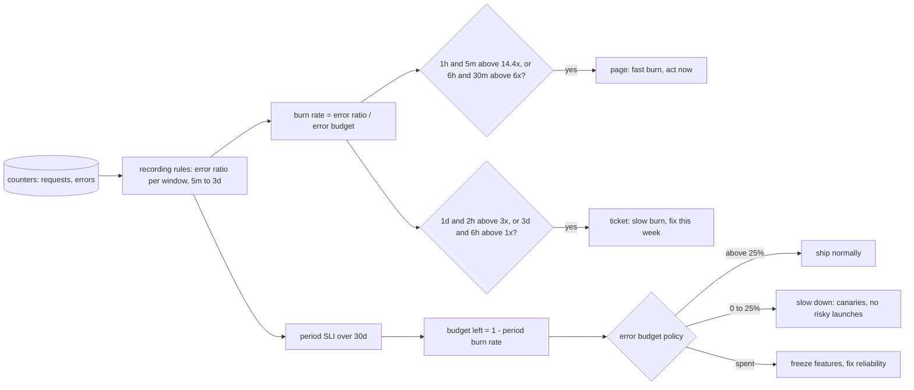

# An SLO Is an Error Budget You Spend on Purpose

*99.9% over 30 days is 43 minutes of failure. A burn rate says how fast you are spending it; two windows per alert decide who gets woken up.*

## Metadata

| Field | Value |
|---|---|
| Type | Build |
| Languages | Python |
| Prerequisites | [PromQL Is Vector Arithmetic Over Time Windows](https://cloudcaptain.io/learn/observability/promql) |
| Time | 75 minutes |
| Tools | Sloth, Prometheus, promtool, Docker, OpenSLO |

<Quiz stage="pre" />

## The Problem

The checkout team pages on `sum(rate(http_requests_total{code=~"5.."}[5m])) / sum(rate(http_requests_total[5m])) > 0.01` with `for: 5m`. On Tuesday at 03:10 it fires because a database failover fails 5% of requests for six minutes; by the time the engineer has a laptop open, the graph is flat again. It fires the same way four more times that month, always at night, always over before anyone can act, and the team starts acknowledging it from bed without looking. Meanwhile a release on the 3rd made 0.4% of checkout requests fail. That is below the 1% line, so nothing ever fires. Support tickets pile up for nine days before someone connects them to the release.

At the planning meeting the product manager asks whether the team can migrate to the new payment provider this sprint. One engineer says the service "has been pretty stable"; another remembers the night pages and says no. Neither can say how much unreliability is left, because the only numbers anyone has are a threshold someone picked years ago and a count of pages. Over those nine days the leak failed 0.4% of requests against a 99.9% objective: four times the allowed rate for nine days, 120% of the whole month's allowance. The five night blips, which woke people up five times, cost under 4% of it together.

The fix is to turn the objective into arithmetic. A 99.9% SLO over 30 days allows 0.1% of requests to fail: that is the **error budget**, about 43 minutes of total outage or a much longer stretch of partial failure. The **burn rate** is how fast you are spending it: 1x spends exactly the budget over the period, 4x spends it in a week. An alert should fire when the burn rate is high enough, for long enough, that a real fraction of the budget is at stake, and stop firing soon after the burning stops. The Google SRE workbook's answer is the multiwindow, multi-burn-rate alert: page when 2% of the budget burns in an hour or 5% in six hours, open a ticket when 10% burns in a day or three days, and require a short window to agree each time so the alert resets in minutes. You are going to build `minislo`, which reads the same SLO spec Sloth reads, writes the recording and alerting rules, replays the night blips and the slow leak through Prometheus' own `rate()` arithmetic to show which alert fires when, and turns what is left of the budget into a release decision. Then you run Sloth and `promtool` on the same spec and check that both rule sets fire at the same minute.

## The Concept

Think of a prepaid phone plan with 43 minutes a month. Nobody calls the carrier because one call ran long. You want a warning when the minutes are going fast enough to run out early: a single 10-minute call in an hour is worth a text, an afternoon of non-stop calls is worth a phone call, and you only want the warning while the spending is still going on. At the end of the month, what you have left decides whether you can afford a long call to an expensive country.

An SLO is that plan for a service. It has three parts. The **SLI** is a ratio of events: good requests over all requests, or bad over all, measured from counters. The **objective** is the share that must be good, for example 99.9%. The **window** is the period it is judged over: a rolling 30 days, or a calendar month that resets on the first. From those, everything else is arithmetic:

- **Error budget** = 1 - objective, as a share of events: 0.1% of requests. Over 30 days of full outage that is 43 minutes 12 seconds; at 1% errors it lasts three days.
- **Burn rate** = observed error ratio / error budget. An error ratio of 0.4% against a 0.1% budget is a burn rate of 4: at that pace the budget lasts 30 / 4 = 7.5 days.
- **Budget spent** over a window of length w at burn rate b = b x w / period. One hour at 14.4x spends 14.4 / 720 = 2% of a 30-day budget.

That last line is the whole alerting design. Pick how much budget may burn before someone must act, and over which window, and the burn rate threshold follows: 2% in 1 hour is 14.4x, 5% in 6 hours is 6x, 10% in 1 day is 3x, 10% in 3 days is 1x. A single window has two problems. A short one is noisy: the failover above is a 50x burn for six minutes, which a 5-minute window sees as an emergency although it costs 0.7% of the budget. A long one is slow to fire and slow to stop: a 1-hour window keeps showing that failover for most of an hour after it ended. So each alert takes two windows: the **long window** measures the damage (enough budget burnt), a **short window** of about a twelfth of it confirms the burn is still happening, and the alert fires only when both are above the same threshold. It resets as soon as the short window drops. Each severity combines two such pairs with `or`, one fast (catches sharp failures within minutes) and one slower (catches the same damage spread over hours).



In Prometheus this becomes three groups of rules. Recording rules compute the error ratio over each window the alerts need (5m, 30m, 1h, 2h, 6h, 1d, 3d) and over the whole period, so the alert expressions are cheap comparisons instead of seven `rate()` scans each. Metadata rules record the objective, the budget, the current burn rate and the budget left. Alerting rules compare the recorded ratios with `burn factor x budget`. Sloth and Pyrra generate rules of this shape from a short spec; the spec is the part a team writes and reviews. The **error budget policy** is the agreement that gives the numbers consequences: while budget is left, the team ships and takes risks on purpose; when it is gone, feature releases stop and the work goes to reliability until it recovers. Without the policy, an SLO is a dashboard.

## Build It

`code/main.py` is `minislo`, one standard-library file with seven subcommands: `validate`, `table`, `budget`, `generate`, `inspect`, `simulate` and `test-file`. It reads Sloth's `prometheus/v1` spec unchanged, so `code/fixtures/slo.yaml` goes to minislo in the tests and to `sloth generate` in the smoke test, and it also reads OpenSLO v1 SLOs (`code/fixtures/openslo.yaml`). `code/fixtures/scenarios.yaml` holds three error patterns, and `code/fixtures/sloth-rules.yaml` is the rule file Sloth v0.16.0 writes for the spec, kept for the tests; the smoke test regenerates it with the real binary.

### Step 1: the spec, and a YAML reader for it

Python's standard library has no YAML parser, and every SLO tool speaks YAML, so `main.py` carries a reader for the subset these files use: block mappings and sequences, plain, quoted and folded scalars, literal blocks (`|`, `|-`, `|+`), flow collections like `{duration: 1h, burn_rate: 20}` and several documents per file. It refuses tabs, anchors and duplicate keys with a line number. One case matters for reading Sloth's output: Go's YAML library writes a list at the same indentation as its key (`groups:` then `- name:` in the same column) and puts a mapping on the dash line. The sequence parser handles the second by rewriting the dash as spaces and parsing the rest of the line as a mapping in that column:

```python
            offset = indent + len(text) - len(rest)
            if is_item(rest) or split_key(rest) is not None:
                self.lines[self.pos] = " " * offset + rest
                items.append(self.node(offset))
                continue
```

The Sloth spec gives a service, labels for every rule, and a list of SLOs with `objective` in percent, an `sli` (`events` with `error_query` and `total_query`, or `raw` with an `error_ratio_query`) and `alerting` with a name, labels and annotations shared by the page and ticket alerts plus overrides for each. Every query carries `{{.window}}` where the range goes. The period is not in the spec: it comes from `--period` (Sloth's `--default-slo-period`, 30d). An OpenSLO `ratioMetric` with `good` and `total` becomes the error ratio `1 - (good / total)`, the same mapping Sloth uses, and a bare counter selector is wrapped into `sum(rate(SELECTOR[{{.window}}]))`.

### Step 2: the budget is exact decimal arithmetic

```python
    @property
    def budget(self) -> float:
        return float((Decimal(100) - Decimal(repr(self.objective))) / 100)
```

In binary floating point, `100 - 99.9` is `0.09999999999999432`, not `0.1`. Sloth computes in floats, so its rules say `(14.4 * 0.0009999999999999432)` in one place and `vector(1-0.9990000000000001)` in another. minislo computes the budget in decimal and writes `0.001`. The difference is in the 16th digit, which matters exactly once: when a ratio lands precisely on a threshold, the two rule sets can fire one evaluation apart (Step 10 deals with that). `minislo budget` turns event counts into a decision:

```bash
python3 code/main.py budget code/fixtures/slo.yaml --total 42000000 --bad 30000 --elapsed 9d
# SLO checkout-requests-availability: 99.9% over 30d, 9d elapsed
#   error budget     0.100% of events: 140000 bad events allowed this period
#   spent            30000 bad events = 21.4% of the budget
#   left             78.6% (110000 bad events)
#   burn rate        0.71x: exhausted in 33d (after this period ends)
#   full outage      43m12s per 30d would spend all of it
#   policy           ship: budget available: release at the normal pace ...
```

Nine days of traffic project to 140 million requests over the period, so 140,000 may fail. The burn rate is the error ratio over the budget, `(30000 / 42000000) / 0.001`, and at 0.71x the budget outlives the month.

### Step 3: the burn-rate table

```python
def burn_factor(window: AlertWindow, period: float) -> float:
    return (window.budget_percent * (period / 3600) / 100) / (window.long / 3600)
```

This is Sloth's formula, in the same order of operations so the factors are the same floats: the hours of budget the row may consume, divided by the hours in its long window. `GOOGLE_WINDOWS` holds the workbook's four rows (2% in 1h with 5m, 5% in 6h with 30m, 10% in 1d with 2h, 10% in 3d with 6h), the same catalogue Sloth embeds for 30-day and 28-day periods. A row fires after `long x threshold / error ratio` of a constant burn, which is what `TableRow.detection()` computes, and whatever the error ratio, it has spent `long x factor / period` of the budget by then, exactly the row's percentage:

```bash
python3 code/main.py table code/fixtures/slo.yaml
# SLO checkout-requests-availability: 99.9% over 30d rolling; error budget 0.100% of events = 43m12s of full outage
# severity  long short  budget   burn  error ratio  fires after (100% errors)  budget spent when it fires
# page        1h    5m      2%   14.4       1.440%                        52s                        2.0%
# page        6h   30m      5%      6       0.600%                      2m10s                        5.0%
# ticket      1d    2h     10%      3       0.300%                      4m19s                       10.0%
# ticket      3d    6h     10%      1       0.100%                      4m19s                       10.0%
python3 code/main.py table code/fixtures/openslo.yaml --slo requests-availability   # 28 days: 13.44, 5.6, 2.8, 0.9333
```

The error ratio column is also the smallest failure each row can ever see. From a clean start, a 1% error rate (10x) is too low for the fast page row and pages through the 6-hour row after 3.6 hours (`6h x 0.006 / 0.01`); 0.5% never pages and opens a ticket after 4.8 hours (`1d x 0.003 / 0.005`). If that is too slow for your users, the objective is too loose, not the alert.

### Step 4: one recording rule per window

```python
def sli_expression(slo: SLO, window: float) -> str:
    if slo.error_ratio_query:
        return f"({render_window(slo.error_ratio_query, window)})"
    return f"({render_window(slo.error_query, window)})\n/\n({render_window(slo.total_query, window)})\n"
```

`render_window()` replaces `{{.window}}` with the window in Prometheus' own duration format, which writes weeks and years only when they divide exactly: 30 days is `30d`, 28 days is `4w`, so a 28-day SLO records `slo:sli_error:ratio_rate4w`. Each rule is named `slo:sli_error:ratio_rate<window>`, the convention Sloth uses (`level:metric:operations` from the Prometheus recording rule guidelines), and carries `sloth_id`, `sloth_service`, `sloth_slo`, `sloth_window` and the spec's labels. Keeping Sloth's names means dashboards built for Sloth work on minislo's rules, and the two rule sets can be compared series by series.

### Step 5: the period, averaged from the short window

The 30-day ratio could be one more `rate(...[30d])`, but that reads 30 days of raw samples of every matching series at every evaluation. Sloth's default, which minislo copies, averages the 5-minute ratio it already records:

```python
def period_expression(slo: SLO, short: float) -> str:
    selector = f"{SLI_METRIC}{prom_duration(short)}{label_selector(slo.id_labels())}"
    period = prom_duration(slo.period)
    return f"sum_over_time({selector}[{period}])\n/ ignoring ({WINDOW_LABEL})\ncount_over_time({selector}[{period}])\n"
```

That is cheap and close, but it is an average of ratios, so a quiet hour counts as much as a busy one: 12 hours at 0.05% errors with 10,000 requests a minute followed by 12 hours at 0.4% with 1,000 requests a minute averages to 0.225%, while the true ratio of bad to total requests is 0.082% (`test_the_optimized_period_ratio_weights_quiet_hours_like_busy_ones`). `--no-optimize` uses the raw queries instead, like Sloth's `disableOptimized`. The metadata group then records `slo:objective:ratio`, `slo:error_budget:ratio`, `slo:time_period:days`, `slo:current_burn_rate:ratio` (5m ratio over the budget), `slo:period_burn_rate:ratio` and `slo:period_error_budget_remaining:ratio`, which is `1 - period burn rate`. Read that last one carefully: it is budget left only when Prometheus holds a full period of data. On a service with three days of history at 0.5x it says 50% left, because it projects the burn rate over the data it has; the event count says 95%.

### Step 6: two windows with `and`, two speeds with `or`

```python
def alert_expression(slo: SLO, quick: TableRow, slow: TableRow) -> str:
    ids = label_selector(slo.id_labels())

    def burning(window: float, row: TableRow) -> str:
        return f"max without ({WINDOW_LABEL}) ({SLI_METRIC}{prom_duration(window)}{ids} > {row.threshold_text})"

    return (f"(\n  {burning(quick.short, quick)}\n  and\n  {burning(quick.long, quick)}\n)\nor\n"
            f"(\n  {burning(slow.short, slow)}\n  and\n  {burning(slow.long, slow)}\n)\n")
```

The comparison filters each recorded series; `max without (sloth_window)` removes the only label that differs between the 5m and the 1h series, so `and` can match them; `or` merges the fast and slow pair into one alert. The result keeps the SLO's labels, so the alert arrives in Alertmanager with `sloth_service`, `sloth_slo` and the spec's labels, plus the rule's `sloth_severity: page` or `ticket` and the spec's `alerting.labels`. There is no `for:`: the long window already is the duration requirement, and a `for` on top would only delay the page. The default annotations are Sloth's (`(page) {{$labels.sloth_service}} {{$labels.sloth_slo}} SLO error budget burn rate is too fast.`), overridden by the spec's.

### Step 7: Prometheus' `rate()`, sample by sample

To predict when those alerts fire, the simulator must compute what Prometheus computes, including its quirks. `extrapolated_rate()` is a port of `extrapolatedRate()` in the Prometheus source:

```python
def extrapolated_rate(series: Counter, at: float, window: float) -> Optional[float]:
    start = at - window
    first = bisect_right(series.times, start)
    last = bisect_right(series.times, at) - 1
    if last - first < 1:
        return None
    first_t, last_t, first_v = series.times[first], series.times[last], series.values[first]
    delta = series.values[last] - first_v + series.resets[last] - series.resets[first]
    sampled = last_t - first_t
    average = sampled / (last - first)
    to_start, to_end = first_t - start, at - last_t
    if to_start >= average * 1.1:
        to_start = average / 2
    if delta > 0 and first_v >= 0:
        to_start = min(to_start, sampled * (first_v / delta))
    if to_end >= average * 1.1:
        to_end = average / 2
    factor = (sampled + to_start + to_end) / sampled
    factor /= window
    return delta * factor
```

The range is left-open, as in Prometheus 3: a sample exactly at `at - window` is outside it (`bisect_right` on the start). A counter that drops is treated as restarted from zero (`resets` is a running sum of the values before each drop). The increase is extrapolated to the edges of the range when the samples come close to them, by half a sample interval when they do not, and never back past the point where the counter would have been zero. In a ratio of two counters scraped at the same moments the extrapolation factors are usually equal and cancel, so the error ratio over a window is the bad increments over the total increments in it; near the start of a series the zero-point rule can shorten one side and not the other.

### Step 8: the simulator

A scenario is a list of phases (`{duration: 1h, burn_rate: 20}` or an `error_ratio`, optionally with its own `events` per interval). `build_counters()` turns it into a good and a bad counter sampled every interval, carrying fractions of a bad event forward so the counters stay whole numbers. `simulate()` then evaluates every interval the way the rule groups do: every window's ratio, the recorded 5-minute ratio, the period ratio averaged from it, and each row of the table:

```python
        for row in rows:
            low, high = ratios[row.short], ratios[row.long]
            margin = min(margin, condition_margin(low, row.threshold), condition_margin(high, row.threshold))
            if slo.alert(row.severity) and low is not None and high is not None and low > row.threshold and high > row.threshold:
                firing[row.severity].append(row.speed)
```

Alongside the rules' view it counts events: the bad and total events in the window (since the first of the month for a calendar SLO), scaled to the whole period, which is the honest "budget left". `margin` is how close any window is to its threshold, for Step 10. Every change of the firing set becomes a transition with the burn rate per window at that minute.

### Step 9: the budget policy

```python
def decide(remaining: Optional[float], page_firing: bool, policy: Sequence[PolicyLevel] = DEFAULT_POLICY) -> Tuple[str, str]:
    if page_firing:
        return "incident", INCIDENT
    for level in sorted(policy, key=lambda item: item.max_remaining):
        if remaining is not None and remaining <= level.max_remaining:
            return level.action, level.rule
    return "ship", SHIP
```

The default levels follow the workbook's example policy: at or below zero, `freeze` (only reliability fixes and security patches ship), up to 25% left, `slow down` (no risky launches, every release as a canary), otherwise `ship`. A firing page overrides everything: mitigate first. `--policy FILE` replaces the levels with your own `{max_remaining, action, rule}` list, and `minislo budget` exits 1 for `freeze` and `incident`, so a deploy pipeline step can gate on it.

### Step 10: a promtool test whose expectations come from the simulator

`promtool test rules` loads input series, evaluates a rule file on a fake clock and compares the firing alerts and query results at chosen times with what you expect. `minislo test-file` writes that file from a simulation: the two counters in promtool's `a+bxn` notation (`0+5x4320 21800+200x59 33605+5x119` is 3 days at 5 bad requests a minute, an hour at 200, two hours at 5), every rule group in `group_eval_order`, an `alert_rule_test` every 30 minutes and on both sides of every transition with the exact labels and annotations the alert will carry, and value checks for the recording rules. promtool compares floats exactly, so a value check asks for a count instead:

```python
def value_check(metric: str, selector: Dict[str, str], value: float, t: float) -> Dict[str, Any]:
    tolerance = 1e-9 + 1e-6 * abs(value)
    offset = f"- {value!r}" if value >= 0 else f"+ {-value!r}"
    return {"expr": f"count(abs({metric}{label_selector(selector)} {offset}) <= {tolerance!r})", "eval_time": prom_duration(t), "exp_samples": [{"labels": "{}", "value": 1}]}
```

Two details come from reading promtool's source. It evaluates rule groups in Go map order unless `group_eval_order` is set, so without it the alert group sometimes reads the previous minute's recordings and fires a minute late at random. And checkpoints where any window sits within one part in a million of its threshold are left out, because there a float rounding difference decides the minute:

```python
def checkpoints(sim: Simulation, every: float) -> Tuple[List[Evaluation], int]:
    wanted = {t for t in sim.good.times if t > 0 and round(t / every, 9) % 1 == 0}
    for change in sim.transitions:
        wanted |= {change["t"], change["t"] - sim.scenario.interval}
    chosen = [e for e in sim.evaluations if e.t in wanted and e.t > 0]
    clear = [e for e in chosen if e.margin >= AMBIGUOUS]
    return clear, len(chosen) - len(clear)
```

Such ties are not hypothetical. A 4x slow burn after three days at 0.5x puts the 3-day window at exactly 0.1% at 3d10h17m: the range then holds 4319 one-minute increases, 617 of them with 40 bad requests and 3702 with 5, exactly 10 in 10,000 on average; Sloth's threshold is 0.0009999999999999432 and minislo's is 0.001. The fixture's slow burn is 5x for that reason, and `test_checkpoints_on_an_exact_threshold_tie_are_skipped` keeps the 4x case.

### Step 11: run it

```bash
F=code/fixtures
python3 code/main.py validate $F/slo.yaml
python3 code/main.py validate $F/openslo.yaml        # 28d rolling availability, calendar-month latency
python3 code/main.py generate $F/slo.yaml -o minislo-rules.yaml
python3 code/main.py inspect minislo-rules.yaml
# alert CheckoutAvailabilityBudgetBurn [page] for 0s: 1h+5m > 0.0144 (14.4x); 6h+30m > 0.006 (6x)
# alert CheckoutAvailabilityBudgetBurn [ticket] for 0s: 1d+2h > 0.003 (3x); 3d+6h > 0.001 (1x)
python3 code/main.py simulate $F/slo.yaml --scenarios $F/scenarios.yaml
# fast-burn: 3d at 0.5x, 1h at 20x, 2h at 0.5x; 10000 events per 1m; ...
#      time  alert                      5m    30m     1h     2h     6h     1d     3d   budget left
#     3d43m  page fires (quick)      20.0x  20.0x  14.7x   7.5x   2.8x   1.1x   0.7x   93.0%
#    3d1h2m  page resolves (quick)   10.2x  18.7x  19.3x  10.3x   3.8x   1.3x   0.8x   92.2%
# slow-burn: 3d at 0.5x, 18h at 5x; ...
#      3d8h  ticket fires (slow)      5.0x   5.0x   5.0x   5.0x   5.0x   2.0x   1.0x   89.4%
# no-burn: 1d at 0.5x; ...  no alert fired
python3 code/main.py test-file $F/slo.yaml --scenarios $F/scenarios.yaml --rules minislo-rules.yaml -o minislo-test.yaml
```

Read the fast burn: 2% errors start at 3d0h00m; the 5-minute window passes 14.4x within four minutes, but the 1-hour window needs 43 minutes of 20x to pass 14.4x, by which time the burst has spent 2% of the budget, the row's share. When the rollback lands at 3d1h, the page clears two minutes later, although the 1-hour window is still near its peak: the short window did its job. The ticket never fires: one hour at 20x is less than 10% of the budget. The slow burn is the opposite: it never pages (5x is below 6x), and the ticket opens after 8 hours, when the 3-day window crosses 1x. Exit codes are 0 for success, 1 when `budget` says releases must stop, and 2 for input it cannot use.

<RunTests />

## Use It

[Sloth](https://github.com/slok/sloth) is the generator minislo imitates: the same spec, the same rule names, plus a Kubernetes controller and, since v0.16.0, a UI. It is a single static binary; the smoke test pins v0.16.0 and checks it against the release's `checksums.txt`:

```bash
V=v0.16.0
curl -fsSLO https://github.com/slok/sloth/releases/download/$V/sloth-linux-amd64
curl -fsSLO https://github.com/slok/sloth/releases/download/$V/checksums.txt
grep ' sloth-linux-amd64$' checksums.txt | sha256sum -c -
chmod +x sloth-linux-amd64 && sudo mv sloth-linux-amd64 /usr/local/bin/sloth
sloth version
sloth validate -i code/fixtures/slo.yaml
sloth generate -i code/fixtures/slo.yaml -o sloth-rules.yaml
python3 code/main.py inspect sloth-rules.yaml
# alert CheckoutAvailabilityBudgetBurn [page] for 0s: 1h+5m > 0.0144 (14.4x); 6h+30m > 0.006 (6x)
```

The file has the same three groups, the same 14 recordings plus `sloth_slo_info` (version, mode and objective as labels, for dashboards), and the same two alerts written as `max(slo:sli_error:ratio_rate5m{...} > (14.4 * 0.0009999999999999432)) without (sloth_window)`. `sloth generate` takes `--default-slo-period 28d`, `--extra-labels key=value` (minislo's `-l`), `--disable-alerts`, `--disable-recordings` and a directory as input. Only periods with a window catalogue are accepted (28d and 30d are built in); `--slo-period-windows-path` loads your own `AlertWindows` files with other percentages or periods.

Check the rules and run the tests with promtool from the Prometheus image (<ToolVersion name="prometheus" />; the smoke test pins v3.15.1). The image runs as `nobody`, so pass your own user to read the mounted files:

```bash
P="docker run --rm --user $(id -u):$(id -g) -v $PWD:/work -w /work --entrypoint /bin/promtool prom/prometheus:v3.15.1"
$P check rules sloth-rules.yaml minislo-rules.yaml          # SUCCESS: 17 rules found / 16 rules found
python3 code/main.py test-file code/fixtures/slo.yaml --scenarios code/fixtures/scenarios.yaml --rules sloth-rules.yaml -o sloth-test.yaml
$P test rules sloth-test.yaml minislo-test.yaml             # both SUCCESS: same alerts, same minutes, same values
sed -i 's/(14.4 \*/(28.8 */' sloth-rules.yaml && $P test rules sloth-test.yaml   # FAILED: alertname ... time: 3d43m
```

A unit test for one alert, written by hand, is short. The test file minislo writes is the same shape, repeated:

```yaml
rule_files: [sloth-rules.yaml]
evaluation_interval: 1m
group_eval_order:
  - sloth-slo-sli-recordings-checkout-requests-availability
  - sloth-slo-meta-recordings-checkout-requests-availability
  - sloth-slo-alerts-checkout-requests-availability
tests:
  - interval: 1m
    input_series:
      - series: 'http_requests_total{job="checkout",code="200"}'
        values: '0+9995x4320 43188200+9800x59 43776395+9995x119'
      - series: 'http_requests_total{job="checkout",code="500"}'
        values: '0+5x4320 21800+200x59 33605+5x119'
    alert_rule_test:
      - eval_time: 3d42m
        alertname: CheckoutAvailabilityBudgetBurn
        exp_alerts: []
      - eval_time: 3d43m
        alertname: CheckoutAvailabilityBudgetBurn
        exp_alerts:
          - exp_labels: {sloth_severity: page, severity: critical, team: payments, owner: payments, tier: "1",
                         sloth_id: checkout-requests-availability, sloth_service: checkout, sloth_slo: requests-availability}
            exp_annotations:
              title: (page) checkout requests-availability SLO error budget burn rate is too fast.
              summary: Checkout is spending its availability error budget too fast
              runbook_url: https://runbooks.example.com/checkout/availability
```

In a real Prometheus the generated file goes into `rule_files`, and the alerts route on `sloth_severity` in Alertmanager, as in the alerting lesson:

```yaml
# prometheus.yml
rule_files: [/etc/prometheus/rules/*.yaml]
alerting:
  alertmanagers: [{static_configs: [{targets: ["alertmanager:9093"]}]}]
---
# alertmanager.yml
route:
  receiver: slo-tickets
  group_by: [alertname, sloth_id, sloth_severity]
  routes:
    - matchers: ['sloth_severity="page"']
      receiver: payments-pager
```

```bash
curl -s localhost:9090/api/v1/rules?type=alert | python3 -m json.tool | grep -E '"name"|"state"'
curl -sG localhost:9090/api/v1/query --data-urlencode 'query=slo:period_error_budget_remaining:ratio' | python3 -m json.tool
curl -sG localhost:9090/api/v1/query --data-urlencode 'query=ALERTS{sloth_severity="page", alertstate="firing"}'
```

On Kubernetes, the spec becomes a `PrometheusServiceLevel` object (`apiVersion: sloth.slok.dev/v1`, same fields under `spec`) and `sloth kubernetes-controller` turns each one into a Prometheus Operator `PrometheusRule`; `sloth server` serves the UI with budgets and burn charts from your Prometheus. [Pyrra](https://github.com/pyrra-dev/pyrra) is the other open-source generator: a `ServiceLevelObjective` object (`apiVersion: pyrra.dev/v1alpha1`) with `target: "99.9"`, `window: 4w` and `indicator.ratio.errors.metric` and `total.metric` given as plain counter selectors (Pyrra writes the `rate()`). It scales its burn-rate windows with the SLO window, records `<metric>:burnrate<window>` and `<metric>:increase<window>` instead of Sloth's names, runs as a Kubernetes operator or reads files, and has its own UI.

[OpenSLO](https://openslo.com/) is the vendor-neutral format: `apiVersion: openslo/v1`, `kind: SLO` with `spec.indicator.spec.ratioMetric` (`good` or `bad` over `total`), `timeWindow` (`duration: 28d, isRolling: true`, or `duration: 1M` with a `calendar` start), `budgetingMethod` and `objectives[].target`. `code/fixtures/openslo.yaml` is the checkout SLO in that form; minislo reads it, while Sloth v0.16.0 reads the older `openslo/v1alpha` dialect. `Occurrences` budgets count events, which is what burn-rate alerts need; `Timeslices` judges each minute good or bad instead, so a quiet night weighs as much as a busy day, and burn rates over events no longer describe it.

**Choosing SLIs that users feel.** Measure where the user's request is answered or lost: the load balancer, the ingress or API gateway, or the client, rather than one pod's own counter, which cannot see the requests that never reached it. Count 5xx (and usually 429) as bad, not 4xx, which are the caller's mistakes. Leave health checks and synthetic traffic out of `total`, or a quiet hour of probes dilutes a real outage. Latency becomes an event ratio by counting requests faster than a threshold, which requires a histogram bucket exactly at that threshold:

```yaml
  - name: "requests-latency"
    objective: 99
    sli:
      events:
        error_query: |
          sum(rate(http_request_duration_seconds_count{job="checkout"}[{{.window}}]))
          - sum(rate(http_request_duration_seconds_bucket{job="checkout",le="0.3"}[{{.window}}]))
        total_query: sum(rate(http_request_duration_seconds_count{job="checkout"}[{{.window}}]))
```

A service with little traffic breaks the arithmetic: at 20 requests an hour, one failure is a 5% error ratio, 50x on a 99.9% SLO, and pages on its own. Use longer windows, add synthetic requests at a known rate, or group several low-traffic endpoints under one SLO. The empty-numerator trap from the progressive delivery lesson applies too: when no 5xx series exists yet, `sum(rate(...{code=~"5.."}[5m]))` is empty, so the ratio is empty, not 0, and dashboards show gaps until the first error.

| What you built | Real tool | Note |
|---|---|---|
| `load_slos()`, `from_sloth()`, `from_openslo()` | Sloth `prometheus/v1` spec, OpenSLO v1, Sloth's `PrometheusServiceLevel` CRD | Sloth reads `openslo/v1alpha`; minislo reads both OpenSLO versions |
| `SLO.budget` in decimal | Sloth's float arithmetic | `0.001` against `0.0009999999999999432`: the same rules except at an exact tie |
| `burn_factor()`, `alert_table()` | the SRE workbook's table, Sloth's `AlertWindows` catalogue | `--slo-period-windows-path` for other percentages or periods |
| `sli_expression()`, `prom_duration()` | `slo:sli_error:ratio_rate<window>` recordings | 28 days is `4w` in both |
| `period_expression()` | Sloth's optimized period SLI, `disableOptimized` | an average of ratios; Pyrra records an increase over the window instead |
| metadata recordings | `slo:period_error_budget_remaining:ratio` and friends, `sloth_slo_info` | budget left only once a full period of data exists |
| `alert_expression()` | Sloth's page and ticket alerts, Pyrra's burn-rate alerts | one alert name, two severities, no `for` |
| `extrapolated_rate()`, `simulate()` | Prometheus `rate()`, the rule manager | left-open ranges, extrapolation, sequential rule evaluation |
| `decide()`, `minislo budget` exit code | your error budget policy | the policy is a human agreement; the tool only applies it |
| `minislo test-file` | `promtool test rules`, `group_eval_order` | expectations from the simulator, ties skipped |
| `minislo inspect` | `promtool check rules`, reading a generated file | recovers windows, thresholds and burn factors from any rule file |

<Quiz stage="check" />

## Ship It

Two artifacts in `outputs/`:

- **`skill-slo-design.md`**: a runbook for designing or reviewing an SLO with a team: pick the user journey and where to measure it, write the SLI as an event ratio, choose the objective from the last month's data and the window, compute the budget and the burn-rate table, generate and test the rules with Sloth or minislo and promtool, route page and ticket in Alertmanager, and write down the error budget policy, with a decision table for the common review findings and a fixed report.
- **`prompt-explain-burn-rate.md`**: paste an SLO (objective, window) and the burn rate or error ratio per window, or a firing burn-rate alert with its labels, and get back what fired and why, how much budget is gone, when it runs out at this pace, what to do now, and which numbers would have been needed to page or not page.

<ShipIt />

## Exercises

### Easy

Add `--exhausted-alert` to `generate`: a third alert, `<name>BudgetExhausted`, that fires when `slo:period_error_budget_remaining:ratio` is at or below zero for 5 minutes, with `sloth_severity: ticket` and an annotation that names the policy action. Sloth ships the same idea as the contrib plugin `error_budget_exhausted_alert_v1`. Write the tests first: the rule exists only with the flag, its expression selects the SLO by `sloth_id`, `minislo inspect` lists it, and `test-file` predicts it firing in the slow-burn scenario at the first evaluation where the simulator's rules-based budget goes negative.

### Medium

Read Sloth's `AlertWindows` files (`apiVersion: sloth.slok.dev/v1`, `kind: AlertWindows`, `spec.sloPeriod`, `page.quick` and so on with `errorBudgetPercent`, `shortWindow`, `longWindow`) with `--windows FILE`, and use them in `table`, `generate`, `simulate` and `test-file` instead of `GOOGLE_WINDOWS`. Reject a file whose `sloPeriod` differs from the SLO's period, as Sloth does. Tests first: a 7-day catalogue gives the factors you compute by hand, the windows show up in the recording rule names, and the fast-burn page fires at a different minute that you derive from `detection()`.

### Hard

Add a latency SLI to the simulator. A phase gets a `slow_ratio`; `build_counters()` produces `http_request_duration_seconds_count` and a `_bucket{le="0.3"}` counter instead of good and bad; and the simulated error ratio becomes `(count - bucket) / count`, each side through `extrapolated_rate()`. Then make `test-file` emit those series for an SLO whose queries use them (`openslo.yaml`'s latency SLO, with its calendar month approximated by 30 days). Prove it with a test that a phase with 10% slow requests pages a 99% latency SLO after the number of minutes `detection()` predicts, and run the generated file through `promtool test rules` by hand.

<Quiz stage="post" />

## Key Terms

| Term | Common misconception | Precise definition |
|---|---|---|
| SLI | "A metric on a dashboard, like CPU or p99 latency." | A ratio of events: good (or bad) events over all valid events, measured as close to the user as possible, for example requests answered without a 5xx over all requests. |
| SLO | "A promise to customers." | An internal objective for an SLI over a window, such as 99.9% over a rolling 30 days. A promise with penalties is an SLA, which should be looser than the SLO. |
| Error budget | "Downtime we are allowed per month." | 1 - objective, as a share of events in the window: 0.1% of requests for 99.9%. It is 43 minutes only if the service fails completely; at 1% errors it lasts three days. |
| Burn rate | "The error rate." | The observed error ratio divided by the error budget. 1x spends exactly the budget over the period; at b x the budget lasts period / b. |
| Multiwindow alert | "Two alerts on the same metric." | One condition over two windows of the same burn rate: the long window proves enough budget is gone, the short one (about a twelfth of it) proves it is still burning, so the alert resets within minutes. |
| Multi-burn-rate | "Several thresholds for warning and critical." | Two or more window pairs per severity joined with `or`, each sized so that it fires after spending the same share of budget: 14.4x over 1h and 6x over 6h for a page, 3x over 1d and 1x over 3d for a ticket. |
| `slo:period_error_budget_remaining:ratio` | "The budget left this month." | Sloth's recording of 1 - (period error ratio / budget). It equals budget left once Prometheus holds a full period of data; with less, it projects the current burn rate over the window. |
| Error budget policy | "We stop deploying when the SLO is breached." | A written agreement on what changes when the budget is low or gone (freeze features, prioritise reliability, require canaries) and what does not, signed by the people who own the releases. |
| `group_eval_order` | "promtool evaluates rule files top to bottom." | The promtool test setting that fixes the order rule groups are evaluated in at each step; without it the order comes from a Go map, and alerts that read recordings can fire one evaluation late at random. |

## Further Reading

- [SRE Practices](https://cloudcaptain.io/docs/learning-paths/sre-practices): SLIs, SLOs, SLAs, error budgets and budget policies in the Reference layer, with the incident and postmortem practices around them.
- [Observability and SRE](https://cloudcaptain.io/docs/tools/observability): the tools this phase builds on, and where SLOs sit among metrics, logs and traces.
- [SRE learning path](https://cloudcaptain.io/docs/learning-paths/sre): what to learn after this lesson, in order.
- [Google SRE Workbook: Alerting on SLOs](https://sre.google/workbook/alerting-on-slos/): the six alerting strategies the multiwindow, multi-burn-rate design is the last of, with the table this lesson implements.
- [Google SRE Workbook: Implementing SLOs](https://sre.google/workbook/implementing-slos/): choosing SLIs, where to measure them and how to pick the objective.
- [Google SRE Workbook: Example Error Budget Policy](https://sre.google/workbook/error-budget-policy/): the policy the default levels in `decide()` follow.
- [Google SRE Book: Service Level Objectives](https://sre.google/sre-book/service-level-objectives/): the original definitions and why 100% is the wrong target.
- [Sloth documentation](https://sloth.dev/): the spec, the CLI, the Kubernetes controller, plugins and the alert window catalogue.
- [Sloth source: alert and SLI rule generators](https://github.com/slok/sloth/tree/main/internal/plugin/slo/core): the Go templates the fixture rule file and minislo's names come from.
- [Pyrra](https://github.com/pyrra-dev/pyrra): the other open-source SLO generator, with scaled windows and a UI.
- [OpenSLO specification](https://openslo.com/specification/): `SLO`, `SLI`, `ratioMetric`, time windows and budgeting methods.
- [Prometheus: unit testing for rules](https://prometheus.io/docs/prometheus/latest/configuration/unit_testing_rules/): the test file format `minislo test-file` writes, including `group_eval_order` and the series notation.
- [Prometheus: recording rules](https://prometheus.io/docs/prometheus/latest/configuration/recording_rules/) and [naming best practices for rules](https://prometheus.io/docs/practices/rules/): the `level:metric:operations` convention and why ratios are recorded, not averaged.
- [Prometheus query functions: rate()](https://prometheus.io/docs/prometheus/latest/querying/functions/#rate): extrapolation and counter resets, which Step 7 ports.
