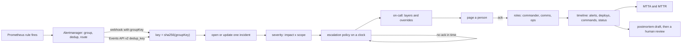

# An Incident Is a Timeline, a Severity and Roles

*An alert wakes a person; an incident gives the response a key, a severity, named roles and a timeline that MTTA, MTTR and the review read.*

## Metadata

| Field | Value |
|---|---|
| Type | Build |
| Languages | Python |
| Prerequisites | [An Alert Is a Query With a Clock and a Router](https://cloudcaptain.io/learn/observability/alerting) |
| Time | 75 minutes |
| Tools | alertmanager, amtool, docker, curl |

<Quiz stage="pre" />

## The Problem

Saturday, 03:12. `CheckoutHighErrorRate` fires. Alertmanager sends it to a Slack channel and, through a phone bridge, to whoever the spreadsheet says is on call. The spreadsheet is a week out of date, so the phone rings for an engineer who swapped shifts and is on a train. Nobody acknowledges anything because nothing asks anyone to. At 03:31 a customer-support lead, woken by angry messages, posts in the channel. Three engineers join. One restarts the checkout pods, one starts a rollback, the third opens the cloud console to look at the database. The restart and the rollback race each other. Nobody tells support what to say, and the status page still says "All systems operational" when the error rate falls at 04:05.

Over the weekend the alert flaps. Every time it fires again Alertmanager sends a fresh notification, and every notification creates a new ticket in the tracker: three tickets for one outage by Monday. In the review nobody can say when users were first affected, when someone took charge, who decided to roll back, or why the first page went unanswered. The time to recovery in the quarterly report is a guess. The postmortem says "human error during deploy" and lists one action item: "be more careful". The same flag misconfiguration takes checkout down again three weeks later.

Every one of those failures is a missing piece of state. There was no key that tied the repeats to one incident, no severity that said who must be woken and how often customers must hear from you, no schedule that knew about the swap, no clock that escalated an unanswered page, no named commander, and no timeline to compute MTTA and MTTR or to write the review from. You are going to build `miniincident`: an incident service that receives Alertmanager's webhook and PagerDuty-style events, opens one incident per group key, pages from layered on-call schedules, escalates on a clock, records every alert, page, acknowledgement, role change, deploy, command and status update, computes MTTA and MTTR, and drafts a blameless postmortem from the timeline. Then you point a real Alertmanager at it.

## The Concept

Think of an emergency dispatch centre. A call comes in (the alert). Dispatch decides whether it is the same fire as the call two minutes ago (the key), how big it is (the severity), and who goes (the on-call rota and its escalation if the first crew does not answer). On scene one person is in command; they do not hold a hose. Someone talks to the press. Everything is written in a log with times, and the inquiry afterwards reads the log, not people's memories.

**The key.** Alertmanager groups alerts by `group_by` labels and names each group with a **group key**: the route path plus the group labels, for example `{}:{alertname="CheckoutHighErrorRate", service="checkout"}`. Every notification for that group carries the same key, whether it is the first one, an update with a new alert, a repeat after `repeat_interval` or the final resolve. An incident tool deduplicates on that key. Alertmanager's PagerDuty integration sends `dedup_key = sha256(groupKey)`, so the webhook and the Events API v2 agree on identity without talking to each other.

**The severity** is a contract, not a feeling. A matrix of impact (outage, degraded, minor) against scope (all, many, few users) gives `SEV1` to `SEV4`, and each level says whether to page, which roles must be filled, how often the status page must be updated and whether a postmortem is required. Alerts propose a severity (from a `severity` label or `impact` and `scope` labels); the commander can change it, and the change goes in the timeline.

**The roles.** The **incident commander** owns the incident: decides, delegates and keeps the timeline honest, and does not debug. **Comms** writes the status page and talks to support and stakeholders. **Ops** works the problem. Roles are handed over explicitly ("commander: frank to alice"), never by drifting away.

**On call** is computed, not looked up. A schedule is a stack of **layers**, each a rotation of people with a handoff time and optional restrictions (08:00 to 16:00 UTC). A higher layer wins where it has coverage, and **overrides** beat every layer. Three layers restricted to eight hours each are a follow-the-sun schedule. An **escalation policy** pages level 1, waits, pages level 2, and so on, until someone acknowledges.

**The timeline** is the product. Each entry has a time, a kind, a source and text. MTTA (time to acknowledge) is acknowledgement minus open, MTTR (time to resolve) is resolve minus open, and time to detect is open minus the first alert's `startsAt`. The postmortem draft is the timeline plus questions; the contributing factors and action items are for people.



The clock deserves a sentence. Escalation is "if nobody acknowledged by T, page the next level". Make the clock an argument and the same code serves a real server (wall time, a ticker every second) and a simulation (a virtual clock you move by hand), and every page lands exactly when the policy says, which is what makes MTTA testable.

## Build It

`code/main.py` is `miniincident`, about 1,300 lines of standard library. Everything takes `now` as an argument; the HTTP server and the `replay` command only decide where `now` comes from. `code/fixtures/config.json` holds four severities, the matrix, three schedules (a follow-the-sun primary with an override, a weekly secondary, a daily search rotation) and two escalation policies; `code/fixtures/scenario.json` is a scripted checkout outage with real Alertmanager payloads.

### Step 1: the webhook and its key

Alertmanager's webhook body (version 4) is one group:

```json
{
  "version": "4",
  "groupKey": "{}:{alertname=\"CheckoutHighErrorRate\", service=\"checkout\"}",
  "status": "firing",
  "receiver": "miniincident",
  "groupLabels": {"alertname": "CheckoutHighErrorRate", "service": "checkout"},
  "commonLabels": {"alertname": "CheckoutHighErrorRate", "service": "checkout", "severity": "critical"},
  "commonAnnotations": {"summary": "Checkout error rate above 5%"},
  "alerts": [{"status": "firing", "labels": {"instance": "checkout-7d9f-a"}, "startsAt": "2026-11-02T09:58:00Z",
              "endsAt": "0001-01-01T00:00:00Z", "fingerprint": "3f1c9a7e52b0d461"}]
}
```

(The alert's labels are cut short here; the fixture carries all of them.) The group key is the route's matcher path, a colon, and the group labels sorted by name, each value quoted. Firing alerts carry Go's zero time as `endsAt`, which `parse_time()` turns into `None`. The incident key is the SHA-256 of the group key, the same value Alertmanager's PagerDuty integration sends as `dedup_key`:

```python
def labelset(labels: Dict[str, Any]) -> str:
    return "{" + ", ".join(f"{name}={json.dumps(str(labels[name]), ensure_ascii=False)}" for name in sorted(labels)) + "}"


def group_key(route_key: str, group_labels: Dict[str, Any]) -> str:
    return f"{route_key}:{labelset(group_labels)}"


def dedup_key(key: str) -> str:
    return hashlib.sha256(key.encode("utf-8")).hexdigest()
```

A nested route adds its matchers to the path: `{}/{team="payments"}:{alertname="X"}`. Two sibling routes with different matchers and `continue: true` that both match an alert therefore produce two group keys and, in any tool that dedups on the key, two incidents; that is usually a configuration bug, not a feature.

### Step 2: open, update, repeat, resolve

```python
key = dedup_key(payload["groupKey"])
incident = self.active(key)
labels = {**(payload.get("groupLabels") or {}), **(payload.get("commonLabels") or {})}
if incident is None:
    if payload.get("status") == "resolved":
        self.unmatched.append({"at": now, "groupKey": payload["groupKey"], "status": "resolved"})
        return {"action": "ignored", "reason": "resolved notification for a group with no open incident", "key": key}
```

`active()` returns the newest incident with that key that is not resolved. No incident means open one, with a title from the `summary` annotation and a severity from the labels. An existing one is updated: `merge_alerts()` compares each alert by fingerprint and records new alerts (`alert.added`) and per-alert resolves; a notification that changes nothing is a **repeat**, counted but kept out of the timeline. When the whole group is `resolved`, the resolve time is the latest `endsAt`, not the arrival time, because the notification arrives up to one `group_interval` after recovery:

```python
if payload.get("status") == "resolved" and incident.status != "resolved":
    ends = [a.get("endsAt") for a in incident.alerts.values() if a.get("endsAt") is not None]
    at = min(max(ends), now) if ends else now
    self.resolve(incident, max(at, incident.opened_at), "alertmanager", "every alert in the group resolved")
```

A group that fires again after its incident resolved gets a **new** incident with the same key (PagerDuty does the same), linked to the old one with a "flapping or not fixed?" entry when it is within `reopen_window`. `receive_pagerduty()` accepts the Events API v2 shape (`routing_key`, `event_action` of `trigger`, `acknowledge` or `resolve`, `dedup_key`, and a `payload` with `summary`, `source` and `severity`) and lands on the same incidents, because the keys are equal.

### Step 3: the severity matrix is a response contract

```python
def classify(config: Config, impact: str, scope: str) -> str:
    if impact not in config.impacts or scope not in config.scopes:
        raise InputError(f"impact must be one of {', '.join(config.impacts)} and scope one of {', '.join(config.scopes)}; got {impact!r}, {scope!r}")
    return config.matrix[impact][scope]


def severity_from_labels(config: Config, labels: Dict[str, Any]) -> Tuple[str, str]:
    impact, scope = labels.get("impact"), labels.get("scope")
    if impact in config.impacts and scope in config.scopes:
        return classify(config, impact, scope), f"matrix impact={impact} scope={scope}"
    label = str(labels.get("severity", ""))
    if label in config.alert_severity:
        return config.alert_severity[label], f"alert severity {label}"
    return config.default_severity, "default"
```

Each severity in the config carries its contract, and `warnings()` checks an open incident against it: missing roles, a commander who also holds another role at `SEV1`, a status page update that is overdue:

```bash
python3 code/main.py severity --config code/fixtures/config.json --impact outage --scope many
# SEV1 (matrix impact=outage scope=many): Critical: a core user journey is down for many users, or data loss, or a security breach
#   page: yes; roles: commander, comms, ops; public update every 30m 00s; component major_outage; postmortem required
python3 code/main.py severity --config code/fixtures/config.json --label severity=warning
# SEV3 (alert severity warning): ...  page: no; roles: ops; no status page cadence; ...
```

`SEV3` and `SEV4` open an incident without paging anyone: a warning at 03:00 is a ticket for the morning, and paging for it is how alert fatigue starts. If the commander raises such an incident to a paging severity, paging starts at that moment.

### Step 4: who is on call

A layer answers only inside its restrictions, and its rotation counts whole shifts from its anchor, also through restricted hours, which is how PagerDuty rotations behave:

```python
def layer_user(layer: Layer, at: float) -> Optional[Tuple[str, float]]:
    if at < layer.start:
        return None
    if layer.restrictions:
        local = datetime.fromtimestamp(at, layer.zone)
        if not any(restriction_covers(r, local) for r in layer.restrictions):
            return None
    shift = int((at - layer.start) // layer.rotation)
    return layer.users[shift % len(layer.users)], layer.start + shift * layer.rotation


def on_call(schedule: Schedule, at: float) -> OnCall:
    for start, end, user in reversed(schedule.overrides):
        if start <= at < end:
            return OnCall(schedule.name, user, "override", start)
    for layer in reversed(schedule.layers):
        found = layer_user(layer, at)
        if found:
            return OnCall(schedule.name, found[0], f"layer {layer.name}", found[1])
    return OnCall(schedule.name, None, "gap", None)
```

`render_schedule()` evaluates `on_call()` minute by minute and merges equal neighbours into the **final schedule**, the view every on-call tool shows; a segment with nobody is a gap, and `oncall --from` exits 1 when it finds one:

```bash
python3 code/main.py oncall --config code/fixtures/config.json --at 2026-11-02T10:00:00Z
# checkout-primary     alice    override since 2026-11-02T08:00:00Z
# checkout-secondary   frank    layer weekly since 2026-11-02T09:00:00Z
# search-primary       ivan     layer daily since 2026-11-02T09:00:00Z
python3 code/main.py oncall --config code/fixtures/config.json --schedule checkout-primary --from 2026-11-02T00:00:00Z --to +1d
#   2026-11-02T00:00:00Z  2026-11-02T08:00:00Z  ravi     layer apac
#   2026-11-02T08:00:00Z  2026-11-02T12:00:00Z  alice    override
#   2026-11-02T12:00:00Z  2026-11-02T16:00:00Z  bob      layer emea
#   2026-11-02T16:00:00Z  2026-11-03T00:00:00Z  dana     layer amer
```

Restrictions can be in a local time zone (`"timezone": "Europe/Berlin"`). Then daylight saving time moves them against the UTC layers: an EMEA layer of 09:00 to 17:00 Berlin time fits 08:00 to 16:00 UTC in winter and opens a one-hour gap at 15:00 UTC when summer time starts. `test_local_time_restrictions_move_with_daylight_saving` pins that down, and the Medium exercise turns it into a check.

### Step 5: escalation on a clock

```python
def page_level(self, incident: Incident, at: float) -> None:
    escalation = incident.escalation
    level = self.config.policies[escalation.policy].levels[escalation.level]
    users = self.resolve_targets(incident, level.targets, at)
    self.page(incident, at, users, escalation.level + 1)
    escalation.next_at = at + level.escalate_after if users else at
```

A level whose schedule has nobody on call escalates at once instead of waiting on nobody. `tick(now)` processes every escalation that is due, stamping each page with its **due time** rather than with `now`, so moving a virtual clock forward twenty minutes produces the pages at +5 and +15 minutes that a real clock would have produced:

```python
while incident.status == "triggered" and escalation.next_at is not None and escalation.next_at <= now:
    due = escalation.next_at
    policy = self.config.policies[escalation.policy]
    waited = policy.levels[escalation.level].escalate_after
    if escalation.level + 1 < len(policy.levels):
        escalation.level += 1
    elif escalation.cycle < policy.repeat:
        escalation.cycle, escalation.level = escalation.cycle + 1, 0
```

After the last level the policy repeats `repeat` times and then is **exhausted**, which is an incident warning of its own: something is paging and nobody, including the manager at level 3, has answered.

### Step 6: acknowledgements, roles and commands

```python
def acknowledge(self, incident: Incident, now: float, actor: str) -> str:
    if incident.status != "triggered":
        return f"{incident.id} is already {incident.status}"
    incident.status, incident.acknowledged_at = "acknowledged", now
    incident.escalation.next_at = None
    if incident.escalation.state == "paging":
        incident.escalation.state = "acknowledged"
    self.add(incident, now, "ack", f"acknowledged by {actor} after {human(now - incident.opened_at)}", actor)
    if "commander" not in incident.roles and not actor.startswith("pagerduty:"):
        self.assign(incident, "commander", actor, now, actor, "first responder")
```

An acknowledgement stops escalation and makes the first responder commander until someone takes over. Everything else arrives as ChatOps commands, the way Slack bots for incident tools take them: `/inc ack`, `/inc sev INC-1 impact=outage scope=many`, `/inc role INC-1 comms @erin`, `/inc role INC-1 commander @alice` (a handoff, recorded with both names), `/inc status INC-1 identified "message"` (a public status page update), `/inc note`, `/inc page INC-1 @user`, `/inc resolve` and `/inc open` for incidents no alert caught. With one open incident the id is optional; with two, the command refuses and lists them, because acknowledging the wrong incident at 03:00 is an easy mistake. `POST /deploys` records deploys and rollbacks; one within `deploy_lookback` before the first alert, or during the incident, joins the incident's timeline with its distance from the first alert. The status page derives each component's state from the worst open incident's severity and adds a final `resolved` update when an incident that had public updates resolves.

### Step 7: MTTA, MTTR and what a mean hides

```python
def incident_times(incident: Incident) -> Dict[str, Optional[float]]:
    opened = incident.opened_at
    return {
        "time_to_detect": None if incident.impact_start is None else max(0.0, opened - incident.impact_start),
        "time_to_acknowledge": None if incident.acknowledged_at is None else incident.acknowledged_at - opened,
        "time_to_resolve": None if incident.resolved_at is None else incident.resolved_at - opened,
    }
```

`metrics()` reports mean and median per measure and per severity. Incidents that resolved without an acknowledgement are counted separately instead of being left out silently: they are alerts that fixed themselves before anyone looked, and a high count means the alert should be a ticket. One four-hour incident moves a quarter's mean MTTR more than twenty quick ones, so read the median next to it, and never compare MTTR across teams with different severity definitions.

### Step 8: the postmortem draft

`postmortem()` writes nine sections: Summary, Impact, Timeline, Response, Contributing factors, What went well, What was hard, Action items and Language check. The tool fills in the facts: times, durations, alerts, pages, roles, handoffs and the full timeline table. It does not write conclusions. Contributing factors start as questions derived from the timeline (a deploy six minutes before the first alert, an escalation, a severity change, an incident that resolved without an acknowledgement), and Action items is an empty table with Owner and Due columns. The language check flags blame phrases such as "human error" or "should have" in the timeline, so the review rewrites them as questions about the system.

### Step 9: run it

```bash
python3 code/main.py replay code/fixtures/scenario.json --config code/fixtures/config.json
```

```text
  10:00:00  webhook   firing {}:{alertname="CheckoutHighErrorRate", service="checkout"}: opened INC-1
  10:00:00  pagerduty trigger 05e94e957880...
  10:01:00  webhook   firing {}:{alertname="SearchLatencyHigh", service="search"}: opened INC-2
  10:02:00  webhook   firing {}:{alertname="CheckoutHighErrorRate", service="checkout"}: updated INC-1
  10:03:00  webhook   firing {}:{alertname="CheckoutHighErrorRate", service="checkout"}: repeat INC-1
  10:05:00  escalation INC-1 to level 2
  10:07:00  command   frank: /inc ack INC-1 -> INC-1 acknowledged by frank; escalation stopped
  10:08:00  command   frank: /inc sev INC-1 impact=outage scope=many -> INC-1 is SEV1
incidents
  INC-1  SEV1  resolved      Checkout error rate above 5%
         TTD 2m 00s  TTA 7m 00s  TTR 24m 00s  alerts 2  notifications 5 (1 repeat)  roles commander=alice, comms=erin, ops=bob
  INC-2  SEV3  resolved      Search p95 latency above 800ms
         TTD 2m 00s  TTA n/a  TTR 18m 30s  alerts 1  notifications 2 (0 repeat)  roles none
pages
  10:00:00  INC-1  level 1  alice    schedule:checkout-primary, override
  10:05:00  INC-1  level 2  frank    schedule:checkout-secondary, layer weekly
MTTA 7m 00s over 1 acknowledged, MTTR 21m 15s over 2 resolved, 1 resolved without acknowledgement, 1 escalation(s)
```

The PagerDuty trigger with `sha256(groupKey)` landed on INC-1, the warning-level search alert never paged, and alice (covering for bob with an override) did not acknowledge within five minutes, so frank on the secondary rotation was paged at 10:05 exactly. Now the draft and the same service over HTTP with a virtual clock:

```bash
python3 code/main.py replay code/fixtures/scenario.json --config code/fixtures/config.json --postmortem INC-1 | sed -n '/## Contributing/,/FILL IN: the/p'
python3 code/main.py serve --config code/fixtures/config.json --listen 127.0.0.1:8085 --virtual-clock 2026-11-02T10:00:00Z --state /tmp/state.json &
python3 -c 'import json; print(json.dumps(json.load(open("code/fixtures/scenario.json"))["steps"][1]["webhook"]))' > /tmp/hook.json
curl -s -X POST localhost:8085/alertmanager -H 'Content-Type: application/json' --data @/tmp/hook.json   # "action": "opened", "incident": "INC-1"
curl -s -X POST localhost:8085/clock -d '{"now": "+6m"}'                                                # escalations: INC-1 level 2 at 10:05
curl -s -X POST localhost:8085/commands -d '{"user": "frank", "text": "/inc ack INC-1"}'                # acknowledged by frank; escalation stopped
curl -s localhost:8085/pages; curl -s localhost:8085/stats                                             # alice at 10:00, frank at 10:05; MTTA 360 s
curl -s localhost:8085/incidents/INC-1/postmortem
python3 code/main.py postmortem --state /tmp/state.json --incident INC-1     # the same draft, from the saved state
kill %1
```

Without `--virtual-clock` the server uses wall time and a ticker escalates every second. Exit codes: 0 for success, 1 when `oncall` finds a gap, 2 for input it cannot use, with the reason on stderr.

<RunTests />

## Use It

The real pipeline is Prometheus rules, Alertmanager and an incident tool. Prometheus (<ToolVersion name="prometheus" /> in this phase) evaluates the rules; Alertmanager has its own releases, and the smoke test pins `prom/alertmanager:v0.34.2`. One receiver with two integrations sends every notification both as the generic webhook and as a PagerDuty Events API v2 event, both pointed at `miniincident`:

```yaml
route:
  receiver: incident
  group_by: [alertname, service]
  group_wait: 30s
  group_interval: 5m
  repeat_interval: 4h
receivers:
  - name: incident
    webhook_configs:
      - url: http://127.0.0.1:8085/alertmanager
        send_resolved: true
    pagerduty_configs:
      - routing_key: <integration key of the service>
        url: http://127.0.0.1:8085/v2/enqueue
        description: '{{ .CommonAnnotations.summary }}'
        severity: '{{ .CommonLabels.severity }}'
        component: '{{ .CommonLabels.service }}'
```

Leave out `url` and the PagerDuty integration posts to `https://events.pagerduty.com/v2/enqueue`. `amtool` ships in the same image and release tarball; the first two commands run it from the image. Check and run it:

```bash
docker run --rm -v $PWD/alertmanager.yml:/etc/alertmanager/alertmanager.yml:ro --entrypoint /bin/amtool prom/alertmanager:v0.34.2 \
  check-config /etc/alertmanager/alertmanager.yml                                                        # SUCCESS, 1 receivers
docker run --rm -v $PWD/alertmanager.yml:/etc/alertmanager/alertmanager.yml:ro --entrypoint /bin/amtool prom/alertmanager:v0.34.2 \
  config routes test --config.file=/etc/alertmanager/alertmanager.yml alertname=CheckoutHighErrorRate service=checkout   # incident
docker run -d --name am --network host -v $PWD/alertmanager.yml:/etc/alertmanager/alertmanager.yml:ro prom/alertmanager:v0.34.2 \
  --config.file=/etc/alertmanager/alertmanager.yml --storage.path=/alertmanager --web.listen-address=127.0.0.1:9093 --cluster.listen-address=
amtool --alertmanager.url=http://127.0.0.1:9093 alert add alertname=CheckoutHighErrorRate service=checkout severity=critical \
  --annotation='summary="Checkout error rate above 5%"'
curl -s localhost:8085/incidents | python3 -c 'import json,sys; [print(i["id"], i["group_key"], i["notifications"]) for i in json.load(sys.stdin)]'
amtool --alertmanager.url=http://127.0.0.1:9093 silence add service=batch --author=you --comment="planned maintenance" --duration=2h
amtool --alertmanager.url=http://127.0.0.1:9093 alert query --silenced                                  # suppressed alerts never reach the incident tool
```

`--network host` lets the container reach `127.0.0.1:8085`, and the empty `--cluster.listen-address` turns off the HA gossip a single test instance does not need. In production Alertmanager runs as a cluster of two or three: the peers gossip their notification logs so only one sends each notification, and an incident tool that deduplicates on the key absorbs the rare duplicate when they disagree.

**The Events API v2 as the common contract.** Monitoring tools that page through PagerDuty send the same small document, and many incident tools accept it, which makes it the closest thing on-call has to a standard:

```bash
curl -s https://events.pagerduty.com/v2/enqueue -H 'Content-Type: application/json' -d '{
  "routing_key": "'"$PD_ROUTING_KEY"'", "event_action": "trigger", "dedup_key": "checkout-errors",
  "payload": {"summary": "Checkout error rate above 5%", "source": "prometheus", "severity": "critical", "component": "checkout"}}'
# {"status":"success","message":"Event processed","dedup_key":"checkout-errors"}   with status 202
```

`acknowledge` and `resolve` with the same `dedup_key` act on the same incident; a `trigger` with a known key appends to it instead of opening a second. That is exactly `receive_pagerduty()`, which answers with the same 202 and body.

**The tools.** PagerDuty runs the schedules, escalation policies, phone and app notifications that `miniincident` only records; its Incident Response guide (linked below) is where the commander, scribe and liaison roles in most companies' process come from. incident.io and Rootly are hosted incident tools built around Slack: a slash command (`/inc` in incident.io, `/rootly` in Rootly) declares an incident, creates its channel, assigns roles, posts status page updates and assembles the timeline and postmortem document, which is the command surface of Step 6. Current Alertmanager releases ship an `incidentio_configs` receiver next to the webhook and PagerDuty ones. Two tools you will still find in older setups carry a status note: Grafana OnCall OSS entered maintenance mode in March 2025 and its repository was archived in March 2026, with Grafana Cloud IRM as Grafana's hosted successor; Opsgenie is being retired: Atlassian stopped selling it in June 2025, support ends on 5 April 2027, and its features are moving to Jira Service Management. Do not start anything new on either.

**Running the review.** Within a few working days, for every `SEV1` and `SEV2`: the commander schedules an hour with the responders, the service owner and someone from support. Walk the timeline first and correct it; disagreements about what happened come before opinions about why. Then ask the generated questions and add your own, write the contributing factors (usually several, rarely one root cause), and leave with three to five action items, each with one owner and a due date, preferring changes to the system (a test, a canary step, an alert, a limit) over reminders to people. Publish it where the whole engineering organisation can read it, and track the action items like any other work.

| What you built | Real tool | Note |
|---|---|---|
| `dedup_key(groupKey)` | Alertmanager's `pagerduty_configs`, PagerDuty `dedup_key` | the same SHA-256; the webhook carries the raw `groupKey` |
| `receive_alertmanager()` | `webhook_configs` into any incident tool | repeats every `repeat_interval`; `send_resolved` must stay on for automatic resolves |
| `receive_pagerduty()` | Events API v2 `/v2/enqueue` | `trigger`, `acknowledge`, `resolve`; answers 202 |
| severity matrix and contracts | incident.io and Rootly severities, PagerDuty priorities and urgencies | the contract (who is paged, which roles, update cadence) matters more than the labels |
| `on_call()`, layers and overrides | PagerDuty schedules, Grafana Cloud IRM | the final schedule view is the same merge of layers |
| `tick()` with a virtual clock | escalation policies | real tools page by phone, SMS, app and voice, and retry each |
| `/inc` commands | Slack apps of incident.io and Rootly | they also create a channel per incident and invite responders |
| `status_page()` | Atlassian Statuspage, incident.io status pages | component states and investigating, identified, monitoring, resolved |
| `metrics()` | PagerDuty Analytics, incident.io Insights | compare medians within one team and one severity scheme |
| `postmortem()` | incident.io and Rootly postmortem documents, the SRE book template | the tool drafts; people write the factors and actions |

<Quiz stage="check" />

## Ship It

Two artifacts in `outputs/`:

- **`skill-incident-commander.md`**: the runbook for the person who takes command: declare and set severity with the matrix, fill the roles, run the update loop (a status page update and a stakeholder note on the severity's cadence), keep the timeline, make the mitigation decision (rollback first when a deploy is in the window), hand off explicitly, resolve with evidence and schedule the review. It has a decision table from situation to action and a fixed handoff and report format.
- **`prompt-draft-postmortem.md`**: paste an incident's timeline (from `miniincident`, a Slack export or an incident tool) and get a blameless postmortem draft in a fixed structure: facts and durations computed from the timeline, a timeline table, questions instead of conclusions for contributing factors, an empty action item table, and a list of blame phrases to rewrite.

<ShipIt />

## Exercises

### Easy

Add a `mitigated` state between acknowledged and resolved with `/inc mitigate [ID]`: users are no longer affected, the cause is not yet fixed. Write the tests first: `incident_times()` gains `time_to_mitigate`, which is at most `time_to_resolve`; mitigating an incident that is still `triggered` also acknowledges it; `metrics()` reports MTTM; the postmortem's Impact table has a Mitigated row; and the status page update on mitigation defaults to `monitoring`.

### Medium

Add `oncall --check-coverage --days 60` that fails when any schedule has a gap or when one person is on call for more than a configurable number of hours in a row. Start from `test_local_time_restrictions_move_with_daylight_saving`: write a test that runs the check over March 2027 with the Berlin-local EMEA layer and expects exactly the 15:00 to 16:00 UTC gap from the day summer time starts, then a second test where a daily rotation of one person trips the fatigue limit. Run it in CI against the real config, so a schedule change that opens a gap fails review instead of failing at 03:00.

### Hard

Correlate incidents. Add `depends_on` to services in the config (checkout depends on payments and search). When an incident opens on a service whose dependency already has an open incident from the last 15 minutes, link it as a child: no separate page, a timeline entry on both, and the parent's commander owns both. Write the tests first, with fixtures for three cases: a child arriving after its parent, a parent arriving after its child (re-parent and cancel the child's escalation), and two unrelated incidents. Then decide, and test, what MTTA and MTTR mean for a child incident, and make `metrics()` report parents and children separately.

<Quiz stage="post" />

## Key Terms

| Term | Common misconception | Precise definition |
|---|---|---|
| Incident | "Any alert that fires." | A unit of response with an id, a key, a severity, a state (triggered, acknowledged, resolved), named roles and a timeline. Many alerts and notifications can belong to one incident. |
| Group key | "The alert's name." | Alertmanager's identity for an aggregation group: the route's matcher path, a colon and the `group_by` labels, sent on every notification for that group. Its SHA-256 is the `dedup_key` the PagerDuty integration sends. |
| Severity | "How loud the alert was." | A level chosen from user impact and scope that is also a contract: whether to page, which roles to fill, how often to update the status page, whether a postmortem is required. |
| Incident commander | "The most senior engineer, who fixes it." | The person who owns the response: sets severity, assigns roles, decides, keeps the timeline and communicates; deliberately not the one debugging. The role is handed over explicitly. |
| Escalation policy | "Paging everyone at once." | Ordered levels of targets, each with a timeout; if nobody acknowledges before a level's timeout, the next level is paged, optionally repeating, until someone acknowledges. |
| On-call schedule | "A list of names per week." | Layers of rotations with handoff times and restrictions, combined with overrides into a final schedule; a higher layer wins where it covers, and any moment no layer covers is a gap. |
| MTTA / MTTR | "Measures of how good the team is." | Means of acknowledgement minus open and resolve minus open over a set of incidents. Sensitive to outliers and to severity definitions; read medians alongside and compare only like with like. |
| Blameless postmortem | "A review where nobody is responsible for anything." | A review that explains decisions by what people knew and the system allowed at the time, so people report what happened honestly, and that ends with owned, dated actions that change the system. |

## Further Reading

- [Observability & SRE](https://cloudcaptain.io/docs/tools/observability): where incident management sits next to metrics, logs, traces and alerting in the Reference layer.
- [SRE learning path](https://cloudcaptain.io/docs/learning-paths/sre): the SRE book chapters on being on call, managing incidents and postmortem culture, in reading order.
- [SRE Practices](https://cloudcaptain.io/docs/learning-paths/sre-practices): SLOs, incident management and postmortems as one practice.
- [Alertmanager configuration](https://prometheus.io/docs/alerting/latest/configuration/): `route`, `webhook_config` with the full webhook payload, `pagerduty_config` and `incidentio_config`.
- [PagerDuty Events API v2](https://docs.pagerduty.com/developer/events-api-v2-overview): the trigger, acknowledge and resolve contract, `dedup_key` and the response codes.
- [PagerDuty Incident Response](https://response.pagerduty.com/): an open incident response process with the commander, scribe and liaison roles, severity definitions and the postmortem template.
- [Managing Incidents](https://sre.google/sre-book/managing-incidents/): Google's incident command structure and why a declared incident with clear roles recovers faster.
- [Postmortem Culture in the SRE Workbook](https://sre.google/workbook/postmortem-culture/): blameless writing, good and bad postmortem examples, and how to make action items stick.
- [Grafana OnCall OSS](https://github.com/grafana-cold-storage/oncall): the archived repository and its notice (maintenance mode since March 2025), for teams still running it.
- [Opsgenie migration](https://www.atlassian.com/software/opsgenie/migration): Atlassian's dates for the retired Opsgenie and the move to Jira Service Management.
