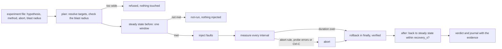

# Chaos Engineering Is an Experiment With a Hypothesis

*A chaos experiment is a hypothesis about an SLI, one fault inside a blast radius, an abort condition and a rollback that always runs.*

## Metadata

| Field | Value |
|---|---|
| Type | Build |
| Languages | Python |
| Prerequisites | [An SLO Is an Error Budget You Spend on Purpose](https://cloudcaptain.io/learn/observability/slo-burn-rate), [Reconcilers From Scratch](https://cloudcaptain.io/learn/orchestration/reconciler) |
| Time | 90 minutes |
| Tools | kubectl, kind, tc, ip, chaos-mesh, helm, litmuschaos, chaos-toolkit |

<Quiz stage="pre" />

## The Problem

Tuesday, 14:10, the first "chaos day" of the payments team. The ticket says "kill some checkout pods and see what happens". An engineer installs a chaos tool, points a pod-kill at `app=checkout` in production with its defaults, and watches the team dashboard. The error panel, a five-minute rate, bumps from 0.2% to 2% and settles. "It handled it", says the channel. Forty minutes later support forwards complaints: card payments failed for about half a minute. The tool's default grace period was zero, so the pods died without running their `preStop` hook, kube-proxy kept sending new connections to the dead IPs for a second or two, and the mobile client does not retry a payment. For 35 seconds a third of the requests failed. The five-minute rate averaged that into a bump, and nobody had written down what "handled it" meant, so there was nothing to compare the bump with.

Thursday, the same team wants to know how checkout behaves when the database is 200 ms away. Someone types `tc qdisc add dev eth0 root netem delay 2000ms` on a bastion host to "try the command first". The interface was the one carrying their own SSH session. The terminal froze, the command that would have removed the qdisc lived only in that terminal, and the host answered every packet two seconds late for 25 minutes until someone found the cloud console's serial port.

Neither incident was caused by the fault. They were caused by running a fault without an experiment around it: no steady state measured before, no hypothesis that could fail, no limit on how much could break, no condition that stops early, no rollback that runs when things go wrong, and no verdict anyone could check. You are going to build `minichaos`, which makes each of those a field in a JSON file and refuses to run without them. It measures an error ratio and a p95 latency from a Prometheus-format endpoint, deletes pods, kills processes, burns CPU and adds `tc netem` delay inside a network namespace, aborts when the SLI breaks, rolls back in a `finally`, and writes a journal with the evidence. Then you run the same pod deletion with Chaos Mesh's `PodChaos` on kind and the same latency with `tc` by hand, and compare.

## The Concept

Think of a fire drill. Before it starts, someone writes down what success looks like ("everyone on the assembly point within four minutes, the lifts unused"), checks that today is a normal day (no real alarm, nobody in surgery), limits the drill to one building, and appoints a person who can call it off. The alarm rings, people with stopwatches watch the stairs, the drill ends at a set time or earlier if someone gets hurt, the alarm is switched off whatever happened, and the report compares the stopwatch with the written goal. Breaking things is the smallest part of it.

A chaos experiment has the same parts, and each one has a mechanism:

- **Steady state.** A measurement of what users feel, taken from the same signals as your SLO: the share of failed requests and the 95th percentile latency. Both come from counters, so a measurement is the difference between two scrapes: errors that happened in the window divided by requests that happened in the window, and the p95 interpolated from the histogram buckets that filled in the window. CPU, pod counts and "the dashboard looks fine" are not a steady state. The window is a trade-off: a five-minute window hides a 30-second outage, and a two-second window at low traffic contains so few requests that a single failure is 10%. A window with fewer than a minimum number of requests is **no data**, which is not the same as fine.
- **Hypothesis.** A sentence that can be false: "with one of three web pods deleted, every 3-second window keeps errors at or under 5% and p95 at or under 250 ms, and the Deployment is back to 3 of 3 ready within 60 seconds". If it holds you have evidence, and if it breaks you have found a weakness before your users did. Both are a success for the experiment.
- **Blast radius.** Which targets (a namespace allow-list, a network namespace instead of the host's own interface), how many (a percentage of the matching pods, rounded down, and an absolute cap) and for how long. It is checked before anything runs. Selection and limits round differently on purpose: Chaos Mesh rounds a `fixed-percent` selection up so that at least one pod is chosen, which makes 34% of 3 pods two pods, while a limit must round down, so 34% of 3 allows one.
- **Abort conditions.** Thresholds that stop the method early, looser than the hypothesis and tighter than real damage: the hypothesis is what you want to learn, the abort condition is what you are not willing to pay for it. Losing the measurement (the metrics endpoint stops answering) is an abort condition too, because an experiment you cannot see is an outage you are causing blind. A human abort button (Ctrl-C, a file another person can create) is the last one.
- **Rollback.** Every fault knows how to undo itself, and the undo runs in a `finally` block: on success, on a breach, on an abort, on Ctrl-C and on a crash of the fault itself. It is verified (the qdisc is really gone), retried, and when it still fails it prints the exact command a human has to run. Some faults undo themselves in a different way: a deleted pod is replaced by the ReplicaSet controller, the reconciler from the prerequisite lesson, so the rollback is "check that the controller did its job". Faults that outlive their controller are dangerous, so a good fault also expires on its own.
- **Verdict.** `held` (evidence that the system copes), `deviated` (the hypothesis broke, below the abort threshold), `aborted`, `inconclusive` (nothing broke, but some windows had no data), `not-run` (the steady state was already broken, so nothing was injected), `refused` (outside the blast radius) and `failed` (a fault could not be injected). The journal keeps every measurement behind it.



Where you run it matters as much as how. Start in staging with a hypothesis you expect to hold, with traffic that looks like production (an experiment without requests measures nothing), and with the abort button in the hand of someone watching the SLI. Move to production only when the experiment passes in staging, when the service has error budget left to spend (the burn-rate lesson's budget is exactly the currency here), and with a blast radius smaller than the one you used in staging.

## Build It

`code/main.py` is `minichaos`. An experiment is a JSON file; the engine talks to the outside world only through a `world` object with `run`, `fetch`, `processes`, `kill`, `spawn`, `sleep` and `now`. `RealWorld` implements them with `subprocess`, `urllib`, `/proc` and the monotonic clock. `SimulatedWorld` implements them with a three-replica service on a virtual clock, so all 27 tests and the `simulate` command run in a second without a cluster, root or Docker. `code/fixtures/` holds the experiments used below and the Kubernetes manifests used in Use It.

### Step 1: an experiment is data

```json
{
  "title": "Deleting one of three web pods keeps errors under 5% and p95 under 250 ms",
  "hypothesis": {
    "source": {"kubectl_raw": "/api/v1/namespaces/cc-chaos-experiments/pods/cc-load:9100/proxy/metrics"},
    "interval_s": 3,
    "min_requests": 20,
    "slis": [
      {"name": "error_rate", "type": "error_ratio", "errors": "minichaos_load_requests_total{outcome=\"error\"}", "total": "minichaos_load_requests_total", "max": 0.05},
      {"name": "p95_latency_s", "type": "latency_quantile", "histogram": "minichaos_load_request_duration_seconds{outcome=\"ok\"}", "quantile": 0.95, "max": 0.25}
    ],
    "checks": [{"type": "deployment-ready", "namespace": "cc-chaos-experiments", "name": "web"}],
    "recovery_s": 60
  },
  "method": {"duration_s": 15, "faults": [{"type": "pod-delete", "namespace": "cc-chaos-experiments", "selector": "app=web", "mode": "one"}]},
  "abort": {"rules": [{"sli": "error_rate", "above": 0.25, "for": 1}, {"sli": "p95_latency_s", "above": 1.0, "for": 2}], "probe_errors": 3},
  "blast_radius": {"namespaces": ["cc-chaos-experiments"], "max_percent": 34, "max_duration_s": 120}
}
```

That is `code/fixtures/pod-delete.json`. `load_experiment()` refuses a file without `abort` or `blast_radius` and names what is missing, refuses an empty list of SLIs ("a steady state is measured, not assumed") and an empty list of faults. The source is where the SLI lives: a URL, a file, or an API server path read with `kubectl get --raw`, which reaches a pod's port through the API server's proxy without a port-forward. `checks` describe the state the system must return to; SLIs describe what users feel while the fault is on.

### Step 2: read what Prometheus would scrape

The SLIs come from the Prometheus text format, so `parse_exposition()` reads it: `name{label="value",...} value [timestamp]`, comments and `# EOF` skipped, `NaN` and `+Inf` as values, OpenMetrics exemplars after ` # ` ignored, and label values read by a small state machine because they can contain commas, braces and the escapes `\"`, `\\` and `\n`. Every error names `source:line`. A selector is the PromQL kind, with the same four matchers:

```python
for key, op, value in self.matchers:
    if key in ignore:
        continue
    actual = labels.get(key, "")
    if op == "=" and actual != value:
        return False
    if op == "!=" and actual == value:
        return False
    if op == "=~" and not re.fullmatch(value, actual):
        return False
    if op == "!~" and re.fullmatch(value, actual):
        return False
return True
```

A missing label matches the empty string, and regular expressions are anchored with `fullmatch`, as in Prometheus: `code=~"5.."` matches `503` and not `1500`.

### Step 3: an SLI is the difference between two scrapes

Counters only go up, except when the process restarts and they start again from zero. The increase over a window adds the differences per series and treats a drop as a restart:

```python
def counter_increase(before: Dict[Labels, float], after: Dict[Labels, float]) -> float:
    total = 0.0
    for labels, value in after.items():
        previous = before.get(labels, 0.0)
        total += value if value < previous else value - previous
    return total
```

A series that appears in the second scrape counts from zero, which is right for the load generator because it exports both outcomes from the start. That is a choice worth copying in your own services: Prometheus' `rate()` ignores a series until it has two samples, so an error counter created on the first error hides the first window of errors. The error ratio is the increase of the error selector divided by the increase of the total. The latency SLI sums the increase of each `_bucket` by its `le` bound, across the series the selector keeps, and interpolates the quantile the way `histogram_quantile()` does:

```python
rank = q * counts[-1]
lower, below = 0.0, 0.0
for index, (bound, _) in enumerate(buckets):
    if counts[index] >= rank:
        if bound == math.inf:
            return buckets[-2][0] if len(buckets) > 1 else None
        if index == 0 and bound <= 0:
            return bound
        if counts[index] <= below:
            return bound
        return lower + (bound - lower) * (rank - below) / (counts[index] - below)
    lower, below = bound, counts[index]
```

`counts` is made monotonic first, because buckets scraped while requests complete can be off by one. A quantile that falls into the `+Inf` bucket returns the highest finite bound: with buckets ending at 5 s, a p95 of "5" means "5 or worse". The answer is only as precise as the buckets: a service whose every request takes 30 ms reports a p95 of 0.049 with buckets at 25 ms and 50 ms, which is the straight line inside that bucket. `Prober.window()` sleeps one interval, scrapes, and turns each SLI into a `Reading` with the status `ok`, `breach` or `no-data` (fewer requests than `min_requests`, or nothing to divide by).

### Step 4: the blast radius is checked before anything runs

```python
def selection_size(mode: str, value: float, count: int, worst_case: bool = False, rng: Optional[random.Random] = None) -> int:
    if mode == "one":
        return min(1, count)
    if mode == "all":
        return count
    if mode == "fixed":
        if value < 1:
            raise InputError("mode fixed needs a value of at least 1")
        return min(int(value), count)
    if not 0 < value <= 100:
        raise InputError(f"mode {mode} needs a percentage in (0, 100], got {value:g}")
    percent = value if mode == "fixed-percent" or worst_case else (rng or random.Random()).randint(0, int(value))
    return math.ceil(count * percent / 100 - 1e-9)


def allowed_count(count: int, blast: BlastRadius) -> int:
    allowed = math.floor(count * blast.max_percent / 100 + 1e-9)
    return allowed if blast.max_pods is None else min(allowed, blast.max_pods)
```

The modes are Chaos Mesh's, with its rounding: `fixed-percent` and `random-max-percent` round up, and `random-max-percent` picks a percentage between 0 and the value. The limit rounds down. `choose()` compares the worst case with the limit and raises `Refused` with both numbers, and refuses an empty selection too, because a fault that hits nothing proves nothing. A single replica with `max_percent: 34` allows zero pods: there is no redundancy to test, and the honest answer is a refusal, not an outage. `static_refusals()` runs first and needs no cluster: a namespace outside the allow-list, `kube-system` and the other system namespaces unless explicitly allowed, `mode: all` under a limit below 100%, a duration above `max_duration_s`, no abort rules, `netem` without a network namespace, a process match shorter than four characters, more CPU workers than allowed.

### Step 5: every fault knows how to undo itself

`netem` builds its commands from the spec and runs them inside the namespace with `ip netns exec`, so the host's own interfaces cannot be touched:

```python
def add_command(self) -> List[str]:
    argv = self.prefix() + ["tc", "qdisc", "add", "dev", self.device, "root", "netem"]
    if self.delay_ms:
        argv += ["delay", f"{self.delay_ms:g}ms"] + ([f"{self.jitter_ms:g}ms"] if self.jitter_ms else [])
    if self.loss_percent:
        argv += ["loss", f"{self.loss_percent:g}%"]
    return argv
```

Before adding, `plan()` reads `tc qdisc show` and refuses when the device already has a configured root qdisc: kernel defaults have the handle `0:`, anything with another handle (an `htb` someone set up, a netem left over from last time) would be deleted by the rollback too. The rollback deletes, then reads the qdisc again, and only a device without netem counts as rolled back:

```python
for attempt in range(1, ATTEMPTS + 1):
    code, out, err = world.run(argv)
    last = (err or out).strip()
    try:
        kind, _ = self.root_qdisc(world)
    except FaultError as exc:
        last = str(exc)
        continue
    if kind != "netem":
        self.applied = False
        return f"{shlex.join(argv)} (attempt {attempt}); root qdisc is now {kind or 'the default'}"
raise FaultError(f"netem is still on {self.device} after {ATTEMPTS} attempts ({last}); remove it by hand: {shlex.join(argv)}")
```

The other faults:

- **`pod-delete`** lists Running pods that are not already terminating (`kubectl get pods -l ... -o json`), chooses with the seeded random generator inside the blast radius, and deletes them with `--wait=false`. By default it keeps each pod's own grace period, so the `preStop` hook runs and the endpoint is removed before the container stops. `grace_period_s: 0` adds `--grace-period=0 --force`, the harsher fault that Chaos Mesh's `pod-kill` and Litmus' `pod-delete` use by default. Its rollback is nothing: the ReplicaSet controller notices one pod fewer than `spec.replicas` and creates a replacement, and the `deployment-ready` check after the rollback proves it did.
- **`process-kill`** reads `/proc/PID/cmdline` (NUL-separated arguments) through `read_processes()`, keeps the processes whose command line contains `match`, never targets PID 1, itself or its parent, and refuses more matches than `max_processes`. Its rollback is also nothing: a supervisor restarts the process, or nothing does, and the after-measurement shows which.
- **`cpu-burn`** starts `workers` processes of `main.py burn --seconds N` with N set to the duration plus 30 seconds. Its rollback terminates them, but if `minichaos` itself is killed with `SIGKILL` and its `finally` never runs, the burners still stop on their own. That is a dead-man's switch, and the Hard exercise adds one to netem.
- **`manifest`** applies a JSON manifest, such as a Chaos Mesh `PodChaos`, with `kubectl apply -f`, optionally waits until a JSONPath reaches a value, and deletes it in the rollback. Its blast radius check reads the Chaos Mesh selector (`namespaces`, `labelSelectors`, `mode`, `value`) and counts the pods with the same rounding as Step 4.

### Step 6: the loop, and why the rollback is in `finally`

```python
started: List[Fault] = []
outcome, reason = "completed", ""
journal.injected_at_s = round(world.now(), 3)
try:
    for fault, entry in zip(experiment.faults, journal.faults):
        started.append(fault)
        entry["result"] = fault.start(world, experiment.blast, experiment.duration_s)
        journal.log(world, "inject", f"{fault.kind}: {entry['result']}")
    outcome, reason = observe(experiment, world, prober, journal)
except Refused as exc:
    outcome, reason = "failed", f"refused at injection time: {exc}"
except FaultError as exc:
    outcome, reason = "failed", f"fault failed: {exc}"
finally:
    if outcome == "aborted":
        journal.aborted_at_s = round(world.now(), 3)
        journal.log(world, "abort", reason)
    rollback(started, world, journal)
recover(experiment, world, prober, journal)
```

Before this block, `run_experiment()` has already checked the static refusals, planned every fault against the live targets, and measured one window of steady state; if that window is not `ok`, the verdict is `not-run` and nothing is injected, because a fault on top of an incident teaches nothing and makes the incident worse. A fault is appended to `started` before it starts, so a fault that half-started (the qdisc was added but the check afterwards failed) is still rolled back. `rollback()` walks `started` in reverse order, catches every exception per fault so that one failed undo does not skip the others, and marks the journal `rollback_ok: false` with the manual command. `recover()` then measures windows until one is `ok` (SLIs and checks) or `recovery_s` runs out, and records how long that took.

### Step 7: abort rules, probe errors and the abort button

```python
for index, rule in enumerate(experiment.abort_rules):
    reading = measurement.reading(rule.sli)
    breached = reading is not None and reading.status != "no-data" and reading.value is not None and reading.value > rule.above
    streaks[index] = streaks[index] + 1 if breached else 0
    if streaks[index] >= rule.count:
        return "aborted", f"{rule.sli} {reading.value:.3f} > {rule.above:g} in {rule.count} measurement(s) in a row"
```

A rule needs `for` consecutive windows above its threshold, so one noisy window does not stop an experiment, and a second one does. Scrape failures count separately: `probe_errors` of them in a row abort the run. The human abort button is two mechanisms in `RealWorld`. `SIGINT` and `SIGTERM` set a flag instead of raising, so Ctrl-C ends the method at once (the sleep checks the flag every 0.2 seconds) but cannot interrupt the rollback that follows. `--abort-file PATH` aborts as soon as that file exists, so the person watching the dashboard can stop the run from another terminal with `touch`.

### Step 8: the verdict, with its evidence

```python
breaches = [m for m in during if m.status == "breach"]
if breaches:
    return "deviated", f"hypothesis broken during the fault, first at +{breaches[0].at:g} s: {breaches[0].text()}; {recovered}"
if journal.recovered_after_s is None:
    if any(m.status == "breach" for m in after):
        return "deviated", f"the system did not return to steady state within recovery_s: {after[-1].text()}"
    return "inconclusive", "no measurement after the rollback had enough data"
blind = [m for m in during if m.status in ("no-data", "error")]
if blind:
    return "inconclusive", f"{len(blind)} of {len(during)} measurements during the fault had no data; nothing broke, but nothing was proven either"
return "held", f"{len(during)} measurements during the fault within tolerance; {recovered}"
```

Exit codes follow: 0 for `held` with a clean rollback, 2 for `refused` and bad input, 1 for everything else, so a pipeline can gate on a game-day experiment. `--json` prints the journal: every measurement with its readings and request counts, every fault with its targets, result and rollback, and the times of injection, abort, rollback and recovery.

### Step 9: a load generator that exports the SLI, and a simulated service

An SLI needs traffic. `minichaos load` sends requests with a fixed concurrency and an optional rate, and serves its own `/metrics`: a counter by outcome and a latency histogram by outcome, with buckets from 5 ms to 5 s. Measuring at the client counts what the server cannot see, such as connections refused by a dead pod and timeouts:

```python
lines += [f'{LOAD_REQUESTS}{{outcome="{o}"}} {show(self.requests[o])}' for o in OUTCOMES]
lines += [f"# HELP {LOAD_LATENCY} Request latency seen by minichaos load.", f"# TYPE {LOAD_LATENCY} histogram"]
for outcome in OUTCOMES:
    cumulative = 0.0
    for bound, count in zip(self.buckets + (math.inf,), self.histograms[outcome]):
        cumulative += count
        le = "+Inf" if bound == math.inf else f"{bound:g}"
        lines.append(f'{LOAD_LATENCY}_bucket{{outcome="{outcome}",le="{le}"}} {show(cumulative)}')
```

It is a closed-loop generator: when the server slows down, each worker sends fewer requests, which is why the experiments use `min_requests`. `SimulatedWorld` uses the same `LoadStats` and advances a virtual clock in 0.25-second steps. Its service has three pods at 20 ms; a graceful delete removes a pod from the endpoints at once and a replacement becomes ready after 4 seconds; a forced delete (grace period 0) also fails a third of the requests for one second, the time kube-proxy needs to notice; a netem qdisc adds twice its delay (the SYN-ACK and the response both leave through the shaped device) and turns three times the loss rate into requests that wait an extra second for a retransmission; a burner slows the service by its share of four cores; killing the supervised server process fails every request for 3 seconds. It also understands just enough `kubectl`, `tc` and `ip netns exec` to answer the commands the faults run, and records every command, which is what the tests assert on.

### Step 10: run it

```bash
python3 code/main.py simulate code/fixtures/pod-delete.json; echo "exit $?"
```

```text
experiment: Deleting one of three web pods keeps errors under 5% and p95 under 250 ms
     +0.0s  plan      delete pods matching app=web in cc-chaos-experiments (mode one, the pod's own grace period): 1 of 3 running pods, chosen at injection time from web-1, web-2, web-3
     +3.0s  before    ok: error_rate 0.000 <= 0.05, p95_latency_s 0.024 <= 0.25, deployment cc-chaos-experiments/web 3/3 ready (150 requests in 3 s)
     +3.0s  inject    pod-delete: deleted web-3
     +6.0s  during    ok: error_rate 0.000 <= 0.05, p95_latency_s 0.049 <= 0.25 (150 requests in 3 s)
     +9.0s  during    ok: error_rate 0.000 <= 0.05, p95_latency_s 0.046 <= 0.25 (150 requests in 3 s)
    +12.0s  during    ok: error_rate 0.000 <= 0.05, p95_latency_s 0.024 <= 0.25 (150 requests in 3 s)
    +15.0s  during    ok: error_rate 0.000 <= 0.05, p95_latency_s 0.024 <= 0.25 (150 requests in 3 s)
    +18.0s  during    ok: error_rate 0.000 <= 0.05, p95_latency_s 0.024 <= 0.25 (150 requests in 3 s)
    +18.0s  rollback  pod-delete: nothing to undo: the ReplicaSet controller creates a replacement for every deleted pod
    +21.0s  after     ok: error_rate 0.000 <= 0.05, p95_latency_s 0.024 <= 0.25, deployment cc-chaos-experiments/web 3/3 ready (150 requests in 3 s)
    +21.0s  verdict   held: 5 measurements during the fault within tolerance; recovered 3 s after the rollback
exit 0
```

Two pods carry the load until the replacement is ready, and p95 rises from 24 ms to 49 ms: the real latency is 30 ms, and the rest is interpolation inside the 25 to 50 ms bucket. Now the same experiment with the defaults of most chaos tools, and the latency experiment:

```bash
sed 's/"mode": "one"}/"mode": "one", "grace_period_s": 0}/' code/fixtures/pod-delete.json > force.json
python3 code/main.py simulate force.json                  # deviated: error_rate 0.111 > 0.05 in the first window, exit 1
python3 code/main.py simulate code/fixtures/netem-latency.json
#     +2.0s  inject    netem: ip netns exec cc-chaos-srv tc qdisc add dev cc-chaos-s root netem delay 200ms loss 5%
#     +4.0s  during    breach: error_rate 0.000 <= 0.05, p95_latency_s 2.000 > 0.1 (100 requests in 2 s)
#     +6.0s  during    breach: error_rate 0.000 <= 0.05, p95_latency_s 2.000 > 0.1 (100 requests in 2 s)
#     +6.0s  abort     p95_latency_s 2.000 > 0.15 in 2 measurement(s) in a row
#     +6.0s  rollback  netem: ip netns exec cc-chaos-srv tc qdisc del dev cc-chaos-s root (attempt 1); root qdisc is now noqueue
#     +8.0s  verdict   aborted: p95_latency_s 2.000 > 0.15 in 2 measurement(s) in a row; recovered 2 s after the rollback
python3 code/main.py simulate code/fixtures/wide-pod-delete.json; echo "exit $?"   # refused: 2 of 3 pods, the blast radius allows 1; exit 2
python3 code/main.py simulate code/fixtures/process-cpu.json                        # held: the decoy dies, two burners start and stop
python3 code/main.py validate code/fixtures/netem-latency.json --commands           # the exact tc commands, nothing executed
python3 code/main.py simulate code/fixtures/netem-latency.json --json > journal.json
```

The latency experiment was planned for 60 seconds and stopped after two windows, 4 seconds in. That is the point of an abort rule: the verdict was clear after 4 seconds, and the remaining 56 would only have cost users.

<RunTests />

## Use It

### `tc netem` in a network namespace, by hand

The kernel's `netem` queueing discipline delays, drops, duplicates, corrupts or reorders packets as they leave a device. Put it on a device inside a network namespace and only that namespace is affected: your SSH session, the host's routes and the rest of the machine are untouched, and deleting the namespace removes the qdisc with it. The lab is the kind the networking phase builds: two ends of a veth pair, a server inside the namespace, the client outside (needs root and `iproute2`):

```bash
sudo ip netns add cc-chaos-srv
sudo ip link add cc-chaos-h type veth peer name cc-chaos-s
sudo ip link set cc-chaos-s netns cc-chaos-srv
sudo ip addr add 10.208.0.1/30 dev cc-chaos-h && sudo ip link set cc-chaos-h up
sudo ip netns exec cc-chaos-srv ip addr add 10.208.0.2/30 dev cc-chaos-s
sudo ip netns exec cc-chaos-srv ip link set cc-chaos-s up
sudo ip netns exec cc-chaos-srv ip link set lo up
mkdir -p www && echo ok > www/index.html
sudo ip netns exec cc-chaos-srv python3 -m http.server 8080 --bind 10.208.0.2 --directory www &
curl -s -o /dev/null -w '%{time_total}\n' http://10.208.0.2:8080/              # about 0.002
sudo ip netns exec cc-chaos-srv tc qdisc show dev cc-chaos-s                     # qdisc noqueue 0: root refcnt 2
sudo ip netns exec cc-chaos-srv tc qdisc add dev cc-chaos-s root netem delay 200ms loss 5%
sudo ip netns exec cc-chaos-srv tc -s qdisc show dev cc-chaos-s                  # qdisc netem 8001: root ... delay 200ms loss 5%, Sent ... dropped ...
curl -s -o /dev/null -w '%{time_total}\n' http://10.208.0.2:8080/              # about 0.40: SYN-ACK and response each wait 200 ms
sudo ip netns exec cc-chaos-srv tc qdisc del dev cc-chaos-s root
curl -s -o /dev/null -w '%{time_total}\n' http://10.208.0.2:8080/              # fast again
```

A new connection pays the delay twice because the server sends two packets on the critical path: the SYN-ACK and the response. Loss shows up as latency before it shows up as errors: a lost SYN-ACK costs the client's one-second SYN retransmission timer, and a lost data segment waits for a retransmission timer that grows with the round-trip time. `netem` shapes egress only; to delay what a device receives you redirect its ingress to an `ifb` device and shape that. If `tc` answers `Specified qdisc kind is unknown`, the `sch_netem` module is not loaded (`sudo modprobe sch_netem`; on some cloud kernels it ships in a separate `linux-modules-extra` package).

Now the same fault as an experiment. The load generator runs outside the namespace and serves its SLI on port 9100; `minichaos` needs root here only because `ip netns exec` does:

```bash
python3 code/main.py load --url http://10.208.0.2:8080/ --concurrency 8 --rate 40 --metrics-port 9100 &
python3 code/main.py measure code/fixtures/netem-latency.json          # ok: error_rate 0.000 <= 0.05, p95_latency_s 0.005 <= 0.1 (80 requests in 2 s)
sudo python3 code/main.py run code/fixtures/netem-latency.json --abort-file /tmp/abort --json > journal.json; echo "exit $?"
python3 -c 'import json; j = json.load(open("journal.json")); print(j["verdict"], j["aborted_at_s"] - j["injected_at_s"], j["faults"][0]["revert"])'
sudo ip netns exec cc-chaos-srv tc qdisc show dev cc-chaos-s           # noqueue again: the rollback ran
kill %2 %1; sudo ip netns del cc-chaos-srv
```

`code/fixtures/process-cpu.json` is the other half: it kills a process started as `exec -a cc-chaos-decoy sleep 300` and burns two cores for 6 seconds while the server keeps answering, and afterwards `pgrep -f 'main.py burn'` finds nothing.

### On kind: pod-delete with minichaos

`code/fixtures/k8s/web.yaml` is an `nginx:1.30-alpine` Deployment with three replicas, a readiness probe every second, a `preStop` hook that sleeps 5 seconds, and a Service. `load-pod.yaml` runs `minichaos load` inside the cluster against the Service name, so every request is a new connection balanced by kube-proxy across the ready endpoints, and serves the SLI on port 9100:

```bash
kind create cluster --name cc-lab
kubectl create namespace cc-chaos-experiments
kubectl -n cc-chaos-experiments create configmap minichaos --from-file=main.py=code/main.py
kubectl -n cc-chaos-experiments apply -f code/fixtures/k8s/web.yaml -f code/fixtures/k8s/load-pod.yaml
kubectl -n cc-chaos-experiments rollout status deployment/web --timeout=120s
kubectl -n cc-chaos-experiments wait --for=condition=Ready pod/cc-load --timeout=120s
kubectl get --raw /api/v1/namespaces/cc-chaos-experiments/pods/cc-load:9100/proxy/metrics | grep requests_total
python3 code/main.py measure code/fixtures/pod-delete.json            # the steady state, before any game day
python3 code/main.py validate code/fixtures/wide-pod-delete.json --resolve; echo "exit $?"   # refused against the real pods: 2 of 3, allowed 1
kubectl -n cc-chaos-experiments get pods -l app=web -w &               # watch one pod go Terminating and a new one appear
python3 code/main.py run code/fixtures/pod-delete.json --journal journal.json; echo "exit $?"
kubectl -n cc-chaos-experiments get deployment web                    # 3/3 again: the ReplicaSet controller did the rollback
```

The `preStop` hook is what keeps the error rate at zero. Deleting a pod marks it terminating, the EndpointSlice controller marks its endpoint not ready, and kube-proxy on every node rewrites its rules; that takes a moment, and during that moment new connections still arrive at the old pod. With `sleep 5` in `preStop` the old nginx keeps serving through the gap and only then receives its stop signal. Set `"grace_period_s": 0` in the fault and run again: the pod can be gone before every node has updated its rules, and the first window usually shows errors; how many depends on how quickly kube-proxy catches up, which is the weakness the experiment measures.

### Chaos Mesh: PodChaos and NetworkChaos

Chaos Mesh runs a controller that watches chaos objects (`PodChaos`, `NetworkChaos`, `StressChaos`, `IOChaos`, `TimeChaos` and more) and a privileged `chaos-daemon` on every node that enters the target pod's namespaces to run `tc`, `iptables` or a stress process. This lesson pins Chaos Mesh v2.8.7 and installs the chart file directly, checked against the digest in the chart repository's `index.yaml`, with Helm (current release <ToolVersion name="helm" />). kind nodes run containerd, so the daemon needs that socket:

```bash
curl -fsSLO https://charts.chaos-mesh.org/chaos-mesh-2.8.7.tgz
echo "c963e0f4ed2e30c1c7e236477f1c31fcf988b171991801bbe392546948436d38  chaos-mesh-2.8.7.tgz" | sha256sum -c -
helm install chaos-mesh ./chaos-mesh-2.8.7.tgz -n chaos-mesh --create-namespace \
  --set chaosDaemon.runtime=containerd --set chaosDaemon.socketPath=/run/containerd/containerd.sock \
  --set controllerManager.replicaCount=1 --set dashboard.create=false --set dnsServer.create=false
kubectl -n chaos-mesh rollout status deployment/chaos-controller-manager --timeout=180s
kubectl get crd | grep chaos-mesh.org                                # podchaos, networkchaos, stresschaos, ...
```

The `PodChaos` that `code/fixtures/podchaos.json` holds, as YAML:

```yaml
apiVersion: chaos-mesh.org/v1alpha1
kind: PodChaos
metadata:
  name: cc-web-pod-kill
  namespace: cc-chaos-experiments
spec:
  action: pod-kill
  mode: one
  gracePeriod: 15
  selector:
    namespaces: [cc-chaos-experiments]
    labelSelectors:
      app: web
```

```bash
kubectl apply -f code/fixtures/podchaos.json
kubectl -n cc-chaos-experiments get podchaos cc-web-pod-kill -o jsonpath='{.status.conditions[?(@.type=="AllInjected")].status}'   # True
kubectl -n cc-chaos-experiments get podchaos cc-web-pod-kill -o jsonpath='{.status.experiment.containerRecords[*].id}'              # the pod it killed
kubectl -n cc-chaos-experiments describe podchaos cc-web-pod-kill | sed -n '/Events:/,$p'
kubectl delete -f code/fixtures/podchaos.json
```

`pod-kill` is a one-shot action: the object stays in the Run phase and kills once, and deleting it afterwards is cleanup. `gracePeriod` defaults to 0, which skips the `preStop` hook exactly like `grace_period_s: 0`; the fixture sets 15 to match the pods' own `terminationGracePeriodSeconds`, so both tools inject the same fault. Chaos Mesh injects but does not measure, so the two combine: the `manifest` fault applies the `PodChaos`, waits until `AllInjected` is `True`, and deletes it in the rollback, while `minichaos` measures the same hypothesis:

```bash
python3 code/main.py run code/fixtures/podchaos-experiment.json; echo "exit $?"   # held, one pod replaced, the same verdict as pod-delete
```

The latency fault in Chaos Mesh's terms. `chaos-daemon` runs the same `tc qdisc add ... netem` inside each selected pod's network namespace, and deleting the object, or reaching `duration`, removes it:

```yaml
apiVersion: chaos-mesh.org/v1alpha1
kind: NetworkChaos
metadata:
  name: cc-web-delay
  namespace: cc-chaos-experiments
spec:
  action: netem
  mode: all
  selector:
    namespaces: [cc-chaos-experiments]
    labelSelectors:
      app: web
  delay:
    latency: 200ms
  loss:
    loss: "5"
  direction: to
  duration: 60s
```

`duration` is the dead-man's switch that `minichaos`'s netem lacks: the controller recovers the fault when the time is up even if whoever created it is gone. Remove Chaos Mesh with `helm uninstall chaos-mesh -n chaos-mesh`, then delete its CRDs (Helm does not delete the CRDs of a chart's `crds/` folder on uninstall), and delete chaos objects before uninstalling the controller: they carry a finalizer that only the controller removes.

### LitmusChaos and the Chaos Toolkit

LitmusChaos is, like Chaos Mesh, a CNCF project. A `ChaosEngine` names the application (`appinfo` with namespace, label and kind) and one or more experiments from its catalogue, each tuned with environment variables. For `pod-delete` they are `TOTAL_CHAOS_DURATION`, `CHAOS_INTERVAL` (time between deletions), `PODS_AFFECTED_PERC` and `FORCE`, which defaults to `true`, a deletion with a 0-second grace period. The steady-state hypothesis is a list of probes (`httpProbe`, `cmdProbe`, `k8sProbe`, `promProbe` for a PromQL query with a comparator) evaluated in modes such as `SOT`, `EOT` and `Continuous`, and the result is a `ChaosResult` whose verdict is Pass or Fail.

The Chaos Toolkit is the closest to `minichaos`: an experiment is a JSON or YAML file with a `steady-state-hypothesis` (probes, each with a `tolerance`), a `method` (actions and probes from extensions for Kubernetes, AWS, Prometheus and others) and `rollbacks`; `chaos run experiment.json` writes `journal.json` with a `status` (`completed`, `failed`, `aborted`, `interrupted`) and a `deviated` flag. Read its defaults carefully. The hypothesis is checked before and after the method only, and the default rollback strategy does not play rollbacks when the run is interrupted or the hypothesis fails. For the behaviour you built, run it as:

```bash
chaos run --hypothesis-strategy=continuously --hypothesis-frequency=3 --fail-fast --rollback-strategy=always experiment.json
```

### Game days

A game day is the same experiment run by people, on purpose, with everyone watching. Write the hypothesis and the abort condition down before the day and agree on them with the service owner. Name the roles: one person runs the commands, one watches the SLI and owns the abort button, one writes the timeline, and the on-call engineer knows it is happening and is not the person running it. Announce start and end in the incident channel so that real alerts are not mistaken for the drill, or the drill for an incident. Start in staging with a blast radius that is obviously survivable, run the same experiment twice to see whether the result is stable, and only then widen the blast radius or move to production, during working hours, with error budget left. Every result is a finding: a hypothesis that held becomes a scheduled regression experiment, and one that broke becomes a ticket with the journal attached, reviewed like an incident, without blame.

| What you built | Real tool | Note |
|---|---|---|
| experiment JSON with `hypothesis`, `method`, `abort`, `blast_radius` | Chaos Toolkit experiment, LitmusChaos `ChaosEngine` with probes | Chaos Mesh objects describe only the fault; the hypothesis lives in a `Workflow` with `StatusCheck` or in an outside tool |
| `Prober` over `/metrics`, `error_ratio`, `latency_quantile` | Litmus `promProbe`, Chaos Toolkit Prometheus probes, PromQL `rate()` and `histogram_quantile()` | the same counter and bucket arithmetic; measure at the client or at the load balancer, not on the pod you kill |
| `selection_size()`, `allowed_count()` | Chaos Mesh `mode` and `value`, Litmus `PODS_AFFECTED_PERC` | Chaos Mesh rounds a percentage selection up; a limit should round down |
| `static_refusals()`, namespace allow-list | Chaos Mesh `enableFilterNamespace` and namespace annotations, RBAC on chaos objects | refuse before touching anything |
| `pod-delete`, `grace_period_s` | `PodChaos` `pod-kill` with `gracePeriod`, Litmus `pod-delete` with `FORCE` | both real tools force-kill by default and skip `preStop` |
| `netem` with `ip netns exec` | `NetworkChaos` `netem` through `chaos-daemon`, `tc qdisc add ... netem` | `duration` recovers it even when the creator is gone |
| `cpu-burn` with a self-expiring worker | `StressChaos` (`stress-ng` in the pod's cgroup), Litmus `pod-cpu-hog` | a burner in the pod's cgroup competes with the app's CPU limit, not with the whole node |
| `process-kill` over `/proc` | `PodChaos` `container-kill`, Litmus `container-kill`, `kill` under a supervisor | protect PID 1 and yourself |
| abort rules, `probe_errors`, `--abort-file`, Ctrl-C | Chaos Toolkit `--fail-fast`, Litmus probe `stopOnFailure`, deleting or pausing the chaos object | stop early, then roll back |
| `rollback()` in `finally`, verified, with the manual command | Chaos Toolkit `--rollback-strategy=always`, Chaos Mesh recovery through finalizers | an undo that is not verified is a hope |
| the journal and its verdict | Chaos Toolkit `journal.json`, Litmus `ChaosResult` | attach it to the ticket the experiment creates |

<Quiz stage="check" />

## Ship It

Two artifacts in `outputs/`:

- **`skill-chaos-experiment-review.md`**: a runbook an agent follows before, during and after a chaos experiment. It refuses to start without a measured steady state, a falsifiable hypothesis, a blast radius, an abort rule and a verified rollback; checks the environment (staging first, error budget left, on-call informed, no open incident); runs `minichaos validate --resolve` and a dry measurement; watches the abort conditions during the run; confirms the rollback and the recovery afterwards; and ends with a fixed report that names the verdict and the evidence.
- **`prompt-design-chaos-experiment.md`**: describe a service (traffic, replicas, dependencies, SLOs, where the metrics live, what you fear) and get back a complete experiment design: the steady state as queries, a hypothesis that can fail, the fault and its blast radius with the rounding written out, abort conditions, the rollback and its verification, the `minichaos` JSON or the Chaos Mesh YAML, and what each possible verdict would teach.

<ShipIt />

## Exercises

### Easy

Add a `latency_mean` SLI type that divides the increase of `<histogram>_sum` by the increase of `<histogram>_count` for the series the selector keeps. Write the tests first: on two `LoadStats` scrapes with 90 requests at 20 ms and 10 at 400 ms in the second window, the mean is 0.058 while the p95 lands in the 250 to 500 ms bucket; a window with fewer than `min_requests` is `no-data`; and an abort rule on `latency_mean` fires in `SimulatedWorld` with the netem fixture. Then explain in one sentence why the mean hides the tail that the p95 shows.

### Medium

Add `interval_s` to `pod-delete`: delete again every `interval_s` seconds during the method, as Litmus' `CHAOS_INTERVAL` does, while keeping the blast radius for the whole run. A pod that is not Ready yet, or still terminating, counts as already disrupted, so a round deletes only `allowed - disrupted` pods and skips the round when that is zero. Test it with `SimulatedWorld` and `ready_after_s=10`: with an interval of 3 seconds and `max_percent: 34` on three replicas, the second round is skipped because the first replacement is not ready, the journal says so, and the third round deletes again.

### Hard

Give `netem` a dead-man's switch. When it starts, spawn a watchdog process (`main.py watchdog --netns NS --device DEV --lease FILE --ttl 10`) that deletes the qdisc when the lease file has not been touched for `ttl` seconds; `observe()` touches the lease every window, and the rollback stops the watchdog after the delete. Test it without root through an injectable runner: kill the experiment's main loop in the middle of the method (raise `SystemExit` from the prober), assert that the `finally` rollback still deletes the qdisc, and then simulate a `SIGKILL` that skips `finally` and assert that the watchdog removes the qdisc after the lease expires and exits.

<Quiz stage="post" />

## Key Terms

| Term | Common misconception | Precise definition |
|---|---|---|
| Chaos experiment | "Breaking things in production to see what happens." | A falsifiable hypothesis about a steady state, a fault inside a blast radius, abort conditions and a rollback, run on purpose and ending in a verdict with the measurements behind it. |
| Steady state | "Everything is green on the dashboard." | A measurement of what users feel, such as the error ratio and p95 latency over a window, taken from counters and histograms before, during and after the fault, with enough requests in each window to mean something. |
| Hypothesis | "We expect the system to be resilient." | A statement that the steady state stays within stated thresholds while a stated fault is active and returns within a stated time, precise enough to be proven false by one measurement. |
| Blast radius | "How bad it could get." | The limit on what the experiment may touch: which namespaces, network namespaces or processes, how many targets (a percentage rounded down and an absolute cap) and for how long, checked before anything is injected. |
| Abort condition | "The same thing as the hypothesis." | A threshold, usually looser than the hypothesis, that stops the method early when breached for a number of consecutive windows, plus losing the measurement and a human abort button. |
| Rollback | "Something you do if it goes wrong." | The undo of every started fault, run in a `finally` on every path, verified against the system (the qdisc is gone, the deployment is ready again), retried, and reported with the manual command when it still fails. |
| `netem` | "A tool that slows down the network." | A Linux queueing discipline attached with `tc qdisc` that delays, drops, duplicates, corrupts or reorders packets leaving one device; inside a network namespace it affects only that namespace. |
| Grace period | "How long Kubernetes waits before it deletes a pod object." | `terminationGracePeriodSeconds`, the time between the start of termination (`preStop`, then the stop signal) and the kill; a deletion with a grace period of 0 skips `preStop` and kills at once. |
| Game day | "A chaos experiment without automation." | A scheduled exercise in which a team runs experiments together with named roles (operator, observer with the abort button, scribe), announced to on-call, starting in staging, and reviewed afterwards like an incident. |

## Further Reading

- [SRE learning path](https://cloudcaptain.io/docs/learning-paths/sre): where chaos engineering sits next to SLOs, incident response and capacity planning.
- [SRE Practices](https://cloudcaptain.io/docs/learning-paths/sre-practices): error budgets and blameless reviews, the policy side of deciding when an experiment may run.
- [Observability and SRE](https://cloudcaptain.io/docs/tools/observability): the metrics and alerting stack the steady state is measured from.
- [Kubernetes in Production](https://cloudcaptain.io/docs/tools/kubernetes/production-operations): probes, PodDisruptionBudgets and graceful shutdown, the things a pod-delete experiment tests.
- [Linux Networking](https://cloudcaptain.io/docs/tools/linux/networking): interfaces, `ip` and the namespace tooling the netem lab uses.
- [Principles of Chaos Engineering](https://principlesofchaos.org/): the short original statement of steady state, hypothesis, real-world events and minimal blast radius.
- [tc-netem(8)](https://man7.org/linux/man-pages/man8/tc-netem.8.html): every netem option, including jitter distributions, correlation, reordering and rate.
- [ip-netns(8)](https://man7.org/linux/man-pages/man8/ip-netns.8.html): how named network namespaces are created, entered and deleted.
- [Chaos Mesh: simulate pod faults](https://chaos-mesh.org/docs/simulate-pod-chaos-on-kubernetes/): `pod-kill`, `pod-failure` and `container-kill`, with the selector and mode fields.
- [Chaos Mesh: simulate network faults](https://chaos-mesh.org/docs/simulate-network-chaos-on-kubernetes/): `NetworkChaos` actions, `direction`, `target` and the netem parameters.
- [Chaos Mesh: define the experiment scope](https://chaos-mesh.org/docs/define-chaos-experiment-scope/): selectors and modes, including the percentage modes discussed in Step 4.
- [LitmusChaos pod-delete](https://litmuschaos.github.io/litmus/experiments/categories/pods/pod-delete/): the tunables, including `FORCE` and `PODS_AFFECTED_PERC`, and a complete `ChaosEngine`.
- [Chaos Toolkit experiment specification](https://chaostoolkit.org/reference/api/experiment/): the format `minichaos` is closest to, with tolerances, rollbacks and runtime strategies.
- [Pod lifecycle: termination](https://kubernetes.io/docs/concepts/workloads/pods/pod-lifecycle/): the order of `preStop`, the stop signal, the grace period and endpoint removal.
- [Google SRE book: Testing for Reliability](https://sre.google/sre-book/testing-reliability/): where fault injection and disaster testing fit among the other kinds of testing.
