# Admission Control Is a Webhook That Can Say No

*Every object passes mutation, then validation, before it is stored; a policy is code on that path, and a broken one blocks every write.*

## Metadata

| Field | Value |
|---|---|
| Type | Build |
| Languages | Python |
| Prerequisites | [RBAC Authorizer](https://cloudcaptain.io/learn/orchestration/rbac-authorizer) |
| Time | 90 minutes |
| Tools | kubectl, kind, openssl, kyverno |

<Quiz stage="pre" />

## The Problem

Tuesday, 09:10. Last month an attacker with a stolen CI token started a pod with `privileged: true` and a `hostPath` of `/`, read the kubelet's credentials off the node and moved sideways. Security asks for three rules: no privileged containers, images only from the approved registries, every workload labelled with its owning team. An engineer writes a validating webhook over a weekend: a small HTTPS service, a Deployment with one replica, and a ValidatingWebhookConfiguration with `rules` on every resource, no `namespaceSelector` and `failurePolicy: Fail`, "because a security control that fails open is not a control". It passes review and goes to production on Wednesday.

Thursday, 02:40. The cluster autoscaler drains the node that runs the webhook's only pod. The ReplicaSet controller asks the API server for a replacement pod; the API server calls the webhook to admit it; the webhook has no endpoints, so the call fails, and `Fail` means the request is refused: `failed calling webhook "policy.example.com": ... no endpoints available for service`. That applies to every pod create in every namespace, the webhook's own included, and to CoreDNS, which was on the same node. Deploys fail, the HPA cannot scale, and the on-call engineer spends fifty minutes before trying `kubectl delete validatingwebhookconfiguration policy`, which works because the API server never sends webhook configuration objects to webhooks.

The review afterwards finds that the policy also leaked. It looked at `spec.containers` but not `initContainers` or the `ephemeralContainers` that `kubectl debug` adds. It compared registries as string prefixes, so `registry.internal.evil.example/miner` passed as `registry.internal`. It judged Pods only, so a non-compliant Deployment was accepted and its ReplicaSet failed to create pods at 3 a.m., with the reason visible only in `kubectl describe rs`. You are going to write `miniadmit`: a mutating and validating webhook that speaks `admission.k8s.io/v1` over HTTPS, policies as data, a CEL subset evaluated the way ValidatingAdmissionPolicy evaluates it, and a `test` command that runs the same code over manifests offline. Then you compare it, decision by decision, with the API server, ValidatingAdmissionPolicy and Kyverno on a kind cluster.

## The Concept

Think of a building with two desks after the door. Authentication checked your badge and RBAC checked that your badge opens this floor; neither looked inside your box. At the first desk staff may add things to the box (a visitor sticker, a missing form). At the second desk someone opens it and decides whether it comes in. Nothing reaches the storeroom without passing both, and if a desk is unstaffed the building's rule says whether boxes wait or walk through.

Admission control is those two desks for every create, update, delete and connect request, before anything is written to etcd. RBAC answered "may this user create pods in this namespace?" from the verb, resource and name; admission sees the whole object, so it can answer "may this pod, with this image and this `securityContext`, exist?". The order is fixed:

- **Decode and default.** The request body becomes a typed object and the API server's defaulting runs: every container gets `resources: {}`, `terminationMessagePath`, an `imagePullPolicy`; in a Pod (not in a Deployment's template) a limit without a request becomes the request. Admission sees the defaulted object, not the YAML you wrote.
- **Mutating admission.** Built-in plugins (LimitRanger, ServiceAccount, DefaultTolerationSeconds and others), then MutatingAdmissionPolicy (CEL inside the API server), then mutating webhooks, called one after another. A mutating webhook answers with an `AdmissionReview` whose `response.patch` is a base64 JSON Patch (RFC 6902) against the object it was sent.
- **Schema validation** of the mutated object.
- **Validating admission.** Built-in validators such as PodSecurity, then ValidatingAdmissionPolicy, then validating webhooks, called in parallel, then ResourceQuota. Each answers `allowed: true` or `false` with a `status` (code and message), optional `warnings` that `kubectl` prints, and optional `auditAnnotations` for the audit log. Any one `false` rejects the request.

A webhook is selected by `rules` (groups, versions, resources, operations), then narrowed by `namespaceSelector`, `objectSelector` and `matchConditions`. When the call fails or exceeds `timeoutSeconds` (1 to 30, default 10), `failurePolicy` decides: `Fail` rejects the request, `Ignore` admits it as if the webhook had said yes. `sideEffects: None` promises the webhook changes nothing outside the response, which is what allows `kubectl apply --dry-run=server` to go through it. ValidatingAdmissionPolicy (GA in Kubernetes 1.30) moves the check into the API server: CEL expressions in a policy, a binding that selects where it applies and turns a failure into `Deny`, `Warn` or `Audit`. No network hop and no certificate, but evaluation errors still follow a `failurePolicy`.

```mermaid
flowchart LR
  R["request: kubectl, a controller, the scheduler"] --> AA["authentication, then RBAC"]
  AA --> D["decode and default the object"]
  D --> MB["built-in mutating plugins"]
  MB --> MAP["MutatingAdmissionPolicy (CEL)"]
  MAP --> MW["mutating webhooks: JSON Patch, one by one"]
  MW --> S["schema validation"]
  S --> VB["built-in validators, e.g. PodSecurity"]
  VB --> VAP["ValidatingAdmissionPolicy: Deny, Warn, Audit"]
  VAP --> VW["validating webhooks, in parallel"]
  VW -->|"every answer allowed"| E["persisted to etcd"]
  VW -->|"any answer allowed: false"| X["rejected with the message"]
  MW -.->|"call fails or times out"| FP["failurePolicy: Fail rejects, Ignore skips"]
```



Two consequences shape everything you build. A validating step sees the object after every mutation, so a policy that requires resource requests passes when a mutating step added them. And an admission step is on the write path of everything it matches: its latency is added to every request, and its outage, with `Fail`, is an outage of every controller that writes those objects.

## Build It

`code/main.py` is `miniadmit`, standard library only. Everything below the HTTP layer is a pure function from an admission request to a decision, so the tests and `miniadmit test` exercise the same code the webhook runs. Fixtures in `code/fixtures/` hold the policies (`policies.json`, `cel-policies.json`), eleven manifests, an AdmissionReview as the API server sends it, and `expected.json`, the decisions the smoke test checks against the real cluster.

### Step 1: an AdmissionReview in, an AdmissionReview out

The API server POSTs an `admission.k8s.io/v1` AdmissionReview to the webhook's path. `request` carries a `uid`, the `kind` and `resource`, `operation`, `namespace`, `userInfo`, `dryRun`, the defaulted `object` and, on updates, `oldObject`. The answer must echo the `uid`; everything else is optional:

```python
def validation_response(uid: str, violations: Sequence[Violation]) -> Dict[str, Any]:
    response: Dict[str, Any] = {"uid": uid, "allowed": True}
    denials = [v for v in violations if "Deny" in v.actions]
    warnings = [labelled(v) for v in violations if "Warn" in v.actions]
    audit: Dict[str, List[str]] = {}
    for violation in violations:
        if "Audit" in violation.actions:
            audit.setdefault(violation.policy, []).append(violation.message)
    if denials:
        response["allowed"] = False
        response["status"] = {"code": 403, "reason": "Forbidden", "message": "; ".join(labelled(v) for v in denials)}
    if warnings:
        response["warnings"] = warnings
    if audit:
        response["auditAnnotations"] = {name: json.dumps(messages) for name, messages in audit.items()}
    return response
```

`handle_review()` refuses anything that is not a v1 AdmissionReview with a `uid` (HTTP 400, which the API server treats as a failed call, so `failurePolicy` applies) and returns a log line with the phase, the object, `dryRun` and the verdict. The API server prefixes each audit annotation key with the webhook's name and prints each warning as `Warning: ...`.

### Step 2: policies are data

A policy is a name, a type, the `actions` a violation triggers and an optional `match`. `code/fixtures/policies.json` is the set the webhook serves (four of its seven policies shown):

```json
{"policies": [
  {"name": "default-requests", "type": "default-requests", "requests": {"cpu": "100m", "memory": "128Mi"}},
  {"name": "require-team-label", "type": "required-labels", "labels": ["team"], "actions": ["Deny"]},
  {"name": "allowed-registries", "type": "allowed-registries", "registries": ["registry.k8s.io", "docker.io/library"], "actions": ["Deny"]},
  {"name": "require-digest", "type": "image-digest", "actions": ["Warn", "Audit"]}
]}
```

`actions` borrows ValidatingAdmissionPolicyBinding's `validationActions` and its rules: non-empty, no repeats, and never `Deny` with `Warn`:

```python
if "Deny" in actions and "Warn" in actions:
    raise InputError(f"{where}: Deny and Warn together report the same failure twice; ValidatingAdmissionPolicyBinding rejects that combination")
```

Enforce is `["Deny"]`; audit mode is `["Warn", "Audit"]`, which admits the object and tells the person applying it what would fail. Mutating types have no actions. A policy without `match.kinds` covers Pods and every workload with a pod template, and `CREATE` and `UPDATE`.

### Step 3: judge the pod a workload will create

The incident's third bug was judging Pods only. `POD_SPEC_PATHS` maps each kind to the pod spec inside it, and `containers()` walks all three container lists with a path for the message:

```python
POD_SPEC_PATHS = {
    "Pod": ("spec",),
    "Deployment": ("spec", "template", "spec"),
    "CronJob": ("spec", "jobTemplate", "spec", "template", "spec"),
}
```

(The real table also has ReplicaSet, StatefulSet, DaemonSet and Job.) `check_privileged()` then reports `container "debug" is privileged (spec.ephemeralContainers[0].securityContext.privileged)` instead of missing it. `check_non_root()` applies the inheritance rule: a container's `runAsNonRoot` wins, otherwise the pod's applies, and anything but `true` fails. Images are normalised the way the container runtime resolves them before the registry is compared, and the comparison is on whole path components:

```python
def registry_allowed(image: Image, allowed: Sequence[str]) -> bool:
    for prefix in allowed:
        base = prefix.rstrip("/")
        if image.name == base or image.name.startswith(base + "/"):
            return True
    return False
```

`nginx:1.30-alpine` becomes `docker.io/library/nginx` with tag `1.30-alpine`; `registry.k8s.io.evil.example/pause` has the registry `registry.k8s.io.evil.example` and fails `registry.k8s.io`. `check_digest()` wants `@sha256:` and 64 hex digits, because a tag can be moved to other content and a digest cannot.

### Step 4: a mutation is a diff, sent as JSON Patch

A mutator returns a changed copy of the object; `json_patch()` turns the difference into RFC 6902 operations. Keys inside a JSON Pointer escape `~` as `~0` and `/` as `~1`, in that order, so a label such as `cloudcaptain.io/mutated-by` becomes `/metadata/labels/cloudcaptain.io~1mutated-by`:

```python
def escape_token(key: Any) -> str:
    return str(key).replace("~", "~0").replace("/", "~1")
```

The patch must apply to the object the API server sent, which is the defaulted one. That is why `mutate_requests()` treats a limit without a request the way defaulting does, and only adds what is missing:

```python
missing = {name: str(limits.get(name, value)) for name, value in policy.params["requests"].items() if name not in requests}
if missing:
    merged = dict(requests)
    merged.update(missing)
    ref.container["resources"] = dict(resources)
    ref.container["resources"]["requests"] = merged
```

From your manifest without `resources`, the patch is `add /spec/containers/0/resources`; from the server's copy, which already has `resources: {}`, it is `add /spec/containers/0/resources/requests`. Different patches, same result. Running the mutators twice yields an empty patch: mutating webhooks can be called again (`reinvocationPolicy: IfNeeded`), so a mutation must be idempotent. `admit()` runs mutation and then validation on the mutated object, the order of the API server.

### Step 5: a CEL subset, errors included

ValidatingAdmissionPolicy expressions are CEL. `miniadmit` has a tokenizer, a recursive-descent parser with CEL's precedence (`?:`, `||`, `&&`, relations including `in`, `+ -`, `* / %`, unary, member access), and an evaluator for field selection, indexing, list and map literals, `has()`, the macros `all`, `exists`, `exists_one`, `map`, `filter`, and the functions `size`, `startsWith`, `endsWith`, `contains`, `matches`, `lowerAscii`, `split`, `join`, `int`, `string`. Undeclared names are compile errors with a position. Three CEL rules decide real policy outcomes.

Selecting a missing field is an **error**, not null: `object.spec.containers[0].securityContext.privileged` errors with `no such key: securityContext` on a pod that never set a security context. `has(c.securityContext)` tests presence without selecting.

`&&` and `||` are **commutative with respect to errors**: `false && error` and `error && false` are both false, `true || error` is true, otherwise the error wins. `all()` behaves the same way: one false element makes the result false even if another element errored.

```python
def logical(node: Any, env: Dict[str, Any], stop: bool) -> bool:
    error: Optional[CelError] = None
    for side in (node[1], node[2]):
        try:
            value = run(side, env)
        except CelError as exc:
            error = error or exc
            continue
        if not isinstance(value, bool):
            error = error or no_overload("_||_" if stop else "_&&_", value)
            continue
        if value is stop:
            return stop
    if error is not None:
        raise error
    return not stop
```

`matches()` is an RE2 search, not a full match, and CEL strings reject unknown escapes: `'\d+'` is a compile error, `'\\d+'` or `r'\d+'` is the pattern. There are no implicit conversions, so `1 + 1.0` is `no such overload`. Integer division truncates toward zero.

### Step 6: failurePolicy decides what an error means

A `cel` policy carries `validations` (each an `expression` with a `message` or a `messageExpression`), optional `variables` (evaluated lazily, reachable as `variables.NAME`) and optional `matchConditions` (all must be true, or the policy is skipped). The environment holds `object`, `oldObject`, `request`, `namespaceObject` and `params`:

```python
def failed(prefix: str, program: Program, exc: CelError) -> List[Violation]:
    if policy.failure_policy == "Ignore":
        return []
    return [Violation(policy.name, policy.actions, f"{prefix}expression '{program.source}' resulted in error: {exc}", True)]
```

With `Fail` (the default) an error becomes a violation with the API server's wording, and the binding's actions apply to it, so under `Warn` it is a warning rather than a denial. The message is the trimmed `messageExpression` result if it is a non-empty string without a newline, else `message`, else `failed expression: ...`. `code/fixtures/cel-naive.json` holds the expression everyone writes first, `object.spec.containers.all(c, c.securityContext.privileged == false)`, which denies every pod that does not set a security context, for the wrong reason.

### Step 7: HTTPS, a certificate and a configuration that fails safe

The API server only calls webhooks over HTTPS and verifies the certificate against the `caBundle` in the configuration, by subjectAltName. `miniadmit certs` drives `openssl` through an injectable runner: an EC P-256 CA, a serving key, a CSR, and a leaf with `extendedKeyUsage = serverAuth` and the SAN `SERVICE.NAMESPACE.svc`, from a config file it writes. `build_server()` wraps a `ThreadingHTTPServer` socket in a TLS 1.2+ context and serves `/validate`, `/mutate` and `/healthz`.

`miniadmit webhook-config` writes both configurations with the defaults the incident lacked, and refuses the configurations that caused it:

```python
return {
    "name": f"{prefix}.{WEBHOOK_DOMAIN}",
    "admissionReviewVersions": ["v1"],
    "sideEffects": "None",
    "failurePolicy": failure_policy,
    "timeoutSeconds": timeout,
    "matchPolicy": "Equivalent",
    "namespaceSelector": copy.deepcopy(selector),
    "rules": copy.deepcopy(rules),
    "clientConfig": client,
}
```

`failurePolicy` defaults to `Ignore`; `namespaceSelector` is required and is `kubernetes.io/metadata.name In [...]`; `kube-system` and the webhook's own namespace are refused; the timeout is 5 seconds. `miniadmit vap` translates every `cel` policy into a ValidatingAdmissionPolicy and a binding with the same `validationActions`, scoped the same way.

### Step 8: run it

```bash
F=code/fixtures
python3 code/main.py test --policies $F/policies.json $F/manifests/*.json; echo "exit $?"
# ALLOWED  Pod default/good
#          patch add /spec/containers/0/resources/requests {"cpu": "100m", "memory": "64Mi"}  (default-requests)
# DENIED   Pod default/lookalike-registry
#          deny       [allowed-registries] image "registry.k8s.io.evil.example/pause:3.10@sha256:..." ... resolves to registry.k8s.io.evil.example/pause, which is not under an allowed registry ...
# ALLOWED  Pod default/tag-only
#          warn+audit [require-digest] image "docker.io/library/nginx:1.30-alpine" in container "web" is not pinned by digest (@sha256:...)
# 11 object(s): 5 allowed, 6 denied, 4 with warnings
# exit 1
python3 code/main.py test --policies $F/cel-policies.json $F/manifests/privileged.json   # [cc-admission-no-privileged] privileged containers are not allowed: web
python3 code/main.py test --policies $F/cel-naive.json $F/manifests/good.json            # resulted in error: no such key: securityContext
python3 code/main.py cel 'object.spec.containers.map(c, c.image)' --object $F/manifests/tag-only.json
python3 code/main.py cel 'object.spec.containers[0].securityContext.privileged' --object $F/manifests/good.json; echo "exit $?"   # error: no such key: securityContext, exit 1
python3 code/main.py cel 'object.spec.containers.all(c, !has(c.securityContext) || !c.securityContext.privileged)' --object $F/manifests/good.json   # true
python3 code/main.py certs --out tls --dns localhost --ip 127.0.0.1
python3 code/main.py serve --policies $F/policies.json --cert tls/tls.crt --key tls/tls.key --host 127.0.0.1 --port 8443 &
curl -s --cacert tls/ca.crt -H 'Content-Type: application/json' --data @$F/review-pod.json https://127.0.0.1:8443/validate
curl -s --cacert tls/ca.crt -H 'Content-Type: application/json' --data @$F/review-pod.json https://127.0.0.1:8443/mutate   # patch is base64; decode it with base64 -d
kill %1
```

`test` exits 0 when every object is admitted, 1 when any is denied (a CI gate), 2 for unreadable input or a policy that does not compile.

<RunTests />

## Use It

Create a cluster (current Kubernetes is <ToolVersion name="kubernetes" />) and two namespaces: `shop`, which the policies guard, and `admission-system`, which runs the webhook and is never intercepted by it.

```bash
kind create cluster --name cc-lab
kubectl create namespace shop
kubectl create namespace admission-system
kubectl api-resources --api-group=admissionregistration.k8s.io      # webhook configurations, validating and mutating admission policies, bindings
```

**ValidatingAdmissionPolicy first.** It needs no server and no certificate, so reach for it before a webhook. `miniadmit vap` writes the policies from `cel-policies.json`; the digest policy looks like this in YAML:

```yaml
apiVersion: admissionregistration.k8s.io/v1
kind: ValidatingAdmissionPolicy
metadata:
  name: cc-admission-digest
spec:
  failurePolicy: Fail
  matchConstraints:
    resourceRules:
      - apiGroups: [""]
        apiVersions: ["v1"]
        operations: ["CREATE", "UPDATE"]
        resources: ["pods"]
  matchConditions:
    - name: not-exempt
      expression: "!has(object.metadata.labels) || !('cloudcaptain.io/digest-exempt' in object.metadata.labels)"
  validations:
    - expression: "object.spec.containers.all(c, c.image.matches('@sha256:[0-9a-f]{64}$'))"
      message: images must be pinned by digest
---
apiVersion: admissionregistration.k8s.io/v1
kind: ValidatingAdmissionPolicyBinding
metadata:
  name: cc-admission-digest
spec:
  policyName: cc-admission-digest
  validationActions: [Deny]
  matchResources:
    namespaceSelector:
      matchExpressions:
        - {key: kubernetes.io/metadata.name, operator: In, values: [shop]}
```

```bash
python3 code/main.py vap --policies code/fixtures/cel-policies.json --namespace shop > vap.json
kubectl apply -f vap.json
kubectl get validatingadmissionpolicy cc-admission-digest -o jsonpath='{.status.typeChecking}'   # type warnings against the Pod schema, if any
kubectl -n shop create --dry-run=server -f code/fixtures/manifests/tag-only.json
# The pods "tag-only" is invalid: : ValidatingAdmissionPolicy 'cc-admission-digest' with binding 'cc-admission-digest' denied request: images must be pinned by digest
kubectl -n shop create --dry-run=server -f code/fixtures/manifests/no-limit.json
# Warning: Validation failed for ValidatingAdmissionPolicy 'cc-admission-memory-limit' with binding 'cc-admission-memory-limit': set a memory limit on every container
python3 code/main.py test --policies code/fixtures/cel-policies.json --namespace shop code/fixtures/manifests/{tag-only,no-limit}.json   # the same two outcomes, offline
```

The API server evaluates every matching policy but reports only the first denial, while warnings accumulate. Roll a new policy out with `validationActions: [Warn, Audit]` (the audit log gets a `validation.policy.admission.k8s.io/validation_failure` annotation per failure), read the warnings and the audit log for a week, then switch the binding to `[Deny]`. Apply `cel-naive.json` the same way and `good.json` is denied with `expression '...' resulted in error: no such key: securityContext`; patch its `failurePolicy` to `Ignore` and the same pod is admitted. Both are what `miniadmit test` printed.

**MutatingAdmissionPolicy** is the in-process counterpart for mutations: alpha in 1.32, beta in 1.34, GA in 1.36. Its `mutations` are CEL that returns either an `ApplyConfiguration` (`Object{...}`, merged like server-side apply) or a list of `JSONPatch{op, path, value}`. Check `kubectl api-resources` for `mutatingadmissionpolicies` before you rely on it on an older cluster:

```yaml
apiVersion: admissionregistration.k8s.io/v1
kind: MutatingAdmissionPolicy
metadata:
  name: cc-admission-mutated-by
spec:
  failurePolicy: Fail
  reinvocationPolicy: Never
  matchConstraints:
    resourceRules:
      - {apiGroups: [""], apiVersions: ["v1"], operations: ["CREATE"], resources: ["pods"]}
  matchConditions:
    - name: has-labels-without-marker
      expression: "has(object.metadata.labels) && !('cloudcaptain.io/mutated-by' in object.metadata.labels)"
  mutations:
    - patchType: JSONPatch
      jsonPatch:
        expression: '[JSONPatch{op: "add", path: "/metadata/labels/cloudcaptain.io~1mutated-by", value: "mutatingadmissionpolicy"}]'
```

It needs a MutatingAdmissionPolicyBinding with `policyName` and `matchResources` like the validating one. `miniadmit test --policies code/fixtures/labels-policy.json` produces the same patch path, `~1` included.

**The webhook, deployed.** Certificates, the code and the policies as a ConfigMap, a hardened Deployment and Service (`code/fixtures/webhook-deploy.json`), then the configurations:

```bash
python3 code/main.py certs --out tls --dns miniadmit.admission-system.svc --dns miniadmit.admission-system.svc.cluster.local
kubectl -n admission-system create secret tls miniadmit-tls --cert tls/tls.crt --key tls/tls.key
kubectl -n admission-system create configmap miniadmit --from-file=main.py=code/main.py --from-file=policies.json=code/fixtures/policies.json
kubectl -n admission-system apply -f code/fixtures/webhook-deploy.json
kubectl -n admission-system rollout status deployment/miniadmit --timeout=180s
python3 code/main.py webhook-config --name miniadmit --service miniadmit --service-namespace admission-system --namespace shop --ca-bundle tls/ca.crt > webhooks.json
kubectl delete validatingadmissionpolicies,validatingadmissionpolicybindings -l app.kubernetes.io/managed-by=miniadmit   # so the denials below come from the webhook alone
kubectl apply -f webhooks.json
kubectl -n shop create --dry-run=server -f code/fixtures/manifests/privileged.json
# Error from server (Forbidden): ... admission webhook "validate.miniadmit.cloudcaptain.io" denied the request: [disallow-privileged] container "web" is privileged (spec.containers[0].securityContext.privileged)
kubectl -n shop create --dry-run=server -f code/fixtures/manifests/no-limit.json -o jsonpath='{.spec.containers[0].resources.requests}'; echo
# Warning: [memory-limit] set a memory limit on every container
# {"cpu":"100m","memory":"128Mi"}
kubectl -n shop create --dry-run=server -f code/fixtures/manifests/deployment-privileged.json   # denied at the Deployment, not at 3 a.m. in the ReplicaSet
kubectl -n admission-system logs deployment/miniadmit                             # one JSON line per review, "dryRun": true
kubectl get validatingwebhookconfigurations,mutatingwebhookconfigurations          # inventory: what sits on your write path
```

**Why a broken webhook takes a cluster down.** Stop the webhook and watch both failure policies:

```bash
kubectl -n admission-system scale deployment/miniadmit --replicas=0
kubectl -n shop create --dry-run=server -f code/fixtures/manifests/privileged.json          # admitted: Ignore fails open, the policy is silently off
kubectl patch validatingwebhookconfiguration miniadmit --type=json -p '[{"op": "replace", "path": "/webhooks/0/failurePolicy", "value": "Fail"}]'
kubectl -n shop create --dry-run=server -f code/fixtures/manifests/good.json                # Internal error occurred: failed calling webhook "validate.miniadmit.cloudcaptain.io": ...
kubectl -n admission-system create --dry-run=server -f code/fixtures/manifests/privileged.json   # admitted: the namespaceSelector kept the blast radius to shop
kubectl delete -f webhooks.json                                                   # the escape hatch: webhooks are never called on their own configurations
```

Neither policy is free. `Ignore` turns an outage into a gap in enforcement that nobody notices unless they alert on it (`apiserver_admission_webhook_fail_open_count` and `apiserver_admission_webhook_rejection_count` on the API server's `/metrics`). `Fail` turns it into an outage of everything matched. The practices that make `Fail` survivable: two or more replicas with a PodDisruptionBudget and anti-affinity, a short timeout, a `namespaceSelector` that excludes `kube-system` and the webhook's own namespace, `matchConditions` to skip requests you do not judge, and `rules` that name resources instead of `*`. Webhooks are also not called for subresources unless the rules list them: `kubectl debug` writes `pods/ephemeralcontainers`, which a rule for `pods` alone never sees.

**Kyverno**, offline and in the cluster. The CLI is one static binary; the smoke uses v1.19.2, checked against the release's `checksums.txt`. `code/fixtures/kyverno-policies.yaml` holds ClusterPolicies equivalent to the five built-in checks, written with Kyverno's pattern language (`=(field)` means "if present", `?*` means non-empty, `|` is or):

```bash
V=1.19.2
curl -fsSLO https://github.com/kyverno/kyverno/releases/download/v$V/kyverno-cli_v${V}_linux_x86_64.tar.gz
curl -fsSLO https://github.com/kyverno/kyverno/releases/download/v$V/checksums.txt
grep " kyverno-cli_v${V}_linux_x86_64.tar.gz$" checksums.txt | sha256sum -c -
tar -xzf kyverno-cli_v${V}_linux_x86_64.tar.gz kyverno
./kyverno apply code/fixtures/kyverno-policies.yaml --resource code/fixtures/manifests/untrusted-registry.json --audit-warn
# policy allowed-registries -> resource .../Pod/untrusted-registry failed: ... then pass: 3, fail: 1, warn: 1, error: 0, skip: 0
./kyverno apply code/fixtures/kyverno-policies.yaml --resource code/fixtures/manifests/privileged.json --policy-report --output-format json --audit-warn
helm repo add kyverno https://kyverno.github.io/kyverno/ && helm install kyverno kyverno/kyverno -n kyverno --create-namespace   # the controller: itself a set of webhooks
```

The controller registers its own mutating and validating webhooks and writes PolicyReports for objects that already exist (background scans). In the cluster a rule with `failureAction: Enforce` denies and one with `Audit` admits and records the failure in a report; `--audit-warn` makes the CLI print those as warnings instead of failures. Kyverno policies on Pods are copied to Deployments, StatefulSets, Jobs and CronJobs automatically (rule names prefixed `autogen-`), the same reason `POD_SPEC_PATHS` exists. Recent Kyverno releases also ship CEL-based `ValidatingPolicy` resources in `policies.kyverno.io`, and `kyverno apply` evaluates ValidatingAdmissionPolicy files too, which makes it a convenient offline test runner for VAPs in CI. **OPA Gatekeeper** is the other common engine: a ConstraintTemplate holds the logic in Rego (recent releases also accept CEL), a Constraint instantiates it with parameters and match rules, and an audit controller reports existing violations.

| What you built | Real tool | Note |
|---|---|---|
| `handle_review()`, `validation_response()` | the `admission.k8s.io/v1` AdmissionReview protocol | echo the `uid`; `status.message` is what `kubectl` prints after `denied the request:` |
| `mutate()` and `json_patch()` | mutating webhooks, MutatingAdmissionPolicy `JSONPatch` | patches apply to the defaulted object; reinvocation needs idempotent mutations |
| `admit()`: mutation, then validation | the API server's admission chain | validation sees the mutated object; LimitRanger already defaults requests from a LimitRange |
| the CEL subset in `compile_cel()` and `run()` | CEL in ValidatingAdmissionPolicy, matchConditions, CRD validation | the real one type-checks against the schema and enforces a cost budget |
| `actions` | `validationActions: [Deny]`, `[Warn, Audit]` | Deny with Warn is rejected; the first denial is reported |
| `failurePolicy` on a `cel` policy | `spec.failurePolicy` of the VAP | errors under `Fail` deny with `resulted in error: ...` |
| `miniadmit vap` | `kubectl apply -f` of a policy and a binding | the binding decides scope and actions |
| `miniadmit webhook-config` | Mutating and ValidatingWebhookConfiguration | `Ignore`, a `namespaceSelector`, `sideEffects: None`, 5 s timeout |
| `miniadmit certs` | cert-manager's CA injector, or the engine's own cert controller | the API server checks the SAN against `SERVICE.NAMESPACE.svc` |
| `miniadmit test` | `kyverno apply`, `gator verify`, `kubectl create --dry-run=server` | offline runs belong in CI before a policy reaches the write path |

<Quiz stage="check" />

## Ship It

Two artifacts in `outputs/`:

- **`skill-admission-policy-rollout.md`**: a runbook for taking one admission rule from idea to enforcement without an outage: inventory what is already on the write path, choose ValidatingAdmissionPolicy or a webhook with a decision table, write the policy with `has()` guards, test it offline against real manifests and in `--dry-run=server`, roll out as `Warn` and `Audit`, measure, switch to `Deny`, and prove the failure mode (what happens when the policy errors or the webhook is down) before you leave. It ends with a fixed report.
- **`prompt-write-admission-policy.md`**: describe the rule in a sentence and paste a compliant and a non-compliant manifest; get back a ValidatingAdmissionPolicy with its binding, the same rule for Kyverno, the error cases the expressions guard against, a test table of manifests and expected outcomes, and the rollout order.

<ShipIt />

## Exercises

### Easy

Add a `no-host-path` validator: a pod whose `spec.volumes` contains a `hostPath` is a violation unless the path is in the policy's `allowedPaths` (compare whole path components, so `/var/log` allows `/var/log/app` but not `/var/logs`). Write the tests first: a pod with `hostPath: /` is denied with the volume name in the message, `/var/log/app` is allowed under `allowedPaths: ["/var/log"]`, `/var/logs` is not, and a Deployment template is judged like a Pod. Then add the equivalent CEL policy to `cel-policies.json` and check that `miniadmit test` agrees with itself on both.

### Medium

Add parameters. A `cel` policy may declare `paramKind: {apiVersion: v1, kind: ConfigMap}`; `test` takes `--params file.json` and binds it to `params`, so `params.data.registries.split(',')` drives an allowed-registries rule. `miniadmit vap` writes `spec.paramKind` on the policy and `spec.paramRef` (name, namespace, `parameterNotFoundAction: Deny`) on the binding. Test first: the same policy with two ConfigMaps gives two different decisions on one manifest, and a missing ConfigMap denies under `Deny` and admits under `Allow`. Verify on kind that the API server agrees.

### Hard

Close the `kubectl debug` hole. Teach `webhook-config` to register `pods/ephemeralcontainers` (an `UPDATE` on that subresource whose `object` is the whole Pod), and make the validating path judge only the containers that `oldObject` did not have. Build the AdmissionReview fixture first (copy one from `kubectl -n shop logs deployment/miniadmit` after logging full requests), write tests for an allowed debug container and a privileged one, then show on kind that `kubectl debug -n shop good -it --image=busybox:1.37 --profile=sysadmin` is denied while `--profile=general` is admitted. Explain why a rule for `pods` alone never saw these requests.

<Quiz stage="post" />

## Key Terms

| Term | Common misconception | Precise definition |
|---|---|---|
| Admission control | "RBAC already decides what can be created." | The step after authentication and authorization where plugins, policies and webhooks see the whole object and may change it (mutating) or reject it (validating) before it is persisted. RBAC only sees the verb, resource and name. |
| AdmissionReview | "The webhook receives the YAML I applied." | The `admission.k8s.io/v1` request and response envelope. The request carries the decoded, defaulted object (and `oldObject` on updates); the response must echo `uid` and says `allowed`, with optional `status`, `warnings`, `auditAnnotations` and a base64 JSON Patch. |
| Mutating then validating | "All admission webhooks run in parallel." | Mutating steps run one after another and each sees the previous patches; then schema validation; then validating steps run, webhooks in parallel, on the final object. Any single rejection fails the request. |
| JSON Patch | "A webhook returns the new object." | A list of RFC 6902 operations (`add`, `replace`, `remove`, ...) addressed by RFC 6901 pointers, where `~` is `~0` and `/` is `~1`, applied to the exact object the webhook received. |
| `failurePolicy` | "Fail is the secure choice, so always use it." | What the API server does when the webhook call or a policy's evaluation fails: `Fail` rejects the request, `Ignore` admits it. `Fail` without tight scoping turns the webhook's outage into an outage of every matched write; `Ignore` turns it into silent non-enforcement. |
| `namespaceSelector` and `matchConditions` | "Rules alone decide what a webhook sees." | Filters after `rules`: a label selector on the request's namespace (`kubernetes.io/metadata.name` is set on every namespace) and CEL conditions on the request. They are how you keep `kube-system` and the webhook's own namespace out of its path. |
| `sideEffects` | "Only matters for webhooks that write to databases." | A declaration that the webhook changes nothing outside its response. Only `None` or `NoneOnDryRun` webhooks are called for `--dry-run=server` requests; others make dry runs fail. |
| ValidatingAdmissionPolicy | "A webhook that Kubernetes hosts for you." | CEL validations evaluated inside the API server, applied through ValidatingAdmissionPolicyBindings that choose the scope and `validationActions` (`Deny`, `Warn`, `Audit`). No network hop; evaluation errors follow the policy's `failurePolicy`. |
| CEL field selection | "A missing field is null, so `== false` is safe." | Selecting an absent field is an error (`no such key`). Guard with `has()`; `&&` and `||` absorb errors when the other side decides the result. |
| Defaulting | "My manifest is what policies see." | The API server fills defaults while decoding, before admission: `resources: {}`, `imagePullPolicy`, and in Pods requests copied from limits. Policies and patches must work against that object. |

## Further Reading

- [Kubernetes Security](https://cloudcaptain.io/docs/tools/kubernetes/security): Pod Security Admission, RBAC and policy engines side by side, the layers this webhook sits between.
- [DevSecOps Fundamentals](https://cloudcaptain.io/docs/tools/devsecops/fundamentals): where policy as code fits in a pipeline, before and after admission.
- [Kubernetes Certification Prep](https://cloudcaptain.io/docs/tools/kubernetes/exam-prep): the CKS tasks on admission controllers and image policy that this lesson covers by hand.
- [kubectl Cheat Sheet](https://cloudcaptain.io/docs/tools/kubernetes/cheatsheet): `--dry-run=server`, `patch --type=json` and the other commands used above.
- [Dynamic Admission Control](https://kubernetes.io/docs/reference/access-authn-authz/extensible-admission-controllers/): the AdmissionReview fields, rules, selectors, `matchConditions`, `failurePolicy`, `sideEffects` and reinvocation, from the source.
- [Admission Webhook Good Practices](https://kubernetes.io/docs/concepts/cluster-administration/admission-webhooks-good-practices/): availability, latency, idempotence and the scoping that keeps a webhook from blocking the control plane.
- [Validating Admission Policy](https://kubernetes.io/docs/reference/access-authn-authz/validating-admission-policy/): policies, bindings, `validationActions`, parameters, variables and type checking.
- [Mutating Admission Policy](https://kubernetes.io/docs/reference/access-authn-authz/mutating-admission-policy/): ApplyConfiguration and JSONPatch mutations in CEL.
- [Common Expression Language in Kubernetes](https://kubernetes.io/docs/reference/using-api/cel/): the libraries, escaping rules, cost budget and the error behaviour Step 5 copies.
- [CEL language definition](https://github.com/google/cel-spec/blob/master/doc/langdef.md): grammar, macros, and the commutative logical operators.
- [RFC 6902, JSON Patch](https://www.rfc-editor.org/rfc/rfc6902) and [RFC 6901, JSON Pointer](https://www.rfc-editor.org/rfc/rfc6901): the patch format and the `~0` / `~1` escapes.
- [Kyverno CLI](https://kyverno.io/docs/kyverno-cli/) and [OPA Gatekeeper](https://open-policy-agent.github.io/gatekeeper/website/docs/): the two policy engines most clusters run, and how to test their policies offline.
