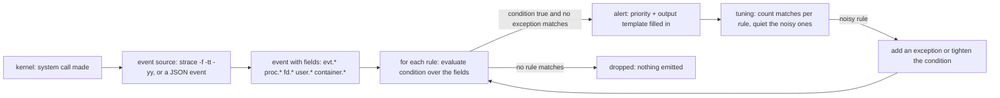

# Runtime Detection Is a Rule Engine Over System Calls

*Prevention bounds what a process can do; detection is a rule engine over the system calls it does make, and names the match as it happens.*

## Metadata

| Field | Value |
|---|---|
| Type | Build |
| Languages | Python |
| Prerequisites | [Syscalls & strace](https://cloudcaptain.io/learn/linux/syscalls-strace), [Runtime Security](https://cloudcaptain.io/learn/containers/runtime-security) |
| Time | 90 minutes |
| Tools | falco, strace, docker, kubectl, kind |

<Quiz stage="pre" />

## The Problem

The payments service runs the hardened image from the last lesson: non-root, `cap-drop ALL`, a read-only root filesystem, the runtime's default seccomp profile. On Tuesday at 02:14 a dependency with a deserialization bug gives an attacker a shell in one pod. The hardening holds where it was set: the shell is uid 1000, it cannot write to `/usr`, and `mount` returns `EPERM`. But `/tmp` is a writable `emptyDir`, the service account token is mounted, and nothing stops the shell from reading `/etc/shadow`, dropping a miner into `/tmp`, and opening a connection to a pool on the internet. None of that is a new bug. Each step is an ordinary system call the kernel was always going to allow, because the process was allowed to make it.

Prevention decided what the process *could* do before it started. It has no opinion about what the process *does* at 02:14, and it leaves no record. The first anyone hears of it is a cloud bill alert four days later. When the on-call engineer finally reads the node, the miner is gone, `/tmp` is empty again because the pod restarted, and the only evidence is a spike in a Grafana panel. There was a moment, between the shell spawning and the outbound connection, when the sequence of calls was unmistakable: a shell, a read of `/etc/shadow`, an execve from `/tmp`, a connect to a strange address. Nobody was watching the calls.

Runtime detection watches them. It attaches to the kernel, receives every system call the filters let through, and runs a list of rules against each one. A rule is a condition over fields of the event (`evt.type`, `proc.name`, `fd.name`, `container.id`), a priority, and an output line. When a call matches, it emits an alert with the fields filled in, in the moment. You are going to write `minifalco`: an event model built from `strace` output and a JSON event format, a condition language modelled on Falco (lists, macros, fields, `and`/`or`/`not`, `in`, `startswith`, `glob`), rule evaluation with priorities, exceptions and output rendering, and a tuning report that counts matches per rule so you can quiet the noisy ones before you ever enforce. After that, a Falco rule and the alert it fires are the same object you built, read off a running node.

## The Concept

A rule engine is a bouncer with a printed list. Each person who walks past (each system call) is checked against every line on the list. A line is a condition ("a shell, started inside a container") joined by `and`, `or` and `not`; when a person matches a line, the bouncer writes down a note (the alert) with their description filled in from the template. The bouncer does not stop anyone and does not decide who gets in: that was the door policy, set earlier. The bouncer only notices and records, in order, as people pass.

The event is the unit. Falco turns each system call into an event with fields grouped by object: `evt.*` is the call itself (`evt.type` is `execve`, `openat`, `connect`), `proc.*` is the process that made it (`proc.name`, `proc.pname` the parent, `proc.cmdline`, `proc.exe`), `fd.*` is the file or socket it touched (`fd.name` a path or a unix socket, `fd.sip` and `fd.sport` a remote address), `user.*` is the identity (`user.uid`, `user.name`), and `container.*` is the context (`container.id`, which is the literal `host` when the call happened outside any container). A rule is written against those field names, so the same rule reads a `cat /etc/shadow` on a bare host and inside a pod.

Three pieces keep rules readable and reusable. A **list** is a named set of values (`shell_binaries` is `bash, sh, zsh, ...`) that expands inside `in (...)`. A **macro** is a named condition (`spawned_process` is `evt.type in (execve, execveat)`) that you drop into a rule as a bare word, so one fix to the macro fixes every rule that uses it. An **exception** is a carve-out on a rule: a field and a set of values that, when matched, suppress the alert, which is how you say "this rule, but not when `apt` is the one writing under `/etc`". Every rule also carries a **priority** (`EMERGENCY` down to `DEBUG`) and an **output** template with `%field` placeholders filled in at match time.



Detection is not prevention, and the distinction decides what you expect from it. Prevention (seccomp, capabilities, a read-only root, admission policy) sets limits before the process runs and refuses calls that cross them; it is a wall. Detection reads the calls that happen and raises an alert; it is a camera. A camera does not stop the burglar, so an alert is only as good as the hand that acts on it, and a rule that fires on normal behaviour (every `apt-get` writing under `/etc`) trains everyone to ignore it. That is why tuning comes before enforcement: you run the rules in audit, count what fires, add exceptions for the legitimate matches, and only then wire the alert to a pager or an automated response. The engine also sees only what the kernel delivers to it; a rootkit that patches the syscall table below the probe, or activity on a node with no sensor, is invisible. You detect what you watch.

## Build It

`code/main.py` is `minifalco`. The rule language is pure functions over an `Event`, which is a bag of fields; the one place that touches the system is reading a file, and even that is given as text to the parser, so every test runs on macOS without strace, Docker or root. `code/rules/minifalco_rules.json` is the built-in ruleset and `code/fixtures/` holds attack and benign captures in both the JSON and the `strace` formats.

### Step 1: tokenize the condition language

A condition is a string like `proc.name in (shell_binaries) and container.id != host`. The tokenizer walks it once: whitespace separates, `()` and `,` are structural, a quoted string is one token, a run of `=!<>` is one operator, and anything else is a bare word (a field, a keyword, a path, a bare value). Paths such as `/etc/` survive as single words because `/` and `.` are not special.

```python
def tokenize(text: str) -> List[str]:
    tokens: List[str] = []
    i = 0
    while i < len(text):
        ch = text[i]
        if ch.isspace():
            i += 1
        elif ch in "(),":
            tokens.append(ch)
            i += 1
        elif ch in "\"'":
            ...
        elif ch in "=!<>":
            j = i
            while j < len(text) and text[j] in "=!<>":
                j += 1
            tokens.append(text[i:j])
            i = j
        else:
            j = i
            while j < len(text) and not text[j].isspace() and text[j] not in "(),\"'=!<>":
                j += 1
            tokens.append(text[i:j])
            i = j
    return tokens
```

### Step 2: parse fields, macros and lists into one tree

A recursive-descent parser builds an AST: `parse_or` over `parse_and` over `parse_unary` (which handles `not`) over `parse_atom`. The one interesting decision is in `parse_atom`: a bare word is a **field comparison** if the next token is an operator, and a **macro reference** otherwise. That is how `spawned_process` (a macro) and `proc.name` (a field, followed by `in`) live in the same grammar.

```python
    def parse_atom(self) -> Node:
        if self.peek() == "(":
            self.next()
            node = self.parse_or()
            self.expect(")")
            return node
        name = self.next()
        following = self.peek()
        if following in COMPARISONS or following in STRING_OPS or following in SET_OPS or following in UNARY_FIELD_OPS:
            return self.parse_predicate(name)
        return self.expand_macro(name)
```

Macros are compiled once into their own subtree and spliced in; `expand_macro` tracks a stack so a macro that refers to itself raises instead of looping. Inside `in (...)`, each item is looked up in the lists table and, if it names a list, expanded in place, so `proc.name in (shell_binaries)` becomes a membership test against `bash, sh, zsh, ...`.

### Step 3: evaluate one field against one value

Every leaf is a `Compare`, a `Membership` or an `Exists`. `apply_comparison` is the whole operator set in one function. Equality on a boolean field is case-insensitive (so `evt.is_open_write = true` matches the Python `True`); the ordering operators parse both sides as numbers and simply fail to match when a side is not numeric; the rest are string tests.

```python
def apply_comparison(raw: Any, op: str, expected: str) -> bool:
    if op in ("=", "=="):
        return stringify(raw).lower() == expected.lower() if isinstance(raw, bool) else stringify(raw) == expected
    if op == "!=":
        return True if raw is None else stringify(raw) != expected
    if op in ("<", "<=", ">", ">="):
        left, right = as_number(raw), as_number(expected)
        return False if left is None or right is None else NUMERIC[op](left, right)
    text = stringify(raw)
    if op == "startswith":
        return text.startswith(expected)
    if op == "glob":
        return fnmatch.fnmatchcase(text, expected)
    ...
```

`Membership` handles `in` (exact set membership), `pmatch` (a path matches if a list entry is one of its parent directories, so `/etc` matches `/etc/passwd` but not `/etcd/data`) and `intersects`. `container.id != host` is true whenever the id is present and not the literal `host`, because an `Event` returns `"host"` for a missing `container.id`.

### Step 4: build events from strace, keeping process identity

The JSON source is a list of field bags, read straight in. The `strace -f -tt -yy` source is the interesting one: a single capture is a stream of calls across a process tree, and a rule needs `proc.name` and `proc.pname`, which a raw line does not carry. `parse_strace_events` tracks them. On a `clone`/`fork` it records the child's parent and inherits its program; on a successful `execve` it sets the running program for that pid; file and network events are then labelled with the current program's basename.

```python
        if name in FORK_CALLS and code is not None and code > 0:
            parents[code] = pid
            if pid in programs:
                programs[code] = programs[pid]
            continue
        if name in EXEC_CALLS and code == 0:
            proc_name = os.path.basename(argv[0]) if argv else os.path.basename(path)
            programs[pid] = path
            names[pid] = proc_name
            base["evt.type"] = "execve"
            base["proc.exe"] = path
            base["proc.name"] = proc_name
            events.append(Event(base, position))
```

`proc.name` comes from the basename of `argv[0]`, not the executable path, which matters on Alpine: `/bin/cat` is a symlink to `/bin/busybox`, so the path is `busybox` but the command name is `cat`, and a rule keyed on `proc.name in (shell_binaries)` must see `cat`, not `busybox`. For `open`/`openat` the flags string decides direction: `evt.is_open_write` is true when the flags include any of `O_WRONLY`, `O_RDWR`, `O_CREAT`, `O_APPEND` or `O_TRUNC`, so a plain `O_RDONLY` of `/etc/shadow` is a read and an `O_WRONLY|O_CREAT` of `/etc/cron.d/x` is a write. A `connect` has its `sockaddr` parsed: `AF_INET` yields `fd.sip` and `fd.sport`, `AF_UNIX` yields the socket path as `fd.name`. strace has no container id, uid or name, so those come from CLI flags (`--container-id`, `--proc-uid`, `--user-name`) and are stamped onto every event; on a live node you pass the id you read from `docker inspect`.

### Step 5: a rule, its exception, and the match

A `Rule` owns a compiled condition node, a priority, an output template and a list of exceptions. It matches when it is enabled, the condition is true, and no exception fires. An exception is a single field predicate (a field, an operator, a set of values, with list names expanded); any one matching suppresses the alert, which is `and not (e1 or e2 or ...)` written as data.

```python
    def matches(self, event: "Event") -> bool:
        if not self.enabled:
            return False
        if not self.node.evaluate(event):
            return False
        return not any(exception.matches(event) for exception in self.exceptions)
```

`evaluate(ruleset, events, min_priority)` runs every rule against every event and collects an `Alert` per match, skipping rules whose priority is below the floor (a higher `PRIORITY_RANK` index is less severe). Rendering the output substitutes each `%field` with the event's value, printing `<NA>` for a field the event lacks, exactly as Falco does.

### Step 6: tune before you enforce

`tune` runs the same matching but counts, per rule, how many events matched and which process names drove them. A rule at the top of that list with one benign process under it is a candidate for an exception, not a pager.

```python
            if rule.matches(event):
                counts[rule.name] += 1
                proc = stringify(event.get("proc.name")) or "<unknown>"
                by_proc[rule.name][proc] = by_proc[rule.name].get(proc, 0) + 1
```

### Step 7: run it

```bash
python3 code/main.py list-rules                                                  # six rules, priorities and conditions
python3 code/main.py run code/fixtures/events-attack.json                        # one alert per rule, exit 1
python3 code/main.py run code/fixtures/events-benign.json; echo "exit $?"        # 0 alerts, exit 0
python3 code/main.py run code/fixtures/capture-attack.strace --container-id a1b2c3d4e5f6 --user-name root   # same six from strace
python3 code/main.py run code/fixtures/events-attack.json --min-priority ERROR   # only Write below etc and the socket
python3 code/main.py tune code/fixtures/events-attack.json                       # matches per rule, top processes
python3 code/main.py run code/fixtures/events-attack.json --json | head -20
```

`run` exits 1 when any alert fires and 0 when none do, so it also works as a gate in a pipeline; bad input or a broken rule exits 2 with the reason. The attack capture fires all six rules (shell in a container, read of `/etc/shadow`, write under `/etc`, execve from `/tmp`, an outbound connection from `nc`, and a touch of the Docker socket); the benign capture, which runs the same program and reads the same `/etc/ld.so.cache`, fires nothing.

<RunTests />

## Use It

Now the real engine. Falco (0.45.2, the CNCF runtime security project, with its default rules at version 5.2.0) attaches to the kernel with a modern eBPF probe, turns every syscall into an event, and runs its rules. It confirmed the release and image tag exist on Docker Hub as `falcosecurity/falco:0.45.2`. Run it on the node, read its rules, and fire the same actions you detected offline:

```bash
docker run --rm -i -t \
  --privileged \
  -v /var/run/docker.sock:/host/var/run/docker.sock \
  -v /proc:/host/proc:ro \
  -v /etc:/host/etc:ro \
  falcosecurity/falco:0.45.2 falco --version        # driver and rules versions

falco -L                                            # like minifalco list-rules: every rule, macro and list
falco --validate /etc/falco/falco_rules.yaml        # parse and check the rules, then exit (like loading minifalco's ruleset)
falco -r /etc/falco/falco_rules.yaml --dry-run      # load everything without reading events
```

Falco's default ruleset ships the detections you built, written in YAML instead of JSON but with the same pieces: lists, macros, conditions and priorities. The shape maps one to one:

```yaml
- list: shell_binaries
  items: [ash, bash, csh, ksh, sh, tcsh, zsh, dash, busybox]

- macro: spawned_process
  condition: (evt.type in (execve, execveat))

- macro: container
  condition: (container.id != host)

- rule: Terminal shell in container
  desc: A shell was used as the entrypoint/exec point into a container with an attached terminal.
  condition: spawned_process and container and shell_procs and proc.tty != 0 and container_entrypoint
  output: A shell was spawned in a container (user=%user.name container=%container.id proc=%proc.name parent=%proc.pname)
  priority: NOTICE
  tags: [maturity_stable, container, shell, mitre_execution, T1059]
```

Run Falco in one terminal and trigger the actions in another, to see the events arrive live:

```bash
docker run -d --name cc-target alpine:3.22 sleep 3600
docker exec -it cc-target sh                          # Falco: "Terminal shell in container" (NOTICE)
# inside the shell:
cat /etc/shadow                                       # Falco: "Read sensitive file untrusted" (WARNING)
cp /bin/busybox /dev/shm/x && /dev/shm/x id           # Falco: "Execution from /dev/shm" (WARNING)
```

Three of `minifalco`'s rules map onto stable Falco default rules; the other three are covered by Falco only through its sandbox/incubating rules or by a rule you tune on, so a stock Falco stays quiet on them. State that honestly rather than claiming parity:

| What you built | Falco default rule (5.2.0) | Note |
|---|---|---|
| `Shell spawned in a container` | `Terminal shell in container` (NOTICE) | Falco also requires `proc.tty != 0` and `container_entrypoint`, so it fires on an interactive `docker exec -it`, not on every non-interactive shell |
| `Read sensitive file untrusted` | `Read sensitive file untrusted` (WARNING) | same `sensitive_file_names` idea; Falco's trusted-reader exclusion list is far longer |
| `Execution from world-writable directory` | `Execution from /dev/shm` (WARNING) | Falco's stable rule covers `/dev/shm`, not `/tmp`; your rule covers both, so map only the `/dev/shm` half |
| `Write below etc` | sandbox rule `Write below etc` | not in the stable default set; enable the incubating rules or add it yourself |
| `Unexpected outbound connection` | tuned `outbound`/`Unexpected...` rules | the default outbound macros are `never_true` until you define the allowed destinations |
| `Container runtime socket accessed` | custom rule | no stable default; write a rule on `fd.name in (docker.sock, ...)` |
| `minifalco tune` | `falco --stats-interval`, rule match counts, falcosidekick metrics | count before you page; a noisy rule is worse than no rule |
| exceptions as data | Falco rule `exceptions:` and `- macro: user_known_...` overrides | tune by exception, not by deleting the rule |

Tuning is the real work. `falco -L` shows that most noisy rules end with `and not user_known_...`, a macro that defaults to `never_true` and is yours to override with the legitimate cases in your environment. The route to enforcement is the same as `minifalco tune`: run in audit, read the counts (falcosidekick fans the alerts out to Slack, a webhook, or Prometheus), add exceptions for the benign matches, and only then act on the alerts. Falco does not respond on its own; `falco-talon` or a falcosidekick action can kill or isolate a pod, but that is a separate, deliberate step. Tetragon (eBPF, from the Cilium project) is the main alternative and can also enforce in-kernel; the trade-off is that enforcement from a detection rule risks killing legitimate work on a false positive, which is why most teams page a human first.

<Quiz stage="check" />

## Ship It

Two artifacts in `outputs/`:

- **`skill-runtime-alert-triage.md`**: a runbook for a runtime alert. It separates the alert (a camera) from containment (the wall), reads the alert's fields into a one-line "what, where, who", reconstructs the process tree and the sequence of calls around it, decides true positive against tuned-out noise, contains without destroying evidence, and ends with a fixed report that either opens an incident or adds an exception with a reason.
- **`prompt-write-falco-rule.md`**: describe a behaviour to catch and the benign activity that looks like it, and get back a Falco rule with its lists and macros, the fields it keys on, the exceptions that keep it quiet, a tuning plan (audit, count, enforce), and the two commands that prove it fires on the bad case and stays silent on the good one.

<ShipIt />

## Exercises

### Easy

Add a `glob` based rule and its negative test. Write a rule "Hidden file created under a home directory" with condition `open_write and fd.name glob /home/*/.??*` (a dotfile with at least two characters), priority `NOTICE`. Write the test first against an `Event` that opens `/home/jo/.bashrc.bak` for write (fires) and one that opens `/home/jo/notes.txt` (does not), then confirm `fd.name glob /home/*/.??*` does not match `/home/jo/.x` (one character after the dot).

### Medium

Rules can double-count. A single `openat` of `/etc/shadow` for write would match both `Write below etc` and, if you added a shadow-write rule, that one too, so one event yields two alerts. Add a `--dedup` mode to `run` that, within one event, keeps only the highest-priority alert and records the suppressed rule names in the alert's JSON under `also_matched`. Write the test first: an event that matches two rules yields one alert at the more severe priority with the other rule listed. Decide and document whether dedup happens before or after `--min-priority` filtering.

### Hard

Falco rules carry `append` and `override` so you can tune a shipped rule without editing it. The loader already merges an `overrides` map keyed by rule name; extend it to also support `append`, where a condition fragment is joined to the base rule's condition with `and` (the common case is `and not <your macro>`). Add `--rules-append file.json` that layers an exception macro and an `append` onto `Read sensitive file untrusted` so that your backup agent reading `/etc/shadow` stops firing, while `cat /etc/shadow` still fires. Prove it with a test that loads the base ruleset plus the overlay and checks both outcomes, and explain why append-with-`and` can only ever make a rule quieter, never louder.

<Quiz stage="post" />

## Key Terms

| Term | Common misconception | Precise definition |
|---|---|---|
| Runtime detection | "It blocks attacks like a firewall." | A sensor reads the system calls a process makes and raises an alert when they match a rule. It records and notifies; it does not refuse the call. Prevention (seccomp, capabilities, admission) is the wall; detection is the camera. |
| Event | "A log line." | One system call turned into a bag of typed fields grouped by object: `evt.*` the call, `proc.*` the process, `fd.*` the file or socket, `user.*` the identity, `container.*` the context. Rules are written against the field names. |
| Rule | "A regular expression over logs." | A named condition over event fields, joined by `and`/`or`/`not`, with a priority and an output template. It matches a single event at a time and emits one alert per match. |
| Macro | "A variable." | A named condition spliced into rules as a bare word (`spawned_process` is `evt.type in (execve, execveat)`). One edit to the macro changes every rule that uses it. |
| List | "The same as a macro." | A named set of values that expands inside `in (...)`. Lists hold data (process names, paths); macros hold logic (conditions). |
| Exception | "Disabling the rule." | A field-and-values carve-out that suppresses the alert when it matches, leaving the rule active for everything else. It is how you tune out a known-good match without deleting the rule. |
| `container.id = host` | "An empty or missing container." | The literal string `host`: Falco sets `container.id` to `host` for a call made outside any container, so `container.id != host` means "inside a container". |
| Priority | "Higher number is more urgent." | A named level from `EMERGENCY` (most severe) down through `CRITICAL`, `ERROR`, `WARNING`, `NOTICE` to `DEBUG`. A severity floor keeps low-priority rules out of the pager; it does not change what matched. |
| Tuning | "Turning rules off until it is quiet." | Running rules in audit, counting what fires per rule and per process, and adding exceptions for the legitimate matches before enforcement. An untuned rule that fires on normal behaviour trains everyone to ignore it. |
| eBPF probe | "A kernel module Falco installs." | A program loaded into the running kernel that delivers syscall events to user space without a custom module. The modern eBPF driver needs a recent enough kernel; where it is missing, the sensor cannot see the calls. |

## Further Reading

- [DevSecOps Fundamentals](https://cloudcaptain.io/docs/tools/devsecops/fundamentals): where runtime detection sits next to image scanning, admission policy and the prevention layers in a pipeline.
- [Linux Security](https://cloudcaptain.io/docs/tools/linux/security): the syscalls, capabilities and audit subsystem the sensor reads, from the host's side.
- [Kubernetes Security](https://cloudcaptain.io/docs/tools/kubernetes/security): the cluster context Falco's `container.*` and `k8s.*` fields come from, and how an alert reaches an on-call responder.
- [Docker Security & Production](https://cloudcaptain.io/docs/tools/docker/security-production): the prevention layer a detection rule assumes is already in place, and the Docker socket an attacker reaches for.
- [Falco documentation](https://falco.org/docs/): the rule language, fields, default ruleset and the modern eBPF driver, with every field name `minifalco` borrows.
- [Falco rules reference](https://falco.org/docs/concepts/rules/): lists, macros, conditions, priorities, outputs and `exceptions`, the exact shape this lesson reimplements.
- [Falco supported fields](https://falco.org/docs/reference/rules/supported-fields/): the full `evt.*`, `proc.*`, `fd.*`, `user.*` and `container.*` catalogue, of which `minifalco` implements a slice.
- [sysdig/libs supported syscalls](https://github.com/falcosecurity/libs): the driver that turns kernel calls into events, the layer below the rules.
- [Tetragon](https://tetragon.io/docs/): the eBPF alternative from the Cilium project, which can also enforce in-kernel, and the trade-off that makes.
