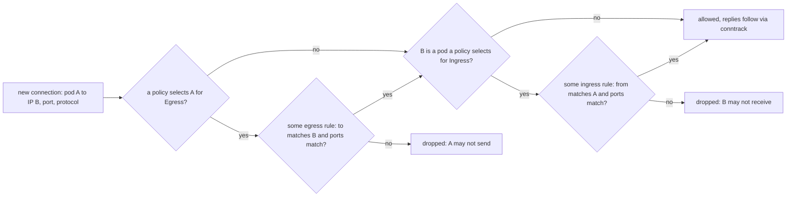

# A NetworkPolicy Is a Default Deny You Have to Write

*A pod accepts every connection until a policy selects it; then only the union of the rules gets through, and both ends must agree.*

## Metadata

| Field | Value |
|---|---|
| Type | Build |
| Languages | Python |
| Prerequisites | [A Service Is a Virtual IP and a Rewrite Rule](https://cloudcaptain.io/learn/orchestration/services-dns) |
| Time | 90 minutes |
| Tools | kubectl, kind, kindnet, docker, Cilium, Calico |

<Quiz stage="pre" />

## The Problem

Tuesday, 09:10. The incident report is short. An outdated plugin in the marketing CMS gave an attacker a shell in one pod, and from that pod they opened a connection straight to the payments database on port 5432, guessed nothing, and read the replication user's password from an environment variable of a pod they could also reach. Nobody had written a NetworkPolicy, so every pod in the cluster could connect to every other pod on every port. The CMS and the database had nothing in common except the cluster.

By Friday the platform team has a fix: a `deny-all` policy in the `payments` namespace and a handful of allow rules. Within minutes every payments pod logs `Temporary failure in name resolution`: the policy denies egress, and DNS is egress to CoreDNS in `kube-system`. Someone adds DNS back. The checkout frontend still cannot reach the API, although the API's policy allows it: the frontend's own namespace now denies egress, and a connection needs both ends to agree. A third change "allows the monitoring scanner" with a `namespaceSelector` and a `podSelector` written as two list items, which opens the database to every pod in the monitoring namespace. And the policy meant to stop exfiltration, `egress: []` without `policyTypes`, never restricted egress at all: the API server defaults such a policy to Ingress only. On a second cluster built with a network plugin that does not implement NetworkPolicy, every `kubectl apply` succeeded and nothing was enforced.

None of this is exotic. NetworkPolicy is a small, precise language with no deny rule, no ordering and a few defaults that read the opposite of what they do. You are going to write `mininetpol`, an evaluator over what `kubectl get pods,namespaces,networkpolicies -o json` prints: isolation per direction, the union of rules, peers, `ipBlock` with `except`, named ports and `endPort`, a connectivity matrix for every pod pair and port, `explain` for one connection, and a linter for the traps above. Then you check every prediction against a kind cluster by probing the real connections from inside the pods.

## The Concept

Think of an office building where every door is propped open. Nobody is locked out until a door gets a badge reader. From then on that door opens only for the badges on its list, and the list is the sum of every access grant that names that door; there is no grant that takes access away. Leaving a room is a separate door with its own reader. To get from one room into another you must be let out of the first and let into the second.

A NetworkPolicy is the badge reader, and the pod is the room:

- **Selection.** A policy lives in a namespace and selects pods there with `spec.podSelector`. An empty selector (`podSelector: {}`) selects every pod in the namespace, not none.
- **Isolation per direction.** A pod selected by at least one policy whose `policyTypes` contains `Ingress` is isolated for ingress; the same for `Egress`. A pod that no policy selects for a direction allows everything in that direction. If `policyTypes` is missing, the API server sets it to `[Ingress]`, plus `Egress` only if `spec.egress` has at least one rule.
- **Union.** For an isolated pod, a connection is allowed if any rule of any policy that selects it matches. Rules only add; their order and the order of policies do not matter.
- **Both ends.** A new connection from pod A to pod B on a port needs A's egress side and B's ingress side to allow it. Replies to an allowed connection are allowed automatically; the enforcer tracks connections.
- **A rule** has peers (`from` for ingress, `to` for egress) and `ports`; both must match, and a missing or empty list matches everything. A peer is `podSelector` (pods in the policy's own namespace), `namespaceSelector` (all pods in the selected namespaces), both in one element (pods matching the first in namespaces matching the second, an AND), or `ipBlock` (a CIDR minus its `except` ranges). Separate elements are ORed. A port is a number, a range with `endPort`, or a name that resolves to the destination pod's container port of that name; the protocol defaults to TCP.

The API server only validates and stores these objects. Enforcement is the network plugin's job: an agent on every node turns policies into packet filters. kindnet, kind's default plugin, has enforced NetworkPolicy since kind v0.24.0 through the SIG Network project kube-network-policies: an nftables rule sends the first packet of each new connection to a userspace agent through NFQUEUE, the agent evaluates the policies and returns accept or drop, and the connection's later packets follow conntrack. The rule sits in the postrouting hook before source NAT, after Service DNAT, so a connection to a ClusterIP is judged by the backend pod it was rewritten to. A plugin without NetworkPolicy support (flannel on its own is the classic example) accepts the same objects and enforces nothing.



There are things NetworkPolicy cannot say. It has no deny rule, so "everything except the database" is written as allow rules for everything else. It cannot block traffic from a pod's own node (kubelet probes must work), cannot match host names or HTTP paths, and does not apply to `hostNetwork` pods, which use the node's addresses. Labels are the identity: anyone allowed to create a pod with `app=frontend` in a namespace gets the frontend's network access there.

## Build It

`code/main.py` is `mininetpol`. It reads the JSON `kubectl` prints, and everything after loading is pure functions over dataclasses. The tests use `code/fixtures/lab/`: two namespaces with a `frontend`, `api` and `db` pod in `cc-network-policy` and a `scanner` pod in `cc-network-policy-tools`, two CoreDNS pods, seven policy files applied one after another, and `expected.json`, the connections each step allows. The smoke test deploys the same pods and policies on kind and compares the real network with the same file.

### Step 1: load what kubectl prints

Pods become an IP, labels and container ports. Three kinds of pod cannot take part and are skipped with a note:

```python
    if spec.get("hostNetwork"):
        return None, f"{key} skipped: a hostNetwork pod uses the node's addresses and no NetworkPolicy selects it"
    if status.get("phase") in TERMINAL_PHASES:
        return None, f"{key} skipped: phase {status['phase']}"
    ip = pod_ip(status)
    if not ip:
        return None, f"{key} skipped: no pod IP yet"
```

Namespaces keep their labels, and `kubernetes.io/metadata.name` is added if the dump lacks it, because the API server sets that label on every namespace and it is the only portable way to select a namespace by name. `load_cluster()` keys every object by namespace and name, so a later `-f proposed.json` replaces the policy of the same name: that is how you evaluate a pull request before it is applied, and how step 7 replaces step 6's `db-allow`.

### Step 2: validation and the policyTypes default

```python
def default_policy_types(spec: Dict[str, Any]) -> List[str]:
    return [INGRESS, EGRESS] if spec.get("egress") else [INGRESS]
```

That one line is the most expensive trap in the API. `egress: []` is falsy, so a policy written as "select everything, allow no egress" without `policyTypes` becomes an Ingress-only policy: it denies all ingress and leaves egress wide open. `make_policy()` applies this default only when `policyTypes` is absent, and refuses what the API server refuses, with the same words:

```python
def parse_peer(raw: Any, where: str) -> Peer:
    if not isinstance(raw, dict):
        raise InputError(f"{where}: a peer is an object with podSelector, namespaceSelector or ipBlock")
    has_pods = raw.get("podSelector") is not None
    has_namespaces = raw.get("namespaceSelector") is not None
    block = raw.get("ipBlock")
    if not (has_pods or has_namespaces or block is not None):
        raise InputError(f"{where}: Required value: must specify a peer")
    if block is not None and (has_pods or has_namespaces):
        raise InputError(f"{where}: Forbidden: may not specify both ipBlock and another peer")
```

`parse_port()` adds the port rules: `endPort` needs a numeric `port` and must not be smaller; a named port is at most 15 lowercase letters, digits and dashes with at least one letter (so `"8080"` as a string is an invalid name, not a number); `except` must be a strict subset of `cidr`. A missing `spec.podSelector` is accepted and stored as `{}`: every pod in the namespace.

### Step 3: selectors and peers

```python
def selector_matches(selector: Selector, labels: Dict[str, str]) -> bool:
    for key, value in selector.match_labels.items():
        if labels.get(key) != value:
            return False
    for key, operator, values in selector.expressions:
        present = key in labels
        if operator == "In" and not (present and labels[key] in values):
            return False
        if operator == "NotIn" and present and labels[key] in values:
            return False
        if operator == "Exists" and not present:
            return False
        if operator == "DoesNotExist" and present:
            return False
    return True
```

Every term must hold, an empty selector holds for everything, and `NotIn` holds for objects that lack the key. A peer combines selectors like this:

```python
def peer_matches(cluster: Cluster, policy_namespace: str, peer: Peer, other: Endpoint) -> bool:
    if peer.cidr is not None:
        return in_block(other.ip, peer.cidr, peer.excepts)
    pod = other.pod
    if pod is None:
        return False
    if peer.namespace_selector is None:
        in_namespace = pod.namespace == policy_namespace
    else:
        in_namespace = selector_matches(peer.namespace_selector, cluster.namespace_labels(pod.namespace))
    return in_namespace and (peer.pod_selector is None or selector_matches(peer.pod_selector, pod.labels))
```

A `podSelector` alone never reaches outside the policy's namespace; `namespaceSelector: {}` alone means every pod in every namespace; selectors never match an address outside the cluster, only `ipBlock` does. `ipBlock` here is plain IP arithmetic and therefore also matches pod IPs, as kube-network-policies does. The NetworkPolicy documentation says `ipBlock` is meant for cluster-external addresses and leaves pod IPs to the implementation, and Cilium, for one, does not apply CIDR rules to traffic between cluster endpoints by default. Select pods with selectors.

### Step 4: ports, numbered, ranged and named

```python
def port_matches(rule_port: PolicyPort, port: int, protocol: str, destination: Optional[Pod]) -> bool:
    if rule_port.protocol != protocol:
        return False
    if rule_port.port is None:
        return True
    if isinstance(rule_port.port, int):
        last = rule_port.end_port if rule_port.end_port is not None else rule_port.port
        return rule_port.port <= port <= last
    if destination is None:
        return False
    return any(cp.name == rule_port.port and cp.port == port and cp.protocol == protocol for cp in destination.ports)
```

A named port is looked up on the **destination** pod for ingress and for egress alike, so `port: http` can mean 8080 on one pod and 8081 on another, and matches nothing on a pod that declares no port called `http` or on an address outside the cluster. A pod can listen on ports it never declares; a numbered rule still matches them, a named one cannot. A port entry with only a protocol means every port of that protocol.

### Step 5: one side, then both

```python
def evaluate_side(cluster: Cluster, direction: str, subject: Optional[Pod], other: Endpoint, port: int, protocol: str, destination: Optional[Pod]) -> Side:
    if subject is None:
        return Side(direction, None, "", [], True, [])
    policies = selecting_policies(cluster, subject, direction)
    checks = [
        check_rule(cluster, policy, direction, index, rule, other, port, protocol, destination)
        for policy in policies
        for index, rule in enumerate(policy.rules(direction))
    ]
    allowed = not policies or any(c.allows for c in checks)
    return Side(direction, subject.key, subject.namespace, [p.name for p in policies], allowed, checks)


def evaluate(cluster: Cluster, source: Endpoint, destination: Endpoint, port: int, protocol: str) -> Verdict:
    egress = evaluate_side(cluster, EGRESS, source.pod, destination, port, protocol, destination.pod)
    ingress = evaluate_side(cluster, INGRESS, destination.pod, source, port, protocol, destination.pod)
    return Verdict(source, destination, port, protocol, egress, ingress)
```

`not policies or any(...)` is the whole isolation model: no selecting policy means open, otherwise the union decides. A policy that selects the pod but has no rules for the direction adds isolation and nothing else, which is exactly what `default-deny` is. An end that is not a pod (an external address) has no policies and always allows. `check_rule()` records, for every rule it tries, whether the peer half and the port half matched and why, so `explain` can show near misses.

### Step 6: the matrix, and DNS as a column

`build_matrix()` evaluates every source pod against every other pod on each declared container port plus the `--port` values, against each `--external NAME=IP:PORT`, and with `--dns` against the kube-dns pods on 53/UDP. DNS goes to a Service, which DNATs each query to one CoreDNS pod, so the column is the verdict for all backends together:

```python
        if dns:
            verdicts = [evaluate(cluster, origin, endpoint_of(b), 53, "UDP") for b in backends]
            allowed = sum(1 for v in verdicts if v.allowed)
            state = ALLOWED if allowed == len(verdicts) else BLOCKED if allowed == 0 else PARTIAL
```

`partial` is the nastiest state in practice: a rule that matches one CoreDNS pod (by IP, or by a label only one replica has) makes lookups fail at random, depending on which backend the Service picks.

### Step 7: explain, lint, and the probes

`explain` prints both sides of one connection: which policies isolate each end, the rule that allows it, or every rule that was tried with the half that failed. `lint` checks the traps: `egress-not-isolated` (the `egress: []` default), `podselector-missing`, `or-peers` (a namespace-only peer next to a pod-only peer), `peer-selects-nothing` (with a hint when a `namespaceSelector` uses a `name` label no namespace has), `named-port-missing`, `ipblock-pods`, `ignored-rules` (rules for a direction not in `policyTypes`), `selects-nothing`, `allow-all`, and `dns-egress`, which evaluates every egress-isolated pod against the kube-dns pods. The `or-peers` check is a pairwise look at neighbouring elements:

```python
            for j in range(len(rule.peers) - 1):
                first, second = rule.peers[j], rule.peers[j + 1]
                if namespace_only(first) and pod_only(second):
                    namespaces, pods = first, second
                elif pod_only(first) and namespace_only(second):
                    namespaces, pods = second, first
                else:
                    continue
```

A prediction is only useful if you can check it. `serve` listens on TCP ports and answers every connection with its host name; the lab pods run it on 8080, 9090 and 5432. `probe` runs inside a pod, reads the `matrix --json` output on stdin and tries every cell of its own row in parallel, with a short timeout:

```python
def tcp_probe(address: str, port: int, timeout: float) -> Tuple[bool, str]:
    try:
        with socket.create_connection((address, port), timeout=timeout):
            return True, "connected"
    except socket.timeout:
        return False, "timeout"
    except ConnectionRefusedError:
        return False, "refused"
    except OSError as exc:
        return False, exc.strerror or exc.__class__.__name__


def dns_query(name: str, query_id: int) -> bytes:
    question = b"".join(bytes([len(label)]) + label.encode("ascii") for label in name.strip(".").split(".")) + b"\x00"
    return struct.pack("!HHHHHH", query_id, 0x0100, 1, 0, 0, 0) + question + struct.pack("!HH", 1, 1)
```

The DNS probe sends that query (one question, type A, recursion desired) to the `nameserver` from the pod's `/etc/resolv.conf` and counts any reply with the right ID as reachable, even NXDOMAIN, so it tests the network and not the name. A drop shows up as `timeout`; `refused` means the packet arrived and nothing listened, which is not a policy decision, and `compare` says so when it sees one.

### Step 8: run it

```bash
L=code/fixtures/lab
B="-f $L/pods.json -f $L/namespaces.json"
P="--namespace cc-network-policy --namespace cc-network-policy-tools --port 8080 --port 9090 --port 5432 --external ext-a=172.18.0.11:8080 --external ext-b=172.18.0.12:8080 --dns"
python3 code/main.py matrix $B -f $L/01-default-deny.json $P
#             api  db  frontend  scanner  ext-a  ext-b  dns
#   api       .    -   -         -        -      -      -
#   db        -    .   -         -        -      -      -
#   frontend  -    -   .         -        -      -      -
#   scanner   -    -   -         .        8080   8080   53/UDP
# 3 of 48 connections allowed
python3 code/main.py explain $B -f $L/01-default-deny.json -f $L/02-api-allow-frontend.json --from frontend --to api --port http; echo "exit $?"
python3 code/main.py matrix $B $(for f in $L/0*.json; do echo -f $f; done) $P          # all seven steps: 9 of 48
python3 code/main.py explain $B $(for f in $L/0*.json; do echo -f $f; done) --from api --to db --port postgres
python3 code/main.py lint $B -f code/fixtures/traps.json; echo "exit $?"                   # 10 warnings, exit 1
python3 code/main.py lint -f $L/01-default-deny.json                                      # dns-egress, even without pods
```

The first `explain` is the Friday bug, word for word:

```text
cc-network-policy/frontend (10.244.0.11) -> cc-network-policy/api (10.244.0.12) 8080/TCP: DENIED
  egress from cc-network-policy/frontend: isolated by default-deny
    nothing allows it; every rule that was checked:
    default-deny: no egress rules, it only isolates
  ingress to cc-network-policy/api: isolated by api-allow-frontend, default-deny
    allowed by api-allow-frontend ingress[0]: from[0] pods app=frontend in namespace cc-network-policy; ports[0] http/TCP (named) is 8080 on cc-network-policy/api
  a connection needs both ends to allow it: change the egress side of cc-network-policy/frontend
```

Steps 6 and 7 are the one-element and two-element versions of `db-allow`. With both selectors in one element the scanner cannot reach the database (it is not `app=api`); split into two elements, the scanner gets 5432 because it is in the tools namespace, and `api` is allowed in by the second element but still cannot get out, because `api`'s egress allows only DNS and the external range. Exit codes: `explain` 0 allowed, 1 denied; `lint` 1 on any warning; `compare` 1 on any difference; 2 for input that is not JSON, an unknown pod or an invalid policy.

<RunTests />

## Use It

Run the same seven steps on kind (Kubernetes <ToolVersion name="kubernetes" />, kind <ToolVersion name="kind" />) and measure the real connectivity matrix after each one. First check that something enforces policies at all:

```bash
kind create cluster --name cc-lab
kubectl -n kube-system get daemonset kindnet -o jsonpath='{.spec.template.spec.containers[0].image}{"\n"}'
docker exec cc-lab-control-plane nft list tables                       # table inet kindnet-network-policies is the enforcer
docker exec cc-lab-control-plane nft list table inet kindnet-network-policies | grep -m3 queue
```

kind releases before v0.24.0 shipped a kindnet that accepted NetworkPolicy objects and enforced none of them. If yours is older, or the cluster uses a plugin without policy support, do not swap the network plugin of a cluster other people use; create a separate one with `networking.disableDefaultCNI: true` in the kind config and install Calico or Cilium there. kindnet's enforcer fails open (`FailOpen` is set in kindnetd), so while its agent restarts, traffic flows.

Deploy the lab: four pods that run `mininetpol serve` from a ConfigMap, and two containers on the `kind` Docker network as addresses outside the cluster:

```bash
NS=cc-network-policy; TOOLS=cc-network-policy-tools; L=code/fixtures/lab
kubectl create namespace $NS && kubectl create namespace $TOOLS
for n in $NS $TOOLS; do kubectl -n $n create configmap mininetpol --from-file=main.py=code/main.py; done
kubectl apply -f $L/workloads.json
kubectl -n $NS wait --for=condition=Ready pod --all --timeout=120s && kubectl -n $TOOLS wait --for=condition=Ready pod --all --timeout=120s
for x in a b; do docker run -d --name cc-ext-$x --network kind -v "$PWD/code:/app:ro" python:3.12-alpine python3 /app/main.py serve --port 8080; done
EXT_A=$(docker inspect -f '{{(index .NetworkSettings.Networks "kind").IPAddress}}' cc-ext-a)
EXT_B=$(docker inspect -f '{{(index .NetworkSettings.Networks "kind").IPAddress}}' cc-ext-b)
docker network inspect kind -f '{{range .IPAM.Config}}{{.Subnet}} {{end}}'      # the IPv4 subnet goes into 05-api-egress-external.json
```

Then one function that predicts, probes from inside each pod and compares:

```bash
measure() {
  kubectl get pods,networkpolicies -A -o json > live.json
  kubectl get namespaces -o json > ns.json
  python3 code/main.py matrix -f live.json -f ns.json --namespace $NS --namespace $TOOLS \
    --port 8080 --port 9090 --port 5432 --external ext-a=$EXT_A:8080 --external ext-b=$EXT_B:8080 --dns --json > predicted.json
  for src in $NS/frontend $NS/api $NS/db $TOOLS/scanner; do
    kubectl -n ${src%/*} exec -i ${src#*/} -- python3 /opt/mininetpol/main.py probe --from $src - < predicted.json > measured-${src#*/}.json
  done
  python3 code/main.py compare predicted.json measured-*.json
}
measure                                                   # no policies: 48 of 48, identical
kubectl apply -f $L/01-default-deny.json && measure       # identical after a second or two: 3 of 48
kubectl apply -f $L/02-api-allow-frontend.json && measure
kubectl get networkpolicy api-allow-frontend -n $NS -o jsonpath='{.spec.policyTypes}{"\n"}'   # ["Ingress"]: the default, filled in
kubectl apply -f $L/03-frontend-egress-api.json -f $L/04-allow-dns.json && measure
kubectl describe networkpolicy allow-dns -n $NS           # "Allowing egress traffic: To Port: 53/UDP ... To: NamespaceSelector: ... PodSelector: k8s-app=kube-dns"
```

Enforcement is asynchronous: the agent sees the new object through a watch and updates its sets, so the first measurement after an apply can still show the old matrix. Measure until it converges, as the smoke test does, and never trust a single attempt that "worked". Edit `05-api-egress-external.json` with the subnet and `$EXT_B/32` as the `except` before applying it, then apply 06 and 07.

**Testing by hand.** `kubectl exec` into the real pod tests with its labels and IP. When the image has no tools, an ephemeral container shares the pod's network namespace, so the same policies apply to it:

```bash
API=$(kubectl -n $NS get pod api -o jsonpath='{.status.podIP}')
kubectl -n $NS debug frontend -it --image=busybox:1.37 -- nc -zv -w 2 $API 8080      # open
kubectl -n $NS debug frontend -it --image=busybox:1.37 -- nc -zv -w 2 $API 9090      # timed out: dropped, not refused
kubectl -n $NS run probe --image=busybox:1.37 --restart=Never --labels=app=frontend -- nc -z -w 2 $API 8080
kubectl -n $NS get pod probe -o jsonpath='{.status.phase}{"\n"}'                     # Succeeded: the label alone bought the frontend's access
```

The last two lines are the security lesson in miniature: a new pod with the right label gets the same access, so RBAC on `create pods` in a namespace is part of your network policy. A pod that has just started can send its first packets before the node's agent has learned its IP and labels, and be treated as an unknown address for a moment; test with a retry, not a single attempt. Ephemeral containers cannot be removed from a pod once added; they disappear with the pod.

**Beyond the standard API.** The network plugins extend NetworkPolicy with what it lacks. Cilium's `CiliumNetworkPolicy` and `CiliumClusterwideNetworkPolicy` add L7 rules (HTTP methods and paths, Kafka topics), explicit deny rules and egress by DNS name; the DNS rule makes the agent's DNS proxy learn which IPs a name resolved to:

```yaml
apiVersion: cilium.io/v2
kind: CiliumNetworkPolicy
metadata:
  name: api-to-payment-provider
  namespace: cc-network-policy
spec:
  endpointSelector:
    matchLabels:
      app: api
  egress:
    - toEndpoints:
        - matchLabels:
            k8s:io.kubernetes.pod.namespace: kube-system
            k8s-app: kube-dns
      toPorts:
        - ports:
            - port: "53"
              protocol: ANY
          rules:
            dns:
              - matchPattern: "*.payments.example.com"
    - toFQDNs:
        - matchPattern: "*.payments.example.com"
      toPorts:
        - ports:
            - port: "443"
              protocol: TCP
```

`hubble observe --verdict DROPPED` then shows each drop with the policy verdict. Calico enforces standard NetworkPolicy and adds its own `projectcalico.org/v3` NetworkPolicy and GlobalNetworkPolicy with an `order`, `Deny`, `Log` and `Pass` actions, tiers, and policy for host endpoints (the node's own interfaces), which standard NetworkPolicy cannot express.

**The cluster-admin layer.** A namespace owner writes NetworkPolicy; a platform team needs rules nobody in a namespace can override, and a default that applies where nobody wrote anything. SIG Network's network-policy-api project defines that as ClusterNetworkPolicy (`policy.networking.k8s.io/v1alpha2`, still alpha CRDs), the successor of its earlier AdminNetworkPolicy and BaselineAdminNetworkPolicy. A cluster-scoped policy sits in the `Admin` tier, evaluated before any NetworkPolicy, or the `Baseline` tier, evaluated after; rules have the actions `Accept`, `Deny` and `Pass` (hand over to the next tier) and a priority where the lower number wins. An Admin `Deny` to the cloud metadata address cannot be undone by a namespace; a Baseline default deny is the cluster-wide version of the policy this lesson's title says you have to write, and any namespace can still open what it needs with NetworkPolicy. kindnet enables only the standard evaluator, so try this on a separate cluster with a plugin that implements it.

| What you built | Real tool | Note |
|---|---|---|
| `selecting_policies()`, `evaluate_side()` | the plugin's agent on every node: kindnet's kube-network-policies, Calico Felix, the Cilium agent | the API server stores policies whether or not anything enforces them |
| `default_policy_types()` | API server defaulting of `spec.policyTypes` | read it back with `kubectl get networkpolicy -o yaml`; `egress: []` alone means Ingress only |
| `parse_peer()`, `parse_port()` errors | API server validation | the same wording: `must specify a peer`, `may not specify both ipBlock and another peer` |
| `peer_matches()` on `ipBlock` | CIDR rules in each plugin | pod IPs inside an `ipBlock` are implementation-defined; select pods with selectors |
| `port_matches()` on named ports | resolved per destination pod by the agent | a named port never matches an address outside the cluster |
| `build_matrix()`, `probe`, `compare` | the upstream NetworkPolicy e2e tests (a reachability matrix of pods, probed with short timeouts), `kubectl debug`, `kubectl exec` | always measure after a change; enforcement is asynchronous |
| `explain` | `kubectl describe networkpolicy`, Hubble drop verdicts, Calico flow logs | the real tools show what happened; `explain` shows why from the objects |
| `lint` | code review | the API server accepts every trap in `traps.json` |
| not built | Cilium and Calico policy CRDs, ClusterNetworkPolicy | deny rules, L7, DNS names, tiers |

<Quiz stage="check" />

## Ship It

Two artifacts in `outputs/`:

- **`skill-network-policy-review.md`**: a runbook for reviewing a NetworkPolicy change or a namespace's isolation. It confirms that the cluster enforces policies at all, dumps pods, namespaces and policies, lints them, computes the connectivity matrix before and after the change with the proposed files overlaid, lists every connection the change opens or closes (DNS, monitoring scrapes, ingress controllers and webhooks included), verifies on the cluster with probes from inside the pods, and ends with a fixed report.
- **`prompt-explain-network-policy.md`**: paste NetworkPolicy manifests (and, if you have them, pod and namespace labels) with a question such as "can `frontend` reach `api` on 8080?", and get the isolation of each pod involved, the answer with the deciding rule at each end, the traps in the policies, the smallest fix as YAML and the commands that prove it.

<ShipIt />

## Exercises

### Easy

Add `who-can-reach --to POD --port PORT`: every source pod and every `ipBlock` (with its `except`) that may open that connection, each with the egress and ingress rules that allow it, plus a line saying whether the destination is reachable from outside the cluster at all. Write the tests first on the lab fixture: after step 7, `db` on `postgres` is reachable from `scanner` only, `api` is listed as allowed by `db-allow` but blocked by its own egress, and before step 1 the answer is "every pod and every address".

### Medium

Make Services first-class destinations. Read `kubectl get services,endpointslices -o json`, accept `--to NAMESPACE/SERVICE --port PORT`, translate the Service port to each ready endpoint's address and `targetPort` (named target ports resolve per endpoint, as in the services lesson), and evaluate each backend after the DNAT, reporting `partial` when only some backends are allowed. Tests first: a Service with a named `targetPort` that maps to 8080 on one pod and 8081 on another, a policy that allows only 8080, and the `partial` verdict that results.

### Hard

Implement ClusterNetworkPolicy tiers in front of and behind the NetworkPolicy evaluation: cluster-scoped objects with a `tier` (`Admin` or `Baseline`), a `priority`, a subject that selects namespaces or pods, and rules with `Accept`, `Deny` or `Pass`. Admin rules are checked by priority first; `Pass` hands the connection to NetworkPolicy; Baseline applies only to traffic that NetworkPolicy left undecided. Write the tests first (an Admin `Deny` beats a NetworkPolicy allow, an Admin `Pass` falls through to NetworkPolicy, a Baseline deny is overridden by a namespace's allow), then check them on a separate kind cluster with kube-network-policies' ClusterNetworkPolicy install, following the project's current release notes for the CRD version.

<Quiz stage="post" />

## Key Terms

| Term | Common misconception | Precise definition |
|---|---|---|
| Isolation | "Creating any NetworkPolicy in a namespace locks the whole namespace down." | A pod is isolated for a direction only if some policy in its namespace selects it and lists that direction in `policyTypes`; every other pod and direction stays open. |
| Union of rules | "A later or more specific policy can restrict an earlier one." | For an isolated pod, a connection is allowed if any rule of any selecting policy matches. There are no deny rules and no order; adding a policy can only allow more. |
| Both ends | "If the destination's policy allows it, the connection works." | A new connection needs the source's egress side and the destination's ingress side to allow it; replies to an allowed connection pass automatically. |
| `podSelector: {}` | "An empty selector selects nothing." | It selects every pod in the policy's namespace. A missing `spec.podSelector` is stored as `{}` and means the same. |
| Peer | "Listing `namespaceSelector` and `podSelector` under `from` narrows the source." | Each list element is one peer and elements are ORed. Both selectors in one element mean pods matching the first in namespaces matching the second; in two elements they mean either. |
| `policyTypes` default | "`egress: []` denies all egress." | Without `policyTypes`, the API server sets `[Ingress]`, adding `Egress` only when `spec.egress` has a rule; an empty egress list therefore leaves egress open. |
| Named port | "`port: http` refers to a Service port." | It is resolved on the destination pod, to that pod's container port with the same name and protocol; pods that declare no such port and addresses outside the cluster never match. |
| `ipBlock` | "An `ipBlock` with the pod CIDR is a neat way to allow all pods." | A CIDR minus its `except` ranges, meant for addresses outside the cluster; whether it matches pod IPs depends on the network plugin. |
| Enforcement | "If `kubectl apply` succeeded, the policy is active." | The API server only validates and stores policies. A network plugin agent on each node enforces them, asynchronously, and a plugin without support enforces nothing. |
| ClusterNetworkPolicy | "Kubernetes has no way to deny traffic." | An alpha cluster-scoped API from SIG Network with Admin and Baseline tiers around NetworkPolicy and `Accept`, `Deny` and `Pass` actions, for plugins that implement it. |

## Further Reading

- [Kubernetes Networking & Services](https://cloudcaptain.io/docs/tools/kubernetes/networking-services): Services, DNS and NetworkPolicy in the manifests you write every day.
- [Kubernetes Security](https://cloudcaptain.io/docs/tools/kubernetes/security): where NetworkPolicy sits next to RBAC, Pod Security and admission control.
- [Kubernetes Certification Prep](https://cloudcaptain.io/docs/tools/kubernetes/exam-prep): NetworkPolicy tasks in exam form, to practise the one-element versus two-element trap under time pressure.
- [Network Policies](https://kubernetes.io/docs/concepts/services-networking/network-policies/): the official semantics, including isolation, `policyTypes` defaulting and what NetworkPolicy cannot do.
- [NetworkPolicy API reference](https://kubernetes.io/docs/reference/kubernetes-api/policy-resources/network-policy-v1/): every field, with the exact wording about empty and missing lists that `mininetpol` follows.
- [kube-network-policies](https://github.com/kubernetes-sigs/kube-network-policies): the NFQUEUE-based enforcer inside kindnet; `pkg/networkpolicy` is a readable reference evaluator.
- [kind v0.24.0 release notes](https://github.com/kubernetes-sigs/kind/releases/tag/v0.24.0): the release that brought network policy support to kind's default plugin.
- [Network Policy API](https://network-policy-api.sigs.k8s.io/): ClusterNetworkPolicy, its tiers and actions, and the status of the earlier AdminNetworkPolicy APIs.
- [Cilium network policy](https://docs.cilium.io/en/stable/security/policy/): L7 rules, DNS-based egress and how identities replace IP lists.
- [Calico network policy](https://docs.tigera.io/calico/latest/network-policy/): ordered policies, deny and log actions, tiers and host endpoint protection.
