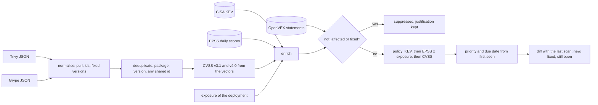

# A CVE Is a Question: Reachable, Exploited, Exposed?

*A scanner lists every CVE you ship; priority comes from three facts it cannot see: is it exploited, is it exposed, can your code reach it.*

## Metadata

| Field | Value |
|---|---|
| Type | Build |
| Languages | Python |
| Prerequisites | [An SBOM Is an Inventory You Can Diff](https://cloudcaptain.io/learn/cicd/sbom) |
| Time | 75 minutes |
| Tools | trivy, grype, vexctl, docker |

<Quiz stage="pre" />

## The Problem

The policy says "fix every CRITICAL within 15 days and every HIGH within 30", and the dashboard says the `shop/api` image has one CRITICAL and five HIGH findings. The team spends a sprint on the CRITICAL: CVE-2023-45853 in `zlib1g`, CVSS 9.8. There is no fixed version to move to: the overflow is in MiniZip, Debian builds MiniZip as separate packages that this image does not contain, and its tracker lists no fix for `zlib1g`. Two engineers write an exception request, a third tries to replace zlib, and the finding is still open on Friday. Meanwhile CVE-2023-4911 in `libc6`, CVSS 7.8 and so only HIGH, waits its turn in the 30-day queue. It is the glibc `GLIBC_TUNABLES` overflow, it has been in CISA's Known Exploited Vulnerabilities catalogue since November 2023, and the fix is a package upgrade that one rebuild on a newer base image delivers.

The numbers do not even agree. CI runs Trivy, the registry runs Grype, and the security report adds both: 24 findings, which are 13 once each is counted once. Eleven appear in both reports, one of them under two names, CVE-2024-3651 in Trivy and GHSA-jjg7-2v4v-x38h in Grype. Every Monday the same `idna` finding is reopened, although someone established months ago that the service never passes user input to the vulnerable function; that analysis lives in a closed ticket that no scanner reads.

Severity was never the question. A CVSS base score describes how bad a flaw is in a generic worst case; it says nothing about whether anyone is exploiting it, whether this deployment faces the internet, or whether this code calls the vulnerable function. You are going to build `minivuln`, which merges Trivy and Grype reports into one list, computes CVSS v3.1 and v4.0 from the vectors with the published formulas and lookup table, adds the KEV catalogue and EPSS probabilities from dated feeds, applies OpenVEX statements, ranks the result with a policy you can read, gives each finding a due date, and diffs two scans. Then you run Trivy, Grype and `vexctl` on a deliberately old Debian image and check that they agree with it.

## The Concept

Think of an emergency department on a busy night. The injury chart says how serious each injury could become (that is CVSS). One patient is bleeding right now (that is KEV: evidence of exploitation in the wild). For the rest, a model estimates who is likely to deteriorate in the next days (that is EPSS). Where the patient is matters: the waiting room is not the same as a ward behind two locked doors (that is exposure). And sometimes the specialist writes a note: "the X-ray shows an old, healed fracture; do not treat" (that is a VEX statement). Triage uses all five, in that order of trust: what is happening beats what might happen, which beats how bad it could be.

**A finding is a package, a version and an advisory.** Scanners do not discover vulnerabilities; they compare an inventory (the SBOM idea from the previous lesson) with advisory databases. Trivy and Grype each build their own database from distribution security trackers, GitHub advisories and NVD, and match packages against it with their own rules. So the same flaw arrives with different identifiers (CVE, GHSA, a Debian DSA, a `TEMP-` id for issues without a CVE), different package names (`pyyaml` and `PyYAML`), and differently encoded package URLs. Deduplication has to compare package, version and any shared identifier, after decoding.

**CVSS measures severity, not risk.** A v3.1 base score is a formula: an impact sub-score from the confidentiality, integrity and availability metrics, an exploitability sub-score from attack vector, complexity, privileges and user interaction, and a scope switch that changes both. v4.0 replaced the formula with a lookup table: the vector is reduced to one of 270 macrovectors (six equivalence classes), each with a score that experts ranked, and the final score is interpolated by how far the vector sits from the most severe vector in its class. v4.0 also has a Threat metric, Exploit Maturity, and when nobody fills it in it defaults to Attacked, the worst case. A base score assumes the flaw is being exploited, which is exactly the assumption KEV and EPSS let you test.

**KEV is evidence; EPSS is a forecast.** The KEV catalogue lists CVEs that CISA has reliable evidence of exploitation for, with the date added and a due date that is binding for US federal agencies under BOD 22-01; entries are almost never removed. EPSS, published daily by FIRST, is the estimated probability that exploitation activity for a CVE is observed in the next 30 days, with its percentile among all scored CVEs. It is a probability, not a severity: 0.64 means "likely", 0.004 means "almost certainly not this month", and it changes from day to day (CVE-2023-4911 dropped from 0.814 on 1 October 2026 to 0.638 on 1 November, while staying in KEV).

**Exposure belongs to the deployment.** The same image can serve the internet or run a nightly batch job on an isolated network. The scanner cannot know which, so exposure is an input you give the ranking, per workload.

**VEX answers "reachable?" in a form tools read.** An OpenVEX statement says that a product is `not_affected`, `affected`, `fixed` or `under_investigation` for one vulnerability. `not_affected` must carry a justification (`component_not_present`, `vulnerable_code_not_present`, `vulnerable_code_not_in_execute_path`, `vulnerable_code_cannot_be_controlled_by_adversary`, `inline_mitigations_already_exist`) or an impact statement, and `affected` must say what to do. The product is a package URL or an image identity, optionally with subcomponents. Trivy and Grype both read these documents with the same library and suppress `not_affected` and `fixed` findings, so the closed ticket becomes a file that every scan honours.

**A policy turns the facts into a queue.** `minivuln`'s default: anything in KEV is P1 (7 days); otherwise EPSS times an exposure weight of at least 0.1 is P2 (30 days); otherwise CVSS 7.0 or more is P3 (90 days); everything else is P4 (180 days). Due dates count from the day the finding was first seen, so a diff between two scans must carry that date forward. The policy is data, because yours will differ; the SSVC decision trees from CERT/CC, and the variant CISA uses, are the formal version of the same idea.



## Build It

`code/main.py` is `minivuln`, standard library only. Every command reads files, so the tests and the fixtures run anywhere. `code/fixtures/` holds two Trivy reports and one Grype report for an image `registry.example.com/shop/api` (1.4.0 built on `debian:12.1-slim`, 1.5.0 rebuilt on `debian:12.14-slim`), trimmed by hand into the tools' formats with real advisories: Debian package versions read from the two Debian images, CVSS vectors from NVD, fixed versions from the Debian tracker via OSV. Next to them sit a seven-entry excerpt of the KEV catalogue (version 2026.10.30), a sixteen-row excerpt of the EPSS file for 2026-11-01, an OpenVEX document, and `cvss-examples.json` with the scoring examples FIRST publishes for v3.1 and v4.0.

### Step 1: two reports, one shape

Trivy's JSON nests vulnerabilities under `Results[]`, one result per package class; Grype's is a flat `matches[]`, each a vulnerability, its related records and the matched artifact. `load_report()` recognises the format by its keys and maps both onto a `Finding`:

| Field | Trivy | Grype |
|---|---|---|
| advisory | `VulnerabilityID` (plus `VendorIDs` such as DSA numbers) | `vulnerability.id`, `relatedVulnerabilities[].id` |
| package | `PkgName`, `InstalledVersion`, `PkgIdentifier.PURL` | `artifact.name`, `artifact.version`, `artifact.purl` |
| fix | `FixedVersion` (comma-separated), `Status` | `vulnerability.fix.versions`, `fix.state` |
| CVSS | `CVSS.SOURCE.V3Vector`, `V40Vector` and scores | `cvss[]` on the vulnerability and on each related record |
| first seen | `CreatedAt` | `descriptor.timestamp` |

Each CVSS entry becomes a claim that remembers who said it:

```python
for source, data in sorted((vuln.get("CVSS") or {}).items()):
    for vector_key, score_key in (("V3Vector", "V3Score"), ("V40Vector", "V40Score")):
        if data.get(vector_key):
            claims.append(CvssClaim(normal_source(source), "trivy", str(data[vector_key]), data.get(score_key)))
```

`normal_source()` folds `nvd@nist.gov` and `nvd` into `nvd`, GitHub's names into `ghsa`, and maps the UUID that NVD uses for CISA's Vulnrichment scores to `cisa-adp`. Trivy's statuses become one vocabulary: `will_not_fix` is `wont-fix`, `affected` is `not-fixed`.

### Step 2: one finding per package, version and advisory

The identifier a finding is reported under is a CVE when any of its ids is one, because KEV and EPSS are keyed by CVE:

```python
def canonical_id(primary: str, others: Iterable[str]) -> str:
    ordered = [primary] + sorted(set(others) - {primary})
    for candidate in ordered:
        if CVE.match(candidate):
            return candidate
    return primary
```

`merge()` indexes every finding under every id it carries, so a Trivy finding that only knows `GHSA-aaaa-bbbb-cccc` and a Grype finding that lists the same GHSA with a CVE meet in the index and become one:

```python
for finding in findings:
    where = (finding.ecosystem, finding.package, finding.version)
    hit = next((index[where + (i,)] for i in sorted(finding.ids) if where + (i,) in index), None)
    if hit is None:
        hit = Finding(finding.vuln, set(), finding.ecosystem, finding.package, finding.version)
        hit.state = finding.state
        hit.first_seen = finding.first_seen
        merged.append(hit)
    hit.absorb(finding)
    for i in hit.ids:
        index[where + (i,)] = hit
```

Vendor advisory numbers such as Trivy's `VendorIDs` (DSA-5514-1) are not aliases: one Debian advisory fixes several CVEs, so they go into a separate `advisories` field and never join two findings. `absorb()` unions ids, purls, fixed versions, tools and CVSS claims, keeps the earliest first-seen date and the most specific fix state. The fixture reports have 12 findings each; merged they are 13, of which 11 came from both tools. The key includes the version on purpose: two installed versions of one library are two pieces of work.

### Step 3: package URLs are compared after decoding

Trivy writes Debian's `login` package as `pkg:deb/debian/login@1:4.13%2Bdfsg1-1%2Bb1?arch=amd64&distro=debian-12.1`, Grype as `pkg:deb/debian/login@1%3A4.13%2Bdfsg1-1%2Bb1?arch=amd64&distro=debian-12&upstream=shadow%401%3A4.13%2Bdfsg1-1`. The two libraries percent-encode different characters, and the qualifiers differ. `parse_purl()` decodes each component, and `purl_matches()` follows the rule of `go-vex`, the library both scanners use for VEX: the first purl is the general one, its version must match if it has one, and each of its qualifiers must appear in the specific purl:

```python
def purl_matches(general: str, specific: str) -> bool:
    a, b = parse_purl(general), parse_purl(specific)
    if a is None or b is None:
        return False
    if (a.type, a.namespace, a.name) != (b.type, b.namespace, b.name):
        return False
    if a.version and a.version != b.version:
        return False
    return all(b.qualifiers.get(key) == value for key, value in a.qualifiers.items())
```

`package_identity()` builds the dedupe name from the purl: `group:artifact` for Maven, `@scope/name` for npm, the PEP 503 normal form for PyPI, and the plain name for distribution packages, whose purl namespace is only the vendor.

### Step 4: CVSS v3.1 is a formula with a careful round-up

```python
def v3_base_score(metrics: Dict[str, str]) -> float:
    scope = metrics["S"]
    cia = V3_WEIGHT["CIA"]
    iss = 1 - (1 - cia[metrics["C"]]) * (1 - cia[metrics["I"]]) * (1 - cia[metrics["A"]])
    if scope == "U":
        impact = 6.42 * iss
    else:
        impact = 7.52 * (iss - 0.029) - 3.25 * (iss - 0.02) ** 15
    exploitability = 8.22 * V3_WEIGHT["AV"][metrics["AV"]] * V3_WEIGHT["AC"][metrics["AC"]] * V3_PRIVILEGES[scope][metrics["PR"]] * V3_WEIGHT["UI"][metrics["UI"]]
    if impact <= 0:
        return 0.0
    if scope == "U":
        return roundup(min(impact + exploitability, 10))
    return roundup(min(1.08 * (impact + exploitability), 10))
```

Privileges Required weighs more when the scope changes (0.68 instead of 0.62 for Low), and a changed scope multiplies the sum by 1.08 before the cap at 10. `roundup()` is the function from Appendix A of the v3.1 specification: it rounds to five decimals first and then up to one, so that a value that floating point stores as `4.000000000000001` stays 4.0 instead of becoming 4.1. `parse_vector()` refuses unknown metrics, duplicates and missing base metrics with the reason, and refuses CVSS v2 vectors, which have no `CVSS:` prefix and a different formula. v3.0 vectors use the same base formula; v3.1 changed the round-up function, which matters only in floating-point edge cases. The tests check every example in FIRST's v3.1 examples document, and the smoke checks all 2,592 base vectors.

### Step 5: CVSS v4.0 is a lookup table plus interpolation

`v4_macrovector()` reduces the vector to six digits. EQ1 is 0 when the attack vector is Network and privileges and user interaction are None, EQ3 is 0 when both confidentiality and integrity of the vulnerable system are High, EQ5 is the Exploit Maturity, and so on; `effective()` applies the defaults (Exploit Maturity and the security requirements default to their worst case) and the modified environmental metrics. `V4_LOOKUP` holds the 270 scores of FIRST's table in key order. The score of the macrovector belongs to its most severe vector; a less severe vector is lowered in proportion to its distance from that top, measured per EQ against the next lower macrovector:

```python
proportional = []
for eq in ("eq1", "eq2", "eq3eq6", "eq4"):
    if lower[eq] is not None:
        proportional.append((value - lower[eq]) * (current[eq] / depth[eq]))
if lower["eq5"] is not None:
    proportional.append(0.0)
mean = sum(proportional) / len(proportional) if proportional else 0.0
result = max(0.0, min(10.0, value - mean))
return js_round((result + V4_ROUNDING_EPSILON) * 10) / 10
```

`current[eq]` is the summed severity distance of the vector's metrics from the highest vector of its class (found by `severity_distances()` among the class's candidate maxima), and `depth[eq]` is how deep that class is. EQ3 and EQ6 move together, and a class with no lower neighbour simply drops out of the mean. The last line is the rounding of the current reference calculator: half up, after adding `1e-6` so that `8.6 - 7.15` (stored as `1.4499999999999993`) rounds like the decimal it stands for. Without that epsilon 522 of the 104,976 base vectors come out 0.1 too low; `cvss-examples.json` keeps eight of them as a test. The threat metric is visible here too: `CVSS:4.0/AV:P/AC:H/AT:P/PR:H/UI:A/VC:H/VI:H/VA:H/SC:H/SI:H/SA:H` scores 7.3, the same as with `/E:A`, and 4.1 with `/E:U`.

### Step 6: KEV and EPSS are dated feeds

`load_kev()` reads CISA's JSON (`vulnerabilities[]` with `cveID`, `dateAdded`, `dueDate`, `knownRansomwareCampaignUse`) and remembers `catalogVersion`. `load_epss()` reads the daily CSV, plain or gzipped, whose first line carries the model and the score date, or the JSON of `api.first.org`:

```python
for line in text.splitlines():
    if line.startswith("#"):
        for part in line[1:].split(","):
            key, _, value = part.partition(":")
            if key.strip() == "model_version":
                model = value.strip()
            elif key.strip() == "score_date":
                date = value.strip()
```

A score outside 0 to 1 is an input error. `assess()` then joins on the CVE ids of each finding and computes the threat:

```python
weight = ctx.policy.exposure[ctx.exposure]
threat = round((epss.probability if epss else 0.0) * weight, 5)
```

A finding without a CVE (a `TEMP-` id, a GHSA nobody mapped) has no EPSS score; its reasons say so instead of silently treating it as safe.

### Step 7: a VEX statement answers "reachable?"

`load_vex()` reads OpenVEX documents and lists every problem: a `not_affected` without a justification or impact statement, a justification that is not one of the five labels, an `affected` without an action statement, a statement without products. `rank` refuses to suppress anything while a document has problems. Matching mirrors `go-vex`:

```python
def statement_applies(statement: Statement, finding: Finding, artifact_ids: Iterable[str]) -> bool:
    if statement.vulnerability not in finding.ids and not finding.ids & set(statement.aliases):
        return False
    artifacts = list(artifact_ids)
    for product in statement.products:
        if any(identifier_matches(product.id, purl) for purl in finding.purls):
            return True
        if any(identifier_matches(product.id, a) for a in artifacts):
            if not product.subcomponents:
                return True
            if any(identifier_matches(sub, purl) for sub in product.subcomponents for purl in finding.purls):
                return True
    return False
```

The product is either the package itself (`pkg:deb/debian/zlib1g@1:1.2.13.dfsg-1` in the fixture) or the scanned artifact, identified by its repository digests (`pkg:oci/api@sha256:...` for the `idna` statement), with the package as a subcomponent. An artifact product without subcomponents suppresses the vulnerability for every package in that artifact, which is rarely what the author meant. When several statements match, the latest timestamp wins, so a later `affected` overrides an earlier `not_affected`. `not_affected` and `fixed` suppress; `under_investigation` and `affected` keep the finding and add the statement to its reasons. A suppressed KEV entry gets one more reason: have a second person review the justification.

### Step 8: the policy is data

```python
tier = next(t for t in ctx.policy.tiers if (not t.kev or kev) and (t.min_threat is None or threat >= t.min_threat) and (t.min_cvss is None or cvss >= t.min_cvss))
first_seen = parse_date(finding.first_seen, "first seen") if finding.first_seen else ctx.now
due = first_seen + dt.timedelta(days=tier.sla_days)
```

The CVSS used is the v3 claim from NVD, else from GitHub, else the highest from any other source, computed by `minivuln` from the vector rather than copied; v4.0 is reported alongside. Inside a tier the order is threat, then CVSS, then whether a fix exists:

```python
active.sort(key=lambda a: (order[a.priority], -a.threat, -a.cvss, not a.finding.fixed, a.finding.ecosystem, a.finding.package, a.finding.vuln, a.finding.version))
```

`--policy FILE` replaces the exposure weights and tiers; the last tier must have no conditions so every finding lands somewhere. `--fail-on P1` makes `rank` exit 1 when anything at that priority or above is open, which is the CI gate.

### Step 9: diff two scans

```python
for finding in new:
    hit = next((index[(finding.ecosystem, finding.package, i)] for i in sorted(finding.ids) if (finding.ecosystem, finding.package, i) in index), None)
    if hit is None:
        added.append(finding)
    else:
        still.append((hit, finding))
        seen.add(id(hit))
fixed = [f for f in old if id(f) not in seen]
```

The diff key leaves the version out: `zlib1g` upgraded but still vulnerable is still open, and keeps the first-seen date of the old scan, so its due date does not reset with every rebuild. When the two sides were scanned with different tools, `diff` prints a warning, because a finding only one tool reports would otherwise look fixed or new.

### Step 10: run it

```bash
cd curriculum/phases/11-security/07-vuln-prioritization
F=code/fixtures
python3 code/main.py cvss CVSS:3.1/AV:L/AC:L/PR:L/UI:N/S:U/C:H/I:H/A:H CVSS:4.0/AV:L/AC:L/AT:N/PR:N/UI:N/VC:N/VI:N/VA:H/SC:N/SI:N/SA:N
python3 code/main.py ingest $F/trivy-api-1.4.0.json $F/grype-api-1.4.0.json            # 13 findings, 11 from both tools
python3 code/main.py rank $F/trivy-api-1.4.0.json $F/grype-api-1.4.0.json \
  --kev $F/kev-2026-10-30.json --epss $F/epss-2026-11-01.csv --exposure internet --now 2026-11-02 --top 6
python3 code/main.py rank $F/trivy-api-1.4.0.json $F/grype-api-1.4.0.json --vex $F/vex-api.openvex.json \
  --kev $F/kev-2026-10-30.json --epss $F/epss-2026-11-01.csv --exposure internet --now 2026-11-02 --json > ranked.json
python3 code/main.py vex $F/vex-api.openvex.json
python3 code/main.py diff --old $F/trivy-api-1.4.0.json --new $F/trivy-api-1.5.0.json --now 2026-11-02; echo "exit $?"
```

The ranking without VEX:

```text
policy kev-epss-cvss: P1 = in KEV, 7 d; P2 = EPSS x exposure >= 0.1, 30 d; P3 = CVSS >= 7, 90 d; P4 = the rest, 180 d
KEV 2026.10.30 (7 entries), EPSS 2026-11-01 model v2026.06.15 (16 scores), VEX 0 statement(s)
    #  prio  due         vuln              package                 installed           fixed in                kev   epss  threat  cvss
    1  P1    2026-10-08  CVE-2023-4911     deb/libc-bin            2.36-9+deb12u1      2.36-9+deb12u3          KEV  0.638   0.638   7.8 (+25d)
    2  P1    2026-10-08  CVE-2023-4911     deb/libc6               2.36-9+deb12u1      2.36-9+deb12u3          KEV  0.638   0.638   7.8 (+25d)
    3  P2    2026-10-31  CVE-2024-2961     deb/libc-bin            2.36-9+deb12u1      2.36-9+deb12u6          -    0.883   0.883   7.3 (+2d)
    4  P2    2026-10-31  CVE-2024-2961     deb/libc6               2.36-9+deb12u1      2.36-9+deb12u6          -    0.883   0.883   7.3 (+2d)
    5  P3    2026-12-30  CVE-2023-45853    deb/zlib1g              1:1.2.13.dfsg-1     wont-fix                -    0.034   0.034   9.8
    6  P3    2026-12-30  CVE-2024-0553     deb/libgnutls30         3.7.9-2             3.7.9-2+deb12u2         -    0.016   0.016   7.5
```

Three policies give three different first rows on the same data: CVSS alone puts `zlib1g` (9.8, no fix) first, EPSS alone puts CVE-2024-2961 (0.883) first, and KEV-first puts the glibc flaw that is being exploited first. The `(+25d)` is the overdue count: 1.4.0 was first scanned on 2026-10-01. With the VEX document, `zlib1g` and `idna` move to the suppressed list with their justifications and `util-linux` and `mount` carry `under_investigation`. The diff from 1.4.0 to 1.5.0 has 9 fixed findings (the base image moved from 12.1 to 12.14, `idna` from 3.6 to 3.10), 1 new (`requests` 2.32.3, CVE-2024-47081) and 3 still open since 2026-10-01; it exits 1 because something is new and no VEX statement suppresses it (a suppressed new finding is listed under `suppressed` and does not fail the gate). Exit codes: 0 for success, 1 for "findings at or above `--fail-on`" in `rank`, "new findings that VEX does not suppress" in `diff`, "problems" in `vex` or "a vector that cannot be scored" in `cvss` (the others are still scored, so a whole file of vectors is never lost to one bad line), and 2 for input that cannot be read, with the reason on stderr.

<RunTests />

## Use It

Install pinned releases of Trivy and Grype and verify each against the checksum file the project publishes with the release (the smoke does exactly this, and `vexctl` the same way):

```bash
T=0.76.1 G=0.121.0
curl -fsSLO https://github.com/aquasecurity/trivy/releases/download/v$T/trivy_${T}_Linux-64bit.tar.gz
curl -fsSLO https://github.com/aquasecurity/trivy/releases/download/v$T/trivy_${T}_checksums.txt
grep " trivy_${T}_Linux-64bit.tar.gz$" trivy_${T}_checksums.txt | sha256sum -c -
curl -fsSLO https://github.com/anchore/grype/releases/download/v$G/grype_${G}_linux_amd64.tar.gz
curl -fsSLO https://github.com/anchore/grype/releases/download/v$G/grype_${G}_checksums.txt
grep " grype_${G}_linux_amd64.tar.gz$" grype_${G}_checksums.txt | sha256sum -c -
tar -xzf trivy_${T}_Linux-64bit.tar.gz trivy && tar -xzf grype_${G}_linux_amd64.tar.gz grype
./trivy --version && ./grype version
```

A deliberately old image and a newer one of the same line, both pinned by digest: `debian:12.1-slim` from September 2023 ships `libc6` 2.36-9+deb12u1, before the fix for CVE-2023-4911; `debian:12.14-slim` ships 2.36-9+deb12u14.

```bash
OLD=debian@sha256:24c92a69df28b21676d721fe18c0bf64138bfc69b486746ad935b49cc31b0b91
NEW=debian@sha256:60eac759739651111db372c07be67863818726f754804b8707c90979bda511df
docker pull -q $OLD && docker pull -q $NEW
./trivy image --scanners vuln $OLD --severity CRITICAL,HIGH                  # the table view
./trivy image --scanners vuln --format json --output trivy-old.json $OLD
./trivy image --scanners vuln --format json --output trivy-new.json $NEW
./grype $OLD -o json --file grype-old.json
./grype $OLD --sort-by kev                                                    # KEV-listed matches first
./grype $OLD --only-fixed --fail-on high; echo "exit $?"                     # a CI gate on severity, as most teams start
```

Both databases are downloaded on first use and change every day, so two runs a week apart disagree, and two tools on the same day disagree too: they read different sources and match differently. Grype's `--add-cpes-if-none` generates CPEs for packages that have none (typical for third-party SBOMs) and matches them against NVD's CPE data; that guesswork produces false positives when a package name resembles another product, so it stays off for image scans, and a match whose `matchDetails[].type` is `cpe-match` deserves less trust than an `exact-direct-match`. `--by-cve` makes Grype report CVE ids instead of GHSA ids, the same canonicalisation as `canonical_id()`.

Grype already carries KEV and EPSS: each match has `vulnerability.knownExploited` and `vulnerability.epss` from its database, and the default sort is by `risk`, computed as `min(threat x severity x kev_modifier, 1) x 100`, where threat is 1.0 for a KEV entry and the EPSS probability otherwise, severity averages the string severity and the CVSS base scores (scaled to 0 to 1), and the modifier is 1.05 for KEV and 1.1 for KEV with known ransomware use. In the Grype fixture that gives 78.75 for CVE-2023-4911 (`1.0 x 0.75 x 1.05 x 100`). There is no exposure in it, because Grype cannot know where the image runs.

The feeds themselves are plain downloads:

```bash
curl -fsSL -o kev.json https://www.cisa.gov/sites/default/files/feeds/known_exploited_vulnerabilities.json
jq '.catalogVersion, (.vulnerabilities[] | select(.cveID == "CVE-2023-4911") | {dateAdded, dueDate})' kev.json
curl -fsSL -o epss.csv.gz https://epss.empiricalsecurity.com/epss_scores-current.csv.gz
gzip -dc epss.csv.gz | head -2                                                # #model_version:...,score_date:...
curl -fsSL "https://api.first.org/data/v1/epss?cve=CVE-2023-4911,CVE-2024-2961"
curl -fsSL "https://api.first.org/data/v1/epss?cve=CVE-2023-4911&date=2026-10-01"
M=~/CloudCaptain/curriculum/phases/11-security/07-vuln-prioritization
python3 $M/code/main.py ingest trivy-old.json grype-old.json | head -3        # per-tool counts and the overlap
python3 $M/code/main.py rank trivy-old.json grype-old.json --kev kev.json --epss epss.csv.gz --exposure internet --top 15
python3 $M/code/main.py diff --old trivy-old.json --new trivy-new.json
```

Record a VEX statement with `vexctl` and give it to all three tools. Use CVE-2023-4911 only to watch the mechanics in a lab: in production this one needs the upgrade, not a statement, and `minivuln` says so when a KEV entry is suppressed.

```bash
V=0.4.4
curl -fsSLO https://github.com/openvex/vexctl/releases/download/v$V/vexctl-linux-amd64
curl -fsSLO https://github.com/openvex/vexctl/releases/download/v$V/vexctl_checksums.txt
grep " vexctl-linux-amd64$" vexctl_checksums.txt | sha256sum -c - && install -m 0755 vexctl-linux-amd64 ./vexctl
./vexctl create --author security@example.com \
  --product "pkg:deb/debian/libc6@2.36-9%2Bdeb12u1" --product "pkg:deb/debian/libc-bin@2.36-9%2Bdeb12u1" \
  --vuln CVE-2023-4911 --status not_affected --justification vulnerable_code_cannot_be_controlled_by_adversary \
  --impact-statement "lab only: no setuid binaries in the image" --file vex.json
./trivy image --scanners vuln --vex vex.json --show-suppressed --format json --output trivy-old-vex.json $OLD
./grype $OLD --vex vex.json -o json --file grype-old-vex.json                 # suppressed matches move to ignoredMatches
python3 $M/code/main.py rank trivy-old.json grype-old.json --vex vex.json --kev kev.json --epss epss.csv.gz
```

The product purls have no qualifiers on purpose: by the matching rule from Step 3 they match Trivy's `distro=debian-12.1` purl and Grype's `distro=debian-12&upstream=glibc` purl alike. Trivy lists what it suppressed under `ExperimentalModifiedFindings` when `--show-suppressed` is set; Grype keeps them in `ignoredMatches` with an `appliedIgnoreRules` entry in the `vex` namespace. Trivy can also fetch VEX from a VEX repository or an OCI attestation (`--vex repo`, `--vex oci`), which is how a vendor's statements about its own image reach you.

`code/smoke.sh` runs all of this on the CI runner and asserts on parsed JSON: `minivuln`'s CVSS scores equal every published v3.1 and v4.0 base vector in Red Hat's `cvss` library test data (2,592 and 104,976 vectors, pinned commit, sha256 checked); the scores of NVD's v3.1 vectors in both reports equal what `minivuln` computes from those vectors; the merged list is exactly the union of the two reports' (package, version, advisory) keys and the overlap is counted once; the same VEX statement suppresses the same packages in `minivuln`, `trivy --vex` and `grype --vex`; with the KEV and EPSS fixtures the first row is CVE-2023-4911; and the diff from 12.1 to 12.14 lists CVE-2023-4911 as fixed, every fixed finding is absent from the new Trivy report and every still-open one is present in both. When the live KEV and EPSS feeds are reachable it also ranks with them and prints how Grype's `knownExploited` flags compare.

**Policies other people use.** Stakeholder-Specific Vulnerability Categorization (SSVC, from CERT/CC; CISA publishes the tree it uses) replaces tiers with a decision tree over Exploitation (none, public PoC, active), Automatable, Technical Impact and Mission and Well-being, ending in Track, `Track*`, Attend or Act; KEV maps to "active" and CVSS v4's Automatable supplemental metric to the second question. Platforms such as DefectDojo and OWASP Dependency-Track keep the history that `diff` reconstructs, deduplicate across scanners, and hold VEX-style analysis per finding. Whatever you choose, write it down as data and keep the reason next to every exception, with an owner and an expiry.

| What you built | Real tool | Note |
|---|---|---|
| `load_report()` for two formats | `trivy image --format json`, `grype -o json` | different databases and matchers; never expect equal counts |
| `merge()` by package, version and shared id | `grype --by-cve`, DefectDojo deduplication | the version stays in the key: two installed versions are two fixes |
| `parse_purl()`, `purl_matches()` | purl libraries in Trivy and syft, `go-vex` `PurlMatches` | the libraries encode `:` and `+` differently; decode first |
| `v3_base_score()`, `roundup()` | NVD calculator; scores copied into Trivy and Grype reports | the scanners copy scores; the smoke recomputes them |
| `v4_score()` with the 270-entry table | FIRST calculator (`cvss40.js`), Red Hat `cvss` library | half-up rounding with a `1e-6` epsilon, as the reference does |
| `load_kev()`, `load_epss()` | CISA KEV JSON, FIRST EPSS CSV and API, Grype `knownExploited` and `epss` | both are dated; record the catalogue version and score date |
| threat = EPSS x exposure | Grype `risk` | Grype has no exposure; it boosts KEV entries instead |
| `statement_applies()`, `vex_for()` | `trivy --vex`, `grype --vex` | same `go-vex` matching; latest statement wins |
| `load_vex()` problems | `vexctl create` validation | `not_affected` needs a justification or impact statement |
| tiers, SLAs, `--fail-on` | your vulnerability management policy, SSVC | KEV ignores exposure; exposure is a guess attackers test |
| `diff` with first-seen carried over | DefectDojo, Dependency-Track history | diff the same tools on both sides |

<Quiz stage="check" />

## Ship It

Two artifacts in `outputs/`:

- **`skill-vuln-triage.md`**: a runbook for a scan result or a new advisory. It scans with both tools and records the database dates, merges and counts the overlap, adds KEV and EPSS from dated feeds, asks for the workload's exposure, walks a reachability decision table that ends in a fix, a VEX statement with evidence, or an `under_investigation` entry with an owner, assigns priorities and due dates, picks the cheapest fix path (base image bump, package upgrade, removal), proves it with a diff, and ends with a fixed report.
- **`prompt-explain-cve-priority.md`**: paste one finding (scanner JSON or a `minivuln rank --json` entry) and the deployment context; the model explains each signal separately (severity from the vector, exploitation from KEV, probability from EPSS, exposure, reachability), says which one decided the priority, what would change it, the smallest fix, and drafts a VEX statement only when the evidence supports one.

<ShipIt />

## Exercises

### Easy

Group findings into work items: one row per source package and fixed version, because one upgrade of `glibc` fixes both `libc6` and `libc-bin`. Use `Finding.upstream` (Grype's `upstreams`, or the `upstream` qualifier in a purl) and fall back to the package name. Add `rank --group`, which prints each group with its highest priority, earliest due date and member packages. Write the tests first: in the fixture, the two CVE-2023-4911 findings and the two CVE-2024-2961 findings become two `glibc` work items, and `login` and `passwd` become one `shadow` item.

### Medium

Rank several deployments at once. Add `--context deployments.json` mapping each artifact (by name or digest) to an exposure and an owner, read several reports for different images, and produce one queue in which the same CVE in an internet-facing image and in an isolated batch image gets different priorities. Tests first: two copies of the 1.4.0 fixture under different artifact names, one `internet` and one `isolated`, and assert that CVE-2024-2961 is P2 in one and P3 in the other while CVE-2023-4911 is P1 in both.

### Hard

Implement the SSVC Deployer tree from CERT/CC as an alternative policy, `--policy ssvc`: Exploitation from KEV (active), a public-PoC list you load from a file, or none; Exposure from the context; Automatable from the CVSS v4.0 `AU` supplemental metric when present, otherwise from a v3.1 vector with `AV:N/AC:L/PR:N/UI:N`; Human Impact as an input; and the outcomes Defer, Scheduled, Out-of-Cycle and Immediate mapped to due dates. Write the tests first from the decision table in the SSVC documentation, then compare its queue with the tier policy on the fixtures and explain every finding whose rank changes.

<Quiz stage="post" />

## Key Terms

| Term | Common misconception | Precise definition |
|---|---|---|
| CVSS base score | "It is the risk of the vulnerability to us." | A 0 to 10 severity computed from a vector of exploitability and impact metrics under worst-case assumptions; it describes the flaw, not its exploitation or your deployment. |
| CVSS v4.0 macrovector | "v4.0 is v3.1 with new metrics in the same formula." | Six equivalence-class digits that select one of 270 expert-ranked scores; the final score is interpolated by the vector's distance from the most severe vector of its class. |
| Exploit Maturity (E) | "Leaving E out means no exploit is known." | The v4.0 Threat metric. Left out it means Not Defined, which scores as Attacked, the worst case; `E:U` lowers the score. |
| KEV | "A list of the most severe CVEs." | CISA's catalogue of CVEs with reliable evidence of exploitation in the wild, with the date added and a remediation due date binding for US federal agencies. |
| EPSS | "A better severity score." | FIRST's daily estimate of the probability that exploitation activity for a CVE is observed in the next 30 days, with its percentile among all scored CVEs. |
| Exposure | "A property of the image." | Where and how a deployment can be reached (internet, internal, isolated); the same image can have several exposures, and only you can supply it. |
| VEX | "A way to hide scanner noise." | A machine-readable statement that a product is `not_affected`, `affected`, `fixed` or `under_investigation` for a vulnerability, with a justification or action someone can audit. |
| Finding deduplication | "Same CVE id means same finding." | Merging reports by ecosystem, package, version and any shared advisory id (CVE, GHSA, distribution ids), after decoding package URLs. |
| First seen | "The date of the latest scan." | The date a finding was first reported for that artifact line; due dates count from it, so a rebuild that does not fix the finding does not reset the clock. |

## Further Reading

- [DevSecOps Fundamentals](https://cloudcaptain.io/docs/tools/devsecops/fundamentals): where image scanning, SBOMs and policy gates sit in a secure pipeline.
- [DevSecOps Cheat Sheet](https://cloudcaptain.io/docs/tools/devsecops/cheatsheet): Trivy and Grype commands next to the other security tools of this phase.
- [Docker Security in Production](https://cloudcaptain.io/docs/tools/docker/security-production): minimal base images and rebuild cadence, the cheapest way to make most findings disappear.
- [CVSS v3.1 Specification](https://www.first.org/cvss/v3-1/specification-document): the base metric definitions, the formulas in Section 7 and the Roundup function in Appendix A.
- [CVSS v4.0 Specification](https://www.first.org/cvss/v4-0/specification-document): macrovectors, the threat metric and its worst-case default, and the scoring method `v4_score()` follows.
- [FIRST CVSS v4.0 calculator source](https://github.com/RedHatProductSecurity/cvss-v4-calculator): the reference implementation, its lookup table and the rounding epsilon.
- [EPSS](https://www.first.org/epss/): what the probability means, the data files and the API, and how to choose a threshold.
- [CISA Known Exploited Vulnerabilities Catalog](https://www.cisa.gov/known-exploited-vulnerabilities-catalog): the catalogue, its JSON and CSV feeds, and the criteria for adding an entry.
- [OpenVEX specification](https://github.com/openvex/spec/blob/main/OPENVEX-SPEC.md): statuses, justifications, products and subcomponents.
- [Trivy VEX documentation](https://trivy.dev/latest/docs/supply-chain/vex/): local files, VEX repositories, OCI attestations and `--show-suppressed`.
- [Grype](https://github.com/anchore/grype): `--vex`, `--sort-by`, `--only-fixed`, `--by-cve` and the JSON output format.
- [SSVC](https://certcc.github.io/SSVC/): the decision-tree approach to the same prioritisation problem, used by CISA.
