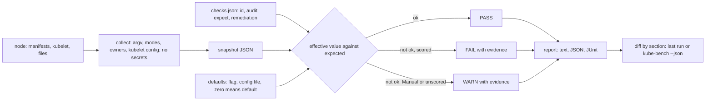

# A Benchmark Is a List of Checks You Can Automate

*Each benchmark line is a test of a node's files, flags and defaults: automate it, keep the evidence, and name the version you ran.*

## Metadata

| Field | Value |
|---|---|
| Type | Build |
| Languages | Python |
| Prerequisites | [A Node Agent Turns a Pod Spec Into Processes](https://cloudcaptain.io/learn/orchestration/kubelet-lite) |
| Time | 75 minutes |
| Tools | kube-bench, kubectl, kind, docker, kubescape |

<Quiz stage="pre" />

## The Problem

The penetration test report has one critical finding: from a pod in the `batch` namespace, the tester ran `curl -sk https://10.0.7.14:10250/pods` against a node's kubelet and got every pod spec on that node, environment variables included, without any credentials. A second request to the kubelet's `/run` endpoint executed `id` inside a database container. Four nodes behave like this; the other forty do not. The security team is puzzled, because the quarterly CIS report, produced with kube-bench on every node pool, shows `4.2.1 Ensure that the --anonymous-auth argument is set to false` as PASS on all of them.

Both are true. The four nodes belong to a pool built from a custom image whose systemd drop-in starts the kubelet without `--config`. A kubelet with no config file uses its command-line defaults: anonymous requests allowed, authorization mode `AlwaysAllow`. The image still contains `/var/lib/kubelet/config.yaml` from the base image, with `anonymous: enabled: false`, and kube-bench, finding no `--anonymous-auth` flag on the command line, reads the first kubelet config file it finds on disk and reports what that file says. The file is never loaded by the kubelet. The report checked a document; the attacker talked to a process.

A benchmark recommendation is a statement about the configuration that is actually in effect: which flag the process got, which file it loaded, what the default is when neither says anything, and who can read the files that hold the credentials. Each one can be written down as data (where to look, what to expect, how to fix it) and evaluated by a program that keeps the evidence. You are going to write `minibench`, that program: 90 checks from CIS Kubernetes Benchmark v1.12.0 (and one from an older version) as JSON, a collector that reads a node through `docker exec` without copying any secret, an evaluator that knows the kubelet's three layers of configuration, PASS, FAIL and WARN with evidence, JSON and JUnit reports, and a diff that compares two runs, or a run with kube-bench's own JSON, section by section.

## The Concept

Think of a pilot's preflight checklist. Every line names something to look at, the reading that is acceptable, and what to do if the reading is wrong. The checklist does not say "the aircraft is safe"; it says "fuel quantity: both gauges at or above the planned figure", and the pilot reads the gauge on this aircraft today, not the one in the hangar last week. The CIS Kubernetes Benchmark is a checklist of the same shape. Each recommendation has a number (`1.2.15`), a title ("Ensure that the --profiling argument is set to false"), an audit procedure (usually a `ps` line or a `stat` of a file), the expected value, a remediation, and an assessment status: **Automated** if a program can decide it, **Manual** if a person must look. kube-bench marks Manual recommendations `scored: false`; when one fails it reports WARN instead of FAIL, and a check with no automated test at all always reports WARN.

**Where a setting lives.** On a kubeadm or kind node the API server, controller manager, scheduler and etcd are static pods: their flags are the `command` list in `/etc/kubernetes/manifests/*.yaml`, which the kubelet turns into processes (the [kubelet lesson](https://cloudcaptain.io/learn/orchestration/kubelet-lite) built that loop). The manifest is what will run; `/proc/PID/cmdline` is what runs now. They differ for a few seconds after an edit, or for good if a manifest is broken and the old container keeps running, so a checker reads both and reports the drift. The kubelet itself is a systemd service, and its configuration has three layers: flags on the command line win over the config file named by `--config`, and the file wins over defaults.

**Unset is a value.** Most findings are flags nobody set. `--profiling` is not in kubeadm's API server manifest, and its default is `true`, so 1.2.15 fails although nothing "wrong" was written. The kubelet is subtler: it has two sets of defaults. With a config file, a missing `authentication.anonymous.enabled` means `false`, `authorization.mode` means `Webhook` and `readOnlyPort` means `0`. Without a config file, the flag defaults apply: anonymous `true`, `AlwaysAllow`, port `10255`. Some values in the file do not mean what they say: kubeadm writes `streamingConnectionIdleTimeout: 0s`, and the kubelet replaces a zero duration with its default of four hours; `podPidsLimit: -1` is set, but it is not a limit. A checker that matches text gets these cases wrong in predictable directions. A checker that models the effective value has to know the defaults, which is why `minibench` keeps them in the data next to each check.

**Files are metadata, and modes are bits.** "600 or more restrictive" is a bitmask test, not a numeric comparison: `640` is numerically above `600` and `400` below it, but `640` adds group read and fails while `400` passes. Ownership is `user:group` by name, as `stat -c %U:%G` prints it. The files these checks protect (kubeconfigs with client keys, the CA key, the service account signing key) must never end up in the scanner's output, so the collector records their mode and owner and reads the contents only of the static pod manifests and the kubelet config.

**Numbers belong to a version.** kube-bench's `cis-1.12` is CIS Kubernetes Benchmark v1.12.0, written for Kubernetes 1.32 to 1.34; a current kind cluster runs a newer release, so the newest benchmark is always a little behind the cluster and you say which one you ran. API server profiling was 1.2.17 in v1.7.0 and is 1.2.15 from v1.9.0 on. "Ensure that the --protect-kernel-defaults argument is set to true" was 4.2.6 in the V1.24 benchmark and was dropped from v1.7.0, where 4.2.6 became `--make-iptables-util-chains`. The managed-service benchmarks renumber again: kubelet anonymous auth is 3.2.1 in the CIS Amazon EKS Benchmark, whose control-plane file has no checks at all, because AWS runs the control plane and you cannot read its manifests.



## Build It

`code/main.py` is `minibench`, standard library only, and `code/checks.json` is its catalogue. `minibench collect` reads a node into a snapshot, `minibench run` evaluates the checks against a snapshot (or collects first with `--node`), `minibench diff` compares two reports and `minibench checks` prints the catalogue. The tests use `code/fixtures/kind-node.json`, a snapshot shaped like what `collect` reads from a kind control-plane node (kubeadm's manifests, kubelet config and file modes), a fake `docker exec` runner, temporary directories and `code/fixtures/kube-bench-sample.json` in kube-bench's `--json` format.

### Step 1: a check is a line of data

Every check is one JSON object: the CIS section as its id, the title as the benchmark words it, whether it is scored, where to look (`audit`), what to expect (`expect`) and how to fix it:

```json
{"id": "1.2.15", "title": "Ensure that the --profiling argument is set to false (Automated)", "scored": true, "audit": {"component": "kube-apiserver", "flag": "--profiling", "default": "true"}, "expect": {"op": "eq", "value": "false"}, "remediation": "Set --profiling=false in /etc/kubernetes/manifests/kube-apiserver.yaml"}
{"id": "4.1.9", "title": "If the kubelet config.yaml configuration file is being used validate permissions set to 600 or more restrictive (Automated)", "scored": true, "audit": {"file": "kubelet-config", "property": "mode", "missing": "pass"}, "expect": {"op": "max-mode", "value": "600"}, "remediation": "chmod 600 on the file the kubelet's --config names (kubeadm: /var/lib/kubelet/config.yaml)"}
```

There are seven kinds of audit (`flag`, `flags`, `kubelet`, `file`, `files`, `tree`, `manual`) and eleven operators. `load_catalogue()` refuses a catalogue it cannot evaluate, with the check id in the message, so a typo in `checks.json` fails loudly instead of passing silently:

```python
        kinds = [kind for kind in AUDIT_KINDS if kind in audit and not (kind == "flag" and "kubelet" in audit)]
        if len(kinds) != 1:
            raise BenchError(f"{where}: audit needs exactly one of {', '.join(AUDIT_KINDS)}, got {sorted(audit)}")
        expect = raw.get("expect") or {}
        if kinds[0] != "manual" and expect.get("op") not in OPS:
            raise BenchError(f"{where}: expect.op must be one of {', '.join(OPS)}")
```

File audits name files through references rather than fixed paths (`manifest:kube-apiserver`, `kubelet-config`, `kubelet-service`, `kubelet-ca`, `etcd-data`), the same idea as kube-bench's `$apiserverconf` and `$kubeletconf` variables. `Snapshot.resolve()` turns them into paths using what the node actually runs: `kubelet-config` is the kubelet's `--config`, `etcd-data` is etcd's `--data-dir`, `kubelet-service` is the first of kubeadm's unit file locations that exists. The titles are copied from kube-bench's `cfg/cis-1.12/*.yaml`, so a comparison lines up word for word.

### Step 2: flags come from the manifest, parsed like pflag

The control-plane components' arguments are the first container's `command` plus `args`, read from the manifest with the YAML subset parser from the kubelet lesson (copied, not imported; each lesson stands alone). If there is no manifest, the running process's arguments are used, and `drift()` reports any flag on which the two disagree:

```python
def container_argv(pod: Any) -> Optional[List[str]]:
    containers = ((pod or {}).get("spec") or {}).get("containers") if isinstance(pod, dict) else None
    if not containers or not isinstance(containers[0], dict):
        return None
    first = containers[0]
    argv = [str(arg) for arg in first.get("command") or []] + [str(arg) for arg in first.get("args") or []]
    return argv or None
```

Kubernetes components parse flags with pflag: `--name=value`, `--name value`, and a bare `--name` for booleans, which never consume the next word. The last occurrence wins:

```python
def parse_flags(argv: Sequence[str]) -> Dict[str, str]:
    flags: Dict[str, str] = {}
    index = 1
    while index < len(argv):
        arg = argv[index]
        if arg.startswith("--") and len(arg) > 2:
            name, sep, value = arg.partition("=")
            if not sep:
                following = argv[index + 1] if index + 1 < len(argv) else ""
                if name not in BOOLEAN_FLAGS and following and not following.startswith("-"):
                    value = following
                    index += 1
                else:
                    value = "true"
            flags[name] = value
        index += 1
    return flags
```

kube-bench does not parse arguments; it greps the text of `ps -ef` with a regular expression built from the flag name. That works for kubeadm's `--name=value` style, and it explains its edge cases: `grep etcd` also matches the API server's line (it contains `--etcd-servers`), and a `has` test is a substring test.

### Step 3: an unset flag is judged by its default

`flag_audit()` takes each flag the check names. Present, it is the value. Absent, the documented default stands in for it, and the evidence says so:

```python
        if name in flags:
            actual: Optional[str] = flags[name]
            evidence.append(f"{component} ({where}): {name}={actual}")
        elif "default" in audit:
            actual = scalar_text(audit["default"])
            evidence.append(f"{component} ({where}): {name} not set; the default is {actual}")
        else:
            actual = None
            evidence.append(f"{component} ({where}): {name} not set")
```

`judge()` applies the operator. List operators split on commas and compare elements, so `--authorization-mode=RBAC,NodeX` does not "include Node"; booleans compare case-insensitively; a check whose expectation allows "not set" says so with `"unset": "pass"`:

```python
    if op == "set":
        return actual is not None
    if op == "unset":
        return actual is None
    if actual is None:
        return expect.get("unset") == "pass"
```

The defaults are the stricter reading. kube-bench passes 1.3.7 when `--bind-address` is missing, although the controller manager then listens on every interface; `minibench` uses the default `0.0.0.0` and fails it. On kubeadm and kind the flag is set to `127.0.0.1`, so both tools agree there. 2.7 ("a unique Certificate Authority is used for etcd") is Manual in the benchmark, but half of it can be automated: `"unlike"` fails the check when etcd's `--trusted-ca-file` is the API server's `--client-ca-file`.

### Step 4: the kubelet has three layers

```python
def kubelet_value(setting: Dict[str, Any], snapshot: Snapshot) -> Tuple[Optional[str], str]:
    key = setting["kubelet"]
    flag = setting.get("flag", "")
    flags = snapshot.kubelet_flags()
    if flag and flag in flags:
        return flags[flag], f"kubelet flag {flag}={flags[flag]} (a flag overrides the config file)"
    config, path = snapshot.kubelet_config()
    if config is not None:
        text = scalar_text(dig(config, key))
        if text:
            zero = parse_duration(text) == 0 if setting.get("zero_means_default") else False
            if zero and "default" in setting:
                return scalar_text(setting["default"]), f"{path}: {key}: {text}, which the kubelet replaces with its default {scalar_text(setting['default'])}"
            return text, f"{path}: {key}: {text}"
        if "default" in setting:
            return scalar_text(setting["default"]), f"{path}: {key} not set; the config file default is {scalar_text(setting['default'])}"
        return None, f"{path}: {key} not set" + (f" and no {flag} flag" if flag else "")
    if "flag_default" in setting:
        return scalar_text(setting["flag_default"]), f"no kubelet config file: {path}; {flag} defaults to {scalar_text(setting['flag_default'])}"
```

The config file is the one the kubelet loads, and only that one. This is the fix for The Problem:

```python
        if self.processes.get("kubelet") and "--config" not in self.kubelet_flags():
            return None, f"{path} (the kubelet runs without --config, so it loads no file)"
```

The 4.2.1 entry in `checks.json` carries both defaults, `"default": "false"` for a config file and `"flag_default": "true"` for a kubelet without one, and the tests cover every layer: a flag that overrides the file, a key missing from the file, a file on disk that the kubelet never loaded, and a config written as JSON. Durations are parsed the way Go's `time.ParseDuration` does (`0s`, `4h0m0s`, `300ms`), because `zero_means_default` turns kubeadm's `streamingConnectionIdleTimeout: 0s` into the four hours the kubelet actually uses, while a `--streaming-connection-idle-timeout=0` flag stays zero and fails.

### Step 5: modes are bits, owners are names

```python
def mode_within(mode: str, allowed: str) -> bool:
    try:
        return int(mode, 8) & ~int(allowed, 8) == 0
    except ValueError:
        return False
```

A mode passes when it sets no bit outside the allowed mask, which is kube-bench's `bitmask` operator. `file_audit()` checks every entry an audit selects. For the PKI tree (1.1.19 to 1.1.21) that is every directory and file under `/etc/kubernetes/pki`, filtered by a glob such as `*.key`, and the evidence names the failing entries and counts the rest. When nothing matches, the check's `missing` rule decides: 4.1.2 passes when there is no kubelet unit file to own, 4.1.1 fails, because "no service file" is not evidence of a protected one.

### Step 6: collect through docker exec, without secrets

A source has four operations (`read`, `stat`, `walk`, `processes`). `ExecSource` runs them through an injectable runner with a prefix, `docker exec NODE` for a kind node; `TreeSource` reads a directory tree in Python, `/` on the node itself or a copied node filesystem, with `/proc` read only when it exists, so the tests run on macOS:

```python
    def stat(self, path: str) -> Optional[Dict[str, Any]]:
        result = self.run(["stat", "-c", STAT_FORMAT, "--", path])
        lines = result.stdout.splitlines()
        return parse_stat_line(lines[0]) if result.returncode == 0 and lines else None
```

`STAT_FORMAT` is `%a|%U|%G|%F|%n`: mode, owner, group, type and name, the same `stat -c` fields kube-bench's audits print. Process arguments come from `/proc/*/cmdline`, where they are separated by NUL bytes; `tr` turns NUL into the unit separator so each process is one line and arguments with spaces stay whole:

```python
PROC_SCRIPT = "for f in /proc/[0-9]*/cmdline; do tr '\\000' '\\037' < \"$f\" 2>/dev/null; echo; done"
```

`collect()` reads the four manifests and the kubelet config with their contents, and only the mode, owner and type of everything else: the kubeconfigs, the CA file, the etcd data directory and the PKI tree. A test plants `client-key-data` in `admin.conf` and asserts it never reaches the snapshot. `check()` runs `true` on the node first, so a container name typo is an error with Docker's message, not an empty snapshot that passes nothing and fails nothing.

### Step 7: PASS, FAIL, WARN and the reports

```python
def verdict(check: Check, ok: bool) -> str:
    if ok:
        return "PASS"
    return "FAIL" if check.scored else "WARN"
```

Manual checks always return WARN with the review instruction as their evidence. A node runs only the targets it has: `master` and `controlplane` need an API server, `etcd` needs etcd, `node` needs a kubelet; the rest are listed as skipped, and asking for a missing target with `--targets` is an error. `--json` writes every result with its effective value, expected condition and evidence; `--junit` writes one test case per check, FAIL as `<failure>` with the remediation, WARN as `<skipped>`, the mapping kube-bench's `--junit` uses, so a CI system shows the hardening state as a test report. `--fail-on fail|warn|none` sets the exit code for a pipeline gate.

### Step 8: diff two runs, or a run and kube-bench

`load_results()` accepts a `minibench run --json` report or kube-bench's `--json` output (`{"Controls": [...], "Totals": {...}}`, also with log lines around it, as `kubectl logs` prints it) and turns both into `{section: state, title, evidence}`. `diff_results()` then lists what changed and what only one side has:

```python
def worse(change: Dict[str, Any]) -> bool:
    return RANK.get(change["new"], len(STATES)) > RANK.get(change["old"], len(STATES))
```

With the default `--fail-on regression`, the exit code is 1 only when a check got worse (PASS to WARN, WARN to FAIL), so last week's report can gate this week's change. `--common --fail-on any` is the tool comparison: only sections both sides implement count, and any disagreement fails with both sides' evidence printed.

### Step 9: run it

```bash
python3 code/main.py checks | head -4                                  # 91 checks: id, target, scored, title
F=code/fixtures/kind-node.json
python3 code/main.py run $F; echo "exit $?"                           # exit 1: there are FAILs
#   [FAIL] 1.2.15 Ensure that the --profiling argument is set to false (Automated)
#          evidence: kube-apiserver (manifest /etc/kubernetes/manifests/kube-apiserver.yaml): --profiling not set; the default is true
#   ...
#   == Summary: 61 PASS, 12 FAIL, 18 WARN (91 checks, 0 skipped)
python3 code/main.py run $F --check 4.2 --verbose                     # the kubelet group, with evidence for passing checks
python3 code/main.py run $F --json > before.json
python3 code/main.py run $F --junit > cis.xml
python3 code/main.py diff before.json code/fixtures/kube-bench-sample.json --common --fail-on any
```

The twelve FAILs on a kubeadm-built node are the usual ones: the etcd data directory owned by root (1.1.12), no `--kubelet-certificate-authority` (1.2.5), profiling on in three components, no audit log (1.2.16 to 1.2.19), `--service-account-extend-token-expiration` left at its default (1.2.30), and two files kubeadm writes as `0644`: the kubelet's systemd drop-in and `/var/lib/kubelet/config.yaml` (4.1.1, 4.1.9). Now flip one kubelet setting in a copy of the fixture and diff the runs:

```bash
python3 - <<'EOF'
import json
d = json.load(open("code/fixtures/kind-node.json"))
d["processes"]["kubelet"].append("--read-only-port=10255")
c = d["files"]["/var/lib/kubelet/config.yaml"]
c["content"] = c["content"].replace("  anonymous:\n    enabled: false", "  anonymous:\n    enabled: true")
json.dump(d, open("flipped.json", "w"))
EOF
python3 code/main.py run flipped.json --json > after.json
python3 code/main.py diff before.json after.json; echo "exit $?"
#   4.2.1     PASS -> FAIL  Ensure that the --anonymous-auth argument is set to false (Automated)
#   4.2.4     PASS -> WARN  Verify that if defined, the --read-only-port argument is set to 0 (Manual)
#   exit 1
```

Exit codes: 0 when nothing reaches `--fail-on`, 1 for findings or a regression, 2 for a node that cannot be read or a file that is not a snapshot, report or valid catalogue.

<RunTests />

## Use It

Create a cluster you can change (Kubernetes <ToolVersion name="kubernetes" />, kind <ToolVersion name="kind" />). Its node is a container, so `docker exec` puts you on the control-plane node, and a hardening experiment cannot hurt anything you care about:

```bash
kind create cluster --name cc-lab
N=cc-lab-control-plane
docker exec $N ls -l /etc/kubernetes/manifests                         # -rw------- root root: 1.1.1 to 1.1.8 pass
docker exec $N stat -c '%a %U:%G %n' /var/lib/etcd /var/lib/kubelet/config.yaml /etc/systemd/system/kubelet.service.d/10-kubeadm.conf
docker exec $N sh -c 'ps -ef | grep kube-apiserver | grep -v grep' | tr ' ' '\n' | grep -- '^--' | sort    # the flags kube-bench greps
docker exec $N cat /var/lib/kubelet/config.yaml                        # streamingConnectionIdleTimeout: 0s, no readOnlyPort
docker exec $N sh -c 'tr "\0" " " < /proc/$(pgrep -x kubelet)/cmdline; echo'   # --config=/var/lib/kubelet/config.yaml
kubectl get --raw "/api/v1/nodes/$N/proxy/configz" | python3 -m json.tool | grep -E '"(enabled|mode|readOnlyPort|streamingConnectionIdleTimeout|podPidsLimit)"'
```

`configz` is the kubelet's effective configuration as it is running, after flags, file and defaults have been merged: `streamingConnectionIdleTimeout` reads `4h0m0s` there, not `0s`, and `podPidsLimit` reads `-1`. It is the ground truth `minibench` has to reproduce, and `code/smoke.sh` compares the two field by field. Now the same node through `minibench`:

```bash
python3 code/main.py collect --node docker:$N -o node.json            # 15 paths, the PKI tree, 6 component command lines
python3 code/main.py run node.json --json > mini.json; python3 code/main.py run node.json | tail -1
python3 code/main.py run node.json --junit > cis.xml
```

**kube-bench as a binary.** kube-bench is a Go binary plus a `cfg/` directory of YAML benchmarks. Download the pinned release, check it against the project's checksum file, and run it on the node with the benchmark named explicitly: its map from Kubernetes versions to benchmarks ends at 1.34 and silently falls back to the nearest lower entry, so say which benchmark you mean:

```bash
V=0.16.0
curl -fsSLO https://github.com/aquasecurity/kube-bench/releases/download/v$V/kube-bench_${V}_linux_amd64.tar.gz
curl -fsSLO https://github.com/aquasecurity/kube-bench/releases/download/v$V/kube-bench_${V}_checksums.txt
grep " kube-bench_${V}_linux_amd64.tar.gz\$" kube-bench_${V}_checksums.txt | sha256sum -c -
mkdir kb && tar -xzf kube-bench_${V}_linux_amd64.tar.gz -C kb
docker exec $N mkdir -p /opt/cc-kube-bench && docker cp kb/kube-bench $N:/opt/cc-kube-bench/ && docker cp kb/cfg $N:/opt/cc-kube-bench/
docker exec $N /opt/cc-kube-bench/kube-bench run --targets master,controlplane,etcd,node --benchmark cis-1.12 -D /opt/cc-kube-bench/cfg
docker exec $N /opt/cc-kube-bench/kube-bench run --targets master,controlplane,etcd,node --benchmark cis-1.12 -D /opt/cc-kube-bench/cfg --json > kube-bench.json
docker exec $N /opt/cc-kube-bench/kube-bench run --targets node --benchmark cis-1.12 -D /opt/cc-kube-bench/cfg --check 4.2.1,4.2.4 --include-test-output
python3 code/main.py diff mini.json kube-bench.json --common --fail-on any   # 90 sections in common; kube-bench also runs 1.1.9, 1.1.10, 1.2.28, 4.1.3, 4.1.4, 4.2.8, 4.3.1
```

The binary goes to `/opt` rather than `/tmp`, because kind mounts `/tmp` in its nodes as a tmpfs. kube-bench runs every audit with `/bin/sh` on the machine where it runs, which is why it has to be on the node (or in a pod that shares the node's PID namespace and mounts its directories), and why its output carries the raw `ps` line as `actual_value`. Each audit's text is in `cfg/cis-1.12/master.yaml` and `node.yaml`: reading them is how you learn what a check really tests.

**kube-bench as a Job.** The usual way on a cluster is a Job with `hostPID: true` and read-only `hostPath` mounts of `/etc/kubernetes`, `/var/lib/kubelet`, `/var/lib/etcd` and `/etc/systemd`. Upstream's `job.yaml` uses the tag of the release; pin it, and name the benchmark:

```yaml
spec:
  template:
    spec:
      hostPID: true
      restartPolicy: Never
      containers:
        - name: kube-bench
          image: docker.io/aquasec/kube-bench:v0.16.0
          command: ["kube-bench", "run", "--targets", "master,controlplane,etcd,node", "--benchmark", "cis-1.12", "--json"]
          volumeMounts:
            - {name: etc-kubernetes, mountPath: /etc/kubernetes, readOnly: true}
            - {name: var-lib-kubelet, mountPath: /var/lib/kubelet, readOnly: true}
```

```bash
kubectl create namespace kube-bench && kubectl -n kube-bench apply -f kube-bench-job.yaml
kubectl -n kube-bench wait --for=jsonpath='{.status.succeeded}'=1 job/kube-bench --timeout=180s
kubectl -n kube-bench logs job/kube-bench > kube-bench-job.log      # JSON on one line, glog lines from stderr around it
python3 code/main.py diff mini.json kube-bench-job.log --common --fail-on any
```

`code/smoke.sh` runs both forms on the smoke cluster, the Job with upstream's volume list minus the three directories a kind node does not have (`/srv/kubernetes`, `/var/lib/kube-scheduler`, `/var/lib/kube-controller-manager`), and requires all three results (minibench, the binary, the Job) to agree on every common section. It also copies the kubelet config with `anonymous.enabled: true` to a scratch path, points a copy of kube-bench's `cfg/config.yaml` at it, and checks that 4.2.1 flips to FAIL in kube-bench as it does in `minibench`, without touching the real file.

**Where they disagree, and why.** On kind they agree everywhere. On other nodes, these are the differences to expect, each one a consequence of matching text instead of evaluating the effective value:

| Situation | kube-bench | minibench |
|---|---|---|
| kubelet started without `--config`, a stale `/var/lib/kubelet/config.yaml` on disk | reads the file: 4.2.1 PASS | flag defaults: anonymous `true`, 4.2.1 FAIL |
| config file without an `authentication` section | 4.2.1 FAIL (path not found) | default `false`: PASS |
| `--bind-address` missing on controller manager or scheduler | PASS | default `0.0.0.0`: FAIL |
| `podPidsLimit: -1` in the kubelet config | 4.2.13 PASS (it is set) | WARN (no limit) |
| `--enable-admission-plugins=NodeRestrictionX` | 1.2.14 PASS (substring) | FAIL (not an element) |

**Fix one finding and prove it.** On your own cluster, turn scheduler profiling off and watch the kubelet restart the static pod:

```bash
docker exec $N sed -i '/^    - kube-scheduler$/a\    - --profiling=false' /etc/kubernetes/manifests/kube-scheduler.yaml
until docker exec $N pgrep -f 'kube-scheduler.*--profiling=false' >/dev/null; do sleep 2; done   # the kubelet restarted the static pod
python3 code/main.py collect --node docker:$N -o node-after.json && python3 code/main.py run node-after.json --json > mini-after.json
python3 code/main.py diff mini.json mini-after.json                   # 1.4.1 FAIL -> PASS, exit 0
```

The order matters on a real control plane: one component at a time, one node at a time, with the old manifest saved outside `/etc/kubernetes/manifests` (the kubelet runs every file in that directory, backups included).

**Kubescape** checks a broader set of controls mapped to several frameworks (NSA-CISA, MITRE ATT&CK, CIS), mostly from the API objects: RBAC, pod specs, network policies. `kubescape list frameworks` prints the framework names it knows, and `kubescape scan framework cis-v1.10.0 --format json --output results.json` scans against its CIS mapping; node-level file and flag controls need node access, which kubescape gets from a host-scanning component deployed with it. Use kube-bench (or `minibench`) for the node, kubescape for the workloads and RBAC.

**Managed control planes.** On EKS, GKE and AKS there is no `/etc/kubernetes/manifests` to read and no etcd to stat; the provider's benchmark keeps the worker node, policy and managed-service sections. kube-bench ships `eks-1.8.0`, `gke-1.9.0` and `aks-1.8` configs, and upstream's `job-eks.yaml` runs `--targets node,policies,managedservices,controlplane` with an `eks-*` benchmark (and the `latest` image tag, which you replace with a pinned one). The control-plane controls become questions for the provider's documentation and API: is audit logging enabled (`aws eks describe-cluster --name NAME --query cluster.logging`), is the endpoint private, are Secrets encrypted with a KMS key.

| What you built | Real tool | Note |
|---|---|---|
| `checks.json` with `audit`, `expect`, `remediation` | kube-bench `cfg/cis-1.12/*.yaml` | kube-bench audits are shell commands; minibench audits are typed and carry defaults |
| `collect()` through `docker exec` | kube-bench on the node, or the Job with `hostPID` and `hostPath` mounts | metadata only for secrets; contents only for manifests and the kubelet config |
| `flag_audit()` with defaults | `ps -ef \| grep` plus a regular expression | defaults make "not set" a value instead of a failure to find text |
| `kubelet_value()`: flag, loaded file, two sets of defaults | `audit` plus `audit_config` in `node.yaml`; `configz` for the truth | `kubectl get --raw /api/v1/nodes/NODE/proxy/configz` |
| `mode_within()`, `owner` | `stat -c permissions=%a` with the `bitmask` op | a mode is a set of bits |
| `verdict()`: FAIL or WARN by `scored` | `scored: false` and `type: manual` | WARN means "look at it", never "fine" |
| `--junit`, `--json`, `--fail-on` | `kube-bench --junit`, `--json`, `--exit-code` | the same JUnit mapping: FAIL is a failure, WARN is skipped |
| `diff` with `--common` | comparing kube-bench runs by `test_number` | section numbers only mean something with the benchmark version |
| `drift()` | none in kube-bench | the manifest and the process can disagree after an edit |
| targets by what the node runs | `--targets`; `eks-*`, `gke-*`, `aks-*` benchmarks | on managed clusters the control-plane sections are the provider's |

<Quiz stage="check" />

## Ship It

Two artifacts in `outputs/`:

- **`skill-cluster-hardening-review.md`**: a runbook for a CIS review of a self-managed or managed cluster: record the benchmark version and node inventory, run kube-bench (pinned, checksum verified, benchmark named) and `minibench` on one node per pool, check the kubelet against `configz`, triage FAIL and WARN with a decision table, fix one component and one node at a time with a rollback, prove each fix with a diff, and report with evidence, exceptions and owners.
- **`prompt-explain-benchmark-finding.md`**: paste one kube-bench or `minibench` result (the JSON object or the text block) with whatever node context you have, and get what the check protects against, how the tool decided, whether the result can be trusted, the fix with its blast radius and the command that proves it.

<ShipIt />

## Exercises

### Easy

Add 1.1.9 and 1.1.10, the CNI configuration files: collect the tree of `/etc/cni/net.d` (stat only) and add two entries to `checks.json` with `"tree": "/etc/cni/net.d"`, mode `600` and owner `root:root`, both unscored. No Python should change except one line in `collect()`. Write the tests first: a fixture tree with a `10-kindnet.conflist` at `644` gives WARN for 1.1.9 with the file named in the evidence, the same file at `600` passes, and a node with no `/etc/cni/net.d` gives WARN with "not found".

### Medium

Merge kubelet drop-in configuration. A kubelet started with `--config-dir=DIR` reads every `*.conf` file in that directory in lexical order and merges each over the main config file. Collect the directory's files with their contents, merge them in `Snapshot.kubelet_config()` (later files win; follow the merge rules in the kubelet configuration documentation), and name the file that set each value in the evidence. Tests first: a drop-in `50-hardening.conf` that sets `readOnlyPort: 0` over a main file with `10255` passes 4.2.4 with the drop-in in the evidence, a `90-debug.conf` that sets it back fails it, and a file named `.conf.bak` is ignored.

### Hard

Run `minibench` across a cluster. Write `minibench cluster` that creates one short-lived pod per node (`nodeName` set, `hostPID: true`, read-only `hostPath` mounts of `/etc/kubernetes`, `/var/lib/kubelet`, `/var/lib/etcd`, `/etc/systemd` and `/proc` at `/host/proc`, a pinned `python:3.12-alpine` image with `code/` mounted from a ConfigMap) that runs `collect --node root:/host`, reads each snapshot from the pod's log, and aggregates: for every check, the nodes per state, grouped by a node label such as the node pool. Tests first, on three in-memory snapshots: two pool members that agree and one that runs the kubelet without `--config`; the aggregate must show 4.2.1 FAIL on exactly that node, and `--fail-on fail` must exit 1 naming it.

<Quiz stage="post" />

## Key Terms

| Term | Common misconception | Precise definition |
|---|---|---|
| CIS Kubernetes Benchmark | "A standard with permanent section numbers." | A versioned list of recommendations, each with an audit procedure, an expected value and a remediation. Numbers move between versions (API server profiling is 1.2.17 in v1.7.0 and 1.2.15 in v1.12.0), so a finding names the version. |
| Automated and Manual | "Manual checks are optional." | The assessment status: Automated recommendations can be decided by a program; Manual ones need a person. kube-bench marks Manual as `scored: false` and reports a failing one as WARN, which still needs a decision. |
| Effective configuration | "The config file is the configuration." | What the process uses after merging command-line flags, the file it actually loaded and the defaults. For the kubelet, `kubectl get --raw /api/v1/nodes/NODE/proxy/configz` shows it. |
| Flag default and config-file default | "A setting has one default." | The kubelet has two: without `--config`, anonymous auth is on, authorization is `AlwaysAllow` and the read-only port is 10255; with a config file, the same missing keys mean off, `Webhook` and 0. |
| Static pod manifest | "Changing it needs kubectl." | A pod spec in the kubelet's `staticPodPath` (kubeadm: `/etc/kubernetes/manifests`). The kubelet runs it with no API server involved and restarts it when the file changes, which is how control-plane flags are set and fixed. |
| File mode bitmask | "640 is more restrictive than 644, so it passes a 600 check." | Permission bits; "600 or more restrictive" means no bit outside `rw-------` is set. `640` adds group read and fails, `400` passes. |
| Evidence | "The result is enough." | The values the decision was made from, with their source: the flag and the manifest it came from, the file path and mode, or the default that stood in for a missing setting. Without it, a PASS cannot be checked and a FAIL cannot be argued. |
| Drift | "The manifest is what runs." | A difference between a static pod's manifest and the arguments of the running process, for example after an edit the kubelet has not applied yet or a broken manifest the kubelet could not start. |

## Further Reading

- [Kubernetes Security & Hardening](https://cloudcaptain.io/docs/tools/kubernetes/security): RBAC, pod security and the hardening context these node checks sit in.
- [Kubernetes Certification Prep](https://cloudcaptain.io/docs/tools/kubernetes/exam-prep): the CKS exam expects you to run kube-bench and fix what it reports under time pressure.
- [Kubernetes in Production](https://cloudcaptain.io/docs/tools/kubernetes/production-operations): control-plane operations, upgrades and the change discipline a hardening rollout needs.
- [CIS Kubernetes Benchmarks](https://www.cisecurity.org/benchmark/kubernetes): the benchmark documents, free to download after registration, with the rationale and audit text for every section.
- [kube-bench](https://github.com/aquasecurity/kube-bench): the `cfg/` directory is the benchmark as code; `docs/platforms.md` maps benchmark versions to Kubernetes versions.
- [Set Kubelet Parameters Via A Configuration File](https://kubernetes.io/docs/tasks/administer-cluster/kubelet-config-file/): `--config`, drop-in directories, precedence and `configz`.
- [Kubelet Configuration (v1beta1)](https://kubernetes.io/docs/reference/config-api/kubelet-config.v1beta1/): every field the kubelet checks read, with its default.
- [Kubelet authentication/authorization](https://kubernetes.io/docs/reference/access-authn-authz/kubelet-authn-authz/): what anonymous requests and `Webhook` authorization mean for port 10250.
- [stat(1)](https://man7.org/linux/man-pages/man1/stat.1.html): the `%a`, `%U`, `%G` and `%F` format sequences both tools rely on.
