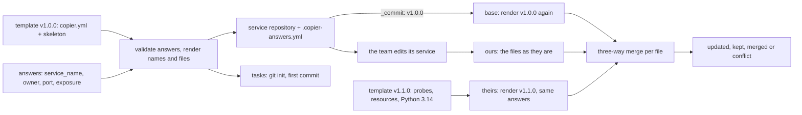

# A Golden Path Is a Template Plus Decisions Already Made

*A template answers the boring questions once; a recorded version and a three-way merge keep every service it made up to date.*

## Metadata

| Field | Value |
|---|---|
| Type | Build |
| Languages | Python |
| Prerequisites | [A Pipeline Is a Graph of Jobs in Clean Rooms](https://cloudcaptain.io/learn/cicd/pipeline-runner), [Build an Image Without a Dockerfile: Layers, Config and Manifest by Hand](https://cloudcaptain.io/learn/containers/image-build) |
| Time | 90 minutes |
| Tools | copier, git, Docker, kubectl, kind |

<Quiz stage="pre" />

## The Problem

The shop has 140 services, and every one of them started as a copy of whichever repository looked least broken that week. A new service takes two weeks: someone copies `payments-api`, deletes the payment code, and works through a 31-step wiki page that was last correct a year ago. In March a new `orders` service ships with `app.kubernetes.io/name: payments` still in its pod labels, because the copy missed one line; the `payments` Service selects the new pods too, and a fraction of payment requests land on a service that answers 404 for an afternoon. Nobody can say who owns 40 of the services, because the catalog file was optional and most copies dropped it.

Then the security team asks for three things on every service: run as a non-root user, a read-only root filesystem, and a base image that is not two Python releases old. There are 23 different base images and nine variants of the CI workflow across the 140 repositories, so the request becomes 140 hand-written pull requests, each one different, most of them reviewed by someone who has never seen that repository. Four months later 31 services are still on the old image.

The platform team writes a cookiecutter template, and creating a service drops to ten minutes. Six months later the template gains readiness probes and resource requests, and the 60 services created from it get none of it: a template is a one-time copy. Nobody knows which template version a service came from, and running the template again over an existing service overwrites the service's own changes, so nobody does. A golden path is more than a template: it is a template whose answers are typed and checked, whose output records where it came from, and whose later versions can be merged into every service it made without losing what the service team changed. You are going to build `scaffolder`, which does exactly that with the Python standard library, and then run copier on the same template and compare the two trees byte for byte.

## The Concept

Think of a housing developer's standard flat. The floor plan fixes the plumbing, the wiring and the fire exits; the buyer chooses the number of bedrooms, the kitchen layout and the colour of the walls from a short list. Years later the fire code changes and the developer issues a revised plan. A contractor visits every flat with three drawings: the plan the flat was built from, the flat as it is today, and the revised plan. Where the tenant never touched a wall, the contractor builds the revision. Where the tenant moved a wall that the revision does not mention, the tenant's wall stays. Where both moved the same wall, the contractor stops and asks. Without the original plan the contractor cannot tell a tenant's change from an old version of the developer's own plan, which is why the flat must record which plan it was built from.

A golden-path generator has the same four parts:

- **Questions.** The few decisions the service team is allowed to make, each with a type, a default (which may be computed from earlier answers), a list of choices or a validator, and a condition under which it is asked at all. Everything that is not a question is a decision already made: the base image, the non-root user, the probes, the labels the catalog and the Kubernetes plugin rely on, the CI steps, the registry.
- **Skeleton.** The files of a service, whose contents and whose names are templates. A file name that renders to an empty string is not created, which is how a public HTTP route exists only when the answer says `public`.
- **Answers file.** The template's location, its version and every answer, committed into the generated repository. It is the flat's record of which plan it was built from.
- **Update.** Render the recorded version with the recorded answers (the base), read the service as it is (ours), render the new version with the same answers plus defaults for new questions (theirs), and merge the three per file. Post-generation tasks such as `git init` and the first commit run after rendering, and only when the user trusts the template, because they are arbitrary commands.



Per file, the three versions decide the action without looking at a single line until both sides changed:

| base (old render) | ours (service) | theirs (new render) | Action |
|---|---|---|---|
| A | A | B | **updated**: take the template's change |
| A | B | A | **kept**: the service's own change stays |
| A | B | B | unchanged: both made the same change |
| A | B | C | **merged** line by line, or **conflict** where both changed the same lines |
| missing | missing | B | **added**: a new file in the template |
| A | A | missing | **removed**: the template dropped the file and the service never changed it |
| A | B | missing | **orphaned**: the template dropped a file the service changed; a person decides |
| A | missing | B | **skipped**: the service deleted the file on purpose; it is not recreated |

The answers file itself is never merged; it is rewritten with the new version and the new answers. The update only runs on a clean Git working tree, so its result is one reviewable diff and `git checkout .` undoes it.

## Build It

`code/main.py` is `scaffolder`. It reads the template format copier uses, so `code/template/` is one template that both tools understand: `copier.yml` holds the settings and nine questions, `skeleton/` holds a small Python HTTP service with its Dockerfile, CI workflow, Kubernetes manifests, `catalog-info.yaml` and README. `code/fixtures/template-v1.1.0.patch` is the next template release: readiness and liveness probes, resource requests with a new `cpu_request` question, a `HEALTHCHECK`, `python:3.14-slim` instead of `python:3.13-slim`, and a setup-python step in CI. Git access goes through an injectable runner and tasks through an injectable shell, so the tests build real temporary template repositories and services.

### Step 1: questions are typed, conditional and validated

A question in `copier.yml` has a `type` (`str`, `int`, `float`, `bool`, `yaml`, `json`), a `default` that may itself be a template, `choices`, a `validator` and a `when`. The validator is a template too: it renders to an empty string when the answer is fine and to the error message when it is not, which is copier's convention:

```yaml
service_name:
  type: str
  help: DNS label used for the image, the Deployment, the Service and the catalog entity
  validator: "must be a DNS label of 3 to 40 characters: lowercase letters, digits and hyphens, starting with a letter"

hostname:
  type: str
  help: Public host name for the HTTPRoute
  when: "{{ exposure == 'public' }}"
  default: "{{ service_name }}.example.com"
```

`resolve_answers()` walks the questions in order, so a default or a condition can use every earlier answer. A value from `--data` wins over a recorded answer, which wins over the default. Strings from the command line are cast by type, so `port=9090` becomes the integer 9090 and `environments=[dev, prod]` a list. Every problem is collected before anything is written:

```python
try:
    asked = cast_bool(render_string(question.when, {**context, **answers}, where + " when"))
except (TemplateError, ValueError) as error:
    problems.append(f"{question.name}: when: {error}")
    continue
if not asked:
    continue
```

A question whose `when` is false is neither asked nor recorded, so an internal service has no `hostname` in its answers file. An unknown `--data` key is an error that lists the real questions, because `-d sevice_name=x` silently ignored is a service named after the default.

### Step 2: a Jinja subset with whitespace control

The skeleton is written in the Jinja syntax copier renders: `{{ expression }}`, ``, ``, ``, `` with `loop.index`, `loop.first` and `loop.previtem`, ``, `` and `{# comments #}`. The tokenizer splits text from tags. The part that decides whether generated YAML is valid is whitespace: a `` on its own line would otherwise leave an empty line, or an indented one, in the Deployment. The template turns on `trim_blocks` (drop the newline after a block tag) and `lstrip_blocks` (drop the spaces before a block tag that starts a line) in `_envops`, and a `-` inside a tag strips all whitespace on that side:

```python
if modifier == "-":
    text = text.rstrip()
elif opener != "{{" and lstrip_blocks and modifier != "+":
    spaces = len(src[: match.start()]) - len(src[: match.start()].rstrip(" \t"))
    at_line_start = match.start() - spaces == 0 or src[match.start() - spaces - 1] == "\n"
    if spaces and at_line_start and text.endswith(src[match.start() - spaces : match.start()]):
        text = text[: len(text) - spaces]
```

`trim_blocks` has one trap the tests pin down: it also eats the newline after an inline tag at the end of a line, so `` as the last thing on a line joins it with the next. The GitHub Actions workflow is the other trap: `${{ github.sha }}` is Jinja syntax, so the skeleton wraps it in `` and ``.

### Step 3: expressions and filters

Expressions are parsed by recursive descent in Jinja's precedence order: the conditional expression `a if test else b`, then `or`, `and`, `not`, comparisons including `in` and `not in`, `+` and `-`, the string concatenation `~`, then `*`, `/`, `//`, `%`, and finally unary minus, literals, names, `.attribute` and `[index]`. Filters bind tighter than every operator, which is why `description | length > 72` compares a length:

```python
node = self.postfix(self.primary())
while True:
    if self.accept("|"):
        kind, name = self.take()
        if kind != "name":
            raise self.fail(f"expected a filter name after |, got {name!r}")
        args, kwargs = self.call_args() if self.peek() == ("op", "(") else ([], {})
        node = ("filter", node, name, args, kwargs)
```

The filters are the ones templates use: `lower`, `upper`, `title`, `trim`, `length`, `join`, `replace`, `default`, `regex_search` (from the Ansible filters copier loads), `tojson` (with Jinja's escaping of `&`, `'`, and angle brackets, so a description with a colon is still valid YAML in `catalog-info.yaml`) and `to_nice_yaml`, which writes the answers file exactly as PyYAML does: sorted keys, `'8080'` and `'yes'` quoted because YAML 1.1 would read them as a number and a boolean. One deliberate difference from Jinja: an undefined name is an error with the file name, not an empty string, because `{{ servce_name }}` rendering to nothing is a broken Deployment that still parses.

### Step 4: render file names, skip empty ones, copy the rest

`render_project()` takes every file under `_subdirectory`. A file ending in `_templates_suffix` (`.jinja`) has its contents rendered and the suffix removed; any other file is copied byte for byte, so `tests/test_app.py` with its own braces is safe. Every path component is rendered, and a component that renders to an empty string drops the file:

```python
templated = bool(config.suffix) and rel.endswith(config.suffix)
name = rel[: -len(config.suffix)] if templated else rel
parts = [Template(part, f"{path} (name)", config.trim_blocks, config.lstrip_blocks).render(context) for part in name.split("/")]
if any(not part for part in parts):
    continue
```

That is how the skeleton's `k8s/httproute.yaml.jinja` becomes `k8s/httproute.yaml` for a public service and nothing for an internal one. The context also holds `_copier_answers`: the answers plus `_commit` (the template version) and `_src_path` (where the template lives), which `skeleton/.copier-answers.yml.jinja` writes with `to_nice_yaml`. `skeleton/catalog-info.yaml.jinja` uses `_commit` too: it writes the annotation `cloudcaptain.io/template-version: "v1.0.0"`, which the scorecard in the [service catalog lesson](https://cloudcaptain.io/learn/platform/service-catalog) reads to tell which services are on a current template; every `update` to a new version rewrites it, so the scorecard moves when the update is merged. After rendering, `check_rendered()` parses every `.yaml` and `.json` file the template produced and refuses to write a service whose manifests do not parse, so a template bug fails at generation time, not at the first deploy.

### Step 5: versions come from Git tags

A template is a Git repository; its releases are tags. `open_template()` picks the highest `vX.Y.Z` tag unless `--ref` names one, reads the whole tree at that commit with one `git archive`, and records the tag as the version:

```python
ref = ref or latest_tag(src, runner) or "HEAD"
code, out, _ = runner(["git", "rev-parse", "--verify", "--quiet", ref + "^{commit}"], src)
if code != 0:
    raise ScaffoldError(f"template {src}: no commit or tag named {ref}")
sha = out.decode().strip()
tagged = git(runner, src, "tag", "--points-at", sha).split()
label = ref if ref in tagged else git(runner, src, "describe", "--tags", "--always", sha).strip()
```

Reading from Git, not from the working directory, is what makes the old version renderable months later: the update needs v1.0.0 exactly as it was. A template that is a plain directory renders fine but records no `_commit`, and `update` refuses it with that reason.

### Step 6: post-generation tasks need trust

`_tasks` in `copier.yml` are shell commands rendered with the answers and run in the new directory: here `git init`, `git add --all` and a first commit, each with `when: "{{ _copier_operation == 'copy' }}"` so they do not run again on update. A template can run anything, so both copier and `scaffolder` refuse a template with tasks unless you say you trust it:

```python
def check_trust(config: TemplateConfig, trust: bool, skip_tasks: bool) -> None:
    if config.tasks and not trust and not skip_tasks:
        commands = "; ".join(t.command for t in config.tasks)
        raise ScaffoldError(f"the template runs commands after rendering ({commands}); pass --trust if you trust it, or --skip-tasks")
```

### Step 7: a three-way merge over lines

`merge3()` is diff3. It diffs base against ours and base against theirs with a longest-common-subsequence diff, turning each into hunks: a range of base lines replaced by a range of side lines. Hunks from both sides are sorted by base position and grouped while they overlap or touch, which is the rule `git merge-file` uses, so two edits on adjacent lines are a conflict and two edits three lines apart are not:

```python
while index < len(changes) and changes[index].base_start <= end:
    group.append(changes[index])
    end = max(end, changes[index].base_end)
    index += 1
out.extend(b[cursor:start])
cursor = end
mine = [h for h in group if h.side == "ours"]
other = [h for h in group if h.side == "theirs"]
ours_text = side_lines(o, mine, start, end, b)
theirs_text = side_lines(t, other, start, end, b)
if not mine or ours_text == theirs_text:
    out.extend(theirs_text)
elif not other:
    out.extend(ours_text)
```

A group changed by one side takes that side; changed by both to the same text, takes it once; otherwise lines common to the start and end of both versions are kept and the rest is written between `<<<<<<< before updating`, `=======` and `>>>>>>> after updating`, the labels copier passes to `git merge-file`, so tools and editors that know merge markers handle both.

### Step 8: update plans each file, then writes

`update()` reads `.copier-answers.yml`, refuses a dirty working tree, opens the template twice (at `_commit` and at the target version), resolves answers for each version from the recorded ones (a new question gets its default, `-d replicas=3` changes one), renders both, and decides per file with `plan_file()`, the table from The Concept in code:

```python
if ours == base.data:
    if theirs.data == base.data:
        return Change(path, "unchanged"), None
    return Change(path, "updated", "template change, no local edits"), theirs.data
if theirs.data == base.data:
    return Change(path, "kept", "local edits, template unchanged"), None
if ours == theirs.data:
    return Change(path, "unchanged", "same change on both sides"), None
return merge_texts(path, base.data, ours, theirs.data, "")
```

Changing an answer goes through the same path: re-rendering with `replicas=3` is a "template change" to `k8s/deployment.yaml`, merged with whatever the team edited there. The exit code is 1 when any file is a conflict or orphaned, so a bot that opens update pull requests can label them.

### Step 9: run it

```bash
cd curriculum/phases/12-platform/01-golden-path
python3 code/main.py questions
python3 code/main.py demo
```

`demo` builds a template repository with tags v1.0.0 and v1.1.0 in a temporary directory, generates `checkout` from v1.0.0, makes four changes the way a team would (a `/version` route, a `FEATURE_FLAGS` variable in the Deployment, a runbook section in the README, and its own base image pin), commits, and updates to v1.1.0:

```
generated checkout from template v1.0.0: 13 files, tasks: git init --quiet --initial-branch=main; git add --all; git commit --quiet --message "Scaffold checkout from the service template"
own changes: /version route, FEATURE_FLAGS env var, a runbook section, base image pinned to python:3.13-slim-trixie
updated checkout from template v1.0.0 to v1.1.0
  updated   .github/workflows/ci.yaml  (template change, no local edits)
  conflict  Dockerfile  (1 conflicting hunk(s) marked with '<<<<<<< before updating')
  merged    README.md  (local edits and template change combined)
  kept      app/main.py  (local edits, template unchanged)
  updated   catalog-info.yaml  (template change, no local edits)
  merged    k8s/deployment.yaml  (local edits and template change combined)
1 file(s) need a decision: resolve the '<<<<<<< before updating' markers, then git add and commit
```

The Deployment has the team's `FEATURE_FLAGS` and the template's probes; `catalog-info.yaml` now says `cloudcaptain.io/template-version: "v1.1.0"`; the Dockerfile has the template's `HEALTHCHECK` merged cleanly and one conflict on the `FROM` line, where both sides changed the base image. Against your own directories:

```bash
python3 code/main.py new /tmp/orders --template /path/to/service-template --trust \
  -d service_name=orders -d owner=shop -d exposure=public -d database=true -d 'environments=[dev, staging, production]'
cd /tmp/orders && python3 -m unittest discover -s tests -t .
python3 /path/to/code/main.py update --dry-run
python3 /path/to/code/main.py update --trust --json
```

Exit code 2 means input `scaffolder` will not use: invalid answers (all of them listed), a template it cannot parse, a non-empty destination for `new`, a dirty tree for `update`.

<RunTests />

## Use It

copier is the tool `scaffolder` imitates, and the lesson's template is a real copier template. Install it as a tool, then generate the same service from the same tag with the same answers:

```bash
pipx install copier==9.19.1
git -C service-template tag --list
copier copy --trust --vcs-ref v1.0.0 -d service_name=checkout -d owner=payments service-template checkout
cat checkout/.copier-answers.yml
git -C checkout log --oneline
```

Without `--defaults` copier asks every question interactively with the help text, the default and the validator, and re-asks on a validation error; with `--defaults` it takes the defaults and stops with an error on an invalid answer. `code/smoke.sh` renders two sets of answers with both tools and compares the trees: the 12 and 13 files are byte for byte identical, including the answers file. Now change the service, commit, and update:

```bash
cd checkout
git commit -am "own changes"
copier update --trust --defaults --vcs-ref v1.1.0
git status --short
git diff
```

`git status` shows ` M` for the merged files and `UU Dockerfile` for the conflict: copier writes the same markers and also puts the three versions into the index as an unmerged file, so `git mergetool` and editors treat it like any merge conflict. copier exits 0 even with a conflict; `scaffolder` exits 1. Internally copier takes a different route to the same result: it renders the old version, diffs it against your committed project, renders the new version over your files, re-applies your diff with `git apply --reject` using three lines of context (`--context-lines`), and runs `git merge-file` on each file that had a rejected hunk. `--conflict rej` leaves `.rej` files instead of markers. On these templates both routes give the same tree, which the smoke test checks for a clean update and for one with a conflict. copier also has what `scaffolder` leaves out: the full Jinja language with macros and includes, `_migrations` that run between versions, `_skip_if_exists` for files a service owns after the first render, `copier recopy` to regenerate from scratch with the recorded answers, and secret questions that are never written to the answers file.

cookiecutter is the older and still common design: `cookiecutter.json` lists variables with defaults, the skeleton lives in a directory named `{{cookiecutter.project_slug}}`, and `hooks/pre_gen_project.py` and `hooks/post_gen_project.py` do validation and post-generation steps (a pre-generation hook that exits non-zero aborts). It has no update. cruft adds one: `cruft create` writes `.cruft.json` with the template URL, the commit and the context, `cruft update` renders the old and new commits, diffs them and applies the template's diff to your repository with Git, and `cruft check` exits non-zero when a newer template commit exists, which makes "is this service on the current template?" a CI check.

Backstage Software Templates are the self-service front door most platform teams put in front of a template. A `Template` entity declares the parameters as JSON Schema forms and the steps as actions:

```yaml
apiVersion: scaffolder.backstage.io/v1beta3
kind: Template
metadata:
  name: python-service
  title: Python service
spec:
  owner: group:default/platform
  type: service
  parameters:
    - title: Service
      required: [service_name, owner]
      properties:
        service_name:
          type: string
          pattern: "^[a-z][a-z0-9-]{1,38}[a-z0-9]$"
        owner:
          type: string
          ui:field: OwnerPicker
          ui:options:
            catalogFilter:
              kind: Group
        exposure:
          type: string
          enum: [internal, public]
          default: internal
    - title: Repository
      required: [repoUrl]
      properties:
        repoUrl:
          type: string
          ui:field: RepoUrlPicker
  steps:
    - id: fetch
      action: fetch:template
      input:
        url: ./skeleton
        values:
          service_name: ${{ parameters.service_name }}
          owner: ${{ parameters.owner }}
    - id: publish
      action: publish:github
      input:
        repoUrl: ${{ parameters.repoUrl }}
    - id: register
      action: catalog:register
      input:
        repoContentsUrl: ${{ steps['publish'].output.repoContentsUrl }}
        catalogInfoPath: /catalog-info.yaml
  output:
    links:
      - title: Repository
        url: ${{ steps['publish'].output.remoteUrl }}
      - title: Open in catalog
        entityRef: ${{ steps['register'].output.entityRef }}
```

The parameters are `copier.yml`'s questions with a form renderer (`OwnerPicker` lists real Groups from the catalog, which a regex cannot); `fetch:template` is `render_project()` with Nunjucks and `${{ values.service_name }}` in skeleton files; `publish:github` and `catalog:register` are the post-generation tasks, run by the Backstage backend with its own credentials instead of on a laptop. The `backstage.io/source-template` annotation in the generated `catalog-info.yaml` records the template an entity came from, which lets the catalog count services per template; the template's own `cloudcaptain.io/template-version` annotation adds the version. The scaffolder runs once: core Backstage keeps no answers file and has no update for the repositories it created, so teams that care about the second day pair the form with copier or cruft underneath, or with a bot that opens update pull requests.

That second day is what makes a golden path a path rather than a starting point, and it only works if teams choose it. Three rules follow from the mechanism. **Keep it optional and cheaper than the alternative**: the path has to be the fastest way to a production-ready service (repository, CI, image, manifests, catalog entry and on-call owner in minutes), and a team that needs something else must be able to leave it without asking permission, because a mandated template that is slower than copying a repository gets copied around. **Keep the decisions few and the questions fewer**: every question is a fork the platform team must test and support; nine questions here produce dozens of combinations, and the smoke test renders several of them. **Ship updates like a product**: a version tag per release, a changelog, small releases that merge cleanly, and a count of services per template version from the answers files, so "how many services still lack probes" has an answer.

| What you built | Real tool | Note |
|---|---|---|
| `load_config()`, `Question` | `copier.yml` questions; Backstage `parameters`; `cookiecutter.json` | Backstage validates with JSON Schema in a form; cookiecutter only in a hook |
| `resolve_answers()` with `when`, validators, casting | copier's prompt and `--defaults`, `-d`, `--data-file` | copier re-asks interactively on a bad answer instead of listing all problems |
| `Template`, `ExprParser` | Jinja (copier, cookiecutter), Nunjucks (Backstage) | the real engines add macros, includes, inheritance and many filters |
| `render_project()` with empty-name skipping | copier conditional file names; `fetch:template` | Backstage uses `copyWithoutTemplating` globs and `if` on steps instead |
| `check_rendered()` | none built in | copier and Backstage write whatever the template renders |
| `.copier-answers.yml` | the same file in copier; `.cruft.json` | Backstage records only the `backstage.io/source-template` annotation |
| `run_tasks()` and `--trust` | copier `_tasks` with `--trust`; cookiecutter hooks; Backstage actions | Backstage actions run server-side with the backend's credentials |
| `open_template()` from tags | copier `--vcs-ref` and PEP 440 tag ordering; cruft commits | copier also accepts pre-release tags with `--prereleases` |
| `merge3()`, `plan_file()`, `update()` | `copier update`; `cruft update` | copier marks conflicts as unmerged in the index and exits 0 |

<Quiz stage="check" />

## Ship It

Two artifacts in `outputs/`:

- **`skill-golden-path-design.md`**: a runbook for designing, testing and rolling out a golden-path template. It separates the decisions the platform makes from the questions it asks, writes validators that fail at generation time, tests the template by rendering a matrix of answers and building and dry-running what comes out, versions it with tags and a changelog, plans updates that merge cleanly, measures adoption from answers files, and ends with a decision table and a fixed report.
- **`prompt-review-service-template.md`**: paste a template's `copier.yml` (or a Backstage `template.yaml` or `cookiecutter.json`) and its skeleton files, and get a structured review: which decisions are made and which are left open, questions that should be decisions and the reverse, validation gaps, whitespace and escaping bugs in the skeleton, security defaults, update readiness, and the three changes that matter most.

<ShipIt />

## Exercises

### Easy

Add `_skip_if_exists`: a list of glob patterns in `copier.yml` for files the service owns after the first render, such as `README.md`. Write the tests first: on `new` the file is rendered as usual; on `update` a matching path is never written or merged and appears in the report as `skipped (owned by the service)`, even when the template changed it; a pattern that matches nothing is not an error. Then add `README.md` to the lesson template's list and show with `demo` that the template's README change no longer reaches `checkout`.

### Medium

Add migrations. A template release can rename a question (`replicas` to `min_replicas`) or move a file (`k8s/` to `deploy/`), and a plain three-way merge then sees a deleted file and a new one. Support `_migrations` entries with `version`, `rename_answers` and `move_files`, applied to the recorded answers and to the service's files before the merge when the update crosses that version. Tests first: an update from v1.0.0 to a v2.0.0 that moves `k8s/deployment.yaml` keeps the team's `FEATURE_FLAGS` in the moved file; an update from a version after the migration does not apply it again; a missing source file is reported, not fatal.

### Hard

Build the fleet view. Write `scaffolder fleet DIR...`, which reads `.copier-answers.yml` from many service repositories and reports, per template version, which services are on it, then runs `update --dry-run` on each and classifies them as up to date, clean update, or conflicts (with the file names). Tests first with five generated services at three versions, two of them with conflicting edits. Then add `--open-branches`, which performs each clean update on a branch named `template/vX.Y.Z` and commits it, and write a paragraph on why a platform team should send these as pull requests rather than push them, and what the update's exit code should do in the service's CI.

<Quiz stage="post" />

## Key Terms

| Term | Common misconception | Precise definition |
|---|---|---|
| Golden path | "The mandatory way to build services." | An opinionated, supported route from idea to production, packaged as a template plus the platform pieces behind it, that teams choose because it is the cheapest route, and may leave. |
| Template parameter | "Anything a team might want to change." | A decision delegated to the service team, with a type, a default, a validator and a condition. Everything else in the template is a decision already made. |
| Skeleton | "A sample repository to copy." | The files of a generated service whose contents and names are templates; names that render empty are not created. |
| Answers file | "A log of what the user typed." | A committed record of the template location, the template version and every answer; the input that lets an update render the old version again. |
| Merge base | "The latest template version." | The common ancestor in a three-way merge; for a template update, the old template version rendered with the recorded answers. |
| Three-way merge | "Overwrite with the new template and reapply local edits by hand." | Combining two descendants of a base: a change on one side is taken, the same change on both sides is taken once, different changes to the same or adjacent lines are a conflict. |
| Post-generation task | "Part of rendering." | A command the template runs in the new directory after writing files (Git init, first commit, publish, catalog registration); arbitrary code, so it requires trust. |
| Template drift | "Services that differ from the template." | Services still on old template versions, measurable from answers files; differences a team made on purpose are not drift. |

## Further Reading

- [Platform Engineering learning path](https://cloudcaptain.io/docs/learning-paths/platform-engineering): where golden paths sit among the catalog, self-service infrastructure and guardrails.
- [Dockerfile guide](https://cloudcaptain.io/docs/tools/docker/dockerfile-guide): the base-image, user and healthcheck choices a service template should make once.
- [GitHub Actions fundamentals](https://cloudcaptain.io/docs/tools/github-actions/fundamentals): the workflow syntax the skeleton's CI file uses, including the `${{ }}` expressions that collide with Jinja.
- [copier: updating a project](https://copier.readthedocs.io/en/stable/updating/): how `copier update` regenerates, diffs and merges, and what to do with conflicts.
- [copier: configuring a template](https://copier.readthedocs.io/en/stable/configuring/): every question key and setting, including `_tasks`, `_migrations`, `_skip_if_exists` and `_envops`.
- [Backstage: writing templates](https://backstage.io/docs/features/software-templates/writing-templates): parameters, steps, built-in actions and outputs of a Software Template.
- [cruft](https://cruft.github.io/cruft/): `create`, `update` and `check` for cookiecutter templates.
- [Jinja whitespace control](https://jinja.palletsprojects.com/en/stable/templates/#whitespace-control): `trim_blocks`, `lstrip_blocks` and the `-` modifiers that decide whether generated YAML is valid.
- [git merge-file](https://git-scm.com/docs/git-merge-file): the three-way file merge copier calls, its labels and conflict styles.
- [How we use Golden Paths to solve fragmentation in our software ecosystem](https://engineering.atspotify.com/2020/08/how-we-use-golden-paths-to-solve-fragmentation-in-our-software-ecosystem): Spotify's account of why golden paths are supported and optional rather than mandated.
