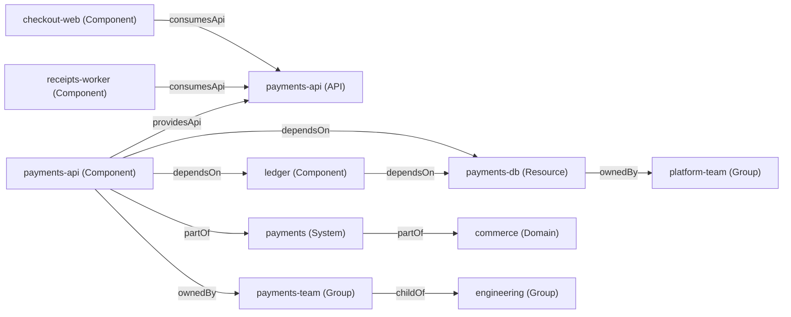

# A Service Catalog Is a Graph of Owners and Dependencies

*Every catalog-info.yaml is a node with typed edges; ownership, blast radius and scorecards are walks over the graph they form.*

## Metadata

| Field | Value |
|---|---|
| Type | Build |
| Languages | Python |
| Prerequisites | [A Golden Path Is a Template Plus Decisions Already Made](https://cloudcaptain.io/learn/platform/golden-path) |
| Time | 75 minutes |
| Tools | backstage, node, kubectl |

<Quiz stage="pre" />

## The Problem

Saturday, 02:40. The primary of `payments-db` fails over and the replica takes four minutes to catch up. The on-call engineer for the database pages "the payments team", because the wiki page from 2023 says they own everything with "payments" in the name. The payments engineer who answers knows `payments-api` is down, but not that `checkout-web` is showing a spinner to every customer, nor that a service called `receipts-worker` exists at all. Checkout finds out from a customer tweet twenty minutes later. Nobody can answer "what else depends on this database" without reading the code of every repository.

On Monday the platform team is asked for a list of production services without an on-call rotation. They grep the organisation's repositories for `catalog-info.yaml`, find 140 files, and discover that 30 were never registered, 12 name an owner group that was renamed during the reorganisation, one service lives in a `payments` namespace so its `owner: payments-team` silently points at a group that does not exist, and a service called `fx-rates` is "owned" by `system:payments`, which Backstage quietly ignores. The portal shows these services with an empty owner field and nobody notices, because an empty field does not page anyone.

A service catalog is not a spreadsheet of services. It is a graph: entities of a few kinds (Component, API, Resource, System, Domain, Group, User, Location) and typed edges between them (`ownedBy`, `dependsOn`, `providesApi`, `consumesApi`, `partOf`, `memberOf`), each stored in both directions. You are going to build `minicatalog`: it reads `catalog-info.yaml` files across repositories by following Locations, validates every entity the way the Backstage catalog does, computes the relations in both directions, finds broken references, dropped relations and orphans, and answers the Saturday questions with graph walks: who owns this, what breaks if it goes down, which team's services have no owner or no on-call, and how each service scores against a production-readiness scorecard written as data. Then you will run Backstage's own validation code over the same files and check that both agree, entity by entity and field by field.

## The Concept

Think of a building's floor plan with the wiring drawn in. Each room has a sign saying who is responsible for it, and each cable is drawn with an arrow. If you only had the signs, you could answer "who owns room 12" but not "which rooms go dark if this fuse blows". If the cables were only drawn from the room that uses power, you could not stand at the fuse box and ask which rooms it feeds. A catalog is useful because the edges are drawn, typed and readable from both ends.

Each `catalog-info.yaml` describes one or more entities in the same envelope: `apiVersion`, `kind`, `metadata` (name, namespace, annotations, tags, links) and `spec`. The spec fields that name other entities are **references** of the form `[kind:][namespace/]name`. A missing kind is filled from the field's default (an owner defaults to `group`, `providesApis` to `api`; `dependsOn` has no default, so its entries must carry a kind), and a missing namespace is taken from the entity itself, not from `default`. The catalog turns each reference into a pair of relations: `payments-api` declares `dependsOn: [resource:payments-db]`, and the catalog stores `payments-api dependsOn payments-db` and `payments-db dependencyOf payments-api`. Only the declaring side writes YAML; both sides can be queried.



Every question from the incident is a walk over this graph. "Who owns `ledger`" follows `ownedBy`, then `hasMember` for people and `childOf` for escalation. "What breaks if `payments-db` goes down" walks the reverse edges: `dependencyOf` to the components that depend on it, `providesApi` from those to their APIs, and `apiConsumedBy` to the consumers of those APIs. A scorecard is a set of predicates over a node and its neighbours (has a runbook link, has an on-call annotation here or on its owner, has an SLO, was generated from the current template) grouped into levels. And hygiene is about edges that point nowhere: an owner that does not exist, a reference whose kind cannot own, an entity that was in the catalog yesterday and whose source no longer produces it.

## Build It

`code/main.py` is `minicatalog`, standard library only, with nine subcommands over one loaded catalog: `validate`, `relations`, `lint`, `owner`, `blast-radius`, `gaps`, `scorecard`, `k8s-owners` and `export`. `code/fixtures/repos/` holds seven small "repositories" with 28 entities: a root Location in `catalog/all.yaml` that points at the others, the organisation in `catalog/org.yaml` (a Domain, four Systems, five Groups, four Users), and services with the mistakes from the problem planted on purpose. `code/fixtures/broken/` holds 24 entities, each with exactly one problem.

### Step 1: a YAML subset you can read in one sitting

Catalog files use a small part of YAML: block mappings and sequences, `- key: value` lists of mappings, flow lists, quoted strings, `|` and `>` block scalars, comments and `---` between documents. The reader works line by line with indentation as structure. A list item that starts a mapping is handled by blanking the dash and parsing the rest as a mapping at the column where its first key starts:

```python
            rest = text[1:].lstrip(" ")
            column = indent + len(text) - len(rest)
            if strip_comment(rest) == "":
                self.pos = index + 1
                items.append(self.parse_value("", indent, index, False))
            elif KEY_LINE.match(rest) or rest == "-" or rest.startswith("- "):
                self.lines[index] = " " * column + rest
                items.append(self.parse_block(column))
```

Plain scalars are typed with the YAML 1.2 core schema the `yaml` package uses (`3` is an integer, `true` a boolean, `yes` a string), which matters: `cloudcaptain.io/replicas: 3` is a number, and annotation values must be strings. Duplicate keys, tabs in indentation, anchors and tags are errors with the file and line. The smoke test parses every fixture with both this reader and the `yaml` package Backstage uses and requires identical JSON.

### Step 2: the envelope, in the order Backstage checks it

`validate_entity()` mirrors the policies the Backstage catalog applies before it looks at the kind: the envelope schema (`apiVersion`, `kind`, `metadata.name` present and strings, annotations and labels map to strings, links have a `url`), no root fields besides `apiVersion`, `kind`, `metadata` and `spec`, and the field formats. Names follow the Kubernetes object-name rule, namespaces are DNS labels, tags are lowercase:

```python
def is_object_name(value: Any) -> bool:
    return isinstance(value, str) and 1 <= len(value) <= 63 and re.fullmatch(r"([A-Za-z0-9][-A-Za-z0-9_.]*)?[A-Za-z0-9]", value) is not None


def is_dns_label(value: Any) -> bool:
    return isinstance(value, str) and 1 <= len(value) <= 63 and re.fullmatch(r"[a-z0-9]+(?:-+[a-z0-9]+)*", value) is not None
```

Each finding names a field path (`metadata.tags.1`, `metadata.annotations.cloudcaptain.io/replicas`, `owner`) so that a person, a CI job or the smoke test can tell exactly what is wrong. A finding stops the entity from entering the catalog; it does not stop the other entities in the file.

### Step 3: kinds and their required fields as data

```python
SPEC_SCHEMAS: Dict[str, Tuple[Tuple[str, ...], Dict[str, Any]]] = {
    "Component": (("type", "lifecycle", "owner"), {"type": STRING, "lifecycle": STRING, "owner": STRING, "system": STRING,
                  "subcomponentOf": STRING, "providesApis": STRINGS, "consumesApis": STRINGS, "dependsOn": STRINGS}),
    "API": (("type", "lifecycle", "owner", "definition"), {"type": STRING, "lifecycle": STRING, "owner": STRING,
            "system": STRING, "definition": STRING}),
```

The table is copied from the JSON schemas in `@backstage/catalog-model`: a Component needs `type`, `lifecycle` and `owner`, an API also a `definition`, a Group needs `type` and `children` (an empty list is fine), a User needs `memberOf`. Kinds are case-sensitive: `kind: component` is not a Component, and Backstage rejects it because no kind validator recognises it. A known kind with an unknown `apiVersion` (`backstage.io/v2`) is rejected the same way, and `minicatalog` names `apiVersion` as the field.

### Step 4: references inherit the namespace

```python
def parse_ref(text: str, default_kind: Optional[str] = None, default_namespace: str = DEFAULT_NAMESPACE) -> Tuple[str, str, str]:
    colon = text.find(":")
    slash = text.find("/")
    if slash != -1 and slash < colon:
        colon = -1
    kind = None if colon == -1 else text[:colon]
    namespace = None if slash == -1 else text[colon + 1:slash]
    name = text[max(colon + 1, slash + 1):]
```

This is the parsing rule of Backstage's `parseEntityRef`. An empty part (`group:`, `system:payments/`) is an error, and so is a reference with no kind in a field without a default kind (`dependsOn: [payments-db]`). The caller passes the entity's own namespace as the default, which is why `receipts-worker` in namespace `payments` with `owner: payments-team` points at `group:payments/payments-team`, a group nobody created. The fix is `owner: group:default/payments-team`; the catalog only tells you if something looks for broken references.

### Step 5: relations in both directions

Each kind lists its reference fields with the relation, the default kind and the kinds allowed at the other end. The reverse relation is written only for kind pairs the model declares:

```python
            kind, namespace, name = parse_ref(item, default_kind, entity.namespace)
            if allowed and kind.lower() not in [k.lower() for k in allowed]:
                notes.append(Finding(path, f"{item!r} is a {kind}; {relation} only accepts {' or '.join(allowed)}, so Backstage drops this relation", "warning"))
                continue
            target = ref_string(kind, namespace, name)
            edges.append(Edge(source, relation, target, path, True))
            reverse = reverse_of(relation, entity.kind, kind)
            if reverse:
                edges.append(Edge(target, reverse, source, path, False))
```

`RELATION_PAIRS` holds the pairs: `ownedBy`/`ownerOf` from any kind to a Group or User, `providesApi`/`apiProvidedBy` and `consumesApi`/`apiConsumedBy` from a Component to an API, `dependsOn`/`dependencyOf` between Components and Resources, `parentOf`/`childOf` between Groups, `memberOf`/`hasMember` from a User to a Group, and `partOf`/`hasPart` up the Component, System, Domain hierarchy. So `fx-rates` with `owner: system:payments` gets no ownership edge at all, and `minicatalog` reports the drop instead of leaving an empty owner field. Membership written on either side (`members: [alice]` on the group, or `memberOf: [payments-team]` on the user) ends up as the same pair of edges. References are compared lowercased, as Backstage's `stringifyEntityRef` does.

### Step 6: loading across repositories, conflicts and orphans

`load()` starts from the paths you give it, parses every YAML file, and follows each Location's `target` and `targets` relative to the file that names them. A missing target is an error unless the Location says `presence: optional`. The second definition of an entity reference is a conflict and is ignored. File names are reported relative to the common directory of everything loaded, so `export` from one checkout can be compared with a later run.

That comparison is how orphans are found. `lint --previous export.json` takes yesterday's export and reports each entity that is gone today: if its source file is still loaded but no longer contains it, or no Location points at its file any more, it is an orphan, which is what Backstage marks with the `backstage.io/orphan` annotation; if its file could not be read today, it is stale, not gone.

### Step 7: graph queries

`blast_radius()` is a breadth-first walk over the reverse edges, so each impacted entity is reported at its shortest distance with the path that reached it:

```python
        steps = [(t, "dependsOn") for t in catalog.targets(current, "dependencyOf")]
        steps += [(t, "providesApi") for t in catalog.targets(current, "providesApi")]
        steps += [(t, "consumesApi") for t in catalog.targets(current, "apiConsumedBy")]
        for target, how in steps:
            if target in seen or target not in catalog.entities:
                continue
            seen[target] = (depth + 1, path + [target])
```

The result lists the teams to notify (with `(no owner)` when an impacted entity's owner does not resolve) and the systems affected. `owner` follows `ownedBy`, lists `hasMember` and walks `childOf` for an escalation chain; when the entity's own owner does not resolve, it falls back to the owner of its System and says so. On-call is read from the paging annotations PagerDuty's and Opsgenie's Backstage plugins use (`pagerduty.com/service-id`, `pagerduty.com/integration-key`, `opsgenie.com/team`, `opsgenie.com/component-selector`), on the entity first and then on its owner. `gaps` lists every Component without a resolvable owner or an on-call annotation, grouped by the team it claims.

### Step 8: scorecards as data

`code/fixtures/scorecard.json` is the production-readiness scorecard: a filter (`kind: Component`, `spec.lifecycle: production`), ordered levels and rules with a check type each (`owner_resolves`, `relation`, `link`, `annotation` with optional inheritance from the owner, `version_at_least` on the `cloudcaptain.io/template-version` annotation the golden-path template writes). An entity reaches a level when it passes every rule of that level and of all levels below:

```python
        for name in levels:
            if any(r["id"] in failed for r in rules if levels.index(r["level"]) <= levels.index(name)):
                break
            level = name
```

`ledger` passes the owner, system and on-call rules (42.9%) but stops at bronze because it has no runbook link: a high score does not buy a level when a lower-level rule fails. `--min-level silver` makes the scorecard a CI gate.

### Step 9: from the catalog to running workloads

The Backstage Kubernetes plugin finds a component's workloads by the label named in its `backstage.io/kubernetes-id` annotation. `k8s-owners` does the reverse with `kubectl get -o json` output: each workload is `owned`, `unlabelled`, `no-component` (the label names no component) or `no-owner` (the component's owner does not resolve), and components whose label matches nothing are listed as not running.

### Step 10: run it

```bash
F=code/fixtures
python3 code/main.py validate $F/repos/catalog/all.yaml          # 8 files, 28 entities: 28 accepted, 0 rejected; fraud-ml skipped (optional)
python3 code/main.py validate $F/broken; echo "exit $?"           # 24 rejected, one field each, exit 1
#   REJECTED component:default/billing   envelope.yaml#1
#            owner: unknown root field 'owner'; only apiVersion, kind, metadata and spec are allowed ...
python3 code/main.py relations $F/repos --entity ledger
#   component:default/ledger   dependencyOf   component:default/payments-api
#   component:default/ledger   dependsOn      resource:default/events-kafka
#   component:default/ledger   ownedBy        group:default/payments-team
python3 code/main.py blast-radius payments-db $F/repos
#   if resource:default/payments-db goes down:
#     component:default/ledger (dependsOn, owners group:default/payments-team)
#     component:default/payments-api (dependsOn, owners group:default/payments-team)
#       api:default/payments-api (providesApi, owners group:default/payments-team)
#         component:default/checkout-web (consumesApi, owners group:default/checkout-team)
#         component:payments/receipts-worker (consumesApi, owners (no owner))
#   teams to notify: (no owner), group:default/checkout-team, group:default/payments-team
python3 code/main.py owner ledger $F/repos                        # payments-team, bob and carol, escalation engineering, on-call opsgenie.com/team
python3 code/main.py gaps $F/repos                                # fx-rates, notifications, receipts-worker; exit 1
python3 code/main.py scorecard $F/repos --rules $F/scorecard.json # checkout-web gold, payments-api silver (template 2.0.3), ledger bronze
python3 code/main.py lint $F/repos --previous $F/previous.json    # 2 broken owners, 1 dropped owner, 2 orphans
python3 code/main.py k8s-owners $F/repos --objects $F/k8s/deployments.json
```

Exit codes: 0 when there is nothing to report, 1 for rejected entities, location errors, lint findings, gaps, workloads without an owner or a failed `--min-level`, and 2 for input that cannot be used (a missing path, an unknown entity, a scorecard with an unknown check). Every command takes `--json`.

<RunTests />

## Use It

### The Backstage software catalog

In Backstage, the catalog backend reads `catalog-info.yaml` from the locations you register, runs the same policies and kind validators, emits relations, and stores the result in a database the portal and its plugins query. Locations come from `app-config.yaml` or from registering a URL:

```yaml
catalog:
  rules:
    - allow: [Component, System, API, Resource, Location, Domain, Group, User]
  locations:
    - type: url
      target: https://github.com/acme/catalog/blob/main/all.yaml
```

The catalog REST API answers the same questions as `minicatalog`, given a running backend and a token:

```bash
B=http://localhost:7007/api/catalog
curl -s -H "Authorization: Bearer $TOKEN" $B/entities/by-name/component/default/ledger | jq '.relations'
curl -s -H "Authorization: Bearer $TOKEN" "$B/entities/by-query?filter=kind=component,relations.ownedBy=group:default/payments-team" | jq '.items[].metadata.name'
curl -s -H "Authorization: Bearer $TOKEN" "$B/entities/by-query?filter=relations.dependsOn=resource:default/payments-db" | jq '.items[].metadata.name'
curl -s -H "Authorization: Bearer $TOKEN" "$B/entity-facets?facet=metadata.annotations.backstage.io/orphan"
curl -s -H "Authorization: Bearer $TOKEN" -X POST $B/validate-entity -H 'Content-Type: application/json' \
  -d "{\"location\": \"url:https://github.com/acme/ledger/blob/main/catalog-info.yaml\", \"entity\": $(yq -o=json catalog-info.yaml)}"
curl -s -H "Authorization: Bearer $TOKEN" -X POST $B/locations -H 'Content-Type: application/json' \
  -d '{"type": "url", "target": "https://github.com/acme/ledger/blob/main/catalog-info.yaml"}'
```

The relation filter answers one hop; a blast radius over several hops is a loop over it or a plugin (the catalog graph plugin draws it). Processing errors such as an unparseable reference do not come back from a registration; they are stored on the entity and shown in the portal, which is why validating in the pull request is worth more.

### Backstage's validator without a Backstage instance

The validation code is a published package, `@backstage/catalog-model`, so a pull request check needs Node and two packages, not a portal. `code/oracle/` holds a `package.json` and a lock file pinning `@backstage/catalog-model` 1.10.2 and `yaml` 2.9.1, and `backstage-check.js`, which applies the catalog's default policies (`SchemaValidEntityPolicy`, `DefaultNamespaceEntityPolicy`, `NoForeignRootFieldsEntityPolicy`, `FieldFormatEntityPolicy`), then the built-in kind validators, then derives relations from the compiled catalog model (`compileCatalogModel([defaultCatalogEntityModel])` from `@backstage/catalog-model/alpha`, where recent releases describe each kind's relation fields as data):

```bash
cp code/oracle/package.json code/oracle/package-lock.json code/oracle/backstage-check.js /tmp/oracle/
(cd /tmp/oracle && npm ci --ignore-scripts)
node /tmp/oracle/backstage-check.js code/fixtures/broken envelope.yaml kinds.yaml references.yaml | jq -r '.documents[] | "\(.source)#\(.doc) \(.field): \(.error)"'
```

`npm ci` refuses to install a tarball whose sha512 differs from the lock file. The smoke test runs both tools on the valid and the broken fixtures and requires the same parsed YAML, the same verdict for every document, the same field for every rejection and the same 98 relations, including the dropped `fx-rates` owner. Backstage stops at the first problem of an entity while `minicatalog` lists all of them; each broken fixture has exactly one problem so both can be compared. Backstage's error texts are terse (`Malformed envelope, <root> must NOT have additional properties`); the checker recovers the field name from the schema validator's error parameters.

### Scorecards: Backstage, Port and Cortex

Backstage has no built-in scorecards; Tech Insights plugins and commercial portals add them. Port and Cortex both model a scorecard the way `scorecard.json` does: a filter for which entities it applies to, rules over entity properties and relations, and levels that an entity reaches by passing every rule up to that level. Cortex writes rules in its query language over the catalog; Port writes them as conditions on blueprint properties. Whichever you use, keep the scorecard in version control and gate on a level, not a score: a percentage can rise while the service still has no runbook.

### Kubernetes and the catalog

```bash
kubectl get deployments -A -l backstage.io/kubernetes-id=payments-api
kubectl get deployments -A -o json > deployments.json
python3 code/main.py k8s-owners code/fixtures/repos --objects deployments.json
kubectl get deployments -A -l '!backstage.io/kubernetes-id'
```

The Backstage Kubernetes plugin uses the same label (or the selector in `backstage.io/kubernetes-label-selector`) to show a component's pods. A workload without the label is invisible from the catalog; the last command lists them. On the CI runner the smoke test applies the five Deployments from `code/fixtures/k8s/workloads.yaml` with zero replicas to its own namespace on kind and checks that the live `kubectl get -o json` gives the same mapping as the recording.

### Keeping catalog-info.yaml next to the code

The file belongs in the repository it describes, changed in the same pull request as the code: a new dependency in the code and a new `dependsOn` in the descriptor are reviewed together, and `CODEOWNERS` can require the owning team's approval. Run `minicatalog validate` (or `backstage-check.js`) and `lint` in that pull request, generate the file from the golden-path template so new services start with an owner, a system, a runbook link and an on-call annotation, and give every repository's file a route into the catalog through a Location or discovery (the GitHub and GitLab discovery providers find `catalog-info.yaml` files by path).

| What you built | Real tool | Note |
|---|---|---|
| `parse_yaml_documents()` | the `yaml` package in the catalog backend | a subset, compared document by document in the smoke test |
| `validate_entity()` | `SchemaValidEntityPolicy`, `NoForeignRootFieldsEntityPolicy`, `FieldFormatEntityPolicy`, kind validators in `@backstage/catalog-model` | Backstage stops at the first problem, minicatalog lists them all |
| `parse_ref()` | `parseEntityRef` | the default namespace is the entity's own |
| `edges_of()`, `RELATION_PAIRS` | `ModelProcessor` and the compiled catalog model; `BuiltinKindsEntityProcessor` in older setups | both drop an owner of a kind that cannot own |
| `load()` following Locations | `catalog.locations`, `POST /locations`, discovery providers | remote targets need an integration with credentials |
| `lint --previous` orphans | `backstage.io/orphan` annotation, `catalog.orphanStrategy` | an orphan is kept until someone deletes it, unless configured otherwise |
| `owner`, `gaps` | entity page "Owner" card, `relations.ownedBy` filter, PagerDuty and Opsgenie plugins | the catalog shows an empty owner; it does not alert on it |
| `blast-radius` | catalog graph plugin, `relations.dependsOn` filter | one hop per API call |
| `scorecard` | Tech Insights, Port scorecards, Cortex scorecards | levels gate on every rule below them |
| `k8s-owners` | Kubernetes plugin, `backstage.io/kubernetes-id` label | unlabelled workloads are invisible from the portal |

<Quiz stage="check" />

## Ship It

Two artifacts in `outputs/`:

- **`skill-catalog-hygiene.md`**: a runbook for a periodic catalog review or the week after a reorganisation. It finds every `catalog-info.yaml` and checks it is registered, validates with Backstage's own package, lists broken references, dropped relations and orphans, works the components without an owner or on-call by team, runs the production-readiness scorecard, maps running workloads to owners, and ends with a fixed report.
- **`prompt-write-catalog-info.md`**: give it what you know about a repository (what it runs, what it calls, which team owns it, where it is deployed) and get a `catalog-info.yaml` with fully qualified references, the annotations the scorecard and plugins read, and a list of the facts it could not confirm.

<ShipIt />

## Exercises

### Easy

Add a `lifecycle` rule to `validate` as a warning: Backstage accepts any string, but most organisations allow only `experimental`, `production` and `deprecated`. Read the allowed values from a `--lifecycles` file, report other values as `warning` findings on `spec.lifecycle` that do not reject the entity, and make `--strict` turn warnings into exit 1. Tests first: `lifecycle: prod` is accepted with one warning, `--strict` exits 1, and the fixtures still produce the same verdicts as Backstage.

### Medium

Add `minicatalog path FROM TO`: the shortest chain of relations from one entity to another over any relation type, with each hop's relation named, and `--via dependsOn,consumesApi` to restrict the types. Use it to answer "why does checkout depend on the database" (`checkout-web consumesApi payments-api apiProvidedBy payments-api dependsOn payments-db`). Tests first: that path, no path between `search-index` and `ledger` with `--via dependsOn` (exit 1), and a path that must go through a Group when membership relations are allowed.

### Hard

Add GitHub-style discovery and stale ownership detection. Given a directory of repository checkouts and a `CODEOWNERS` file in each, discover every `catalog-info.yaml` that no Location reaches (unregistered), and compare each component's `spec.owner` with the team in `CODEOWNERS` for the descriptor's path, reporting mismatches as findings. Then add `--since` to `lint` that uses `git log -1 --format=%cI -- catalog-info.yaml` to flag descriptors untouched for longer than a threshold while the code next to them changed. Tests first, on temporary Git repositories with fixed commit dates: one unregistered descriptor, one owner mismatch after a team rename, and one descriptor older than 180 days in a repository with commits last week.

<Quiz stage="post" />

## Key Terms

| Term | Common misconception | Precise definition |
|---|---|---|
| Entity | "A row in a list of services." | One described thing in the catalog, with `apiVersion`, `kind`, `metadata` and `spec`, identified by its reference `kind:namespace/name`. Components, APIs, Resources, Systems, Domains, Groups, Users and Locations are the built-in kinds. |
| Entity reference | "The name is enough." | The string `[kind:][namespace/]name`. Missing parts come from the field's default kind and the referring entity's own namespace; references compare case-insensitively. |
| Relation | "A link stored where it is written." | A typed edge (`ownedBy`, `dependsOn`, `providesApi`, `partOf`, `memberOf` and their reverses) that the catalog derives from spec fields and stores in both directions, so either end can be queried. |
| Location | "Where the YAML file happens to be." | An entity of kind Location whose `target` or `targets` tell the catalog which other descriptor files to read; `presence: optional` makes a missing target acceptable. |
| Broken reference | "Validation would have rejected it." | A reference that parses but names an entity that does not exist. The entity is accepted; the relation points nowhere and the portal shows an empty field. |
| Orphan | "An entity without an owner." | An entity whose source no longer produces it (the file dropped it, or no Location points at the file). Backstage marks it `backstage.io/orphan` and keeps it unless configured to delete orphans. |
| Blast radius | "Everything in the same system." | The set of entities reachable from a failing entity over reverse dependency edges (`dependencyOf`, `providesApi`, `apiConsumedBy`), with the shortest path and the owners to notify. |
| Scorecard | "A percentage per service." | Rules over entity data and relations, grouped into ordered levels; an entity reaches a level only when it passes every rule of that level and all levels below it. |

## Further Reading

- [Platform Engineering learning path](https://cloudcaptain.io/docs/learning-paths/platform-engineering): where the catalog sits next to golden paths, internal developer portals and self-service.
- [SRE practices](https://cloudcaptain.io/docs/learning-paths/sre-practices): on-call, runbooks and SLOs, the things the scorecard checks for.
- [YAML fundamentals](https://cloudcaptain.io/docs/tools/yaml/fundamentals): the syntax rules behind the parser in Step 1, including why `3` and `"3"` differ.
- [Backstage descriptor format](https://backstage.io/docs/features/software-catalog/descriptor-format): every kind, its required spec fields and the envelope rules this lesson implements.
- [Backstage well-known relations](https://backstage.io/docs/features/software-catalog/well-known-relations): the relation pairs and which kinds each connects.
- [Backstage entity references](https://backstage.io/docs/features/software-catalog/references): the `[kind:][namespace/]name` format and how defaults fill it in.
- [The life of an entity](https://backstage.io/docs/features/software-catalog/life-of-an-entity): ingestion, processing, stitching, errors and orphaning, the pipeline `load()` compresses into one function.
- [Well-known annotations](https://backstage.io/docs/features/software-catalog/well-known-annotations): `backstage.io/techdocs-ref`, `backstage.io/kubernetes-id` and the rest of the annotations plugins read.
- [Backstage Kubernetes plugin configuration](https://backstage.io/docs/features/kubernetes/configuration): how components are matched to workloads by label.
- [`@backstage/catalog-model` source](https://github.com/backstage/backstage/tree/master/packages/catalog-model): the policies, JSON schemas and catalog model the smoke test runs.
