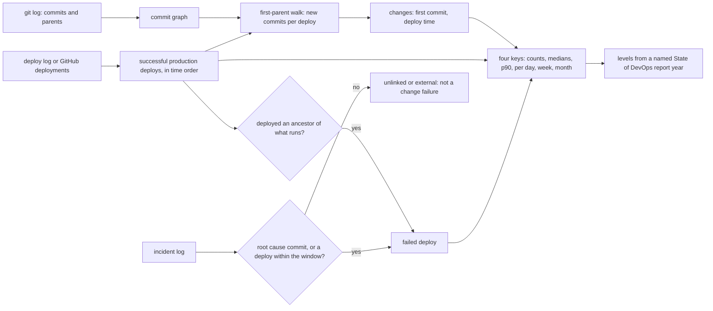

# DORA Metrics Are Joins Over Deploys, Commits and Incidents

*Each of the four keys is a join between a deploy log, the commit graph and an incident log; get the join right before you read the number.*

## Metadata

| Field | Value |
|---|---|
| Type | Build |
| Languages | Python |
| Prerequisites | [A Release Is a Version, a Changelog and a Tag](https://cloudcaptain.io/learn/cicd/release-versioning) |
| Time | 75 minutes |
| Tools | git, duckdb, gh |

<Quiz stage="pre" />

## The Problem

The platform team bought a delivery dashboard and plugged it into GitHub. A week later it reports the checkout team as elite: 40 deploys a week, a lead time of two hours, a change failure rate of 0%. The engineering director puts the slide in the quarterly review. The checkout team is surprised, because in the same quarter they had three customer-facing outages after releases, one of them rolled back in a panic at midnight, and their biggest feature sat in review for three weeks.

Each number is wrong for a different reason, and each reason is a join. The 40 deploys are every successful workflow run named "deploy", including staging and the nine times somebody re-ran the job to pick up a new secret without changing a line of code. The two-hour lead time starts at the squash commit GitHub creates at merge time, so the three weeks in review never appear. The 0% failure rate is 0 because incidents live in the paging tool and nothing connects an incident to the deploy that caused it; the midnight rollback is just another successful deploy.

Two months later it gets worse. Somebody adds deployment frequency to the team's goals, and a pipeline starts deploying every merge to a docs folder. The number doubles and nothing ships faster. The DORA metrics are useful because they come from events, not opinions, but only if the events are joined the way the definitions say: deploys to production, the commits each one shipped for the first time, and incidents tied to the deploy that caused them. You are going to write `minidora`, which computes the four keys from `git log`, a deploy log and an incident log, shows the joins it made, and warns when a number is easy to game. Then you will compute the same numbers in SQL the way Google's Four Keys project did, and feed both from the GitHub deployments API.

## The Concept

Think of a kitchen. An order is a change, the pass where plates leave is the deploy, and a plate sent back is a failure. How often plates leave says little on its own; you also want to know how long an order waited from the moment the cook started it, how many plates came back, and how long the table waited for a good one. None of these can be read off a single list. You need the order tickets (commits), the pass log (deploys) and the complaints (incidents), and you need to know which plate carried which order.

DORA (DevOps Research and Assessment, now part of Google Cloud) defines the software delivery metrics this way:

- **Deployment frequency**: how often a change reaches production. Count successful production deploys per day, week or month.
- **Change lead time**: how long a change takes from being committed to running in production. It is a distribution over changes, so you report a median and a high percentile, never a mean.
- **Change failure rate**: the share of deploys that needed immediate intervention, typically a rollback or a hotfix, or that caused an incident.
- **Failed deployment recovery time**: how long it took to recover from such a failed deploy. Until the 2023 report this key was "time to restore service" (MTTR) over all incidents; DORA narrowed it to failures caused by deploys, because a cloud provider outage says nothing about your delivery process.

The join is the hard part. A deploy names one commit. The changes it shipped are every commit reachable from that commit in the Git graph that no earlier deploy reached: on `main` with merge commits, walk the first-parent chain back to the last deployed commit; each step is one change (a pull request merge or a direct push), and the commits that merge brought in belong to it. A change's lead time runs from its earliest commit to its first production deploy. A deploy of a commit that is a proper ancestor of what is already running is a rollback, and it marks the deploy it undid as failed. An incident belongs to the deploy containing its root-cause commit when someone recorded one, otherwise to the latest deploy shortly before it started; an incident outside that window, or caused by something outside your code, is not a change failure.



Two more ideas keep the numbers honest. First, the State of DevOps reports describe performance clusters (elite, high, medium, low) found by cluster analysis of survey answers, and the boundaries change every year: the 2023 report puts a 15% change failure rate at medium, the 2024 report puts 20% at high and 10% at medium. A team's "level" per metric is a comparison with one year's table, so it has to carry the year. Second, any number that becomes a target gets gamed. Splitting one release into five deploys, redeploying an unchanged commit, squash-merging so the clock starts late and not linking incidents all improve a metric without improving delivery, and each leaves a trace in the same events.

## Build It

`code/main.py` is `minidora`. It has two subcommands: `demo` builds a Git repository from a scripted history in `code/fixtures/scenario.json` (22 changes over four weeks, with merges, a hotfix, a rollback, a failed deploy attempt, a redeploy and five incidents) plus a deploy log, an incident log and the same deploys in the GitHub API shape; `report` computes the metrics. Everything after reading the inputs is pure functions over dataclasses, and the tests feed them hand-built graphs.

### Step 1: the commit graph from git log

`git log` prints what you ask for. `minidora` asks for the hash, the parents, the author time and the subject, separated by control characters that never appear in a subject:

```python
GIT_LOG_FORMAT = "%H%x1f%P%x1f%at%x1f%an%x1f%s%x1e"
```

```bash
git -C repo log --all --format='%H%x1f%P%x1f%at%x1f%an%x1f%s%x1e' > git.log
python3 code/main.py report --git-log git.log --deploys deploys.jsonl
```

The author time (`%at`) and not the committer time is the start of the clock, because a rebase or a cherry-pick rewrites the committer time to "now" and would make every rebased change look fresh. `parse_git_log()` builds a dictionary from hash to `Commit(sha, parents, authored, author, subject)`. `--repo` runs the same `git log` through an injectable runner, so the tests never need a repository.

### Step 2: which commits did a deploy ship?

A deploy ships every commit reachable from its commit that no earlier deploy reached. `split_changes()` walks the first-parent chain from the deployed commit back to the first commit that is already deployed, then hands out the commits, oldest change first, so that each commit belongs to the first change that can reach it:

```python
def split_changes(commits: Dict[str, Commit], tip: str, deployed: Set[str]) -> List[Tuple[str, List[str]]]:
    chain: List[str] = []
    current = tip
    while current in commits and current not in deployed:
        chain.append(current)
        parents = commits[current].parents
        current = parents[0] if parents else ""
    claimed = set(deployed)
    changes: List[Tuple[str, List[str]]] = []
    for head in reversed(chain):
        members = walk(commits, head, claimed)
        claimed |= members
        changes.append((head, sorted(members, key=lambda sha: (commits[sha].authored, sha))))
    return changes
```

`walk()` is a depth-first search that stops at anything in `claimed`. A merge commit's change therefore holds the merge and the branch commits it brought in; a direct push is a change of one commit. The set of deployed commits only grows, which is what makes the walk stop: the ancestors of a deployed commit are deployed too. This is the same question as `git rev-list NEW ^OLD1 ^OLD2`, and the smoke test asks Git exactly that and compares.

### Step 3: attribution and rollbacks

`attribute()` processes successful production deploys in time order, records each change with the time of its first commit and keeps every commit's own lead time too:

```python
        if results:
            previous = results[-1].deploy
            if deploy.rollback or is_proper_ancestor(commits, full, previous.sha):
                result.rollback_of = previous.id
        for head, members in split_changes(commits, full, deployed):
            first = min(commits[sha].authored for sha in members)
            leads = [deploy.time - commits[sha].authored for sha in members]
            result.changes.append(Change(head, commits[head].subject, members, first, deploy.id, deploy.time, leads))
            result.new_commits.update(members)
        deployed |= result.new_commits
```

A rollback is detected from the graph, not from a label: deploying a commit that is a proper ancestor of what runs means going back. Redeploying the same commit is neither a rollback nor a change; it ships nothing. A deploy can also say `"rollback": true` when the rollback was done by reverting forward. Commits are attributed to their first production deploy, so after a rollback the reverted commits keep the lead time of the deploy that first shipped them. Failed attempts (`status` other than `success`) and other environments are not deployments; they are listed as attempts. A deploy whose commit is not in the history (force-pushed away, or from another repository) is reported as a problem and makes the exit code 1.

### Step 4: failed deploys and recovery time

A deploy failed if the next deploy rolled it back within the window (24 hours by default) or an incident is linked to it. The incident link prefers evidence over timing:

```python
        elif incident.root_cause:
            full = resolve(commits, incident.root_cause)
            target = next((r for r in results if full is not None and full in r.new_commits), None)
            if target is None:
                problems.append(f"incident {incident.id}: root cause {incident.root_cause} was never deployed")
            else:
                how = "root cause"
        else:
            before = [r for r in results if r.deploy.time <= incident.started and incident.started - r.deploy.time < window]
            if before:
                target, how = before[-1], "window"
```

In the scenario, `inc-2` starts 18 hours after `d-14`, so the window alone would blame `d-14`; its postmortem named a commit from `pr-110`, which shipped in `d-13`, and that is the deploy it fails. Incidents marked `external` (the cloud provider's load balancer outage) and incidents with no deploy in the window are never change failures; they are still in the old MTTR, which `minidora` prints next to the new metric so you can see the difference. Recovery runs from the failed deploy to the earlier of its rollback and the resolution of its last linked incident:

```python
        linked = [link.incident for link in links if link.deploy == result.deploy.id]
        candidates = list(rollback_times.get(result.deploy.id, []))
        if linked and all(incident.resolved is not None for incident in linked):
            candidates.append(max(incident.resolved for incident in linked if incident.resolved is not None))
        result.restore_candidates = candidates
```

An incident that is still open leaves the recovery time missing and raises a warning, because leaving it out makes the median look better than it is.

### Step 5: medians, percentiles and views

Lead and recovery times are skewed: most changes take hours, a few take weeks. The mean is pulled by the few; the median says what a typical change waits and the 90th percentile says how bad the slow ones are. `percentile()` interpolates between ranks the way SQL's `PERCENTILE_CONT` and DuckDB's `quantile_cont` do, so the numbers can be checked in SQL:

```python
def percentile(values: Iterable[float], fraction: float) -> Optional[float]:
    ordered = sorted(values)
    if not ordered:
        return None
    position = (len(ordered) - 1) * fraction
    lower, upper = math.floor(position), math.ceil(position)
    return ordered[lower] + (ordered[upper] - ordered[lower]) * (position - lower)
```

`--view daily|weekly|monthly` groups deploys by UTC day, ISO week or month, with empty buckets kept (a week without deploys is information). Every metric is bucketed by the deploy it belongs to: a change by the deploy that shipped it, a failure by the deploy that failed. `--changes` lists every change with its first commit, its deploy and its lead time, which is where you find the bottleneck.

### Step 6: performance levels, with the year

The levels are data, one table per report year:

```python
    "2024": {
        "report": "Accelerate State of DevOps Report 2024",
        "deploys_per_day_at_least": {"elite": 1.0, "high": 1 / 7, "medium": 1 / 30},
        "lead_time_under": {"elite": DAY, "high": 7 * DAY, "medium": 30 * DAY},
        "change_failure_rate": {"elite": 5.0, "high": 20.0, "medium": 10.0, "low": 40.0},
        "recovery_under": {"elite": HOUR, "high": DAY, "medium": DAY},
    },
```

The reports give deployment frequency, lead time and recovery time as survey answer ranges ("between once per day and once per week", "less than one day"), which `minidora` maps to the numeric bounds above and checks best level first. They give the change failure rate as one typical value per cluster, not a range, and in 2024 those values are not even in order (high 20%, medium 10%), so `level_nearest()` picks the closest value. That is the honest version of what the reports say, and it is why `minidora` prints a level per metric and never claims to place a team in a cluster: the clusters come from all four answers at once. The 2025 report stopped publishing the four clusters and describes team profiles instead, another reason every level carries its year.

### Step 7: warnings for numbers that are easy to game

`warnings_for()` looks for the traces gaming and missing data leave in the events:

| Warning | What it sees | Why the number misleads |
|---|---|---|
| `empty-deploys` | deploys that shipped no new commit and are not rollbacks | frequency goes up, nothing was delivered |
| `bursty-deploys` | at least one deploy per day on average, fewer than three deploy days per week | frequency comes from bursts or split releases |
| `no-failures-recorded` | ten or more deploys and no failed one | incidents and rollbacks are probably not linked |
| `unlinked-incidents` | incidents with no root cause and no deploy in the window | they fall out of both failure metrics |
| `open-incidents` | linked incidents without a resolution time | recovery looks faster than it is |
| `single-commit-changes` | 80% or more of changes are one commit | squash or rebase merges hide review time |
| `small-sample` | fewer than ten deploys or changes | a median moves with one event |

Warnings never change the exit code. Problems in the input (a deploy commit that is not in the history, an incident resolved before it started, a root cause that was never deployed) do: exit 1. Unreadable input is exit 2.

### Step 8: run it

```bash
python3 code/main.py demo /tmp/dora
python3 code/main.py report --repo /tmp/dora/repo --deploys /tmp/dora/deploys.jsonl --incidents /tmp/dora/incidents.jsonl \
  --since 2026-09-07 --until 2026-10-05
# minidora: production, 2026-09-07 to 2026-10-05 (28 days), incidents linked within 24 h, levels per metric from the Accelerate State of DevOps Report 2024
#   deployment frequency       21 deploys, 0.75 per day, median 3 deploy days per week  [high]
#   lead time for changes      22 changes, median 8.0 h, p90 17.5 h; per commit (Four Keys) median 6.0 h  [elite]
#   change failure rate        4 of 21 deploys = 19.05%  [high]
#   failed deployment recovery 4 restored, median 9.5 h, p90 27.2 h  [high]
#   incident time to restore   5 incidents, median 1.5 h (the pre-2023 MTTR, every incident)
# failed deploys
#   d-03     2026-09-09T12:00:00Z  incident inc-1; recovered after 3.0 h
#   d-06     2026-09-11T10:00:00Z  rolled back by d-07; recovered after 1.0 h
#   d-13     2026-09-16T06:00:00Z  incident inc-2; recovered after 32.0 h
#   d-19     2026-09-28T21:00:00Z  incident inc-4; recovered after 16.0 h
# warning [empty-deploys] 1 deploy(s) shipped no new commit (d-12): ...
python3 code/main.py report --repo /tmp/dora/repo --deploys /tmp/dora/github-deployments.json --incidents /tmp/dora/incidents.jsonl --clusters 2023
python3 code/main.py report --repo /tmp/dora/repo --deploys /tmp/dora/deploys.jsonl --incidents /tmp/dora/incidents.jsonl --view daily --changes --json > dora.json
```

Check the numbers by hand from the scenario: 21 successful production deploys (the failed attempt `d-09` and the two staging deploys are not counted, the redeploy `d-12` and the rollback `d-07` are), 4 failed, so 19.05%; recoveries of 1, 3, 16 and 32 hours have a median of 9.5. The change failure rate is high against the 2024 table and medium against 2023. Notice the old MTTR, 1.5 hours over all incidents, is six times shorter than the recovery time from failed deploys: the external outage and the quickly fixed unlinked incident pull it down, and neither tells you anything about your releases.

<RunTests />

## Use It

### The definitions and the Four Keys project

DORA publishes the definitions on dora.dev. Its current guide lists five measures: the four above plus **deployment rework rate**, the share of deploys that were unplanned and made because of a production incident, introduced with the 2024 report, which found that the change failure rate and the rework rate together form a reliable measure of delivery stability. Throughput (lead time, frequency, recovery time) and instability (change failure rate, rework rate) are read together; improving one by trading away the other is not improvement.

Google's Four Keys project (`dora-team/fourkeys`, which its README now says is not maintained) was the reference implementation: webhooks from GitHub, GitLab, Cloud Build, Tekton or CircleCI land in BigQuery as raw events, and SQL turns them into three tables, `deployments`, `changes` and `incidents`, then into the four keys. Its lead time query is the per-commit version of Step 3:

```sql
SELECT PERCENTILE_CONT(
         IF(TIMESTAMP_DIFF(d.time_created, c.time_created, MINUTE) > 0,
            TIMESTAMP_DIFF(d.time_created, c.time_created, MINUTE), NULL), 0.5) OVER () AS median_minutes
FROM four_keys.deployments d, d.changes
LEFT JOIN four_keys.changes c ON changes = c.change_id
```

Two of its joins are worth knowing because they are easy to copy by accident. A deployment's changes come from the push event of the deployed commit, so commits from earlier pushes that were never deployed separately are missed; walking the graph, as `minidora` does, finds them. And incidents are linked by a `root cause: SHA` line in the incident or issue body, so an incident without one never counts as a failure. Its change failure rate divides incident-matched rows by distinct deploys over a join of deploys with their changes, so the numerator counts joined rows, not failed deploys. `minidora` prints the Four Keys per-commit median next to its per-change one: in the scenario they are 6 and 8 hours, because merge commits and late fixup commits pull a per-commit median down.

The smoke test does the Four Keys job in DuckDB. Git answers the graph questions (which commits each deploy shipped, which deploy was a rollback), SQL does the joins and the aggregates:

```bash
git -C repo rev-list --first-parent "$DEPLOYED" ^"$PREVIOUS_1" ^"$PREVIOUS_2"      # the change heads of one deploy
git -C repo rev-list "$HEAD" ^"$HEAD^1" ^"$PREVIOUS_1" ^"$PREVIOUS_2"               # the commits of one change
git -C repo merge-base --is-ancestor "$DEPLOYED" "$RUNNING" && echo rollback
```

```sql
CREATE TABLE changes AS
SELECT cc.deploy_id, cc.head, d.time_created - min(c.authored) AS lead_seconds
FROM change_commits cc JOIN commits c USING (sha) JOIN period_deploys d USING (deploy_id)
GROUP BY cc.deploy_id, cc.head, d.time_created;

SELECT count(*), quantile_cont(lead_seconds::DOUBLE, 0.5), quantile_cont(lead_seconds::DOUBLE, 0.9) FROM changes;

SELECT count(*), count(f.deploy_id), 100.0 * count(f.deploy_id) / count(*),
       quantile_cont((f.restored - d.time_created)::DOUBLE, 0.5)
FROM period_deploys d LEFT JOIN failures f USING (deploy_id);
```

`failures` is a `UNION ALL` of rollbacks within the window and incidents linked by root cause or by `arg_max(deploy_id, time_created)` over the deploys in the window, grouped by deploy with `min(restored)`. Every number `minidora` prints, the weekly deploy counts and the exact partition of commits into changes must agree, on the scenario and after each planted change.

### GitHub deployments and environments as the event source

GitHub records a deployment when a workflow job targets an environment (`environment: production` in the job), and each deployment carries a list of statuses (`queued`, `in_progress`, `success`, `failure`, `error`, `inactive`). The deploy time is the first `success` status, not the deployment's `created_at`, which is when the job started; `inactive` marks a deployment that a newer one replaced (GitHub can add it automatically) and is not a failure. Fetch them with `gh` and attach each deployment's statuses, which is the shape `minidora` reads:

```bash
gh api repos/OWNER/REPO/environments --jq '.environments[].name'
gh api --paginate 'repos/OWNER/REPO/deployments?environment=production&per_page=100' --jq '.[]' | jq -s '.' > deployments.json
jq -c '.[]' deployments.json | while read -r deployment; do
  id="$(jq -r '.id' <<< "$deployment")"
  gh api --paginate "repos/OWNER/REPO/deployments/$id/statuses" --jq '.[]' | jq -s --argjson d "$deployment" '$d + {statuses: .}'
done | jq -s '.' > github-deployments.json
python3 code/main.py report --repo . --deploys github-deployments.json --incidents incidents.jsonl
```

The incident log is whatever your paging or incident tool exports (PagerDuty, Opsgenie, incident.io, GitHub issues with an `incident` label), reduced to `id`, `started`, `resolved` and, from the postmortem, `root_cause`. That last field is the one most teams do not have, and it is the one that makes the change failure rate mean something.

### Using the numbers

The metrics are for finding the constraint in your own delivery, not for ranking teams. Open `--changes` and look at where the time goes: in the scenario, `pr-117` has a lead time of 86 hours because its first commit was made three and a half days before it merged; the median hides it, the p90 shows it. Split such changes into time to first review, review, merge to deploy (an Exercise) and the constraint is usually waiting, not coding. A falling deployment frequency with a stable lead time often means batching; a rising change failure rate after a frequency push means the safety net (tests, canaries, feature flags) did not keep up. Compare a team with its own past periods, with the same definitions; comparing teams with different services, risk and incident practices compares their data hygiene. And watch the warnings: once a metric is a target, `empty-deploys` and `single-commit-changes` start to rise.

| What you built | Real tool | Note |
|---|---|---|
| `parse_git_log()`, `split_changes()` | `git log --format`, `git rev-list --first-parent`, `git rev-list A ^B` | the graph answers which commits a deploy shipped for the first time |
| rollback by `is_proper_ancestor()` | `git merge-base --is-ancestor`, `kubectl rollout undo`, Argo CD rollback | detected from the graph, not from a label |
| `load_deploys()` | GitHub deployments and statuses API, environments | the deploy time is the first `success` status |
| `link_incidents()` | Four Keys `incidents` table with `root cause: SHA` | root cause first, time window second, external never |
| `summarize()` with `percentile()` | Four Keys dashboard SQL, DuckDB `quantile_cont` | median and p90, never the mean |
| failed deployment recovery time | Four Keys "time to restore" | measured from the failed deploy, not over all incidents |
| `CLUSTERS` with `--clusters` | the State of DevOps report tables | a level per metric, always with the year |
| `warnings_for()` | (none in Four Keys) | the traces of gaming and of missing links |

<Quiz stage="check" />

## Ship It

Two artifacts in `outputs/`:

- **`skill-delivery-metrics-review.md`**: a runbook for a monthly or quarterly delivery metrics review. It checks the event sources (production only, success status, every deploy commit in the history, incidents with root causes), runs `minidora` for the period and the previous one, reconciles a sample by hand, reads the warnings, finds the bottleneck from the slowest changes and the failed deploys, and ends with a fixed report that compares the team with itself and names the year of any level it quotes.
- **`prompt-explain-dora-change.md`**: paste two `minidora --json` reports (or any before and after numbers with their changes and failures) and get an explanation of why a metric moved, split into real delivery changes and measurement effects such as redeploys, squash merges, unlinked incidents or a changed window, with the queries that confirm it.

<ShipIt />

## Exercises

### Easy

Split lead time into stages. The head of a change is its merge commit (or the commit itself for a direct push), and its author time is when the change reached `main`. Add `review_seconds` (first commit to head) and `release_seconds` (head to deploy) to every change, and medians of both to the report. Write the tests first: in the scenario `pr-117` has 85 hours of review and 1 hour of release, a direct push has 0 review, and the two stages add up to the lead time for every change.

### Medium

Add DORA's fifth measure, deployment rework rate: the share of deploys that were unplanned and made because of a production incident. Accept an optional `fix` field on incidents (a commit) and count a deploy as rework when it is the first deploy containing an incident's fix commit, or a rollback. Tests first: in the scenario with `inc-1` fixed by `hotfix-1`, `d-04` and the rollback `d-07` are rework (2 of 21), later deploys that also contain the fix commit are not, and the change failure rate does not change.

### Hard

Use Kubernetes as the deploy source. With a commit annotation on the pod template (for example `app.example.com/commit`), every new ReplicaSet of a Deployment is a deploy and `kubectl rollout undo` reuses an old ReplicaSet, bumping its `deployment.kubernetes.io/revision` and recording the old one in `deployment.kubernetes.io/revision-history`. Write an importer for `kubectl get replicasets -o json` that turns revisions into deploy events and marks reused ReplicaSets as rollbacks. ReplicaSets carry no timestamp for a revision bump, so take rollout times from the Deployment's events or record them in an annotation of your own. Test it against fixture JSON with three revisions and an undo, then on a kind cluster: roll out three images, undo one, and check that `minidora` counts four deploys with one rollback.

<Quiz stage="post" />

## Key Terms

| Term | Common misconception | Precise definition |
|---|---|---|
| Deployment frequency | "Every successful pipeline run is a deploy." | The number of successful deploys to production per period. Staging deploys, failed attempts and other environments are not deployments; a redeploy of an unchanged commit is one, but ships no change. |
| Change lead time | "Time from merge to deploy." | Time from a change's first commit to the first production deploy that contains it, reported as a median and a high percentile over changes. Merge to deploy is only its last stage. |
| Change | "One commit." | The unit of work that lands on the deployed branch: a merge with the commits it brings in, or a direct push. Four Keys measures per commit; DORA's definition starts at the commit, so the first commit of the change is the start of the clock. |
| Change failure rate | "Incidents divided by deploys." | The share of deploys that needed immediate intervention (rollback, hotfix) or caused an incident, each failed deploy counted once, whatever the number of incidents. |
| Failed deployment recovery time | "The same as MTTR." | Time from a failed deploy to service restored (rollback or resolution of its incidents), over failed deploys only. Since the 2023 report it replaces time to restore service, which covered every incident including ones no deploy caused. |
| Rollback | "A deploy labelled rollback." | A deploy of a commit that is a proper ancestor of the one running; it marks the deploy it undid as failed. Reverting forward with a new commit is a hotfix, not a rollback in the graph. |
| Performance cluster | "A fixed standard for elite teams." | A group found by cluster analysis of one year's survey answers; the bounds change every year (15% change failure rate is medium in 2023 and high in 2024), so a level is only meaningful with its year. |
| Root cause commit | "Optional detail for the postmortem." | The commit an incident review identified as the cause; it ties the incident to the deploy that first shipped that commit, which a time window can only guess. |

## Further Reading

- [Platform Engineering learning path](https://cloudcaptain.io/docs/learning-paths/platform-engineering): where delivery metrics sit among the other platform measures (developer satisfaction, adoption, cost).
- [CI/CD Fundamentals](https://cloudcaptain.io/docs/tools/cicd/fundamentals): the pipeline stages whose waiting times make up lead time.
- [Git Advanced Topics](https://cloudcaptain.io/docs/tools/git/advanced): merge strategies, squash and rebase, which decide what the commit graph can tell you.
- [DevOps Interview Prep](https://cloudcaptain.io/docs/interview-prep/devops): the DORA questions you can now answer with the joins, not the slogans.
- [DORA's software delivery performance metrics](https://dora.dev/guides/dora-metrics/): the current definitions, including deployment rework rate and why failed deployment recovery time replaced MTTR.
- [DORA research reports](https://dora.dev/research/): the State of DevOps reports with each year's cluster tables and methodology.
- [Four Keys](https://github.com/dora-team/fourkeys): the reference implementation's event schema and SQL, not maintained but still the clearest description of the joins.
- [REST API endpoints for deployments](https://docs.github.com/en/rest/deployments/deployments) and [deployment statuses](https://docs.github.com/en/rest/deployments/statuses): the fields `minidora` reads and the meaning of `inactive`.
- [git rev-list](https://git-scm.com/docs/git-rev-list): `^` exclusions, `--first-parent` and `--count`, the graph queries behind Step 2.
- [DuckDB aggregate functions](https://duckdb.org/docs/stable/sql/functions/aggregates): `quantile_cont`, `arg_max` and `FILTER`, as used in the smoke test.
