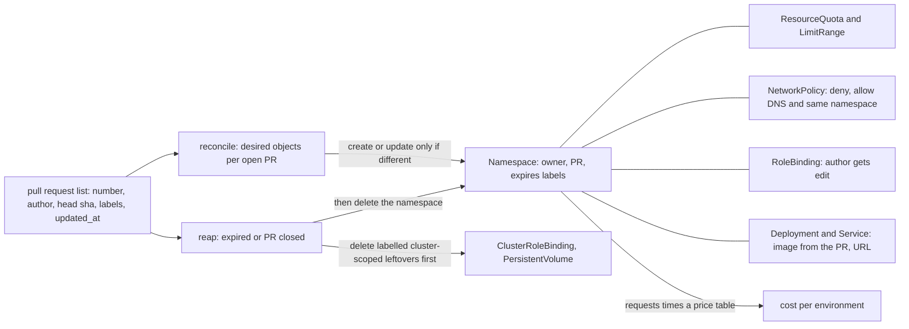

# Preview Environments Are Namespaces With a Lifetime

*Every pull request gets a fenced namespace with a quota, an owner and an expiry; a reaper that cannot be fooled makes them disposable.*

## Metadata

| Field | Value |
|---|---|
| Type | Build |
| Languages | Python |
| Prerequisites | [GitOps Reconciler](https://cloudcaptain.io/learn/cicd/gitops-reconciler), [RBAC Authorizer](https://cloudcaptain.io/learn/orchestration/rbac-authorizer) |
| Time | 90 minutes |
| Tools | kubectl, kind, argocd, vcluster |

<Quiz stage="pre" />

## The Problem

The shop team wanted reviewers to click a link instead of checking out a branch, so a CI job started running `kubectl create namespace shop-pr-$NUMBER && kubectl apply -n shop-pr-$NUMBER -f deploy/` on every push. Product managers loved it for three weeks. Then the shared staging cluster ran out of capacity on a Tuesday: 140 namespaces, 61 of them for pull requests merged or abandoned months ago, one of them running a load-test branch that had scaled itself to 40 replicas with no resource requests, so the scheduler kept packing pods onto nodes that were already full and real staging services were evicted.

The cleanup was worse than the outage. A script deleted every namespace matching `shop-pr-*`, which included `shop-pr-review-tools`, a namespace another team had created by hand. Two weeks later the storage bill showed 300 GiB of PersistentVolumes in `Released` state: their claims had died with the namespaces, but the volumes were cluster-scoped, had `Retain` as their reclaim policy, and nobody deleted them. Meanwhile a contractor who could push to any branch had `edit` rights in every preview namespace, because the CI job's service account created the RoleBinding for a group, not for the author.

None of these are exotic bugs. They are the missing parts of a design: a preview environment needs an owner, a budget, a fence and an end date written on it when it is created, and a second loop that reads those fields and removes what has expired, including the things outside the namespace. In this lesson you build `minienv`, a controller that does exactly that from a list of pull requests, then run it on kind and compare it with Argo CD's ApplicationSet pull request generator, vcluster and TTL janitors.

## The Concept

A namespace is cheap to create and cheap to delete, and almost every policy in Kubernetes can be scoped to one: quotas, default resource limits, network policy, RBAC bindings. That makes it the natural unit for a preview environment. What a plain namespace lacks is a lifetime. `minienv` writes the lifetime into the namespace itself as labels and annotations, so any later process (the reaper, a cost report, a human with `kubectl get ns -L`) can decide what to do from the cluster alone:

| On the namespace | Example | Read by |
|---|---|---|
| `app.kubernetes.io/managed-by=minienv` and `preview.cloudcaptain.io/repo` | `minienv`, `shop` | the reaper, which never touches a namespace without both |
| `preview.cloudcaptain.io/pr`, `preview.cloudcaptain.io/owner` | `101`, `alice` | the reaper (is the PR still open?), cost reports, humans |
| `preview.cloudcaptain.io/expires` | `1794582000` (Unix seconds; label values cannot hold a colon) | the reaper |
| annotations `preview.cloudcaptain.io/expires-at` and `janitor/expires` | `2026-11-13T15:00:00Z` | humans, and kube-janitor-style tools as a second line of defence |

The expiry is computed from the pull request's last push plus a TTL, not from the time of the reconcile, so running the reconcile twice computes the same labels and writes nothing. A new push moves the expiry forward; an abandoned pull request stops moving it.

Inside the namespace the guard rails are admission-time rules, so they hold no matter who deploys there. When a pod is created, the API server runs the **LimitRanger** admission plugin, which fills in missing container requests and limits from the namespace's LimitRange and rejects containers above its `max`, and then the **ResourceQuota** plugin, which adds the pod's requests to the quota's recorded usage and refuses the pod if any tracked resource would exceed `hard`. The quota is why the runaway load test cannot starve staging; the LimitRange is what makes the quota usable, because a quota on `requests.cpu` refuses every pod that does not state a CPU request. A default-deny NetworkPolicy with exceptions for DNS and the namespace's own pods keeps one preview from calling another (or production), if the cluster's network plugin enforces NetworkPolicy. A RoleBinding gives the pull request's author, and only the author, the built-in `edit` ClusterRole inside that namespace.



There are two loops with different inputs, and keeping them separate is a safety property. Reconcile is driven by open pull requests and only ever creates or updates. Reap is driven by labels in the cluster plus the pull request list, and only ever deletes, and it has two rules that the script in The Problem lacked: it acts only on namespaces carrying its own `managed-by` label and repository label, and it refuses to treat an empty pull request list as "everything is closed", because an expired token or a rate-limited API returns an empty list too. Deleting a namespace deletes everything inside it, but not cluster-scoped objects that belong to the environment in spirit: PersistentVolumes whose `claimRef` points into the namespace, and ClusterRoles or ClusterRoleBindings an app's chart created. The reaper deletes those first, then the namespace, and sweeps orphans whose namespace is already gone, so a reaper that crashed halfway through still converges on the next run.

## Build It

`code/main.py` is `minienv`, about 1,000 lines of standard-library Python. It reads a JSON array shaped like GitHub's `GET /repos/OWNER/REPO/pulls` response (`code/fixtures/pulls.json` has five), talks to the cluster through `Kubectl` (subprocess calls to `kubectl` with server-side apply) or through `FakeCluster`, an in-memory API server that applies defaults, canonicalises quantities, keeps `resourceVersion`s and runs the same admission code, so the tests and the demo run on a laptop without a cluster.

### Step 1: which pull requests get an environment

The decision is a pure function of the pull request, the configuration and the clock. A `preview-ttl-<N>h` label overrides the default TTL, `no-preview` opts out, and `--require-label preview` makes environments opt-in, which is what ApplicationSet's `labels` filter does:

```python
def wanted(pr: PullRequest, config: Config, now: datetime) -> Tuple[bool, str]:
    if pr.state != "open":
        return False, f"state is {pr.state}"
    if SKIP_LABEL in pr.labels:
        return False, f"labelled {SKIP_LABEL}"
    if config.require_label and config.require_label not in pr.labels:
        return False, f"missing label {config.require_label}"
    if expiry(pr, config) <= now:
        return False, f"expired at {iso(expiry(pr, config))} (push a commit to renew)"
    return True, "open"
```

Namespace names are `<prefix>-<repo>-pr-<number>`, cut to the 63-character DNS label limit with a short hash of the full name when the repository name is long, so two long names never collide.

### Step 2: the desired objects

`desired_objects()` returns the whole environment as plain dicts. Every object carries the managed-by, repository, PR and environment labels; the namespace also carries the owner and the expiry:

```python
def desired_objects(pr: PullRequest, config: Config) -> List[Obj]:
    ns = namespace_name(config, pr.number)
    expires = expiry(pr, config)
    common = {LABEL_MANAGED: MANAGER, LABEL_REPO: label_value(config.repo), LABEL_PR: str(pr.number), LABEL_ENV: ns}
    ns_labels = dict(common, **{LABEL_OWNER: label_value(pr.login), LABEL_EXPIRES: str(int(expires.timestamp()))})
    ns_annotations = {ANNOTATION_EXPIRES_AT: iso(expires), JANITOR_EXPIRES: iso(expires), ANNOTATION_URL: url_for(pr, config), ANNOTATION_HEAD: pr.head_sha, ANNOTATION_BRANCH: pr.branch}
    selector = {"app.kubernetes.io/name": APP}
```

The rest of the list is a ResourceQuota (`pods: 10`, `requests.cpu: 1`, `requests.memory: 1Gi`, `limits.cpu: 2`, `limits.memory: 2Gi`, and zero LoadBalancer and NodePort Services, so a preview can never buy a cloud load balancer), a LimitRange (default limit `250m`/`256Mi`, default request `100m`/`128Mi`, max `1`/`1Gi` per container), three NetworkPolicies (`default-deny` for both directions, `allow-dns` to `kube-dns` in `kube-system` on port 53 over UDP and TCP, `allow-same-namespace`), the author's RoleBinding to the `edit` ClusterRole, and the app: a Deployment whose image comes from `--image-template` (default `ghcr.io/acme/{repo}:pr-{number}-{short_sha}`) and a Service. With `--gateway NAMESPACE/NAME` it adds an HTTPRoute for `pr-<number>.<repo>.<domain>` and one NetworkPolicy exception for traffic from the Gateway's namespace.

### Step 3: admission, the way the API server does it

`admit_pod()` reproduces the two admission plugins in their real order, so you can predict a rejection before you see one, and `minienv admit` runs it offline against the objects `kubectl get limitrange,resourcequota -o json` returns:

```python
def admit_pod(pod: Obj, objects: Sequence[Obj]) -> Tuple[Obj, Optional[str]]:
    admitted = copy.deepcopy(pod)
    name = (admitted.get("metadata") or {}).get("name", "")
    for container in init_containers_of(admitted) + containers_of(admitted):
        default_requests_to_limits(container)
    errors: List[str] = []
    for limit_range in sorted((o for o in objects if o.get("kind") == "LimitRange"), key=lambda o: o["metadata"]["name"]):
        for item in (limit_range.get("spec") or {}).get("limits") or []:
            if item.get("type", "Container") == "Container":
                for container in init_containers_of(admitted) + containers_of(admitted):
                    apply_limit_range(container, item, errors)
    if errors:
        return admitted, f'pods "{name}" is forbidden: {aggregate(errors)}'
    for quota in sorted((o for o in objects if o.get("kind") == "ResourceQuota"), key=lambda o: o["metadata"]["name"]):
        problem = check_quota(admitted, quota)
        if problem:
            return admitted, f'pods "{name}" is forbidden: {problem}'
    return admitted, None
```

The first loop is pod defaulting, which happens before any admission plugin: a container with a limit and no request gets a request equal to the limit, not the LimitRange's `defaultRequest`. That surprises people, and test `test_limit_range_fills_defaults_and_requests_default_to_limits` pins it down. `check_quota()` first refuses if the quota's `status.hard` is not filled in yet (the quota controller has not processed it, and the real message is `status unknown for quota`), then refuses containers without an explicit value for a tracked compute resource, then adds the pod's usage (containers summed, init containers as a maximum, plus `pods=1`) to `status.used` and reports only the resources that would go over, formatted the way the API server prints quantities:

```python
    requested = {key: value for key, value in pod_usage(pod).items() if key in hard}
    exceeded = sorted(key for key, value in requested.items() if (used.get(key, (Fraction(0), False))[0] + value[0]) > hard[key][0])
    if not exceeded:
        return None
    return "exceeded quota: {}, requested: {}, used: {}, limited: {}".format(
        name, pretty({k: requested[k] for k in exceeded}), pretty({k: used.get(k, (Fraction(0), requested[k][1])) for k in exceeded}), pretty({k: hard[k] for k in exceeded}))
```

`parse_quantity()` and `format_quantity()` handle the quantity grammar (`250m`, `1.5`, `1e3`, `128Mi`, `1Gi`) with `Fraction`, so `600m + 600m` prints as `1200m` and `1024Mi` equals `1Gi`, exactly as the API server compares them.

### Step 4: reconcile without writing

`Reconciler.ensure()` reads the live object and writes only if the live object does not already contain every field minienv wants:

```python
    def ensure(self, obj: Obj) -> str:
        live = self.cluster.get(obj["kind"], obj["metadata"]["name"], obj["metadata"].get("namespace"))
        if live is not None and covers(live, obj):
            return "unchanged"
        action = "updated" if live is not None else "created"
        if live is not None and obj["kind"] == "RoleBinding" and live.get("roleRef") != obj["roleRef"]:
            action = "replaced"
            if not self.dry_run:
                self.cluster.delete("RoleBinding", obj["metadata"]["name"], obj["metadata"]["namespace"])
        if not self.dry_run:
            self.cluster.apply(obj)
        return action if not self.dry_run else f"would be {action}"
```

```python
def covers(live: Any, want: Any) -> bool:
    if isinstance(want, dict):
        return isinstance(live, dict) and all(key in live and covers(live[key], value) for key, value in want.items())
    if isinstance(want, list):
        return isinstance(live, list) and len(live) == len(want) and all(covers(a, b) for a, b in zip(live, want))
    return same_scalar(live, want)
```

`covers()` is a subset test, so the fields the API server adds (a Service's `clusterIP`, a probe's `scheme`, `imagePullPolicy`, the namespace's `kubernetes.io/metadata.name` label) never count as drift, and `same_scalar()` compares quantities by value because the API server stores `1024Mi` as `1Gi`. A RoleBinding's `roleRef` is immutable, so a changed role is a delete and a create. The writes go through `kubectl apply --server-side --field-manager=minienv`; a second reconcile of a settled cluster makes no write at all, which the smoke test proves by comparing `resourceVersion`s.

### Step 5: the reaper

`reap()` lists namespaces by label selector, keeps only names that start with this repository's stem, and asks one question per namespace:

```python
    def reap_reason(self, ns: Obj, open_numbers: Optional[set]) -> Optional[str]:
        labels = ns["metadata"].get("labels") or {}
        try:
            expires = datetime.fromtimestamp(int(labels.get(LABEL_EXPIRES, "")), timezone.utc)
        except ValueError:
            return f"label {LABEL_EXPIRES} is missing or not a number"
        if expires <= self.now:
            return f"expired at {iso(expires)}"
        if open_numbers is not None and labels.get(LABEL_PR) not in open_numbers:
            return f"pull request #{labels.get(LABEL_PR)} is closed, gone or no longer wants a preview"
        return None
```

`open_numbers` is `None`, which turns the closed-PR rule off, when the pull request list is empty and `--allow-empty` was not passed:

```python
        if not pulls and not allow_empty:
            open_numbers = None
            report["warnings"].append("the pull request list is empty; closed-PR reaping is off (pass --allow-empty if that is really the state)")
```

Before deleting a namespace, `leftovers()` finds the cluster-scoped objects that belong to it, by label and, for PersistentVolumes, by `claimRef`, which outlives the claim:

```python
    def leftovers(self, namespace: str) -> List[Tuple[str, str]]:
        found = []
        for kind in CLUSTER_LEFTOVER_KINDS:
            for obj in self.cluster.list(kind, LABEL_ENV):
                if obj["metadata"]["labels"].get(LABEL_ENV) == namespace:
                    found.append((kind, obj["metadata"]["name"]))
        for pv in self.cluster.list("PersistentVolume"):
            claim = (pv.get("spec") or {}).get("claimRef") or {}
            if claim.get("namespace") == namespace and ("PersistentVolume", pv["metadata"]["name"]) not in found:
                found.append(("PersistentVolume", pv["metadata"]["name"]))
        return sorted(found)
```

They are deleted before the namespace; `orphans()` then sweeps labelled objects and claimed volumes whose namespace no longer exists, so a crash between the two steps is repaired by the next run. `--dry-run` reports the same plan and deletes nothing.

### Step 6: what an environment costs

`cost_report()` sums each environment's Deployment requests times replicas, prices them per hour, and adds two numbers that matter for budgeting: the ceiling (what the quota would allow at most) and the projected cost until the expiry label:

```python
def money(cpu: Fraction, memory: Fraction, prices: Obj) -> float:
    return float(cpu) * float(prices["cpu_core_hour"]) + float(memory) / 1024 ** 3 * float(prices["memory_gib_hour"])
```

The default price table (`0.0316` per core-hour, `0.0042` per GiB-hour) is illustrative; pass your provider's numbers with `--prices`. Requests, not usage, are what you pay for on a node pool sized by requests.

### Step 7: run it

```bash
python3 code/main.py demo                     # reconcile x2, a push, admission, leftovers, cost, reap expired, reap closed, empty-list guard
python3 code/main.py render --prs code/fixtures/pulls.json --number 101 | python3 -c 'import json,sys; [print(o["kind"], o["metadata"]["name"]) for o in json.load(sys.stdin)["items"]]'
python3 code/main.py reconcile --prs code/fixtures/pulls.json --dry-run --context kind-cc-lab    # the plan, no writes
python3 code/main.py reconcile --help
```

<RunTests />

## Use It

Run minienv against a real API server first, so the quota, the RoleBinding and the reaper meet the real admission chain and the real authorizer. Use a kind cluster (Kubernetes <ToolVersion name="kubernetes" /> is current):

```bash
kind create cluster --name cc-lab
NOW=$(date -u +%Y-%m-%dT%H:%M:%SZ)
python3 - "$NOW" > /tmp/prs.json <<'PY'
import json, sys
now = sys.argv[1]
pr = lambda n, who, labels: {"number": n, "state": "open", "user": {"login": who}, "head": {"ref": f"pr-{n}", "sha": f"{n:07d}abcdef"}, "labels": [{"name": l} for l in labels], "updated_at": now}
print(json.dumps([pr(101, "alice", []), pr(102, "bob", []), pr(103, "carol", ["preview-ttl-1h"])]))
PY
python3 code/main.py reconcile --context kind-cc-lab --prs /tmp/prs.json --image-template nginx:1.30-alpine --port 80
kubectl get ns -l app.kubernetes.io/managed-by=minienv -L preview.cloudcaptain.io/owner,preview.cloudcaptain.io/pr
kubectl rollout status deploy/app -n preview-shop-pr-101 --timeout=120s
kubectl describe resourcequota preview-quota -n preview-shop-pr-101    # Used and Hard per resource
```

Who may do what is now a question for the authorizer, and `kubectl auth can-i` answers it under impersonation:

```bash
kubectl auth can-i create deployments -n preview-shop-pr-101 --as alice    # yes: her RoleBinding to edit
kubectl auth can-i create deployments -n preview-shop-pr-101 --as bob      # no
kubectl auth can-i create deployments -n preview-shop-pr-102 --as alice    # no: bob's environment
kubectl auth can-i create rolebindings -n preview-shop-pr-101 --as alice   # no: edit cannot grant access to others
```

Admission with `--dry-run=server` runs the whole chain without creating anything, which makes it the right tool to test guard rails:

```bash
pod() { python3 -c 'import json,sys; n=sys.argv[1]; print(json.dumps({"apiVersion":"v1","kind":"Pod","metadata":{"name":n},"spec":{"containers":[{"name":c,"image":"registry.k8s.io/pause:3.10","resources":json.loads(r)} for c,r in zip(sys.argv[2::2],sys.argv[3::2])]}}))' "$@"; }
pod plain app '{}' | kubectl create -n preview-shop-pr-101 --dry-run=server -o jsonpath='{.spec.containers[0].resources}{"\n"}' -f -
# {"limits":{"cpu":"250m","memory":"256Mi"},"requests":{"cpu":"100m","memory":"128Mi"}}: the LimitRange filled them in
pod huge app '{"limits":{"cpu":"2"}}' | kubectl create -n preview-shop-pr-101 --dry-run=server -f -
# pods "huge" is forbidden: maximum cpu usage per Container is 1, but limit is 2
pod greedy a '{"limits":{"cpu":"600m"}}' b '{"limits":{"cpu":"600m"}}' > /tmp/greedy.json
kubectl get limitrange,resourcequota -n preview-shop-pr-101 -o json > /tmp/ns-objects.json
python3 code/main.py admit /tmp/greedy.json --objects /tmp/ns-objects.json    # predicts the next line before the API server says it
kubectl create -n preview-shop-pr-101 --dry-run=server -f /tmp/greedy.json
# pods "greedy" is forbidden: exceeded quota: preview-quota, requested: requests.cpu=1200m, used: requests.cpu=100m, limited: requests.cpu=1
```

The greedy pod has two containers, each limited to `600m` (and so requesting `600m`, because a missing request defaults to the limit): each is under the LimitRange's max, together they are over the quota. Run the reconcile again and nothing is written; push a commit (change `head.sha` and `updated_at` in `/tmp/prs.json`) and only the Deployment and the namespace's expiry change. Then fast-forward the clock to see the reaper decide:

```bash
python3 code/main.py reconcile --context kind-cc-lab --prs /tmp/prs.json --image-template nginx:1.30-alpine --port 80   # 0 write(s)
LATER=$(python3 -c 'import datetime as d; print((d.datetime.now(d.timezone.utc)+d.timedelta(hours=2)).strftime("%Y-%m-%dT%H:%M:%SZ"))')
python3 code/main.py reap --context kind-cc-lab --prs /tmp/prs.json --now "$LATER" --dry-run   # would delete preview-shop-pr-103 only
python3 code/main.py reap --context kind-cc-lab --prs /tmp/prs.json --now "$LATER"
python3 code/main.py cost --context kind-cc-lab
```

**Argo CD ApplicationSet with the pull request generator** (Argo CD <ToolVersion name="argo-cd" /> is current) is the GitOps version of minienv's reconcile. The generator polls the Git host's API, produces one set of parameters per open pull request, and the template turns each into an Application:

```yaml
apiVersion: argoproj.io/v1alpha1
kind: ApplicationSet
metadata:
  name: shop-previews
  namespace: argocd
spec:
  goTemplate: true
  goTemplateOptions: ["missingkey=error"]
  generators:
    - pullRequest:
        github:
          owner: acme
          repo: shop
          tokenRef:
            secretName: github-token
            key: token
          labels:
            - preview
        requeueAfterSeconds: 300
  template:
    metadata:
      name: 'shop-pr-{{.number}}'
    spec:
      project: previews
      source:
        repoURL: https://github.com/acme/shop.git
        targetRevision: '{{.head_sha}}'
        path: deploy/preview
        kustomize:
          images:
            - 'ghcr.io/acme/shop:pr-{{.number}}-{{.head_short_sha}}'
      destination:
        server: https://kubernetes.default.svc
        namespace: 'shop-pr-{{.number}}'
      syncPolicy:
        automated:
          prune: true
          selfHeal: true
        syncOptions:
          - CreateNamespace=true
        managedNamespaceMetadata:
          labels:
            preview.cloudcaptain.io/pr: '{{.number}}'
```

When the pull request closes, the generator stops producing it and the ApplicationSet deletes the Application; with the `resources-finalizer.argocd.argoproj.io` finalizer on it, Argo CD deletes the resources it manages first. A namespace created by `CreateNamespace=true` is not one of them, so either render the Namespace (with its quota, LimitRange and policies) in `deploy/preview` so pruning removes it, or keep a reaper. ApplicationSet has no TTL: a pull request left open for a month keeps its environment for a month, which is why minienv's expiry label exists.

**TTL janitors.** kube-janitor and similar controllers delete any object whose `janitor/ttl` (a duration such as `24h`, counted from creation) or `janitor/expires` (an absolute time) has passed. minienv writes `janitor/expires` on every namespace, so such a janitor is a safety net if minienv's reaper stops running. A janitor knows nothing about pull requests or cluster-scoped leftovers, so it complements the reaper rather than replacing it.

**vcluster** gives each pull request a virtual control plane (its own API server and data store) running as pods inside one host namespace. The pull request's workloads still run on the host's nodes, but CRDs, cluster-scoped objects and even cluster-admin rights stay inside the virtual cluster, so an app that installs a CRD or a webhook cannot affect anyone else, and deleting the host namespace deletes all of it:

```bash
vcluster create shop-pr-101 --namespace vc-shop-pr-101
vcluster connect shop-pr-101 --namespace vc-shop-pr-101 -- kubectl get namespaces
vcluster delete shop-pr-101 --namespace vc-shop-pr-101
```

| Isolation unit | Good for | Cost and limits |
|---|---|---|
| Namespace (minienv) | apps that need only namespaced objects; dozens to hundreds of previews | shared CRDs, webhooks and cluster-scoped objects; one noisy neighbour is bounded only by quota; NetworkPolicy depends on the CNI |
| Virtual cluster (vcluster) | apps that install CRDs, operators or ClusterRoles; teams that want cluster-admin in their preview | an extra API server per preview (memory and start-up time); still shares nodes and the kernel |
| Real cluster per PR | infrastructure changes: CNI, node pools, cluster upgrades | minutes to create and real money per hour; needs its own reaper with the same safety rules |

| What you built | Real tool | Note |
|---|---|---|
| `wanted()` over a GitHub-shaped list | ApplicationSet `pullRequest` generator | the generator calls the API itself; filter with `labels`, poll with `requeueAfterSeconds` |
| `desired_objects()` | the ApplicationSet `template` plus manifests in Git | Git is the better home for the per-environment manifests; minienv keeps them in code to stay self-contained |
| `ensure()` with `covers()` | Argo CD's diff and `kubectl apply --server-side` | server-side apply is itself a no-op when nothing changed; checking first also saves the call |
| `admit_pod()` | the LimitRanger and ResourceQuota admission plugins | real quota admission also tracks object counts such as `count/secrets`, scopes and priority classes |
| quota and LimitRange objects | the same objects, applied | `kubectl describe quota` shows Used and Hard; the quota controller recomputes usage asynchronously |
| author RoleBinding to `edit` | the same, or a Role you write | `edit` cannot create RoleBindings, so the author cannot invite others |
| `reap()` with label rules and the empty-list guard | kube-janitor-style TTL controllers; ApplicationSet deleting Applications | neither knows about PersistentVolumes in `Released` state or labelled cluster-scoped objects |
| `cost_report()` | Kubecost or OpenCost allocation by namespace label | they price real usage and idle capacity per node; minienv prices requests |
| one namespace per PR | vcluster, or a cluster per PR | stronger isolation, more cost and start-up time, see the table above |

<Quiz stage="check" />

## Ship It

Two artifacts in `outputs/`:

- **`skill-preview-env-review.md`**: a runbook for reviewing a preview-environment setup (yours, an ApplicationSet, a vendor's): inventory what one environment contains, check the namespace labels and expiry, test the guard rails with `--dry-run=server`, test access with `kubectl auth can-i --as`, run the reaper drills (expired, closed, empty list, crashed halfway), hunt for cluster-scoped leftovers, and write a verdict in a fixed report.
- **`prompt-explain-quota-rejection.md`**: paste a `forbidden: exceeded quota` or LimitRange error together with `kubectl describe quota` and `kubectl describe limitrange` output, and get the arithmetic behind it, the cause in one sentence, and the smallest fix (smaller requests, a larger quota, or deleting what is using it) with the commands.

<ShipIt />

## Exercises

### Easy

Add a `scale-to-zero` command that sets every Deployment in environments idle for more than N hours to zero replicas and records the previous count in an annotation, and a `wake` command that restores it. Write the tests first against `FakeCluster`: with a new `preview.cloudcaptain.io/last-push` namespace annotation written by reconcile, an environment whose last push is 10 hours old is scaled down with `--idle-hours 8`, one 2 hours old is not, a second run writes nothing, `wake` restores the exact replica count, and `cost` reports zero hourly cost for a scaled-down environment.

### Medium

Fetch the pull request list from GitHub instead of a file. Add `--github OWNER/REPO` that calls `GET /repos/OWNER/REPO/pulls?state=open&per_page=100` with `urllib`, follows the `Link: rel="next"` header, reads a token from `GITHUB_TOKEN`, and on any error (401, 403 with `x-ratelimit-remaining: 0`, a timeout) raises instead of returning an empty list. Tests first with a local `http.server` fixture: two pages are merged, a rate-limited response makes `reap` exit 1 without deleting anything, and an honest empty list deletes the closed-PR environments only with `--allow-empty`.

### Hard

Give the platform team a budget. Add a cluster-wide limit (`--max-environments 20`, `--max-hourly 2.50`) that reconcile enforces before creating a new environment: if the new one would exceed either limit, skip it with the reason, and post the reason where the author will see it (a status line in the JSON report for the CI job to comment on the pull request). Decide and test the ordering rule when the limit is hit (oldest push loses? newest PR waits?), make sure a renewal (a new push) of an existing environment is never blocked, and prove on kind that the 21st pull request gets no namespace while the first 20 keep working.

<Quiz stage="post" />

## Key Terms

| Term | Common misconception | Precise definition |
|---|---|---|
| Preview environment | "A copy of staging per branch." | A short-lived deployment of one pull request's build, with its own URL, isolated from other previews by a namespace (or a virtual or real cluster), created on open or push and deleted on close or expiry. |
| ResourceQuota | "It limits what pods actually use." | A namespaced object that caps the sum of requests, limits and object counts in a namespace. The ResourceQuota admission plugin refuses a create that would exceed `hard`, using usage the quota controller records in `status.used`. It never throttles a running pod. |
| LimitRange | "Another quota." | A namespaced object that sets per-container (or per-pod, per-claim) defaults, minimums, maximums and ratios. The LimitRanger admission plugin fills in missing requests and limits and refuses values outside the range, before the quota is checked. |
| Default-deny NetworkPolicy | "Kubernetes isolates namespaces by default." | A policy selecting every pod (`podSelector: {}`) with `Ingress` and `Egress` policy types and no allow rules. Pods are non-isolated until some policy selects them; enforcement depends on the network plugin. |
| TTL and expiry | "Delete it after N hours from creation." | For previews, the lifetime counted from the last push, written into the object as data (labels or annotations) so any process can decide from the cluster alone, and renewed by activity. |
| Reaper | "A cron job that deletes old namespaces by name." | A loop that deletes only objects it can prove it owns (by label), for a stated reason (expired, PR closed), that removes the environment's cluster-scoped leftovers first, and that refuses to act on inputs that look like an outage, such as an empty pull request list. |
| Cluster-scoped leftover | "Deleting the namespace deletes everything." | An object outside any namespace that belonged to the environment: a PersistentVolume in `Released` state with a `claimRef` into the namespace, a ClusterRole or ClusterRoleBinding a chart created, a webhook. Namespace deletion does not touch them. |
| Virtual cluster | "A namespace with a different name." | A separate Kubernetes control plane (API server and data store) running as pods in a host namespace, with its workloads synced to the host's nodes; CRDs and cluster-scoped objects stay inside it. |

## Further Reading

- [Kubernetes Production Operations](https://cloudcaptain.io/docs/tools/kubernetes/production-operations): the readiness checklist and GitOps setup that preview environments plug into.
- [Kubernetes Security & Hardening](https://cloudcaptain.io/docs/tools/kubernetes/security): RBAC and NetworkPolicy in depth, for the author binding and the default-deny fence.
- [GitOps](https://cloudcaptain.io/docs/tools/cicd/gitops): Argo CD and Flux, where an ApplicationSet-based preview setup lives.
- [Resource Quotas](https://kubernetes.io/docs/concepts/policy/resource-quotas/): every resource a quota can track, scopes, and how quota admission counts usage.
- [Limit Ranges](https://kubernetes.io/docs/concepts/policy/limit-range/): defaults, min, max and ratios, and the order in which they are applied to a pod.
- [Network Policies](https://kubernetes.io/docs/concepts/services-networking/network-policies/): default-deny patterns and the requirement for a plugin that enforces them.
- [Admission controllers reference](https://kubernetes.io/docs/reference/access-authn-authz/admission-controllers/): where LimitRanger and ResourceQuota sit in the chain and what each does.
- [ApplicationSet pull request generator](https://argo-cd.readthedocs.io/en/stable/operator-manual/applicationset/Generators-Pull-Request/): the providers, filters and template parameters the GitOps version uses.
- [vcluster documentation](https://www.vcluster.com/docs): how a virtual cluster syncs workloads to the host and what stays isolated.
