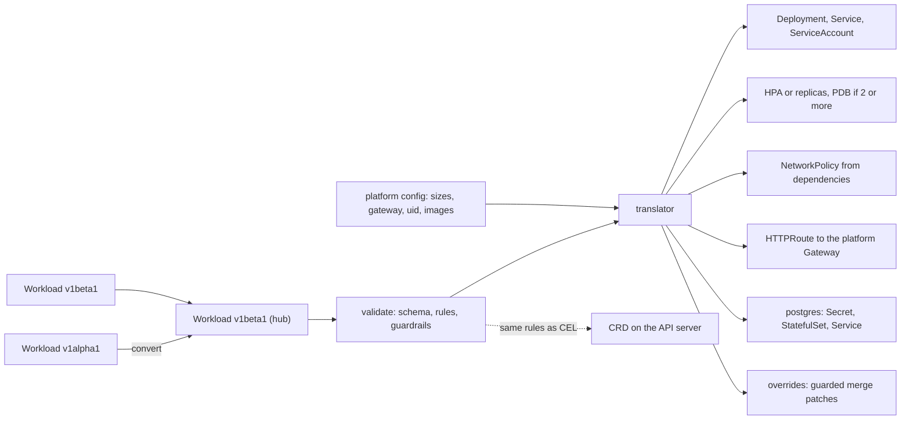

# A Platform API Is One Resource That Hides Ten Others

*A platform API is a small versioned schema plus a translator: teams state intent, the platform renders every object and every default.*

## Metadata

| Field | Value |
|---|---|
| Type | Build |
| Languages | Python |
| Prerequisites | [Operators](https://cloudcaptain.io/learn/orchestration/operator), [Gateway API](https://cloudcaptain.io/learn/orchestration/gateway-api) |
| Time | 90 minutes |
| Tools | kubectl, kind, score-k8s, gateway-api, kubevela, crossplane |

<Quiz stage="pre" />

## The Problem

The platform team at a 60-engineer company owns one Helm chart that every service copies. A new service is a pull request with 400 lines of YAML: Deployment, Service, HorizontalPodAutoscaler, PodDisruptionBudget, NetworkPolicy, HTTPRoute, a ServiceAccount, and for anything with a database a StatefulSet, a Secret and a second NetworkPolicy. Reviews take days because the platform team is the only group that can tell which of those lines matter. Copies drift: twelve services still run as root because they were copied before the `securityContext` block was added, and three have a PodDisruptionBudget with `minAvailable: 1` on one replica, so every node drain stalls until someone deletes it by hand.

Then the checkout team switches `orders` to autoscaling. They add the HPA and, following a blog post, keep `replicas: 2` in the Deployment "as a floor". Every deploy now applies `replicas: 2` over the HPA's eight, and the Friday release drops orders to two pods at peak. The fix, removing `replicas`, causes the same drop once more: a field removed from an applied manifest falls back to its default of 1 until the HPA reacts. Nobody on the team could have predicted either, because the knowledge lives in nine object kinds and in the platform team's heads.

What the developers actually wanted to say fits in twenty lines: this image, this port, two to five replicas on CPU, public at `shop.cc.test/api/orders`, needs a Postgres database. A **platform API** is that sentence as a typed, versioned resource, plus a translator that owns everything else: the defaults, the guardrails, the objects, and the order of operations when the sentence changes. You will build `miniplatform`: a `Workload` spec in two versions with conversion between them, validation that matches what the Kubernetes API server enforces with CEL, a translator that expands one Workload into up to eleven objects, and a diff that says which change restarts pods. Then you run the same Workloads through `score-k8s` and apply miniplatform's output to a kind cluster.

## The Concept

A platform API has three parts, and each one is a decision someone used to make in code review:

- **The schema** is what a developer may say. It is small on purpose: image, port, scaling, route, dependencies, size. Anything not in it (security context, probe timing, labels, PDB policy) is a platform decision with one answer for everyone. The schema is versioned, because it will change, and every version that was ever served must keep working.
- **The translator** is a pure function from the schema plus the platform's configuration to Kubernetes objects. Pure matters: the same input always gives the same output, so it can run in CI, in a controller, or on a laptop, and its output can be diffed before anything is applied.
- **The escape hatch** is how a team does the one thing the schema did not anticipate (a priority class, a pod annotation for a sidecar) without forking the template. It is a patch applied to the generated objects, and it is guarded: some paths, like the security context, cannot be overridden.

Versioning works the way Kubernetes does it. One version is the **hub** (here `v1beta1`); every other version converts to and from it, so N versions need N-1 converters, not N². A conversion must round-trip: `v1beta1` to `v1alpha1` and back must give the original, even for fields `v1alpha1` cannot express. Kubernetes' own convention is to park those fields in an annotation on the older version, and miniplatform does the same.

Validation happens twice in a real platform. The translator validates in CI and on a laptop, with errors that name the field. The API server validates again when the Workload is a CustomResourceDefinition: the OpenAPI schema catches types, enums, ranges and unknown fields, and **CEL rules** (`x-kubernetes-validations`) catch cross-field rules like "min must not be greater than max". If the two disagree, developers find out at the worst moment, so miniplatform generates its CRD from the same schema objects it validates with, and the smoke test checks that both reject the same Workloads with the same messages.



Dependencies are the part that makes this more than a template. `orders` says it needs `db: postgres`; the translator turns that into a database the platform provisions, environment variables pointing at it, and a NetworkPolicy on the database that admits only `orders`. `storefront` says it calls `orders`; the translator adds `ORDERS_URL` to storefront and an ingress rule to orders' NetworkPolicy. Neither team wrote a selector.

## Build It

`code/main.py` is `miniplatform`. Workloads are JSON files (`kubectl` reads JSON as well as YAML, and the standard library has no YAML parser); the samples are `code/fixtures/storefront.json` (written in `v1alpha1`) and `code/fixtures/orders.json` (in `v1beta1`).

### Step 1: one schema object, two uses

A `Field` describes a node of the schema: its type, required children, enum, bounds, pattern, and its rules. A `Rule` carries the same constraint twice, as CEL text for the API server and as a Python function for the local validator:

```python
SCALING_RULES = (
    Rule(
        "has(self.replicas) != (has(self.min) || has(self.max))",
        "set either replicas or min and max, not both",
        lambda v: ("replicas" in v) != ("min" in v or "max" in v),
    ),
    Rule(
        "!has(self.min) || !has(self.max) || self.min <= self.max",
        "min must not be greater than max",
        lambda v: not has(v, "min", "max") or v["min"] <= v["max"],
    ),
)
```

`check()` walks a value against a `Field` and collects every error, not just the first, with the path and the wording the API server uses (`Required value`, `Unsupported value`, `should be less than or equal to 50`). Unknown fields are errors, with a suggestion:

```python
for key, child in value.items():
    if key not in schema.props:
        hint = difflib.get_close_matches(key, list(schema.props), n=1)
        suffix = f" (did you mean {hint[0]!r}?)" if hint else ""
        errors.append(f"{path}.{key}: unknown field{suffix}")
```

Rules on a node run only when its children passed, because `v["min"] <= v["max"]` on a string is a crash, not a validation error.

### Step 2: generate the CRD from the same objects

`openapi()` turns a `Field` into an OpenAPI v3 schema and attaches each rule as `x-kubernetes-validations`; `crd()` wraps it in a CustomResourceDefinition for `workloads.platform.cloudcaptain.io`. Two details come from how the API server costs CEL. Every string has a `maxLength` and every list a `maxItems`, because the API server estimates the worst-case cost of each rule from those bounds and refuses a CRD whose rules could be too expensive. And `env` is a list of `name`/`value` objects with `x-kubernetes-list-type: map`, not a map, because map keys have no length bound to cost against and a list keyed by `name` gets duplicate detection for free:

```python
ENV_LIST = Field(
    "array",
    items=Field("object", required=("name",), props={"name": string(128, pattern=ENV_NAME), "value": string(4096)}),
    max_items=64,
    list_map_key="name",
)
```

A unit test walks the generated schema and fails if any string or list is unbounded.

### Step 3: two versions and a hub

`v1alpha1` was the first draft: `team`, flat container fields, `replicas`, `public`, `database: postgres` and `calls: [orders]`. `v1beta1` renamed `team` to `owner`, nested the container, replaced `replicas` with `scaling` (fixed or autoscaled), turned `database` and `calls` into one `dependencies` list, and added `overrides`. `alpha_to_beta()` is a mechanical mapping. The other direction loses information, so `beta_to_alpha()` converts, converts back, and keeps whatever did not survive in an annotation:

```python
rebuilt = alpha_to_beta({"apiVersion": f"{GROUP}/v1alpha1", "kind": KIND, "metadata": {}, "spec": out})["spec"]
defaults: Dict[str, Any] = {"scaling": {"replicas": 1}}
lost = {key: spec.get(key) for key in ("scaling", "dependencies", "overrides") if spec.get(key, defaults.get(key)) != rebuilt.get(key)}
if lost:
    meta.setdefault("annotations", {})[PRESERVE_ANNOTATION] = json.dumps(lost, sort_keys=True, separators=(",", ":"))
```

`alpha_to_beta()` reads that annotation back, so an autoscaled `v1beta1` Workload survives a trip through a `v1alpha1` client. Comparing against the rebuilt value, instead of listing "fields v1alpha1 lacks", means a new `v1beta1` field cannot be forgotten. Everything downstream works on the hub version only.

### Step 4: the translator and its decisions

`render_workload()` builds the objects from a `Workload` dataclass and the platform configuration (`DEFAULT_PLATFORM`, overridable with `--platform FILE`). Every line below is a decision a developer no longer makes:

```python
deployment_spec: Dict[str, Any] = {}
if workload.replicas is not None:
    deployment_spec["replicas"] = workload.replicas
```

With autoscaling, `spec.replicas` is left out entirely and the HPA owns it, which is the Friday incident from The Problem made impossible. A PodDisruptionBudget is rendered only when there are at least two replicas, with `maxUnavailable: 1`, so it never blocks a drain on a single-replica service. Containers get a named `http` port, readiness and liveness probes on it, requests and a memory limit from the `size` table (no CPU limit, which only causes throttling), `runAsNonRoot`, a fixed UID, `RuntimeDefault` seccomp, all capabilities dropped, a read-only root filesystem with an `emptyDir` on `/tmp`, and no service account token.

### Step 5: dependencies become wiring

A `postgres` dependency becomes a Secret, a StatefulSet and a Service (a development-grade provisioner, like score-k8s's default one), plus environment variables in the workload:

```python
service = f"{workload.name}-{dep.name}"
return [
    {"name": f"{prefix}_HOST", "value": service},
    {"name": f"{prefix}_PORT", "value": str(platform["postgres"]["port"])},
    {"name": f"{prefix}_NAME", "value": workload.name},
    {"name": f"{prefix}_USER", "value": workload.name},
    {"name": f"{prefix}_PASSWORD", "valueFrom": {"secretKeyRef": {"name": service, "key": "password"}}},
]
```

The password is an HMAC of the namespace, workload and dependency under `MINIPLATFORM_SEED`, so rendering is deterministic and can be diffed; score-k8s solves the same problem by keeping random values in `.score-k8s/state.yaml`. A `workload` dependency becomes `ORDERS_URL=http://orders:80`, and `callers_of()` inverts the dependency graph so the called workload's NetworkPolicy admits the caller's pods on the container port. A route adds an ingress rule for the Gateway's data-plane namespace, matched by the `kubernetes.io/metadata.name` label every namespace carries.

### Step 6: an escape hatch with guardrails

`spec.overrides` is a list of JSON merge patches (RFC 7386) by kind, applied after rendering. `guarded_paths()` refuses any patch that touches a platform-owned key anywhere in the tree:

```python
GUARDED_SEGMENTS = {
    "securityContext",
    "hostNetwork",
    "hostPID",
    "hostIPC",
    "serviceAccountName",
    "automountServiceAccountToken",
    "selector",
}
```

A patch must also target a kind the workload renders: an override for a HorizontalPodAutoscaler on a fixed-replica workload is an error that lists what is rendered. Merge patches replace lists wholesale, so an override cannot add one environment variable to `containers[0]`; that is deliberate, because the list belongs to the platform.

### Step 7: a diff that knows Kubernetes

`diff_objects()` renders both versions of a Workload, matches objects by kind and name, and compares flattened field paths. It adds what a text diff cannot know: any change under `spec.template` of a Deployment or StatefulSet restarts pods, some paths are immutable, and dropping `spec.replicas` while an HPA arrives resets the Deployment to 1:

```python
if path == "spec.replicas" and now == MISSING and ("HorizontalPodAutoscaler", change.name) in added:
```

The exit code follows `diff` and `kubectl diff`: 0 for no change, 1 for changes.

### Step 8: run it

```bash
python3 code/main.py validate code/fixtures/storefront.json code/fixtures/orders.json
python3 code/main.py validate code/fixtures/invalid.json          # 13 Workloads, each with its own message
python3 code/main.py render code/fixtures/storefront.json code/fixtures/orders.json --summary
python3 code/main.py render code/fixtures/orders.json             # YAML; -o json for a List
python3 code/main.py convert code/fixtures/storefront-autoscaled.json --to v1alpha1
python3 code/main.py diff code/fixtures/orders.json code/fixtures/orders-next.json
python3 code/main.py diff code/fixtures/storefront.json code/fixtures/storefront-autoscaled.json
python3 code/main.py crd | head -40
```

```text
~ Deployment/orders   [restarts pods]
    spec.template.spec.containers[0].image: "python:3.12-alpine" -> "python:3.13-alpine"
    spec.template.spec.containers[0].resources.limits.memory: "256Mi" -> "512Mi"
    spec.template.spec.containers[0].resources.requests.cpu: "100m" -> "250m"
    spec.template.spec.containers[0].resources.requests.memory: "128Mi" -> "256Mi"
~ HTTPRoute/orders
    spec.rules[0].matches[0].path.value: "/api/orders" -> "/api/v2/orders"
0 added, 0 removed, 2 changed
```

Two Workloads of about twenty lines each become 17 objects; `orders` alone becomes eleven.

<RunTests />

## Use It

**Score** is an open specification for exactly this layer: a workload file (`score.dev/v1b1`) with containers, a service, and `resources` that name dependencies by type, plus implementations that translate it for a target. `score-k8s` produces Kubernetes manifests; `score-compose` produces a Compose file from the same input. This lesson pins score-k8s 0.22.0 and verifies the release checksum. `miniplatform to-score` writes the Score file for each Workload, with dependency outputs as placeholders such as `${resources.db.host}`:

```bash
python3 code/main.py to-score code/fixtures/orders.json code/fixtures/storefront.json --out score/
cd score
score-k8s init --no-sample
score-k8s generate orders.score.yaml storefront.score.yaml --namespace shop
grep -c '^kind:' manifests.yaml
```

The smoke test parses both outputs and compares the shared fields object by object. Image, command, resources, probes, environment variable names, Service ports and the HTTPRoute's hostnames and rules are equal. The differences are the decisions each tool made: score-k8s renders no HPA, PDB, NetworkPolicy, ServiceAccount or security context (that is what patch templates and custom provisioners are for), names its database `pg-orders-<guid>` with a random user kept in `.score-k8s/state.yaml`, attaches routes to a Gateway called `default`, and its `service-port` provisioner outputs the container's target port, so `ORDERS_URL` becomes `http://orders:8080` while the Service listens on 80. That last one is worth knowing before you adopt it: either give the Service the same port as the container or replace the provisioner.

Now the API server's side. Install the Gateway API CRDs (current release <ToolVersion name="gateway-api" />; this lesson pins v1.7.0) and the Workload CRD that miniplatform generated:

```bash
kind create cluster --name cc-lab
kubectl apply --server-side -f https://github.com/kubernetes-sigs/gateway-api/releases/download/v1.7.0/standard-install.yaml
python3 code/main.py crd | kubectl apply -f -
kubectl explain workload.spec.scaling
kubectl get crd workloads.platform.cloudcaptain.io -o jsonpath='{.spec.versions[0].schema.openAPIV3Schema.properties.spec.properties.scaling.x-kubernetes-validations}'
kubectl create namespace shop
python3 code/main.py convert code/fixtures/storefront.json --to v1beta1 > storefront.v1beta1.json
kubectl apply --dry-run=server --validate=strict -n shop -f storefront.v1beta1.json
```

Feed it the invalid fixtures one at a time and compare the messages with `miniplatform validate`:

```text
The Workload "min-over-max" is invalid: spec.scaling: Invalid value: "object": min must not be greater than max
```

Eleven of the thirteen are refused by both with the same text. Two are refused only by miniplatform: an override that touches `securityContext`, and an `env` entry that collides with a dependency's variable. The CRD marks `overrides[].patch` as `x-kubernetes-preserve-unknown-fields`, so CEL cannot see into it, and the collision depends on rendering. That gap is normal; a real platform closes it with a ValidatingAdmissionPolicy or a webhook, or by validating in the controller and writing the result to status. The Gateway API CRDs carry CEL rules of their own: a dry run of an HTTPRoute rule with both a `RequestRedirect` filter and a `backendRefs` entry is refused with `RequestRedirect filter must not be used together with backendRefs`, before any controller sees it.

Then apply the translator's output and watch the objects do what the Workloads said:

```bash
python3 code/main.py render code/fixtures/storefront.json code/fixtures/orders.json -o json --namespace shop --gateway shop/web > objects.json
kubectl apply --dry-run=server -f objects.json
kubectl apply -f objects.json
kubectl rollout status deployment/storefront -n shop --timeout=180s
kubectl get deployment orders -n shop -o jsonpath='{.spec.replicas}/{.status.readyReplicas}{"\n"}'   # 2/2, set by the HPA
kubectl exec -n shop deploy/storefront -- python -c 'import os, urllib.request; print(urllib.request.urlopen(os.environ["ORDERS_URL"]).status)'
kubectl exec -n shop deploy/storefront -- python -c 'import socket; socket.create_connection(("orders-db", 5432), timeout=3)'   # times out: NetworkPolicy
python3 code/main.py render code/fixtures/storefront.json code/fixtures/orders-next.json -o json --namespace shop --gateway shop/web > next.json
kubectl diff -f next.json
```

The HTTPRoute is stored and validated, but `status.parents` stays empty until a controller owns the Gateway's class, as the Gateway API lesson showed. On a recent kind the default CNI enforces NetworkPolicy, so the last connection attempt fails while `orders` reaches its database.

Other tools sit at the same layer with different trade-offs:

- **KubeVela** implements the Open Application Model: an `Application` lists components of a type (`webservice`) with properties, and traits (`scaler`, `gateway`) attach operational behaviour. The platform team defines the types and traits in CUE, so the translator lives in the cluster and the schema is the definition's parameters.

```yaml
apiVersion: core.oam.dev/v1beta1
kind: Application
metadata:
  name: orders
spec:
  components:
    - name: orders
      type: webservice
      properties:
        image: python:3.12-alpine
        ports:
          - port: 8080
            expose: true
      traits:
        - type: scaler
          properties:
            replicas: 2
```

- **Crossplane** puts the whole API in the cluster: a CompositeResourceDefinition declares a new kind with an OpenAPI schema, and a Composition, usually a pipeline of composition functions, expands each composite resource into Kubernetes objects and cloud resources. It is miniplatform as a controller, including the database.
- **Your own CRD and operator**, as in the operator lesson. When a CRD needs a second version with a different shape, set `spec.conversion.strategy: Webhook` and serve a ConversionReview endpoint that calls a function like `convert()`; with `strategy: None` the API server only rewrites `apiVersion`, which is correct only when both versions have the same schema.

Keeping the abstraction leak-proof but escapable comes down to four habits: the schema stays small and every field has an owner; the generated objects are visible (`render`, `diff`, `kubectl diff`) so nobody has to trust a black box; there is an override path with guarded fields instead of a "fork the chart" path; and a team that outgrows the abstraction can take the rendered YAML and leave.

| What you built | Real tool | Note |
|---|---|---|
| `Workload` `v1alpha1` and `v1beta1` | Score `score.dev/v1b1`, KubeVela `Application`, a Crossplane XRD | each fixes a small developer vocabulary |
| `check()` with `Required value`, `Unsupported value` | the CRD's OpenAPI schema with strict field validation | unknown fields fail with `--validate=strict` |
| `Rule` with CEL text and a Python twin | `x-kubernetes-validations` | the API server refuses a CRD whose rules are too expensive to run |
| `alpha_to_beta()`, `beta_to_alpha()` with an annotation | a conversion webhook (`strategy: Webhook`) | the hub-and-spoke model controller-runtime uses |
| `render_workload()` and `DEFAULT_PLATFORM` | score-k8s provisioners and patch templates, KubeVela definitions, Crossplane functions | the platform decisions live here |
| `dependency_env()` and `render_postgres()` | score-k8s `postgres` and `service-port` provisioners | score-k8s outputs the target port for `service-port` |
| `callers_of()` NetworkPolicies | hand-written policies, or Cilium and Calico identities | enforced by the CNI, not the API server |
| `overrides` with `GUARDED_SEGMENTS` | score-k8s `--patch-manifests`, Kustomize patches, admission policies | the CRD alone cannot guard inside a free-form patch |
| `diff_objects()` | `kubectl diff`, Argo CD diff | adds "restarts pods" and the replicas-to-HPA warning |

<Quiz stage="check" />

## Ship It

Two artifacts in `outputs/`:

- **`skill-platform-api-review.md`**: a runbook for reviewing a platform abstraction (a Score setup, a KubeVela definition, a Crossplane XRD and Composition, or a home-grown CRD and translator): render the samples, inventory which fields developers own, check the defaults against a table (security context, probes, PDB rules, HPA and replicas, NetworkPolicy, requests), test validation parity between local and server-side, test version round trips, check the escape hatch and its guardrails, run a change through a diff, and report.
- **`prompt-design-workload-spec.md`**: describe the services your teams run and the decisions your platform team already makes; get back a minimal developer-facing schema with field owners, the defaults table, the objects each field expands into, CEL rules, a versioning plan with the fields that need preserving, the escape hatch and its guarded paths, and two example specs.

<ShipIt />

## Exercises

### Easy

Add a `redis` dependency type. It renders a Deployment and a Service running `redis:8-alpine` as a non-root user, a NetworkPolicy that admits only the calling workload on port 6379, and a `<NAME>_URL=redis://<workload>-<name>:6379` variable. Write the tests first: the rendered kinds for a Workload with a `cache: redis` dependency, the variable, the policy's `from`, the CRD's enum now listing `redis`, and `to-score` emitting `type: redis`.

### Medium

Write the conversion webhook. Add a `serve-conversion` command that answers `apiextensions.k8s.io/v1` `ConversionReview` requests over `http.server` by calling `convert()` for each object, returns `result.status: Failure` with a message for an invalid object, and keeps `metadata` intact. Test it by posting ConversionReview JSON. Then serve both versions from the CRD with `v1beta1` as the storage version, `strategy: Webhook`, a self-signed certificate in `caBundle`, and the server running in the cluster; create a Workload as `v1alpha1`, read it with `kubectl get workloads.v1beta1.platform.cloudcaptain.io`, and show that an autoscaled `v1beta1` object read as `v1alpha1` and written back keeps its `scaling`.

### Hard

Make miniplatform a controller. With the operator lesson's list-then-watch loop through `kubectl proxy`, watch Workloads, render each one, apply the objects with server-side apply under the field manager `miniplatform`, set an owner reference from every object to its Workload, delete objects that carry the Workload's label but are no longer rendered (the HPA when scaling becomes fixed), and write `status.conditions` (`Ready` from the Deployment's availability, `Rendered` with the object count) with `observedGeneration`. Add printer columns for owner, replicas and Ready. Prove the replicas handover: switch a Workload from fixed to autoscaled and show with `kubectl get deployment -w` that the replica count never drops, because server-side apply leaves `spec.replicas` to the HPA's field manager once your manager stops setting it.

<Quiz stage="post" />

## Key Terms

| Term | Common misconception | Precise definition |
|---|---|---|
| Platform API | "A portal with a form." | A typed, versioned resource that developers write and a translator owns, so that every object it implies, and every default in those objects, is decided once by the platform team. |
| Workload spec | "A Helm values file." | The developer-facing schema: image, port, scaling, route, dependencies and size. Unlike chart values it is validated against a schema, has versions with conversion, and is the only file a team edits. |
| Translator | "A template with variables." | A pure function from a spec and the platform configuration to Kubernetes objects; deterministic, so its output can be diffed and tested, and it can run in CI, on a laptop or in a controller. |
| Hub version | "The newest version." | The one version every other version converts to and from; with N versions you write N-1 converters, and fields an older version cannot express are preserved, by convention in an annotation. |
| CEL validation rule | "A webhook." | An `x-kubernetes-validations` expression in a CRD's schema that the API server evaluates on every write; its worst-case cost is estimated from `maxLength` and `maxItems`, and it cannot see into fields marked `x-kubernetes-preserve-unknown-fields`. |
| Conversion webhook | "Needed for every new version." | An HTTPS endpoint the API server calls to convert stored objects between versions when `strategy: Webhook`; with `strategy: None` only `apiVersion` changes, which is correct only for identical schemas. |
| Provisioner | "Creates the database in the cloud." | The part of a translator that turns a dependency type into outputs (host, port, credentials) and objects; score-k8s's defaults run development-grade instances in the cluster, and production platforms replace them. |
| Escape hatch | "Lets teams change anything." | A supported way to patch generated objects for a need the schema lacks, with guarded paths that stay platform-owned, so nobody forks the template. |
| HPA replicas handover | "Keep `replicas` as a minimum." | With an HPA, `spec.replicas` must leave the manifest; while it is there every apply overrides the HPA, and removing it from an applied manifest sets it back to 1 unless ownership is handed over first. |

## Further Reading

- [Platform Engineering learning path](https://cloudcaptain.io/docs/learning-paths/platform-engineering): where a platform API sits next to golden paths, catalogs and preview environments.
- [Kubernetes Workloads](https://cloudcaptain.io/docs/tools/kubernetes/workloads): Deployments, StatefulSets and HPAs, the objects miniplatform generates.
- [Kubernetes Security](https://cloudcaptain.io/docs/tools/kubernetes/security): security contexts and NetworkPolicies behind the platform defaults.
- [Score specification reference](https://docs.score.dev/docs/score-specification/score-spec-reference/): every field of `score.dev/v1b1` and how resources and placeholders work.
- [score-k8s](https://github.com/score-spec/score-k8s): the reference Kubernetes implementation, its default provisioners and patch templates.
- [Versions in CustomResourceDefinitions](https://kubernetes.io/docs/tasks/extend-kubernetes/custom-resources/custom-resource-definition-versioning/): storage versions, `strategy: None` versus webhook conversion, and the ConversionReview format.
- [CRD validation rules](https://kubernetes.io/docs/tasks/extend-kubernetes/custom-resources/custom-resource-definitions/#validation-rules): CEL in `x-kubernetes-validations`, cost estimation and transition rules.
- [Horizontal Pod Autoscaling: migrating to autoscaling](https://kubernetes.io/docs/tasks/run-application/horizontal-pod-autoscale/#migrating-deployments-and-statefulsets-to-horizontal-autoscaling): the official procedure for removing `spec.replicas`, for client-side and server-side apply.
- [KubeVela](https://kubevela.io/docs/): the Open Application Model with components, traits and CUE definitions.
- [Crossplane compositions](https://docs.crossplane.io/latest/composition/compositions/): composite resources and function pipelines as an in-cluster platform API.
- [CNCF Platforms white paper](https://tag-app-delivery.cncf.io/whitepapers/platforms/): what a platform's interfaces should offer and why they must stay optional.
