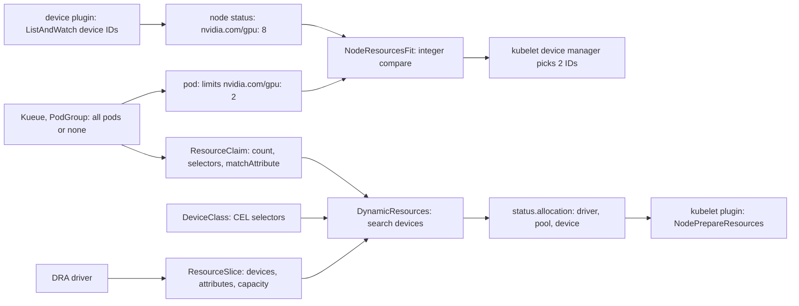

# A GPU Is a Countable Resource Until It Isn't

*The scheduler counts GPUs; memory, NVLink islands, MIG slices and gangs decide whether a job runs. Model them, or describe them with DRA.*

## Metadata

| Field | Value |
|---|---|
| Type | Build |
| Languages | Python |
| Prerequisites | [A Scheduler Is Filter, Score, Bind](https://cloudcaptain.io/learn/orchestration/scheduler) |
| Time | 90 minutes |
| Tools | kubectl, kind, kube-scheduler, nvidia-device-plugin, gpu-operator, kueue, jobset |

<Quiz stage="pre" />

## The Problem

Monday, 09:15. The research team's 8-GPU fine-tune has been `Pending` since Saturday with `0/14 nodes are available: 14 Insufficient nvidia.com/gpu.`, and the GPU dashboard says 38% of the pool is idle. Both DGX nodes, the PCIe box and the inference nodes each have between two and six free GPUs. Over the weekend forty single-GPU notebook pods arrived, and the default scheduler spread them out: its `LeastAllocated` score prefers the emptiest node, and by default it only weighs CPU and memory, so a node's GPUs play no part in the choice. Every node still has free GPUs; no node has eight.

The same morning brings two more tickets. An embedding job that asks for one GPU and loads a 40 GiB model was killed twice with CUDA out-of-memory errors: it landed on an inference node where the device plugin shares each 24 GiB L4 between four pods by time-slicing, so its "GPU" was a quarter of one with no memory isolation. And two distributed training jobs, submitted a minute apart, each got two of their four pods scheduled before the GPUs ran out. Each training process waits at its rendezvous for ranks that never start, and together they have held 16 idle A100s for six hours.

All three tickets have one cause. To kube-scheduler, `nvidia.com/gpu: 8` is an integer, like CPU millicores. It cannot see GPU memory, the NVLink links between GPUs, the fixed shapes of MIG partitions, the difference between a GPU and a time-sliced replica, or the fact that four pods are one job. You are going to build `gpusched`: a cluster model with all of those details, the placement policies that use them, the integer view the scheduler really has, a Dynamic Resource Allocation (DRA) allocator that matches devices by attributes, a gang scheduling simulator, and fragmentation metrics. Then you run the real thing on kind: an extended resource patched onto a node, and DRA objects that the real scheduler allocates exactly the way `gpusched` predicts.

## The Concept

Think of selling theatre tickets. "Two seats available" answers whether two seats exist. A couple wants two seats next to each other; a person with a big coat wants a wide seat; a box splits into fixed sub-boxes; an orchestra wants all sixty musicians seated or none, because a half-seated orchestra cannot play. A box office that only counts seats will sell all of those badly, and after a while it will have plenty of empty seats and no two together.

**Extended resources** are the counting box office. A device plugin (NVIDIA's runs as a DaemonSet) registers with the kubelet over gRPC on a socket in `/var/lib/kubelet/device-plugins/`, streams a list of device IDs and their health (`ListAndWatch`), and the kubelet writes the count into the node's `status.capacity` and `status.allocatable`. A pod asks for `limits: {nvidia.com/gpu: 2}`. `NodeResourcesFit` compares that integer with allocatable minus the requests of bound pods, exactly as it does for CPU, and binds the pod to a node. Only then, at admission on that node, does the kubelet's device manager pick two device IDs (honouring NUMA hints from the Topology Manager and the plugin's optional `GetPreferredAllocation`) and call the plugin's `Allocate`, which tells the runtime which devices to expose. The rules follow from "it is an integer": whole numbers only, request equal to limit, no overcommit, and no attributes at all.

What the count hides:

- **Memory and model.** A100 80 GB, L4 24 GB and H100 80 GB are all `nvidia.com/gpu: 1`. The usual workaround is node labels from GPU Feature Discovery (`nvidia.com/gpu.product`, `nvidia.com/gpu.memory`) and node affinity.
- **Topology.** GPUs in a node are joined by NVLink in **islands**: all eight through NVSwitch on an SXM board, pairs through bridges on many PCIe servers, nothing at all on others. Inside an island data moves at hundreds of GB/s per direction; between islands it crosses PCIe at about 32 GB/s (Gen4 x16). A data-parallel job exchanges its gradients every step, so the island decides the step time.
- **Sharing.** Time-slicing makes the device plugin advertise each GPU several times (`replicas: 4` turns 8 GPUs into 32). Pods take turns on the same GPU with no memory or fault isolation, and two replicas can be the same physical GPU. **MIG** (Multi-Instance GPU, on A100, H100 and later) cuts a GPU into hardware-isolated instances with their own memory and compute slices, but only in fixed profiles at fixed offsets. A free slice is not a free instance.
- **The job.** A distributed training job is N pods that are useless one at a time. Scheduling them one by one lets two jobs each grab half the GPUs and wait for each other forever.

**Dynamic Resource Allocation** replaces the count with a description. A DRA driver publishes **ResourceSlices**: per node (a pool), a list of devices with typed attributes (`model`, `nvlinkIsland`) and capacities (`memory: 80Gi`). An administrator defines a **DeviceClass** with CEL selectors ("devices of driver `gpu.example.com`"). A workload writes a **ResourceClaim**, or a **ResourceClaimTemplate** that stamps out one claim per pod: requests with a class, a count, more CEL selectors, and constraints such as `matchAttribute: gpu.example.com/nvlinkIsland` (every device must share that value). The scheduler's `DynamicResources` plugin searches the slices for devices that satisfy the claim on each candidate node, writes the choice into the claim's `status.allocation` (driver, pool and device per request, plus a node selector), and binds the pod. The kubelet then calls the driver's kubelet plugin (`NodePrepareResources`) to set the devices up. The API is `resource.k8s.io/v1`, stable since Kubernetes 1.34.



Two things stay true on either path. Gang semantics are not the scheduler's job by default: something above it (Kueue, a coscheduling PodGroup, Volcano) must admit all of a job's pods together or none. And **fragmentation** is the gap between "GPUs free" and "jobs of the size you need that fit": 24 free GPUs spread three per node run zero 8-GPU jobs. Bin-packing small pods keeps whole nodes and whole islands free; spreading them is what the default scheduler does.

## Build It

`code/main.py` is `gpusched`, six subcommands over one model. `place` puts pods on the cluster one after another with a policy and a view, then reports fragmentation; `frag` measures a cluster file with busy GPUs; `slices` prints the ResourceSlices a driver would publish for the model; `dra` allocates ResourceClaims against slices; `gang` simulates training jobs on a virtual clock; `k8s` predicts the Pending reason for a pod from `kubectl get -o json`. Everything is pure functions over dataclasses; `code/fixtures/` holds a five-node cluster (two DGX nodes, a PCIe box with NVLink pairs, a time-sliced L4 node and a MIG node), the pods for the walk-through, a two-node cluster with three training jobs, and DRA claims.

### Step 1: a GPU has an island, replicas and MIG instances

```python
@dataclass
class Gpu:
    index: int
    island: int
    replicas: int = 1
    holders: List[Tuple[str, float]] = field(default_factory=list)
    mig: List[MigInstance] = field(default_factory=list)

    @property
    def free_replicas(self) -> int:
        return 0 if self.mig else self.replicas - len(self.holders)

    @property
    def declared_gib(self) -> float:
        return sum(memory for _, memory in self.holders)
```

`make_node()` reads a node's `gpu` block: `count`, `memory_gib`, `islands` (lists of GPU indices joined by NVLink; a GPU in no list is an island of one), `nvlink_gbps` and `pcie_gbps` per direction, `time_slicing` replicas or `mig` layouts, and `busy` GPUs already in use. A holder records the pod and the GPU memory it declared, so a time-sliced GPU can add up what its tenants expect. The fixture's bandwidths are half the bidirectional datasheet figures (600 GB/s NVLink, 64 GB/s PCIe Gen4 for an A100); change them for your hardware.

### Step 2: what kube-scheduler sees

```python
def advertised(node: Node) -> Dict[str, int]:
    counts: Dict[str, int] = {}
    for gpu in node.gpus:
        if gpu.mig:
            for instance in gpu.mig:
                key = f"nvidia.com/mig-{instance.profile}"
                counts[key] = counts.get(key, 0) + 1
        else:
            counts[GPU_RESOURCE] = counts.get(GPU_RESOURCE, 0) + gpu.replicas
    return counts
```

That is the whole node as the device plugin reports it: a DGX node is `nvidia.com/gpu: 8`, the L4 node with two GPUs and four replicas each is also `nvidia.com/gpu: 8`, and the MIG node is one counter per profile (the plugin's `mixed` strategy). `--view extended` schedules on exactly this: the only filter is the count, and the GPUs chosen are the lowest free indices, which stands in for the kubelet's choice inside the node the scheduler already picked:

```python
if view == "extended":
    units = [g.index for g in node.gpus if not g.mig for _ in range(g.free_replicas)]
    if len(units) < pod.gpus:
        return None, f"Insufficient {GPU_RESOURCE}"
    return Option(node, units[: pod.gpus], None, pack_key(policy, len(units) - pod.gpus, node.name)), ""
```

After placing, `consequences()` compares the choice with the truth and lists what will go wrong at runtime: the model is not the one asked for, the GPU has less memory than the pod needs, the pod got a time-sliced replica, two replicas are the same physical GPU, the declared memory on one GPU exceeds what it has, or the GPUs span NVLink islands.

### Step 3: the GPU view filters on what matters

`--view gpu` (the default) is what a scheduler would do if it could see the hardware, which is what DRA makes possible. One reason per node, as in kube-scheduler, so the reasons add up into the same histogram:

```python
def gpu_view_mismatch(node: Node, pod: PodSpec) -> str:
    if pod.shared and not node.shared:
        return "node is not time-sliced"
    if node.shared and not pod.shared:
        return "node is time-sliced"
    if pod.model and pod.model != node.model:
        return f"GPU model is not {pod.model}"
    if pod.memory_gib > node.memory_gib:
        return f"GPU memory below {pod.memory_gib:g} GiB"
    return ""
```

Then the count, counting only GPUs that can take the pod (on a time-sliced node, a GPU whose declared memory plus the pod's still fits), and for `nvlink: true` an island with enough free GPUs:

```python
if pod.nvlink and pod.gpus > 1 and not any(len(m) >= pod.gpus for m in by_island(candidates).values()):
    return None, f"no NVLink island with {pod.gpus} free GPUs"
```

`fit_error()` is the scheduler lesson's function: a histogram of reasons, sorted as strings, behind `0/N nodes are available:`.

### Step 4: bin-pack, spread and topology are sort keys

Every feasible node gets a key and the smallest wins:

```python
def pack_key(policy: str, free_after: int, name: str, spans: int = 0, island_left: int = 0) -> Tuple[Any, ...]:
    if policy == "spread":
        return (-free_after, name)
    if policy == "topology":
        return (spans, island_left, free_after, name)
    return (free_after, name)
```

Bin-pack prefers the node with the fewest free GPUs left after the placement (`MostAllocated`), spread the most (`LeastAllocated`). Topology first avoids spanning islands, then prefers the island that will have the fewest GPUs left over, so single GPUs fill the small PCIe pairs and an eight-GPU NVSwitch island stays whole for the job that needs it. Inside the node, `choose_gpus()` makes the same best-fit choice among islands:

```python
groups = sorted(by_island(candidates).items())
fitting = [(len(members), island, members) for island, members in groups if len(members) >= count]
if fitting:
    return min(fitting, key=lambda f: (f[0], f[1]))[2][:count]
```

Topology has no extended view: through a count there is nothing to be topology-aware about, and `gpusched` refuses the combination.

### Step 5: what crossing an island costs

A ring all-reduce over `k` GPUs sends and receives `2(k-1)/k` times the gradient size per GPU, so the step's communication time is bounded by the slowest link the ring crosses:

```python
def allreduce_seconds(gpus: int, gradient_gb: float, bandwidth_gbps: float) -> float:
    if gpus < 2 or gradient_gb <= 0 or bandwidth_gbps <= 0:
        return 0.0
    return 2 * (gpus - 1) / gpus * gradient_gb / bandwidth_gbps
```

A 7B-parameter model has 14 GB of bf16 gradients. Over eight GPUs in one NVLink island at 300 GB/s that is 0.082 s per step; two GPUs that sit in different PCIe pairs exchange the same 14 GB at 32 GB/s, 0.44 s. The real libraries (NCCL) overlap communication with compute and pick rings or trees, so treat this as the lower bound that topology sets, not a benchmark.

### Step 6: MIG has fixed shapes at fixed offsets

An A100 has 7 compute slices and 8 memory slices. Each profile takes a number of each and may only start at certain memory slices, the placements `nvidia-smi mig -lgipp` lists:

```python
A100_80GB_MIG = {
    p.name: p
    for p in (
        MigProfile("1g.10gb", 1, 1, (0, 1, 2, 3, 4, 5, 6), 10),
        MigProfile("2g.20gb", 2, 2, (0, 2, 4), 20),
        MigProfile("3g.40gb", 3, 4, (0, 4), 40),
        MigProfile("4g.40gb", 4, 4, (0,), 40),
        MigProfile("7g.80gb", 7, 8, (0,), 80),
    )
}
```

```python
def mig_start(instances: Sequence[MigInstance], profile: MigProfile) -> Optional[int]:
    used: Set[int] = set()
    for instance in instances:
        used |= instance.slices
    compute = sum(A100_80GB_MIG[i.profile].compute for i in instances)
    if compute + profile.compute > MIG_COMPUTE_SLICES:
        return None
    for start in profile.starts:
        if not used & set(range(start, start + profile.memory_slices)):
            return start
    return None
```

Two busy `1g.10gb` instances at slices 0 and 4 leave six memory slices and five compute slices free, and still no `3g.40gb` fits: it needs slices 0-3 or 4-7. The instances themselves are created ahead of time by an administrator or the GPU Operator's MIG manager, and the device plugin advertises what exists; a pod asking for `nvidia.com/mig-3g.40gb` takes a free instance of that exact profile or stays Pending. `mig_report()` lists the free instances and which profiles a repartition could add without touching the busy ones.

### Step 7: fragmentation is free GPUs no job of your size can use

```python
for size in sizes:
    by_count = sum(len(gpus) // size for gpus in per_node.values())
    within = sum(len(members) // size for gpus in per_node.values() for members in by_island(gpus).values())
    stranded = free - by_count * size
    rows.append(FragRow(size, by_count, within, stranded, round(100.0 * stranded / free, 1) if free else 0.0))
```

For every job size: how many such pods fit by count (what extended resources allow), how many fit inside one NVLink island (what a communication-heavy job needs), and how many free GPUs are left over that no pod of that size can use. A cluster is not "60% free"; it is "60% free for 1-GPU pods, 0% free for 8-GPU jobs".

### Step 8: DRA in miniature: slices, CEL and a search

`cluster_slices()` turns the model into ResourceSlices in the `resource.k8s.io/v1` shape: one per node, driver `gpu.example.com`, a device per GPU with `type`, `model`, `index`, `nvlinkIsland` and `timeSliced` attributes and a `memory` capacity, and a device per MIG instance. Selectors are CEL, and `gpusched` implements the subset device selectors use: `device.driver`, `device.attributes["domain"].name`, `device.capacity["domain"].name`, comparisons, `&&`, `||`, `!`, `quantity("40Gi")` with `compareTo`, `isGreaterThan` and `isLessThan`, and `startsWith`, `endsWith`, `contains` on strings. A runtime error, such as reading an attribute a device does not have, means no match, and `&&` and `||` follow CEL's rule that `false && error` is `false`:

```python
def selector_matches(expression: str, device: Device) -> bool:
    tree = compile_cel(expression)
    try:
        return cel_eval(tree, device_env(device)) is True
    except CelError:
        return False
```

Allocation is a search: for each request in order, try combinations of matching, unused devices in slice order, and keep the first one that satisfies every `matchAttribute` constraint:

```python
free = [d for d in candidates[index] if d.key not in used and d.key not in taken]
combos = itertools.combinations(free, request.count)
for combo in combos:
    attempt = picks + [(request.name, d) for d in combo]
    if not constraints_hold(claim, attempt):
        continue
    found = search(index + 1, attempt, taken | {d.key for d in combo})
    if found is not None:
        return found
```

On a node whose islands are `{0, 2}` and `{1, 3}`, a two-GPU claim with `matchAttribute: gpu.example.com/nvlinkIsland` tries `gpu-0, gpu-1`, rejects it, and takes `gpu-0, gpu-2`. That is the NVLink requirement the count could not express, now written in the claim. `allocationMode: All` takes every matching device or fails if any is in use. The result is written in the shape of `status.allocation`, with a node selector that pins the claim, and therefore its pods, to that node.

### Step 9: gang scheduling on a virtual clock

`simulate_gang()` replays jobs (`pods`, `gpus_per_pod`, `duration`, `arrival`) on the two-node fixture. Each event (an arrival, a finish, a timeout) is followed by a scheduling pass:

```python
if mode == "pod":
    progress = True
    while progress:
        progress = False
        for state in queue:
            if len(state.placed) < state.job.pods and place_pod(cluster, state, policy):
                progress = True
else:
    for state in queue:
        while len(state.placed) < state.job.pods and place_pod(cluster, state, policy):
            pass
        if len(state.placed) < state.job.pods and timeout <= 0:
            release_job(cluster, state)
```

`pod` is the default scheduler: pods of jobs created at the same time interleave in the queue, each one that fits is bound, and a job starts only when all of its pods are placed. `gang` takes a job's pods together; with `--timeout 0` a job that does not fit completely gives everything back at once (all-or-nothing, as Kueue admits a workload), and with a timeout it may hold a partial reservation for that long before releasing it (as a coscheduling PodGroup's `scheduleTimeoutSeconds` does). The simulator accounts GPU-seconds held idle by partial gangs, and reports a deadlock when nothing runs, nothing can start and partial gangs hold GPUs.

### Step 10: run it

```bash
F=code/fixtures
python3 code/main.py place $F/cluster.json $F/pods.json                     # bin-pack: notebooks fill dgx-a, train-8 gets dgx-b
python3 code/main.py place $F/cluster.json $F/pods.json --policy spread
```

```text
  notebook-0     -> dgx-a    nvidia.com/gpu GPUs [0] islands [0]
  notebook-1     -> dgx-b    nvidia.com/gpu GPUs [0] islands [0]
  notebook-2     -> pcie-a   nvidia.com/gpu GPUs [0] islands [0]
  ...
  train-8        Pending  0/5 nodes are available: 1 GPU model is not A100-SXM4-80GB, 1 node is time-sliced, 3 Insufficient nvidia.com/gpu.
fragmentation of exclusive GPUs: 15 free; largest block on one node 6, inside one NVLink island 5
  size  pods(count)  pods(island)  stranded
     1           15            15     0 (0%)
     2            7             7     1 (6.7%)
     4            3             2     3 (20%)
     8            0             0    15 (100%)
```

Six notebooks were enough to make the 8-GPU job impossible on a cluster with 15 free GPUs. `--policy topology` puts the notebooks on the PCIe pairs instead and leaves a whole 7-GPU island free at the end. Now the scheduler's real view of the same pods:

```bash
python3 code/main.py place $F/cluster.json $F/pods.json --view extended
```

```text
  embed          -> l4-a     nvidia.com/gpu GPUs [0] islands [0]
                    ! needs 40 GiB per GPU, L4 has 24 GiB: out of memory when the weights load
                    ! lands on a time-sliced replica: shares a physical GPU, no memory or fault isolation
                    ! GPU 0 memory oversubscribed: 40 of 24 GiB declared
  chat-0         -> l4-a     nvidia.com/gpu GPUs [0] islands [0]
                    ! GPU 0 memory oversubscribed: 50 of 24 GiB declared
```

`embed` asked for one GPU, the L4 node advertised eight, and bin-pack broke the tie by name: the second ticket from The Problem. Fragmentation of a cluster that is already busy, including a MIG GPU:

```bash
python3 code/main.py frag $F/fragmented.json
```

```text
fragmentation of exclusive GPUs: 8 free; largest block on one node 4, inside one NVLink island 2
  size  pods(count)  pods(island)  stranded
     1            8             8     0 (0%)
     2            4             2     0 (0%)
     4            1             0     4 (50%)
     8            0             0     8 (100%)
  MIG mig-a GPU 0: used 1g.10gb@0=chat-0, 1g.10gb@4=chat-1; free instances 1g.10gb x3, 2g.20gb x1; a repartition could add 1g.10gb, 2g.20gb
```

`pcie-a` has four free GPUs, one in each pair: a 4-GPU pod fits by count and runs over PCIe. Gangs:

```bash
python3 code/main.py gang $F/gang-cluster.json $F/jobs.json --mode pod                 # deadlock at t=1200, 16 GPUs held, nothing running
python3 code/main.py gang $F/gang-cluster.json $F/jobs.json --mode gang                # llm-a 1200-4800, llm-b 4800-6600, 0 idle GPU-hours
python3 code/main.py gang $F/gang-cluster.json $F/jobs.json --mode gang --timeout 300  # same makespan, 2.64 GPU-hours held idle while gangs swap reservations
```

The third run is the honest trade-off: holding a partial reservation only pays off when the missing GPUs are about to be freed, and here the blocker runs for twenty minutes. DRA, against the same cluster model:

```bash
python3 code/main.py slices $F/cluster.json | head -40
python3 code/main.py dra --cluster $F/cluster.json --objects $F/dra.json
```

```text
claim ml/big-sxm: allocated on dgx-a: dgx-a/gpu-0
claim ml/nvlink-pair: allocated on pcie-a: pcie-a/gpu-0, pcie-a/gpu-1
claim ml/rerank-mig: allocated on mig-a: mig-a/gpu-0-mig-3g-40gb-4
claim ml/h200: cannot allocate all claims: no device on any node matches the DeviceClass and the selectors
```

Run `dra --cluster $F/fragmented.json` and `nvlink-pair` fails with `enough devices, but no combination satisfies matchAttribute gpu.example.com/nvlinkIsland`. Finally, `k8s` reads real `kubectl` JSON, which is how Use It compares `gpusched` with the cluster:

```bash
python3 code/main.py k8s --nodes nodes.json --pods pods.json --pod gpu-c.json
#   cc-lab-control-plane     Insufficient example.com/gpu (example.com/gpu: requested 2, free 1 of 4)
# FailedScheduling: 0/1 nodes are available: 1 Insufficient example.com/gpu.
python3 code/main.py k8s --nodes nodes.json --pods pods.json --pod dra.json --objects dra-objects.json --objects claims.json --objects slice.json
#                            claim cc/pair -> cc-lab-control-plane/gpu-0, cc-lab-control-plane/gpu-2
```

It counts extended resources the way `NodeResourcesFit` does (requests default to limits, init containers take the maximum, finished pods free theirs), answers cordons and untolerated taints first, and allocates a pod's ResourceClaims against the exported slices, skipping devices other claims already hold. Exit codes are 0 when everything fits, 1 for a Pending pod, an unallocatable claim or a deadlock, and 2 for input it cannot read.

<RunTests />

## Use It

Nothing here needs a GPU. An extended resource is a number in a node's status, and DRA works with any driver name, so a kind cluster (Kubernetes <ToolVersion name="kubernetes" />) shows the scheduler's side of both for real.

**Extended resources by hand.** This is what a device plugin's registration amounts to on the API side. Patch the node's status subresource (`~1` is the JSON-pointer escape for `/`):

```bash
kind create cluster --name cc-lab
NODE=cc-lab-control-plane
kubectl patch node $NODE --subresource=status --type=json \
  -p '[{"op":"add","path":"/status/capacity/example.com~1gpu","value":"4"}]'
kubectl get node $NODE -o jsonpath='{.status.allocatable.example\.com/gpu}{"\n"}'   # 4, copied from capacity on the kubelet's next status update
kubectl create namespace gpu
for spec in gpu-a:2 gpu-b:1 gpu-c:2; do
  kubectl -n gpu run ${spec%%:*} --image=registry.k8s.io/pause:3.10 \
    --overrides='{"spec":{"containers":[{"name":"main","image":"registry.k8s.io/pause:3.10","resources":{"limits":{"example.com/gpu":"'${spec##*:}'"}}}]}}'
done
kubectl -n gpu get pods -o wide                                   # gpu-a and gpu-b Running, gpu-c Pending
kubectl -n gpu get pod gpu-c -o jsonpath='{.status.conditions[?(@.type=="PodScheduled")].message}{"\n"}'
# 0/1 nodes are available: 1 Insufficient example.com/gpu. no new claims to deallocate, preemption: ...
kubectl describe node $NODE | sed -n '/Allocated resources/,/Events/p'     # example.com/gpu  3  3
kubectl get nodes -o json > nodes.json && kubectl get pods -A -o json > pods.json
kubectl -n gpu get pod gpu-c -o json > gpu-c.json
python3 code/main.py k8s --nodes nodes.json --pods pods.json --pod gpu-c.json   # the same first sentence
kubectl -n gpu delete pod gpu-a && kubectl -n gpu wait --for=condition=PodScheduled pod/gpu-c --timeout=60s
```

Deleting `gpu-a` gives two GPUs back and `gpu-c` is bound without being recreated. A request of `500m` is refused by the API server with `must be an integer`, and a request that differs from its limit is refused too: extended resources cannot be overcommitted. The `no new claims to deallocate,` in the message comes from the DRA plugin's post-filter on clusters where DRA is on. Remove the resource with the same patch and `"op":"remove"` on `/status/capacity/example.com~1gpu`.

**The default scheduler does not pack GPUs.** `NodeResourcesFit` scores `cpu` and `memory` with weight 1 unless you say otherwise, so GPU nodes are chosen by how busy their CPUs are. A profile for GPU pods, in the `KubeSchedulerConfiguration` from the scheduler lesson:

```yaml
profiles:
  - schedulerName: gpu-binpack
    pluginConfig:
      - name: NodeResourcesFit
        args:
          scoringStrategy:
            type: MostAllocated
            resources:
              - name: nvidia.com/gpu
                weight: 10
              - name: cpu
                weight: 1
              - name: memory
                weight: 1
```

Pods with `schedulerName: gpu-binpack` now fill the busiest GPU node first, which is `--policy binpack`. Nothing in the scheduler's configuration can make it island-aware; that needs attributes.

**Dynamic Resource Allocation.** Check that the API is served, create a class and a claim, and a pod that uses it. No driver exists for `gpu.example.com`:

```bash
kubectl api-versions | grep '^resource.k8s.io/'          # resource.k8s.io/v1 on current releases
kubectl apply -f - <<'EOF'
apiVersion: resource.k8s.io/v1
kind: DeviceClass
metadata:
  name: example-gpu
spec:
  selectors:
    - cel:
        expression: device.driver == "gpu.example.com"
---
apiVersion: resource.k8s.io/v1
kind: ResourceClaim
metadata:
  name: pair
  namespace: gpu
spec:
  devices:
    requests:
      - name: gpus
        exactly:
          deviceClassName: example-gpu
          allocationMode: ExactCount
          count: 2
          selectors:
            - cel:
                expression: device.capacity["gpu.example.com"].memory.compareTo(quantity("40Gi")) >= 0
    constraints:
      - requests: ["gpus"]
        matchAttribute: gpu.example.com/nvlinkIsland
---
apiVersion: v1
kind: Pod
metadata:
  name: dra
  namespace: gpu
spec:
  resourceClaims:
    - name: gpus
      resourceClaimName: pair
  containers:
    - name: main
      image: registry.k8s.io/pause:3.10
      resources:
        claims:
          - name: gpus
EOF
kubectl -n gpu get pod dra -o jsonpath='{.status.conditions[?(@.type=="PodScheduled")].message}{"\n"}'   # ... cannot allocate all claims ...
kubectl -n gpu get resourceclaim pair                       # STATE pending: no allocation
kubectl get resourceslices                                  # nothing: no driver has published devices
```

A **ResourceClaimTemplate** has the same `spec` under `spec.spec`; a pod that references it with `resourceClaimTemplateName` gets its own generated claim, named in `status.resourceClaimStatuses` and deleted with the pod. Use a template when every replica needs its own devices, a claim when several pods must share the same ones.

Now play the driver. A real driver's controller and kubelet plugin publish slices as devices appear; `gpusched slices` writes the same object for a model of this node with islands `{0, 2}` and `{1, 3}`:

```bash
echo '{"nodes": [{"name": "cc-lab-control-plane", "gpu": {"model": "A100-PCIE-80GB", "count": 4, "memory_gib": 80, "islands": [[0, 2], [1, 3]], "nvlink_gbps": 300}}]}' > kind-model.json
python3 code/main.py slices kind-model.json > slice.json
kubectl get nodes -o json > nodes.json && kubectl -n gpu get pod dra -o json > dra.json
kubectl get deviceclasses,resourceslices -o json > dra-objects.json && kubectl -n gpu get resourceclaims -o json > claims.json
python3 code/main.py k8s --nodes nodes.json --pod dra.json --objects dra-objects.json --objects claims.json --objects slice.json   # predicts gpu-0, gpu-2
kubectl apply -f slice.json
kubectl -n gpu wait --for=condition=PodScheduled pod/dra --timeout=90s
kubectl -n gpu get resourceclaim pair -o jsonpath='{range .status.allocation.devices.results[*]}{.device}{" "}{end}{"\n"}'   # gpu-0 gpu-2
kubectl -n gpu describe pod dra | sed -n '/^Events:/,$p'    # bound, then the kubelet cannot reach a plugin for gpu.example.com
```

The new slice requeued the Pending pod, the `DynamicResources` plugin found the same pair `gpusched` found, wrote it into the claim and bound the pod. The pod still never starts: allocation is the scheduler's job, preparing the devices is the driver's kubelet plugin, and there is none. Clean up with `kubectl delete -f slice.json`, `kubectl delete deviceclass example-gpu` and `kubectl delete namespace gpu`.

**On a cluster with NVIDIA GPUs.** The GPU Operator installs everything a node needs: the driver (as a container), the NVIDIA Container Toolkit, the device plugin, GPU Feature Discovery, the DCGM exporter for metrics and the MIG manager. The device plugin alone is a smaller install when the nodes already have drivers. Pin chart versions with `--version` to what you have tested:

```bash
helm repo add nvidia https://helm.ngc.nvidia.com/nvidia && helm repo update
helm install --wait --generate-name -n gpu-operator --create-namespace nvidia/gpu-operator
kubectl get nodes -L nvidia.com/gpu.product,nvidia.com/gpu.memory,nvidia.com/gpu.count    # GPU Feature Discovery labels
kubectl get node NODE -o jsonpath='{.status.allocatable.nvidia\.com/gpu}{"\n"}'
helm repo add nvdp https://nvidia.github.io/k8s-device-plugin
helm upgrade -i nvdp nvdp/nvidia-device-plugin -n nvidia-device-plugin --create-namespace   # device plugin only
```

Time-slicing is device plugin configuration. With the Operator it lives in a ConfigMap that the `ClusterPolicy` points to; afterwards the node advertises `count × replicas`, and the `nvidia.com/gpu.replicas` label says so:

```yaml
version: v1
sharing:
  timeSlicing:
    resources:
      - name: nvidia.com/gpu
        replicas: 4
```

The plugin can rename the shared resource (`renameByDefault: true` gives `nvidia.com/gpu.shared`), so a pod that needs a whole GPU cannot land on a replica by accident, which is the fix for the second ticket; `failRequestsGreaterThanOne: true` refuses pods that ask for several replicas, since they get no more compute. MIG is configured on the hardware: `nvidia-smi mig -lgip` lists the profiles, `nvidia-smi mig -lgipp` their placements, and with the Operator you label a node (`kubectl label node NODE nvidia.com/mig.config=all-1g.10gb --overwrite`) and the MIG manager repartitions it after GPU workloads leave. With the `mixed` strategy each profile is its own resource (`nvidia.com/mig-3g.40gb`); with `single`, every GPU on a node has the same profile and is advertised as `nvidia.com/gpu`. NVIDIA also maintains a DRA driver for GPUs (`k8s-dra-driver-gpu`) that publishes GPUs and MIG devices as ResourceSlices.

**Gangs: Kueue and JobSet.** Kueue queues workloads and admits one only when its whole quota fits; until then the Job stays suspended (`spec.suspend: true`) and creates no pods, so two half-scheduled jobs cannot happen inside the quota:

```yaml
apiVersion: kueue.x-k8s.io/v1beta1
kind: ResourceFlavor
metadata:
  name: a100
spec:
  nodeLabels:
    nvidia.com/gpu.product: NVIDIA-A100-SXM4-80GB
---
apiVersion: kueue.x-k8s.io/v1beta1
kind: ClusterQueue
metadata:
  name: training
spec:
  namespaceSelector: {}
  resourceGroups:
    - coveredResources: ["cpu", "memory", "nvidia.com/gpu"]
      flavors:
        - name: a100
          resources:
            - {name: cpu, nominalQuota: 256}
            - {name: memory, nominalQuota: 2Ti}
            - {name: nvidia.com/gpu, nominalQuota: 16}
---
apiVersion: kueue.x-k8s.io/v1beta1
kind: LocalQueue
metadata:
  name: training
  namespace: research
spec:
  clusterQueue: training
```

A Job, JobSet or training-operator job joins the queue with the label `kueue.x-k8s.io/queue-name: training`. Check which API versions your Kueue release serves with `kubectl api-resources --api-group=kueue.x-k8s.io`. Quota is not placement: 16 GPUs of quota can be 16 GPUs scattered over eight nodes. Kueue's `waitForPodsReady` setting (a timeout after which a workload whose pods are not all ready is evicted and requeued) is the `--timeout` of Step 9, and its Topology Aware Scheduling places a workload's pods inside one rack or block. A **JobSet** describes one distributed job as replicated Jobs (for example a coordinator and N workers), gives the pods stable DNS names through a headless Service so ranks can find each other, and restarts the whole set when one pod fails (`failurePolicy.maxRestarts`); the annotation `alpha.jobset.sigs.k8s.io/exclusive-topology` gives each child Job a topology domain of its own. Without Kueue, the scheduler-plugins coscheduling plugin does gang scheduling in the scheduler itself: a `PodGroup` with `minMember` and `scheduleTimeoutSeconds`, pods labelled `scheduling.x-k8s.io/pod-group`, held at the Permit stage until enough are reserved. Volcano offers the same with `minAvailable`.

| What you built | Real tool | Note |
|---|---|---|
| `advertised()`, `--view extended` | device plugin `ListAndWatch`, node `status.allocatable` | an integer per resource name; MIG profiles in `mixed` strategy are separate names |
| lowest free indices inside the chosen node | kubelet device manager, Topology Manager, `GetPreferredAllocation` | NVIDIA's plugin prefers well-connected GPUs, but only inside the node the scheduler picked |
| `consequences()` | CUDA out-of-memory, slow NCCL all-reduce | what the count does not tell the scheduler shows up at runtime |
| `--policy binpack` / `spread` | `NodeResourcesFit` `MostAllocated` / `LeastAllocated` | the default scores only CPU and memory; add `nvidia.com/gpu` with a weight |
| `--policy topology`, `matchAttribute` | DRA constraints; Kueue Topology Aware Scheduling | islands become attributes a claim can constrain |
| `time_slicing` replicas | device plugin `sharing.timeSlicing`, `nvidia.com/gpu.replicas` label | no memory isolation; `renameByDefault` keeps whole-GPU pods off replicas |
| `A100_80GB_MIG`, `mig_start()` | `nvidia-smi mig -lgipp`, GPU Operator MIG manager, `nvidia.com/mig.config` | repartitioning needs the GPU drained |
| `cluster_slices()` | a DRA driver's ResourceSlices (`k8s-dra-driver-gpu`) | `kubectl get resourceslices -o yaml` |
| CEL subset, `allocate()` | `DynamicResources` plugin, `status.allocation` | real CEL is complete and cost-limited; `firstAvailable` lists alternatives |
| `simulate_gang()` | Kueue admission and `waitForPodsReady`, coscheduling `PodGroup`, Volcano | all-or-nothing happens above or inside the scheduler, never by default |
| `fragmentation()` | DCGM exporter metrics plus a capacity query | "free GPUs" is the wrong number; "free GPUs per job size" is the right one |
| `k8s` subcommand | `kubectl describe pod`, the `PodScheduled` condition | the same first sentence, from the same JSON |

On AWS the GPU node shapes are instance types (`p4d.24xlarge` is 8 A100 40 GB over NVSwitch, `g6` instances carry L4s), EKS ships accelerated AMIs with the drivers and toolkit installed, and Karpenter creates nodes for pending GPU pods; GKE and AKS have GPU node pools with their own drivers and time-sharing options. The scheduling problems are the same on every provider, because they are Kubernetes' integer view of the hardware.

<Quiz stage="check" />

## Ship It

Two artifacts in `outputs/`:

- **`skill-gpu-capacity-planning.md`**: a runbook for a GPU pool review: inventory the hardware the scheduler cannot see (models, memory, NVLink islands, MIG layouts, time-slicing), measure fragmentation per job size from live allocations, check the scheduler's scoring and the sharing configuration against the workload mix, decide between bin-pack profiles, dedicated node pools, MIG layouts and DRA with a decision table, put gangs behind Kueue or a PodGroup, and report.
- **`prompt-explain-gpu-pending.md`**: paste a Pending GPU pod's message with its spec and the nodes' GPU labels and allocatable, and get each reason explained in terms of the hardware, whether the GPUs are really gone or only fragmented, whether a gang or a claim is involved, the one change that schedules it, and what will not help.

<ShipIt />

## Exercises

### Easy

Add `--gpu-weight N` to `place --view extended` that reproduces the `gpu-binpack` profile from Use It: score nodes with `MostAllocated` over `nvidia.com/gpu` with weight N plus CPU and memory with weight 1. Add `cpu` and `memory` allocatable and requests to the cluster and pod files. Write the tests first: with `LeastAllocated` over CPU and memory only (the default profile) the notebooks spread over all three exclusive nodes and `train-8` stays Pending; with `MostAllocated` and `--gpu-weight 10` they fill one node and `train-8` schedules.

### Medium

Add preemption for GPU pods to `place`: a pod with a `priority` that does not fit may evict lower-priority pods from one node, choosing the node whose victims have the lowest maximum priority and then the fewest GPUs, and only if evicting them makes an NVLink island big enough when `nvlink` is set. Tests first: an 8-GPU training pod with priority 100 evicts four notebooks from one DGX node rather than one from each, and a pod whose only problem is GPU memory evicts nothing.

### Hard

Make the DRA allocator support `firstAvailable` (a prioritised list of subrequests, each with its own class, selectors and count) and an `allNodes` ResourceSlice for a network-attached device pool. Then write a claim that prefers two GPUs in one NVLink island, falls back to two on the same node, and finally to one, and prove with tests that the allocation result names the subrequest that was used (`gpus/pair`). Compare with the real allocator on kind by publishing your slices with `gpusched slices` as in Use It, if your cluster's release serves the field.

<Quiz stage="post" />

## Key Terms

| Term | Common misconception | Precise definition |
|---|---|---|
| Extended resource | "Kubernetes knows what a GPU is." | A domain-qualified integer in a node's `status.capacity` and `allocatable` (such as `nvidia.com/gpu`) that `NodeResourcesFit` counts like CPU; whole numbers only, request equal to limit, no overcommit, no attributes. |
| Device plugin | "It decides where GPU pods run." | A node-local gRPC service that registers a resource name with the kubelet, reports device IDs and health, and sets up the devices the kubelet picked for a container; the scheduler only sees the resulting count. |
| NVLink island | "All GPUs in a node are equally connected." | A set of GPUs joined by NVLink or NVSwitch; traffic inside it runs at hundreds of GB/s per direction, between islands it crosses PCIe at tens, which bounds the step time of data-parallel training. |
| Time-slicing | "Four replicas give four quarter GPUs." | The device plugin advertising one GPU several times; pods take turns on it with no memory or fault isolation, and two replicas in one pod can be the same GPU. |
| MIG | "Free memory slices can host any instance." | Hardware partitioning of A100-class GPUs into profiles (`1g.10gb` to `7g.80gb`) that take fixed compute and memory slices at fixed start positions; instances are created ahead of time and advertised per profile. |
| DeviceClass, ResourceClaim, ResourceSlice | "DRA is a new name for device plugins." | DRA's three objects: a driver publishes devices with attributes in ResourceSlices, a DeviceClass selects a kind of device with CEL, a claim asks for devices by class, count, selectors and constraints; the scheduler allocates and records the choice in the claim's status. |
| Gang scheduling | "The scheduler starts all pods of a Job together." | Admitting all of a job's pods or none, done by Kueue (quota admission), a coscheduling PodGroup or Volcano; the default scheduler binds pods one at a time and can deadlock two jobs. |
| GPU fragmentation | "The cluster is 40% free, so a big job fits." | Free GPUs that no pod of a given size, or no pod that needs one NVLink island, can use; measured per job size, not as one percentage. |

## Further Reading

- [Kubernetes Workloads & Scheduling](https://cloudcaptain.io/docs/tools/kubernetes/workloads): node selectors, affinity and the GPU taint and toleration pattern this lesson builds on.
- [Kubernetes in Production](https://cloudcaptain.io/docs/tools/kubernetes/production-operations): requests, priority classes and node pools, the levers a GPU pool review pulls.
- [AI/ML Ops learning path](https://cloudcaptain.io/docs/learning-paths/ai-ml): where GPU scheduling sits next to serving, autoscaling and cost.
- [Dynamic Resource Allocation](https://kubernetes.io/docs/concepts/scheduling-eviction/dynamic-resource-allocation/): DeviceClass, ResourceClaim, ResourceClaimTemplate and ResourceSlice from the source, with the CEL environment for selectors.
- [Device plugins](https://kubernetes.io/docs/concepts/extend-kubernetes/compute-storage-net/device-plugins/): registration, `ListAndWatch`, `Allocate`, `GetPreferredAllocation` and the Topology Manager integration.
- [Advertise extended resources for a node](https://kubernetes.io/docs/tasks/administer-cluster/extended-resource-node/): the status patch used in Use It, with its JSON-pointer escape.
- [NVIDIA MIG user guide](https://docs.nvidia.com/datacenter/tesla/mig-user-guide/): profiles, placements and the valid combinations per GPU, the table behind `A100_80GB_MIG`.
- [NVIDIA GPU Operator: GPU sharing](https://docs.nvidia.com/datacenter/cloud-native/gpu-operator/latest/gpu-sharing.html): time-slicing configuration, `renameByDefault` and the replica labels.
- [NVIDIA k8s-device-plugin](https://github.com/NVIDIA/k8s-device-plugin): MIG strategies, sharing options and the Helm chart.
- [Kueue](https://kueue.sigs.k8s.io/docs/): ClusterQueues, ResourceFlavors, `waitForPodsReady` and Topology Aware Scheduling.
- [JobSet](https://jobset.sigs.k8s.io/docs/): replicated jobs, failure policies and placement annotations for distributed training.
