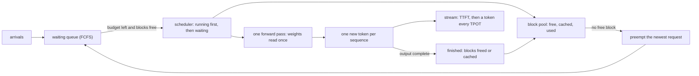

# Serving a Model Is a Batch Scheduler With a KV Cache

*Each decode step reads every weight once, so batching is nearly free until the KV cache fills; TTFT and TPOT show who pays.*

## Metadata

| Field | Value |
|---|---|
| Type | Build |
| Languages | Python |
| Prerequisites | [A GPU Is a Countable Resource Until It Isn't](https://cloudcaptain.io/learn/ai-infra/gpu-scheduling) |
| Time | 120 minutes |
| Tools | docker, llama.cpp, vllm, curl |

<Quiz stage="pre" />

## The Problem

Monday, 09:05. The internal assistant runs Llama 3.1 8B in vLLM on one 24 GB L4, and on Friday a release gave every conversation a new 1,000-token system prompt. Now the chat window shows a spinner for twenty seconds before the first word, then the words arrive at a normal pace. The dashboard says GPU utilisation 100%, so the first proposal is a second GPU. The second proposal, from someone who read that batching helps, raises `--max-num-seqs` from 256 to 512. Nothing improves. `vllm:num_requests_waiting` sits at 40, `vllm:kv_cache_usage_perc` is pinned at 1.0, and `vllm:num_preemptions_total` climbs every minute.

Every one of those numbers is a consequence of arithmetic nobody did. The weights take 16 GB, so after vLLM's memory share and its activation reserve about 3.8 GiB (at a 0.9 share) are left for the KV cache: roughly 31,000 tokens, at 128 KiB per token for this model. Forty conversations of 1,500 tokens do not fit in 31,000 tokens, so the scheduler runs the twenty or so that do, keeps the rest in the queue (the twenty-second spinner is queue time, not slow generation), and when the running ones grow it evicts the newest and recomputes it later. Raising the sequence limit changes nothing, because memory, not the limit, caps the batch. GPU utilisation is 100% whenever a kernel is running at all; it says nothing about how many requests share each step. The fix the numbers point to is boring: every request starts with the same 1,000 tokens, so with prefix caching those tokens are stored once instead of forty times.

An LLM server is a scheduler. Each step it picks which sequences advance by one token, how many prompt tokens to prefill, and which requests wait, under two budgets: tokens per step and KV cache blocks. You are going to build `servesim`, a token-level simulator of exactly that loop (continuous batching, chunked prefill, a paged KV cache with prefix sharing and preemption, a roofline cost per step) that reports TTFT, TPOT, inter-token latency, queue time, throughput and KV utilisation the way vLLM does, plus a load generator that measures the same numbers from any OpenAI-compatible server's stream. Then you run the llama.cpp server on CPU with a 135M-parameter model and watch the same trade-off happen for real.

## The Concept

Think of a bus line. Driving the route costs the same fuel whether one passenger rides or forty, so an operator who waits for a full bus moves more people per litre, and every passenger waits longer at the stop. The seats are the limit: when they are full, people stay at the stop no matter how many buses you schedule.

Generating text is that route, run once per token. A model produces one token per **forward pass**, and the pass for token *n* needs the keys and values of all previous tokens. Serving has two phases. **Prefill** runs the whole prompt through the model in one pass (or a few chunks): thousands of tokens, matrix-matrix work, compute-bound, and it ends with the first output token. **Decode** then runs one pass per output token per sequence. Each decode pass must read every weight from memory (16 GB for an 8B model in BF16) to do two floating point operations per weight per sequence. On an H100 reading 16 GB takes 5 to 6 ms; computing for one sequence takes a few microseconds. Decode is memory-bound, so adding a second, tenth or hundredth sequence to the same pass costs almost nothing until the arithmetic catches up with the memory traffic, at a batch of roughly peak FLOPs divided by bandwidth (a couple of hundred tokens per step on an H100). Batching is how a server turns idle arithmetic into throughput.

**Continuous batching** (iteration-level scheduling, from the Orca paper) is what makes batching work for requests that arrive at random and stop at different lengths. The scheduler decides the batch again at every step: finished sequences leave immediately, waiting ones join immediately. vLLM's scheduler runs the sequences already running first, one token each, and then admits waiting requests while two budgets last: `--max-num-seqs` sequences and `--max-num-batched-tokens` tokens per step. With **chunked prefill** a long prompt takes several steps in budget-sized chunks, so it does not stall everyone else's next token.

The **KV cache** holds, for every token of every running sequence, a key and a value vector per layer per KV head: `2 x layers x kv_heads x head_dim x bytes` per token, 128 KiB for Llama 3.1 8B. That memory, not the sequence limit, decides how many requests run together. **PagedAttention** stores it in fixed blocks (16 tokens by default) allocated as a sequence grows and freed when it finishes, like virtual memory pages, so no space is reserved for tokens that are never generated. Blocks with identical content (the same system prompt) can be shared: **prefix caching** hashes full blocks and lets a new request reuse them, and freed blocks stay cached until the space is needed. When a running sequence needs a block and none is free, the scheduler **preempts** the most recently admitted request: it frees its blocks and puts it back at the head of the queue, to be recomputed later.



Four numbers describe the result, and each one has a different owner. **TTFT** (time to first token) is queue time plus prefill: what a chat user feels as the spinner. **TPOT** (time per output token, the mean gap after the first token) and **ITL** (inter-token latency, every single gap) are the decode step time, which grows with the batch and spikes when a prefill chunk or a preemption lands in the same step. **Throughput** (output tokens per second across all requests) is what the GPU bill buys. A bigger batch raises throughput and makes every request's TPOT worse; a full KV cache turns extra load into queue time and preemptions instead of throughput.

## Build It

`code/main.py` is `servesim` with four subcommands: `capacity` (the memory plan), `simulate` and `sweep` (the scheduler on a virtual clock), and `loadgen` (the same metrics from a real server's stream). The simulator is pure Python over dataclasses with presets for an H100, an A100, an L4 and a 4-vCPU machine, and for Llama 3.1 8B and 70B and the SmolLM2 135M model used in Use It. The hardware numbers are datasheet peaks (memory as `nvidia-smi` reports it, HBM or GDDR bandwidth, dense BF16 TFLOPS) times an efficiency factor; the CPU preset is a rough effective figure meant to be calibrated, which is an exercise.

### Step 1: the memory plan

Weights are parameters times bytes per parameter: 2 for BF16, 34/32 for llama.cpp's Q8_0 (32 int8 values plus one 16-bit scale per block). The KV cache per token is two tensors per layer per KV head:

```python
@property
def kv_bytes_per_token(self) -> int:
    return 2 * self.layers * self.kv_heads * self.head_dim * self.kv_dtype_bytes
```

Grouped-query attention is why `kv_heads` (8 for Llama 3.1 8B) and not the 32 query heads appears here; it cuts the cache to a quarter. What is left of the device after the weights becomes blocks, the way vLLM sizes its cache from `--gpu-memory-utilization` after a profiling run measures activation memory (servesim uses a fixed reserve instead):

```python
budget = hardware.memory_gib * GIB * gpu_memory_utilization
kv_bytes = budget - model.weight_bytes - hardware.reserve_gib * GIB
```

```python
num_blocks = int(kv_bytes // (block_size * model.kv_bytes_per_token))
```

A model whose weights alone exceed the budget is a `CapacityError` with the three ways out: quantize, shard with tensor parallelism, or a bigger device. `--kv-tokens` fixes the cache size instead, which is what llama.cpp's `--ctx-size` does.

### Step 2: a roofline cost per step

One step costs whichever is slower, moving the bytes or doing the arithmetic, plus a fixed overhead for scheduling and kernel launches:

```python
def step_seconds(hardware: Hardware, model: ModelSpec, tokens: int, context_tokens: int) -> float:
    compute = 2 * model.params * tokens / (hardware.tflops * 1e12 * hardware.mfu)
    memory = (model.weight_bytes + context_tokens * model.kv_bytes_per_token) / (hardware.bandwidth_gbs * 1e9 * hardware.mbu)
    return hardware.step_overhead_ms / 1000 + max(compute, memory)
```

`tokens` is every token processed in the step (one per decoding sequence plus the prefill chunks), and `context_tokens` is the KV the attention reads. Two consequences fall out. A decode step for 16 sequences costs barely more than for one, because the weight read dominates. And there is a batch where compute time equals the weight read, `critical_batch()`, about 197 tokens for Llama 3.1 8B on an H100 and under 3 on the CPU preset. Beyond it every extra sequence makes every step slower. The model leaves out attention FLOPs and kernel details; it is a roofline, good for direction and order of magnitude, not for a benchmark.

### Step 3: a paged KV cache

`BlockPool` is a free list in least-recently-used order, reference counts, and a map from content key to block:

```python
def allocate(self, count: int) -> List[int]:
    if count > len(self.free):
        raise CapacityError(f"asked for {count} KV blocks, {len(self.free)} free")
    blocks = []
    for _ in range(count):
        block, _ = self.free.popitem(last=False)
        key = self.key_of.pop(block, None)
        if key is not None:
            del self.cached[key]
            self.evictions += 1
        self.refs[block] = 1
        blocks.append(block)
    return blocks
```

A released block goes to the end of the free list but keeps its key, so it is still a cache hit until `allocate()` reaches it; taking it then is an **eviction**. `release()` walks a request's blocks in reverse, as vLLM does, so the tail of a sequence is evicted before the shared prefix at its head. `lookup()` returns the leading run of cached blocks for a list of keys, and `touch()` takes a reference on them, pulling them off the free list.

### Step 4: one rule for prefill and decode

A request is its prompt plus what it has generated, and the engine only tracks how many of those tokens already have KV:

```python
@property
def length(self) -> int:
    return self.prompt_tokens + self.generated

@property
def remaining(self) -> int:
    return self.length - self.computed
```

Prefill is a request whose `remaining` is the prompt; decode is a request whose `remaining` is 1 (the token sampled last step). Whenever a step brings `computed` up to `length`, the request samples its next token. This one rule covers chunked prefill (several steps until `computed == length`), decode, and recompute after preemption, which is just a prefill of the prompt plus everything generated so far.

### Step 5: the scheduler, running first

```python
while index < len(self.running) and budget > 0:
    request = self.running[index]
    tokens = min(request.remaining, budget)
    need = self.blocks_for(request.computed + tokens) - len(request.blocks)
    while need > self.pool.free_count() and request in self.running:
        self.preempt(self.running.pop())
        preempted = True
    if request not in self.running:
        break
    request.blocks.extend(self.pool.allocate(need))
    batch.append((request, tokens))
    budget -= tokens
    index += 1
if preempted:
    return batch
```

Running requests are served in admission order, each with as many tokens as it needs or the budget allows. If one needs a block and none is free, the last-admitted request is preempted, possibly the one asking. A step that preempted anything admits nobody new, as in vLLM: there is no point admitting work while evicting work. Otherwise waiting requests are admitted in arrival order while `--max-num-seqs`, the token budget and the free blocks allow. The head of the queue blocks everyone behind it, which is what first-come-first-served means:

```python
need = self.blocks_for(cached + tokens) - len(hits)
if need > self.pool.free_count() - self.pool.free_among(hits):
    break
```

`--no-chunked-prefill` adds one more rule: a prompt is admitted only if all of it fits in the budget that is left, and a request longer than `--max-num-batched-tokens` is rejected outright, which is why vLLM refuses that configuration unless the budget is at least `--max-model-len`.

### Step 6: preemption and prefix caching

```python
def preempt(self, request: Request) -> None:
    self.pool.release(request.blocks)
    request.blocks = []
    request.computed = 0
    request.preemptions += 1
    self.preemptions += 1
    self.waiting.appendleft(request)
```

The tokens it already streamed stay streamed; its KV is gone, so when it is admitted again it prefills its prompt plus its output so far, and the user sees one very long gap between two tokens. That gap is the ITL spike that `vllm:num_preemptions_total` explains. The alternative, swapping blocks out to CPU memory, was an option in vLLM's original engine; the current engine recomputes.

Prefix caching keys each full block of a shared prefix by name and position (real servers hash the block's token ids chained with the previous block's hash, which amounts to the same thing). The last token of a prompt is always computed, because the model needs its logits to sample:

```python
full = min(request.prefix_tokens, request.length - 1) // self.config.block_size
return [(request.prefix, index) for index in range(full)]
```

### Step 7: the step and the metrics

`step()` schedules, prices the batch with `step_seconds()`, advances the virtual clock, appends a token time to every request whose `computed` reached `length`, and frees the blocks of finished requests. `simulate()` feeds it arrivals: open loop from a trace or Poisson arrivals (`--rate`), or closed loop (`--concurrency N`: N clients, each sending the next request when its previous one ends, which is what a load generator does). The metrics use one definition for simulated and measured requests:

```python
ttft = [(r.token_times[0] - r.sent) * 1000 for r in done]
tpot = [(r.token_times[-1] - r.token_times[0]) * 1000 / (r.output_tokens - 1) for r in done if r.output_tokens > 1 and len(r.token_times) > 1]
itl = [(later - earlier) * 1000 for r in done for earlier, later in zip(r.token_times, r.token_times[1:])]
```

TPOT excludes the first token, as in vLLM's benchmark scripts. Throughput is output tokens over the span from the first request sent to the last token received. Percentiles are nearest rank. The engine report adds what only a server can see: mean sequences per step, peak and time-weighted KV utilisation, preemptions, evictions and the prefix hit rate.

### Step 8: the load generator

`loadgen` sends `stream: true` chat completions with `stream_options.include_usage`, so the last chunk carries the server's own token counts, and timestamps every server-sent event as it is read:

```python
for choice in event.get("choices") or []:
    delta = choice.get("delta") or {}
    if delta.get("content") or delta.get("reasoning_content"):
        record.token_times.append(at)
usage = event.get("usage")
if usage:
    record.prompt_tokens = int(usage.get("prompt_tokens") or 0)
    record.output_tokens = int(usage.get("completion_tokens") or 0)
```

TTFT is the first chunk with content; a chunk can occasionally carry more than one token, which is why TPOT divides by the usage count rather than counting chunks. A stream that stops without a `finish_reason` or `[DONE]` is recorded as an error, not as a short answer, and an HTTP error (a prompt too long for the context, say) is kept per request instead of being averaged in; only a refused connection aborts the run. N worker threads make it a closed loop. A sampler thread scrapes `/metrics` while the load runs, and `server_window()` turns the before and after scrapes into deltas for llama.cpp and vLLM names. llama.cpp exports `llamacpp:n_busy_slots_per_decode` as a running average since start, so the batch size during your window is recovered from the average and the decode counter: `(after_avg x after_decodes - before_avg x before_decodes) / (after_decodes - before_decodes)`. That number is the real server's mean batch, the one to compare with servesim's `mean batch`.

### Step 9: run it

```bash
python3 code/main.py capacity --hardware l4-24gb
python3 code/main.py capacity --model llama-3.1-70b; echo "exit $?"
python3 code/main.py sweep --requests 256 --concurrency 1,8,32,128,256
```

```text
capacity  llama-3.1-8b on l4-24gb  gpu-memory-utilization 0.90
  weights              16.06 GB   8.03 B params x 2 bytes
  kv per token         128.0 KiB  2 x 32 layers x 8 kv heads x 128 head dim x 2 bytes
  memory budget        20.25 GiB  22.5 GiB x 0.90
  kv cache              3.79 GiB  budget - weights - 1.5 GiB reserve
  blocks           1,941 x 16 tokens = 31,056 tokens
  max concurrency  7.58x at 4,096 tokens per request
  decode step      72.38 ms at batch 1; compute catches up with the weight read at ~269 tokens per step
servesim: llama-3.1-70b does not fit on h100-sxm-80gb: weights 141.20 GB plus 2.0 GiB reserve exceed 71.64 GiB ...
exit 1
sweep  llama-3.1-8b on h100-sxm-80gb  256 requests  prompt 256-1024  output 64-256
  concurrency  out tok/s  ttft p50  tpot p50  tpot p95  queue p95  batch  kv peak  preempt
            1      132.9      21.5       7.4       7.4        0.0    1.0     0.3%        0
            8      932.7      22.9       8.3       8.7        0.0    7.9     1.7%        0
           32     2568.2      26.8      11.4      12.6      267.1   29.2     5.8%        0
          128     4177.9     100.3      22.7      37.1     2403.5   86.9    22.3%        0
          256     4587.5    2937.6      30.6      66.7     5074.0  146.2    40.4%        0
```

Read the sweep down the columns. From 1 to 8 clients, throughput rises 7x and TPOT moves by 1 ms: the weights were being read anyway. From 32 on, TPOT climbs because prefill chunks share steps with decodes and the batch approaches the compute knee, and queue time appears because one 8,192-token budget cannot prefill every new prompt in the same step. Going from 128 to 256 clients buys 10% more throughput for almost thirty times the TTFT. Now the Monday incident, as a trace in `code/fixtures/burst.jsonl`: 48 requests in 3.5 seconds, each with one of two 1,024-token system prompts:

```bash
python3 code/main.py simulate --hardware l4-24gb --trace code/fixtures/burst.jsonl
python3 code/main.py simulate --hardware l4-24gb --trace code/fixtures/burst.jsonl --prefix-caching
```

```text
servesim  llama-3.1-8b on l4-24gb  48 requests  trace arrivals
  kv cache      1,941 blocks x 16 tokens   peak 100.0%   mean 84.1%
  steps         704   mean batch 17.5 seqs   preemptions 6   evictions 0   prefix hits 0.0%
  ttft ms          16668.7   48451.6
  throughput    158.1 output tok/s   975.7 total tok/s   0.62 req/s
servesim  llama-3.1-8b on l4-24gb  48 requests  trace arrivals
  kv cache      1,941 blocks x 16 tokens   peak 74.3%   mean 60.4%
  steps         373   mean batch 33.1 seqs   preemptions 0   evictions 0   prefix hits 70.7%
  ttft ms           1770.2    2484.9
  throughput    292.5 output tok/s   1805.1 total tok/s   1.14 req/s
```

(Both outputs are trimmed to the lines that changed.) The cache was full, the batch was capped at 17 sequences by memory, and six requests were recomputed. Sharing the two prefixes frees enough blocks to run 33 sequences, TTFT drops by 9x, and throughput nearly doubles on the same GPU. Last, the shape Use It will run on a real server: SmolLM2 135M on the CPU preset, a 4,096-token cache and 4 slots:

```bash
python3 code/main.py sweep --hardware cpu-4vcpu --model smollm2-135m-q8_0 --kv-tokens 4096 --max-num-seqs 4 --prompt-tokens 40 --output-tokens 64 --requests 16 --concurrency 1,4,8
```

```text
  concurrency  out tok/s  ttft p50  tpot p50  tpot p95  queue p95  batch  kv peak  preempt
            1       92.6     109.6       9.2       9.2        0.0    1.0     2.7%        0
            4      207.1     432.4      12.8      12.8        0.0    4.0    10.9%        0
            8      207.1    1668.7      12.8      12.8     1236.3    4.0    10.9%        0
```

On a CPU the knee is below a batch of 4, so batching buys a little over 2x the throughput at a 40% worse TPOT, and the eighth client only waits: four slots are four slots. Exit codes are 0 on success, 1 when a model does not fit or a server is unreachable or a request failed, 2 for bad input.

<RunTests />

## Use It

llama.cpp's `llama-server` is a C++ server with an OpenAI-compatible API, continuous batching and a Prometheus endpoint; it runs GGUF models on CPU or GPU. This lesson pins the CPU image `ghcr.io/ggml-org/llama.cpp:server-b11706` (build b11706, index digest `sha256:f41d47eee678c02656eefc9ed8cce76cab584aa7032805eeef0e6639fcfda485`) and SmolLM2-135M-Instruct in Q8_0, 145 MB, pinned by Hugging Face revision and sha256:

```bash
mkdir -p models
curl -fL -o models/SmolLM2-135M-Instruct-Q8_0.gguf \
  https://huggingface.co/bartowski/SmolLM2-135M-Instruct-GGUF/resolve/09816acd5d99df7be770d85ea30822623dab342c/SmolLM2-135M-Instruct-Q8_0.gguf
echo "5a1395716f7913741cc51d98581b9b1228d80987a9f7d3664106742eb06bba83  models/SmolLM2-135M-Instruct-Q8_0.gguf" | sha256sum -c -   # macOS: shasum -a 256 -c -
docker run --rm -d --name llm -p 8080:8080 -v "$PWD/models:/models:ro" ghcr.io/ggml-org/llama.cpp:server-b11706 \
  -m /models/SmolLM2-135M-Instruct-Q8_0.gguf --alias smollm2-135m --parallel 4 --ctx-size 4096 -cb --metrics --threads 4
until curl -sf localhost:8080/health; do sleep 1; done; echo   # 503 "Loading model" until the weights are in memory, then {"status":"ok"}
```

The flags are the simulator's knobs under other names. `--parallel 4` creates four slots: at most four sequences per batch, servesim's `--max-num-seqs 4`; a fifth request is deferred until a slot frees. `--ctx-size 4096` is the whole KV cache in tokens, servesim's `--kv-tokens 4096`. With an explicit `--parallel` it is split evenly into a fixed 1,024-token context per slot rather than paged on demand (the unified cache, `--kv-unified`, is the default only when the slot count is left on auto), so a prompt plus output longer than 1,024 tokens fails with `the request exceeds the available context size` even when the other slots are idle. `-cb` is continuous batching, on by default and spelled out here. `--metrics` enables `/metrics`, which is off by default. The image's entrypoint is `llama-server` and it already listens on 0.0.0.0:8080.

```bash
curl -s localhost:8080/v1/models | python3 -m json.tool | head -12            # id smollm2-135m, meta.n_ctx 1024 per slot
curl -s localhost:8080/slots | python3 -c 'import json,sys; print([(s["id"], s["n_ctx"], s["is_processing"]) for s in json.load(sys.stdin)])'
curl -sN localhost:8080/v1/chat/completions -H 'content-type: application/json' \
  -d '{"model":"smollm2-135m","messages":[{"role":"user","content":"What is a KV cache?"}],"max_tokens":16,"stream":true,"stream_options":{"include_usage":true}}'
```

The stream is server-sent events: a first chunk whose delta has `role: assistant` and the first piece of content, one `chat.completion.chunk` per token after that, a chunk with `finish_reason` (`length` here, `stop` at an end-of-sequence token), a chunk with empty `choices` and the `usage` you asked for, which in llama.cpp also carries `timings` (`prompt_n`, `prompt_ms`, `predicted_n`, `predicted_per_token_ms`, `predicted_per_second`, and `cache_n` for prompt tokens reused from the slot's cache), and finally `data: [DONE]`. That `predicted_per_token_ms` is the server's own TPOT for the request. Now the metrics and the load:

```bash
curl -s localhost:8080/metrics | grep -v '^#'
python3 code/main.py loadgen --url http://127.0.0.1:8080 --concurrency 1 --requests 8 --max-tokens 64 --ignore-eos
python3 code/main.py loadgen --url http://127.0.0.1:8080 --concurrency 4 --requests 16 --max-tokens 64 --ignore-eos
python3 code/main.py loadgen --url http://127.0.0.1:8080 --concurrency 8 --requests 16 --max-tokens 64 --ignore-eos --json > c8.json
docker logs llm 2>&1 | grep -E 'n_slots|n_ctx_slot|system_info' | head -5
docker rm -f llm
```

`/metrics` lists `llamacpp:prompt_tokens_total`, `llamacpp:prompt_tokens_cached_total`, `llamacpp:tokens_predicted_total`, `llamacpp:prompt_seconds_total`, `llamacpp:tokens_predicted_seconds_total`, `llamacpp:n_decode_total` (one per batched forward pass), `llamacpp:n_tokens_max`, the gauges `llamacpp:requests_processing` (busy slots), `llamacpp:requests_deferred` (the queue), `llamacpp:n_busy_slots_per_decode`, and two throughput gauges averaged over the window between scrapes. `--ignore-eos` keeps every request at exactly 64 output tokens, so the runs are comparable; both llama.cpp and vLLM accept the field. Your absolute numbers depend on the CPU. The shape does not: at concurrency 4 the output tokens per second rise well above concurrency 1, TPOT gets worse, and the server line reports a mean batch per decode near 4 where it was 1.0. At concurrency 8 the throughput stays where it was at 4, `max waiting` (llama.cpp's deferred requests) is 4, and TTFT grows by the time a request waits for a slot: the last row of the CPU sweep in Step 9. Compare servesim on the same shape, with the prompt length loadgen reported from `usage`, and the directions agree even where the CPU preset's absolute milliseconds do not.

The same knobs on a GPU with vLLM (current release <ToolVersion name="vllm" />), the server most production clusters run:

```bash
vllm serve meta-llama/Llama-3.1-8B-Instruct --max-model-len 8192 \
  --max-num-seqs 256 --max-num-batched-tokens 8192 --gpu-memory-utilization 0.90 --block-size 16 --enable-prefix-caching
# startup log: "GPU KV cache size: N tokens, Maximum concurrency for 8,192 tokens per request: X.XXx"
curl -s localhost:8000/metrics | grep -E '^vllm:(num_requests_running|num_requests_waiting|kv_cache_usage_perc|num_preemptions_total|prefix_cache_hits_total|prefix_cache_queries_total)'
python3 code/main.py loadgen --url http://127.0.0.1:8000 --concurrency 32 --requests 256 --max-tokens 256 --ignore-eos
```

That log line is the `blocks` and `max concurrency` lines of `servesim capacity`, computed from a measured profile instead of a fixed reserve. vLLM's defaults depend on the device and the release: 0.92 for `--gpu-memory-utilization` and, for the API server, 1,024 sequences and 8,192 batched tokens on H100-class GPUs, 256 and 2,048 on smaller GPUs and the A100; prefix caching and chunked prefill are on by default for most models. Pass them explicitly in production so an upgrade does not change your capacity. The latency histograms are `vllm:time_to_first_token_seconds`, `vllm:inter_token_latency_seconds`, `vllm:request_time_per_output_token_seconds`, `vllm:request_queue_time_seconds` and `vllm:e2e_request_latency_seconds`: the same definitions as Step 7, measured inside the server, so a gap between them and loadgen's numbers is network and proxy time.

**Other servers.** SGLang is the other widely deployed open server: the same continuous batching and paged cache, with RadixAttention (a radix tree over cached token prefixes, which makes prefix reuse across many conversations its strength), its own knobs (`--mem-fraction-static`, `--max-running-requests`, `--chunked-prefill-size`), the same OpenAI-compatible endpoints and Prometheus metrics behind `--enable-metrics`. Hugging Face TGI pioneered much of this, but it is in maintenance mode and its repository is archived; Hugging Face now recommends vLLM, SGLang or llama.cpp. NVIDIA's TensorRT-LLM with Triton and the Dynamo framework are the vendor-optimised route. Every one of them exposes the same three levers under different names: the batch cap, the per-step token budget and the memory share for the KV cache.

| What you built | Real tool | Note |
|---|---|---|
| `plan_capacity()`, `capacity` | vLLM's startup profile and the "KV cache size ... Maximum concurrency" log line; llama.cpp `--ctx-size` | vLLM measures activation memory; servesim uses a fixed reserve |
| `--max-num-seqs` | vLLM `--max-num-seqs`; llama.cpp `--parallel`; SGLang `--max-running-requests` | llama.cpp slots also split the context statically |
| `--max-num-batched-tokens`, chunked prefill | vLLM `--max-num-batched-tokens`; llama.cpp `--batch-size`/`--ubatch-size`; SGLang `--chunked-prefill-size` | bigger budget: better TTFT under load, spikier ITL |
| `BlockPool` with 16-token blocks | PagedAttention, vLLM `--block-size` | llama.cpp allocates the whole `--ctx-size` up front |
| `--gpu-memory-utilization`, `--kv-tokens` | vLLM `--gpu-memory-utilization`; SGLang `--mem-fraction-static` | the share of device memory for weights plus cache |
| `preempt()` | vLLM recompute preemption, `vllm:num_preemptions_total` | llama.cpp has no recompute preemption; requests wait for a free slot |
| `--prefix-caching`, `lookup()` | vLLM automatic prefix caching, SGLang RadixAttention, llama.cpp `cache_prompt` per slot and `--cache-reuse` | hit rate from `vllm:prefix_cache_hits_total` / `vllm:prefix_cache_queries_total` |
| `step_seconds()` roofline | the GPU kernels; `nvidia-smi` utilisation | utilisation says a kernel ran, not how full the batch was |
| `summarize()` TTFT, TPOT, ITL, queue | `vllm:time_to_first_token_seconds`, `vllm:inter_token_latency_seconds`, `vllm:request_queue_time_seconds`; llama.cpp `timings` | measured server-side; loadgen adds the network |
| `loadgen` | `vllm bench serve`, `llama-bench` (no server), GuideLLM | the same closed loop with more arrival patterns |
| `server_window()` mean batch | `llamacpp:n_busy_slots_per_decode`, `vllm:num_requests_running` | the real batch size, not utilisation |

<Quiz stage="check" />

## Ship It

Two artifacts in `outputs/`:

- **`skill-llm-serving-tuning.md`**: a runbook for a model server that is slow or expensive: write down the SLO (TTFT and TPOT percentiles) and the traffic shape, do the memory arithmetic, read the server's own metrics to find which budget binds (sequences, tokens per step or KV blocks), measure a concurrency sweep with a load generator, change one knob at a time from a decision table that maps symptoms to knobs on vLLM, llama.cpp and SGLang, verify against the SLO, and report.
- **`prompt-explain-serving-metrics.md`**: paste a `/metrics` scrape, a `loadgen --json` report or a `servesim` sweep together with the server flags, and get which phase dominates latency, which budget is binding, the capacity arithmetic checked, the single knob to change first with its expected effect on each metric, and what will not help.

<ShipIt />

## Exercises

### Easy

Add `--max-tokens-in-flight` to the scheduler: a cap on the sum of `length` over running requests, below what the KV cache allows, the way some servers protect TTFT by refusing to admit work that will need memory later. Tests first: with a cap of 2,000 tokens and four 900-token requests, at most two run at once and the other two show queue time; without the cap all four run. Then show with `sweep` that the cap removes preemptions on the burst trace at the price of higher TTFT.

### Medium

Calibrate the CPU preset. Write `servesim calibrate loadgen-c1.json loadgen-c4.json` that solves for `bandwidth_gbs`, `tflops` and `step_overhead_ms` from the TPOT measured at two concurrencies (one memory-bound point and one near the knee) and the TTFT at concurrency 1 (a prefill), and prints a preset line. Test it with reports you generate from servesim itself with known parameters (the calibration must recover them within 5%), then run it on the smoke's two loadgen reports and check that the calibrated simulator predicts the concurrency 8 run's throughput within 25%.

### Hard

Disaggregate prefill and decode. Model two engines, one that only prefills and one that only decodes, connected by a link that moves each request's KV cache (`length x kv_bytes_per_token` bytes) at a configurable bandwidth before the request can decode. Tests first: with a 25 GB/s link a 2,000-token prompt of Llama 3.1 8B waits about 10 ms for its transfer; decode-side ITL no longer spikes when long prompts arrive; and on a trace mixing 8,000-token prompts with short chats, find the link bandwidth below which the colocated engine wins on TTFT p95. Compare your design with how llm-d and NVIDIA Dynamo describe their prefill and decode workers.

<Quiz stage="post" />

## Key Terms

| Term | Common misconception | Precise definition |
|---|---|---|
| Prefill | "The model reads the prompt for free." | The forward pass over the prompt tokens that fills their KV cache and samples the first output token; compute-bound, and the bulk of TTFT when the queue is empty. |
| Decode step | "Each request gets its own forward pass." | One forward pass that advances every running sequence by one token; it reads all the weights once, so its cost grows slowly with the batch until compute catches up with memory traffic. |
| Continuous batching | "The server waits to fill a batch." | Scheduling at every step: finished sequences leave and waiting ones join between two decode steps, under a sequence cap and a token budget per step. |
| KV cache | "A cache of answers." | The keys and values of every token of every running sequence, `2 x layers x kv_heads x head_dim x bytes` per token; its size, not the sequence limit, decides how many requests run together. |
| PagedAttention block | "Memory is reserved for the maximum length." | A fixed group of token slots (16 by default in vLLM) allocated as a sequence grows and freed when it ends, so memory follows actual length and blocks can be shared. |
| Prefix caching | "It caches responses." | Reusing the KV blocks of an identical leading token sequence (a system prompt) across requests, keyed by a hash of each full block; it saves prefill compute and cache memory, never output. |
| Preemption | "Requests are cancelled when memory runs out." | Freeing a running request's blocks (the newest first) and requeueing it to be recomputed later; the user sees one long pause between tokens, and the server counts it. |
| TTFT | "Model speed." | Time from sending the request to the first content token: queue time plus prefill, plus the network for a client-side measurement. |
| TPOT and ITL | "The same as throughput." | TPOT is the mean gap between output tokens after the first; ITL is each individual gap. Both track the decode step time, so they get worse as the batch grows while throughput gets better. |
| Throughput | "Tokens per second of one request." | Output tokens per second across all requests on a server; it rises with the batch until the cache or compute saturates, after which extra load becomes queue time. |

## Further Reading

- [AI/ML Ops learning path](https://cloudcaptain.io/docs/learning-paths/ai-ml): where model serving sits between training pipelines, Kubernetes and inference cost.
- [Docker Fundamentals](https://cloudcaptain.io/docs/tools/docker/fundamentals): `docker run -d -p -v`, entrypoint arguments and `docker logs`, everything the llama.cpp steps use.
- [Observability & SRE](https://cloudcaptain.io/docs/tools/observability): Prometheus scraping and percentiles, the tooling the serving metrics plug into.
- [Efficient Memory Management for LLM Serving with PagedAttention](https://arxiv.org/abs/2309.06180): the vLLM paper; blocks, block tables, sharing and preemption by recompute, with the measurements.
- [Orca: a distributed serving system for transformer-based generative models](https://www.usenix.org/conference/osdi22/presentation/yu): iteration-level scheduling, the idea behind continuous batching.
- [Sarathi-Serve: chunked prefills](https://arxiv.org/abs/2403.02310): why mixing prefill chunks with decodes trades a little TTFT for steady inter-token latency.
- [vLLM optimization and tuning](https://docs.vllm.ai/en/latest/configuration/optimization.html): preemption, chunked prefill and how `--max-num-seqs` and `--max-num-batched-tokens` interact, from the project.
- [vLLM metrics design](https://docs.vllm.ai/en/latest/design/metrics.html): every `vllm:` metric, what it measures and which ones were renamed.
- [vLLM automatic prefix caching](https://docs.vllm.ai/en/latest/design/prefix_caching.html): block hashing, the free queue and eviction order that `BlockPool` imitates.
- [llama.cpp server README](https://github.com/ggml-org/llama.cpp/blob/master/tools/server/README.md): every flag, the `/slots` and `/metrics` endpoints and the streaming `timings` fields.
- [SGLang documentation](https://docs.sglang.ai/): RadixAttention and the server arguments that map onto the same three budgets.
