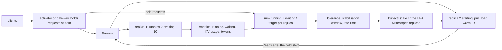

# Scale Inference on Queue Depth, Not CPU

*A model server is full when requests wait, not when its CPU is busy: scale on running plus waiting, and budget for the cold start.*

## Metadata

| Field | Value |
|---|---|
| Type | Build |
| Languages | Python |
| Prerequisites | [Serving a Model Is a Batch Scheduler With a KV Cache](https://cloudcaptain.io/learn/ai-infra/llm-serving) |
| Time | 90 minutes |
| Tools | kubectl, kind, docker, llm-d-inference-sim, vllm, llama.cpp, keda, kserve |

<Quiz stage="pre" />

## The Problem

Monday, 09:05. The support assistant runs an 8B model on vLLM, one replica per GPU, four replicas on a GPU node pool. Its HorizontalPodAutoscaler was copied from the web tier: CPU, `averageUtilization: 70`. Traffic triples as Europe logs in, time to first token goes from 300 ms to 40 seconds, clients time out, and `kubectl get hpa` shows `cpu: 31%/70%` with four replicas. The HPA is working exactly as configured. A vLLM pod spends about one core on the engine loop that launches GPU work and a little more on HTTP and tokenisation, and that number is the same whether 20 requests are waiting or 2,000. What is saturated is GPU memory bandwidth and KV cache, and the overflow sits in a queue the CPU never sees.

The on-call engineer lowers the target to 20%. Now any pod with one running request reads 30%, so the HPA climbs to its maximum of eight replicas and stays there all night: eight GPUs billed by the hour for a trickle of traffic. During the climb each new pod needed about 90 seconds to become Ready (pull a multi-gigabyte image, load 16 GB of weights, warm up), and the requests that arrived meanwhile kept landing on the old pods, which is where the queue lived. A week later finance asks for the internal summariser to scale to zero at night. The first request each morning waits through a whole cold start, and the client's 60-second timeout fires first.

Every model server already exports the signal that was missing: vLLM's `vllm:num_requests_running` and `vllm:num_requests_waiting`, llama.cpp's `llamacpp:requests_processing` and `llamacpp:requests_deferred`, SGLang's `sglang:num_running_reqs` and `sglang:num_queue_reqs`. You are going to build `infscale`. It reads those pages in the Prometheus text format, computes a replica count with the HPA's own algorithm (target per replica, tolerance, stabilisation windows, rate limits), adds what the HPA does not model (cold-start lookahead, scale to zero behind a queue that holds requests), and replays traffic through a GPU replica built from memory bandwidth and FLOPs, so that SLO misses and replica-minutes for CPU-based and queue-based policies become numbers. Then the same decision runs against a vLLM-compatible simulator on kind, and `kubectl scale` applies it.

## The Concept

Think of supermarket checkouts. You open another till when the line gets long, not when the cashier's pulse goes up, and the number that matters is everyone at a till plus everyone in line. Opening a till takes a few minutes, so a manager who waits until the line reaches the door is already late.

A model replica works the same way, and Little's law makes it exact: requests in flight equal arrival rate times latency. A replica batches up to `--max-num-seqs` sequences, and only as many as its KV cache can hold. Inside that limit, extra concurrency is cheap, because decoding is bound by memory bandwidth: each step reads every weight once, whether it advances one sequence or sixty-four. Beyond the limit, requests wait, and every waiting request adds its full service time to the time to first token (TTFT) of the requests behind it. So `running + waiting` per replica, compared with what the replica can batch, measures load, and `waiting > 0` means overload. The pod's CPU does neither. It stays flat at one busy core as soon as anything runs. GPU utilisation is no better, because it reports the share of time any kernel was running, which is close to 100% at batch 1 and at batch 64 alike.

The HPA turns a metric into replicas every 15 seconds with one formula: `desired = ceil(current × value / target)`. For a total with an `AverageValue` target that is `ceil(total / target)`: 12 requests in flight with a target of 4 per replica means 3 replicas. The HPA skips the change when the ratio is within 10% of 1, remembers its recommendations and scales down only to the highest one of the last 300 seconds (the stabilisation window), and limits each scale-up step to doubling or four pods, whichever is more. The result is clamped to `minReplicas` and `maxReplicas`.

Two things the formula does not see. **Cold start**: from the decision to Ready a replica pulls its image, loads its weights and warms up, and during that time the queue grows by the arrival rate minus capacity, multiplied by the cold start. A reactive policy needs headroom (a target below the knee) or a lookahead that projects demand over the cold start. **Zero**: the HPA's minimum is 1 (zero needs the alpha `HPAScaleToZero` feature gate), and with no pod there is no `/metrics` page to read. KEDA performs the 0-to-1 step itself and leaves 1-to-N to an HPA it creates, and something in front of the Service has to hold the waking request and count it: the Knative activator, the KEDA HTTP add-on's interceptor, or a gateway.



The window and the cold start pull in opposite directions. A long scale-down window keeps replicas you may not need, which costs money. A short one gives back replicas you will need again in a minute, and each one returns only after another cold start, which costs SLO.

## Build It

`code/main.py` is `infscale`. Parsing, the decision and the simulator are pure functions over dataclasses. The HTTP client (for `/metrics` and the load generator) uses `urllib`, and the cluster path calls `kubectl` through an injectable runner, so all 31 tests run without a cluster. `code/fixtures/` holds `/metrics` pages shaped like vLLM's, llama.cpp's, SGLang's and the simulator's, plus the Kubernetes manifests used in Use It.

### Step 1: read the Prometheus text format

Every model server answers `GET /metrics` with lines of `name{label="value",...} value [timestamp]`, plus `# HELP` and `# TYPE` comments. Metric names may contain colons, which is why vLLM's names look like `vllm:num_requests_running`. Label values are quoted, with `\\`, `\"` and `\n` as the only escapes, and a value can be `NaN`, `+Inf` or `-Inf`:

```python
match = METRIC_NAME.match(line)
if not match:
    raise InputError(f"{where}: {line[:60]!r} does not start with a metric name")
rest = match.end()
labels: Tuple[Tuple[str, str], ...] = ()
if rest < len(line) and line[rest] == "{":
    labels, rest = parse_labels(line, rest, where)
fields = line[rest:].split()
if not fields or len(fields) > 2:
    raise InputError(f"{where}: expected a value and an optional timestamp after {match.group(0)}")
result.samples.append(Sample(match.group(0), labels, parse_value(fields[0], where)))
```

`parse_labels()` is a small state machine rather than a regular expression, because a label value can contain commas, braces and escaped quotes. Errors carry `source:line`, so a broken scrape points at the line that broke it.

### Step 2: three servers, one set of signals

Each server names the same quantities differently. A profile maps them, and the first profile whose queue metrics appear on the page wins:

```python
PROFILES: Tuple[ServerProfile, ...] = (
    ServerProfile("vllm", ("vllm:num_requests_running",), ("vllm:num_requests_waiting",), ("vllm:kv_cache_usage_perc", "vllm:gpu_cache_usage_perc"), ("vllm:prompt_tokens_total",), ("vllm:generation_tokens_total",)),
    ServerProfile("llama.cpp", ("llamacpp:requests_processing",), ("llamacpp:requests_deferred",), (), ("llamacpp:prompt_tokens_total",), ("llamacpp:tokens_predicted_total",)),
    ServerProfile("sglang", ("sglang:num_running_reqs",), ("sglang:num_queue_reqs",), ("sglang:token_usage",), ("sglang:prompt_tokens_total",), ("sglang:generation_tokens_total",)),
)
```

`replica_metrics()` sums running and waiting across label sets (a vLLM pod with data parallelism reports one `engine` label per engine) and takes the maximum KV usage, because the fullest engine is the one that preempts first. Older vLLM releases call the KV gauge `vllm:gpu_cache_usage_perc`, and llama.cpp has no KV gauge at all, so `kv_usage` is optional. Counters only mean something as rates, so `add_rates()` turns two scrapes into output tokens per second and `process_cpu_seconds_total` into a CPU percentage of the pod's request, treating a counter that went down as a restart.

### Step 3: the HPA formula on queue depth

```python
def ceil_div(value: float, target: float) -> int:
    return max(0, math.ceil(value / target - 1e-9))
```

```python
if policy.metric in ADDITIVE:
    total = sum(getattr(replica, policy.metric) for replica in observation.replicas)
    held = observation.held if policy.metric != "running" else 0
    total += held
```

`queue` (running plus waiting) is the default metric; `waiting` and `running` are there for comparison. Requests held by an activator count as demand, because at zero they are the only demand there is. The result is `raw = ceil_div(projected, policy.target)`, which is HPA's `AverageValue` arithmetic, and the ratio `total / (current × target)` feeds the 10% tolerance check. The `1e-9` keeps `ceil(2.1 / 0.7)` at 3, where floating point computes 3.0000000000000004 and would ask for a fourth replica. `kv` and `cpu` are utilisation metrics: the average over replicas divided by the target, times the number of replicas that reported, as the HPA does for `averageUtilization`. A replica with no sample does not vote, and with no samples at all the decision keeps the current count.

### Step 4: stabilisation windows and rate limits

This is the Kubernetes algorithm line for line. The raw recommendation is stored, scale-up takes the lowest recommendation in the up window, and scale-down takes the highest in the down window:

```python
up_candidates = [n for t, n in state.history if t > now - policy.up_window_s] + [raw]
down_candidates = [n for t, n in state.history if t > now - policy.down_window_s] + [raw]
state.history.append((now, raw))
up_recommendation = min(up_candidates)
down_recommendation = max(down_candidates)
stabilised = current
if stabilised < up_recommendation:
    stabilised = up_recommendation
if stabilised > down_recommendation:
    stabilised = down_recommendation
```

Then the scale-up rate limit, the HPA's default policy of 100% or four pods per period:

```python
limit = max(math.ceil(current * (1 + policy.up_percent / 100.0)), current + policy.up_pods)
```

The defaults are the HPA's: no up window, a 300-second down window, tolerance 0.1, a 15-second period. `ScalerState` serialises to JSON (`--state FILE`), so a decision run from cron or a shell loop remembers its window between runs the way the HPA controller remembers it in memory.

### Step 5: scale to zero and back

```python
if policy.min_replicas == 0 and not active and current > 0:
    idle = math.inf if state.last_active is None else observation.now - state.last_active
    if idle >= policy.zero_cooldown_s:
        steps.append(f"idle for {'ever' if idle == math.inf else f'{idle:g} s'}, at least the {policy.zero_cooldown_s:g} s cooldown: scale to zero")
        desired = 0
        reason = "idle-to-zero"
```

Activity is any running, waiting or held request. The floor is 1 while traffic flows or the cooldown runs, as with KEDA, whose generated HPA never goes below 1. From zero, any held request activates at least one replica, and a large backlog asks for more. `Policy.validate()` refuses `cpu` or `kv` with `min=0`: with no pod there is no sample, so such a deployment could never wake up.

### Step 6: a GPU replica from first principles

There is no GPU here, so the simulator derives a replica from four facts about the hardware and the model. The defaults are an 8B model in FP16 on one 80 GB GPU with about 3.35 TB/s of memory bandwidth and about 990 dense BF16 TFLOPS, an H100-class card:

```python
@property
def kv_capacity_tokens(self) -> int:
    free = self.gpu_memory_gb * 1e9 * self.memory_utilization - self.weights_bytes - self.reserve_gb * 1e9
    if free <= 0:
        raise InputError(f"{self.name}: the weights ({self.weights_bytes / 1e9:g} GB) do not fit in {self.gpu_memory_gb:g} GB x {self.memory_utilization:g}")
    return int(free // self.kv_bytes_per_token)

@property
def prefill_tokens_per_s(self) -> float:
    return self.peak_tflops * 1e12 * self.mfu / (2 * self.params_billion * 1e9)

def decode_step_s(self, context_tokens: float) -> float:
    return (self.weights_bytes + context_tokens * self.kv_bytes_per_token) / (self.hbm_gb_per_s * 1e9 * self.bandwidth_efficiency)
```

A decode step reads every weight plus the KV cache of every running sequence, so its time is bytes over bandwidth. A Llama-3-8B-shaped model stores 131,072 bytes of KV per token (32 layers, 8 KV heads of dimension 128, K and V, 2 bytes each). Prefill is compute-bound, at about 2 FLOPs per parameter per token. `python3 code/main.py gpu` prints what follows from those numbers:

```text
replica model: 8B model, FP16, one 80 GB GPU
  weights      16.0 GB (8B parameters x 2 bytes)
  KV cache     52.0 GB free = 396728 tokens at 131072 bytes per token
  prefill      24750 tokens/s (990 TFLOPS x 0.4 MFU / 16 GFLOP per token)
  decode step  6.9 ms at batch 1, 10.4 ms at batch 64 (1000-token contexts): 6154 output tokens/s at full batch
  cold start   91 s = image 45 s + weights 16 s at 1 GB/s + warm-up 30 s
  pod CPU      idle 5%, batch 1 30%, batch 64 46% of 4 requested cores, whatever the queue
```

Batch 64 costs 50% more per step than batch 1 and produces 64 times the tokens: that is why servers batch. The CPU line is the point of the lesson. It models one engine core that is busy whenever anything runs, a small cost per running sequence, and nothing at all for waiting requests, so CPU tops out at 46% of the request while the queue grows without limit.

### Step 7: the simulator

Time advances in 0.25-second steps. Arrivals go to the ready replica with the fewest outstanding requests, as a least-request load balancer would, and wait in that replica's queue, as they do inside vLLM. When no replica is ready, they wait in the activator. Each step, a replica admits waiting requests while it has batch slots and KV space (prefill uses part of the step's time), then decodes:

```python
step = gpu.decode_step_s(sum(r.prompt + r.generated for r in replica.running))
tokens = budget / step
still: List[SimRequest] = []
for request in replica.running:
    need = request.output - request.generated
    if need <= tokens:
        request.finished = now + dt - budget + need * step
        request.generated = float(request.output)
        done.append(request)
    else:
        request.generated += tokens
        still.append(request)
replica.running = still
```

Every 15 simulated seconds the policy observes the ready replicas and the activator queue, and `resize()` applies the decision. New replicas become ready after the cold start. Removed replicas are those still starting first, then the least loaded, which drain their queues before they stop. Replica-minutes count starting and draining replicas too, because a GPU that is loading weights is billed like one that is serving. A request misses the SLO when its TTFT exceeds `--slo-ttft` (2 seconds), when it was rejected, or when it never got a first token. Prefill here stalls decode for its whole duration; servers with chunked prefill mix the two, which narrows the gap between TTFT and inter-token latency.

### Step 8: talk to a cluster

`infscale kube` reads the Deployment, lists its pods by the Deployment's selector, and scrapes each Ready pod through the API server's pod proxy, which works from any machine with a kubeconfig and needs no port-forward:

```python
for pod in sorted(pods, key=lambda p: p["metadata"]["name"]):
    name = pod["metadata"]["name"]
    if not pod_ready(pod):
        continue
    text = run(["get", "--raw", f"/api/v1/namespaces/{namespace}/pods/{name}:{port}/proxy{path}"])
    metrics = add_rates(replica_metrics(parse_exposition(text, name), name), state.counters.get(name), now, cpu_request_cores(pod))
```

`current` is `spec.replicas`, so pods that are still starting count as capacity on the way, and only Ready pods vote. With `--apply`, a changed decision becomes `kubectl scale deployment/NAME --replicas=N`. The tests pass a fake runner that records every command.

### Step 9: run it

```bash
python3 code/main.py parse code/fixtures/vllm-busy.prom code/fixtures/llamacpp.prom code/fixtures/sglang.prom
python3 code/main.py decide code/fixtures/sim-loaded.prom --target 4 --max 3
#   sim-loaded.prom   vllm   2   10   12   0.00   -   -
# queue:4 (min 1, max 3): current 1 -> desired 3 (up; metric)
#   queue 12 / target 4 per replica = 3 replica(s)
python3 code/main.py decide --current 0 --held 5 --min 0 --target 4          # activate-from-zero: 2 replicas
python3 code/main.py decide --metric cpu --min 0 --target 60; echo "exit $?" # exit 2: cpu cannot scale from zero
```

Now the comparison. The default trace runs at 3 requests per second, ramps to 30 between seconds 180 and 360, holds, falls, goes silent at 960 and wakes with a trickle at 1320:

```bash
python3 code/main.py simulate
```

```text
policy                          SLO miss  miss %  TTFT p50  TTFT p95 replica-min  peak scale events
cpu:60                             13932   89.6%   226.26s   471.71s        25.0     1            0
cpu:25                                 0    0.0%     0.04s     0.05s       145.8     8            9
queue:24                             257    1.7%     0.04s     0.48s        86.1     7            7
queue:24,lookahead=90                  0    0.0%     0.04s     0.05s       114.8     8            9
queue:24,min=0,cooldown=120          283    1.8%     0.04s     0.58s        81.9     7            9
```

At 60% the CPU policy never scales, because the pod cannot exceed 46%, and nine requests in ten miss. At 25% it meets the SLO by scaling to the maximum as soon as anything runs: 145.8 replica-minutes. The queue policy meets the SLO for 98% of requests at 59% of that cost. Its misses come from the ramp, while new replicas were still loading. The lookahead removes those misses by buying replicas earlier. Scale to zero saves the silent minutes, and the price is the first requests after silence, which wait one cold start in the activator. Add `--timeline` to see each decision. Around second 690 the queue policy drops from 7 replicas to 3 while traffic is still at 30 requests per second: with 7 replicas, batches are small and latency is low, so concurrency per replica reads low, and the 300-second window expires before the measurement corrects itself. The Easy exercise is about that.

<RunTests />

## Use It

### The same signals from a real server

`llm-d-inference-sim` is a vLLM-compatible server without a model. It implements `/v1/completions`, `/v1/chat/completions` and `/v1/models`, queues requests beyond `--max-num-seqs`, waits `--time-to-first-token` and `--inter-token-latency` per request, and exports vLLM's metric names on `/metrics`. It is the CPU stand-in for vLLM (current release <ToolVersion name="vllm" />); this lesson pins the simulator at v1.0.0. With a batch of 2 and 8 concurrent clients, the queue is visible within seconds:

```bash
docker run -d --name sim -p 127.0.0.1:8000:8000 ghcr.io/llm-d/llm-d-inference-sim:v1.0.0 \
  --model cc-tiny --port 8000 --max-num-seqs 2 --time-to-first-token 1s --inter-token-latency 20ms
curl -s 127.0.0.1:8000/v1/models                                               # {"object":"list","data":[{"id":"cc-tiny",...}]}
python3 code/main.py load --url http://127.0.0.1:8000 --concurrency 8 --duration 20 &
curl -s 127.0.0.1:8000/metrics | grep -E '^vllm:num_requests_(running|waiting)'  # running 2, waiting 6
python3 code/main.py decide http://127.0.0.1:8000/metrics --target 4             # queue 8 / 4 = 2 replicas
wait; docker rm -f sim
```

Real vLLM prints the same names with an `engine` label next to `model_name`; `vllm:kv_cache_usage_perc` is the fraction of KV blocks in use, and `vllm:time_to_first_token_seconds` is a histogram of the SLO itself. llama.cpp's server exports metrics only when started with `--metrics`. Run it as in the [llm-serving lesson](https://cloudcaptain.io/learn/ai-infra/llm-serving), with `--parallel 4` (four slots) and `--metrics` added, then:

```bash
curl -s 127.0.0.1:8080/metrics | grep -E '^llamacpp:requests_(processing|deferred)'   # deferred = requests waiting for a free slot
python3 code/main.py parse http://127.0.0.1:8080/metrics
```

`requests_processing` is bounded by the slots, so on llama.cpp `requests_deferred` is the overload signal. SGLang exports `sglang:num_running_reqs`, `sglang:num_queue_reqs` and `sglang:token_usage` when started with `--enable-metrics`.

### On kind: decide, scale, watch the new replica take traffic

`code/fixtures/k8s/sim.yaml` is a Deployment and a Service for the simulator with a `/health` readiness probe. `load-pod.yaml` runs `infscale load` from inside the cluster, so traffic goes through the Service and kube-proxy spreads connections across every Ready pod. (A `kubectl port-forward` to a Service forwards to one pod only, which would hide whether the new replicas take traffic.)

```bash
kind create cluster --name cc-lab
kubectl create namespace infscale
kubectl -n infscale create configmap infscale --from-file=main.py=code/main.py
kubectl -n infscale apply -f code/fixtures/k8s/sim.yaml
kubectl -n infscale rollout status deployment/cc-sim --timeout=180s
POD=$(kubectl -n infscale get pods -l app=cc-sim -o jsonpath='{.items[0].metadata.name}')
kubectl get --raw "/api/v1/namespaces/infscale/pods/$POD:8000/proxy/metrics" | grep '^vllm:num_requests'
kubectl -n infscale apply -f code/fixtures/k8s/load-pod.yaml               # 12 clients for 60 s
python3 code/main.py kube -n infscale --deployment cc-sim --target 4 --max 3 --down-window 20 --state state.json
# deployment infscale/cc-sim: spec.replicas 1, pods 1, ready with metrics 1
#   cc-sim-...   vllm   2   10   12   0.00   ...
# queue:4 (min 1, max 3): current 1 -> desired 3 (up; metric)
python3 code/main.py kube -n infscale --deployment cc-sim --target 4 --max 3 --down-window 20 --state state.json --apply
kubectl -n infscale rollout status deployment/cc-sim --timeout=120s
python3 code/main.py kube -n infscale --deployment cc-sim --target 4 --max 3 --down-window 20 --state state.json   # three rows, about 4 in flight each
```

Run the last command in a loop (`while sleep 5; do ...; done` with `--apply`) and watch the end of the load: the first decision after the queue empties holds 3 with the reason `stabilised`, and once 20 seconds of zero recommendations have passed it scales back to 1.

### The HPA with an External metric

The HPA can read any metric, but only through the aggregated metrics APIs: `custom.metrics.k8s.io` for metrics attached to Kubernetes objects and `external.metrics.k8s.io` for everything else. Something must implement them, usually prometheus-adapter or KEDA's metrics server. `code/fixtures/k8s/hpa-external.yaml` is the HPA that `infscale` imitates, with every default spelled out:

```yaml
apiVersion: autoscaling/v2
kind: HorizontalPodAutoscaler
metadata:
  name: cc-sim
spec:
  scaleTargetRef: {apiVersion: apps/v1, kind: Deployment, name: cc-sim}
  minReplicas: 1
  maxReplicas: 3
  metrics:
    - type: External
      external:
        metric:
          name: vllm_requests_in_flight
          selector: {matchLabels: {deployment: cc-sim}}
        target: {type: AverageValue, averageValue: "4"}
  behavior:
    scaleUp:
      stabilizationWindowSeconds: 0
      policies:
        - {type: Percent, value: 100, periodSeconds: 15}
        - {type: Pods, value: 4, periodSeconds: 15}
      selectPolicy: Max
    scaleDown:
      stabilizationWindowSeconds: 300
      policies:
        - {type: Percent, value: 100, periodSeconds: 15}
```

On a fresh kind cluster no adapter exists, and the HPA says so instead of scaling:

```bash
kubectl -n infscale apply -f code/fixtures/k8s/hpa-external.yaml
kubectl -n infscale describe hpa cc-sim | sed -n '/Conditions:/,$p'   # ScalingActive False FailedGetExternalMetric
kubectl -n infscale delete hpa cc-sim
```

With an adapter, one rule turns the PromQL sum of running and waiting into `vllm_requests_in_flight`. The HPA then computes `ceil(total / 4)`, as `infscale` does. For CPU the HPA also has startup rules that `infscale` leaves out: `--horizontal-pod-autoscaler-initial-readiness-delay` and `--horizontal-pod-autoscaler-cpu-initialization-period` decide when a new pod's CPU samples start to count.

### KEDA: Prometheus trigger, and the problem with zero

KEDA wraps the same HPA. A ScaledObject names the target and its triggers; KEDA creates an HPA called `keda-hpa-<name>` with an External metric served by its own metrics server, and it performs the step between 0 and 1 itself:

```yaml
apiVersion: keda.sh/v1alpha1
kind: ScaledObject
metadata:
  name: cc-sim
spec:
  scaleTargetRef:
    name: cc-sim
  pollingInterval: 15
  minReplicaCount: 1
  maxReplicaCount: 3
  advanced:
    horizontalPodAutoscalerConfig:
      behavior:
        scaleDown:
          stabilizationWindowSeconds: 300
  triggers:
    - type: prometheus
      metadata:
        serverAddress: http://prometheus-operated.monitoring.svc:9090
        query: sum(vllm:num_requests_running{namespace="cc-inference-autoscaling"}) + sum(vllm:num_requests_waiting{namespace="cc-inference-autoscaling"})
        threshold: "4"
```

`threshold` is the per-replica target (the trigger's default `metricType` is `AverageValue`). `minReplicaCount: 0` together with `cooldownPeriod` (default 300 seconds, applied only to the last step to zero) and `activationThreshold` gives scale to zero, but not with this query. At zero there is no vLLM pod, so Prometheus has nothing to scrape, the query returns nothing, and the deployment never wakes. Scale to zero needs a metric source that outlives the pods: the KEDA HTTP add-on, whose interceptor holds requests and reports them as pending, a gateway that counts queued requests, or Knative. That is the `held` argument in `infscale`.

### KServe: Standard mode or Knative mode

KServe (current release <ToolVersion name="kserve" />) puts a model behind an InferenceService and chooses the autoscaler by deployment mode. In **Standard** mode (called RawDeployment in older releases) it creates a Deployment with an HPA on CPU or memory, or, with the annotation `serving.kserve.io/autoscalerClass: keda`, a KEDA ScaledObject built from `autoScaling.metrics`:

```yaml
apiVersion: serving.kserve.io/v1beta1
kind: InferenceService
metadata:
  name: chat
  annotations:
    serving.kserve.io/deploymentMode: "Standard"
    serving.kserve.io/autoscalerClass: "keda"
spec:
  predictor:
    minReplicas: 1
    maxReplicas: 5
    autoScaling:
      metrics:
        - type: External
          external:
            metric:
              backend: "prometheus"
              serverAddress: "http://prometheus-operated.monitoring.svc:9090"
              query: vllm:num_requests_waiting
            target:
              type: Value
              value: "2"
    model:
      modelFormat:
        name: huggingface
      storageUri: "hf://Qwen/Qwen2.5-0.5B-Instruct"
```

In **Knative** mode the Knative Pod Autoscaler scales on concurrency (`scaleMetric: concurrency`, `scaleTarget`), averaged over a 60-second stable window, with a panic mode that reacts over a 6-second window when concurrency reaches twice the target. `minReplicas: 0` works there because Knative's activator stays in the request path when a revision has no pods: it holds requests, reports them to the autoscaler, and forwards them once a pod is Ready. That is `infscale`'s activator queue, and its cold start is still the image pull plus the model load.

### Why CPU is the wrong signal

On a GPU server the CPU runs the HTTP front end, tokenisation and the engine loop that launches kernels. The loop needs about one core whenever any sequence runs, so utilisation jumps from idle to busy at the first request and then barely moves. Waiting requests cost almost nothing. The bottlenecks, memory bandwidth for decode, FLOPs for prefill and KV capacity for concurrency, are all on the GPU. A CPU target above the busy plateau never fires, and one below it fires on any traffic and never lets go. The signals that track load are `waiting` (overload, scale up), `running + waiting` against the batch limit (concurrency), KV usage near 1 (preemption is coming) and TTFT p95 (the SLO itself, but a histogram that lags).

| What you built | Real tool | Note |
|---|---|---|
| `parse_exposition()`, `PROFILES` | Prometheus scrape, prometheus-adapter rules | vLLM `vllm:*`, llama.cpp `llamacpp:*` (needs `--metrics`), SGLang `sglang:*` (needs `--enable-metrics`) |
| `raw_recommendation()` for `queue` | HPA `External` metric with `AverageValue`, KEDA Prometheus `threshold` | `ceil(total / target)` |
| `raw_recommendation()` for `cpu` | HPA `Resource` metric with `averageUtilization` | saturates at the engine loop's core; cannot start from zero |
| `--tolerance` | `--horizontal-pod-autoscaler-tolerance` (0.1) | recent releases can also set `tolerance` per direction in `behavior` |
| `stabilise()` with `--down-window` | `behavior.scaleDown.stabilizationWindowSeconds` (300) | the highest recommendation in the window wins |
| `up_percent`, `up_pods` | `behavior.scaleUp.policies` (100% or 4 pods per 15 s) | scale-down policies are the Easy exercise |
| `--zero-cooldown`, `held` | KEDA `cooldownPeriod` and activation, KEDA HTTP add-on, Knative activator | at zero the metric has to come from in front of the pods |
| `--lookahead` | Knative panic mode, a lower target as headroom | none of them knows the cold start; you choose the margin |
| `GpuProfile`, `simulate()` | load tests against vLLM or the simulator | the simulator has the queueing, not the GPU physics |
| `kube_step()` with `--apply` | the HPA controller writing the `scale` subresource | `kubectl scale` writes the same field |
| `infscale load` | `vllm bench serve`, `hey`, `k6` | one new connection per request, so kube-proxy spreads the load |
| nothing in `infscale` | KServe InferenceService | Standard mode: HPA or KEDA; Knative mode: KPA with scale to zero |

<Quiz stage="check" />

## Ship It

Two artifacts in `outputs/`:

- **`skill-inference-autoscaling-review.md`**: a runbook for reviewing how a model-serving Deployment scales: inventory the autoscaler objects and the metrics the server exports, measure one replica's knee with a load test, measure the cold start from scale to Ready, choose metric and target from those two numbers, check the window, rate limits and scale-to-zero path against the cold start, replay a trace with `infscale simulate`, and report with a fixed structure.
- **`prompt-choose-scaling-metric.md`**: paste the server type, a `/metrics` sample, a load-test summary, the cold start, the SLO and the traffic shape, and get the metric to scale on and why, the target per replica derived from the numbers, the HPA, KEDA or KServe manifest, the windows, whether scale to zero is safe, and the commands that prove it.

<ShipIt />

## Exercises

### Easy

Add scale-down rate limits, the `behavior.scaleDown.policies` of the HPA: `--down-pods N` and `--down-percent P` per period, with `selectPolicy: Max` semantics (the larger of the two allowed drops). Write the tests first: from 8 replicas with a raw recommendation of 2, `--down-pods 1` gives 7, `--down-percent 50` gives 4, and both together give 4. Then run `simulate --policy queue:24,downpods=1 --timeline` and check whether the drop from 7 to 3 around second 690, and the misses it causes, disappear, and what the change costs in replica-minutes.

### Medium

Scale on the SLO directly. Parse the cumulative buckets of `vllm:time_to_first_token_seconds_bucket` from two scrapes, subtract them, and compute p95 by linear interpolation inside the bucket, as PromQL's `histogram_quantile()` does. Add `--metric ttft` with a target in seconds that scales on the ratio p95 / target. Tests first: a fixture pair whose difference puts p95 halfway through the `le="1.0"` bucket, a counter reset between the scrapes, and a window with no new requests (no recommendation). Then explain, with a simulator run, why the TTFT signal reacts later than `waiting`.

### Hard

Write `infscale activator`: an HTTP proxy (`http.server` and `urllib`) in front of a Service that holds requests while the Deployment has no Ready endpoints, exposes `infscale_pending_requests` on its own `/metrics`, runs `kubectl scale --replicas=1` on the first held request, releases the held requests in order once an endpoint is Ready, and fails them with 503 after `--hold-timeout`. Test it with a fake upstream and the fake runner. Then on kind scale `cc-sim` to 0, send five requests through the activator, and measure the TTFT each client sees against the cold start you measured with `kubectl get pods -w`.

<Quiz stage="post" />

## Key Terms

| Term | Common misconception | Precise definition |
|---|---|---|
| Queue depth | "The number of requests waiting." | For a model server, running plus waiting per replica: the concurrency the replica carries. Running is capped by `--max-num-seqs` and KV capacity; waiting above zero means the replica is past what it can batch. |
| Little's law | "Throughput and latency are independent." | In-flight requests equal arrival rate times latency. Concurrency per replica therefore measures load only while latency is steady; it reads low when replicas are idle and batches are small. |
| HPA target | "A threshold that triggers scaling." | The per-replica value the HPA steers toward: `desired = ceil(current × value / target)`, skipped when the ratio is within the 10% tolerance and clamped to min and max. |
| Stabilisation window | "A cooldown after each scaling event." | The span of past recommendations the HPA considers: scale-down goes only to the highest recommendation in the window (300 s by default), scale-up only to the lowest in its own window (0 by default). |
| Cold start | "The container start time." | Time from the scaling decision to a Ready replica: image pull, weight load and warm-up. Tens of seconds to minutes for a model server, during which the queue keeps growing on the replicas you already have. |
| Scale to zero | "minReplicas: 0 on any autoscaler." | Removing the last replica after an idle cooldown, which needs a component in front of the pods to hold the next request and report demand, because with no pod there is no metric to read. |
| Activator | "A load balancer." | The component that buffers requests for a service with no ready pods and signals the autoscaler: Knative's activator, the KEDA HTTP add-on's interceptor, or `held` in `infscale`. |
| External metric | "The HPA reads Prometheus." | A metric the HPA fetches from `external.metrics.k8s.io`, an API that an adapter (prometheus-adapter, KEDA's metrics server) must implement; without one the HPA reports `ScalingActive=False`. |
| KEDA cooldownPeriod | "KEDA's scale-down window." | Seconds of trigger inactivity before KEDA scales the last replica to zero; it applies only to that step. Scaling between 1 and N is done by the HPA that KEDA generates, under its own stabilisation window. |

## Further Reading

- [Kubernetes in Production](https://cloudcaptain.io/docs/tools/kubernetes/production-operations): HPA, resource requests and cluster autoscaling in the Reference layer.
- [Kubernetes Workloads & Scheduling](https://cloudcaptain.io/docs/tools/kubernetes/workloads): Deployments, readiness probes and the `scale` subresource that every autoscaler writes.
- [Observability & SRE](https://cloudcaptain.io/docs/tools/observability): Prometheus scraping and the metrics pipeline an adapter or KEDA reads from.
- [AI/ML Ops learning path](https://cloudcaptain.io/docs/learning-paths/ai-ml): where serving, autoscaling and GPU cost sit together.
- [Horizontal Pod Autoscaling](https://kubernetes.io/docs/tasks/run-application/horizontal-pod-autoscale/): the algorithm, tolerance, readiness rules, `behavior` and the scale-to-zero feature gate, from the source.
- [Prometheus exposition formats](https://prometheus.io/docs/instrumenting/exposition_formats/): the text format `parse_exposition()` implements, including escapes and special values.
- [vLLM production metrics](https://docs.vllm.ai/en/latest/usage/metrics.html): every `vllm:` metric, its labels and what it counts.
- [llm-d-inference-sim](https://github.com/llm-d/llm-d-inference-sim): the simulator's flags, latency model and metrics; the CPU stand-in for vLLM used here.
- [llama.cpp server README](https://github.com/ggml-org/llama.cpp/blob/master/tools/server/README.md): `--metrics`, `--parallel` and the `llamacpp:` metric table.
- [KEDA Prometheus scaler](https://keda.sh/docs/latest/scalers/prometheus/): `threshold`, `activationThreshold` and how a query becomes an HPA metric.
- [KEDA HTTP add-on](https://github.com/kedacore/http-add-on): the interceptor that holds requests so an HTTP service can scale from zero.
- [KServe autoscaling with LLM metrics](https://kserve.github.io/website/docs/model-serving/generative-inference/autoscaling): Standard mode with KEDA and vLLM metrics, the source of the InferenceService example.
- [Knative autoscaling](https://knative.dev/docs/serving/autoscaling/): the KPA's concurrency target, stable and panic windows, and scale to zero through the activator.
