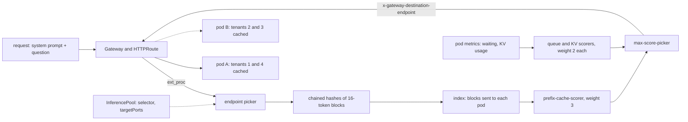

# Route by Prefix Cache, Not Round Robin

*A prefix cache only helps on the replica that holds it: hash the prompt into blocks, find that replica, and weigh it against its queue.*

## Metadata

| Field | Value |
|---|---|
| Type | Build |
| Languages | Python |
| Prerequisites | [Scale Inference on Queue Depth, Not CPU](https://cloudcaptain.io/learn/ai-infra/inference-autoscaling) |
| Time | 90 minutes |
| Tools | docker, llm-d-inference-sim, vllm, kubectl, kind, gateway-api-inference-extension, llm-d-router |

<Quiz stage="pre" />

## The Problem

The support platform runs one 8B model for forty tenants. Every request starts with the tenant's system prompt: about 3,000 tokens of policy text, tone rules and tool definitions, followed by a 150-token question. Eight vLLM replicas sit behind a Kubernetes Service. Automatic prefix caching is enabled, and the dashboard divides `vllm:prefix_cache_hits_total` by `vllm:prefix_cache_queries_total`: 14%. Time to first token at p95 is 1.8 seconds, and almost all of it is prefill of text the cluster has already processed thousands of times today.

For the product launch the team doubles the fleet to sixteen replicas. The GPU bill doubles, TTFT barely moves and the hit rate falls to 8%. Someone switches the Service to `sessionAffinity: ClientIP` to keep users on one replica. Hit rate climbs, until the largest tenant, whose traffic all leaves through one corporate NAT address, lands on a single replica with forty requests waiting while three replicas sit idle, and the p99 alert fires.

Both failures have one cause. The prefix cache lives in each replica's GPU memory and nowhere else. A Service spreads connections without reading the prompt, so every tenant's 3,000 tokens are prefilled again on every replica they reach, and each replica must hold all forty prefixes to ever hit. Sixteen replicas means each one sees a given tenant half as often, so its blocks are evicted before they are reused: sixteen caches working as sixteen copies of one. Affinity by client address restores locality and throws away load. You are going to build `prefixroute`, a router that hashes prompts into blocks the way vLLM does, remembers which replica it sent which blocks to, and scores replicas on prefix match, queue depth and KV cache pressure like the llm-d endpoint picker. A simulator compares round robin, least-queue and prefix-aware routing on a trace with shared system prompts, a calculator prices splitting prefill from decode, and then three `llm-d-inference-sim` replicas in Docker and an InferencePool on kind run the same job with the real components.

## The Concept

Think of a restaurant with four cooks, each with a small fridge. A sauce takes twenty minutes to make and keeps for an hour. A host who seats orders in strict rotation makes every cook brew every sauce, and their fridges overflow; a host who remembers that cook two made the béarnaise sends béarnaise orders to cook two, until cook two has twelve tickets and cook three has none. The good host remembers where the sauces are and still counts tickets.

**The KV cache.** Prefill runs the whole prompt through the model once and stores, for every token and every layer, a key vector and a value vector, so decode can attend to the prompt without recomputing it. vLLM stores them in fixed-size blocks (16 tokens by default) in GPU memory. For Llama 3.1 8B a token costs 2 (K and V) × 32 layers × 8 KV heads × 128 dimensions × 2 bytes = 128 KiB, so a 3,000-token system prompt is about 390 MB of GPU memory and roughly a quarter of a second of H100 compute to produce.

**Automatic prefix caching.** vLLM gives every full block a hash computed from the hash of the block before it, the token IDs in the block and extra keys (LoRA adapter, image hashes, a per-request `cache_salt`). Because each hash covers its parent, a block's hash names the entire prefix up to and including it. A new request hashes its blocks and walks from the first one until a hash is missing; those blocks are reused and only the rest is prefilled. Freed blocks stay resident and are evicted least recently used first. Only full blocks are cached, and when the whole prompt hits, the last block is recomputed because the model needs logits for the final token.

**Routing on the cache.** A router cannot read GPU memory, so it keeps an approximate copy. It tokenizes and hashes the prompt the same chained way, keeps an LRU set of block hashes per endpoint recording what it has sent there, and scores each endpoint by the fraction of the prompt's blocks that endpoint already matches. That is llm-d's `approx-prefix-cache-producer` feeding its `prefix-cache-scorer`. The approximation can be wrong after evictions; the precise variant subscribes to the servers' KV events (`BlockStored`, `BlockRemoved`, published over ZMQ) instead of guessing.

**Locality against load.** Prefix match alone builds hot spots, so other scorers vote too: `queue-scorer` normalises waiting requests between the shortest and longest queue, `kv-cache-utilization-scorer` gives `1 - kv_cache_usage_perc`. Each score is in 0..1, each scorer has a weight (the llm-d chart's default profile uses prefix 3, queue 2, KV 2), and `max-score-picker` takes the highest sum. A brand-new prefix matches nowhere; a no-hit LRU scorer sends such cold requests to the endpoint that least recently took one, so new tenants spread out instead of piling onto whichever endpoint wins ties.

**Splitting prefill from decode.** Prefill is compute-bound and decode is memory-bandwidth-bound, and a long prefill scheduled into a batch stalls every decoding sequence on that replica for its duration. Disaggregation runs prefill on one pool and decode on another and moves the KV blocks between them. The bill is the KV size: at 128 KiB per token, a GPU prefilling 12,000 tokens per second produces KV at about 12.6 Gb/s, so the link has to move at least that much for the transfer to keep up.

**The Kubernetes shape.** The Gateway API Inference Extension defines an `InferencePool`: a label selector over model-server Pods, the `targetPorts` they serve on, and an optional `endpointPickerRef` to the endpoint picker (EPP) Service. An HTTPRoute uses the pool as a backendRef. For every request the gateway calls the EPP over Envoy's ext_proc protocol; the EPP answers with the chosen `ip:port` in the `x-gateway-destination-endpoint` header and metadata, and the gateway forwards there. `failureMode` decides what happens when the EPP does not answer.



The router's index is a belief, not a fact. Everything else in this lesson is about keeping that belief close enough to the servers' real caches, and about knowing when load should overrule it.

## Build It

`code/main.py` is `prefixroute`: tokenizer and block hashing, the index, four scorers and a `Router` in pure functions; a simulator of replicas with LRU block caches; a disaggregation calculator; an OpenAI-compatible proxy (`serve`) that scrapes the servers' `/metrics`; a load generator (`replay`) that reads the servers' own hit counters before and after; an InferencePool validator and resolver (`pool`); and `fake-server`, a vLLM-like server with a real prefix cache for running everything without Docker.

### Step 1: tokens without a tokenizer

Real routers tokenize with the model's tokenizer, or estimate. `prefixroute` uses the scheme `llm-d-inference-sim` uses for models it has no tokenizer for: a regex that splits words and punctuation (each keeps its trailing whitespace) and a 32-bit FNV-1a hash of each piece as the token ID:

```python
TOKEN_RE = re.compile(r"""([{}:,\-.?!;@#$%^&*()+_~/\\><\[\]="']|\w+)(\s*)""")


def fnv1a_32(text: str) -> int:
    value = FNV_OFFSET
    for byte in text.encode("utf-8"):
        value = ((value ^ byte) * FNV_PRIME) & 0xFFFFFFFF
    return value
```

Token boundaries will not match a real tokenizer, and they do not need to: the router only has to agree with itself about which prompts share a prefix. `prompt_text()` flattens chat messages in order, system first, so a shared system prompt becomes a shared run of leading tokens.

### Step 2: chained block hashes

```python
def block_hashes(tokens: Sequence[int], block_size: int, model: str = "", salt: str = "", include_partial: bool = True) -> List[int]:
    if block_size <= 0:
        raise InputError(f"block size must be positive, got {block_size}")
    full, rest = divmod(len(tokens), block_size)
    count = full + (1 if include_partial and rest else 0)
    previous = h64(length_prefixed(model) + length_prefixed(salt))
    hashes = []
    for index in range(count):
        block = tokens[index * block_size:(index + 1) * block_size]
        content = h64(struct.pack(f"<{len(block)}I", *block))
        previous = h64(struct.pack("<QQ", content, previous))
        hashes.append(previous)
    return hashes
```

This is the structure of llm-d's prefix hashing with BLAKE2b standing in for xxHash: the seed covers the model name and the cache salt, length-prefixed so model `ab` with salt `c` cannot collide with model `a` and salt `bc`, and every block hash mixes in the previous one. Change one token in block 0 and every hash after it changes, which is exactly what makes "longest run of known hashes" mean "longest shared prefix". The router includes the final partial block (llm-d does); a server caches full blocks only (vLLM does), which is why `include_partial` is a parameter.

### Step 3: the index is what the router believes

```python
def longest_match(self, hashes: Sequence[int], endpoint: str) -> int:
    lru = self.blocks.get(endpoint)
    matched = 0
    for value in hashes:
        if not lru or value not in lru:
            break
        matched += 1
    return matched
```

`record()` adds a request's hashes to the chosen endpoint's LRU after the decision and evicts beyond `capacity` blocks per endpoint (31,250 here, the llm-d default for `lruCapacityPerServer`). Nothing tells the index when a server evicts; it learns only from its own choices.

### Step 4: four scorers, each in 0..1

```python
def score_queue(endpoints: Sequence[Endpoint]) -> Dict[str, float]:
    measured = [e for e in endpoints if e.has_metrics]
    if not measured:
        return {}
    low = min(e.waiting for e in measured)
    high = max(e.waiting for e in measured)
    if high == low:
        return {e.name: 1.0 for e in measured}
    return {e.name: (high - e.waiting) / (high - low) for e in measured}
```

`score_prefix()` is matched blocks over total blocks. `score_kv()` is `1 - kv_usage`. Endpoints without metrics are left unscored, which counts as zero, as in llm-d. `score_no_hit_lru()` returns 0.5 for everyone when any endpoint matches (so it never fights locality) and, for a cold request, 1.0 for endpoints that never took a cold request and falling scores for the ones that took one most recently.

### Step 5: pick, then commit

```python
scores["prefix"] = score_prefix(matches, len(hashes))
if self.policy == "prefix":
    scores["queue"] = score_queue(pool)
    scores["kv"] = score_kv(pool)
    scores["no-hit-lru"] = score_no_hit_lru(names, cold, self.cold_order)
totals = {name: sum(self.weights[scorer] * values.get(name, 0.0) for scorer, values in scores.items()) for name in names}
chosen = self.best(totals)
```

`best()` breaks exact ties with a seeded random choice, as `max-score-picker` does. `commit()` records the hashes on the winner and updates the cold LRU; it is separate from `pick()` because the proxy must decide, forward, and only then believe the blocks are there. The same `Router` also implements the baselines: `round-robin`, `random`, `least-queue` (fewest in flight) and `prefix-only` (the prefix scorer without the load scorers). With the default weights a full match is worth 3 points and an idle queue plus an empty cache 4, so a deep enough queue overrules locality; that trade is the whole design.

### Step 6: a replica's cache, the way vLLM keeps it

```python
hashes = block_hashes(tokens, self.block_size, model, salt, include_partial=False)
usable = max(0, (len(tokens) - 1) // self.block_size)
with self.lock:
    matched = 0
    for value in hashes[:usable]:
        if value not in self.blocks:
            break
        matched += 1
```

Full blocks only, the lookup capped at `(n - 1) // block_size` blocks so the last token is always computed, then every block is touched or inserted and the oldest evicted beyond capacity. `hit_tokens` and `query_tokens` are the two counters vLLM exports as `vllm:prefix_cache_hits_total` and `vllm:prefix_cache_queries_total`, both in tokens. `ReplicaSim` wraps this cache with request lanes: a request waits for a free lane, its TTFT is the wait plus `prefill_overhead + uncached_tokens / prefill_tps`, which is the same formula the simulator server's `per-token` latency mode uses.

### Step 7: simulate the policies

`trace` writes a JSONL trace whose lines carry an OpenAI request body; eight tenants with 180-word system prompts and short questions, Poisson arrivals at 20 per second. `simulate` replays it against three replicas with a 64-block (1,024-token) cache each: room for four tenants' prefixes per replica, not eight.

```bash
python3 code/main.py trace -o /tmp/trace.jsonl
python3 code/main.py simulate /tmp/trace.jsonl
python3 code/main.py simulate /tmp/trace.jsonl --policy prefix --show-decisions 4
```

```text
policy       hit rate  TTFT p50  TTFT p95  queue p95  groups on 1 replica  requests per replica
prefix          76.0%     34 ms    226 ms       0 ms                8/8    19 22 23
prefix-only     63.8%     34 ms    226 ms       0 ms                8/8    10 46 8
least-queue     31.2%    226 ms    226 ms       0 ms                0/8    19 24 21
round-robin     44.8%     34 ms    226 ms       0 ms                0/8    22 21 21
random          35.3%    226 ms    226 ms       0 ms                0/8    18 23 23
  #1 tenant-1: prefix -> replica-2: cold, no endpoint holds a block, score 5.00, next replica-3 5.00
  #2 tenant-5: prefix -> replica-3: cold, no endpoint holds a block, score 5.00, next replica-1 5.00
  #3 tenant-1: prefix -> replica-2: match 12/14 blocks, score 6.63, next replica-1 4.50
  #4 tenant-2: prefix -> replica-1: cold, no endpoint holds a block, score 5.00, next replica-3 3.90
```

Round robin and least-queue give every replica all eight prefixes, which do not fit, so blocks are evicted before reuse. Prefix routing gives each replica two or three tenants, which fit, and the only misses left are each tenant's first request and the questions themselves. `prefix-only` shows the other failure: cold tenants land wherever ties fall, 46 of 64 requests on one replica, and its cache thrashes. Rerun with `trace --hot 0.7 --rate 40 --requests 200` and `simulate --slots 2`: `prefix-only` puts 185 of 200 requests on one replica and TTFT p95 triples, while `prefix` spills the hot tenant onto a second replica once its queue outweighs the match.

### Step 8: price disaggregation

```python
uncached = prompt_tokens - cached_tokens
prefill_s = uncached / prefill_tps
kv_bytes = uncached * shape.kv_bytes_per_token()
transfer_s = link_latency_ms / 1000 + kv_bytes * 8 / (link_gbps * 1e9)
stall_s = prefill_s if chunk_tokens <= 0 else min(prefill_s, chunk_tokens / prefill_tps)
production_gbps = shape.kv_bytes_per_token() * prefill_tps * 8 / 1e9
remote = threshold_tokens > 0 and uncached >= threshold_tokens
```

Only uncached tokens are prefilled and moved: the decode pod already holds the cached prefix. `remote` is llm-d's `prefix-based-pd-decider` rule: prefill remotely when at least `nonCachedTokens` are missing on the chosen decode pod. The prefill throughput is an input, not a fact; 12,000 tokens per second is a plausible figure for an 8B model on one H100 and you should replace it with your own measurement.

```bash
python3 code/main.py disagg --prompt-tokens 4000
```

```text
llama-3.1-8b: 131072 bytes of KV per token (128 KiB); one replica holds about 426788 tokens of KV cache
prompt: 4000 uncached tokens = 524.3 MB of KV; prefill 333.3 ms; the prefill GPU produces KV at 12.6 Gb/s
decider (nonCachedTokens threshold): remote prefill; a co-located prefill would stall each decode step by 333.3 ms
     link   transfer  TTFT local  TTFT remote  link keeps up
   10 Gb/s   419.9 ms    333.3 ms     753.3 ms  no
   25 Gb/s   168.3 ms    333.3 ms     501.6 ms  yes
  100 Gb/s    42.4 ms    333.3 ms     375.8 ms  yes
  400 Gb/s    11.0 ms    333.3 ms     344.3 ms  yes
```

Disaggregation costs this request the transfer and saves every co-located decode stream a 333 ms stall; chunked prefill (`--chunk-tokens 512`) shrinks the stall to 43 ms per step without moving anything, which is why it is the first thing to try. The capacity line comes from `(80 GB × 0.9 − 16 GB of weights) / 128 KiB`, the same arithmetic as vLLM's `--gpu-memory-utilization`, before activation memory. The model treats transfer as following prefill; layer-by-layer streaming overlaps the two, which is what "link keeps up" is about.

### Step 9: the proxy, the servers' own counters, and a fake server

```bash
python3 code/main.py fake-server --name sim-a --port 9001 &
python3 code/main.py fake-server --name sim-b --port 9002 &
python3 code/main.py fake-server --name sim-c --port 9003 &
python3 code/main.py serve --endpoint sim-a=http://127.0.0.1:9001 --endpoint sim-b=http://127.0.0.1:9002 --endpoint sim-c=http://127.0.0.1:9003 --port 8080 &
python3 code/main.py trace --rate 0 -o /tmp/seq.jsonl
python3 code/main.py replay /tmp/seq.jsonl --url http://127.0.0.1:8080 --metrics sim-a=http://127.0.0.1:9001 --metrics sim-b=http://127.0.0.1:9002 --metrics sim-c=http://127.0.0.1:9003
curl -s 127.0.0.1:8080/prefixroute/state | python3 -m json.tool | head -30
```

```text
64 requests, 0 errors; latency p50 44.6 ms p95 238.9 ms
per endpoint: {'sim-a': 15, 'sim-b': 27, 'sim-c': 22}
groups on one endpoint: 8/8; cached prompt tokens (usage): 76.0%
server prefix cache hit rate: 76.0% (sim-a 75.3%, sim-b 77.2%, sim-c 75.0%)
```

`serve` reads each request body, picks, commits, forwards with `urllib` and streams the response back chunk by chunk (Server-Sent Events pass through), adding `x-prefixroute-endpoint`, `x-prefixroute-policy` and `x-prefixroute-match: 12/14`. A `Scraper` thread reads every endpoint's `/metrics` each half second for `vllm:num_requests_waiting`, `vllm:num_requests_running` and `vllm:kv_cache_usage_perc`; an endpoint whose scrape or connection fails is skipped until it answers again, and a dead upstream is a 502. `replay` reads the servers' hit and query counters before the run and polls them after it until the query delta covers every prompt token it sent, so the hit rate it prints is the servers' claim, not the router's. `fake-server` keeps a `BlockCache`, sleeps for `overhead + uncached × per-token`, returns `usage.prompt_tokens_details.cached_tokens` and exports the vLLM metric names.

### Step 10: InferencePool, validated and resolved

```python
if len(set(map(repr, numbers))) != len(numbers):
    problems.append(f'spec.targetPorts: Invalid value: "array": {UNIQUE_PORT_MESSAGE}')
```

`validate_pool()` applies the rules of the v1 CRD: `selector.matchLabels` required with at least one label, one to eight unique `targetPorts`, `appProtocol` either `http` or `kubernetes.io/h2c`, and for an `endpointPickerRef` of kind Service (the default) a port, with the CRD's own message `port is required when kind is 'Service' or unspecified (defaults to 'Service')`. `pool_endpoints()` is what an EPP does with the pool: Pods in the pool's namespace whose labels match, each `podIP:port` per target port an endpoint, Ready ones only. `pool live.json --args` prints the `--endpoint` flags for `serve`.

<RunTests />

## Use It

### vLLM's own prefix cache

On a GPU node, vLLM is the server this lesson imitates (current release <ToolVersion name="vllm" />). Prefix caching is on by default in current releases; the flags that matter for routing are the block size and the hash:

```bash
vllm serve meta-llama/Llama-3.1-8B-Instruct --enable-prefix-caching --block-size 16 --gpu-memory-utilization 0.9
curl -s localhost:8000/metrics | grep -E '^vllm:(prefix_cache_(hits|queries)_total|kv_cache_usage_perc|num_requests_(waiting|running)|cache_config_info)'
```

```text
sum(rate(vllm:prefix_cache_hits_total[5m])) / sum(rate(vllm:prefix_cache_queries_total[5m]))
```

That PromQL ratio is the number from The Problem. `--prefix-caching-hash-algo` selects the block hash (SHA-256 based by default since v0.11), and a request field `cache_salt` mixes a per-tenant secret into the first block's hash so tenants cannot probe each other's cached prompts through timing. A router that hashes for a salted fleet must salt the same way, which is why `block_hashes()` takes `salt`.

### llm-d-inference-sim: vLLM's surface on a CPU

`llm-d-inference-sim` is the llm-d project's vLLM simulator: the same OpenAI endpoints, the same metric names, a prefix cache over simulated blocks, and latency computed from cached and uncached tokens, without a GPU or a model. Run three replicas the way the smoke test does, with a cache of 64 blocks each and 1 ms of prefill per uncached token:

```bash
for n in a b c; do
  docker run -d --name sim-$n -p 127.0.0.1::8000 -e POD_IP=127.0.0.1 -e POD_NAME=sim-$n \
    ghcr.io/llm-d/llm-d-inference-sim:v1.0.0 \
    --model cc-sim --port 8000 --enable-kvcache --kv-cache-size 64 --block-size 16 \
    --latency-calculator per-token --prefill-overhead 5ms --prefill-time-per-token 1ms
done
A=$(docker port sim-a 8000/tcp)
curl -s $A/v1/models
BODY='{"model":"cc-sim","max_tokens":1,"messages":[{"role":"system","content":"You are the billing assistant. Check the invoice, the refund policy and the order history before answering."},{"role":"user","content":"Where is my refund?"}]}'
curl -s $A/v1/chat/completions -H 'content-type: application/json' -d "$BODY" | python3 -c 'import json,sys; print(json.load(sys.stdin)["usage"])'
curl -s $A/v1/chat/completions -H 'content-type: application/json' -d "$BODY" | python3 -c 'import json,sys; print(json.load(sys.stdin)["usage"])'
curl -s $A/metrics | grep -E '^vllm:prefix_cache'
```

The second response reports `prompt_tokens_details.cached_tokens` greater than zero and the counters move. Three details are easy to miss. `--enable-kvcache` needs `POD_IP` in the environment because the simulator names its KV event topic `kv@<ip>:<port>@<model>`. Without `--render-url` it uses the regex-and-FNV tokenizer from Step 1 (with a model name containing `/` it logs a warning, since real block hashes would then not match a real vLLM). And boolean flags take no separate value: `--enable-kvcache true` is refused.

Now put `prefixroute` in front, once per policy, with fresh containers each time so neither run inherits the other's cache:

```bash
EP=(); MET=(); for n in a b c; do U=http://$(docker port sim-$n 8000/tcp); EP+=(--endpoint sim-$n=$U); MET+=(--metrics sim-$n=$U); done
python3 code/main.py serve "${EP[@]}" --policy round-robin --port 8080 &
python3 code/main.py replay /tmp/seq.jsonl --url http://127.0.0.1:8080 "${MET[@]}"
kill %1; docker rm -f sim-a sim-b sim-c        # rerun the docker run loop and the EP/MET line for fresh replicas, then:
python3 code/main.py serve "${EP[@]}" --policy prefix --port 8080 &
python3 code/main.py replay /tmp/seq.jsonl --url http://127.0.0.1:8080 "${MET[@]}"
python3 code/main.py simulate /tmp/seq.jsonl --policy round-robin --slots 1
```

The `server prefix cache hit rate` line comes from the simulator's own counters. Round robin spreads every tenant over all three containers and lands well under half; prefix routing keeps each tenant on one container and lands around three quarters, the same direction `simulate` predicts for the same shape. Mean latency follows the hit rate, because the simulator charges 1 ms per uncached token.

### The Kubernetes objects

Install the Inference Extension's CRDs. Since v1.6.0 that repository holds the `InferencePool` API, its conformance tests and the endpoint picker protocol; the full EPP moved to the llm-d router:

```bash
kubectl apply --server-side -f https://github.com/kubernetes-sigs/gateway-api-inference-extension/releases/download/v1.6.2/manifests.yaml
kubectl get crd inferencepools.inference.networking.k8s.io
```

Run the simulator as a Deployment labelled `app: cc-sim` (the same arguments as above, with `POD_IP` and `POD_NAME` from the downward API), then describe the pool:

```yaml
apiVersion: inference.networking.k8s.io/v1
kind: InferencePool
metadata:
  name: sim-pool
spec:
  selector:
    matchLabels:
      app: cc-sim
  targetPorts:
    - number: 8000
  endpointPickerRef:
    name: sim-epp
    port:
      number: 9002
    failureMode: FailClose
```

`endpointPickerRef` is optional in the v1 API since v1.6.0; a pool without it is still a valid object that tools can resolve. Validation happens at the API server: two identical `targetPorts` are refused with `port number must be unique`, and a Service reference without a port with `port is required when kind is 'Service' or unspecified`. `prefixroute pool` gives the same answers and resolves the same Pods:

```bash
kubectl get inferencepool sim-pool -o yaml
kubectl get inferencepools.inference.networking.k8s.io,pods -o json > live.json
python3 code/main.py pool live.json
python3 code/main.py serve $(python3 code/main.py pool live.json --args) --port 8080 &   # from inside the cluster network
```

A route sends traffic to the pool instead of a Service, and the gateway implementation calls the EPP for each request:

```yaml
apiVersion: gateway.networking.k8s.io/v1
kind: HTTPRoute
metadata:
  name: llm
spec:
  parentRefs:
    - name: inference-gateway
  rules:
    - backendRefs:
        - group: inference.networking.k8s.io
          kind: InferencePool
          name: sim-pool
```

Gateways that implement this include Envoy AI Gateway, Istio, agentgateway, NGINX Gateway Fabric and GKE's managed gateway; the llm-d router repository carries a Gateway manifest for each. The EPP itself is configured with plugins and a scheduling profile. This is the default profile from the llm-d router chart, the weights `prefixroute` copies:

```yaml
apiVersion: llm-d.ai/v1
kind: EndpointPickerConfig
plugins:
  - type: queue-scorer
  - type: kv-cache-utilization-scorer
  - type: prefix-cache-scorer
schedulingProfiles:
  - name: default
    plugins:
      - pluginRef: queue-scorer
        weight: 2
      - pluginRef: kv-cache-utilization-scorer
        weight: 2
      - pluginRef: prefix-cache-scorer
        weight: 3
```

`approx-prefix-cache-producer` is added automatically when a scorer needs it (64-token blocks by default, auto-tuned from the servers' `vllm:cache_config_info` when present); `precise-prefix-cache-producer` replaces it with an index fed by the servers' KV events, and `no-hit-lru-scorer` is the cold-request spreader from Step 4. For disaggregation the EPP runs a `disagg-profile-handler` with separate prefill and decode profiles and a `prefix-based-pd-decider` whose `nonCachedTokens` is the threshold in Step 8; a sidecar on each decode pod sends the prefill to the chosen prefill pod and pulls the KV blocks through vLLM's `NixlConnector` (RDMA or GPU-direct where available).

| What you built | Real tool | Note |
|---|---|---|
| `tokenize()` with FNV-1a | the model's tokenizer; llm-d's `token-producer` (estimate or vLLM `/render`); the simulator's regex tokenizer | the router only needs to agree with itself, the precise index needs the server's token IDs |
| `block_hashes()` chained from a model and salt seed | vLLM's block hash (parent, tokens, extra keys) and llm-d's xxHash chain | vLLM caches full blocks; llm-d also hashes the partial last block |
| `PrefixIndex` | `approx-prefix-cache-producer` with `lruCapacityPerServer` | learns from its own decisions; wrong after evictions |
| nothing yet | `precise-prefix-cache-producer` reading `BlockStored` and `BlockRemoved` over ZMQ | the Hard exercise |
| `score_prefix`, `score_queue`, `score_kv`, `score_no_hit_lru` | `prefix-cache-scorer`, `queue-scorer`, `kv-cache-utilization-scorer`, `no-hit-lru-scorer` | weights 3, 2, 2 in the chart default |
| `Router.best()` | `max-score-picker` | random among exact ties |
| `BlockCache` | vLLM automatic prefix caching, the simulator's KV cache | LRU over free blocks; vLLM never evicts blocks in use, `BlockCache` does not model that |
| `serve` with `x-prefixroute-endpoint` | Gateway + EPP over ext_proc with `x-gateway-destination-endpoint` | the gateway proxies, the EPP only decides |
| `Scraper` | the EPP's `metrics-data-source` and `core-metrics-extractor` | polls `/metrics` every 50 ms by default |
| `validate_pool()`, `pool_endpoints()` | the InferencePool CRD and the EPP's endpoint discovery | `podIP:port` per target port |
| `disagg_plan()` | `disagg-profile-handler`, `prefix-based-pd-decider`, NIXL | measure prefill throughput before trusting any threshold |
| `fake-server` | `llm-d-inference-sim` | both expose `vllm:*` metrics and `cached_tokens` in `usage` |

<Quiz stage="check" />

## Ship It

Two artifacts in `outputs/`:

- **`skill-inference-routing-review.md`**: a runbook for reviewing how a model-serving fleet routes: measure the servers' own prefix hit rate and how many replicas each prefix reaches, find the shared prefixes and their sizes, check that cache capacity per replica can hold its share, compare policies on a replayed trace, set scorer weights against queue depth, decide whether prefill/decode disaggregation pays with the KV transfer arithmetic, check the InferencePool and EPP configuration, roll out behind a comparison, and report.
- **`prompt-explain-prefix-caching.md`**: paste `/metrics` from your replicas, a description of your prompts and your routing setup, and get the hit rate per replica explained, the arithmetic of what the cache could save, the single routing or configuration change worth making first, and the measurement that proves it.

<ShipIt />

## Exercises

### Easy

Add llm-d's match-length term to the prefix scorer: `score = w × min(1, matched_tokens / scale)² + (1 − w) × matched / total`, with `--match-length-weight` (default 0) and `--match-length-scale-tokens` (default 8192), so a long shared prefix outranks a short one with the same ratio. Write the tests first: with `w = 0` the scores are unchanged; with `w = 0.5` an endpoint matching 4,000 of 5,000 tokens beats one matching 400 of 500; values of `w` outside 0..1 raise `InputError`.

### Medium

Simulate disaggregation. Give `simulate` `--prefill-replicas N --decode-replicas M` and `--threshold`: each request is routed to a decode replica by the prefix router; if its uncached tokens reach the threshold, a prefill replica chosen by least queue computes them and the KV moves at `--link-gbps` (use `disagg_plan()`), otherwise the decode replica prefills locally. Charge local prefills to every request decoding on that replica as a stall. Tests first: with a threshold of 0 the result equals today's simulation; on a trace of 4,000-token prompts a 400 Gb/s link improves decode p95 over aggregated serving, and a 10 Gb/s link makes TTFT worse than aggregated.

### Hard

Make the index precise. Start the simulator with `--zmq-endpoint tcp://*:5557` and subscribe with `pyzmq` and `msgpack` to each replica's `kv@<ip>:<port>@<model>` topic; maintain, per replica, the set of block keys from `BlockStored` (computed from the event's token IDs and parent hash, as the simulator's documentation advises) minus `BlockRemoved`, and use it in place of `PrefixIndex`. Write a test that replays events from a fixture file, then demonstrate on Docker the case the approximate index gets wrong: fill one replica's cache with other tenants until a prefix is evicted, and show the approximate router still sending that prefix there while the precise one routes it as cold.

<Quiz stage="post" />

## Key Terms

| Term | Common misconception | Precise definition |
|---|---|---|
| KV cache | "The model's weights in memory." | The key and value vectors prefill computed for every prompt token in every layer, kept so decode can attend without recomputing; 128 KiB per token for Llama 3.1 8B in 16-bit. |
| Automatic prefix caching | "A response cache." | Reuse of KV blocks whose chained hash matches the start of a new prompt; it skips prefill for the shared prefix only, the model still generates a new answer. |
| Block hash | "A hash of the block's text." | A hash of the parent block's hash, the block's token IDs and extra keys (adapter, salt); it identifies the whole prefix up to that block, which makes longest-run lookup a prefix match. |
| Approximate prefix index | "The router reads the GPU cache." | The router's own record of which block hashes it sent to each endpoint, LRU-bounded; it never hears about evictions unless it subscribes to KV events. |
| Scorer weight | "A priority order." | A multiplier on a 0..1 score; the endpoint with the largest weighted sum wins, so a full prefix match (3) can lose to an idle queue and an empty cache (2 + 2). |
| Endpoint picker (EPP) | "The gateway." | An ext_proc service the gateway calls per request; it reads the body, scores the InferencePool's endpoints and returns the chosen `ip:port`, and the gateway does the proxying. |
| InferencePool | "A Service for models." | A Gateway API Inference Extension object: a label selector over model-server Pods, up to eight target ports and an optional endpoint picker reference; an HTTPRoute uses it as a backend. |
| Disaggregated prefill and decode | "Always faster." | Running prefill and decode on separate pools and moving the KV blocks between them; it removes prefill stalls from decode at the cost of a transfer that grows with uncached tokens. |
| cache_salt | "An encryption key." | A per-request value mixed into the first block's hash so only requests with the same salt share cached blocks; routing must hash with it too or every salted prompt looks cold. |

## Further Reading

- [AI/ML Ops learning path](https://cloudcaptain.io/docs/learning-paths/ai-ml): where serving, routing and scaling sit in the wider AI infrastructure path.
- [Kubernetes Networking & Services](https://cloudcaptain.io/docs/tools/kubernetes/networking-services): Services, session affinity and the Gateway API that InferencePool extends.
- [Docker Fundamentals](https://cloudcaptain.io/docs/tools/docker/fundamentals): `docker run -p`, `docker port` and environment variables, all used to run the simulator replicas.
- [vLLM: Automatic Prefix Caching design](https://docs.vllm.ai/en/latest/design/prefix_caching.html): the block hash, full-block caching, LRU eviction and `cache_salt`, from the source.
- [Gateway API Inference Extension](https://gateway-api-inference-extension.sigs.k8s.io/): the InferencePool API, supported gateways and the conformance profile.
- [Endpoint picker protocol](https://github.com/kubernetes-sigs/gateway-api-inference-extension/blob/v1.6.2/docs/proposals/004-endpoint-picker-protocol/README.md): what the gateway sends the EPP and how the chosen endpoint comes back.
- [llm-d router](https://github.com/llm-d/llm-d-router): the endpoint picker, its scorers, the configuration format and the disaggregation design.
- [llm-d-inference-sim KV cache](https://github.com/llm-d/llm-d-inference-sim/blob/v1.0.0/docs/kv-cache.md): how the simulator caches blocks, computes TTFT from cached tokens and publishes KV events.
- [Envoy ext_proc filter](https://www.envoyproxy.io/docs/envoy/latest/configuration/http/http_filters/ext_proc_filter): the external processing hook that lets a picker read the body and steer the request.
