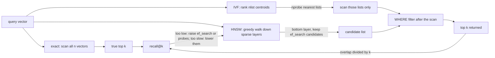

# A Vector Index Is a Recall Budget You Tune

*An ANN index reads less and misses neighbours; measure recall@k against exact search, then spend ef_search, probes and filters on purpose.*

## Metadata

| Field | Value |
|---|---|
| Type | Build |
| Languages | Python |
| Prerequisites | [Serving a Model Is a Batch Scheduler With a KV Cache](https://cloudcaptain.io/learn/ai-infra/llm-serving) |
| Time | 90 minutes |
| Tools | docker, pgvector, postgresql, psql |

<Quiz stage="pre" />

## The Problem

The platform team runs retrieval for `opsbot`, the internal assistant that answers on-call questions from 1.8 million runbook and postmortem chunks. The chunks live in PostgreSQL with pgvector, one 768-dimension embedding per row. At launch the query was an exact scan: `ORDER BY embedding <=> $1 LIMIT 10` compared the question with every row, took 900 ms at p95, and the serving dashboards from the previous lesson showed retrieval eating most of the time-to-first-token budget. Someone ran `CREATE INDEX ... USING hnsw`, p95 fell to 12 ms, and the ticket was closed.

Three weeks later the complaints are about answers, not speed. The assistant cites the runbook of the wrong service about one time in eight. Payments engineers get "I could not find a relevant runbook" for questions that have one, because their queries carry `WHERE team = 'payments'` and payments owns 2% of the chunks: the index hands back its 40 best candidates (`hnsw.ef_search` defaults to 40), the filter runs after that, and on average less than one candidate survives. A second table, indexed with IVFFlat while it held a 50,000-row sample, has since grown to 1.8 million rows, and its lists are still the ones k-means learned from the sample. Nobody can say whether either index finds 99% or 70% of the true neighbours, because nobody has ever compared it with the exact answer.

An approximate index is a deal: it reads a fraction of the vectors and in exchange sometimes misses the true nearest ones. The fraction is a knob (`ef_search` for HNSW, `probes` for IVF), the misses are measurable (recall@k against brute force), and filters and deletes change both. You are going to build `vecindex`: exact search as the answer key, an IVF index with k-means cells, a small HNSW graph with M, efConstruction and efSearch, three ways to apply a metadata filter, upserts with tombstones, snapshots, memory and work estimates, and a recall report. Then pgvector answers the same queries in Docker, and you grade it with the same report.

## The Concept

Exact search compares the query with every stored vector. For a million 768-dimension float32 vectors that is 3 GB of memory read per query, roughly 300 ms on one core that streams 10 GB/s, and it grows linearly with the data. Every vector index is a way to read less by guessing where the neighbours are, and every guess can be wrong.

**IVF** (inverted file) runs k-means once to cut the space into `nlist` cells and files each vector under its nearest centroid. A query ranks the centroids and scans only the `nprobe` nearest lists. A true neighbour just across a cell border is missed unless its cell is probed; more probes give more recall and more work, and probing every list is exact search with extra steps. The centroids are learned from the data present at build time and never move afterwards.

**HNSW** (hierarchical navigable small world) links every vector to a few close neighbours, at most M per layer and 2M on the bottom layer, and promotes a random, geometrically shrinking subset of vectors to higher layers that work like express lanes. A query enters at the top, walks greedily towards the query vector, drops a layer, and on the bottom layer runs a best-first search that keeps the `ef_search` best candidates seen so far. It stops when the closest unexplored candidate is farther away than the worst of those candidates. A larger `ef_search` explores more of the graph before it stops; `efConstruction` is the same list size used while inserting, and decides how good the links are.

**Recall@k** is the share of the true k nearest neighbours that the index returned, averaged over queries. It depends on your data and on your query distribution, so the only way to know it is to run exact search on a sample of real queries and compare. That is the budget: choose the recall the application needs, then buy it with the smallest `ef_search` or `probes` that reaches it, and re-measure when the data changes.

**Filters** are not ranked by the index. Post-filtering applies the condition to whatever the scan returned, so a filter that matches 10% of rows keeps about 10% of the candidates. Pre-filtering finds the matching rows first (a B-tree, a partition, a payload index) and searches only those, exactly, which is cheap when few rows match. Filtering during the traversal (pgvector's iterative scans, Qdrant's filterable HNSW) keeps walking until k matching rows are found, and costs more the rarer the match is.

**Updates.** Inserting into HNSW is a search plus a few link changes, with no training step. Inserting into IVF appends to the nearest existing list, so a table that grows or drifts away from its training data ends up with unbalanced lists and falling recall until the index is rebuilt. Deleting from either is a tombstone: the vector stays in the structure (in HNSW it still routes searches) and is skipped in results until a rebuild or `VACUUM` removes it.



## Build It

`code/main.py` is `vecindex`, standard library only. Every index stores the same `Node` records (key, vector, metadata, a deleted flag) and implements one method, `_search`. `Index` itself is brute force; `IVF` and `HNSW` subclass it. The CLI generates a seeded dataset, builds and snapshots indexes, searches, upserts and deletes, sweeps a knob against exact search, writes the same benchmark as a psql script for pgvector, and grades the rows psql prints. The tests use 600 vectors in 12 dimensions so they run in under a second.

### Step 1: one distance function for L2 and cosine

pgvector's `<->` is Euclidean (L2) distance and `<=>` is cosine distance, `1 - cos θ`. For unit vectors the two are tied together: `|a - b|² = 2 - 2 cos θ`, so cosine distance is half the squared L2 distance and both rank neighbours identically. `vecindex` normalises vectors once on the way in when the metric is cosine, ranks everything with `math.dist` (C code, fast enough for thousands of vectors in pure Python), and converts back only when it reports a distance:

```python
def prepare(self, vector: Any) -> List[float]:
    checked = as_vector(vector, self.dim)
    return unit(checked) if self.metric == "cosine" else checked

def report(self, rank_distance: float) -> float:
    return rank_distance * rank_distance / 2.0 if self.metric == "cosine" else rank_distance
```

`as_vector` rejects NaN, infinity and the wrong number of dimensions, and `unit` rejects the zero vector, which has no direction; pgvector refuses the same inputs and does not index zero vectors for cosine. The same identity is why pgvector's documentation suggests inner product (`<#>`) for embeddings that are already normalised: it ranks like cosine and skips the division.

### Step 2: brute force is the answer key

```python
def exact(self, query: List[float], k: int, flt: Optional[Dict[str, Any]] = None) -> SearchResult:
    accept = self.accepts(flt)
    pool = [n for n in range(len(self.nodes)) if accept(n)]
    best = heapq.nsmallest(k, ((math.dist(query, self.nodes[n].vector), n) for n in pool))
    return SearchResult(self.hits(best), len(pool), "pre" if flt else "exact")
```

Every result carries `evals`, the number of distance computations, because that number, times the dimensions, times 4 bytes, is the work the query did. Recall compares an answer with this one:

```python
def recall_at_k(found: Sequence[str], truth: Sequence[str], k: int) -> float:
    expected = list(truth)[:k]
    if not expected:
        return 1.0
    return len(set(list(found)[:k]) & set(expected)) / len(expected)
```

Order inside the top k does not matter, and a result list shorter than k counts its missing places as misses. That second rule is what makes the filtering problem visible in Step 7.

### Step 3: IVF is k-means plus a probe count

Training is Lloyd's algorithm, seeded with k-means++ so the starting centroids are spread out: assign every vector to its nearest centroid, move each centroid to the mean of its vectors, repeat until no assignment changes. For cosine the centroids are normalised again after each move (spherical k-means):

```python
for i, vector in enumerate(vectors):
    best = nearest_index(vector, centroids)
    if best != assignment[i]:
        assignment[i], changed = best, True
if not changed:
    break
```

A search ranks all centroids, then scans lists in that order. Its work is `nlist` plus the vectors in the probed lists, which `vecindex` reports in `evals`:

```python
order = sorted((math.dist(query, c), i) for i, c in enumerate(self.centroids))
nprobe = max(1, min(nprobe, len(order)))
limit = len(order) if max_probes is None else max(nprobe, min(max_probes, len(order)))
accept = self.accepts(flt)
evals, probed, scored = len(order), 0, []
for _, cluster in order:
    if probed >= nprobe and not (mode == "iterative" and len(scored) < k and probed < limit):
        break
```

Vectors upserted after training go to the nearest existing list (`_add`), and `stats()` reports `growth_since_training` and `imbalance` (largest list over the mean) so you can see when the cells no longer describe the data. Training on fewer vectors than `nlist` leaves a warning in the snapshot, the case pgvector warns about when an IVFFlat index is created on a nearly empty table.

### Step 4: HNSW is a graph you walk

Each new vector draws its top layer from a geometric distribution, `floor(-ln(U) / ln(M))`, so a vector reaches layer 1 with probability 1/M, layer 2 with 1/M², and so on. With M = 16 and 4000 vectors, about 250 vectors reach layer 1 and about 15 go higher:

```python
def random_level(self) -> int:
    return int(-math.log(1.0 - self.rng.random()) * self.level_mult)
```

`search_layer` is the core of both inserting and querying. `candidates` is a min-heap of nodes still to expand; `results` is a max-heap (negated distances) of the best `ef` seen so far. The loop stops when the nearest unexpanded candidate is worse than the worst result, because nothing reachable through it can improve the list:

```python
while candidates:
    distance, node = heapq.heappop(candidates)
    if len(results) >= ef and distance > -results[0][0]:
        break
    for other in links[node][layer]:
        if other in visited:
            continue
        visited.add(other)
        self.counter += 1
        d = math.dist(query, nodes[other].vector)
        if len(results) < ef or d < -results[0][0]:
            heapq.heappush(candidates, (d, other))
            if accept is None or accept(other):
                heapq.heappush(results, (-d, other))
                if len(results) > ef:
                    heapq.heappop(results)
```

The `accept` predicate is how tombstones and filters enter the walk: a rejected node is still expanded, so the graph stays connected through it, but it never enters `results`. Inserting is a descent with `ef = 1` through the layers above the new node's level, then a search with `ef_construction` on each of its own layers, linking it to the neighbours chosen from what that search found:

```python
for layer in range(top, level, -1):
    nearest = self.search_layer(query, nearest, 1, layer)
for layer in range(min(level, top), -1, -1):
    found = self.search_layer(query, nearest, self.ef_construction, layer)
    chosen = self.select_neighbors(found, self.m)
    self.links[node][layer] = [n for _, n in chosen]
    for _, other in chosen:
        self.connect(other, node, layer)
    nearest = found
```

### Step 5: neighbours are chosen for direction, not only distance

Linking each vector to its M closest candidates sounds right and builds a bad graph: in a dense cluster all M links point into the same clump and nothing leads out of it. The heuristic from the HNSW paper keeps a candidate only if it is closer to the new vector than to every neighbour already chosen, so the links fan out in different directions:

```python
def select_neighbors(self, candidates: Sequence[Scored], m: int) -> List[Scored]:
    nodes = self.nodes
    chosen: List[Scored] = []
    for distance, node in candidates:
        vector = nodes[node].vector
        if all(math.dist(vector, nodes[other].vector) > distance for _, other in chosen):
            chosen.append((distance, node))
            if len(chosen) >= m:
                break
    return chosen
```

Links are added in both directions. When the reverse link pushes an existing node past its cap (M on upper layers, 2M on layer 0), `connect` re-runs the heuristic over that node's links and keeps the survivors. That is why the bottom layer of the walk-through graph below averages about 17 links against a cap of 32, and why the test asserts caps rather than exact degrees.

### Step 6: ef_search decides how much of the graph a query reads

```python
nearest = [(math.dist(query, self.nodes[self.entry].vector), self.entry)]
for layer in range(self.top, 0, -1):
    nearest = self.search_layer(query, nearest, 1, layer)
if mode == "iterative":
    found = self.search_layer(query, nearest, max(ef, k), 0, self.accepts(flt), budget=max_visit)
else:
    found = self.search_layer(query, nearest, ef, 0, self.accepts(None))
    if flt:
        found = [(d, n) for d, n in found if matches(self.nodes[n].meta, flt)]
```

The candidate list has `ef` places, so a query can return at most `ef` rows. pgvector behaves the same way: with `hnsw.ef_search = 5`, `LIMIT 10` returns five rows. hnswlib and FAISS instead raise `ef` to at least k; `vecindex` follows pgvector because that is the system you will compare it with.

### Step 7: three ways to apply a filter

`search(..., flt={"tag": 3}, mode=...)` takes one of three modes:

- **post**: the branch above. Search as if there were no filter, then drop the candidates that do not match. With `ef = 40` and a tag that 10% of rows carry, about 4 of the 40 survive.
- **pre**: `exact()` over the matching rows only. Always exact and always k rows when k rows match; the work is the number of matching rows. A real system finds those rows with an index on the metadata, not by checking every row the way `vecindex` does.
- **iterative**: the `accept` branch of `search_layer`: walk the graph through non-matching nodes until `ef` matching ones are in the list, or until `max_visit` nodes have been visited (pgvector's equivalent limit is `hnsw.max_scan_tuples`, 20,000 by default). For IVF, iterative mode keeps probing lists beyond `nprobe` until k rows match or `max_probes` lists are read, like `ivfflat.max_probes`.

### Step 8: upserts leave tombstones, snapshots keep everything

```python
def upsert(self, key: Any, vector: Any, meta: Optional[Dict[str, Any]] = None) -> int:
    prepared = self.space.prepare(vector)
    name = str(key)
    old = self.by_key.get(name)
    if old is not None:
        self.nodes[old].deleted = True
    node = len(self.nodes)
    self.nodes.append(Node(name, prepared, dict(meta or {})))
    self.by_key[name] = node
    self._add(node)
    return node
```

An update is a delete plus an insert, which is also what PostgreSQL does under MVCC: the old row version stays in the heap and in the index until `VACUUM`. `delete` only sets the flag. Tombstoned HNSW nodes keep routing searches; tombstoned IVF entries are skipped without computing a distance. Both count towards memory until you rebuild.

`save` writes the whole structure (nodes, flags, centroids and lists, or links, entry point and the level generator's random state) as JSON to a temporary file and renames it over the old snapshot, so a crash never leaves half a file. Because the random state is saved, inserting into a reloaded HNSW snapshot builds exactly the graph that inserting without the reload would have built; one test checks that.

### Step 9: what an index costs

```python
def memory_estimate(kind: str, n: int, dim: int, m: int = 16, nlist: int = DEFAULT_NLIST, float_bytes: int = FLOAT_BYTES, link_bytes: int = LINK_BYTES) -> Dict[str, int]:
    vectors = n * dim * float_bytes
    if kind == "flat":
        structure = 0
    elif kind == "ivf":
        structure = nlist * dim * float_bytes + n * link_bytes
    elif kind == "hnsw":
        structure = round(n * link_bytes * (2 * m + m / (m - 1)))
```

The vectors dominate. HNSW adds up to 2M links per vector on layer 0 plus `M/(M-1)` link slots on the upper layers on average (the sum of the geometric series of layer probabilities); IVF adds its centroids and one list entry per vector. Per-query work is `n` distances for brute force and `nlist + nprobe × n / nlist` for IVF. For HNSW there is no honest closed form, so `estimate` takes the `evals` you measured with `sweep`. Latency is bytes read over memory bandwidth:

```python
def latency_ms(evals: float, dim: int, bandwidth_gbps: float = DEFAULT_BANDWIDTH_GBPS, float_bytes: int = FLOAT_BYTES) -> float:
    return evals * dim * float_bytes / (bandwidth_gbps * 1e9) * 1000.0
```

### Step 10: run it

```bash
mkdir -p /tmp/vec
python3 code/main.py generate --out /tmp/vec/data.jsonl --queries-out /tmp/vec/queries.jsonl --pgcopy /tmp/vec/items.tsv
python3 code/main.py build --data /tmp/vec/data.jsonl --index hnsw -o /tmp/vec/hnsw.json
python3 code/main.py sweep --snapshot /tmp/vec/hnsw.json --queries /tmp/vec/queries.jsonl
```

The dataset is 4000 vectors in 32 dimensions around 50 overlapping cluster centres, plus 50 queries from the same distribution, all from seed 7; `tag` is `id % 10`, so each tag matches one row in ten. The build takes about two seconds and reports levels `{"0": 3746, "1": 239, "2": 12, "3": 3}` and a mean layer-0 degree of 17.4. The sweep:

```text
hnsw {"ef_construction": 64, "m": 16, "seed": 0} over 4000 vectors, 50 queries
  label               recall@10    min  returned     evals  scanned    p95 ms
  hnsw:ef_search=10       0.788   0.20      10.0       272    6.8%      0.24
  hnsw:ef_search=20       0.896   0.70      10.0       416   10.4%      0.33
  hnsw:ef_search=40       0.970   0.80      10.0       664   16.6%      0.56
  hnsw:ef_search=80       1.000   1.00      10.0      1079   27.0%      1.08
  hnsw:ef_search=200      1.000   1.00      10.0      1935   48.4%      2.00
```

That is the budget on one screen. pgvector's default `ef_search` of 40 gives 0.97 here, with one query at 0.8; 80 buys the last three points for 60% more distance computations. Read the `min` column too: an average of 0.97 can hide a query that lost two of its ten neighbours. On a few thousand vectors the graph reads half the data at `ef_search = 200`; on millions the same setting reads a small fraction, because the walk grows with the logarithm of n, not with n. IVF with 40 lists, and the filter modes:

```bash
python3 code/main.py build --data /tmp/vec/data.jsonl --index ivf -o /tmp/vec/ivf.json
python3 code/main.py sweep --snapshot /tmp/vec/ivf.json --queries /tmp/vec/queries.jsonl
python3 code/main.py sweep --snapshot /tmp/vec/hnsw.json --queries /tmp/vec/queries.jsonl --values 40 --filter tag=3
```

```text
  ivf:probes=1       0.478   0.00      10.0       145    3.6%      0.16
  ivf:probes=2       0.588   0.00      10.0       253    6.3%      0.27
  ivf:probes=4       0.728   0.10      10.0       465   11.6%      0.49
  ivf:probes=8       0.874   0.60      10.0       894   22.4%      0.80
  ivf:probes=16      0.958   0.70      10.0      1732   43.3%      1.39
  hnsw:ef_search=40:post           0.396   0.10       4.0       664   16.6%      0.74
  hnsw:ef_search=40:iterative      1.000   1.00      10.0      2744   68.6%      3.16
  hnsw:ef_search=40:pre            1.000   1.00      10.0       400   10.0%      2.14
```

IVF needs 16 of 40 lists to come close to what HNSW gets at `ef_search = 40` (0.958 against 0.970), and reads 2.6 times as many vectors to do it; with `probes = 1` some queries find none of their true neighbours, because the query sits near a cell border. Post-filtering returns 4.0 rows on average, exactly pgvector's documented "only 4 rows will match on average". Iterative filtering returns all 10 but walks 69% of the graph to find 40 matching nodes; the exact search over the 400 matching rows reads 10%, which is why a selective filter belongs in a pre-filter (a B-tree or a partition), not in the vector index.

Searching, deleting and upserting a snapshot in place:

```bash
python3 code/main.py search --index /tmp/vec/hnsw.json --query-file /tmp/vec/queries.jsonl --limit 1 --k 5 --ef 5
#     4  3370         5.05001  {"tag": 0}   <- the true 4th neighbour, 3831, was not among the 5 candidates
python3 code/main.py delete --index /tmp/vec/hnsw.json --id 3679                     # tombstoned 3679: 3999 live, 1 tombstones
python3 code/main.py upsert --index /tmp/vec/hnsw.json --id 3679 --vector "$(head -1 /tmp/vec/queries.jsonl | python3 -c 'import json,sys; print(json.load(sys.stdin)["vector"])')" --meta '{"tag": 9}'
python3 code/main.py search --index /tmp/vec/hnsw.json --query-file /tmp/vec/queries.jsonl --limit 1 --k 3   # 3679 at distance 0.00000, 1 tombstone
python3 code/main.py estimate --n 1000000 --dim 768 --nlist 1000 --nprobe 10 --hnsw-evals 2000
#   flat  memory    2.9 GiB  structure        0 B  per query: 1000000 distances, 2.9 GiB read, ~307.200 ms
#   ivf   memory    2.9 GiB  structure    6.7 MiB  per query: 11000 distances, 32.2 MiB read, ~3.379 ms
#   hnsw  memory    3.0 GiB  structure  126.1 MiB  per query: 2000 distances, 5.9 MiB read, ~0.614 ms
```

Exit codes: 0 for success, 1 when `--min-recall` is given and a row falls below it (`sweep` and `recall` work as a CI gate), 2 for bad input such as a vector with the wrong dimensions, a filter that is not `key=value`, or a file that is not a snapshot.

<RunTests />

## Use It

pgvector adds a `vector` type, distance operators and two index access methods to PostgreSQL. Run it in Docker (the image is the official `postgres` image with the extension compiled in; the tag names the pgvector and PostgreSQL versions) and load the dataset you just generated:

```bash
docker run -d --name pgv --shm-size=256m -e POSTGRES_PASSWORD=lab -e POSTGRES_DB=vec pgvector/pgvector:0.8.7-pg18
until docker exec pgv pg_isready -h 127.0.0.1 -U postgres -d vec; do sleep 1; done
pgq() { docker exec -i -e PGPASSWORD=lab pgv psql -h 127.0.0.1 -U postgres -d vec -v ON_ERROR_STOP=1 "$@"; }
pgq -c "CREATE EXTENSION IF NOT EXISTS vector"
pgq -c "CREATE TABLE items (id text NOT NULL, meta jsonb NOT NULL, embedding vector(32) NOT NULL)"
pgq -c "COPY items (id, meta, embedding) FROM STDIN" < /tmp/vec/items.tsv
pgq -c "ANALYZE items"
```

Readiness is checked over TCP on purpose: during first start-up the image runs a temporary server that listens only on the Unix socket, so a socket check can succeed against a server that is about to restart. Each `vector(32)` value takes `4 × 32 + 8` bytes, and `COPY` is the fast way in; create indexes after loading, as with any PostgreSQL index.

Without an index, a nearest-neighbour query is a sequential scan with a top-N sort, which is exact:

```sql
SELECT id, embedding <-> '[...]' AS d FROM items ORDER BY d LIMIT 10;
EXPLAIN (COSTS OFF) SELECT id FROM items ORDER BY embedding <-> '[...]' LIMIT 10;   -- Limit, Sort, Seq Scan
```

The HNSW index takes the parameters you built, and the query knob is a session setting:

```sql
CREATE INDEX items_embedding_ann ON items USING hnsw (embedding vector_l2_ops) WITH (m = 16, ef_construction = 64);
SET hnsw.ef_search = 80;
SET enable_seqscan = off;   -- on a 4000-row table the planner may still prefer a scan; production tables do not need this
EXPLAIN (COSTS OFF) SELECT id FROM items WHERE meta @> '{"tag": 3}' ORDER BY embedding <-> '[...]' LIMIT 10;
--  Limit
--    ->  Index Scan using items_embedding_ann on items
--          Order By: (embedding <-> '[...]'::vector)
--          Filter: (meta @> '{"tag": 3}'::jsonb)
SELECT pg_size_pretty(pg_relation_size('items_embedding_ann'));
```

The plan says what Step 7 said: the filter runs on what the index scan returns. The operator class must match the operator (`vector_l2_ops` for `<->`, `vector_cosine_ops` for `<=>`, `vector_ip_ops` for `<#>`), the query needs `ORDER BY` a distance in ascending order and a `LIMIT`, and `ORDER BY 1 - (embedding <=> q) DESC` does not use the index. `SET LOCAL` inside a transaction scopes `hnsw.ef_search` to one query. Builds are much faster when the graph fits in `maintenance_work_mem` (pgvector prints a notice when it stops fitting), and in a container parallel builds also need `--shm-size` at least that large.

IVFFlat learns its lists at `CREATE INDEX` time, so it is created after the data is loaded. pgvector's starting points are `lists = rows / 1000` up to a million rows, `sqrt(rows)` above that, and `probes = sqrt(lists)`; the 40 lists here are more than the rule suggests so that `probes` has a range to sweep:

```sql
DROP INDEX items_embedding_ann;
CREATE INDEX items_embedding_ann ON items USING ivfflat (embedding vector_l2_ops) WITH (lists = 40);
SET ivfflat.probes = 8;   -- default 1; at probes = lists the planner stops using the index, because it would be exact anyway
```

Filtering, the payments problem. Since pgvector 0.8.0, iterative index scans keep reading the index until the query has enough rows:

```sql
SET hnsw.iterative_scan = relaxed_order;    -- or strict_order; off is the default
SET hnsw.max_scan_tuples = 20000;           -- the stop condition, default 20000
SET ivfflat.iterative_scan = relaxed_order; -- IVFFlat supports relaxed_order only
SET ivfflat.max_probes = 40;
```

`relaxed_order` can return rows slightly out of distance order, which a materialised CTE with an outer `ORDER BY` fixes. For a filter that matches few rows, the other answers are ordinary PostgreSQL: a B-tree on the filter column (exact search over the matching rows, the `pre` mode), a partial HNSW index per hot value (`CREATE INDEX ... WHERE (team = 'payments')`), or list partitioning per tenant, which also stops one tenant's vectors from changing another tenant's recall.

Now run the benchmark from Build It against pgvector and grade it with the same code:

```bash
python3 code/main.py sql --queries /tmp/vec/queries.jsonl --lists 40 --filter tag=3 > /tmp/vec/bench.sql
pgq -qAt -F $'\t' < /tmp/vec/bench.sql > /tmp/vec/pg.tsv
wc -l /tmp/vec/pg.tsv          # 750: 15 runs of 50 queries
python3 code/main.py recall --data /tmp/vec/data.jsonl --queries /tmp/vec/queries.jsonl --results /tmp/vec/pg.tsv
```

The script runs the exact queries first, with no index; then builds HNSW, sets `hnsw.ef_search` to each value and runs the 50 queries, plus the filtered queries with iterative scans off and on; then does the same for IVFFlat with `ivfflat.probes`. Each row it prints is `label, filter, query id, ids`, which is what `recall` grades against `vecindex`'s brute force. Expect the `exact` row at 1.000 (float32 storage in pgvector and float64 in Python can swap a near-tie, nothing more), `hnsw:ef_search=*` climbing towards 1.0 like the sweep above, `ivf:probes=*` climbing more slowly, the post-filter rows short of 10 rows and the iterative rows at 10. The numbers will not match `vecindex` digit for digit, because the graph and the centroids come from different random draws; the shape is what `code/smoke.sh` asserts. To watch recall in production the same way, run a sample of real queries twice, once normally and once inside `BEGIN; SET LOCAL enable_indexscan = off; ... COMMIT;`, and compare the ids.

Two habits keep a pgvector index honest after launch. Updates and deletes leave dead tuples that the index still returns and the heap then discards, so a table with heavy churn returns fewer rows than `ef_search` until `VACUUM` runs (pgvector suggests `REINDEX INDEX CONCURRENTLY` before vacuuming a large HNSW index, because it is faster). And an IVFFlat index on a table that has grown or drifted far beyond its training data should be rebuilt, the `growth_since_training` number from Step 3. When memory is the constraint, `halfvec` stores 2 bytes per dimension and binary quantisation (`binary_quantize(embedding)` in an expression index, then re-ranking the candidates with full vectors) stores one bit.

**Dedicated vector databases** do the same three things with different names. Qdrant builds HNSW per collection with `m` (16 by default) and `ef_construct` (100), takes `hnsw_ef` or `exact: true` per search, and solves the filter problem in two ways: payload indexes plus a query planner that does a full scan when a filter's estimated matches fall below `full_scan_threshold`, and filterable HNSW, which adds extra graph edges per indexed payload field so a walk through matching points stays connected; payload indexes should exist before the data is loaded so those edges get built. Milvus offers `FLAT`, `IVF_FLAT` (`nlist`, `nprobe`), `HNSW` (`M`, `efConstruction`, `ef`) and quantised and disk-based variants, stores data in segments that are indexed when sealed, and applies deletes as a filter until compaction removes them. FAISS is the library underneath many of these ideas: `IndexFlatL2`, `IndexIVFFlat`, `IndexHNSWFlat`, in process, no server.

**When you do not need a vector database.** Run `estimate` with your numbers first. A hundred thousand 768-dimension vectors are 293 MiB; brute force reads that in about 30 ms, next to a model call that takes seconds. If the documents already live in PostgreSQL, pgvector keeps vectors, metadata, filters, transactions and backups in one place, and every managed PostgreSQL offers it: Amazon RDS and Aurora PostgreSQL, Azure Database for PostgreSQL, Cloud SQL and AlloyDB. A separate service earns its operational cost at hundreds of millions of vectors, high query rates with selective filters, or when you need sharding and quantisation managed for you: Amazon OpenSearch Service k-NN, Azure AI Search, Vertex AI Vector Search, or Qdrant and Milvus run by yourself.

| What you built | Real tool | Note |
|---|---|---|
| `Index.exact()` | a pgvector query with no index, or with `SET LOCAL enable_indexscan = off`; FAISS `IndexFlatL2`; Qdrant `exact: true` | the answer key for every recall number |
| `IVF`, `nprobe`, `max_probes` | `USING ivfflat ... WITH (lists = N)`, `ivfflat.probes`, `ivfflat.max_probes`; FAISS `IndexIVFFlat`; Milvus `IVF_FLAT` | pgvector samples rows for k-means; rebuild when the data drifts |
| `HNSW`, `m`, `ef_construction`, `ef` | `USING hnsw ... WITH (m, ef_construction)`, `hnsw.ef_search`; Qdrant `m`, `ef_construct`, `hnsw_ef`; Milvus `M`, `efConstruction`, `ef` | pgvector and `vecindex` return at most `ef_search` rows per scan |
| `mode="post"` | `WHERE` on an approximate index scan | about selectivity × ef_search rows survive |
| `mode="iterative"` | `hnsw.iterative_scan`, `ivfflat.iterative_scan`, `hnsw.max_scan_tuples`; Qdrant filterable HNSW and ACORN | pgvector keeps scanning past the first `ef_search` candidates; `vecindex` filters inside one walk |
| `mode="pre"` | a B-tree on the filter column, a partial index, partitioning; Qdrant payload index with full scan below `full_scan_threshold` | exact, and cheapest for selective filters |
| tombstones, `upsert` | MVCC dead tuples and `VACUUM`; Qdrant optimizers; Milvus compaction | deleted vectors still cost memory and can still be returned and discarded |
| `save` / `load` | the table and WAL in PostgreSQL; Qdrant snapshots; FAISS `write_index` | a pgvector index is rebuilt from the table, not restored on its own |
| `sweep`, `recall`, `--min-recall` | `EXPLAIN (ANALYZE, BUFFERS)`, `pg_stat_statements`, ann-benchmarks | only your own queries tell you your recall |
| `memory_estimate`, `estimate` | `pg_relation_size`, `halfvec`, `binary_quantize` | the vectors dominate; links and pages add the rest |

<Quiz stage="check" />

## Ship It

Two artifacts in `outputs/`:

- **`skill-vector-index-tuning.md`**: a runbook for an agent or an engineer who owns a vector index. It builds a ground-truth set from real queries with exact search, sweeps `hnsw.ef_search` or `ivfflat.probes` to the smallest value that meets a target recall@k at the `min` as well as the mean, checks filtered queries for short results and picks post, iterative or pre-filtering by selectivity, checks dead tuples and IVF drift, sizes memory, and ends with a fixed report and a recall gate for CI.
- **`prompt-choose-vector-store.md`**: paste your numbers (vector count and dimensions, growth, query rate, filter selectivity, latency and recall targets, where the documents live today) and get a decision between brute force, pgvector, a library such as FAISS and a dedicated or managed vector database, with the arithmetic shown, the index parameters to start from, and the measurements that would change the answer.

<ShipIt />

## Exercises

### Easy

Add inner product as a third metric, `ip`, the way pgvector defines `<#>`: the negative dot product, so smaller is still better. Write the tests first: on unit vectors `ip` ranks exactly like `cosine`; on unnormalised vectors it prefers longer vectors, which is the property that makes it wrong for unnormalised embeddings; `vecindex sql --metric ip` emits `<#>` and `vector_ip_ops`; and `recall` grades an `ip` run against an `ip` brute force.

### Medium

Add `--filter-mode auto` and a metadata index. Keep an inverted index from `(key, value)` to the set of live nodes, maintained by `upsert` and `delete`, so `pre` no longer checks every node. Then `auto` estimates the number of matches from that index and chooses `pre` below a threshold (start at 10 × ef_search) and `iterative` above it, which is what Qdrant's query planner does with `full_scan_threshold`. Tests first: a 1% tag chooses `pre` and reads only matching vectors, a 50% tag chooses `iterative`, and both return k rows with recall 1.0 on the test dataset.

### Hard

Add binary quantisation with re-ranking. Store one bit per dimension (the sign), search by Hamming distance for `k × rescore` candidates, then re-rank those candidates with the full vectors. Report memory and recall@10 for `rescore` in 1, 4, 16 and show where it matches HNSW at `ef_search = 40` on the default dataset. Then reproduce it in pgvector with an expression index on `binary_quantize(embedding)::bit(32)` using `bit_hamming_ops` and a query that orders by Hamming distance inside a subquery and by `<->` outside, grade it with `vecindex recall`, and write a test that pins the recall your version reaches at `rescore = 4`.

<Quiz stage="post" />

## Key Terms

| Term | Common misconception | Precise definition |
|---|---|---|
| Recall@k | "The index is accurate, it says so in the benchmark." | The share of the true k nearest neighbours (from exact search) that a query returned, averaged over a set of queries; it depends on your data, your queries, the index parameters and filters, and has to be measured. |
| Approximate nearest neighbour (ANN) index | "A faster index that returns the same rows." | A structure that reads a subset of the vectors chosen by a heuristic, trading missed neighbours for less work; adding one changes query results, which is why pgvector documents it as different from ordinary indexes. |
| IVF and nprobe | "More lists is always better." | k-means cells (`nlist`) with each vector filed under its nearest centroid; a query scans the `nprobe` nearest lists. More lists means smaller lists and more probes for the same recall; centroids do not move after training. |
| HNSW M and efConstruction | "M is the number of layers." | M caps the links per node per layer (2M on the bottom layer); efConstruction is the candidate list size while inserting. Both are fixed at build time and set graph quality and memory. |
| ef_search | "It is a build parameter." | The size of the candidate list at query time: the knob that trades recall for distance computations, settable per session or per query, and in pgvector also the maximum number of rows one scan returns. |
| Post-filtering | "WHERE makes the index search only matching rows." | Applying the metadata condition to the rows the index scan already returned; with an approximate index it returns about selectivity × ef_search rows, often fewer than the LIMIT. |
| Iterative scan | "It fixes filtering for free." | Continuing the index scan until enough rows pass the filter or a limit (`hnsw.max_scan_tuples`, `ivfflat.max_probes`) is reached; the rarer the match, the more of the index it reads. |
| Tombstone | "Deleting a vector frees its space." | A deleted or superseded vector that stays in the structure, still routing HNSW searches and costing memory, until a rebuild or `VACUUM` removes it. |
| Cosine versus L2 | "They give different neighbours, pick carefully." | On unit-length vectors cosine distance is half the squared L2 distance, so they rank identically; they differ only for unnormalised vectors, where inner product differs again. |

## Further Reading

- [AI/ML learning path](https://cloudcaptain.io/docs/learning-paths/ai-ml): where retrieval sits next to model serving, gateways and cost in an AI platform.
- [Docker Fundamentals](https://cloudcaptain.io/docs/tools/docker/fundamentals): `docker run -d -e`, `docker exec -i` and the container lifecycle the pgvector steps rely on.
- [AWS Databases & Storage](https://cloudcaptain.io/docs/cloud/aws/databases-storage): RDS and Aurora PostgreSQL, where pgvector runs as a managed extension.
- [pgvector README](https://github.com/pgvector/pgvector): every operator, index option, query setting and filtering strategy quoted in this lesson, including iterative scans and the troubleshooting answers about short result lists.
- [Efficient and robust approximate nearest neighbor search using HNSW graphs](https://arxiv.org/abs/1603.09320): the HNSW paper by Malkov and Yashunin, with the layer distribution, the search algorithm and the neighbour-selection heuristic implemented here.
- [Faiss indexes](https://github.com/facebookresearch/faiss/wiki/Faiss-indexes): the catalogue of flat, IVF, HNSW and quantised indexes and their parameters, the vocabulary most vector databases borrow.
- [Qdrant indexing](https://qdrant.tech/documentation/concepts/indexing/) and [Qdrant filtering](https://qdrant.tech/documentation/concepts/filtering/): payload indexes, `full_scan_threshold`, filterable HNSW and ACORN, the dedicated-database answer to the filtering problem.
- [ANN-Benchmarks](https://ann-benchmarks.com/): recall against queries per second for many libraries on public datasets, plotted the way `sweep` prints it.
- [Using EXPLAIN](https://www.postgresql.org/docs/current/using-explain.html) and [COPY](https://www.postgresql.org/docs/current/sql-copy.html): reading the plans above and the text format the loader writes.
