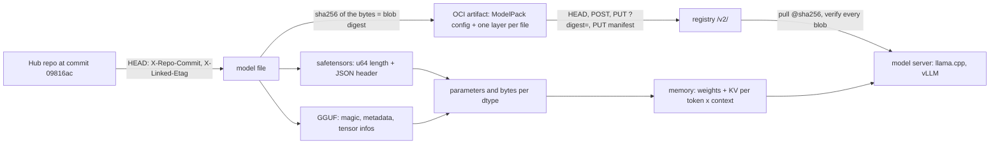

# A Model Is an Artifact: Weights, Formats and Quantization

*A model is tensors behind a header you can read in 64 KB: count its bytes before you size a GPU, and pin it by digest like an image.*

## Metadata

| Field | Value |
|---|---|
| Type | Build |
| Languages | Python |
| Prerequisites | [Serving a Model Is a Batch Scheduler With a KV Cache](https://cloudcaptain.io/learn/ai-infra/llm-serving), [Pull an Image With Plain HTTP](https://cloudcaptain.io/learn/containers/registry-pull) |
| Time | 75 minutes |
| Tools | hf, oras, registry, llama.cpp, gguf-py |

<Quiz stage="pre" />

## The Problem

The support assistant has run on the same Deployment for a month: an init container runs `hf download` for the team's fine-tuned 8B model, and a vLLM container serves it. On Tuesday the answers change tone, and nobody changed anything in the cluster. The init container downloads from the `main` branch, and on Monday evening someone on the ML team pushed a re-quantized checkpoint there. Pods that restarted overnight serve the new weights, pods that did not still serve the old ones, and the image tag in the manifest is identical everywhere. Asked which weights produced last Wednesday's escalated answer, nobody can say: the only identifier anyone recorded is a branch name.

The same week, the capacity plan for a cheaper GPU pool says the 4-bit build "is 4.5 GB, so a 24 GB L4 fits it five times over". On the new node vLLM starts, logs a KV cache of about 140,000 tokens, and under load requests queue while the GPU sits at a fraction of its compute. The server is configured for 32,768-token contexts and 16 concurrent sequences. Every token of context on a Llama 3.1 8B costs 128 KiB of KV cache (32 layers, 8 KV heads, 128 dimensions, K and V, 2 bytes each), so the configuration asks for 64 GiB of cache next to 4.2 GiB of weights. The weights were 6% of the memory question.

And every pod start downloads the weights from the Hub again: minutes of cold start, a rate limit during an incident, and one pod that served a truncated file because nothing checked its hash. Containers solved all three problems years ago: pin by digest, store in a registry you run, verify every byte, read the metadata before you schedule. This lesson treats a model the same way. You build `modelinspect`, which reads safetensors and GGUF headers without loading the weights, counts parameters and bytes per dtype and quantization, computes the KV cache for a context length, downloads one file from a pinned revision and verifies it, and pushes the files to an OCI registry as a ModelPack artifact that you pull by digest.

## The Concept

A model file is a list of tensors plus enough metadata to find them. Every tensor has a name (`model.layers.0.self_attn.k_proj.weight`), a dtype, a shape and a byte range. The parameter count is the sum of the shapes' products; the size in bytes is the parameter count times the bits per weight of each tensor's dtype, divided by eight. Nothing about that requires reading the weights, which is why a good format puts the table of contents first.

**safetensors** is the Hugging Face format: 8 bytes holding the header length N as a little-endian unsigned integer, N bytes of JSON mapping each tensor name to `dtype`, `shape` and `data_offsets`, an optional `__metadata__` map of strings, then one flat byte buffer. Tensors are row-major and contiguous, the offsets must tile the buffer without gaps, and the reference reader refuses headers above 100 MB. Loading it never runs code, unlike the pickle inside a PyTorch `.bin` or `.pt` checkpoint, which can execute anything on load. The architecture (layers, heads) is not in the file; it lives in the repository's `config.json`.

**GGUF** is llama.cpp's single-file format: the magic `GGUF`, a version (3 today), a tensor count, a metadata count, then typed key/value pairs (`general.architecture`, `llama.block_count`, `llama.attention.head_count_kv`, the whole tokenizer, the chat template), then one descriptor per tensor (name, up to four dimensions with the row length first, a ggml type, an offset), then the data, aligned to `general.alignment` (32 by default). One file carries everything a server needs to run the model.

**Quantization** stores weights in blocks that share a scale. Q8_0 keeps 32 signed bytes and one 16-bit scale: 34 bytes for 32 weights, 8.5 bits per weight. Q4_0 packs 32 four-bit values and a scale into 18 bytes, 4.5 bits. The K-quants group 256 weights into a super-block with small per-sub-block scales: Q4_K is 144 bytes per 256 weights (4.5 bits), Q6_K is 210 (6.5625 bits). A name like `Q4_K_M` is a recipe, not a type: llama.cpp picks a type per tensor, and a tensor whose rows are not a multiple of 256 falls back to a 32-wide format.

**Serving memory** is the weights plus the KV cache plus runtime buffers. The KV cache stores, for every token in every running sequence, a key and a value vector per KV head in every layer: `2 × layers × kv_heads × head_dim × bytes` per token. Grouped-query attention (fewer KV heads than query heads) is the main reason modern models fit long contexts at all.

**Identity** comes from content addressing. A Hugging Face revision is a git commit; each large file is stored in LFS under its SHA-256, which the Hub returns in the `X-Linked-Etag` header. An OCI registry names a blob by the same SHA-256 of the same bytes. Push the files as layers of an OCI artifact, with a config that says what they are, and the model gets everything images have: a digest to pin, a registry to mirror, and a pull that verifies every byte.



The order matters in production: inspect the header (kilobytes) to decide whether and where the model fits, then move the weights (gigabytes) once, into a registry you control, and pull them by digest from there.

## Build It

`code/main.py` is `modelinspect`, six subcommands over one data model: `inspect`, `memory`, `digest`, `fetch`, `push` and `pull`. It uses only the standard library, reads local files or `http(s)://` URLs, and the tests run it against synthetic files, a fake Hugging Face Hub and a fake registry served on real local sockets.

### Step 1: read only what you parse

Both formats put their header first, so the parser reads through a small cursor that fetches chunks on demand. A `FileSource` seeks; an `HttpSource` sends a `Range` request and refuses servers that ignore it:

```python
request = urllib.request.Request(self.name, headers={"Range": f"bytes={offset}-{offset + length - 1}", "User-Agent": USER_AGENT})
self.requests += 1
try:
    with urllib.request.urlopen(request, timeout=self.timeout) as response:
        if response.status != 206:
            raise InputError(f"{self.name} answered {response.status} to a Range request; download the file and inspect it locally")
```

The `Reader` starts with a 64 KiB chunk and doubles it on every fetch up to 8 MiB, so a safetensors header costs one request and a GGUF tokenizer of a few megabytes costs a handful. Every read is checked against the bytes that remain, which is what turns a corrupt length field into an error instead of a 10^12-byte allocation:

```python
left = self.remaining()
if left is not None and n > left:
    raise InputError(f"truncated or corrupt: wants {n:,} bytes at byte {self.pos:,} but only {left:,} remain")
end = self.pos + n
if not (self.buffer_start <= self.pos and end <= self.buffer_start + len(self.buffer)):
    self.buffer = self.source.read_at(self.pos, max(n, self.chunk))
    self.buffer_start = self.pos
    self.chunk = min(self.chunk * 2, self.max_chunk)
```

### Step 2: safetensors is a length and a JSON object

```python
header_size = reader.unpack("<Q")
if header_size > SAFETENSORS_MAX_HEADER:
    raise InputError(f"header claims {header_size:,} bytes; safetensors refuses headers above {SAFETENSORS_MAX_HEADER:,}")
raw = reader.read(header_size)
if not raw.startswith(b"{"):
    raise InputError("not a safetensors file: the JSON header does not start with '{'")
```

Each entry is checked the way the reference implementation checks it: the dtype is known, the byte span equals `product(shape) × bits / 8`, and after sorting by offset every tensor starts where the previous one ended. The last check is that header plus tensors account for the whole file, so trailing bytes are an error:

```python
bits = (math.prod(shape) if shape else 1) * SAFETENSORS_BITS[dtype]
if bits % 8:
    raise InputError(f"tensor {name!r}: {dtype} x {shape} is not a whole number of bytes")
if end - begin != bits // 8:
    raise InputError(f"tensor {name!r}: data_offsets span {end - begin} bytes but {dtype} x {shape} needs {bits // 8}")
```

`SAFETENSORS_BITS` is in bits, not bytes, because the format now has 4- and 6-bit floating point dtypes (`F4`, `F6_E2M3`) for microscaling formats.

### Step 3: GGUF is typed metadata, then tensor descriptors

The header is four fields, then `kv_count` typed pairs. Strings are a u64 length and UTF-8 bytes; arrays are an element type, a count and the elements:

```python
if reader.read(4) != GGUF_MAGIC:
    raise InputError("not a GGUF file: the first four bytes are not 'GGUF'")
raw_version = reader.read(4)
version = struct.unpack("<I", raw_version)[0]
```

```python
for _ in range(kv_count):
    key = read_gguf_string(reader)
    value_type = reader.unpack("<I")
    if key in metadata:
        raise InputError(f"duplicate metadata key {key!r}")
    metadata[key] = read_gguf_value(reader, value_type)
    value_types[key] = gguf_type_name(value_type)
```

Each tensor descriptor is a name, `n_dims`, the dimensions with the row length first, a ggml type id and an offset relative to the data section. The data section starts at the next multiple of the alignment after the last descriptor:

```python
dims = [reader.unpack("<Q") for _ in range(n_dims)]
type_id = reader.unpack("<I")
offset = reader.unpack("<Q")
```

```python
data_offset = align(reader.pos, alignment)
tensors = [Tensor(name, dtype, dims, data_offset + offset, nbytes) for name, dtype, dims, offset, nbytes in infos]
check_layout(tensors, reader.source.size)
```

A GGUF file is untrusted input: llama.cpp has shipped fixes for heap overflows in exactly this parser. `parse_gguf()` rejects more than four dimensions, unknown types, rows that are not a multiple of the block size, misaligned offsets, duplicate names, and tensors that overlap or run past the end of the file, each with a message that names the tensor.

### Step 4: bytes per tensor come from the block format

One table holds every ggml type as (name, weights per block, bytes per block). F32 is a block of one 4-byte weight; Q8_0 is 32 weights in 34 bytes:

```python
8: ("Q8_0", 32, 34),
10: ("Q2_K", 256, 84),
11: ("Q3_K", 256, 110),
12: ("Q4_K", 256, 144),
13: ("Q5_K", 256, 176),
14: ("Q6_K", 256, 210),
```

```python
def tensor_nbytes(dtype: str, elements: int) -> int:
    block, size = BLOCK_FORMATS[dtype]
    return elements // block * size
```

To see that the bytes really are weights, `--peek` decodes the first values of a tensor. A Q8_0 block is a 16-bit scale followed by 32 signed bytes, and each weight is `scale × q`; Q4_0 stores the first 16 values in the low nibbles and the next 16 in the high nibbles, each `scale × (q − 8)`:

```python
def dequantize_q8_0(block: bytes) -> List[float]:
    if len(block) != 34:
        raise InputError(f"a Q8_0 block is 34 bytes, got {len(block)}")
    scale = fp16_to_float(struct.unpack("<H", block[:2])[0])
    return [q * scale for q in struct.unpack("<32b", block[2:])]
```

`quantize_q8_0()` and `quantize_q4_0()` go the other way, with the same rounding rules as ggml's reference quantizers; the tests show the round-trip error stays within half a quantization step.

### Step 5: memory is weights plus KV cache

The shape comes from GGUF keys prefixed with the architecture, or from `config.json` for safetensors. Head dimension defaults to `embedding / heads`, KV heads to the head count (no grouped-query attention):

```python
kv_value = arch_key(md, "attention.head_count_kv")
kv_heads = as_layer_list(kv_value, layers, heads)
key_dim = int(arch_key(md, "attention.key_length") or embedding // heads)
value_dim = int(arch_key(md, "attention.value_length") or key_dim)
```

The cache element type uses the same block table, because llama.cpp quantizes the cache with the same formats (`--cache-type-k q8_0` stores 34 bytes per 32 values):

```python
def kv_cache_bytes(shape: Shape, tokens: int, kv_type: str = "f16") -> int:
    block, size = kv_format(kv_type)
    if shape.key_dim % block or shape.value_dim % block:
        raise InputError(f"head dimensions {shape.key_dim}/{shape.value_dim} are not multiples of the {kv_type} block size {block}")
    return shape.kv_elements_per_token * tokens * size // block
```

`memory` prints the weights for a standard list of formats (or `--quant`), the exact tensor bytes of the file itself, the KV cache for `--ctx` tokens times `--seqs` sequences, and with `--gpu-gib` how many tokens of cache fit after the weights at vLLM's default `--gpu-memory-utilization` of 0.9. It warns when the metadata shows a sliding window or latent attention, where the simple formula overstates the cache.

### Step 6: pin a revision, verify the bytes

`fetch` asks the Hub for a file at a revision without following the redirect, because the Hub's own response carries the identity and the CDN's does not:

```python
headers = hub_headers(url)
commit = headers.get("x-repo-commit", "")
linked = headers.get("x-linked-etag", headers.get("etag", "")).strip().strip('"').removeprefix("W/").strip('"')
if COMMIT.match(revision) and commit and commit != revision:
    raise VerifyError(f"asked for revision {revision} but the Hub resolved {commit}")
```

For LFS files `X-Linked-Etag` is the SHA-256 of the content; for small files kept in git it is the git blob id, `sha1("blob <size>\0" + content)`. A digest you pinned is compared with the Hub's before a single weight byte moves; the download is hashed as it streams into a `.part` file, and only a file that matches every known digest is renamed into place. A branch name works but prints the commit you should pin instead.

### Step 7: package the files as a ModelPack artifact

Each file becomes one uncompressed layer whose digest is the SHA-256 of the file, so the layer digest of a GGUF equals its Hugging Face LFS hash. The media type follows the ModelPack layer kinds (weights, weight configuration such as `config.json` and tokenizers, docs, code), and the file name goes into `org.opencontainers.image.title` (which `oras pull` uses) and `org.cncf.model.filepath`. The config blob says what the layers are, filled from the inspection:

```python
technical["format"] = inspected.format
technical["paramSize"] = param_size_label(inspected.parameters)
```

```python
return {"descriptor": descriptor, "config": technical, "modelfs": {"type": "layers", "diffIds": [layer.digest for layer in layers]}}
```

```python
manifest: Dict[str, Any] = {
    "schemaVersion": 2,
    "mediaType": OCI_MANIFEST,
    "artifactType": MODEL_ARTIFACT,
    "config": config.descriptor(),
    "layers": [layer.descriptor() for layer in layers],
}
```

The JSON is compact with sorted config keys and no timestamp, so the same files always produce the same manifest digest.

### Step 8: push and pull with the distribution API

Push is the other half of the registry lesson's client. For every blob: `HEAD` it and skip it if the registry already has it, otherwise `POST` to open an upload and `PUT` the bytes to the returned location with the digest in the query. The registry hashes what it receives and refuses a mismatch. The manifest goes last, because the registry checks that every blob it references exists:

```python
status, headers, body = self.request("POST", self.url(repository, "blobs/uploads/"), {"Content-Length": "0"}, b"")
if status != 202 or "location" not in headers:
    raise VerifyError(f"starting an upload returned {status} {body[:200]!r}; the registry may need credentials or push access")
location = urllib.parse.urljoin(self.base + "/", headers["location"])
location += ("&" if "?" in location else "?") + "digest=" + urllib.parse.quote(blob.digest)
```

File bodies stream from disk in 1 MiB blocks, so pushing a 15 GB shard does not need 15 GB of memory. `pull` fetches the manifest (verifying it against the digest if you asked by digest), reads the ModelPack config, then streams each titled layer to a `.part` file while hashing it, checks digest and size, and only then renames it. A layer whose path annotation is absolute or contains `..` is refused: an artifact is as untrusted as a tar layer.

### Step 9: run it

Download the GGUF at a pinned revision, then inspect it and the original safetensors, the second one without downloading it:

```bash
python3 code/main.py fetch bartowski/SmolLM2-135M-Instruct-GGUF SmolLM2-135M-Instruct-Q8_0.gguf \
  --revision 09816acd5d99df7be770d85ea30822623dab342c \
  --sha256 5a1395716f7913741cc51d98581b9b1228d80987a9f7d3664106742eb06bba83 --dest model
# sha256:5a1395716f79...  144,811,360 bytes  model/SmolLM2-135M-Instruct-Q8_0.gguf
# commit 09816acd5d99df7be770d85ea30822623dab342c; verified against: pinned sha256, Hub LFS sha256 (x-linked-etag)
python3 code/main.py inspect model/SmolLM2-135M-Instruct-Q8_0.gguf --peek token_embd.weight
```

```text
SmolLM2-135M-Instruct-Q8_0.gguf: GGUF v3, 37 metadata keys, 272 tensors, data at byte 1,785,952
model     llama 'Smollm2 135M 8k Lc100K Mix1 Ep2', file type MOSTLY_Q8_0
shape     30 layers, embedding 576, 9 heads, 3 KV heads, head dim 64, context 8,192, vocab 49,152
params    134,515,008 (134.5M)
  dtype    tensors      parameters           bytes  bits/weight
  Q8_0         211     134,479,872     142,884,864         8.50
  F32           61          35,136         140,544        32.00
  total        272     134,515,008     143,025,408         8.51
file      144,811,360 bytes = 1,785,952 header + 143,025,408 tensors + 0 padding
read      2,031,616 bytes in 5 request(s)
peek      token_embd.weight: -0.106544, 0.0329781, 0.0481987, -0.022831, -0.0684929, -0.0456619, 0.0202942, -0.121765
```

The norms stay in F32 (61 small tensors); everything else is Q8_0. The header is 1.8 MB because the whole tokenizer lives in it. Now the publisher's BF16 safetensors of the same model, over HTTP:

```bash
python3 code/main.py inspect https://huggingface.co/HuggingFaceTB/SmolLM2-135M-Instruct/resolve/12fd25f77366fa6b3b4b768ec3050bf629380bac/model.safetensors --tensors | grep -E 'embed|^read'
#   model.embed_tokens.weight                BF16     [49152, 576]             56,623,104
# read      65,536 bytes in 1 request(s)
python3 code/main.py inspect model/SmolLM2-135M-Instruct-Q8_0.gguf --tensors | grep token_embd
#   token_embd.weight                        Q8_0     [576, 49152]             30,081,024
```

Same 134,515,008 parameters, 269 MB instead of 145 MB, inspected by reading 64 KB. The embedding is the same tensor under another name, with its dimensions listed in the opposite order: GGUF lists the row length first. A quantization recipe can surprise you:

```bash
python3 code/main.py inspect https://huggingface.co/bartowski/SmolLM2-135M-Instruct-GGUF/resolve/09816acd5d99df7be770d85ea30822623dab342c/SmolLM2-135M-Instruct-Q4_K_M.gguf | sed -n '6,9p'
#   Q5_0         166      78,077,952      53,678,592         5.50
#   Q8_0          15      29,859,840      31,726,080         8.50
#   Q6_K          14      12,386,304      10,160,640         6.56
#   Q4_K          16      14,155,776       7,962,624         4.50
```

The "4-bit" file averages 6.17 bits per weight: the model's hidden size is 576, not a multiple of 256, so llama.cpp falls back from Q4_K to Q5_0 for most tensors. Memory, for this model and for the 8B model from The Problem:

```bash
python3 code/main.py memory model/SmolLM2-135M-Instruct-Q8_0.gguf --ctx 8192 | tail -3
# kv cache  f16: 30 layers x 3 KV heads x (64 + 64) dims = 23,040 bytes/token
#           8,192 tokens x 1 sequence(s) = 188,743,680 bytes (180.0 MiB)
echo '{"model_type": "llama", "num_hidden_layers": 32, "num_attention_heads": 32, "num_key_value_heads": 8, "hidden_size": 4096, "max_position_embeddings": 131072}' > llama31-8b.json
python3 code/main.py memory llama31-8b.json --params 8.03e9 --quant Q4_K --ctx 32768 --seqs 16 --gpu-gib 24
# Q4_K         4,516,875,072     4.21 GiB  4.5 bits/weight
# kv cache  f16: 32 layers x 8 KV heads x (128 + 128) dims = 131,072 bytes/token
#           32,768 tokens x 16 sequence(s) = 68,719,476,736 bytes (64.00 GiB)
# gpu       24.0 GiB x 0.9: 17.39 GiB left for KV = 142,486 tokens = 4 sequence(s) of 32,768
```

Then package and push. Without a registry, `--dry-run` prints the manifest and config; with one (Use It starts `registry:2`), the second push of the same files uploads nothing:

```bash
python3 code/main.py fetch HuggingFaceTB/SmolLM2-135M-Instruct config.json --revision 12fd25f77366fa6b3b4b768ec3050bf629380bac --dest model
python3 code/main.py push localhost:5000/models/smollm2:q8_0 model/SmolLM2-135M-Instruct-Q8_0.gguf model/config.json --revision 09816acd5d99df7be770d85ea30822623dab342c --dry-run | head -24
python3 code/main.py push localhost:5000/models/smollm2:q8_0 model/*.gguf model/config.json --plain-http
#   pushed  sha256:5a1395716f79...     144,811,360  application/vnd.cncf.model.weight.v1.raw  SmolLM2-135M-Instruct-Q8_0.gguf
# pin it as localhost:5000/models/smollm2@sha256:...
python3 code/main.py pull localhost:5000/models/smollm2@sha256:<digest> --dest pulled --plain-http
```

Exit codes: 0 for success, 1 for a verification failure (digest mismatch, refused path, registry rejection), 2 for input that is not a model, a missing file or a bad reference.

<RunTests />

## Use It

**Download by revision.** The Hub's own CLI is `hf`, from `huggingface_hub`; the older `huggingface-cli` is deprecated and has been removed from current releases. Pin the commit, then check the hash the Hub publishes for the file:

```bash
pip install 'huggingface_hub==2.2.0'
hf download EleutherAI/pythia-14m model.safetensors config.json --revision cf967c0a9a04383db6f7b1108d86b2962634b4ac --local-dir pythia
sha256sum pythia/model.safetensors                       # 116a0253...: the LFS sha256 on the file's page
curl -sI https://huggingface.co/EleutherAI/pythia-14m/resolve/cf967c0a9a04383db6f7b1108d86b2962634b4ac/model.safetensors | grep -iE 'x-repo-commit|x-linked-etag'
curl -s 'https://huggingface.co/api/models/EleutherAI/pythia-14m/revision/cf967c0a9a04383db6f7b1108d86b2962634b4ac?expand[]=safetensors'
# {"safetensors":{"parameters":{"F16":14067712},"total":14067712}, ...}: the Hub parses the same header
```

The Hub computes the parameter counts on model pages from the same safetensors header, and for GGUF repos from the GGUF metadata (`?expand[]=gguf` returns total parameters, architecture and context length). `hf download` without `--local-dir` stores files in a cache under `~/.cache/huggingface/hub`, keyed by commit, which is the same content-addressed idea on one machine.

**Read headers with the reference readers.** llama.cpp's Python package `gguf` (gguf-py, maintained in the llama.cpp repository) ships `gguf-dump`; the C tree builds `llama-gguf`, which reads and writes the format. The Python `safetensors` package opens a file lazily:

```bash
pip install 'gguf==0.17.1' 'safetensors==0.8.0' 'numpy==2.2.6'
gguf-dump --json model/SmolLM2-135M-Instruct-Q8_0.gguf > dump.json      # metadata types and every tensor's shape and type
python3 -c 'import json; d = json.load(open("dump.json")); print(len(d["tensors"]), d["metadata"]["general.file_type"])'
python3 -c 'import math; from safetensors import safe_open; f = safe_open("pythia/model.safetensors", framework="numpy"); print(sum(math.prod(f.get_slice(k).get_shape()) for k in f.keys()))'
```

**Ask the server what it loaded.** The llama.cpp server reports the model it loaded at `/v1/models` (llama.cpp adds a `meta` object: `n_params`, `size` in bytes, `n_embd`, `n_vocab`, `n_ctx_train`) and logs the KV cache it allocated:

```bash
docker run -d --name llama -p 8080:8080 -v "$PWD/model:/models:ro" ghcr.io/ggml-org/llama.cpp:server-b11706 \
  -m /models/SmolLM2-135M-Instruct-Q8_0.gguf -c 8192 -np 1 --host 0.0.0.0 --port 8080
curl -s localhost:8080/v1/models | python3 -m json.tool | grep -A6 '"meta"'   # n_params 134515008, size 143025408
docker logs llama 2>&1 | grep -i 'kv.*size'                                     # 180.00 MiB for 8192 cells, 30 layers
```

`ollama show MODEL` prints the same facts for a model in Ollama (architecture, parameters, context length, embedding length, quantization), and Ollama stores models the way this lesson does: a manifest under `~/.ollama/models/manifests` whose layers (`application/vnd.ollama.image.model` for the GGUF, plus template and parameter layers) are blobs named by SHA-256. vLLM reports the KV cache capacity in tokens and the resulting maximum concurrency at startup; its knobs map onto `memory`: `--max-model-len` is `--ctx`, `--max-num-seqs` bounds `--seqs`, `--gpu-memory-utilization` is `--utilization`, `--kv-cache-dtype fp8` halves the cache.

**Store the model in a registry.** Run a registry and push the same files with ORAS, the CNCF's general-purpose OCI artifact CLI:

```bash
docker run -d --name registry -p 5000:5000 registry:2.8.3
python3 code/main.py push localhost:5000/models/smollm2:q8_0 model/SmolLM2-135M-Instruct-Q8_0.gguf model/config.json --dry-run --config-out modelpack-config.json > /dev/null
cd model
oras push --plain-http localhost:5000/models/smollm2:q8_0-oras \
  --artifact-type application/vnd.cncf.model.manifest.v1+json \
  --config ../modelpack-config.json:application/vnd.cncf.model.config.v1+json \
  SmolLM2-135M-Instruct-Q8_0.gguf:application/vnd.cncf.model.weight.v1.raw \
  config.json:application/vnd.cncf.model.weight.config.v1.raw
cd ..
oras manifest fetch --plain-http localhost:5000/models/smollm2:q8_0-oras | python3 -m json.tool
python3 code/main.py push localhost:5000/models/smollm2:q8_0 model/SmolLM2-135M-Instruct-Q8_0.gguf model/config.json --plain-http   # 0 blob(s) uploaded, 3 already present
oras pull --plain-http -o from-oras localhost:5000/models/smollm2@sha256:<modelinspect's digest>
```

The second push uploads nothing: the config and both layers have the digests ORAS already stored. The two manifests still have different digests, because they are different JSON documents (ORAS stamps an `org.opencontainers.image.created` annotation and annotates layers differently); the blobs they reference are identical. `oras attach` adds a signature or an SBOM that refers to the model's manifest, and `oras discover` lists them, the same supply-chain tooling images use. The current Distribution release line is `registry:3`; the API is the same.

**Package with the model-specific tools.** The CNCF ModelPack project defines the artifact type, config and layer media types used here, and ships `modctl` (`modctl modelfile generate DIR`, `modctl build -t REF DIR`, `modctl push REF`). KitOps packages a ModelKit from a Kitfile (`kit pack`, `kit push`) and writes ModelPack with `kit pack --use-model-pack`. Docker Model Runner pulls and pushes GGUF models as OCI artifacts with `docker model`. In Kubernetes, image volumes (`volumes[].image.reference`, stable since v1.36) mount an OCI image or artifact read-only into a pod, which removes the download from the init container entirely; whether non-image artifacts mount depends on the container runtime, so check yours. KServe can serve a model packaged as an OCI image (a modelcar) through an `oci://` storage URI.

| What you built | Real tool | Note |
|---|---|---|
| `parse_safetensors()` | the `safetensors` library, the Hub's parameter counts | same validation rules; the library also maps the data for zero-copy loads |
| `parse_gguf()` | `gguf-dump` (gguf-py), `llama-gguf`, llama.cpp's loader | the server's `/v1/models` `meta` reports the same `n_params` and `size` |
| `inspect` over HTTP `Range` | the Hub's model page, `huggingface_hub`'s safetensors metadata helpers | a header is kilobytes; never download a model to learn its size |
| `GGML_TYPES` block table, `dequantize_q8_0()` | `llama-quantize`, gguf-py `quants` | K-quants and i-quants use per-sub-block scales and lookup grids |
| `memory` KV estimate | llama.cpp's KV cache log line, vLLM's KV capacity at startup | runtime buffers and CUDA context come on top |
| `fetch --revision --sha256` | `hf download --revision`, the Hub's `X-Linked-Etag` | pin a commit, never a branch |
| `digest --expect` | `sha256sum -c` | the LFS sha256 equals the OCI blob digest |
| `push` (HEAD, POST, PUT, manifest) | `oras push`, `modctl push`, `kit push` | auth, chunked uploads, cross-repository mounts and retries are left out |
| ModelPack manifest and config | ModelPack spec, KitOps ModelKit, Ollama manifests | Azure ML, Vertex AI and SageMaker registries keep model metadata outside OCI |
| `pull` with path checks | `oras pull`, image volumes, KServe modelcars | pull by `@sha256`, verify, then serve |

<Quiz stage="check" />

## Ship It

Two artifacts in `outputs/`:

- **`skill-model-supply-chain.md`**: a runbook for bringing a model into production as an artifact: resolve and pin the revision, refuse pickle checkpoints, record every file's SHA-256 from the Hub, verify after download, inspect headers for parameters and quantization, push to the internal registry with a ModelPack config, pin the manifest digest in the deployment, and verify on pull. It ends with a decision table for the failures you will meet (moved branch, digest mismatch, pickle only, gated repo, "4-bit" file larger than expected) and a fixed report.
- **`prompt-estimate-model-memory.md`**: paste a `config.json` or `modelinspect inspect --json` output plus the serving settings (context, concurrency, KV dtype, GPU) and get the weight bytes per format, the KV cache per token and in total, whether it fits, the largest context or concurrency that does, and which single change buys the most room.

<ShipIt />

## Exercises

### Easy

Add sharded checkpoints: when `inspect` is given a `model.safetensors.index.json`, read its `weight_map`, inspect every shard it names in the same directory, sum the parameters and bytes, and check that `metadata.total_size` equals the sum of tensor bytes and that no tensor appears in two shards. Write the tests first with two synthetic shards and an index, including one index whose `total_size` is wrong.

### Medium

Inspect a PyTorch checkpoint without running it. `pickletools.genops()` walks a pickle's opcodes without executing them; collect every `GLOBAL` and `STACK_GLOBAL` import from `data.pkl` inside the zip and report anything outside an allowlist (`torch._utils._rebuild_tensor_v2`, `collections.OrderedDict`, the `torch.*Storage` classes). Tests first: a benign checkpoint you build by hand, and a pickle whose `__reduce__` calls `os.system`, which must be flagged and never executed.

### Hard

Make `push` work against a registry that needs credentials and avoid re-uploading weights across repositories. Implement the Bearer token flow from the registry lesson with `pull,push` scope, then cross-repository mounting: `POST /v2/<repo>/blobs/uploads/?mount=<digest>&from=<other-repo>` answers `201` when the registry can link the blob without an upload. Extend the fake registry in the tests to require a token and support mounts, and assert that pushing the same GGUF to a second repository sends zero weight bytes.

<Quiz stage="post" />

## Key Terms

| Term | Common misconception | Precise definition |
|---|---|---|
| Parameter count | "The file size in bytes divided by two." | The sum over tensors of the product of each shape; bytes depend on each tensor's dtype, so the same 134.5M parameters are 269 MB in BF16 and 143 MB in Q8_0. |
| Bits per weight | "A 4-bit model uses 4 bits per weight." | Block bytes × 8 / weights per block, including the shared scales: Q4_0 and Q4_K are 4.5, Q8_0 is 8.5, and a mixed file averages over its tensors. |
| Block quantization | "Each weight is rounded on its own." | Weights are stored in groups (32 or 256) that share one or more scales, so each weight costs its quantized bits plus a share of the scale. |
| `Q4_K_M` | "A data type." | A llama.cpp file type: a recipe that picks a type per tensor, mostly Q4_K with some Q6_K, falling back to 32-wide formats when rows are not a multiple of 256. |
| safetensors | "A compressed PyTorch file." | An 8-byte header length, a JSON table of dtype, shape and offsets, then raw contiguous tensor bytes; no code runs on load, and the header alone gives sizes and counts. |
| GGUF | "Just the weights for llama.cpp." | One self-contained file: typed metadata (architecture, hyperparameters, tokenizer, chat template), tensor descriptors and aligned tensor data, often quantized. |
| KV cache | "Part of the model weights." | Per-token key and value vectors kept for every running sequence: `2 × layers × kv_heads × head_dim × bytes` per token; it grows with context and concurrency, not with the file. |
| Revision | "The branch you download from." | A git commit id on the Hub; a branch like `main` is a pointer that can move, exactly like an image tag. |
| LFS sha256 | "A Hugging Face internal id." | The SHA-256 of the file's bytes, returned in `X-Linked-Etag`; it is the same value an OCI registry uses as that file's blob digest. |
| OCI artifact | "A container image with a model inside." | An OCI image manifest with an `artifactType`, a config blob describing the content and layers that need not be filesystem tars; ModelPack defines the types for models. |

## Further Reading

- [AI/ML Ops learning path](https://cloudcaptain.io/docs/learning-paths/ai-ml): where model packaging sits between training, serving and cost management.
- [Docker Security & Production](https://cloudcaptain.io/docs/tools/docker/security-production): digest pinning, signing and registry controls that apply unchanged to model artifacts.
- [DevSecOps Fundamentals](https://cloudcaptain.io/docs/tools/devsecops/fundamentals): supply-chain thinking (provenance, SBOMs, verification) to extend to model weights.
- [GGUF specification](https://github.com/ggml-org/ggml/blob/master/docs/gguf.md): the header, value types, tensor descriptors, alignment and the standard metadata keys.
- [safetensors documentation](https://huggingface.co/docs/safetensors/index): the format, why it replaced pickle, and lazy loading.
- [Hugging Face pickle security](https://huggingface.co/docs/hub/security-pickle): what loading a pickle checkpoint can do and how the Hub scans for it.
- [llama.cpp quantize](https://github.com/ggml-org/llama.cpp/blob/master/tools/quantize/README.md): the quantization types, the file-type recipes and their measured size and quality.
- [llama.cpp server](https://github.com/ggml-org/llama.cpp/blob/master/tools/server/README.md): the flags (`-c`, `-np`, `--cache-type-k`) and endpoints used in Use It.
- [Hugging Face download guide](https://huggingface.co/docs/huggingface_hub/guides/download): `hf download`, revisions and the local cache layout.
- [ModelPack specification](https://github.com/modelpack/model-spec/blob/main/docs/spec.md): the artifact type, layer media types and config this lesson's `push` writes.
- [OCI artifacts guidance](https://github.com/opencontainers/image-spec/blob/main/artifacts-guidance.md) and [OCI distribution specification](https://github.com/opencontainers/distribution-spec/blob/main/spec.md): `artifactType`, the push sequence and the digest rules.
- [ORAS documentation](https://oras.land/docs/): push, pull, attach and discover for any OCI artifact.
- [Kubernetes image volumes](https://kubernetes.io/docs/tasks/configure-pod-container/image-volumes/): mounting OCI content into a pod without an init container.
