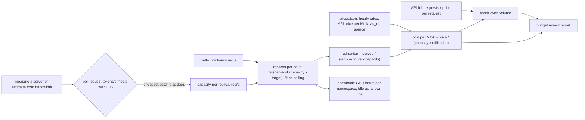

# The Cost of a Token Is a Capacity Plan

*A self-hosted token costs the hourly price over throughput times utilisation; measure throughput, and utilisation decides the bill.*

## Metadata

| Field | Value |
|---|---|
| Type | Build |
| Languages | Python |
| Prerequisites | [Serving a Model Is a Batch Scheduler With a KV Cache](https://cloudcaptain.io/learn/ai-infra/llm-serving), [Scale Inference on Queue Depth, Not CPU](https://cloudcaptain.io/learn/ai-infra/inference-autoscaling) |
| Time | 75 minutes |
| Tools | docker, llama.cpp, kubectl, kind, opencost, aws-cli |

<Quiz stage="pre" />

## The Problem

In March the support team moved its assistant from a hosted API to an 8B model on its own GPUs. The slide that won the argument said self-hosting costs a tenth of the API per token. The number came from a vendor benchmark: one GPU at batch 64, flat out, for an hour. Production is not that hour. Traffic peaks at 14:00 and is almost nothing at 03:00, the platform team keeps two replicas up at night for availability, the latency target allows a batch of about twenty, and the autoscaler aims for 70% so a spike does not queue. The first full invoice was four times the estimate and higher than the API bill it replaced.

Finance now asks the questions a budget review always asks. What does a token cost us today? At what volume does self-hosting pay for itself? Would a quantized model on a cheaper GPU do it? Nobody can answer from the slide, because each of its three inputs was wrong in a different way: the hourly price was a list price read once in March, the throughput was measured at a batch the latency target forbids, and utilisation was assumed to be 100% when the traffic curve says the day averages under half of capacity.

The arithmetic is not hard. A replica bills by the hour whether it is busy or not, an API bills by the token, and the self-hosted cost per token is the hourly price divided by what the replica can serve times how much of that it actually serves. You are going to write `tokencost`: it reads prices from a file where every entry carries a date and a source, gets throughput by measuring a real OpenAI-compatible server or by estimating it from the accelerator's memory bandwidth, sizes replicas hour by hour from a traffic curve, and prints the cost per million input and output tokens, the break-even volume against each API and a report you can put in front of finance. Then it charges the GPU nodes to the namespaces that requested them, the way OpenCost does.

## The Concept

Owning a car versus taking taxis is the right intuition. The car costs the same every month whether you drive it or not, so its cost per kilometre depends on how much you drive. The taxi costs the same per kilometre at any volume. Below some distance the taxi wins, above it the car wins, and the crossing point moves with the price of each and with how efficiently you use the car.

For a model server the three numbers are:

- **The hourly price** of a replica: an instance type with its GPUs, on-demand, spot or committed. It is a quote with a date, read from a price page or an API, and it goes stale.
- **Throughput at the batch you run.** Decode, the step that produces each output token, reads every weight from GPU memory once per step no matter how many sequences are in the batch. A batch of 16 produces 16 tokens per read instead of one, so aggregate tokens per second rise with batch size until the KV cache fills memory or the matrix maths becomes the bottleneck. Each request's own speed falls as the batch grows, so the latency target caps the batch. Quantization shrinks the bytes read per step (Q4_K is about 4.5 bits per weight, F16 is 16) and frees memory for more sequences, which raises both. Prefill, processing the prompt, is one large parallel matrix multiply per request, so input tokens cost a fraction of output tokens; APIs price output several times higher than input for the same reason.
- **Utilisation**: what the replicas served divided by what they could have served. Replicas are whole numbers, the autoscaler keeps headroom (its target), a floor keeps one or two up at night, and the curve has a peak. In this lesson's fixture a 70% target averages 46% to 57% over the day on an L4.

The cost of a self-hosted token is then `price / (capacity × 3600 × utilisation)`. The API's cost is linear in volume. Self-hosting is a staircase with a floor: at low volume the floor dominates and the API wins; as volume grows the floor is amortised and the cost per token approaches the marginal cost of a fully used replica at the target. If that marginal cost is above the API's price, no volume ever closes the gap.



Everything in the diagram is arithmetic except two inputs: the prices and the throughput. The lesson's rule is that both are files with provenance. A price without a date is a guess, and a throughput without a batch size and a latency target is a benchmark, not a capacity.

## Build It

`code/main.py` is `tokencost`, five subcommands over one cost model: `prices` validates the price file, `estimate` derives throughput points from an accelerator's datasheet, `measure` drives a real OpenAI-compatible server, `plan` turns prices, points and a traffic curve into the budget review, and `allocate` charges GPU nodes to namespaces. The HTTP client is a function argument, so the tests drive a fake server over real sockets. `code/fixtures/` holds the price file, two scenarios, four estimated options for an 8B model on L4 and H100 GPUs, one real measurement of llama.cpp on a laptop CPU, a small cluster for showback, and `expected-plan.json`, the report summary the tests and the smoke check compare against.

### Step 1: a price is an input with a date and a source

Every instance and API entry must say when it was read and where from. A missing date or source is an error; an old date is a warning that names the source to re-read:

```python
def dated(entry: Dict[str, Any], where: str, today: date, max_age_days: int, warnings: List[str]) -> Tuple[str, str]:
    source = str(entry.get("source") or "").strip()
    if not entry.get("as_of"):
        raise InputError(f"{where}: no as_of date; every price needs the day it was read")
    if not source:
        raise InputError(f"{where}: no source; every price needs the page or quote it came from")
    try:
        day = datetime.strptime(str(entry["as_of"]), "%Y-%m-%d").date()
    except ValueError:
        raise InputError(f"{where}: as_of {entry['as_of']!r} is not a date (YYYY-MM-DD)") from None
    if day > today:
        raise InputError(f"{where}: as_of {day} is after today ({today})")
    age = (today - day).days
    if age > max_age_days:
        warnings.append(f"{where}: price is {age} days old (as_of {day}, stale after {max_age_days}); re-read {source}")
    return str(day), source
```

The fixture's prices are labelled as examples, not quotes. The GPU entries also carry the datasheet numbers the estimator needs (`memory_gb`, `bandwidth_gbps`, `tflops`), with the datasheet as their source.

```bash
python3 code/main.py prices code/fixtures/prices.json --today 2026-11-01
# instance gpu-l4-1x          0.8000 USD/h   1x L4       as_of 2026-10-28  example price, not a quote (a 1x NVIDIA L4 instance ...
# api      api-small          0.1500 in / 0.6000 out USD/Mtok   as_of 2026-10-28  example price for a small hosted model ...
python3 code/main.py prices code/fixtures/prices.json --today 2027-03-01   # WARNING ... price is 124 days old ... re-read ...
```

### Step 2: what one replica can do, from the datasheet

Without a GPU you can still estimate throughput, because decode is bounded by memory traffic. Each decode step reads all the weights plus each sequence's KV cache; the bytes depend on the quantization and the architecture:

```python
def kv_bytes_per_token(layers: int, kv_heads: int, head_dim: int, dtype_bytes: float = 2.0) -> float:
    return 2 * layers * kv_heads * head_dim * dtype_bytes
```

For an 8B model with 32 layers, 8 KV heads of 128 dimensions in F16 that is 131072 bytes, 128 KiB per token, so a 4096-token context reserves 0.54 GB per sequence. How many sequences fit is what memory leaves after the weights:

```python
def max_batch(instance: Instance, params_b: float, quantization: str, kv_per_token: float, context: int, memory_fraction: float = 0.9) -> int:
    usable = instance.memory_gb * 1e9 * max(1, instance.accelerators) * memory_fraction
    free = usable - weight_bytes(params_b, quantization)
    return int(free // (kv_per_token * context)) if free > 0 else 0
```

On a 24 GB L4 the 8B model fits 10 sequences in F16 (16 GB of weights), 24 in Q8_0 (8.5 GB) and 31 in Q4_K (4.5 GB). A decode step takes the longer of the memory time and the compute time; prefill is compute-bound at about `2 × parameters` FLOPs per token:

```python
    flops_per_token = 2 * params_b * 1e9
    kv_read = batch * kv_per_token * (input_tokens + output_tokens / 2)
    step = max((weight_bytes(params_b, quantization) + kv_read) / bandwidth, batch * flops_per_token / flops)
    prefill = flops / flops_per_token
    latency = input_tokens / prefill + output_tokens * step
    busy = input_tokens / prefill + output_tokens * step / batch
```

`latency` is what one request waits; `busy` is the replica time it costs, because a decode step is shared by the whole batch. `--efficiency 0.6` says the kernels reach 60% of peak bandwidth and FLOPs, which is an assumption you should replace with a measurement once you have the hardware. At batch 1 the Q4_K model streams 38 tokens/s; F16 manages 11, because every step reads 16 GB over a 300 GB/s bus.

```bash
python3 code/main.py estimate --prices code/fixtures/prices.json --today 2026-11-01 --instance gpu-l4-1x \
  --model llama-8b --params-b 8 --quantization Q4_K --layers 32 --kv-heads 8 --head-dim 128 \
  --input-tokens 600 --output-tokens 200 --batches 1,4,8,16,24,31 -o /tmp/l4-q4.json
diff <(python3 -c 'import json,sys; print(json.load(open(sys.argv[1]))["points"])' /tmp/l4-q4.json) \
     <(python3 -c 'import json,sys; print(json.load(open(sys.argv[1]))["points"])' code/fixtures/l4-llama8b-q4_k.json) && echo same
```

### Step 3: measure a real server

An estimate is a starting point; a measurement is evidence. `run_load()` is a closed loop: `concurrency` workers each send a request, wait for the answer and send the next, so the server sees exactly that many requests in flight:

```python
    def one(index: int) -> Dict[str, Any]:
        body: Dict[str, Any] = {"model": model, "messages": [{"role": "user", "content": f"Ticket {offset + index}: {prompt}"}], "max_tokens": max_tokens, "temperature": 0}
        if ignore_eos:
            body["ignore_eos"] = True
        if cache_prompt is not None:
            body["cache_prompt"] = cache_prompt
        started = clock()
        reply = post(endpoint, body, timeout)
        ended = clock()
```

Three details keep the numbers honest. `ignore_eos` makes the server generate exactly `max_tokens`, so a model that stops early does not look fast. `cache_prompt: false` (llama.cpp) stops the server reusing the prompt prefix it cached for that slot; with caching on, `timings.prompt_n` counts only the uncached tokens and the prefill rate looks several times worse than it is. And the prefill rate used for the split is the one measured alone, at the lowest concurrency, because under load a prompt is processed in the same batches as other requests' decode steps, so its per-request speed measures contention, not capacity:

```python
def isolated_prefill(points: Sequence[Point]) -> List[Point]:
    alone = min(points, key=lambda p: p.concurrency).prefill_tokens_per_second
    return [replace(point, prefill_tokens_per_second=alone) for point in points]
```

Each point records requests per second (requests over wall time), the mean input and output tokens from `usage`, the median per-request speed (`completion_tokens / latency`) and the prefill rate. With `--metrics-url` the command also reads `llamacpp:tokens_predicted_total` before and after and stores both counts, so you can see that the server generated exactly the tokens you think you bought. `code/fixtures/cpu-smollm2-q8_0.json` is a real run against llama.cpp on a laptop CPU: 3.96 requests/s at concurrency 1, 7.63 at concurrency 4, while each request's speed fell from 383 to 184 tokens/s. That is the batching trade-off in two lines.

### Step 4: capacity at your request shape

A point was measured at one shape (here 57 input and 96 output tokens). Your traffic has another. `capacity()` splits the replica time per request into prefill and decode, rescales each, and returns requests per second and the share of replica time spent on input:

```python
def capacity(point: Point, input_tokens: float, output_tokens: float) -> Tuple[float, float]:
    busy = 1 / point.requests_per_second
    prefill = point.prefill_tokens_per_second
    decode_busy = busy - (point.input_tokens / prefill if prefill else 0.0)
    if decode_busy <= 0 or point.output_tokens <= 0:
        raise InputError(f"point c={point.concurrency}: prefill alone takes longer than a whole request; check prefill_tokens_per_second")
    input_busy = input_tokens / prefill if prefill else 0.0
    total = input_busy + output_tokens * decode_busy / point.output_tokens
    return 1 / total, input_busy / total
```

The input share is how a self-hosted bill is split into a price per input token and a price per output token, so it can be compared line by line with an API price table. Prompt tokens served from a prefix cache (`cached_input_fraction` in the scenario) skip prefill, so they shrink the input share on the self-hosted side and are billed at the cached-input price on the API side.

### Step 5: replicas per hour, and the utilisation they produce

The scenario is 24 hourly request rates, a request shape, a latency target and the autoscaler's settings. Each hour gets enough replicas to keep each one at the target, at least the floor, at most the ceiling; hours that hit the ceiling are recorded as shortfall:

```python
def replicas_for(demand: Sequence[float], per_replica: float, target: float, min_replicas: int, max_replicas: Optional[int]) -> Tuple[List[int], List[int]]:
    plan: List[int] = []
    short: List[int] = []
    for hour, rps in enumerate(demand):
        need = max(min_replicas, 1, math.ceil(rps / (per_replica * target) - 1e-9)) if rps > 0 else min_replicas
        if max_replicas is not None and need > max_replicas:
            short.append(hour)
            need = max_replicas
        plan.append(need)
    return plan, short
```

This is the decision the previous lesson's autoscaler makes, simplified to one hour at a time. If you already have its decisions, pass them with `--replicas replicas.json` (24 whole numbers) and `tokencost` prices those instead and flags every hour where demand exceeded what they could serve.

### Step 6: the cost of a token, both ways

```python
    served = [min(rps, n * per_replica) for rps, n in zip(demand, plan)]
    replica_hours = sum(plan)
    compute = replica_hours * instance.hourly_price * scenario.days_per_month
    monthly = compute + scenario.overhead_monthly
```

```python
        "utilization": sum(served) / (replica_hours * per_replica) if replica_hours else 0.0,
```

```python
        "per_mtok_input": monthly * input_share / input_tokens * 1e6 if input_tokens else None,
        "per_mtok_output": monthly * (1 - input_share) / output_tokens * 1e6 if output_tokens else None,
```

The tests check the identity behind it: output cost per million tokens equals the hourly price times the output share, divided by output tokens per replica-hour at the measured utilisation. The API side is one line per request, with cached input at its own price:

```python
    return ((scenario.input_tokens - cached) * api.input_per_mtok + cached * cached_price + scenario.output_tokens * api.output_per_mtok) / 1e6
```

`overhead_monthly` is where people go: on-call, upgrades, evaluation runs. It is zero in the fixture, and the report says so instead of hiding it.

### Step 7: break-even volume

Scale the whole curve by a factor and compare the two monthly bills. First the question that needs no scan: is a fully used replica, at the target, cheaper per request than the API at all?

```python
    marginal = instance.hourly_price / SECONDS_PER_HOUR / (per_replica * scenario.target_utilization)
    api_price = api_request_price(api, scenario)
    daily = sum(scenario.hourly_rps) * SECONDS_PER_HOUR
    if marginal >= api_price:
        return {"api": api.name, "scale": None, "reason": f"at {scenario.target_utilization:.0%} utilisation a self-hosted request costs {marginal * 1000:.4f} per 1k, the API {api_price * 1000:.4f}; more traffic never closes the gap"}
```

If it is, a geometric scan from 0.001 to 10000 times today's traffic finds the last volume where self-hosting is still dearer, and bisection narrows the crossing. Taking the last losing point rather than the first winning one matters: the staircase of whole replicas can make self-hosting briefly cheaper and then dearer again just above a step, and a budget needs the volume from which it stays cheaper. Break-even ignores `max_replicas`, because the question is how much traffic it takes, not whether today's ceiling allows it.

### Step 8: the cheapest batch that meets the SLO

For each option `plan` prices every measured or estimated batch, then keeps the ones whose per-request speed meets the SLO and whose replicas never hit the ceiling, and picks the cheapest month:

```python
        eligible = [row for row in points if row["meets_slo"] and not row["shortfall_hours"]]
        chosen = min(eligible, key=lambda row: (row["monthly"], -row["requests_per_second_per_replica"])) if eligible else None
```

Ties go to the larger batch, which has the lower marginal cost; the latency you trade for it is in the `tok/s` column. Every point also carries a sweep over 0.25 to 8 times today's traffic, so the report shows the cost per token falling as utilisation rises.

### Step 9: showback, GPUs charged by request

A shared GPU node is billed to the company once; teams want to see their share. `allocate()` reads `kubectl get nodes -o json` and `kubectl get pods -A -o json`, prices each node by its `node.kubernetes.io/instance-type` label (or `--instance NODE=NAME`), splits the node price evenly across its GPUs, and charges each non-terminal pod bound to the node for the GPUs it requested:

```python
    def charge(key: str, node: str, gpus: int, per_gpu_hour: float) -> None:
        row = rows.setdefault(key, {"name": key, "gpus": 0, "gpu_hours": 0.0, "cost": 0.0, "nodes": []})
        row["gpus"] += gpus
        row["gpu_hours"] += gpus * hours
        row["cost"] += gpus * hours * per_gpu_hour
        if node not in row["nodes"]:
            row["nodes"].append(node)
```

GPUs nobody requested are charged to `__idle__`, OpenCost's name for the same line; `--share-idle` spreads it over the teams in proportion to their cost instead. A finished Job costs nothing and a Pending pod reserves nothing. `--focus FILE.csv` writes the rows in FOCUS columns, with the idle row's `AllocatedResourceId` left empty as the specification requires for the unallocated part of a split charge.

### Step 10: run it

```bash
F=code/fixtures
python3 code/main.py plan --prices $F/prices.json --today 2026-11-01 --scenario $F/scenario.json \
  --measurements $F/l4-llama8b-f16.json $F/l4-llama8b-q8_0.json $F/l4-llama8b-q4_k.json $F/h100-llama8b-f16.json
```

```text
Budget review: support-chat
  traffic   5,648,400 requests/month, 3,389 M input + 1,130 M output tokens, peak 4.4 req/s at 14:00
  SLO       at least 15 output tokens/s per request; replicas sized for 70% utilisation
  prices    USD, 6 entries, oldest 2026-10-28, 0 stale

  * chosen batch   x misses the SLO   ! runs out of replicas at peak (max_replicas)
  self-hosted                      batch  tok/s req/s/rep rep-h/d   util     /month  /Mtok in /Mtok out  /1k req
x gpu-l4-1x llama-8b F16               1   11.1     0.056     192    95%   4,608.00    0.0515   20.8926   4.2094
...
                                  not eligible: no point meets 15 tokens/s per request (best 11.1 at c=1)
...
! gpu-l4-1x llama-8b Q4_K              1   38.2     0.191     159    90%   3,816.00    0.0545    6.3070   1.2941
!                                      4   36.1     0.674     113    69%   2,712.00    0.0713    2.1868   0.4801
                                       8   33.6     1.164      76    59%   1,824.00    0.0828    1.3661   0.3229
                                      16   29.6     1.829      55    52%   1,320.00    0.0942    0.8858   0.2337
                                      24   26.4     2.260      47    49%   1,128.00    0.0995    0.7001   0.1997
*                                     31   24.1     2.529      45    46%   1,080.00    0.1066    0.6364   0.1912
! gpu-h100-1x llama-8b F16             1  123.7     0.618     117    72%  14,040.00    0.0414   12.3040   2.4857
...
*                                     64   91.2    19.927      24    11%   2,880.00    0.2740    1.7275   0.5099

  api                                                                        /month  /Mtok in /Mtok out  /1k req
  api-small                                                                1,186.16    0.1500    0.6000   0.2100
  api-large                                                               27,112.32    3.0000   15.0000   4.8000

  break-even at the chosen batch (self-hosting is cheaper from this volume up)
    gpu-l4-1x llama-8b Q8_0 vs api-small: 5.75x current traffic, 1,081,913 requests/day
    gpu-l4-1x llama-8b Q4_K vs api-small: 0.708x current traffic, 133,340 requests/day
    gpu-h100-1x llama-8b F16 vs api-small: 2.43x current traffic, 457,144 requests/day
  utilisation sweep gpu-h100-1x llama-8b F16 (traffic, util, USD/Mtok blended): x0.25 3% 2.5494, x0.5 5% 1.2747, x1 11% 0.6373, x2 22% 0.3187, x4 33% 0.2124, x8 47% 0.1494

  cheapest at current traffic: gpu-l4-1x llama-8b Q4_K (self-hosted) at 1,080.00 USD/month
```

Lines marked `...` are omitted here. Read it as finance would. Batch size first: Q4_K at batch 1 would need more replicas than the ceiling allows (`!`), and its 90% utilisation is saturation, not efficiency; at batch 31 the same model costs 1,080 a month instead of 3,816. F16 on an L4 cannot meet the latency target at any batch, because every step reads 16 GB. Quantizing to Q4_K makes it the cheapest option at today's traffic and breaks even with the small API at 0.71 times today's volume. The H100 serves a token more cheaply than anything once it is busy (0.149 per million at 8 times the traffic) but has the highest monthly bill of the self-hosted options that qualify, because it runs at 11% utilisation: one replica is far more than this curve needs. Its break-even is 2.4 times today's traffic. Against the large API every self-hosted option wins almost immediately, which is only meaningful if the 8B model passes the same evaluation. Then showback:

```bash
python3 code/main.py allocate --prices $F/prices.json --today 2026-11-01 --nodes $F/gpu-nodes.json --pods $F/gpu-pods.json
#   node gpu-node-a: gpu-l4-4x at 4.6/h, 3/4 requested
#   chat                       2 GPUs     48.0 GPU-h      55.20   50.0%
#   search                     1 GPUs     24.0 GPU-h      27.60   25.0%
#   __idle__                   1 GPUs     24.0 GPU-h      27.60   25.0%
python3 code/main.py allocate --prices $F/prices.json --today 2026-11-01 --nodes $F/gpu-nodes.json --pods $F/gpu-pods.json \
  --by label:team --share-idle --focus /tmp/focus.csv --period-start 2026-10-31T00:00:00Z && head -2 /tmp/focus.csv
```

Exit codes: 0 for a report, 1 when a server cannot be reached or answers without `usage`, 2 for input that is missing, undated, unsourced or not JSON.

<RunTests />

## Use It

### Measure a real server

Run the same measurement against llama.cpp's server on CPU with a tiny model, pinned by repository revision and checked by digest like an image:

```bash
mkdir -p ~/models
REV=09816acd5d99df7be770d85ea30822623dab342c
curl -fL -o ~/models/SmolLM2-135M-Instruct-Q8_0.gguf \
  "https://huggingface.co/bartowski/SmolLM2-135M-Instruct-GGUF/resolve/$REV/SmolLM2-135M-Instruct-Q8_0.gguf"
echo "5a1395716f7913741cc51d98581b9b1228d80987a9f7d3664106742eb06bba83  $HOME/models/SmolLM2-135M-Instruct-Q8_0.gguf" | sha256sum -c -   # shasum -a 256 -c - on macOS
docker run -d --name llm -p 127.0.0.1:8080:8080 -v ~/models:/models:ro ghcr.io/ggml-org/llama.cpp:server-b11706 \
  -m /models/SmolLM2-135M-Instruct-Q8_0.gguf -c 4096 --parallel 4 --metrics -t 4
until curl -sf localhost:8080/health; do sleep 1; done                               # {"status":"ok"} once the model is loaded
python3 code/main.py measure --url http://127.0.0.1:8080 --instance cpu-4vcpu --model SmolLM2-135M-Instruct --quantization Q8_0 \
  --concurrency 1,4 --requests 8 --max-tokens 96 --ignore-eos --no-prompt-cache --metrics-url http://127.0.0.1:8080/metrics -o cpu.json
curl -s localhost:8080/metrics | grep -E '^llamacpp:(tokens_predicted_total|prompt_tokens_total|n_busy_slots_per_decode) '
curl -s localhost:8080/slots | python3 -c 'import json,sys; print([s["id"] for s in json.load(sys.stdin)])'   # the four slots
python3 code/main.py plan --prices code/fixtures/prices.json --scenario code/fixtures/scenario-cpu.json --measurements cpu.json
docker rm -f llm
```

`--parallel 4` gives the server four slots and splits `-c 4096` between them, 1024 tokens of context each (`/v1/models` reports `n_ctx: 1024`); continuous batching is on by default, so the four slots share each decode step. The OpenAI-compatible response carries `usage` like any provider, and llama.cpp adds a `timings` object with `prompt_n`, `prompt_ms`, `predicted_n` and `predicted_ms`, which is where the prefill rate comes from. Two server metrics are worth a dashboard panel each: `llamacpp:tokens_predicted_total`, whose rate is your output throughput and whose delta matched the client's count exactly in the run recorded for this lesson, and `llamacpp:n_busy_slots_per_decode`, the average batch the server actually ran, which is utilisation seen from inside. vLLM exposes the same signals as `vllm:generation_tokens_total` and `vllm:num_requests_running`, and its `--max-num-seqs` is the batch ceiling that the SLO should set.

### Prices are inputs: instance types and API price pages

The price file is the only place a price lives. Fill it from the provider's machine-readable price list, with the date you read it and the URL:

```bash
aws pricing get-products --region us-east-1 --service-code AmazonEC2 \
  --filters Type=TERM_MATCH,Field=instanceType,Value=g6.xlarge Type=TERM_MATCH,Field=regionCode,Value=us-east-1 \
            Type=TERM_MATCH,Field=operatingSystem,Value=Linux Type=TERM_MATCH,Field=tenancy,Value=Shared \
            Type=TERM_MATCH,Field=preInstalledSw,Value=NA Type=TERM_MATCH,Field=capacitystatus,Value=Used \
  --query 'PriceList[0]' --output text > g6.json
python3 -c 'import json; p=json.load(open("g6.json")); d=next(iter(next(iter(p["terms"]["OnDemand"].values()))["priceDimensions"].values())); print(d["pricePerUnit"]["USD"], d["unit"])'
aws ec2 describe-spot-price-history --instance-types g6.xlarge --product-descriptions "Linux/UNIX" \
  --start-time "$(date -u +%Y-%m-%dT%H:%M:%S)" --query 'SpotPriceHistory[].[AvailabilityZone,SpotPrice]' --output text
curl -sG https://prices.azure.com/api/retail/prices \
  --data-urlencode "\$filter=armSkuName eq 'Standard_NC24ads_A100_v4' and armRegionName eq 'eastus' and priceType eq 'Consumption'" \
  | python3 -c 'import json,sys; [print(i["skuName"], "|", i["productName"], "|", i["retailPrice"], i["unitOfMeasure"]) for i in json.load(sys.stdin)["Items"]]'
```

The AWS Price List API needs credentials (any IAM principal allowed `pricing:GetProducts`) and is served from a few regions, `us-east-1` among them; the Azure Retail Prices API needs none and returns on-demand, Spot and Low Priority rows for Linux and Windows, so filter before you copy. Google Cloud publishes the same data through the Cloud Billing Catalog API. The GPU families to look for: AWS `g6` (NVIDIA L4) and `p5` (H100), Google Cloud `g2` (L4) and `a3` (H100), Azure `NCads A100 v4` and `ND H100 v5`. Datasheet numbers (memory, bandwidth, dense FP16 or BF16 TFLOPs) belong in the same entry with the datasheet as source; sparse-tensor TFLOPs are twice the dense figure and are not what an inference kernel gets.

API prices come from the provider's pricing page. Record input, output and cached-input prices per million tokens and the date. Prompt caching and batch endpoints change the bill more than switching providers usually does, so model them (`cached_input_fraction` in the scenario, a second `apis` entry for the batch price) instead of remembering them.

### Showback on Kubernetes: what OpenCost does

OpenCost, the CNCF project, and Kubecost, the commercial product built on it, answer "which team spent the GPU money". Their rule, from the OpenCost specification, is that a workload is charged for the greater of what it requested and what it used, because a request reserves the resource from the scheduler whether or not it is used; the node's price is split into CPU, GPU and RAM components, and whatever nobody requested is reported as `__idle__`. You can watch the request side on kind with an extended resource, the same mechanism a GPU device plugin uses to advertise `nvidia.com/gpu`:

```bash
kind create cluster --name cc-lab
NODE=cc-lab-control-plane
kubectl patch node $NODE --subresource=status --type=json -p '[{"op":"add","path":"/status/capacity/example.com~1gpu","value":"4"}]'
kubectl get node $NODE -o jsonpath='{.status.allocatable.example\.com/gpu}{"\n"}'     # 4, once the kubelet syncs allocatable
kubectl create namespace chat && kubectl create namespace search
for spec in chat/llm-0/2 search/embed-0/1 chat/llm-1/2; do IFS=/ read ns name gpus <<<"$spec"
  kubectl apply -f - <<EOF
apiVersion: v1
kind: Pod
metadata: {name: $name, namespace: $ns}
spec:
  containers:
    - name: main
      image: registry.k8s.io/pause:3.10
      resources: {limits: {example.com/gpu: "$gpus"}}
EOF
done
kubectl get pods -A -o wide | grep -E 'llm|embed'                                        # llm-1 is Pending: only 1 of 4 left
kubectl get nodes -o json > nodes.json && kubectl get pods -A -o json > pods.json
python3 code/main.py allocate --prices code/fixtures/prices.json --nodes nodes.json --pods pods.json \
  --resource example.com/gpu --instance $NODE=gpu-l4-4x
kubectl patch node $NODE --subresource=status --type=json -p '[{"op":"remove","path":"/status/capacity/example.com~1gpu"}]'
```

kind nodes carry no `node.kubernetes.io/instance-type` label (on a cloud cluster the cloud controller sets it), so `--instance` supplies the price. The Pending `llm-1` costs nothing and reserves nothing; the idle GPU is a quarter of the node's bill. The real thing needs Prometheus and two Helm charts; on a cluster without a cloud price feed, the prices go into `customPricing` as hourly rates per CPU, GB of RAM and GPU, which is the same "prices are inputs" rule:

```bash
helm install prometheus --repo https://prometheus-community.github.io/helm-charts prometheus \
  --namespace prometheus-system --create-namespace \
  --set prometheus-pushgateway.enabled=false --set alertmanager.enabled=false \
  -f https://raw.githubusercontent.com/opencost/opencost/develop/kubernetes/prometheus/extraScrapeConfigs.yaml
cat > opencost-values.yaml <<'EOF'
opencost:
  customPricing:
    enabled: true
    costModel:
      description: from prices.json, gpu-l4-4x as_of 2026-10-28, 4.60/h over 4 GPUs
      CPU: 0.0
      RAM: 0.0
      GPU: 1.15
EOF
helm install opencost --repo https://opencost.github.io/opencost-helm-chart opencost --namespace opencost --create-namespace -f opencost-values.yaml
kubectl -n opencost port-forward deployment/opencost 9003 &
curl -sG localhost:9003/allocation -d window=1d -d aggregate=namespace -d includeIdle=true | python3 -m json.tool | head -40
```

OpenCost looks for GPUs under the resource names GPU device plugins register, such as `nvidia.com/gpu`, so the fake `example.com/gpu` above will not show up there; on a real GPU node it will. Add `shareIdle=true` to spread idle cost over the namespaces, or `aggregate=label:team` to charge teams instead of namespaces.

### FOCUS: one table for the invoice and the showback

The FinOps Open Cost and Usage Specification (FOCUS) is the column set cloud billing exports now offer alongside their native formats: AWS Data Exports, Azure Cost Management exports and Google Cloud's BigQuery billing export each have a FOCUS dataset. Its columns (`BilledCost`, `EffectiveCost`, `ChargePeriodStart`, `ConsumedQuantity`, `ServiceCategory` with values such as `AI and Machine Learning`, `Tags`) mean the same thing for every provider, and since version 1.3 the `AllocatedMethodId`, `AllocatedResourceId` and `AllocatedTags` columns describe exactly the split a GPU node needs. Writing your showback in those columns (`allocate --focus`) puts it in the same query as the invoice line for the node, which is how you prove the split adds up to what was billed.

### Why utilisation dominates

Every lever in this lesson moves one of the three numbers. A committed-use discount or Spot moves the price by tens of percent. Quantization and the right batch moved an L4 replica from 0.5 to 2.5 requests/s in Step 10, five times. Utilisation moved the H100 from 0.64 to 0.15 USD per million tokens between today's traffic and eight times today's, with nothing else changed. The L4's 46% against a 70% target is the shape of the curve: at 03:00 a replica that could serve 2.5 requests/s receives 0.3. Scaling to zero does not help while any traffic arrives; sending the quiet hours to an API, or filling them with batch work such as embeddings or evaluations, does. Before negotiating a discount, find out how much of the capacity you already pay for is used.

| What you built | Real tool | Note |
|---|---|---|
| `prices.json` with `as_of` and `source` | AWS Price List API (`aws pricing get-products`), Azure Retail Prices API, Google Cloud Billing Catalog API, provider pricing pages | list prices; your negotiated rate lives in the bill, and FOCUS `ContractedCost` carries it |
| `estimate` from bandwidth and FLOPs | vendor datasheets, roofline analysis | an upper bound times an efficiency you should measure |
| `measure` closed-loop load | `vllm bench serve`, GuideLLM; `llama-bench` for raw model speed | real tools add open-loop arrival rates and streaming TTFT |
| `--metrics-url` cross-check | `llamacpp:tokens_predicted_total`, `vllm:generation_tokens_total` in Prometheus | the server's own count of what you paid for |
| `replicas_for()` per hour | HPA or KEDA on queue depth, KServe | the autoscaler lesson; `--replicas` takes its real decisions |
| `plan` cost per Mtok and break-even | spreadsheets, the FinOps Foundation's FinOps for AI guidance | yours keeps every input dated and the arithmetic testable |
| `allocate` by GPU request | OpenCost `/allocation`, Kubecost | they charge max(request, usage) and split node price into CPU, GPU, RAM |
| `__idle__`, `--share-idle` | OpenCost `includeIdle`, `shareIdle` | the same names and the same proportional split |
| `--focus` CSV | FOCUS exports from AWS Data Exports, Azure Cost Management, Google Cloud BigQuery | `Allocated*` columns are the standard place for a split charge |

<Quiz stage="check" />

## Ship It

Two artifacts in `outputs/`:

- **`skill-ai-cost-review.md`**: a runbook for a budget review of self-hosted inference. It checks every price for a date and a source, gets throughput from a measurement at the batch the latency target allows (or an estimate marked as one), builds replicas from the real traffic curve or the autoscaler's decisions, computes utilisation, cost per million input and output tokens and break-even against each API, runs the sensitivity on price, throughput and utilisation, charges the GPU nodes to teams with idle shown, and ends with a fixed report finance can read.
- **`prompt-self-host-vs-api.md`**: paste a `tokencost plan --json` report (or your own numbers) and get a recommendation for self-hosting, the API, or a mix, with the arithmetic shown, the break-even in requests per day, the three changes that would move the decision, and the inputs that are stale or missing.

<ShipIt />

## Exercises

### Easy

Show what the latency target costs. Add `--slo 10,15,25` to `plan`: for each option, report the chosen batch and the monthly cost at each target, and add a line to the text report such as `SLO 25 tok/s costs 290 USD/month more than 15`. Write the test first: on the fixtures, relaxing the target from 25 to 15 tokens/s must pick a larger batch for Q8_0 on the L4 and a lower monthly cost, and a target no point meets must say so instead of choosing nothing silently.

### Medium

Add committed pricing. An instance entry may carry `committed_hourly_price` and the scenario `committed_replicas`: that many replicas are billed at the committed price for every hour of the month, used or not, and any replica above them at the on-demand price. Tests first: with one committed replica on the support-chat curve the monthly cost is `24 × days × committed + extra replica-hours × on-demand`; committing to more replicas than the night needs raises the bill; the break-even against `api-small` moves down by the amount the arithmetic predicts. Then report the commitment level that minimises the monthly cost.

### Hard

Measure utilisation instead of computing it. Add `tokencost observe` that reads a Prometheus `query_range` result (or a directory of `/metrics` scrapes taken every 15 seconds) for each replica and produces hourly served requests, replica counts and the batch actually run (`llamacpp:n_busy_slots_per_decode`, or `vllm:num_requests_running`), then feeds them to `plan` in place of the scenario's curve. Tests first, with recorded Prometheus text from two replicas over three hours: counter resets when a pod restarts must not produce negative rates, and the observed utilisation must match the hand-computed value. Finally compare the planned utilisation with the observed one and print the gap, which is the number the March slide got wrong.

<Quiz stage="post" />

## Key Terms

| Term | Common misconception | Precise definition |
|---|---|---|
| Utilisation | "The GPU shows 90% in `nvidia-smi`, so we use it fully." | Requests (or tokens) served divided by what the running replicas could serve at the chosen batch, over the billing period. Kernel busy time says nothing about empty batch slots or idle night hours. |
| Throughput at a batch | "The benchmark says 2,000 tokens/s, so that is our capacity." | Aggregate tokens or requests per second a replica sustains at a given concurrency and request shape. It rises with batch size until memory or compute runs out and is only usable up to the batch the latency target allows. |
| Per-request speed | "Batching makes every user faster." | Output tokens per second one request sees. It falls as the batch grows, because each decode step reads more KV cache; the SLO is a floor on it. |
| Prefill and decode | "An input token costs the same to serve as an output token." | Prefill processes the prompt in one parallel, compute-bound pass; decode produces one token per step and is bound by memory bandwidth. Input tokens cost a fraction of output tokens, which is why price tables charge them differently. |
| Quantization | "4-bit weights make the model 4 times cheaper." | Fewer bits per weight (Q8_0 is 8.5, Q4_K 4.5, F16 16), so fewer bytes per decode step and more memory for KV cache. The gain shows up as throughput and batch size, has to be measured, and must not cost quality the evaluation catches. |
| Break-even volume | "Self-hosting is cheaper per token, full stop." | The traffic level above which the self-hosted monthly bill stays below the API's for the same requests. It exists only if a fully used replica at the target is cheaper per request than the API. |
| Replica floor | "Scaling to zero is free." | The `min_replicas` billed every hour regardless of traffic. It sets the low-volume cost; removing it trades money for a cold start on the first request. |
| Showback and idle cost | "Idle capacity is nobody's cost." | Charging teams for what they requested, by namespace or label, and reporting what nobody requested as its own `__idle__` line, or spreading it in proportion when `shareIdle` is on. |
| FOCUS | "Each cloud's bill needs its own parser forever." | The FinOps Open Cost and Usage Specification: one set of billing columns (`BilledCost`, `ChargePeriodStart`, `ServiceCategory`, `Allocated*`) that the major providers export and that your own showback rows can use too. |

## Further Reading

- [FinOps Fundamentals](https://cloudcaptain.io/docs/cloud/finops/fundamentals): the inform, optimise and operate lifecycle, showback versus chargeback and tagging, the practice this lesson's numbers feed.
- [FinOps](https://cloudcaptain.io/docs/cloud/finops): the Reference section with interview questions on cost allocation and commitments.
- [AI/ML Ops learning path](https://cloudcaptain.io/docs/learning-paths/ai-ml): where cost sits next to serving, autoscaling and evaluation.
- [Kubernetes in Production](https://cloudcaptain.io/docs/tools/kubernetes/production-operations): requests, quotas and autoscaling, the inputs every Kubernetes cost tool reads.
- [OpenCost specification](https://opencost.io/docs/specification): max(request, usage), how a node price is split into resources, and the definition of idle.
- [OpenCost API](https://opencost.io/docs/integrations/api): the `/allocation` parameters (`window`, `aggregate`, `includeIdle`, `shareIdle`) used above.
- [FOCUS specification](https://focus.finops.org/): the columns, their allowed values and the split cost allocation rules, from the source.
- [llama.cpp server README](https://github.com/ggml-org/llama.cpp/blob/master/tools/server/README.md): `--parallel`, continuous batching, `cache_prompt`, `/metrics` and the `timings` object.
- [vLLM optimization and tuning](https://docs.vllm.ai/en/latest/configuration/optimization.html): `--max-num-seqs`, `--max-num-batched-tokens` and preemption, the knobs that set throughput at a batch.
- [AWS Price List Query API](https://docs.aws.amazon.com/awsaccountbilling/latest/aboutv2/using-price-list-query-api.html) and [Azure Retail Prices API](https://learn.microsoft.com/en-us/rest/api/cost-management/retail-prices/azure-retail-prices): where instance prices come from when you fill the price file.
- [Advertise extended resources for a node](https://kubernetes.io/docs/tasks/administer-cluster/extended-resource-node/): the status patch used in the showback demo.
- [NVIDIA L4](https://www.nvidia.com/en-us/data-center/l4/) and [NVIDIA H100](https://www.nvidia.com/en-us/data-center/h100/): the memory, bandwidth and dense TFLOPs that go into `estimate`.
