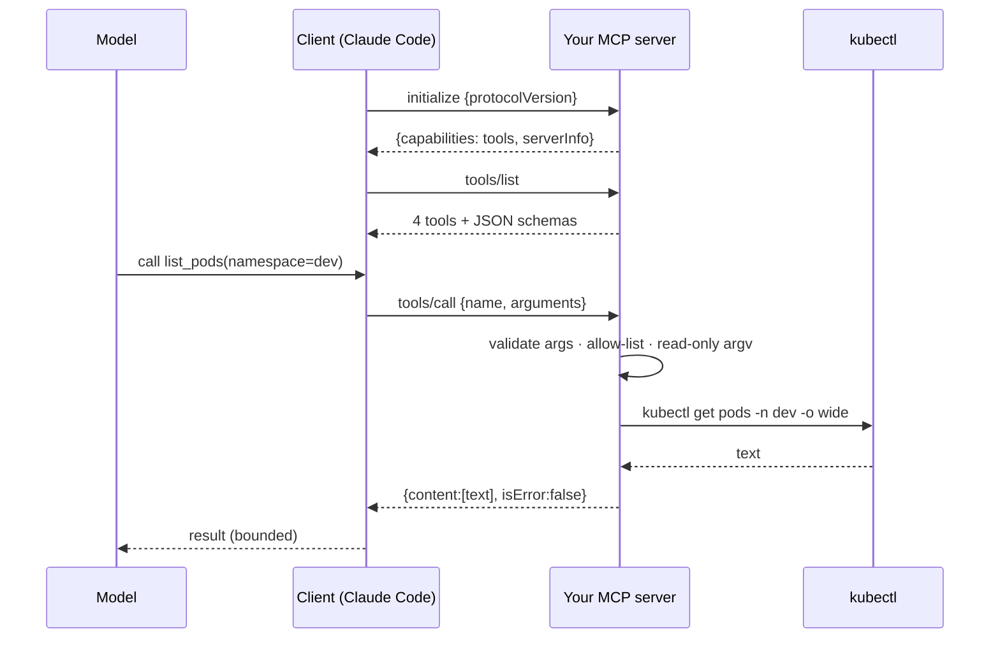

# An MCP Server for kubectl: Tools Are Functions With a Schema

*An agent can only touch your cluster through the tools you expose; write the server yourself and decide what those tools can never do.*

## Metadata

| Field | Value |
|---|---|
| Type | Build |
| Languages | Python |
| Prerequisites | [Lab Doctor](https://cloudcaptain.io/learn/setup/lab-doctor) |
| Time | 90 minutes |
| Tools | kubectl, kind, claude-code, mcp-inspector |

<Quiz stage="pre" />

## The Problem

Someone on the team connected a "Kubernetes MCP server" from a GitHub README to their coding agent and asked it why the checkout service was slow. The agent found a pod in `CrashLoopBackOff`, read its logs, and the logs contained a stack trace from a library that printed a config dump including, helpfully, the text of an old incident ticket: *"fix: delete the stuck pods in prod and restart the deployment"*. The agent had a `run_kubectl` tool that took a command string. It used it.

Nobody wrote a malicious prompt. The model did what the text in front of it suggested, through a tool that made the suggestion executable. That is the whole risk model of agentic operations in one story: agents read untrusted text (logs, events, tickets, web pages) and act through tools. The safety of the system is not a property of the model or the prompt. It is a property of the tools: what they accept, what they can run, and what they can never do.

So instead of installing someone's server, you are going to write one. It will expose exactly four read-only operations on a cluster, refuse everything else by construction, and still make an agent useful for triage. Afterwards you will be able to read any MCP server's tool list and know in a minute whether it belongs anywhere near production.

## The Concept

The **Model Context Protocol** (MCP) is how agents discover and call tools. It is deliberately small: JSON-RPC 2.0 messages, one per line, over the server's stdin and stdout (or HTTP). The client (Claude Code, Cursor, Codex, your own harness) does three things:

1. `initialize`: agree on a protocol version and learn what the server offers.
2. `tools/list`: fetch the tools, each with a name, a description, and a JSON Schema for its arguments. The model reads these to decide what to call.
3. `tools/call`: invoke one tool with arguments; get back content (usually text) and an `isError` flag.



Two design rules fall out of the story in The Problem. **Tools take typed arguments, never command strings**, so the server assembles the argv and a verb allow-list decides what can run; no text the model reads can turn into a shell. **Tool failures are results, protocol failures are errors**: a refused namespace or a missing argument comes back as `isError: true` so the model can recover; an unknown method or tool is a JSON-RPC error.

## Build It

`code/main.py` is a complete server with no dependencies. The protocol handling is pure (`handle(message, policy, runner)`), so the tests drive it with a fake `kubectl` and never need a cluster.

### Step 1: declare the tools as data

Each tool is a name, a description the model will read, a schema, and a function from validated arguments to a `kubectl` argv:

```python
ToolSpec(
    "pod_logs",
    "Recent logs of a pod (last N lines, default 100). Optional container name and previous=true for the crashed instance.",
    {"namespace": {"type": "string"}, "name": {"type": "string"}, "container": {"type": "string"},
     "tail_lines": {"type": "integer", "minimum": 1, "maximum": 2000}, "previous": {"type": "boolean"}},
    ["namespace", "name"],
    lambda a: ["logs", str(a["name"]), "-n", str(a["namespace"]), f"--tail={int(a.get('tail_lines') or 100)}",
               *(["-c", str(a["container"])] if a.get("container") else []), *(["--previous"] if a.get("previous") else [])],
)
```

The description is part of the interface: it tells the model *when* to use the tool. Write it the way you would brief a new on-call engineer.

### Step 2: validate arguments against the schema

A small checker enforces required keys, types, integer bounds and `additionalProperties: false`. Anything wrong is returned to the model as an `isError` result with a precise message, and `kubectl` never runs:

```python
problem = validate_args(spec, args or {})
if problem:
    return text_result(f"invalid arguments for {name}: {problem}", True)
```

### Step 3: make read-only structural

Policy is checked before the command exists. The namespace allow-list refuses both disallowed namespaces and all-namespace queries; the verb allow-list and the forbidden-flag list run on the final argv, so no code path can produce a write:

```python
READ_ONLY_VERBS = {"get", "describe", "logs", "top", "version", "api-resources", "explain"}
FORBIDDEN_FLAGS = {"--raw", "--kubeconfig", "--token", "--server", "--as", "--as-group", "--exec"}

def ensure_read_only(argv):
    if not argv or argv[0] not in READ_ONLY_VERBS:
        raise PermissionError(f"verb {argv[0]!r} is not read-only")
    for item in argv:
        if item.split("=", 1)[0] in FORBIDDEN_FLAGS:
            raise PermissionError(f"flag {item} is not allowed")
```

`--raw` would let a caller hit arbitrary API paths; `--kubeconfig`, `--server` and `--token` would point at a different cluster; `--as` would impersonate. A pinned `--context` goes on every command.

### Step 4: speak JSON-RPC over stdio

`serve()` reads one JSON object per line, dispatches to `handle()`, writes one JSON object per line. Notifications (no `id`) get no reply. Logs go to **stderr**; a single stray `print()` on stdout would corrupt the stream the client is parsing:

```python
for raw in stdin:
    message = json.loads(raw)
    response = handle(message, policy, runner)
    if response is not None:
        stdout.write(json.dumps(response) + "\n")
        stdout.flush()
```

### Step 5: bound the output

Every byte a tool returns is read by the model and paid for in tokens. Results are cut at a limit with a hint that teaches the model to narrow the query:

```python
def truncate(text, limit):
    if len(text) <= limit:
        return text
    return text[:limit] + f"\n… truncated ({len(text) - limit} more characters); narrow the query with a namespace, selector or tail_lines"
```

### Step 6: drive it by hand

A session is just lines of JSON. With a fake `kubectl` on `PATH` you can watch the whole protocol without a cluster:

```bash
mkdir -p /tmp/fakebin && printf '#!/bin/sh\necho "fake-kubectl $*"\n' > /tmp/fakebin/kubectl && chmod +x /tmp/fakebin/kubectl
printf '%s\n' \
  '{"jsonrpc":"2.0","id":1,"method":"initialize","params":{"protocolVersion":"2025-06-18","capabilities":{},"clientInfo":{"name":"me","version":"1"}}}' \
  '{"jsonrpc":"2.0","method":"notifications/initialized"}' \
  '{"jsonrpc":"2.0","id":2,"method":"tools/list"}' \
  '{"jsonrpc":"2.0","id":3,"method":"tools/call","params":{"name":"list_pods","arguments":{"namespace":"dev"}}}' \
  '{"jsonrpc":"2.0","id":4,"method":"tools/call","params":{"name":"list_pods","arguments":{"namespace":"prod"}}}' \
  | PATH=/tmp/fakebin:$PATH python3 code/main.py --allow-namespaces dev,staging
```

The fourth call comes back `isError: true` with the allow-list in the message, and `kubectl` was never invoked for it.

<RunTests />

## Use It

Now a real cluster and a real agent:

```bash
kind create cluster --name cc-lab
kubectl --context kind-cc-lab run broken --image=alpine:3.22 -- sh -c 'echo boom; exit 1'      # a CrashLoopBackOff to find
npx @modelcontextprotocol/inspector python3 code/main.py --allow-namespaces default,kube-system --context kind-cc-lab
```

The Inspector opens a browser UI where you can call `list_events(warnings_only=true)`, then `pod_logs(namespace=default, name=broken, previous=true)` and see exactly what an agent would see. Then install the server into your agent:

```bash
claude mcp add kubectl-ro -- python3 "$PWD/code/main.py" --allow-namespaces default,kube-system --context kind-cc-lab
claude mcp list
```

For Cursor or any client that uses the standard config, see `outputs/mcp-kubectl-readonly/mcp.json`. Ask the agent: *"Which pods in default are not Ready, and why?"* Watch the tool calls it makes: events first, then describe, then logs with `previous=true`. That sequence is the triage runbook encoded in four tool descriptions.

Compare with the servers people actually install, using the same review you just internalised:

| Server | Tool surface | Write path | Your verdict should ask |
|---|---|---|---|
| this lesson | 4 read-only tools, typed arguments, allow-lists, pinned context | none | nothing to approve |
| `containers/kubernetes-mcp-server` (Red Hat) | pods, resources, helm, events; configurable `--read-only` | `apply`, `delete`, `exec` unless read-only mode | is read-only mode on? which kubeconfig? |
| HashiCorp Terraform MCP server | registry docs, provider schemas, workspaces and runs on HCP Terraform | run creation on remote workspaces | which workspaces can it reach, and who approves applies? |
| a server with `run_command(command: string)` | anything | everything | do not connect it to credentials that matter |

Finally, the thing the official servers add that yours does not: **resources** (read-only documents the client can attach, such as a manifest) and **prompts** (reusable prompt templates). Both are more `tools/list`-shaped vocabularies over the same JSON-RPC, and both come with the same question: what can this never do?

<Quiz stage="check" />

## Ship It

Two artifacts in `outputs/`:

- **`mcp-kubectl-readonly/`**: the server packaged for use: a README with the raw stdio session, Inspector and Claude Code / Cursor install commands, every flag, and the explicit list of what it will never do; plus `mcp.json`, the client configuration to copy.
- **`skill-mcp-tool-review.md`**: a review skill for any MCP server before it goes near production credentials: enumerate the tools without an agent in the loop, answer six questions (state changes, unparsed arguments, cluster/account scope, output bounds, secrets, audit), reason explicitly about prompt injection through the tools' own outputs, and record a verdict.

<ShipIt />

## Exercises

### Easy

Add a `list_nodes` tool (`kubectl get nodes -o wide`) and a `top_pods` tool that needs metrics-server. Tests first: the argv for each, and that `top_pods` returns an `isError` result with a helpful message when `kubectl top` fails because metrics are unavailable.

### Medium

Add `--max-output` awareness per tool: `pod_logs` should truncate from the *start* (keep the newest lines), `list_events` from the end. Then add an `audit` log line per `tools/call` to a file (`--audit /var/log/kubectl-mcp.jsonl`) with timestamp, tool, arguments and whether it was refused.

### Hard

Add exactly one write tool, `rollout_restart(namespace, deployment, confirm)`, behind a `--allow-write` flag. It must refuse unless `confirm == "restart <namespace>/<deployment>"`, must be idempotent, must log to the audit file, and must stay invisible in `tools/list` when the flag is off. Then write two paragraphs on why the human approval still belongs in the client, not in the server, and what you would need to see in a client before trusting its approval UI.

<Quiz stage="post" />

## Key Terms

| Term | Common misconception | Precise definition |
|---|---|---|
| MCP (Model Context Protocol) | "An AI framework." | A small JSON-RPC 2.0 protocol by which a client exposes tools, resources and prompts from servers to a model; transports are stdio and HTTP. |
| Tool | "A function the model runs." | A named operation with a JSON Schema the *client* executes on the model's behalf; the server decides what it does and what it refuses. |
| `isError` result vs JSON-RPC error | "Both are failures." | `isError` is a tool outcome the model should read and adapt to; a JSON-RPC error is a protocol fault (unknown method or tool, malformed message). |
| Prompt injection | "A jailbreak someone types." | Any untrusted text the model reads (logs, events, pages) steering its actions; the defence is tools that cannot execute what the text suggests. |
| Read-only by construction | "A `read_only: true` setting." | Structural limits: typed arguments assembled into argv, a verb allow-list, forbidden flags, a pinned context, no free-form command tool. |
| Bounded output | "Return everything, let the model filter." | Truncation or pagination with a hint; context windows and token cost are part of the tool contract. |
| Human in the loop | "The model asks before dangerous things." | The *client* shows the exact call and gets approval before `tools/call`; the server adds confirm arguments, audit logs and idempotency so a misconfigured client still cannot do silent harm. |

## Further Reading

- [Kubernetes Production Operations](https://cloudcaptain.io/docs/tools/kubernetes/production-operations): the triage runbook your four tools encode, written for humans.
- [kubectl Cheat Sheet](https://cloudcaptain.io/docs/tools/kubernetes/cheatsheet): every verb the allow-list permits, and the ones it refuses.
- [Kubernetes Fundamentals](https://cloudcaptain.io/docs/tools/kubernetes/fundamentals): pods, events and the API objects the tools return.
- [MCP specification](https://modelcontextprotocol.io/specification/latest): lifecycle, tools, resources and prompts; read the tools section and the security considerations.
- [MCP Inspector](https://github.com/modelcontextprotocol/inspector): the browser UI you used to call tools by hand; keep it in your toolbox for every server review.
