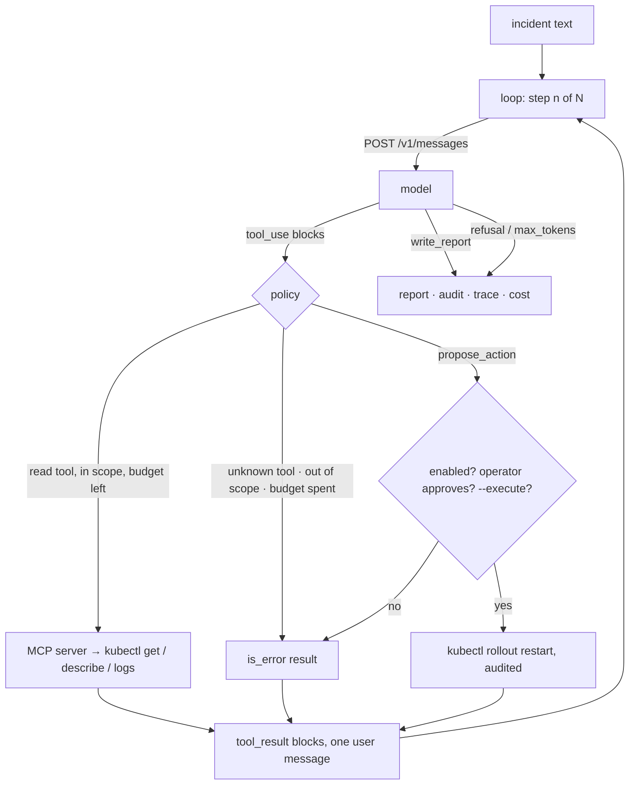

# An Incident-Triage Agent: The Loop Decides What the Model May Touch

*An ops agent is a loop you write around a model you rent; the loop decides what it can touch, how long it runs and who approves.*

## Metadata

| Field | Value |
|---|---|
| Type | Build |
| Languages | Python |
| Prerequisites | [MCP for kubectl](https://cloudcaptain.io/learn/aiops/mcp-kubectl-server) |
| Time | 120 minutes |
| Tools | kubectl, kind, claude-code, anthropic-sdk |

<Quiz stage="pre" />

## The Problem

The demo was impressive. A model, a chat box and a `run_kubectl(command)` tool: ask "why is checkout slow?" and it finds the CrashLoopBackOff, reads the logs and explains the stack trace in plain English. Three weeks later it is 02:10, the same assistant is on a bridge call, and the questions nobody can answer are different ones. Why did it spend forty tool calls and eleven dollars re-reading the same log? Why did it restart a deployment in `prod` when the incident was in `staging`? What exactly did it do between 02:03 and 02:07, and did a log line that said "rerun the migration" have anything to do with it?

None of those are questions about the model. They are questions about the **loop** around it: which tools existed, how many steps it was allowed, which namespaces were in scope, what counted as a write and who approved it, what was recorded, and what happened when the model was cut off or declined. In the previous lesson you built the tool server and made it read-only by construction. This lesson builds the other half, the loop that calls the model, hands it those tools, enforces budgets and scope, puts the single write path behind an operator, and ends with a report instead of a paragraph.

You will write it against the Claude Messages API with nothing but the standard library, so every byte of the protocol is visible, then compare it with the SDK's tool runner, with Claude Code as the loop, and with Anthropic's hosted agents. The loop is where ops judgment lives; renting the model does not outsource it.

## The Concept

An agent loop is short. Send the conversation and the tool definitions; the model answers with text, with `tool_use` blocks, or with both. Execute each `tool_use`, send every result back as `tool_result` blocks in **one** user message, and call again. Stop when the model stops asking for tools, or when you decide it has had enough. Everything that makes the loop safe to run against production is a decision the loop makes between those two calls.

| Decision | Where it lives in this lesson |
|---|---|
| What tools exist | the MCP server's `tools/list`, converted to tool definitions; two built-ins the loop handles itself |
| How long it runs | `max_steps` model calls and `max_tool_calls` tool executions; the model is told the budget |
| What is in scope | a namespace allow-list the loop enforces in addition to the server's |
| What a write is | `propose_action`: a typed proposal, an enabled-kinds list, operator approval, and `--execute` as three separate gates |
| How it ends | `write_report` with a strict schema; `refusal`, `max_tokens` and the budgets as the other exits |
| What is remembered | an audit entry per tool call, a trace line per model call, a cost line per run |



The stop reason is the loop's steering wheel. `tool_use` means execute and continue. `end_turn` means the model is done. `max_tokens` means the output was cut off, so a `tool_use` in that turn may have a truncated input and must never run. `refusal` means a safety classifier declined and, again, nothing in that turn runs. `pause_turn` means a server-side tool is still working and the same messages should be sent again. Prompt injection has the same shape here as in the previous lesson: logs and events are text the model reads, and the loop's job is to make sure no text can become an action it did not expose.

## Build It

`code/main.py` is `triage_agent`. The model call and the tool source are both injectable, so the tests drive the whole loop with a scripted model and fake tools, and `--replay FILE` runs the same script from the command line against the real MCP server without an API key.

### Step 1: an MCP client in forty lines

The previous lesson's server speaks JSON-RPC over stdio. The client spawns it, performs `initialize`, sends `notifications/initialized`, reads `tools/list` and turns each entry into a Claude tool definition. `inputSchema` becomes `input_schema`; nothing else changes.

```python
def to_claude_tools(mcp_tools):
    return [{"name": tool["name"], "description": tool.get("description", ""), "input_schema": tool.get("inputSchema") or {"type": "object", "properties": {}}} for tool in mcp_tools]
```

`McpStdioClient.call()` sends `tools/call`, joins the text blocks of the result and returns `(text, is_error)`: the server's `isError` becomes the loop's `is_error` on the way back to the model.

### Step 2: the request

```python
def build_request(model, messages, tools, max_tokens=16000, effort="medium", fallbacks=True, system=SYSTEM_PROMPT):
    request = {
        "model": model,
        "max_tokens": max_tokens,
        "system": [{"type": "text", "text": system, "cache_control": {"type": "ephemeral"}}],
        "tools": [*tools, PROPOSE_ACTION_TOOL, WRITE_REPORT_TOOL],
        "messages": messages,
        "output_config": {"effort": effort},
    }
    if fallbacks:
        request["fallbacks"] = "default"
    return request
```

Four details carry weight. The system prompt is cached, because it is identical on every step and the conversation grows after it. There is no `thinking` parameter: on Claude Opus 5.5 thinking is always on and `output_config.effort` is the knob, so the loop passes the assistant content back unchanged, thinking blocks included. The two built-in tools are `strict`, so their arguments always match the schema. And `fallbacks: "default"` opts into a server-side retry on another model when a safety classifier declines, which is what keeps a false positive on an incident at 02:00 from ending the investigation; it needs the `anthropic-beta: server-side-fallback-2026-07-01` header, which `anthropic_messages()` adds together with `anthropic-version: 2026-10-21` and the API key.

### Step 3: the loop

```python
for step in range(1, policy.max_steps + 1):
    response = model(build_request(model_name, messages, tool_defs, effort=effort, fallbacks=fallbacks))
    content = response.get("content") or []
    stop_reason = response.get("stop_reason")
    messages.append({"role": "assistant", "content": content})
    tool_uses = [block for block in content if block.get("type") == "tool_use"]
    if stop_reason in ("refusal", "max_tokens"):
        break
    if stop_reason == "pause_turn":
        continue
    if not tool_uses:
        break
    results = [dispatch(step, block) for block in tool_uses]
    messages.append({"role": "user", "content": results})
```

Every `tool_use` of a turn is executed and every result goes back in a single user message, in order, with `is_error: true` where the tool failed or the loop refused. Splitting results across messages or dropping a failed one teaches the model to stop making parallel calls.

### Step 4: the policy

`dispatch()` runs the checks the server cannot see. An unknown tool name is answered with an error result and recorded as a violation. A namespace outside the incident's scope is refused before the server is asked. When the tool budget is spent the result says so and tells the model to write the report:

```python
if outcome.tool_calls >= policy.max_tool_calls:
    return f"tool budget of {policy.max_tool_calls} calls is spent; call write_report with what you have.", True, False
```

Every refusal is phrased as an instruction the model can act on, because the point is to finish the triage, not to crash it.

### Step 5: the write path, three gates

The MCP server stays read-only; a write tool there would weaken the guarantee every client relies on. The loop owns a second, smaller door:

```python
if kind not in policy.allowed_actions:
    return f"refused: {kind} is not enabled for this agent; put it under proposed_actions in the report instead."
command = action_argv(kind, namespace, target, policy.context)
if not approve({**arguments, "command": command}):
    return "denied by the operator; do not propose it again, continue the investigation or write the report."
if not policy.execute:
    return f"approved by the operator, who will run it by hand: {' '.join(command)}. It has not run yet."
code, out, err = runner(command)
```

The kind has to be enabled when the agent starts (`--allow-action rollout_restart`), an operator has to say yes to the exact command, and `--execute` has to be on before anything runs; without it approval produces a command for a human to paste. The model sees the decision as a tool result and is told, in words, whether anything happened. Each branch writes an audit entry.

### Step 6: ending with data

`write_report` is a tool with a strict schema: summary, severity, evidence, hypothesis, confidence, proposed actions, next checks. Calling it records the report and ends the loop, so the result of a triage is a JSON object a ticketing system or a human can read, and a missing report is itself a finding (`stop: max_steps`, `stop: end_turn` with free text).

### Step 7: run it

Without an API key first, against the real server with a fake `kubectl`, replaying a scripted investigation that includes an injection attempt:

```bash
mkdir -p /tmp/fakebin && printf '#!/bin/sh\necho "fake-kubectl $*"\n' > /tmp/fakebin/kubectl && chmod +x /tmp/fakebin/kubectl
PATH=/tmp/fakebin:$PATH python3 code/main.py "checkout is in CrashLoopBackOff" \
  --mcp "python3 ../01-mcp-kubectl-server/code/main.py --allow-namespaces default --quiet" \
  --replay code/fixtures/replay-crashloop.json --namespaces default --trace /tmp/triage-trace.jsonl
```

Step 4 of the script calls `run_kubectl`, which does not exist, and proposes a restart that is not enabled: both come back as refusals, the violation is listed, the report still lands. Add `--allow-action rollout_restart` and the proposal reaches you for approval; add `--execute` and an approved restart actually runs. Then the live version against a cluster with something to find:

```bash
kind create cluster --name cc-lab
kubectl --context kind-cc-lab create deployment checkout --image=alpine:3.22 -- sh -c 'echo "KeyError: DATABASE_URL"; exit 1'
export ANTHROPIC_API_KEY=...
python3 code/main.py "checkout pods in default keep restarting" \
  --mcp "python3 ../01-mcp-kubectl-server/code/main.py --allow-namespaces default --context kind-cc-lab --quiet" \
  --namespaces default --context kind-cc-lab --allow-action rollout_restart --max-tool-calls 10 --trace /tmp/triage-trace.jsonl
```

Read the audit lines as they print, say no to the first proposal, and compare the cost line with what the replay reported. `--json` gives the whole outcome, report included, for a pipeline.

<RunTests />

## Use It

The official SDK ships the same loop as a helper. `pip install "anthropic[mcp]"` (Python 3.10 or newer) and the MCP conversion helpers turn the server's tools into runner tools; the human gate moves inside the one tool that needs it:

```python
import asyncio
from anthropic import AsyncAnthropic, beta_tool
from anthropic.lib.tools.mcp import async_mcp_tool
from mcp import ClientSession
from mcp.client.stdio import stdio_client, StdioServerParameters

@beta_tool
def propose_action(kind: str, namespace: str, target: str, reason: str) -> str:
    """Propose one remediation; an operator approves or denies it. kind is rollout_restart or delete_pod."""
    answer = input(f"approve {kind} {namespace}/{target} ({reason})? [y/N] ")
    return "approved; the operator will run it by hand" if answer.lower() == "y" else "denied by the operator"

async def main():
    client = AsyncAnthropic()
    server = StdioServerParameters(command="python3", args=["../01-mcp-kubectl-server/code/main.py", "--allow-namespaces", "default", "--quiet"])
    async with stdio_client(server) as (read, write):
        async with ClientSession(read, write) as mcp:
            await mcp.initialize()
            tools = [async_mcp_tool(t, mcp) for t in (await mcp.list_tools()).tools] + [propose_action]
            runner = client.beta.messages.tool_runner(
                model="claude-opus-5-5", max_tokens=16000, tools=tools,
                system="You triage Kubernetes incidents with read-only tools and finish with a short report.",
                messages=[{"role": "user", "content": "checkout pods in default keep restarting"}],
            )
            async for message in runner:
                print(message.stop_reason, [b.name for b in message.content if b.type == "tool_use"])

asyncio.run(main())
```

What the runner gives you for free: the request shape, the loop, parallel results in one message, `pause_turn` handling and typed inputs. What it does not decide for you: budgets (`max_iterations` on the runner is the step budget, the tool budget is yours), scope, the audit trail, the cost line, and what counts as a report. Those stay your code, exactly as in Build It.

Claude Code is also a loop. With the server from the previous lesson installed (`claude mcp add kubectl-ro -- …`), drop `outputs/agent-incident-triage.md` into `.claude/agents/` and you have a subagent whose tool list is the four read-only tools; Claude Code's permission prompt is the approval gate, and `claude -p "checkout pods in default keep restarting" --max-turns 12` is the step budget. Anthropic's Managed Agents move the loop and the sandbox server-side with permission policies (`always_ask` on a write tool is the same gate) and a per-session dollar budget.

| Decision | What you built | SDK tool runner | Claude Code | Managed Agents |
|---|---|---|---|---|
| tool surface | MCP `tools/list` + two built-ins | `async_mcp_tool` + `@beta_tool` | `claude mcp add`, subagent `tools:` list, `--allowedTools` | agent config toolsets, MCP servers |
| step / tool budget | `max_steps`, `max_tool_calls` told to the model | `max_iterations` | `--max-turns` | session budget in dollars, task budgets |
| approval | enabled kinds → operator → `--execute` | gate inside the tool function or `set_messages_params()` | permission prompts, `allow` / `ask` rules | `always_ask` permission policy |
| stop reasons | handled explicitly | handled by the runner | handled | handled |
| audit and trace | audit list + JSONL with GenAI attribute names | your hooks around the loop | session transcript | session events, Console viewer |
| cost | computed from `usage` | `message.usage` per iteration | `/cost` | per-session usage |

<Quiz stage="check" />

## Ship It

Two artifacts in `outputs/`:

- **`agent-incident-triage.md`**: the triage runbook as an agent definition for Claude Code (`.claude/agents/`) or any agent runtime that reads front matter: the four read-only tools by name, the method, the rules about untrusted text and about never claiming an action ran, the budget, and the report template `write_report` enforces here.
- **`skill-ops-agent-review.md`**: a review skill for any agent that touches infrastructure, yours or a vendor's: the six loop decisions as questions with pass and fail examples, a stop-reason checklist, a budget-and-cost check and a prompt-injection drill with a planted log line.

<ShipIt />

## Exercises

### Easy

Add `--max-cost-usd` as a third budget: estimate the cost after every model call from `usage` and stop with `stop: max_cost` before the next call would exceed it. Write the test with a scripted model whose `usage` grows each turn.

### Medium

The trace lines already use OpenTelemetry GenAI attribute names (`gen_ai.request.model`, `gen_ai.usage.input_tokens`). Replace the JSONL writer with real spans from the OpenTelemetry SDK, one span per model call with a child span per tool call carrying the tool name, `is_error` and the result size, and look at a run in Jaeger (`docker run -p 16686:16686 -p 4318:4318 jaegertracing/jaeger:2.7.0`).

### Hard

Build the evaluation this lesson has been avoiding. Write five replay fixtures for five incident types (CrashLoopBackOff, ImagePullBackOff, OOMKilled, a failing readiness probe, a pending pod with no node) with the expected failing component and severity, then a grader that runs the **live** model against a kind cluster that reproduces each one and scores the report, the tool-call count and the cost over three runs. Make it fail when accuracy drops below your threshold, and keep the results next to the fixtures: the evaluations lesson later in this phase starts from exactly this file.

<Quiz stage="post" />

## Key Terms

| Term | Common misconception | Precise definition |
|---|---|---|
| Agent loop | "The model runs tools." | Client code that sends messages and tool definitions, executes the `tool_use` blocks the model returns, appends `tool_result` blocks and repeats until a stop condition it chose. The model proposes; the loop executes. |
| Stop reason | "Only `end_turn` matters." | The field that tells the loop what happened: `tool_use` (execute), `end_turn` (done), `max_tokens` (output cut off, do not run tools), `refusal` (classifier declined, do not run tools), `pause_turn` (resend). |
| `tool_result` with `is_error` | "Errors should raise." | The way a failure or a refusal is returned to the model so it can adapt; a refusal written as an instruction gets a better next step than a stack trace. |
| Human in the loop | "The model asks before dangerous things." | Gates in the loop, not in the prompt: an enabled-kinds list, an operator's approval of the exact command, and a separate switch before anything executes; the model only ever sees the decision. |
| Prompt injection | "A jailbreak someone types." | Untrusted text reaching the model through tool results and steering it; the defence is a tool surface on which the suggested action is impossible, plus refusals that are recorded. |
| Budget | "A timeout." | Explicit limits on model calls, tool calls and money, announced to the model and enforced by the loop, with a graceful exit (write the report) instead of a crash. |
| Refusal fallback | "A retry." | A server-side opt-in (`fallbacks: "default"`) that re-runs a request declined by a safety classifier on another model chosen by refusal category; the loop still checks `stop_reason`. |
| Audit vs trace | "Logging." | The audit is the list of tool calls, decisions and outcomes a human reads after the incident; the trace is one record per model call with token counts and timing for the observability system. |

## Further Reading

- [Kubernetes Production Operations](https://cloudcaptain.io/docs/tools/kubernetes/production-operations): the triage runbook the system prompt condenses, written for humans.
- [kubectl Cheat Sheet](https://cloudcaptain.io/docs/tools/kubernetes/cheatsheet): the commands the four tools wrap and the ones the loop refuses to grow into.
- [Kubernetes Fundamentals](https://cloudcaptain.io/docs/tools/kubernetes/fundamentals): pods, events, probes and restart policies, the vocabulary of the report.
- [AI/ML Ops learning path](https://cloudcaptain.io/docs/learning-paths/ai-ml): where agents, serving and evaluation sit in the wider landscape.
- [Tool use overview](https://platform.claude.com/docs/en/agents-and-tools/tool-use/overview) and [Handling stop reasons](https://platform.claude.com/docs/en/build-with-claude/handling-stop-reasons): the protocol you implemented by hand, from the source.
- [MCP specification](https://modelcontextprotocol.io/specification/latest): the client half you wrote in Step 1.
- [OpenTelemetry semantic conventions for generative AI](https://opentelemetry.io/docs/specs/semconv/gen-ai/): the attribute names in the trace lines, for the Medium exercise and the observability lesson later in this phase.
