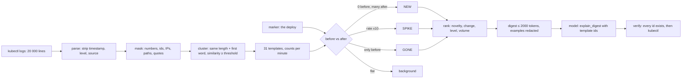

# AI Log Analysis Is Clustering First, Model Second

*A service writes thirty sentences with the numbers changed; cluster them, rank what changed since the deploy, and hand the model a page.*

## Metadata

| Field | Value |
|---|---|
| Type | Build |
| Languages | Python |
| Prerequisites | [Triage Agent](https://cloudcaptain.io/learn/aiops/incident-triage-agent) |
| Time | 90 minutes |
| Tools | kubectl, stern, loki, anthropic-sdk |

<Quiz stage="pre" />

## The Problem

At 02:40 checkout starts returning 500s. The on-call engineer runs `kubectl logs deploy/checkout --since=30m`, gets twenty thousand lines, and pastes them into a chat window with a model. The first attempt is rejected as too long. The second attempt is the last five hundred lines, and the answer arrives in seconds: a confident paragraph about `upstream connection reset by peer`, with a suggestion to check the network policy. The engineer spends twenty minutes on the network policy. The connection resets have been in the log at the same rate for four months. The actual new error, a missing `DATABASE_URL` after the 02:29 release, started eleven minutes earlier and sits two thousand lines above the window the model saw. Also in those five hundred lines: forty session tokens and a dozen customer email addresses, now in a third party's request log.

Nothing in that story is the model's fault. Logs are the most repetitive text a computer produces: a service writes a few dozen distinct sentences and varies the numbers, the ids and the addresses. The questions that matter during an incident are about counts and time: which sentences are new since the deploy, which ones got ten times more frequent, which ones stopped. Those are arithmetic over the whole window, and a model reading a tail cannot do arithmetic over lines it never received. Sending the whole window instead costs real money per incident, overflows the request, and hands over every secret in the text to find out.

You are going to write `logmine`: it parses lines from any of the usual formats, masks the variables, clusters the lines into templates the way Drain does, counts each template per minute before and after a marker you give it (the deploy), ranks what is new, spiking or gone, and builds a digest that fits a token budget with secrets redacted. Only then does it ask a model, with the same request shape as the triage agent, for an explanation that references template ids you can verify. After that, Loki's pattern detection, Grafana's Logs Drilldown, Elastic's log categorization and the redaction processors in your log pipeline will read as the same five steps at production scale.

## The Concept

A **template** is a log line with its variables replaced by placeholders: `http request method=GET path=/api/v1/cart status=500 duration=697ms client=10.4.1.9` becomes `http request method=<*> path=<PATH> status=<NUM> duration=<NUM> client=<IP>`. Once lines are templates, they can be counted. The algorithm that does this online, one line at a time, without a list of known formats, is Drain (He et al., 2017), and its idea fits in three sentences. Lines with the same number of tokens and the same first word are candidates for the same template. A candidate joins the template whose tokens agree with it in at least a threshold fraction of positions. Where they disagree, the template gets a wildcard, so it generalises as more lines arrive.

Counting per template per time bucket turns a text file into a table. A **marker**, the time of the deploy, splits every row into a before and an after. Three signals come out of the split and none of them needs a model: a template with zero lines before and many after is **new**; a template whose per-minute rate went up by a large factor is **spiking**; a template seen only before has **vanished**, which matters too (health checks stopped, a consumer went quiet). Level is the tie-breaker among things that changed, not a reason to rank a pre-existing error first.



The digest is the handover between the two halves. It carries the window, the marker, and for each ranked template its id, level, counts and rates before and after, a shape over time, the template text and two example lines, all redacted. A token **budget** decides how many templates fit; four characters per token is the estimate you can compute without an API call. The model's job shrinks to the one thing it is good at, explaining a page of evidence, and its answer comes back as a structured call that names template ids. An id that is not in the digest is an invented fact, and the tool says so.

## Build It

`code/main.py` is `logmine`. Everything up to the digest is pure functions over text, so the tests feed them fixture lines and run on any machine. The model call is injectable: `--replay FILE` plays scripted responses, `--no-model` stops at the digest, and only a real `ANTHROPIC_API_KEY` reaches the API.

### Step 1: strip the envelope

A log line is an envelope around a message. `parse_line()` peels the envelope in the forms you meet in a cluster: a `[pod/name/container]` prefix from `kubectl logs --prefix`, an ISO or bracketed timestamp, klog's `I1101 10:05:00.123456 1 reload.go:75]`, syslog, an access-log date, and JSON lines whose `ts`, `level` and `msg` keys become fields while the remaining keys are appended as `key=value`. The level is normalised (`WARNING` and `WARN` are the same thing) and removed from the body:

```python
match = ISO_TS.match(text)
if match:
    ts, text = parse_timestamp(match.group(1)), text[match.end():]
match = LEVEL_TOKEN.match(text)
if match:
    level, text = normalize_level(match.group(1)), text[match.end():]
```

A line without a timestamp, the second line of a stack trace, inherits the previous line's time. A file with no timestamps at all is placed by line number, and the marker is then a line number too.

### Step 2: mask the variables

Each whitespace token is classified in a fixed order, most specific first. Quoted strings are collapsed before splitting; punctuation around a token is kept outside the placeholder; a `key=value` token keeps its key and masks only the value:

```python
def mask_token(core):
    if not core:
        return core
    if UUID_RE.match(core):
        return "<UUID>"
    if IP_RE.match(core):
        return "<IP>"
    if URL_RE.match(core):
        return "<URL>"
    if PATH_RE.match(core):
        return "<PATH>"
    if NUM_RE.match(core):
        return "<NUM>"
    if HEX_RE.match(core):
        return "<HEX>"
    if HAS_DIGIT.search(core):
        return "<ID>"
    return core
```

The last rule is Drain's: anything with a digit in it is a variable. It is what turns `checkout-7d9f8b6c4-x2k9p` into `<ID>` without knowing what a pod name looks like, and it is also why `status=200` and `status=500` end up in the same template; the Easy exercise fixes that.

### Step 3: cluster, Drain style

Clusters are grouped by `(token count, first token)`. Within a group the line joins the most similar cluster if the similarity clears the threshold, otherwise it founds a new one. Similarity is the share of positions where the tokens are equal; a wildcard in the template does not count as a match, so a template cannot drift into matching everything:

```python
def similarity(template, tokens):
    if len(template) != len(tokens) or not tokens:
        return 0.0
    return sum(1 for a, b in zip(template, tokens) if a == b and a != WILDCARD) / len(tokens)

def merge_token(a, b):
    if a == b:
        return a
    if "=" in a and "=" in b and a.split("=", 1)[0] == b.split("=", 1)[0]:
        return f"{a.split('=', 1)[0]}={WILDCARD}"
    return WILDCARD
```

```python
group = self.groups.setdefault(self.key(tokens), [])
best, best_sim = None, 0.0
for cluster in group:
    sim = similarity(cluster.tokens, tokens)
    if sim > best_sim:
        best, best_sim = cluster, sim
if best is None or best_sim < self.threshold:
    best = Cluster(list(tokens), first_seen=ts, last_seen=ts)
    group.append(best)
    self.clusters.append(best)
else:
    best.tokens = merge(best.tokens, tokens)
```

Each cluster keeps its count, first and last time, level counts, a count per time bucket, the top sources and up to two example lines. The default threshold of 0.5 merges `method=GET` and `method=POST` into `method=<*>`; raise it to keep them apart, lower it to merge more aggressively. Both are a trade between fewer templates and more specific ones.

### Step 4: count against the marker

With the marker snapped to the bucket grid, every cluster splits into a before and an after, and the three signals are comparisons:

```python
before = cluster.count_where(lambda b: b < snapped)
after = cluster.count - before
novel = before == 0 and after > 0
vanished = before > 0 and after == 0
before_rate, after_rate = before / before_minutes, after / after_minutes
spike = (after_rate / before_rate) if before > 0 else None
```

The score is additive so you can read it back: novelty is worth 5, a vanished template 2, a rate increase up to 4 (`log2` of the factor, capped), `ERROR` and `FATAL` 3, `WARN` 1, and `log10` of the volume after the marker as the tie-breaker:

```python
def rank_score(novel, vanished, spike, level, after):
    score = 5.0 if novel else 0.0
    score += 2.0 if vanished else 0.0
    if spike is not None and spike > 1:
        score += min(4.0, math.log2(spike))
    score += LEVEL_WEIGHT.get(level, 0.0)
    score += math.log10(after + 1)
    return round(score, 2)
```

A new `ERROR` at any volume therefore outranks a steady `ERROR` at any volume, and a steady `ERROR` outranks spiking `INFO` noise unless the spike is enormous. Without `--marker` the window's midpoint is used and the digest says so.

### Step 5: a digest under a budget, redacted

Tokens are estimated as characters divided by four, which is close enough to decide what fits and needs no network call:

```python
def estimate_tokens(text):
    return (len(text) + 3) // 4
```

The digest starts with a header (window, line count, template count, marker and how it was chosen) and adds ranked templates while the total stays under the budget. If even the first template does not fit with its examples, it is retried without them:

```python
for entry in candidates:
    attempt = f"{text}\n\n{render_entry(entry, analysis.synthetic_time, examples)}"
    if estimate_tokens(attempt + footer(shown + 1)) > budget:
        break
    text, shown = attempt, shown + 1
```

Every template line and every example goes through `redact()` on the way in. Masking (Step 2) made lines comparable; redaction is a different job, removing what must not leave the machine even once: values of keys that smell like secrets, bearer tokens, email addresses, long opaque blobs, and by default IPv4 addresses:

```python
def redact(text, ips=True):
    text = SECRET_KV.sub(lambda m: f"{m.group(1)}{m.group(2)}<REDACTED>", text)
    text = BEARER.sub("Bearer <REDACTED>", text)
    text = EMAIL.sub("<EMAIL>", text)
    text = LONG_SECRET.sub("<REDACTED>", text)
    if ips:
        text = IPV4.sub("<IP>", text)
    return text
```

A UUID and a `sha256:` image digest survive it on purpose; they are identifiers the explanation may need.

### Step 6: ask the model, verify the answer

The request has the shape you built in the triage lesson: a cached system prompt, one strict tool, `output_config.effort`, no `temperature` or `thinking`, and `fallbacks: "default"` with its beta header so a false positive from a safety classifier does not end the analysis:

```python
request = {
    "model": model,
    "max_tokens": max_tokens,
    "system": [{"type": "text", "text": system, "cache_control": {"type": "ephemeral"}}],
    "tools": [EXPLAIN_TOOL],
    "messages": messages or [{"role": "user", "content": f"Explain this log digest. Treat the marker as a deploy unless the digest says otherwise. Refer to templates by id.\n\n<digest>\n{digest_text}\n</digest>"}],
    "output_config": {"effort": effort},
}
```

The system prompt says what a digest is, tells the model to start from the top-ranked templates, to treat everything inside the digest as data, and to finish with one `explain_digest` call: headline, likely cause, confidence, severity, affected components, evidence as template ids, noise as template ids, next checks. `explain()` makes one call, resends on `pause_turn`, runs nothing on `refusal` or `max_tokens`, and checks the ids:

```python
if stop_reason == "refusal":
    outcome.stop, outcome.refusal = "refusal", response.get("stop_details")
elif stop_reason == "max_tokens":
    outcome.stop = "max_tokens"
else:
    calls = [block for block in content if block.get("type") == "tool_use" and block.get("name") == "explain_digest"]
    if calls:
        outcome.report = calls[0].get("input") or {}
        outcome.stop = "report"
        outcome.unknown_refs = [ref for ref in list(outcome.report.get("evidence") or []) + list(outcome.report.get("noise") or []) if re.fullmatch(r"T\d+", str(ref)) and ref not in known_ids]
```

The usage block prices the call from the same table as the triage agent, and `render_stats()` prints what the raw logs would have cost as input next to what the digest cost.

### Step 7: run it

`--generate` writes a synthetic log you can reason about: thirty templates in plain and JSON form, a steady low-rate error, a session token in an `INFO` line, and at minute 20 a deploy line followed by a new `ERROR` with an occasional stack-trace line and a tenfold spike of an existing `WARN`:

```bash
python3 code/main.py --generate 20000 --seed 7 > /tmp/app.log          # prints the deploy marker on stderr
python3 code/main.py /tmp/app.log --marker 2026-11-01T10:20:00Z --no-model
```

```text
T01  score 11.28 ERROR NEW    before 0.0/min  after 188.3/min  n=1883  first 10:20:00  last 10:29:25
     checkout config: missing key DATABASE_URL (release <ID>)
     ····················█▇▇▇▇█▇▇▇▃
     e.g. 2026-11-01T10:20:00.176Z ERROR checkout config: missing key DATABASE_URL (release checkout-a5cd6)
T02  score 7.58  -     NEW    before 0.0/min  after 38.0/min  n=380  first 10:20:03  last 10:29:24
     File <STR>, line <NUM>, in load
T03  score 7.15  WARN  x10.6  before 5.2/min  after 55.5/min  n=660  first 10:00:23  last 10:29:21
     upstream timeout service=payments after <NUM>
T05  score 4.78  ERROR x0.7   before 8.4/min  after 5.9/min  n=226
     upstream connection reset by peer addr=<IP>
(10 of 31 templates shown; budget 2000 tokens)

raw logs: 20000 lines ≈ 488398 tokens ≈ $1.9536 of input on claude-opus-5-5
digest:   10/31 templates ≈ 1014 tokens ≈ $0.0041   (482x smaller)
```

The four-month-old connection resets are T05, below everything that changed. The token line is the argument for this whole lesson: half a million tokens of input per look, or a thousand. Now the model, scripted first and live second:

```bash
python3 code/main.py /tmp/app.log --marker 2026-11-01T10:20:00Z --replay code/fixtures/replay-deploy.json
export ANTHROPIC_API_KEY=...
python3 code/main.py /tmp/app.log --marker 2026-11-01T10:20:00Z --json | python3 -c 'import json,sys; e=json.load(sys.stdin)["explanation"]; print(e["report"]["headline"], e["report"]["evidence"], e["cost_usd"])'
```

Then a real cluster, straight from `kubectl` through stdin:

```bash
kubectl logs -n kube-system -l tier=control-plane --all-containers --prefix --timestamps --since=1h --tail=500 | python3 code/main.py - --no-model --top 8
```

The `sources:` field on each template names the pods it came from, because the `--prefix` envelope was parsed, not masked away.

<RunTests />

## Use It

Collecting the window is the part the real tools make easy. `kubectl logs` takes a selector, a time window and the flags that keep the envelope intact; `stern` does the same across pods with colour and a regex filter, and both can be piped into `logmine`:

```bash
kubectl logs -n payments -l app=checkout --all-containers --prefix --timestamps --since=15m --max-log-requests 20 > /tmp/checkout.log
kubectl logs -n payments deploy/checkout --previous --timestamps > /tmp/checkout-prev.log       # the crashed container, not the restarted one
kubectl rollout history -n payments deploy/checkout                                              # the marker: when did the revision change
stern -n payments checkout --since 15m --timestamps -o raw > /tmp/checkout-stern.log
python3 code/main.py /tmp/checkout.log --marker "$(kubectl get -n payments deploy/checkout -o jsonpath='{.status.conditions[?(@.type=="Progressing")].lastUpdateTime}')" --no-model
```

Where logs are already in Loki, the clustering runs server-side. LogQL's `pattern` parser extracts fields with the same placeholders you wrote, `logfmt` and `json` parsers do Step 1, and a metric query does Step 4 for one template at a time:

```logql
{namespace="payments", app="checkout"} |= "ERROR" | logfmt | line_format "{{.msg}}"
{namespace="payments", app="checkout"} | pattern "<_> level=<level> msg=<msg>"
sum by (level) (count_over_time({namespace="payments", app="checkout"} | logfmt [1m]))
```

Grafana's Logs Drilldown has a Patterns tab that does Steps 2 and 3 for a whole stream: it is backed by Loki's pattern ingester, which runs a Drain-derived algorithm as lines arrive, and it shows each pattern's volume over time so NEW and SPIKE are visible without a query. Elastic's log categorization and log rate analysis group messages into categories and point at the categories whose rate changed around a point in time, and OpenSearch's PPL `patterns` command extracts templates from a field. All of them are the same five steps; what differs is where the counting happens and whether you can see the threshold.

Redaction belongs in the pipeline, before anything is stored, so that what reaches a model is already clean. Vector's VRL has `redact()` with regex filters, Fluent Bit rewrites or drops fields with its `modify` and `lua` filters, and the OpenTelemetry Collector's `redaction` processor removes attributes by key and masks values by regex. Your `redact()` is the last line of defence for text that got through.

The cost comparison is the one your tool printed. On Opus 5.5 input, half a million tokens is about two dollars per look and would not fit a standard request; a thousand-token digest is under a cent and leaves room for the model to think. Haiku 5.5 divides both numbers by forty, and the digest is small enough that the model choice is about quality, not budget.

| What you built | Real tool | Note |
|---|---|---|
| `parse_line()`: strip timestamp, level, prefix | `kubectl logs --timestamps --prefix`, LogQL `logfmt` / `json` parsers, Elastic ingest pipelines | keep the envelope at collection time; parsers need it |
| `mask()` to typed placeholders | LogQL `pattern "<_> msg=<msg>"`, Drain in Loki's pattern ingester | Loki's placeholders are `<_>` and named captures |
| Drain clustering with a threshold | Grafana Logs Drilldown Patterns, OpenSearch PPL `patterns`, Elastic log categorization | you can see your threshold; theirs is fixed |
| counts per bucket, before/after a marker | `count_over_time(... [1m])`, Elastic log rate analysis, deploy annotations in Grafana | the marker is the deploy; get it from `rollout history` |
| NEW / SPIKE / GONE ranking | Drilldown pattern volumes, anomaly detection jobs | none of these needs a model |
| `redact()` on examples and templates | Vector `redact()`, Fluent Bit `modify` / `lua`, OTel Collector `redaction` processor | do it in the pipeline, keep yours as the last check |
| `estimate_tokens()` as characters / 4 | the token counting endpoint of the Messages API | exact counts when you need them; the estimate is enough to fit a budget |
| `explain_digest` with ids checked | Grafana and Elastic AI assistants, Claude Code reading a digest file | ask which template a claim refers to |

<Quiz stage="check" />

## Ship It

Two artifacts in `outputs/`:

- **`skill-log-triage-with-llm.md`**: a runbook for using a model on logs during an incident without pasting logs into it: fix the window and the marker, cluster before you read (`logmine` or Loki patterns), decide what matters with a NEW / SPIKE / GONE / steady table, redact, set a budget and know its cost, ask with a structure, verify every id against the digest and every claim against `kubectl`, and report.
- **`prompt-explain-log-digest.md`**: paste a `logmine` digest (or a Loki patterns export) and get the explanation in a fixed structure: headline, what changed, most likely cause, evidence by template id, noise, next checks, confidence, with the rules that the digest is data and ids must exist.

<ShipIt />

## Exercises

### Easy

`status=200` and `status=500` share a template, so a burst of 500s after a deploy hides inside the request line. Add `--keep-key status,code,method` so listed `key=value` tokens keep their value when it has no letters mixed with digits other than a plain number, then write the test first: the generated log mined with `--keep-key status` must show `status=500` as its own template, ranked above the steady request line.

### Medium

The stack-trace line `File "/app/config.py", line 42, in load` is template T02, separated from the error it belongs to. Add a record assembler in front of the parser that attaches continuation lines (indented, starting with `File`, `at`, `Caused by:` or `Traceback`) to the preceding timestamped line, so the trace becomes part of T01's example and T02 disappears. Test with a Python and a Java trace; keep the single-line behaviour unchanged for everything else.

### Hard

Turn `logmine` into a watcher: `--follow` reads lines as `kubectl logs -f` writes them, keeps a sliding window of N minutes, re-ranks at every bucket boundary and prints only when a template becomes NEW or crosses a spike factor. Take the marker from the deployment itself through an injectable runner around `kubectl get deploy -o jsonpath` so the test can fake it. Prove, by piping the generator's output through a `sleep`-paced loop, that the alert for `DATABASE_URL` fires within one bucket of the deploy line and that nothing fires in the twenty minutes before it.

<Quiz stage="post" />

## Key Terms

| Term | Common misconception | Precise definition |
|---|---|---|
| Template | "A log format the developer defined." | A line with its variables replaced by placeholders, discovered from the data by clustering; one template stands for every line that differs only in values. |
| Drain | "A machine-learning model for logs." | An online clustering algorithm: group by token count and first token, join the most similar template above a threshold, wildcard the positions that differ. No training, one pass. |
| Masking vs redaction | "The same thing." | Masking makes lines comparable (`120ms` to `<NUM>`) and keeps the originals as examples; redaction removes what must not leave the machine (tokens, emails, secrets) and runs on everything that goes out. |
| Marker | "The incident start." | The time of the change you are testing, usually the deploy; it splits every template into before and after. Without it, novelty has no meaning and the midpoint is only a guess. |
| NEW / SPIKE / GONE | "Errors." | Three signals computed from counts: zero before and some after; rate after over rate before above a factor; some before and zero after. Level breaks ties among them, it does not create them. |
| Rate | "Count." | Lines per minute within a side of the marker; a count of 100 means nothing until you know whether the side was two minutes or two hours long. |
| Token budget | "A cost cap." | The size of the request you decide to send, estimated as characters divided by four; it fixes how many templates fit and forces the ranking to matter. |
| Digest | "A summary." | A machine-built page: window, marker, ranked templates with counts, rates, shape and redacted examples, each with an id the explanation must reference. |
| Prompt injection via logs | "Someone hacking the chat." | Text in a log line that reads like an instruction reaching the model through the digest; the defence is to treat the digest as data, send few raw lines, and give the model nothing to execute. |

## Further Reading

- [Observability & SRE](https://cloudcaptain.io/docs/tools/observability): logging, metrics and tracing as one system, and where log aggregation sits in it.
- [kubectl Cheat Sheet](https://cloudcaptain.io/docs/tools/kubernetes/cheatsheet): the `kubectl logs` flags you used to collect a window with its envelope intact.
- [Python for DevOps Scripting](https://cloudcaptain.io/docs/tools/python/devops-scripting): the standard-library habits (`re`, `dataclasses`, `argparse`, reading stdin) that `logmine` is built from.
- [AI/ML Ops learning path](https://cloudcaptain.io/docs/learning-paths/ai-ml): where log analysis sits next to agents, serving and evaluation.
- [Drain: An Online Log Parsing Approach with Fixed Depth Tree](https://jiemingzhu.github.io/pub/pjhe_icws2017.pdf): the 2017 paper; Section 3 is the algorithm you wrote, with the tree that makes it fast.
- [kubectl logs reference](https://kubernetes.io/docs/reference/kubectl/generated/kubectl_logs/): `--since`, `--prefix`, `--timestamps`, `--all-containers`, `--max-log-requests` and `--previous`, from the source.
- [LogQL log queries](https://grafana.com/docs/loki/latest/query/log_queries/): the `pattern`, `logfmt` and `json` parsers and `line_format`, the server-side version of Steps 1 and 2.
- [Grafana Logs Drilldown](https://grafana.com/docs/grafana/latest/explore/simplified-exploration/logs/): the Patterns view and what the pattern ingester must be enabled for.
- [Token counting](https://platform.claude.com/docs/en/build-with-claude/token-counting): the endpoint that replaces characters divided by four when the budget has to be exact.
- [Vector VRL `redact`](https://vector.dev/docs/reference/vrl/functions/#redact) and the [OpenTelemetry Collector redaction processor](https://github.com/open-telemetry/opentelemetry-collector-contrib/tree/main/processor/redactionprocessor): redaction in the pipeline, before storage.
