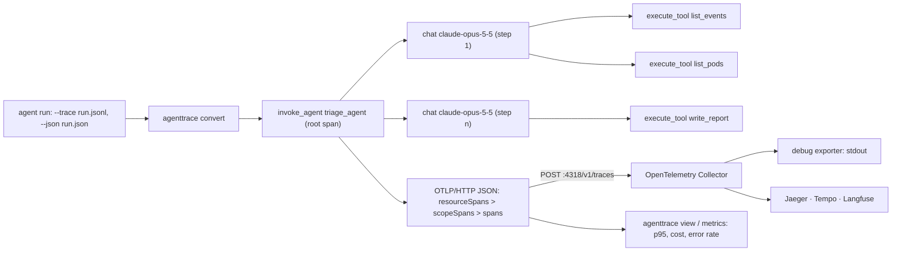

# Trace the Agent Like a Service: OpenTelemetry for LLM Calls

*A model call is a span with tokens and a price on it; export it like any other request and cost, latency and failures become queries.*

## Metadata

| Field | Value |
|---|---|
| Type | Build |
| Languages | Python |
| Prerequisites | [Triage Agent](https://cloudcaptain.io/learn/aiops/incident-triage-agent) |
| Time | 90 minutes |
| Tools | docker, opentelemetry-collector, jaeger, grafana-tempo |

<Quiz stage="pre" />

## The Problem

The triage agent from the previous lesson has been on call for a month. Finance forwards the invoice: three times the estimate. The on-call lead has three questions. Which incidents cost the most? Is the agent getting slower? Why did two runs last Tuesday end without a report? The only records are a directory of `trace.jsonl` files and the cost line the agent prints at the end of every run, which nobody kept. The agent is observable in the way a service is observable when its only instrumentation is `print`.

Every other service in that cluster answers those questions in Grafana, because every request it handles becomes a span: a name, a start and an end, a status, attributes, and a parent. Spans are grouped into traces, traces are aggregated into latency percentiles and error rates, and attributes make the aggregates filterable. A model call is a request too. It has a start, an end and a stop reason, plus two numbers no HTTP call carries, input tokens and output tokens, which multiply into money. A tool call the model asked for is a child request. An agent run is a trace. Nothing about an LLM needs a separate observability system; it needs the same one, with four extra attributes.

You are going to write `agenttrace`: it turns the agent's trace and audit into OpenTelemetry spans named the way the GenAI semantic conventions prescribe, ships them as OTLP/HTTP JSON to a collector you run in Docker, and reads p95 latency per model, cost per run, tool error rate and refusal rate back out of the spans. After that, Jaeger, Tempo, Langfuse and the SDK instrumentation libraries are all implementations of a payload you have built by hand.

## The Concept

A **trace** is a tree of **spans** that share one 16-byte trace id. Each span has an 8-byte span id, the id of its parent, a name, a kind (client, server, internal), a start and an end as nanoseconds since the epoch, a status (unset, ok, error) and typed attributes. The agent run is the root span; each model call is a child; each tool call is a child of the model turn that asked for it. Duration, nesting and attributes are the whole model, and everything a tracing backend shows is a view over them.

**Semantic conventions** decide what the names and attributes are, so one dashboard works for every application: `http.request.method` for HTTP, `db.system.name` for databases. For LLM calls the OpenTelemetry **GenAI** conventions define `gen_ai.operation.name` (`chat`, `execute_tool`, `invoke_agent`), `gen_ai.provider.name`, `gen_ai.request.model`, `gen_ai.response.model`, `gen_ai.usage.input_tokens`, `gen_ai.usage.output_tokens`, `gen_ai.response.finish_reasons`, `gen_ai.tool.name` and `gen_ai.agent.name`, and the span name `operation model` (`chat claude-opus-5-5`). These conventions are in **Development** status: names have already changed once (`gen_ai.system` became `gen_ai.provider.name`) and may change again, so keep them in one place in your code. Everything specific to your agent goes in your own namespace; here it is `triage.*`.

**OTLP** is the wire format. It is protobuf, with a JSON mapping, carried over gRPC on port 4317 or HTTP on 4318. An HTTP export is one `POST /v1/traces` whose body nests `resourceSpans` (who emitted: `service.name`), `scopeSpans` (which instrumentation library) and `spans`. Ids are lowercase hex strings, timestamps are strings of digits because int64 is a string in protobuf JSON, and every attribute is `{key, value}` where the value holds exactly one of `stringValue`, `intValue`, `doubleValue`, `boolValue` or `arrayValue`. A **collector** receives OTLP on one side and exports on the other; it stores nothing, which is why you can test against one that just prints.



Two decisions in the tree deserve a sentence each. Tool spans sit under the model turn that requested them, so "which turn asked for six tool calls" is a question the tree answers; the conventions also allow them as siblings under the agent span. And a refusal is not an error: the HTTP call succeeded and the model answered, so `refusal` is a finish reason you count, while the root span's status says whether the run produced a report.

## Build It

`code/main.py` is `agenttrace`, four subcommands over one span model: `convert` reads the triage agent's `--trace` lines and `--json` outcome and writes OTLP JSON; `view` prints a payload as a tree; `export` POSTs it; `metrics` aggregates many payloads. The HTTP transport is a function argument, so the tests and the `export` logic run without a collector.

### Step 1: a span and its ids

```python
@dataclass
class Span:
    trace_id: str
    span_id: str
    parent_span_id: Optional[str]
    name: str
    kind: int
    start_ns: int
    end_ns: int
    attributes: Dict[str, Any] = field(default_factory=dict)
    status_code: int = STATUS_UNSET
    status_message: str = ""
```

Ids are random bytes rendered as hex, 16 for the trace and 8 for each span, and never all zeros, because the all-zero id means "invalid" in OpenTelemetry. `--seed` makes them reproducible for fixtures and tests:

```python
def _hex(self, nbytes: int) -> str:
    while True:
        value = self.rng.getrandbits(nbytes * 8)
        if value:
            return format(value, f"0{nbytes * 2}x")
```

### Step 2: the names, in one place

```python
SEMCONV_STATUS = "Development"
OPERATION_NAME = "gen_ai.operation.name"
PROVIDER_NAME = "gen_ai.provider.name"
AGENT_NAME = "gen_ai.agent.name"
REQUEST_MODEL = "gen_ai.request.model"
RESPONSE_MODEL = "gen_ai.response.model"
INPUT_TOKENS = "gen_ai.usage.input_tokens"
OUTPUT_TOKENS = "gen_ai.usage.output_tokens"
FINISH_REASONS = "gen_ai.response.finish_reasons"
TOOL_NAME = "gen_ai.tool.name"
```

The triage agent already writes its trace lines with these keys, which is why the converter can read `event.get(INPUT_TOKENS)` straight off a line. When the conventions move, this block is the only thing that changes.

### Step 3: one `chat` span per model call

Each trace line becomes a client span whose duration is the model latency the agent measured, placed right after the previous step on the timeline. Tokens and the price table give the cost per step:

```python
chat = Span(trace_id, ids.span_id(), root.span_id, f"chat {model}", SPAN_KIND_CLIENT, cursor, cursor + int(event.get("elapsed_ms") or 0) * 1_000_000, {
    OPERATION_NAME: "chat",
    PROVIDER_NAME: provider,
    REQUEST_MODEL: model,
    RESPONSE_MODEL: str(event.get(RESPONSE_MODEL) or model),
    INPUT_TOKENS: input_tokens,
    OUTPUT_TOKENS: output_tokens,
    FINISH_REASONS: [str(reason) for reason in (event.get(FINISH_REASONS) or [])],
    STEP: step,
    COST_USD: cost,
})
```

The root span wraps everything: `invoke_agent triage_agent`, total tokens, steps, tool calls, cost (the outcome's figure, which includes cache reads, when it is present) and the stop reason. `stop: report` sets its status to OK; `max_steps`, `max_tokens` or `refusal` set it to ERROR with a message, because a run that produced no report failed at its job even though every call succeeded.

### Step 4: tool calls as children, with honest durations

Every audit entry becomes an `execute_tool` span under the chat span of its step. The audit records what ran and how it ended but not how long it took, so the converter shares the time the run spent outside model calls evenly across the tool calls that actually ran, and says so:

```python
measured = entry.get("elapsed_ms")
estimated = measured is None and outcome in RAN_OUTCOMES
duration_ms = share_ms if estimated else float(measured or 0)
```

`share_ms` is `(elapsed_seconds × 1000 − Σ elapsed_ms) / tool calls that ran`. The span carries `triage.duration_estimated: true` and `view` prints the duration with a `~`. Entries the loop refused (`refused`, `budget`) or handled itself (`report`) take no time and get zero. Failed and refused calls get status ERROR and `error.type` set to the outcome, with the audit detail as the status message. If an entry ever carries its own `elapsed_ms`, the measurement wins; the Easy exercise adds exactly that to the agent.

### Step 5: OTLP JSON

Attribute values are typed by the Python type, with `bool` checked before `int` because in Python a `bool` is an `int`, and integers become strings:

```python
def encode_value(value: Any) -> Dict[str, Any]:
    if isinstance(value, bool):
        return {"boolValue": value}
    if isinstance(value, int):
        return {"intValue": str(value)}
    if isinstance(value, float):
        return {"doubleValue": value}
    if isinstance(value, (list, tuple)):
        return {"arrayValue": {"values": [encode_value(item) for item in value]}}
    return {"stringValue": str(value)}
```

The payload is three nested lists and a resource:

```python
def to_otlp(spans: Sequence[Span], service: str = "triage-agent", scope_name: str = "agenttrace", scope_version: str = "1.0.0") -> Dict[str, Any]:
    return {"resourceSpans": [{"resource": {"attributes": encode_attributes({"service.name": service})}, "scopeSpans": [{"scope": {"name": scope_name, "version": scope_version}, "spans": [encode_span(span) for span in spans]}]}]}
```

`validate_otlp()` checks what a collector would reject: 32 and 16 hex characters for the ids, digit strings for the timestamps, an end not before the start, exactly one typed field per attribute value. `from_otlp()` reads a payload back into spans so `view` and `metrics` work on any OTLP JSON file, not only the ones this tool wrote.

### Step 6: export with an injectable transport

```python
def export(payload: Dict[str, Any], endpoint: str = DEFAULT_ENDPOINT, transport: Transport = urllib_transport, headers: Optional[Dict[str, str]] = None) -> Dict[str, Any]:
    problems = validate_otlp(payload)
    if problems:
        raise ValueError("payload is not valid OTLP JSON: " + "; ".join(problems[:3]))
    body = json.dumps(payload).encode("utf-8")
    status, raw = transport(endpoint, {"content-type": "application/json", **(headers or {})}, body)
```

A collector answers `200` with `{"partialSuccess":{}}`, or with `rejectedSpans` and an `errorMessage` when it dropped some, and `export` reports both. The real transport is `urllib`; a connection refused on 4318 produces a message with the `docker run` line that starts a collector. `--header Authorization=Basic ...` is how the same command reaches Langfuse or Grafana Cloud.

### Step 7: read it back: `view` and `metrics`

`view` sorts children by start time and prints a tree with the duration, tokens, cost and finish reason of each chat span and the outcome of each tool span. `metrics` groups spans by trace id and computes what a dashboard would:

```python
def percentile(values: Sequence[float], pct: float) -> float:
    if not values:
        return 0.0
    ordered = sorted(values)
    rank = max(1, math.ceil(pct / 100 * len(ordered)))
    return float(ordered[rank - 1])
```

Per model, p50 and p95 of chat latency; per run, mean and p95 of tokens, cost and tool calls; the tool error rate as ERROR tool spans over all tool requests; runs without a report; the refusal rate from finish reasons and stop reasons. Nearest-rank percentiles are what Prometheus histograms approximate and what you can check by hand against nine numbers.

### Step 8: run it

Three recorded runs of the triage agent live in `code/fixtures/`: the CrashLoopBackOff investigation from the previous lesson on Opus, an OOMKilled triage on Sonnet, and a run that re-read the same log until `max_steps`.

```bash
python3 code/main.py convert --trace code/fixtures/crashloop.trace.jsonl --outcome code/fixtures/crashloop.outcome.json --start 2026-11-01T02:03:00Z -o /tmp/crashloop.otlp.json
python3 code/main.py view /tmp/crashloop.otlp.json
```

```text
trace 6513270e  triage-agent  2026-11-01 02:03:00Z  21.4 s
└─ invoke_agent triage_agent            21400 ms   5 steps  4 tool calls  16600 in / 550 out  $0.0774  stop report  violations 1
   ├─ chat claude-opus-5-5                  3120 ms   step 1  1800 in / 90 out  $0.0090  tool_use
   │  ├─ execute_tool list_events              ~832 ms   ok
   │  └─ execute_tool list_pods                ~832 ms   ok
   ├─ chat claude-opus-5-5                  2480 ms   step 2  2600 in / 70 out  $0.0118  tool_use
   │  └─ execute_tool describe_pod             ~832 ms   ok
   ├─ chat claude-opus-5-5                  2210 ms   step 3  3400 in / 60 out  $0.0148  tool_use
   │  └─ execute_tool pod_logs                 ~832 ms   ok
   ├─ chat claude-opus-5-5                  4870 ms   step 4  4100 in / 120 out  $0.0188  tool_use
   │  ├─ execute_tool run_kubectl                 0 ms   refused  unknown tool  ERROR
   │  └─ execute_tool propose_action              0 ms   refused  action kind not enabled  ERROR
   └─ chat claude-opus-5-5                  5390 ms   step 5  4700 in / 210 out  $0.0230  tool_use
      └─ execute_tool write_report                0 ms   report
```

Input tokens grow every step because the whole conversation is re-sent; the injection attempt from step 4 is two ERROR spans. Now the other two runs and the aggregate:

```bash
for run in oomkilled maxsteps; do
  python3 code/main.py convert --trace code/fixtures/$run.trace.jsonl --outcome code/fixtures/$run.outcome.json -o /tmp/$run.otlp.json
done
python3 code/main.py metrics /tmp/*.otlp.json
python3 code/main.py metrics /tmp/*.otlp.json --json | head -12
```

```text
runs: 3   stops: max_steps=1, report=2
  chat latency claude-opus-5-5      p50     2800 ms   p95     5390 ms   (9 spans)
  chat latency claude-sonnet-5-5    p50     1900 ms   p95     2600 ms   (3 spans)
  tokens per run        mean 15100 in / 377 out   p95 20200 in
  cost per run          mean $0.0614   p95 $0.0866   total $0.1842
  tool calls per run    mean 3.3   p95 4
  tool error rate       25.0%
  runs without report   1/3
```

Then a run of your own. The triage agent writes both inputs; replay it with a fake `kubectl` as in the previous lesson, or live with an API key:

```bash
printf '#!/bin/sh\necho "fake-kubectl $*"\n' > /tmp/fakebin-kubectl && mkdir -p /tmp/fakebin && mv /tmp/fakebin-kubectl /tmp/fakebin/kubectl && chmod +x /tmp/fakebin/kubectl
PATH=/tmp/fakebin:$PATH python3 ../02-incident-triage-agent/code/main.py "checkout is in CrashLoopBackOff" \
  --mcp "python3 ../01-mcp-kubectl-server/code/main.py --allow-namespaces default --quiet" \
  --replay ../02-incident-triage-agent/code/fixtures/replay-crashloop.json --namespaces default \
  --trace /tmp/run.jsonl --json > /tmp/run.json
python3 code/main.py convert --trace /tmp/run.jsonl --outcome /tmp/run.json -o /tmp/run.otlp.json && python3 code/main.py view /tmp/run.otlp.json
```

<RunTests />

## Use It

The payload you built is what every OpenTelemetry backend ingests. Start with the collector (current release <ToolVersion name="opentelemetry-collector" />) and an exporter that prints, so you can see your spans arrive before any UI is involved:

```bash
cat > /tmp/collector.yaml <<'EOF'
receivers:
  otlp:
    protocols:
      http:
        endpoint: 0.0.0.0:4318
exporters:
  debug:
    verbosity: detailed
service:
  pipelines:
    traces:
      receivers: [otlp]
      exporters: [debug]
EOF
docker run --rm -d --name otelcol -p 4318:4318 -v /tmp/collector.yaml:/etc/otelcol-contrib/config.yaml:ro otel/opentelemetry-collector-contrib
python3 code/main.py export /tmp/crashloop.otlp.json                  # 13 spans (…bytes) accepted by http://localhost:4318/v1/traces
docker logs otelcol 2>&1 | grep -E 'Name +:|gen_ai\.' | head -24      # Name : chat claude-opus-5-5, -> gen_ai.usage.input_tokens: Int(1800) …
docker rm -f otelcol
```

The `endpoint: 0.0.0.0:4318` line matters: recent collector releases bind the OTLP receiver to localhost by default, which inside a container is unreachable from the published port. The `debug` exporter replaced the older `logging` exporter, which has been removed.

Jaeger v2 is built on the collector and accepts OTLP directly, so the same `export` fills a UI:

```bash
docker run --rm -d --name jaeger -p 16686:16686 -p 4318:4318 jaegertracing/jaeger:2.22.0
python3 code/main.py export /tmp/*.otlp.json
curl -s 'localhost:16686/api/traces?service=triage-agent&limit=5' | python3 -c 'import json,sys; d=json.load(sys.stdin)["data"]; print(len(d), "traces with", [len(t["spans"]) for t in d], "spans")'
```

Browse to `http://localhost:16686`, pick the `triage-agent` service and open a trace: the same tree as `view`, with the attributes on each span, and the `~832 ms` tool spans now visibly uniform, which is the estimate showing. In production the spans go to Grafana Tempo instead, and TraceQL asks the questions `metrics` answered from files:

```text
{ resource.service.name = "triage-agent" && span.gen_ai.operation.name = "chat" } | quantile_over_time(duration, .95) by (span.gen_ai.request.model)
{ span.gen_ai.operation.name = "execute_tool" && status = error } | rate() by (span.gen_ai.tool.name)
{ span.gen_ai.operation.name = "invoke_agent" && span.triage.stop != "report" }
```

With the collector's `spanmetrics` connector in the pipeline, the same spans also become Prometheus histograms and counters, and a `histogram_quantile(0.95, …)` over the duration buckets filtered by `span_name=~"chat .*"` is the p95 panel; the exact metric names depend on the connector's `namespace` setting, so read them off `/metrics` before writing the dashboard.

You will not normally write the converter. Instrumentation libraries for the provider SDKs (packages named along the lines of `opentelemetry-instrumentation-anthropic`, from the OpenTelemetry contrib ecosystem and from vendors) wrap `client.messages.create()` and emit the `chat` span at call time with these attribute names, and the OpenTelemetry SDK's `BatchSpanProcessor` and `OTLPSpanExporter` do what `export` does with batching and retries. Check which semantic-convention version a library targets before relying on a saved query. Claude Code can send its own OpenTelemetry metrics and events to the same collector through the standard environment variables (`CLAUDE_CODE_ENABLE_TELEMETRY=1`, `OTEL_EXPORTER_OTLP_ENDPOINT`), and LLM-specific stores such as Langfuse and Arize Phoenix accept OTLP traces on their own `/v1/traces` endpoints, adding prompt and response content views that a generic tracing UI does not have.

| What you built | Real tool | Note |
|---|---|---|
| `Span` dataclass with GenAI attribute names | OpenTelemetry SDK `tracer.start_as_current_span("chat claude-opus-5-5")` and the `opentelemetry-semantic-conventions` package | the SDK adds context propagation, sampling and resource detection |
| `convert` from the agent's trace file | an instrumentation library wrapping the SDK client | the span is created around the call; no file in between, and tool time is measured |
| `to_otlp` JSON | `OTLPSpanExporter` (protobuf over HTTP or gRPC) | binary protobuf on the wire by default; JSON is what you read by hand |
| `export` with `urllib` | `BatchSpanProcessor` | batches, retries with backoff, drops under backpressure |
| `view` | Jaeger UI, Grafana Explore | click a span for its attributes and status |
| `metrics` p50/p95, cost, error rate | TraceQL metrics, the `spanmetrics` connector, Langfuse and Phoenix dashboards | yours works offline on files |
| `triage.duration_estimated` | nothing | real instrumentation times the tool call itself |

What to alert on, from the numbers you now have per run: cost per run above 1.5 times last week's p95; tool calls per run above half the loop's budget; any run whose root status is not OK when the agent runs unattended; refusal rate above a few percent; p95 chat latency per model doubling; tool error rate above 10%. Each of those is one query over the attributes in this lesson.

<Quiz stage="check" />

## Ship It

Two artifacts in `outputs/`:

- **`skill-llm-trace-review.md`**: a runbook for reading an agent run's trace: get the tree, account for the time (model, tools, remainder, marking estimates), account for the tokens and the money, account for the outcome (stop reason, refused and failed tool spans, refusals), a decision table from trace pattern to cause to fix, the six alerts to set with starting thresholds, and the report format.
- **`prompt-trace-dashboard-spec.md`**: paste `agenttrace metrics --json` output and name your backend; the prompt returns a dashboard specification with rows and panels, TraceQL and PromQL queries, alert rules whose thresholds are derived from the pasted numbers, the attribute names the dashboard depends on with the Development-status caveat, and open questions.

<ShipIt />

## Exercises

### Easy

Make the `~` go away. In the triage agent, time each tool dispatch with the same clock it uses for model calls and add `elapsed_ms` to the audit entry; `agenttrace` already prefers a measured value. Test first: an outcome fixture whose entries carry `elapsed_ms` must produce tool spans with `triage.duration_estimated` false and the measured durations, and `view` must print no tilde.

### Medium

Add cache accounting. The trace line only carries input and output tokens, so a run with a cached system prompt looks as expensive as one without. Write the test first: a chat span with `triage.cache_read_tokens` prices them at the cache-read rate, the root sums them, and `metrics` reports a cache hit ratio per run (cache reads over cache reads plus input tokens). Then add `cache_read_input_tokens` to the agent's trace line, export a replayed and a live run to Jaeger and compare the two ratios.

### Hard

Replace the converter with live instrumentation. Using the OpenTelemetry Python SDK and the OTLP/HTTP exporter, open a `chat` span around each model call and an `execute_tool` span around each dispatch inside the triage agent, with the same attribute names, and pass the trace context to the MCP server (an environment variable at spawn time or the request's `_meta`) so the server's `kubectl` runs appear as grandchildren. Run the same replay through both paths and assert, with a test that reads both OTLP payloads, that the chat durations agree within 50 ms and that no span in the live trace is estimated.

<Quiz stage="post" />

## Key Terms

| Term | Common misconception | Precise definition |
|---|---|---|
| Span | "A log line with a duration." | A named operation with a start and an end in nanoseconds, its own id, the trace id, a parent id, typed attributes and a status; the unit everything else aggregates. |
| Trace | "The agent's transcript." | All spans sharing one trace id, forming a tree from the root; the transcript is content, the trace is timing, structure, status and cost. |
| Semantic conventions | "Any attribute name works." | The agreed names (`gen_ai.usage.input_tokens`) that let one dashboard serve every application; the GenAI set is in Development status and has already renamed `gen_ai.system` to `gen_ai.provider.name`. |
| OTLP | "A Jaeger format." | The OpenTelemetry protocol: protobuf messages over gRPC (4317) or HTTP (4318), with a JSON mapping in which ids are hex strings and int64 values are strings; every current backend speaks it. |
| Collector | "A database." | A stateless process with receivers on one side, exporters on the other and processors between (batch, filter, `spanmetrics`); it holds nothing, so a `debug` exporter is a complete test setup. |
| Resource and scope | "All metadata is the same." | Resource attributes say who emitted (`service.name`), scope says which library instrumented, span attributes describe this operation; backends filter at each level. |
| Finish reason | "An error code." | Why the model stopped (`tool_use`, `end_turn`, `max_tokens`, `refusal`); a refusal is a successful HTTP call, so it is an attribute to count, not a span error. |
| p95 | "Roughly the average." | The value below which 95% of samples fall (nearest rank here); a loop that re-reads logs moves p95 tool calls per run long before it moves the mean. |

## Further Reading

- [Observability & SRE](https://cloudcaptain.io/docs/tools/observability): the tooling landscape this lesson plugs an agent into, from Prometheus and Grafana to Jaeger and OpenTelemetry.
- [AI/ML Ops learning path](https://cloudcaptain.io/docs/learning-paths/ai-ml): where LLM observability sits next to serving, evaluation and cost management.
- [Docker Fundamentals](https://cloudcaptain.io/docs/tools/docker/fundamentals): `docker run -d -p -v` and `docker logs`, everything the collector and Jaeger steps rely on.
- [OpenTelemetry semantic conventions for generative AI](https://opentelemetry.io/docs/specs/semconv/gen-ai/): the attribute names, span names and the Development-status notice, from the source.
- [OTLP specification](https://opentelemetry.io/docs/specs/otlp/): the request shape, the `/v1/traces` path, `partialSuccess`, and the JSON encoding rules for ids and int64.
- [Protobuf JSON mapping](https://protobuf.dev/programming-guides/json/): why `intValue` is a string and enums are integers.
- [Collector debug exporter](https://github.com/open-telemetry/opentelemetry-collector/blob/main/exporter/debugexporter/README.md): the `verbosity` levels and the output format you grep in the smoke test.
- [Jaeger documentation](https://www.jaegertracing.io/docs/latest/): v2 architecture on the collector, the all-in-one image and its OTLP ports.
- [TraceQL](https://grafana.com/docs/tempo/latest/traceql/): the query language behind the Tempo examples, including metrics queries such as `quantile_over_time`.
