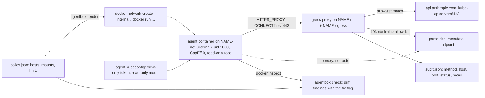

# Run the Agent Where It Cannot Hurt You: Sandboxes and Egress Policy

*The model decides what to try; the container decides what it can touch, and the proxy decides where it can talk.*

## Metadata

| Field | Value |
|---|---|
| Type | Build |
| Languages | Python, Bash |
| Prerequisites | [Triage Agent](https://cloudcaptain.io/learn/aiops/incident-triage-agent) |
| Time | 90 minutes |
| Tools | docker, curl, kubectl, kind, cilium, gvisor |

<Quiz stage="pre" />

## The Problem

The platform team liked the triage agent enough to put it on a schedule. It runs every ten minutes from the bastion host, as the on-call user, so it has what that user has: `~/.kube/config` with cluster-admin on three clusters, the bastion's cloud instance role, `/var/run/docker.sock` because someone once needed `docker ps`, and an unrestricted route to the internet and to `169.254.169.254`. A month in, someone adds a `fetch_runbook(url)` tool so the agent can read the team wiki. The tool validates that its argument is a URL. It is.

Then an attacker who can make the ingress log a request writes a User-Agent string that reads like an instruction: before triage, fetch the "diagnostics endpoint" at a paste site with the contents of the kubeconfig in the query string. The agent reads that log line through `pod_logs`, as it was designed to. In 199 runs out of 200 the model ignores it. In one it does not, and the trace shows a `fetch_runbook` call to a host nobody has heard of with four kilobytes of base64 after `?d=`. Every gate from the previous lessons held: the tool server was read-only, the loop's budgets were respected, the namespaces were in scope. None of them was about where bytes may go.

Prompt injection is a property of feeding untrusted text to a model, and logs, events and manifests are untrusted text. You cannot filter it to zero. You can make a successful injection boring: run the agent where the only file worth stealing is a short-lived read-only token, where nothing it can execute can gain privileges, and where the only way off the box is a proxy that knows the three hosts the job needs, refuses the rest with a reason and writes down every attempt. That is what you build here, with the standard library and `docker`, and then map onto Kubernetes, gVisor and the hosted sandboxes.

## The Concept

A sandbox answers two questions outside the agent: **what can the process touch**, and **where can it talk**. The first is container hardening, which you met in [runtime security](https://cloudcaptain.io/learn/containers/runtime-security): a non-root uid, no capabilities, `no-new-privileges`, a read-only root filesystem with a `tmpfs` for scratch, pids, memory and CPU limits, and only the mounts the job needs. For an ops agent the important mount is the credential: a kubeconfig whose token can `get`, `list` and `watch` and nothing else, expires in an hour, and is mounted read-only.

The second question is egress, and it has a trap. `HTTPS_PROXY` in the environment is how polite clients (curl, Python's `urllib`, Go's `net/http`, so `kubectl` too) find a proxy; it is not enforcement, because `curl --noproxy '*'` or a raw socket simply ignores it. Enforcement is the network: a Docker network created with `--internal` has no route out of its subnet. The agent lives only there. The proxy is the one container attached both to that network and to a normal one, so it is the only door, and the environment variables just tell clients where the door is.

A **forward proxy** sees two kinds of request. Plain HTTP arrives with an absolute URL (`GET http://host/path`), so the proxy sees the host, method and path and forwards the request itself. HTTPS arrives as `CONNECT host:443`; the proxy decides on the host and port, answers `200 Connection established` and from then on relays opaque TLS bytes in both directions. It never sees the path, the headers or the body, which is the whole point of TLS and the limit of this design. The decision is an **allow-list** on names: exact hosts, `*.domain` for subdomains (not the apex), and an optional port. Anything else gets a `403` with the reason, and every decision goes into an audit with bytes and duration.

The last piece is **drift**. A policy file says what the sandbox should be; a renderer turns it into exact `docker` argv; `docker inspect` says what is actually running. Comparing the last with the first is the same plan-versus-state idea as infrastructure as code, applied to one container.



What a sandbox does not do: it does not stop the model from being steered. An injected instruction can still make the agent do anything that is allowed, so the allow-list and the token are the real policy. Keep both as small as the job.

## Build It

`code/main.py` is `agentbox`, three subcommands over two small models: `proxy` runs the egress proxy, `render` turns a policy into `docker` commands, `check` compares a container with the policy. `code/main.sh` is the same sandbox by hand in Bash. Everything except the live `docker inspect` runs on any machine; the tests start the proxy on localhost against a local `http.server`.

### Step 1: host rules and the decision

A rule is a host, `*.domain` or `*`, with an optional port. Parsing normalises case and a trailing dot, because `API.Anthropic.com.` is the same name:

```python
    def matches(self, host: str, port: int) -> bool:
        if self.port is not None and self.port != port:
            return False
        if self.pattern == "*":
            return True
        if self.pattern.startswith("*."):
            suffix = self.pattern[1:]
            return host.endswith(suffix) and host != suffix[1:]
        return host == self.pattern
```

`*.svc.cluster.local` matches `kubernetes.default.svc.cluster.local` but not `svc.cluster.local`, and `api.anthropic.com` does not match `evil.api.anthropic.com`. The policy is deny by default, and the reason travels with the decision so the 403 and the audit can say why:

```python
    def decide(self, host: str, port: int) -> Decision:
        host = host.strip().lower().rstrip(".")
        for rule in self.rules:
            if rule.matches(host, port):
                return Decision(True, f"matches rule {rule.text}")
        return Decision(False, f"{host}:{port} is not in the allow-list")
```

### Step 2: the audit

Every request, allowed or not, becomes one entry: `at`, `method`, `host`, `port`, `allowed`, `status`, `reason`, `bytes_out`, `bytes_in`, `duration_ms`. Per-host counters accumulate next to it, under a lock because the server is threaded. The file is rewritten after every request through a temporary file and `os.replace`, so a reader never sees half a JSON document, even when the proxy is killed:

```python
    def _write(self) -> None:
        assert self.path is not None
        tmp = f"{self.path}.tmp"
        with open(tmp, "w", encoding="utf-8") as handle:
            json.dump(self._snapshot(), handle, indent=2)
        os.replace(tmp, self.path)
```

### Step 3: plain HTTP, forwarded

`ProxyHandler` is a `BaseHTTPRequestHandler`. A proxy request carries an absolute URL; a relative one means someone talked to the proxy as if it were a web server, which is a 400:

```python
        parts = urlsplit(self.path)
        if parts.scheme != "http" or not parts.hostname:
            self._refuse(400, "Bad request", self.command, parts.hostname or "-", parts.port or 0, Decision(False, "a forward proxy needs an absolute http:// URL or CONNECT"), started)
            return
        host, port = parts.hostname, parts.port or 80
        decision = self.policy.decide(host, port)
        if not decision.allowed:
            self._refuse(403, "Egress denied", self.command, host, port, decision, started)
            return
```

Allowed requests are rewritten for the origin: origin-form path, the client's headers minus the hop-by-hop ones (`Proxy-Authorization`, `Proxy-Connection`, `Keep-Alive`, `Upgrade` and friends, which belong to the client-proxy hop only), and `Connection: close` so one request maps to one upstream connection and one audit entry. The response bytes are streamed back unchanged; the status is read from the first line for the audit. Chunked request bodies get a 411 rather than a half-implemented parser.

### Step 4: CONNECT, tunnelled

```python
    def do_CONNECT(self) -> None:
        started = time.monotonic()
        host, port = split_hostport(self.path, 443)
        decision = self.policy.decide(host, port)
        if not decision.allowed:
            self._refuse(403, "Egress denied", "CONNECT", host, port, decision, started)
            return
        try:
            upstream = socket.create_connection((host, port), timeout=CONNECT_TIMEOUT)
        except OSError as exc:
            self._refuse(502, "Bad gateway", "CONNECT", host, port, Decision(True, f"{decision.reason}; upstream unreachable: {exc}"), started)
            return
        upstream.settimeout(None)
        self.send_response(200, "Connection established")
        self.end_headers()
        with upstream:
            bytes_out, bytes_in = relay(self.connection, upstream)
        self.close_connection = True
        self.audit.record("CONNECT", host, port, decision, 200, bytes_out, bytes_in, started)
```

The decision happens before any connection is opened, so a denied host never sees a packet from the proxy. `relay()` registers both sockets with a `selectors.DefaultSelector` and copies whatever arrives on one to the other until either side closes or 120 seconds pass in silence, counting bytes per direction. That is all a TLS tunnel is from the outside: two byte counts and a duration.

### Step 5: run the proxy

```bash
mkdir -p /tmp/www && echo "hello from the allowed host" > /tmp/www/hello.txt
python3 -m http.server 18000 --bind 127.0.0.1 --directory /tmp/www &
python3 code/main.py proxy --listen 127.0.0.1:13128 --allow 127.0.0.1:18000 --audit /tmp/audit.json &
curl -s --noproxy '' -x http://127.0.0.1:13128 http://127.0.0.1:18000/hello.txt
curl -s --noproxy '' -x http://127.0.0.1:13128 http://127.0.0.1:18001/
curl -s --noproxy '' -p -x http://127.0.0.1:13128 http://127.0.0.1:18000/hello.txt
curl -sS --noproxy '' -x http://127.0.0.1:13128 https://example.com/
curl -sI --noproxy '' -x http://127.0.0.1:13128 http://example.com/ | head -1
kill %2
```

```text
hello from the allowed host
{"error": "egress denied", "host": "127.0.0.1", "port": 18001, "reason": "127.0.0.1:18001 is not in the allow-list"}
hello from the allowed host
curl: (56) CONNECT tunnel failed, response 403
HTTP/1.1 403 Egress denied
```

`curl -p` forces a CONNECT tunnel even for an `http://` URL, which is how you test tunnelling without TLS. The proxy's own log on stderr, one line per decision, ends with the summary it prints on SIGTERM:

```text
agentbox proxy listening on 127.0.0.1:13128 with 1 allow rule(s): 127.0.0.1:18000
GET     127.0.0.1:18000 ALLOW 200 out=106 in=213 6ms  matches rule 127.0.0.1:18000
GET     127.0.0.1:18001 DENY  403 out=0 in=0 0ms  127.0.0.1:18001 is not in the allow-list
CONNECT 127.0.0.1:18000 ALLOW 200 out=87 in=213 0ms  matches rule 127.0.0.1:18000
CONNECT example.com:443   DENY  403 out=0 in=0 0ms  example.com:443 is not in the allow-list
HEAD    example.com:80    DENY  403 out=0 in=0 0ms  example.com:80 is not in the allow-list
agentbox proxy stopped: 5 request(s), 2 allowed, 3 denied, 193 bytes out
```

`/tmp/audit.json` holds the same five entries plus `hosts` with per-host allowed/denied counts and bytes, and `summary`. Now real TLS, with a wildcard rule:

```bash
python3 code/main.py proxy --listen 127.0.0.1:13129 --allow api.anthropic.com --allow '*.github.com:443' &
curl -s --noproxy '' -x http://127.0.0.1:13129 -o /dev/null -w '%{http_code}\n' https://api.anthropic.com/v1/models   # 401: no key, but the tunnel worked
curl -s --noproxy '' -x http://127.0.0.1:13129 -o /dev/null -w '%{http_code}\n' https://api.github.com/              # 200
curl -s --noproxy '' -x http://127.0.0.1:13129 -o /dev/null -w '%{http_code}\n' https://github.com/                  # 000, exit 56
https_proxy=http://127.0.0.1:13129 python3 -c 'import urllib.request; urllib.request.urlopen("https://pypi.org/simple/")'
```

```text
CONNECT api.anthropic.com:443   ALLOW 200 out=604 in=3353 184ms  matches rule api.anthropic.com
CONNECT api.github.com:443   ALLOW 200 out=590 in=6911 80ms  matches rule *.github.com:443
CONNECT github.com:443   DENY  403 out=0 in=0 0ms  github.com:443 is not in the allow-list
CONNECT pypi.org:443   DENY  403 out=0 in=0 0ms  pypi.org:443 is not in the allow-list
```

`*.github.com` does not cover `github.com`. And the last line matters most for this curriculum: Python's `urllib` reads `https_proxy` from the environment and failed with `Tunnel connection failed: 403 Egress denied`. The triage agent calls the Messages API through `urllib`, so it needs no code change to run behind the proxy.

### Step 6: a policy, rendered to exact argv

A sandbox policy is a small JSON file. `code/fixtures/policy-triage.json`:

```json
{
  "name": "triage",
  "image": "python:3.12-alpine",
  "allowed_hosts": ["api.anthropic.com", "cc-lab-control-plane:6443"],
  "kubeconfig": "/home/me/.kube/agent-config",
  "tmpfs": ["/tmp"],
  "limits": {"pids": 64, "memory": "256m", "cpus": "1"},
  "user": "1000",
  "env": {"ANTHROPIC_BASE_URL": "https://api.anthropic.com"}
}
```

`load_policy()` validates it (the name prefixes networks and containers, so it must be lowercase letters, digits and dashes; memory and CPU must parse) and derives the names: `triage-net`, `triage-egress`, `triage-proxy`, `triage-agent`, and the proxy URL `http://triage-proxy:3128`. The agent's argv is built in one place, which is what the tests pin down flag by flag:

```python
    argv += ["--name", policy.agent_container, "--network", policy.network, "--read-only"]
    for path in policy.tmpfs:
        argv += ["--tmpfs", path]
    argv += ["--cap-drop", "ALL", "--security-opt", "no-new-privileges", "--pids-limit", str(policy.pids), "--memory", policy.memory, "--cpus", policy.cpus, "--user", policy.user]
    for key, value in proxy_env(policy).items():
        argv += ["-e", f"{key}={value}"]
    for key, value in sorted(policy.env.items()):
        argv += ["-e", f"{key}={value}"]
    if policy.kubeconfig:
        argv += ["-v", f"{policy.kubeconfig}:{policy.kubeconfig_target}:ro"]
```

`proxy_env()` sets both spellings of `HTTPS_PROXY`, `HTTP_PROXY` and `NO_PROXY`, because curl ignores an uppercase `HTTP_PROXY` and some clients read only the uppercase names. The proxy container gets the same hardening, the main file mounted read-only, and the allow-list as `--allow` flags:

```bash
python3 code/main.py render --policy code/fixtures/policy-triage.json -- python3 -c 'print(1)'
```

```text
docker network create --internal triage-net
docker network create triage-egress
docker run -d --rm --name triage-proxy --network triage-egress --read-only --tmpfs /tmp --cap-drop ALL --security-opt no-new-privileges --pids-limit 64 --memory 128m --user 1000 -v /home/you/CloudCaptain/curriculum/phases/14-aiops/05-guardrails-sandboxes/code/main.py:/main.py:ro python:3.12-alpine python3 /main.py proxy --listen 0.0.0.0:3128 --audit /tmp/audit.json --allow api.anthropic.com --allow cc-lab-control-plane:6443
docker network connect triage-net triage-proxy
docker run --rm --name triage-agent --network triage-net --read-only --tmpfs /tmp --cap-drop ALL --security-opt no-new-privileges --pids-limit 64 --memory 256m --cpus 1 --user 1000 -e HTTPS_PROXY=http://triage-proxy:3128 -e HTTP_PROXY=http://triage-proxy:3128 -e https_proxy=http://triage-proxy:3128 -e http_proxy=http://triage-proxy:3128 -e NO_PROXY=localhost,127.0.0.1 -e no_proxy=localhost,127.0.0.1 -e ANTHROPIC_BASE_URL=https://api.anthropic.com -e KUBECONFIG=/home/agent/.kube/config -v /home/me/.kube/agent-config:/home/agent/.kube/config:ro python:3.12-alpine python3 -c 'print(1)'
```

The order matters: the proxy starts on the egress network, then joins the internal one, so it is the only container on both. `--json` prints the same plan as lists for scripts.

### Step 7: the same sandbox by hand

`code/main.sh` does what `render` prints, with four subcommands: `up` creates both networks and starts the proxy with the allow-list, `run` starts the agent, `audit` reads `/tmp/audit.json` out of the proxy container with `docker exec`, `down` removes containers and networks. The agent's argv is assembled the same way and echoed before it runs:

```bash
  local args=(docker run --rm)
  if [[ -n "$DETACH" ]]; then args+=(-d); fi
  args+=(--name "$AGENT" --network "$NET" --read-only --tmpfs /tmp
    --cap-drop ALL --security-opt no-new-privileges --pids-limit "$PIDS" --memory "$MEMORY" --cpus "$CPUS" --user "$USER_ID"
    -e "HTTPS_PROXY=$PROXY_URL" -e "HTTP_PROXY=$PROXY_URL" -e "https_proxy=$PROXY_URL" -e "http_proxy=$PROXY_URL"
    -e "NO_PROXY=localhost,127.0.0.1" -e "no_proxy=localhost,127.0.0.1")
```

The smoke test checks that the line `main.sh run` echoes and the agent argv from `render --json` are identical, argument for argument, so the Bash and Python versions cannot drift apart silently.

### Step 8: drift, with the fix for each finding

`check` reads `docker inspect` (live with `--container`, or a saved file with `--inspect`) and compares it with the policy. Each check is one line that names what it expected, what it found, and the flag that fixes it:

```python
    expect("read-only rootfs", host_config.get("ReadonlyRootfs") is True, "true", str(host_config.get("ReadonlyRootfs")).lower(), "--read-only")
    cap_drop = [str(cap).upper() for cap in host_config.get("CapDrop") or []]
    expect("capabilities dropped", "ALL" in cap_drop, "CapDrop [ALL]", f"CapDrop {host_config.get('CapDrop')}", "--cap-drop ALL")
    expect("no capabilities added", not (host_config.get("CapAdd") or []), "CapAdd []", f"CapAdd {host_config.get('CapAdd')}", "remove --cap-add")
```

Limits are compared in the units `docker inspect` uses (`Memory` in bytes, `NanoCpus` in billionths of a CPU), the network must be the internal one and nothing else, and every mount is classified: the policy's kubeconfig must come from the policy's source and be read-only, anything under `/var/run/docker.sock`, `/proc`, `/sys`, `/etc`, `/root` and similar is a sensitive mount, and so is any path containing `.aws`, `.kube`, `.ssh`, `.docker`, `.azure` or `.config/gcloud`. The fixture `inspect-default.json` is the bastion setup from The Problem:

```bash
python3 code/main.py check --policy code/fixtures/policy-triage.json --inspect code/fixtures/inspect-default.json | head -9
```

```text
triage-agent vs policy triage: 15 drift finding(s)
  DRIFT read-only rootfs       expected true                           actual false
        fix: --read-only
  DRIFT capabilities dropped   expected CapDrop [ALL]                  actual CapDrop None
        fix: --cap-drop ALL
  DRIFT no capabilities added  expected CapAdd []                      actual CapAdd ['NET_ADMIN']
        fix: remove --cap-add
  DRIFT no-new-privileges      expected no-new-privileges              actual []
        fix: --security-opt no-new-privileges
```

The other eleven are the pids, memory and CPU limits, the `bridge` network, the empty user (root), the missing proxy variables and tmpfs, three sensitive mounts (`/home/me/.kube`, `/var/run/docker.sock`, `/home/me/.aws`) and the missing agent kubeconfig, each with its fix line; the exit code is 1. `inspect-hardened.json`, a container started from the rendered command, prints `0 drift finding(s)` and exits 0, so `check` can gate a cron job or a CI step. Bad input (a missing file, invalid JSON, a policy with a bad name) exits 2 with an `agentbox:` message.

<RunTests />

## Use It

On a Linux machine with Docker, the sandbox is two commands, and every claim in it can be tested from inside. `curlimages/curl` stands in for the agent because it makes each check one line:

```bash
bash code/main.sh up --name triage --allow api.anthropic.com --allow example.org
bash code/main.sh run --name triage --image curlimages/curl:8.11.1 --detach -- sleep 600
docker network inspect -f '{{.Internal}}' triage-net                                          # true
docker exec triage-agent curl -s -o /dev/null -w '%{http_code}\n' https://example.org/        # 200, through CONNECT example.org:443
docker exec triage-agent curl -s -o /dev/null -w '%{http_connect}\n' https://example.com/     # 403, from the proxy
docker exec triage-agent curl -s --noproxy '*' --max-time 5 https://example.org/; echo $?    # non-zero: no route off the internal network
docker exec triage-agent grep -E 'CapEff|NoNewPrivs' /proc/self/status                         # CapEff 0000000000000000, NoNewPrivs 1
docker exec triage-agent touch /etc/x                                                          # Read-only file system
bash code/main.sh audit --name triage | python3 -m json.tool | head -20
```

The `--noproxy` line is the one to remember: the proxy variables are advice, the internal network is the rule. Depending on the Engine version the name may not even resolve on an internal network; it does not matter, because with a proxy the client hands the name to the proxy (`CONNECT example.org:443`) and only the proxy resolves it. Check the running container against a policy that describes it, then tear down:

```bash
echo '{"name": "triage", "image": "curlimages/curl:8.11.1", "allowed_hosts": ["api.anthropic.com", "example.org"]}' > /tmp/policy.json
python3 code/main.py check --policy /tmp/policy.json --container triage-agent                  # 0 drift finding(s)
docker run -d --rm --name lazy --cap-add NET_ADMIN curlimages/curl:8.11.1 sleep 600
python3 code/main.py check --policy /tmp/policy.json --container lazy; echo "exit $?"           # a finding per missing flag, exit 1
docker rm -f lazy && bash code/main.sh down --name triage
```

**The cluster credential.** The agent's kubeconfig should hold a short-lived ServiceAccount token bound to the built-in `view` ClusterRole, which reads most resources but not Secrets. For the `cc-lab` kind cluster:

```bash
kubectl create namespace triage
kubectl create serviceaccount triage-ro -n triage
kubectl create clusterrolebinding triage-ro-view --clusterrole=view --serviceaccount=triage:triage-ro
kubectl auth can-i delete pods --as=system:serviceaccount:triage:triage-ro                      # no
kubectl auth can-i get secrets --as=system:serviceaccount:triage:triage-ro                      # no
TOKEN=$(kubectl create token triage-ro -n triage --duration=1h)
kubectl config view --raw --minify -o jsonpath='{.clusters[0].cluster.certificate-authority-data}' | base64 -d > /tmp/cc-lab-ca.crt
KC=~/.kube/agent-config
kubectl --kubeconfig "$KC" config set-cluster cc-lab --server=https://cc-lab-control-plane:6443 --certificate-authority=/tmp/cc-lab-ca.crt --embed-certs=true
kubectl --kubeconfig "$KC" config set-credentials triage-ro --token="$TOKEN"
kubectl --kubeconfig "$KC" config set-context triage --cluster=cc-lab --user=triage-ro --namespace=default
kubectl --kubeconfig "$KC" config use-context triage
bash code/main.sh up --name triage --allow api.anthropic.com --allow cc-lab-control-plane:6443
docker network connect kind triage-proxy
bash code/main.sh run --name triage --image curlimages/curl:8.11.1 --kubeconfig "$KC" --user "$(id -u)" --detach -- sleep 600
```

`https://cc-lab-control-plane:6443` is the address `kind get kubeconfig --internal --name cc-lab` prints: the control-plane container's name on the `kind` Docker network. Connecting the proxy to that network, and allowing `cc-lab-control-plane:6443`, gives the agent the API server and nothing else on it. `kubectl config` writes the file with mode 600, hence `--user "$(id -u)"`: uid 1000 in the container could not read it otherwise. The smoke test does the same with a namespaced RoleBinding: from inside the sandbox, through the proxy, listing pods returns 200 and listing Secrets 403, the 403 coming from RBAC, not from the proxy. A RoleBinding in one namespace instead of the ClusterRoleBinding narrows it further. The token expires on its own: `kubectl create token` asks the API server for a bound token with an expiry, which is why it beats a long-lived Secret-based token and why a stolen copy is worth an hour at most.

**Kubernetes egress.** In a cluster the agent runs as a pod, and NetworkPolicy plays the part of the internal network. Once an egress policy selects a pod, only the listed destinations are allowed, so the agent pod gets two: the proxy pod and cluster DNS:

```yaml
apiVersion: networking.k8s.io/v1
kind: NetworkPolicy
metadata:
  name: triage-agent-egress
spec:
  podSelector:
    matchLabels: {app: triage-agent}
  policyTypes: [Egress]
  egress:
  - to:
    - podSelector:
        matchLabels: {app: egress-proxy}
    ports: [{protocol: TCP, port: 3128}]
  - to:
    - namespaceSelector:
        matchLabels: {kubernetes.io/metadata.name: kube-system}
      podSelector:
        matchLabels: {k8s-app: kube-dns}
    ports: [{protocol: UDP, port: 53}, {protocol: TCP, port: 53}]
```

Two caveats. NetworkPolicy is enforced by the CNI plugin, not by the API server: the object is accepted on any cluster and does nothing where the plugin does not implement it, so test it by trying to `curl` past it. And it has no host names, only pods, namespaces and CIDRs, which is why the proxy exists. If the agent also talks to the API server directly instead of through the proxy, add a rule for the API server's endpoint addresses; most implementations match policies on the translated endpoint, not the `kubernetes` Service's ClusterIP. Cilium adds names to the policy language: a `CiliumNetworkPolicy` on the proxy pod with `toFQDNs` and `matchName: api.anthropic.com` allows that host on port 443 by learning its addresses from the DNS answers Cilium's DNS proxy observes, which is why such a policy also needs a DNS rule toward `kube-dns`. With it, the proxy pod itself can only reach the names it is supposed to forward to, a second wall behind the first.

**Stronger walls.** `--network none` leaves only a loopback interface, right for steps that need no network at all (summarising a log file that is already on disk). Rootless Docker or Podman run the daemon as an unprivileged user, so a container escape lands as that user; they change nothing about egress. Every container still shares the host kernel, and a kernel bug is the escape the flags above cannot close. gVisor's `runsc` implements the Linux system-call interface in a user-space kernel, so the container talks to gVisor instead of the host kernel: install it, run `sudo runsc install` to register the runtime with Docker, restart the daemon, and add `--runtime=runsc` to the agent's `docker run`. Kata Containers gives each pod a lightweight VM with its own kernel. In Kubernetes both are selected per pod with a `RuntimeClass` (for gVisor, `handler: runsc`) and `runtimeClassName` in the pod spec; the handler name is whatever the node's container runtime was configured with.

**The hosted versions.** Anthropic's Managed Agents run the tool sandbox for you, and its environment configuration is this lesson as a setting: `networking` of type `limited` is deny by default, with `allowed_hosts` for names and switches for package registries and MCP servers. The matching rules are the ones you wrote in Step 1: a bare host matches only itself, `*.example.com` matches every subdomain but not `example.com`. Credentials can live in a vault as environment variables that the sandbox only sees as placeholders, with the real value substituted on the way out, which removes the "file worth stealing" entirely. Claude Code's sandboxed Bash applies the same split on a laptop: OS-level isolation limits writes to the project, and network traffic goes through a proxy outside the sandbox that only lets approved domains through and asks about new ones.

| What you built | Real tool | Note |
|---|---|---|
| `HostRule` + `EgressPolicy` | Squid `acl ... dstdomain`, Envoy as a forward proxy, Managed Agents `allowed_hosts` | Squid's `.github.com` matches the apex too; yours and Managed Agents' `*.github.com` do not |
| `do_CONNECT` + `relay()` | Squid, Envoy, any HTTP forward proxy | none of them sees inside TLS unless it terminates it with its own CA |
| `Audit` JSON | Squid `access.log`, Envoy access logs, Cilium Hubble flows | ship it to the same log store as the agent's trace |
| `--internal` network + proxy | NetworkPolicy egress to the proxy pod; Cilium `toFQDNs` | the network enforces, the variables only point |
| `agent_argv` / `main.sh run` | pod `securityContext`, `RuntimeClass` for gVisor or Kata | same flags, different spelling |
| `check` drift | `docker inspect`; Pod Security Admission `restricted`, `ValidatingAdmissionPolicy` | admission refuses drift before it runs; `check` finds it after |
| read-only `view` token | `kubectl create token --duration`, Managed Agents vault credentials | the credential is the policy for what the agent can do with an allowed host |

What none of this solves: an injected instruction still steers the agent inside the allow-list. Everything the agent reads goes to the model provider by design, so the provider is in your data boundary whether you like it or not. Any allowed host that accepts writes is an exfiltration channel if the agent holds a token with write scope there. A proxy deciding on the CONNECT name cannot see paths or bodies, and on a shared CDN another site can sit behind an allowed name unless you check the TLS server name (the Hard exercise) or terminate TLS. And `view` still reads ConfigMaps and pod logs, which in real clusters carry passwords more often than anyone admits. Keep the allow-list to the hosts this job needs, keep the token to the verbs it needs, and read the audit.

<Quiz stage="check" />

## Ship It

Two artifacts in `outputs/`:

- **`skill-agent-sandbox-setup.md`**: a runbook for putting an agent (yours or someone else's) into a sandbox: inventory what it reads, executes and calls; mint a read-only short-lived credential; write the policy; bring up the internal network and the proxy; prove the five properties from inside (uid, capabilities, read-only root, allowed host reachable, everything else 403 and no bypass); gate on `check`; a decision table from symptom to fix (a client ignores the proxy, kubectl cannot reach the API server, TLS errors, a host needed only at install time); and the report format.
- **`prompt-egress-policy-review.md`**: paste a policy (an agentbox policy, a Managed Agents `networking` block, a NetworkPolicy or a Squid ACL), the proxy audit and a sentence about the job; the prompt returns a host-by-host verdict with evidence from the audit, the exfiltration channels each allowed host opens, the credential and mount findings, a tightened policy and the questions to answer before shipping.

<ShipIt />

## Exercises

### Easy

The default fixture passes `ANTHROPIC_API_KEY=sk-ant-redacted` in the container environment, and `check` says nothing about it. Write the test first: `check_container` on `inspect-default.json` must return a `secret in environment` finding for `ANTHROPIC_API_KEY` whose `actual` names the variable but never contains its value, and the hardened fixture must still have no drift. Match names ending in `_KEY`, `_TOKEN`, `_SECRET` or `PASSWORD`, then make the fix line point at a mounted file or a vault instead of `-e`.

### Medium

Run the triage agent itself in the sandbox. Build an image with Python, `kubectl` and the code of the MCP server and triage agent lessons, render a policy that allows `api.anthropic.com` and `cc-lab-control-plane:6443` with the `view` kubeconfig from Use It, connect the proxy to the `kind` network, and run the agent in `--replay` mode. Test first, as a smoke step: the proxy audit's set of hosts must be exactly `cc-lab-control-plane:6443` in replay mode and exactly both hosts in a live run with `ANTHROPIC_API_KEY`, and `check` must report no drift while the agent runs.

### Hard

Close the domain-fronting gap. In `do_CONNECT`, after answering 200, read the first TLS record from the client before relaying, parse the ClientHello's `server_name` extension, and refuse the tunnel when the name differs from the CONNECT host (audit status 421, reason `SNI x does not match CONNECT y`); a tunnel without SNI is refused unless the rule says otherwise. Add a per-host byte budget (`--max-bytes-out api.anthropic.com=2000000`) that closes the tunnel and records status 413 when the client exceeds it. Write the tests first, with a ClientHello as a fixture, captured by pointing `openssl s_client -connect 127.0.0.1:PORT -servername evil.example` at a socket that saves the first bytes it receives, and keep the relay byte counts exact.

<Quiz stage="post" />

## Key Terms

| Term | Common misconception | Precise definition |
|---|---|---|
| Sandbox | "A container is a sandbox." | An execution environment whose limits are set outside the process: identity, capabilities, filesystem, resources, credentials, network and kernel surface. A container with default flags limits few of them. |
| Egress allow-list | "Block the bad sites." | Deny by default, then name the destinations the job needs (host, `*.domain`, optional port); everything else is refused with a reason and logged. |
| Forward proxy | "A load balancer in front of a service." | A server clients send their outbound requests to: absolute-URL requests for HTTP, `CONNECT host:port` tunnels for TLS; it decides per destination and can log every attempt. |
| CONNECT tunnel | "The proxy can inspect HTTPS." | An HTTP method that asks the proxy for a raw TCP relay to `host:port`; after `200 Connection established` the proxy sees only encrypted bytes, their count and the duration. |
| `--internal` network | "The same as `--network none`." | A Docker network with no route out of its subnet: containers on it reach each other, unlike `--network none`, but the engine gives them no gateway or NAT to anything beyond it, so a proxy attached to a second network becomes the only exit. |
| Proxy environment variables | "Setting `HTTPS_PROXY` forces traffic through the proxy." | A convention clients may follow (`curl` reads lowercase `http_proxy` only, Go and Python read both); a process can ignore them, which is why the network has to enforce. |
| Drift | "If I ran the right command, the container is right." | The difference between the declared policy and what `docker inspect` reports now; it comes from hand edits, old containers, other scripts and defaults. |
| Bound service account token | "A token is a token." | A short-lived token from `kubectl create token` (the TokenRequest API) with an expiry and an audience, bound to a ServiceAccount whose RBAC decides what it can do. |

## Further Reading

- [Docker Security & Production](https://cloudcaptain.io/docs/tools/docker/security-production): the hardening flags in this lesson in the context of running Docker for real.
- [Docker Networking & Storage](https://cloudcaptain.io/docs/tools/docker/networking-storage): bridge and user-defined networks, DNS between containers, and bind mounts, all of which the sandbox relies on.
- [Kubernetes Security](https://cloudcaptain.io/docs/tools/kubernetes/security): RBAC, NetworkPolicy egress control and Pod Security, the cluster half of Use It.
- [docker network create](https://docs.docker.com/reference/cli/docker/network/create/): the `--internal` flag and the other network options, from the source.
- [RFC 9110, CONNECT](https://www.rfc-editor.org/rfc/rfc9110#name-connect): what a proxy owes the client for a tunnel, and why it sees nothing inside.
- [Kubernetes Network Policies](https://kubernetes.io/docs/concepts/services-networking/network-policies/): default-deny egress, the DNS rule, and the reminder that enforcement belongs to the network plugin.
- [Cilium DNS-based policies](https://docs.cilium.io/en/stable/security/policy/language/#dns-based): how `toFQDNs` learns addresses from DNS and why the DNS rule is required.
- [gVisor documentation](https://gvisor.dev/docs/): the user-space kernel, its Docker and Kubernetes installation, and its compatibility trade-offs.
- [Managed Agents environments](https://platform.claude.com/docs/en/managed-agents/environments): the `limited` networking mode and `allowed_hosts` matching, the hosted version of Step 1.
