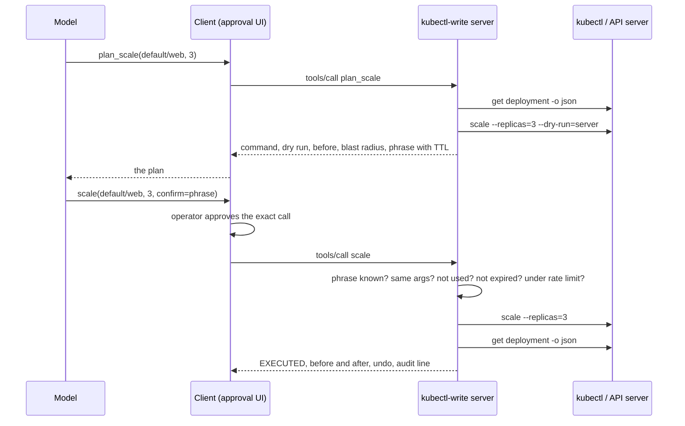

# Write Tools Done Safely: Confirm, Dry-Run, Idempotency, Blast Radius

*A write tool is safe when the model cannot run it by accident, twice, or on the wrong thing; the server guarantees that, not the prompt.*

## Metadata

| Field | Value |
|---|---|
| Type | Build |
| Languages | Python |
| Prerequisites | [Triage Agent](https://cloudcaptain.io/learn/aiops/incident-triage-agent) |
| Time | 90 minutes |
| Tools | kubectl, kind, claude-code, opentofu, argo-cd |

<Quiz stage="pre" />

## The Problem

The triage agent from the previous lesson earned trust for three months, so the team gave it a `scale` tool. Its first night on call went like this. The incident was in `staging`, the agent's context window held a log line from `prod`, and the tool took a namespace and a deployment name, so it scaled `prod/checkout` to one replica. The call timed out at the network layer while the API server was slow, the client retried, and the second call found a deployment already at one replica and reported success. Twenty minutes later someone asked what the replica count had been before the agent touched it. Nobody knew: the tool returned `deployment.apps/checkout scaled` and nothing else.

Look at the three failures separately and none of them is about the model. The wrong target got through because the tool never showed anyone what it was about to do before doing it. The duplicate got through because the tool treated every call as a new instruction instead of recognising a retry. The missing history is because the tool logged its output and not the state it changed. A fourth failure was waiting: nothing in the tool knew that taking `checkout` from six replicas to one removes more than eighty percent of its capacity, so nothing could have flagged it.

The previous lesson put the write path behind the client's approval: an operator says yes to the exact command. That gate is necessary and it is not enough, because the client is the part you control least. A different agent runtime, a `--yes` flag on a cron job, a teammate's laptop with permissions set to allow: any of them turns a confirmed write into an unconfirmed one. The server is the only component every caller must pass through, so this lesson moves the guarantees there. You will build an MCP server whose write tools are two calls apart, where the first call changes nothing and tells you everything, and the second call can only do what the first one described, once.

## The Concept

A safe write is a two-phase protocol between the model and the server, the same shape as `plan` and `apply`, or as a bank transfer that shows you the amount and the account before you type the code from your phone.

**Plan.** The model calls `plan_scale(namespace, deployment, replicas)`. The server reads the current state, asks the API server to run the exact command as a server-side dry run (authentication, authorization, admission and validation all run; nothing is persisted), computes the blast radius from the state it just read, and returns the command, the dry-run result, the state, the radius, an undo command, and a confirm phrase such as `scale deployment default/web from 2 to 3 [3f9a1c2e]`. The phrase is human-readable on purpose: whoever approves it in a client UI reads the change in the receipt itself. It is valid for a TTL and bound to this action with these arguments.

**Execute.** The model calls `scale(namespace, deployment, replicas, confirm)`. The server checks, in order: is the phrase one it issued; are the action and arguments the ones it planned; has it been executed already (if so, return the first result and run nothing); has it expired; is the target still in scope; is the write rate under the limit. Only then does `kubectl` run, the state is read again, and one line with before and after goes to an append-only audit file.

| Failure in The Problem | Gate that makes it impossible |
|---|---|
| wrong target | the phrase is bound to the exact arguments; `prod` is a protected namespace; the plan shows the command before anything runs |
| duplicate on retry | the phrase is an idempotency key; the second execution returns the first result |
| no history | the audit line carries the state before and after, the command, the phrase and the time |
| unseen magnitude | the blast radius is computed from the current state and printed in the plan |
| too much too fast | a per-minute write limit, a TTL that forces a fresh dry run after a pause |
| any caller at all | without `--allow-write` the execute tools do not exist in `tools/list` |



Two layers, two jobs. The client approves **intent**: a human looked at this plan and said yes. The server guarantees **mechanics**: exactly the planned change, once, in time, in scope, on record. Neither layer can do the other's job, and a server that trusts the client to have asked is the server in The Problem.

## Build It

`code/main.py` is `kubectl_write_mcp`. The protocol and the two-step logic live in a `WriteServer` whose `kubectl` runner, clock, token source and audit sink are constructor arguments, so the tests drive a complete session against a stateful fake `kubectl` and never need a cluster.

### Step 1: actions as data, tools derived from them

Each action is an `ActionSpec`: the arguments, the `kubectl` argv, how to observe the target's state, how to compute the blast radius from that state, the summary that becomes the phrase, and the undo command. Two tools are generated per action: `plan_<name>` and `<name>`.

```python
ActionSpec(
    "scale",
    "Set the replica count of a deployment.",
    {"namespace": NAMESPACE, "deployment": DEPLOYMENT, "replicas": {"type": "integer", "minimum": 0}},
    ["namespace", "deployment", "replicas"],
    False,
    _deployment,
    lambda a: ["scale", f"deployment/{a['deployment']}", "-n", str(a["namespace"]), f"--replicas={int(a['replicas'])}"],
    observe_deployment,
    lambda a, before: scale_blast(int(before["replicas"]), int(a["replicas"])),
    lambda a, before: f"scale deployment {a['namespace']}/{a['deployment']} from {before['replicas']} to {int(a['replicas'])}",
    lambda a, before: ["scale", f"deployment/{a['deployment']}", "-n", str(a["namespace"]), f"--replicas={before['replicas']}"],
)
```

`observe_deployment` runs `kubectl get deployment -o json` and keeps five numbers: replicas, ready, available, generation and the rolling-update `maxUnavailable`. The same observer runs again after the write, which is where the audit's `after` comes from. For a pod the observer follows the owner reference to the ReplicaSet to learn how many siblings it has; for a node it counts schedulable nodes and the pods on this one.

### Step 2: the plan

`plan()` refuses before it reads, reads before it dry-runs, and issues a phrase only when the dry run passed:

```python
problem = self.scope_problem(args)
if problem:
    self.record("refused", tool.name, args, reason=problem)
    return text_result(f"refused: {problem}", True)
before = action.observe(args, self.read_json)
if not before.get("present"):
    return text_result(f"refused: {action.target(args)} not found; nothing to plan ({self.last_read_error or 'no such object'})", True)
command = self.command(action.argv(args))
code, out, err = self.runner([*command, "--dry-run=server"])
if code != 0:
    return text_result(f"dry run failed (exit {code}): {detail}\nno confirm phrase was issued; fix the cause and plan again", True)
```

The scope check covers protected namespaces (`kube-system` and friends by default), an optional namespace allow-list, and a node allow-list that is empty unless you fill it: nobody cordons a node the server was not told about. `--max-replicas` is written into the tool schema as `maximum`, so the model sees the cap in `tools/list` and a request above it fails validation before any `kubectl` runs.

The dry run is the part people skip. `--dry-run=server` sends the real request with `dryRun=All`: RBAC, admission webhooks and `ValidatingAdmissionPolicy` all evaluate it, and the API server stops just before writing. A plan that passes it will apply; a plan that fails it tells you, in the plan, exactly what would have refused the write.

### Step 3: blast radius from the state you just read

```python
def scale_blast(before: int, after: int) -> BlastRadius:
    delta = after - before
    if delta == 0:
        return BlastRadius(0, 0.0, "no change, the deployment already has that many replicas")
    if after == 0:
        return BlastRadius(before, 100.0, "scales to zero; every pod stops and the service has no endpoints")
    percent = 100.0 if before == 0 else min(100.0, abs(delta) / before * 100.0)
    verb = "adds" if delta > 0 else "removes"
    return BlastRadius(abs(delta), percent, f"{verb} {abs(delta)} replica(s)")
```

A restart touches every pod, so its radius is `replicas` pods at 100 percent with the `maxUnavailable` the rolling update will respect. Deleting one of three pods behind a ReplicaSet is one pod at 33 percent and a replacement is coming; deleting a pod nobody owns is 100 percent and the note says it will not come back. A cordon evicts nothing, so its radius is zero pods and the share of schedulable nodes you are removing, with the count of pods that stay. The numbers are small and they are the difference between a plan a human can approve in a glance and a plan nobody reads.

### Step 4: the execute checks, in order

```python
plan = self.plans.get(phrase)
if plan is None:
    return text_result(f"refused: no plan matches this confirm phrase; call plan_{action.name} first and pass its phrase unchanged", True)
if plan.action != action.name or plan.arguments != wanted:
    return text_result(f"refused: this confirm phrase belongs to {plan.action} {json.dumps(plan.arguments, sort_keys=True)}, not to {action.name} {json.dumps(wanted, sort_keys=True)}", True)
if plan.result is not None:
    return replay_result(plan.result, iso(plan.executed_at or 0))
if now > plan.expires_at:
    del self.plans[phrase]
    return text_result(f"refused: the confirm phrase expired {now - plan.expires_at:.0f}s ago (TTL {self.policy.ttl_seconds:.0f}s); plan again and read the new dry run", True)
```

The order matters. Replay is checked before expiry, so a retry that arrives after the TTL still gets the first result instead of a confusing "expired" for a change that did happen. A refused attempt with the wrong arguments does not consume the real plan. A write that fails (`kubectl` exits non-zero) consumes the phrase anyway: the next attempt must plan again, because the dry run is what tells you why it failed. Then the rate limit, a `deque` of execution times pruned to the last sixty seconds, and only then:

```python
self.executions.append(now)
plan.executed_at = now
code, out, err = self.runner(plan.command)
after = action.observe(wanted, self.read_json)
plan.result = render_execution(plan, code, output, after, self.policy.output_limit)
```

The result the model reads starts with `EXECUTED` or `FAILED`, shows the command, before, after and the undo command. A replay returns the same text with a `REPLAYED` line on top and `"replayed": true` in `structuredContent`.

### Step 5: the audit is a file, written before the result is returned

```python
def file_audit(path: str) -> Audit:
    def append(entry: Dict[str, Any]) -> None:
        with open(path, "a", encoding="utf-8") as handle:
            handle.write(json.dumps(entry, sort_keys=True) + "\n")
    return append
```

Every path through the server calls `record()`: `plan`, `execute`, `replayed`, `refused`, `expired`, `rate_limited`, `dry_run_failed`. An execute line carries the phrase, the argv, the exit code, the output, and the observer's `before` and `after`. Open the file with `jq` after an incident and the question from The Problem has an answer in one line.

### Step 6: tools that do not exist cannot be called

```python
if policy.allow_write:
    write_props = dict(props)
    write_props["confirm"] = {"type": "string", "description": f"the confirm phrase returned by plan_{action.name}, passed unchanged"}
    tools.append(ToolDef(action.name, action, "write", write_props, [*action.required, "confirm"], ...))
```

Without `--allow-write` the server lists five `plan_*` tools and nothing else; a call to `scale` is a JSON-RPC `-32602 Unknown tool`, the same answer as for a tool that was never written. The plan tools stay, because a plan with a dry run and a blast radius is exactly what you want an agent to hand an operator who will run the command by hand. Every tool also carries MCP **annotations** (`readOnlyHint`, `destructiveHint`, `idempotentHint`), which clients use to colour their approval prompts; the spec is explicit that they are hints, not gates, which is why none of the checks above read them.

### Step 7: drive it by hand

A shell script is enough of a `kubectl` to watch the protocol:

```bash
mkdir -p /tmp/fakebin && cat > /tmp/fakebin/kubectl <<'EOF'
#!/bin/sh
case "$*" in
  *"get deployment"*) echo '{"metadata":{"generation":4},"spec":{"replicas":2},"status":{"readyReplicas":2,"availableReplicas":2}}' ;;
  *--dry-run=server*) echo "deployment.apps/web scaled (server dry run)" ;;
  *) echo "deployment.apps/web scaled" ;;
esac
EOF
chmod +x /tmp/fakebin/kubectl
printf '%s\n' \
  '{"jsonrpc":"2.0","id":1,"method":"initialize","params":{"protocolVersion":"2025-06-18","capabilities":{},"clientInfo":{"name":"me","version":"1"}}}' \
  '{"jsonrpc":"2.0","method":"notifications/initialized"}' \
  '{"jsonrpc":"2.0","id":2,"method":"tools/call","params":{"name":"plan_scale","arguments":{"namespace":"default","deployment":"web","replicas":3}}}' \
  '{"jsonrpc":"2.0","id":3,"method":"tools/call","params":{"name":"scale","arguments":{"namespace":"default","deployment":"web","replicas":3,"confirm":"scale deployment default/web from 2 to 3 [guessed1]"}}}' \
  '{"jsonrpc":"2.0","id":4,"method":"tools/call","params":{"name":"plan_scale","arguments":{"namespace":"kube-system","deployment":"coredns","replicas":0}}}' \
  | PATH=/tmp/fakebin:$PATH python3 code/main.py --allow-write --audit /tmp/audit.jsonl --quiet
cat /tmp/audit.jsonl
```

Message 2 returns the plan with a phrase you did not know in advance; message 3 is refused because a guessed phrase matches no plan; message 4 is refused before `kubectl` runs because the namespace is protected. For the real two-step, where you read the phrase and paste it back, use the Inspector: `npx @modelcontextprotocol/inspector python3 code/main.py --allow-write`, call `plan_scale`, copy the phrase, call `scale`, then call `scale` again and watch the replay. `python3 code/main.py --list-tools` with and without `--allow-write` shows the two tool surfaces without a session.

<RunTests />

## Use It

The pieces of your server all exist as real tools. Start with the two `kubectl` features the plan leans on, against a kind cluster:

```bash
kind create cluster --name cc-lab
kubectl --context kind-cc-lab create deployment web --image=registry.k8s.io/pause:3.10 --replicas=2
kubectl --context kind-cc-lab scale deployment/web --replicas=3 --dry-run=server        # the plan's dry run: admission runs, nothing is written
kubectl --context kind-cc-lab scale deployment/web --replicas=3                         # the execute
kubectl --context kind-cc-lab annotate deployment/web kubernetes.io/change-cause="scale to 3 for the launch" --overwrite
kubectl --context kind-cc-lab rollout restart deployment/web
kubectl --context kind-cc-lab rollout history deployment/web                           # revisions carry the change-cause annotation
kubectl --context kind-cc-lab rollout undo deployment/web                              # reverts the pod template, not the replica count
```

`rollout undo` goes back one **revision**, and only pod-template changes create revisions. That is why the server's undo hint for `scale` is another `scale` and for `rollout_restart` it is `rollout undo`: an undo path is per action, and a tool that promises "undo" without saying which one is hiding something.

Now move one of your gates into the cluster. A `ValidatingAdmissionPolicy` (generally available since Kubernetes 1.30) is a CEL rule the API server evaluates during admission, which means the plan's dry run hits it too:

```yaml
apiVersion: admissionregistration.k8s.io/v1
kind: ValidatingAdmissionPolicy
metadata:
  name: cap-replicas
spec:
  failurePolicy: Fail
  matchConstraints:
    resourceRules:
      - apiGroups: ["apps"]
        apiVersions: ["v1"]
        operations: ["CREATE", "UPDATE"]
        resources: ["deployments", "deployments/scale"]
  validations:
    - expression: "object.spec.replicas <= 5"
      message: "more than 5 replicas needs a change ticket"
---
apiVersion: admissionregistration.k8s.io/v1
kind: ValidatingAdmissionPolicyBinding
metadata:
  name: cap-replicas
spec:
  policyName: cap-replicas
  validationActions: ["Deny"]
  matchResources:
    namespaceSelector:
      matchLabels:
        kubernetes.io/metadata.name: default
```

```bash
kubectl --context kind-cc-lab apply -f cap-replicas.yaml
kubectl --context kind-cc-lab scale deployment/web --replicas=6 --dry-run=server        # denied by cap-replicas, and so is plan_scale(replicas=6)
```

The server's `--max-replicas` and the cluster's policy now say the same thing from two places, and the one in the cluster also binds `kubectl` in a human's hands. That is the pattern: gates in the server for the agent, the same gates in admission for everyone.

The two-step itself is older than agents. OpenTofu's saved plan is a confirm phrase for a whole infrastructure:

```bash
tofu plan -out=change.tfplan                                                  # the plan, computed against the current state
tofu show -json change.tfplan | jq '.resource_changes[] | {address, actions: .change.actions}'   # the blast radius
tofu apply change.tfplan                                                      # applies exactly that plan; refuses a stale one when the state moved on
```

Argo CD does the same for GitOps: `argocd app diff` is the plan, `argocd app sync` the execute, `syncPolicy.automated` with `prune` and `selfHeal` is an agent with the write tools enabled, and **sync windows** on an `AppProject` are a TTL at calendar scale:

```yaml
apiVersion: argoproj.io/v1alpha1
kind: AppProject
metadata:
  name: payments
  namespace: argocd
spec:
  syncWindows:
    - kind: deny
      schedule: "0 9 * * 1-5"
      duration: 9h
      applications: ["*"]
      manualSync: true
```

Finally, the servers people actually connect, and the client in front of them. The `kubernetes-mcp-server` from the `containers` GitHub organisation (Red Hat) ships write tools for pods and arbitrary resources; `--read-only` keeps only tools annotated `readOnlyHint: true`, and `--disable-destructive` drops the ones annotated `destructiveHint: true`. Those are the same annotations your tools carry, used as a filter at startup rather than trusted at call time. Install your server into Claude Code and layer the client's gate on top:

```bash
claude mcp add kubectl-write -- python3 "$PWD/code/main.py" --allow-write --allow-namespaces default --context kind-cc-lab --audit "$HOME/kubectl-write-audit.jsonl"
```

```json
{
  "permissions": {
    "allow": ["mcp__kubectl-write__plan_scale", "mcp__kubectl-write__plan_rollout_restart"],
    "ask": ["mcp__kubectl-write__scale", "mcp__kubectl-write__rollout_restart"],
    "deny": ["mcp__kubectl-write__delete_pod", "mcp__kubectl-write__cordon", "mcp__kubectl-write__uncordon"]
  }
}
```

Ask it to "bring web in default to 3 replicas". The plan runs without a prompt because it is read-only; the execute stops at the permission prompt, which shows the phrase, so the operator reads `scale deployment default/web from 2 to 3` in the receipt before clicking. Anthropic's Managed Agents offer the same shape as an `always_ask` permission policy. Both are the intent layer. If someone runs the same server from a script with approvals turned off, every mechanic you built still holds, which is the entire point of building it in the server.

| What you built | Real tool | Note |
|---|---|---|
| `plan_*` with a server dry run | `kubectl --dry-run=server`, `tofu plan -out`, `argocd app diff` | the real request through admission, nothing persisted |
| confirm phrase bound to the exact arguments, with a TTL | a saved plan (`tofu apply change.tfplan` refuses a stale one), change tickets with an expiry | a receipt for one specific change |
| replay returns the first result | `Idempotency-Key` headers in payment APIs, `kubectl apply` converging on the same state | retries are normal; applying twice is the bug |
| protected namespaces, node allow-list, `--max-replicas` | RBAC on the ServiceAccount, `ValidatingAdmissionPolicy`, Argo CD `AppProject` destinations | a cluster-side gate also fails the dry run, so it shows up in the plan |
| rate limit per minute | Argo CD sync windows, change freezes | bounds how much can go wrong per unit of time |
| audit JSONL with before and after | the API server audit log, `rollout history` with `kubernetes.io/change-cause`, Argo CD app history | who, what, when, and what it looked like before |
| undo command per action | `kubectl rollout undo`, `scale` back, `uncordon`, applying the previous plan | every plan says how to go back before it runs |
| write tools absent without `--allow-write` | `kubernetes-mcp-server --read-only` and `--disable-destructive`, Claude Code `deny` rules | structural beats configured |

<Quiz stage="check" />

## Ship It

Two artifacts in `outputs/`:

- **`mcp-kubectl-write/`**: the server packaged for use: a README with the two-step protocol, a raw stdio session, the Inspector and Claude Code install commands, every flag with its default, the audit line format, and the list of what it will never do; plus `mcp.json`, the client configuration to copy.
- **`skill-write-tool-design-review.md`**: a review runbook for any tool that changes infrastructure, yours or a vendor's: enumerate the write surface without an agent in the loop, score it against ten checks (preview, binding, expiry, idempotency, blast radius, scope, rate, audit, undo, visibility) with pass and fail examples, run three drills (the retry, the stale plan, the pasted phrase), and record a verdict.

<ShipIt />

## Exercises

### Easy

Add `drain`: `plan_drain(node)` and `drain(node, confirm)` running `kubectl drain NODE --ignore-daemonsets --delete-emptydir-data`, marked destructive, with a blast radius of every pod on the node and `uncordon` as the undo. Tests first: the argv, the radius from a fake node with four pods, the node allow-list applying to it, and the dry run that `kubectl drain` performs with `--dry-run=server`.

### Medium

Turn the blast radius into a gate. Add `--max-blast-percent` (default 50) so a plan above it is refused with a message that names a smaller step, then add a required `reason` argument to every write tool that lands in the audit line and, for deployments, in the `kubernetes.io/change-cause` annotation after a successful write. Write the tests before the code: a scale to zero is refused at the default, allowed at 100, and the reason appears in the audit and in the annotate argv.

### Hard

Plans live in the server's memory and die with it. Persist them to a file and sign each phrase with `hmac` over the action, the arguments and the expiry (key from `--key-file`), so a restarted server can verify a phrase it never saw, keeps replay memory across restarts, and rejects a phrase issued by a server with a different key. Then add verification after the write: poll `kubectl rollout status --timeout=120s` after `scale` and `rollout_restart`, record the outcome in the audit, and write one paragraph on whether the server should run the undo command automatically when the rollout does not become ready, and who you would need to tell first.

<Quiz stage="post" />

## Key Terms

| Term | Common misconception | Precise definition |
|---|---|---|
| Two-step write | "Asking the model to double-check." | A protocol in which the first call changes nothing and returns the exact command, its dry run, the current state and a receipt, and the second call can only perform what the receipt describes. |
| Confirm phrase | "A password for the tool." | A server-generated, human-readable, one-time receipt bound to one action with one set of arguments, valid for a TTL; it is also the idempotency key for the write. |
| Server-side dry run | "A syntax check." | The real API request with `dryRun=All`: authentication, authorization, admission and validation run, persistence is skipped; a plan that passes it will apply. |
| Idempotency | "Making the tool safe to call often." | The property that repeating a request produces the first result and no second change; retries are expected, so a write tool without it multiplies approved actions. |
| Blast radius | "How dangerous the verb is." | The share of current capacity a change touches, computed from the state at plan time: pods affected, percentage, direction, and what happens afterwards (recreated, gone, rolling). |
| Protected namespace and allow-list | "A warning in the system prompt." | Scope enforced in the server before any `kubectl` runs: namespaces no write may touch, namespaces it may, and nodes named explicitly; the same rule in admission binds humans too. |
| Append-only audit | "The tool's log output." | One JSON line per plan, execution, replay and refusal with the phrase, the argv, exit code, output, and the observed state before and after, written before the result returns. |
| Tool annotations | "The server's permission system." | MCP hints (`readOnlyHint`, `destructiveHint`, `idempotentHint`) that clients may use to shape approval UIs or filter tools; the specification says they are untrusted, so they never gate a call. |

## Further Reading

- [kubectl Cheat Sheet](https://cloudcaptain.io/docs/tools/kubernetes/cheatsheet): `--dry-run=server`, `rollout undo` and `rollout history`, the commands your plan and undo hints wrap.
- [Kubernetes Security & Hardening](https://cloudcaptain.io/docs/tools/kubernetes/security): RBAC and admission, the chain a server-side dry run passes through.
- [Kubernetes in Production](https://cloudcaptain.io/docs/tools/kubernetes/production-operations): rolling-update strategies that decide the blast radius of a restart, and Argo CD auto-sync.
- [GitOps](https://cloudcaptain.io/docs/tools/cicd/gitops): Git as the plan, the sync agent as the executor, and where approval sits in that flow.
- [Terraform Fundamentals](https://cloudcaptain.io/docs/tools/terraform/fundamentals): the plan and apply workflow and `-out`, the oldest two-step in infrastructure.
- [Kubernetes API concepts: dry run](https://kubernetes.io/docs/reference/using-api/api-concepts/#dry-run): what `dryRun=All` runs and what it skips, from the source.
- [ValidatingAdmissionPolicy](https://kubernetes.io/docs/reference/access-authn-authz/validating-admission-policy/): CEL rules in the API server, the cluster-side twin of your scope checks.
- [Argo CD sync windows](https://argo-cd.readthedocs.io/en/stable/user-guide/sync_windows/): allow and deny windows on an `AppProject`, change windows as configuration.
- [OpenTofu plan](https://opentofu.org/docs/cli/commands/plan/): saved plans with `-out` and why apply refuses a stale one.
- [MCP specification: tools](https://modelcontextprotocol.io/specification/2025-06-18/server/tools): tool annotations and the security considerations that say they are hints.
