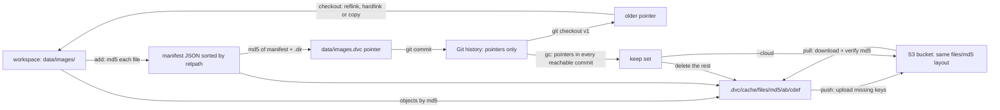

# A Dataset Version Is a Content-Addressed Snapshot

*Git versions a 100-byte pointer and the data lives in a cache keyed by its md5: a dataset version is a commit, not a folder name.*

## Metadata

| Field | Value |
|---|---|
| Type | Build |
| Languages | Python |
| Prerequisites | [Git Is a Content-Addressed Object Store](https://cloudcaptain.io/learn/git/object-store), [An S3 Request Is a Signed String](https://cloudcaptain.io/learn/cloud/s3-signing) |
| Time | 75 minutes |
| Tools | dvc, moto, git, lakefs, git-lfs |

<Quiz stage="pre" />

## The Problem

Tuesday morning the fraud model's precision drops from 0.91 to 0.84 after the weekly retrain. The training job reads `s3://ml-data/fraud/train/`, and the code in Git did not change, so the data did. Nobody can say how. The prefix is overwritten every Monday by an export job; last week's files are gone, S3 versioning was never turned on for that bucket, and the copy someone made "just in case" is called `train_final_v3_fixed/` and has 40 fewer files than the one that produced the good model. The model card says "trained on the latest data", which describes every model the team has ever shipped.

The first fix people reach for is committing the data to Git. The 6 GB of Parquet makes every clone take twenty minutes, the hosting provider rejects files over its size limit, and when someone moves the files to Git LFS the CI runners start downloading every version on every checkout until the LFS bandwidth quota runs out mid-month. The second fix is a naming convention (`train-2026-11-03/`), which works until two pipelines write the same date, and still cannot answer "which data did commit `4f2a9c1` train on?"

What the team needed was what Git already does for code, applied to bytes Git should not store: name every file by the hash of its content, keep the bytes in a cache and a bucket under that name, and commit only a small file that says "this directory was `5e9309d6...dir`". Then a dataset version is whatever a commit points to, `git checkout` plus one command restores it exactly, two identical datasets cost the storage of one, and garbage collection can prove which objects no commit needs. You are going to build `minidvc`, which writes the same pointer files, cache layout and remote layout as DVC, so the real tool can read what it writes.

## The Concept

Think of a coat check. You hand over a heavy coat and get a small ticket; the ticket goes in your pocket and the coat goes on a rack under the ticket's number. Data versioning gives the ticket to Git and the coat to a cache, with one difference: the ticket number is computed from the coat itself, so the same coat always gets the same number and two people with identical coats share one hook.

- **Content address.** A file's name in the cache is the md5 of its bytes, stored at `.dvc/cache/files/md5/ab/cdef...` (the first two hex digits are a directory, so no directory holds millions of entries). Renaming a file or touching its timestamp changes nothing; changing one byte gives a new object.
- **Directories are manifests.** A tracked directory becomes a JSON list of `relpath` and `md5` for every file, sorted by path. That list is itself stored as an object, named by the md5 of its bytes with a `.dir` suffix. Change one file and the manifest changes, so the directory gets a new name; the other files are shared with the previous version. This is a Git tree, one level deep.
- **Pointer files.** `data/images.dvc` records `md5`, `size`, `nfiles`, `hash: md5` and `path`. It is a hundred bytes, it goes into Git, and the data itself goes into `.gitignore`. A commit therefore pins a dataset version by hash.
- **Checkout is linking.** Making the workspace match a pointer means placing cache objects at their paths. A reflink (copy-on-write clone) is instant and safe, a hardlink is instant but shares the bytes with the cache, a copy is slow but always works. The tool tries them in order.
- **Remotes are the same layout in a bucket.** `push` lists what the remote has and uploads the missing keys; `pull` downloads the missing keys and checks out. Because names are hashes, nothing is ever overwritten, and the download can verify every byte.
- **Garbage collection is reachability.** Walk every commit that a branch or tag can reach, read every pointer and lock file in it, expand `.dir` manifests, and delete every object outside that set. An object only a deleted branch referenced is garbage.
- **Pipelines are hashes too.** `dvc.lock` records the md5 of each stage's dependencies and outputs. A stage reruns only if its command or one of those hashes changed.



The md5 here is an identifier, not a security boundary: anyone who can write to the cache or the bucket can plant bytes under any name. What content addressing buys is deduplication and integrity against accidents (a truncated upload or a flipped bit no longer matches its name), and the trust in *which* hash belongs to a release comes from the Git commit, which you can sign.

## Build It

`code/main.py` is `minidvc`, standard library only. It uses DVC's on-disk formats: the same `.dvc/` directory, cache layout, pointer files, `.dvc/config` syntax, `dvc.yaml` and `dvc.lock`, and the same remote layout. The tests check its hashes against values produced by DVC 3.67.1, and the smoke test runs both tools side by side.

### Step 1: hash a file and a directory the way DVC does

A file's hash is the md5 of its bytes, read in 1 MiB blocks so a 50 GB file never sits in memory. A directory's hash is the md5 of a manifest: one `{"md5", "relpath"}` row per file, sorted by `relpath` as a plain string, serialized with Python's default `json.dumps` separators and sorted keys:

```python
def manifest_bytes(entries: Iterable[DirEntry]) -> bytes:
    rows = sorted(({"md5": e.md5, "relpath": e.relpath} for e in entries), key=lambda row: row["relpath"])
    return json.dumps(rows, sort_keys=True).encode("utf-8")


def hash_tree(root: Path) -> Tuple[HashInfo, List[DirEntry], bytes]:
    entries = [DirEntry(rel, file_md5(full), full.stat().st_size) for rel, full in walk_files(root)]
    data = manifest_bytes(entries)
    info = HashInfo(hashlib.md5(data).hexdigest() + DIR_SUFFIX, sum(e.size for e in entries), len(entries))
    return info, entries, data
```

Every byte of that serialization is part of the identity. Sorting as strings puts `sub-z.txt` and `sub.x` before `sub/y.txt` (`-` and `.` sort before `/`), so sorting by path components would give a different manifest and a different hash for the same files. Empty directories do not appear in the manifest, so an empty folder adds nothing; a directory with no files at all hashes to `d751713988987e9331980363e24189ce.dir`, the md5 of `[]`. `size` is the sum of the file sizes and `nfiles` their count. Timestamps, permissions and the directory's own name are not part of the hash.

### Step 2: the cache and the pointer file

Objects live under `files/md5/` with a two-character fan-out, and are written read-only through a temporary name and `os.replace()`, so a crash never leaves a half-written object under a valid name:

```python
def object_key(md5: str) -> str:
    return f"files/md5/{md5[:2]}/{md5[2:]}"


    def put_file(self, source: Path, md5: str) -> bool:
        if self.has(md5):
            return False
        target = self.path(md5)
        target.parent.mkdir(parents=True, exist_ok=True)
        temp = target.with_name(target.name + f".tmp{os.getpid()}")
        shutil.copyfile(source, temp)
        os.chmod(temp, READ_ONLY)
        os.replace(temp, target)
        return True
```

`add` stores every file, then the manifest, then writes the pointer next to the data and appends `/images` to the `.gitignore` in the same directory. The pointer's key order is DVC's, so the file is byte-identical to the one `dvc add` writes:

```python
def pointer_text(info: HashInfo, name: str) -> str:
    out: Dict[str, Any] = {"md5": info.md5, "size": info.size}
    if info.is_dir:
        out["nfiles"] = info.nfiles
    out["hash"] = "md5"
    out["path"] = name
    return to_yaml({"outs": [out]})
```

`hash: md5` marks the DVC 3 format. DVC 2 hashed text files after converting CRLF to LF and kept objects directly under `.dvc/cache/ab/...`; its pointers have no `hash` field, and `minidvc` refuses entries marked `md5-dos2unix` with a pointer to `dvc cache migrate`.

### Step 3: YAML without a YAML library

The standard library has no YAML parser, so `to_yaml()` and `load_yaml()` handle the subset DVC writes: block mappings, sequences of mappings with the dash at the parent's indentation, plain, single-quoted and double-quoted scalars, and long values folded onto continuation lines (DVC wraps a long `cmd` at about 80 characters). `yaml_scalar()` quotes anything that would otherwise change type, so `schema: '2.0'` stays a string, as in DVC's lock file. The tests feed it a `dvc.lock` written by DVC.

### Step 4: status, three states per output

```python
    def out_state(self, out: Out) -> Optional[str]:
        if self.missing_objects(out.info):
            return "not in cache"
        path = self.root / out.path
        if not path.exists():
            return "deleted"
        current, _, _ = hash_path(path)
        return None if current.md5 == out.info.md5 else "modified"
```

The order matches DVC: an output whose objects are missing is `not in cache` even if the workspace still looks right, because nothing could restore it. `status --json` produces DVC's shape, `{"data/raw.csv.dvc": [{"changed outs": {"data/raw.csv": "modified"}}]}`, and `status -q` exits 1 when anything changed, which makes it a CI check that committed pointers match committed data.

### Step 5: checkout with link strategies and a fallback

```python
def link_file(source: Path, target: Path, strategies: Sequence[str], linkers: Dict[str, Callable[[Path, Path], None]]) -> str:
    target.parent.mkdir(parents=True, exist_ok=True)
    failures: List[str] = []
    for name in strategies:
        if target.exists() or target.is_symlink():
            remove_path(target)
        try:
            linkers[name](source, target)
        except (OSError, NotImplementedError) as exc:
            failures.append(f"{name}: {exc}")
            if target.exists() or target.is_symlink():
                remove_path(target)
            continue
        if name in WRITABLE_AFTER:
            os.chmod(target, WRITABLE)
        return name
    raise MiniDvcError(f"cannot link {target}: " + "; ".join(failures))
```

`reflink()` uses the `FICLONE` ioctl on Linux (Btrfs, XFS with reflink enabled) and `clonefile()` on macOS (APFS); on ext4 or across filesystems the kernel answers `EOPNOTSUPP` or `EXDEV` and the loop moves on. The default order is `reflink,copy`, DVC's default `cache.type`, and `[cache] type = ...` in `.dvc/config` or `--link` changes it. A hardlink shares the inode with the read-only cache object, so the workspace file is read-only too: that is the protection, because an editor that writes in place would otherwise corrupt the cache for every commit that uses that object.

Before overwriting anything, `checkout` hashes the workspace file and refuses if that content is not in the cache, because overwriting it would destroy the only copy. For a directory it also deletes files the manifest does not list, then removes directories left empty. `--force` skips the check.

### Step 6: remotes, a local directory and S3 with SigV4

A remote is anything with `keys()`, `upload()`, `download()` and `delete()`. The local remote is a directory with the cache layout. The S3 remote speaks HTTP with `urllib` and signs every request with AWS Signature Version 4: a canonical request (method, path, sorted query, signed headers, payload sha256), a string to sign with the date and scope, and an HMAC chain that derives a key for that day, region and service:

```python
    key = ("AWS4" + secret_key).encode()
    for part in (amz_date[:8], region, service, "aws4_request"):
        key = hmac.new(key, part.encode(), hashlib.sha256).digest()
    signature = hmac.new(key, to_sign.encode(), hashlib.sha256).hexdigest()
```

The tests check `sign_v4()` against the GET example in AWS's documentation and against signatures botocore computed for a PUT and a paginated list. `keys()` pages through `ListObjectsV2` with `continuation-token` until `IsTruncated` is false; listing once is far cheaper than one HEAD per object when a dataset has 100,000 files.

`push` uploads the objects the workspace references and the remote lacks, files first and `.dir` manifests last, so a reader never finds a manifest whose files are not there yet:

```python
        todo = sorted((md5 for md5 in wanted - on_remote if self.cache.has(md5)), key=lambda md5: (md5.endswith(DIR_SUFFIX), md5))
```

Every PUT carries `Content-Type: application/octet-stream`: without it `urllib` labels the body `application/x-www-form-urlencoded`, and a server built on a web framework (moto runs on Werkzeug) may parse the object as a form and store zero bytes, which the md5 check on the next pull catches.

`fetch` downloads manifests first (it cannot know a directory's files without them), then the files, and checks each download against its name with `check_md5()`. A tampered or truncated object is rejected before it reaches the cache. `pull` is `fetch` plus `checkout`.

### Step 7: garbage collection over every commit

```python
        if all_commits:
            git = git or GitReader(self.root)
            commits = git.commits()
            blobs: Dict[str, str] = {}
            for commit in commits:
                for path, blob in git.tracked_files(commit).items():
                    blobs.setdefault(blob, path)
            for blob, path in sorted(blobs.items()):
                outs.extend(outs_from_text(git.blob(blob), path))
        keep = self.referenced(outs, remote)
```

`GitReader` runs `git rev-list --all` (every commit reachable from a branch, tag or other ref), `git ls-tree -r -z` per commit to find `*.dvc` and `dvc.lock` blobs, and `git cat-file blob` once per distinct blob, since most commits share most pointers. `referenced()` expands each `.dir` into its files, downloading a manifest from the remote if the local cache lost it. Everything in the cache outside that set is deleted, and with `--cloud` everything under the remote prefix too. Without `--all-commits` only the workspace counts, which deletes every older version: that is why `dvc gc` asks for confirmation and `minidvc gc` has `--dry-run`. A commit that only the reflog remembers (a deleted branch) is not reachable, so its data goes.

### Step 8: a two-stage pipeline and its lock file

`dvc.yaml` declares stages with `cmd`, `deps` and `outs`. `order_stages()` sorts them so a stage runs after the stage that produces its dependency, and rejects cycles. Each stage is compared with its entry in `dvc.lock`:

```python
        if locked.get("cmd") != stage.cmd:
            reasons.append("changed command")
        before = {e["path"]: e.get("md5") for e in locked.get("deps") or []}
        deps: Dict[str, str] = {}
        for path in stage.deps:
            current = self.entry(path)
            if current is None:
                deps[path] = "deleted"
            elif path not in before:
                deps[path] = "new"
            elif current["md5"] != before[path]:
                deps[path] = "modified"
```

and the same for outputs (deleted or modified). A stage with no reasons is skipped. A stage that runs has its outputs deleted first (so a stale file cannot pass for a new one), its command run with `sh -c`, its outputs hashed into the cache and added to `.gitignore`, and its lock entry rewritten with `path`, `hash`, `md5`, `size` (and `nfiles`) for every dependency and output. Because the decision happens stage by stage after upstream stages ran, a `prepare` stage that reruns but produces identical bytes does not make `train` rerun.

### Step 9: run it

```bash
mkdir -p proj/data/images/sub && cd proj && git init -q
printf 'csv\n1,2\n' > data/raw.csv; printf 'hello\n' > data/images/x.txt
printf 'b\n' > data/images/sub/y.txt; printf '1\n' > 'data/images/a b.txt'
M=../code/main.py
python3 $M init
python3 $M add data/raw.csv data/images
# added data/raw.csv  md5 54bc7d11ceb0d713444942aebfc9fb5d  8 bytes  -> data/raw.csv.dvc
# added data/images  md5 b38334d2c106d28534c1062921159181.dir  3 files, 10 bytes  -> data/images.dvc
find .dvc/cache -type f | sort          # four files and one .dir manifest
python3 $M remote add -d local /tmp/minidvc-remote
python3 $M push                         # pushed 5 object(s) to /tmp/minidvc-remote, 0 already there
echo x >> data/raw.csv
python3 $M status                       # data/raw.csv.dvc: changed outs: modified: data/raw.csv
python3 $M checkout; echo "exit $?"     # refuses: the edited version is not in the cache; exit 1
python3 $M checkout --force --link reflink,hardlink,copy    # restored data/raw.csv (reflink) on APFS or XFS, (hardlink) on ext4
python3 $M --json gc --all-commits --cloud --dry-run
```

Exit codes: 0 on success, 1 when data is missing, unsaved work would be lost, a remote fails or `status -q` finds changes, 2 for usage errors such as running outside a repository.

<RunTests />

## Use It

DVC does the same job with more speed and more options. Install a pinned version (the smoke test pins the whole dependency tree with hashes in `code/requirements-dvc.txt`) and run the same steps in a Git repository:

```bash
python3 -m venv .venv && .venv/bin/pip install 'dvc[s3]==3.67.1'
export PATH="$PWD/.venv/bin:$PATH"
dvc init && dvc config core.analytics false
dvc add data/raw.csv data/images            # writes data/raw.csv.dvc, data/images.dvc, data/.gitignore
git add data/*.dvc data/.gitignore .dvc .dvcignore && git commit -m "data v1" && git tag v1
cat data/images.dvc                         # the same five fields minidvc writes
ls .dvc/cache/files/md5/                    # the same two-character fan-out
dvc status --json                           # {} when the workspace matches the pointers
```

A local S3 endpoint for tests. moto is an AWS emulator from PyPI; `moto_server` answers the S3 API on a local port, and with `INITIAL_NO_AUTH_ACTION_COUNT=3` it accepts three unauthenticated calls (enough to create an IAM user, its access key and a policy) and from then on recomputes every SigV4 signature, so a client with a wrong secret gets `403 SignatureDoesNotMatch`. The smoke test runs it exactly like this, with `moto[server]` hash-pinned in `code/requirements-moto.txt`, in its own virtual environment because its `boto3` pins a different `botocore` than `dvc-s3`:

```bash
python3 -m venv .moto && .moto/bin/pip install 'moto[server]==5.2.5'
INITIAL_NO_AUTH_ACTION_COUNT=3 .moto/bin/moto_server -H 127.0.0.1 -p 5000 &
.moto/bin/python - <<'PY' > key.txt
import json, boto3
iam = boto3.client("iam", endpoint_url="http://127.0.0.1:5000", region_name="us-east-1")
iam.create_user(UserName="data-bot")
key = iam.create_access_key(UserName="data-bot")["AccessKey"]
iam.put_user_policy(UserName="data-bot", PolicyName="s3-all", PolicyDocument=json.dumps(
    {"Version": "2012-10-17", "Statement": [{"Effect": "Allow", "Action": "s3:*", "Resource": "*"}]}))
print(key["AccessKeyId"], key["SecretAccessKey"])
PY
read -r AWS_ACCESS_KEY_ID AWS_SECRET_ACCESS_KEY < key.txt && export AWS_ACCESS_KEY_ID AWS_SECRET_ACCESS_KEY
python3 -c 'import botocore.session as s; s.get_session().create_client("s3", endpoint_url="http://127.0.0.1:5000", region_name="us-east-1").create_bucket(Bucket="ml-data")'
dvc remote add -d store s3://ml-data/dvcstore
dvc remote modify store endpointurl http://127.0.0.1:5000
cat .dvc/config                             # [core] remote = store, ['remote "store"'] url, endpointurl
dvc push                                    # objects land under dvcstore/files/md5/
git clone . ../fresh && cd ../fresh && dvc pull && cd -
```

botocore uses path-style URLs (`http://127.0.0.1:5000/ml-data/dvcstore/...`) for an IP endpoint, and so does `minidvc`. moto keeps everything in memory and is an emulator, not storage: it is for tests and CI. For a remote that holds real data:

- **Amazon S3** (or GCS, Azure Blob through their DVC plugins): turn on bucket versioning, keep lifecycle rules away from the `files/md5/` prefix, and give CI a role that can read but not delete.
- **MinIO**: the upstream repository is archived and no longer maintained, the official community images are gone from Docker Hub, and the vendor now ships a separately licensed product (AIStor). Community forks such as `pgsty/minio` keep publishing images built from the last source; treat one like any other third-party supply-chain dependency before it holds your data.
- **SeaweedFS** and **Garage**: maintained, self-hosted object stores with an S3 API. SeaweedFS targets large numbers of small files; Garage targets small geo-distributed clusters. Check which S3 calls a remote needs (ListObjectsV2, HEAD, multipart upload) against each project's compatibility list.

A remote can always be a plain directory or NFS mount instead (`dvc remote add -d store /mnt/dvcstore`), which is what the `LocalRemote` class models.

Credentials belong in environment variables or `.dvc/config.local` (ignored by Git), never in `.dvc/config`. `minidvc` reads that same `.dvc/config`, so in the smoke test DVC pulls what `minidvc` pushed and `minidvc` pulls what DVC pushed.

Older versions and the pipeline:

```bash
git checkout v1 && dvc checkout             # data/ is v1 again; dvc pull first if the cache lacks it
git checkout main && dvc checkout
dvc config cache.type reflink,hardlink,copy # the link order; dvc checkout --relink applies it to existing files
dvc stage add -n prepare -d data/raw.csv -o prepared.csv 'tail -n +2 data/raw.csv > prepared.csv'
dvc stage add -n train -d prepared.csv -d params.txt -o model.txt 'cat prepared.csv params.txt > model.txt'
dvc repro                                   # runs both, writes dvc.lock
dvc repro                                   # Stage 'prepare' didn't change, skipping (and train)
echo 'lr=0.2' > params.txt && dvc status && dvc repro    # only train reruns
dvc dag                                     # the stage graph
dvc gc --workspace --dry                    # what would go if only the current workspace counted
dvc gc --all-commits --cloud -f             # keep what any reachable commit references, here and in the bucket
```

What DVC adds over `minidvc`: a state database keyed by inode, mtime and size, so unchanged files are not re-hashed; parallel transfers (`dvc push -j`); multipart uploads for large objects; many remote types (S3, GCS, Azure, SSH, HTTP, HDFS); `params.yaml` and `metrics` tracking in `dvc.yaml`; the **run-cache**, which remembers every (command, deps) combination already run and restores its outputs instead of running again, so switching a parameter back reruns nothing; `dvc exp` for experiments; and `dvc import` to pull a dataset version from another repository by Git revision.

**lakeFS** puts the versioning on the object store instead of beside Git: a lakeFS server sits in front of a bucket, exposes it through an S3-compatible gateway as `s3://repo/branch/path`, and gives the bucket branches, commits and merges at the metadata layer (`lakectl branch create lakefs://repo/exp --source lakefs://repo/main` copies no data). It fits a data lake many jobs write to, tables of millions of files, and "test this ETL change on an isolated branch, then merge atomically". It is a service to run, and its versions live in lakeFS, not in your code repository.

**Git LFS** also replaces files with pointers (`version https://git-lfs.github.com/spec/v1`, `oid sha256:...`, `size ...`) and stores the bytes on the Git host's LFS server. It is the right tool for binary assets inside an application repository (icons, small models, test fixtures) when everyone already uses that host. It has no directory objects, no pipeline, no choice of storage backend without running your own server, and hosted plans meter storage and bandwidth.

| What you built | Real tool | Note |
|---|---|---|
| `hash_tree()`, `manifest_bytes()` | `dvc add`, the `.dir` object | byte-identical manifests and hashes; DVC caches hashes in its state database |
| `pointer_text()` | `*.dvc` files | DVC also records `cache`, `push`, `desc` and `meta` fields when set |
| `Cache` under `files/md5/` | `.dvc/cache`, `dvc cache dir` | a shared cache on one disk lets many clones share objects |
| `link_file()` order | `cache.type`, `dvc checkout --relink` | DVC's default is `reflink,copy`; `symlink` and `hardlink` need `dvc unprotect` before editing |
| `status()` | `dvc status --json` | same three states and JSON shape; `dvc data status` gives a Git-like view |
| `S3Remote`, `sign_v4()` | `dvc remote` (s3fs + botocore) | parallel jobs, multipart uploads, retries, many backends |
| `push()` / `fetch()` with md5 check | `dvc push` / `dvc pull` | `dvc fetch` and `dvc checkout` are the two halves of `pull` |
| `gc(all_commits=True)` | `dvc gc --all-commits --cloud` | also `--all-branches`, `--all-tags`, `--rev`, `--not-in-remote`, `--dry` |
| `repro()` with `dvc.lock` | `dvc repro`, `dvc dag` | plus the run-cache, `params`, `metrics`, `foreach` stages |
| pointers in Git | lakeFS, Git LFS | lakeFS branches the bucket; LFS keeps pointers but no pipeline |

<Quiz stage="check" />

## Ship It

Two artifacts in `outputs/`:

- **`skill-dataset-versioning-review.md`**: a runbook for reviewing how a project versions its data. It checks that every training input is tracked by hash and committed, that the remote holds what the pointers reference, that a past release can be restored from a fresh clone, that the pipeline lock matches the code, and that garbage collection cannot delete a released version, then ends with a fixed report.
- **`prompt-explain-data-lineage.md`**: paste `git log` output, `.dvc` files, `dvc.lock` and `dvc status` from two commits and get an explanation of which data each model was trained on, what changed between them, which stages had to rerun, and what cannot be reproduced.

<ShipIt />

## Exercises

### Easy

Add `minidvc diff REV_A REV_B` that reads the pointer files of two Git revisions (`git show REV:path`) and lists added, deleted and modified paths, expanding `.dir` manifests so a directory change is reported file by file. Write the tests first with the fake `GitReader`: one file modified, one directory with a file added and one deleted, and a pointer that exists only in the newer revision. Compare your output with `dvc diff --json REV_A REV_B`.

### Medium

Add a state database: a JSON or SQLite file in `.dvc/tmp/` mapping (inode, mtime in nanoseconds, size) to md5, used by `hash_path()` so `status` on an unchanged 5 GB directory reads no file contents. Tests first: a second `status` calls `file_md5()` zero times (count calls through an injected hasher), changing one byte with the mtime restored by `os.utime()` is still detected when the size changes, and explain in a test name why same-size, same-mtime edits are the known blind spot.

### Hard

Add the run-cache: after a stage runs, store its outputs' hashes under a key computed from the stage's command and the hashes of its dependencies (`.dvc/cache/runs/<key>`). On the next `repro`, a stage whose key is already in the run-cache restores its outputs from the cache with `checkout` instead of running. Prove it with tests: set `params.txt` to `lr=0.2`, then back to `lr=0.1`, and assert the injected runner is not called the second time; then extend the smoke test so both tools flip the parameter and back, and assert from the marker file that neither ran the command the second time.

<Quiz stage="post" />

## Key Terms

| Term | Common misconception | Precise definition |
|---|---|---|
| Content address | "The hash is a checksum stored next to the file." | The object's name is the hash of its bytes, so identical content is stored once, a changed byte is a new object, and a download can be verified against its own name. |
| Pointer file (`.dvc`) | "It contains or compresses the data." | A small YAML file committed to Git that records the md5, size, file count and path of an output; the data stays in the cache and the remote. |
| `.dir` manifest | "A directory hash is a hash of the file names." | A JSON list of `relpath` and `md5` for every file, sorted by path as strings; its md5 plus `.dir` names the directory, so any file change gives a new directory version. |
| Cache | "It is a temporary download folder." | The local content-addressed store under `.dvc/cache/files/md5/`; checkout links from it, push uploads from it, and gc deletes from it. |
| Link strategy | "Hardlinks are a free copy." | How checkout places a cache object in the workspace: reflink (copy-on-write clone), hardlink (same inode, read-only), symlink, or copy, tried in order with a fallback. |
| Remote | "A backup of the workspace." | Object storage with the same `files/md5/` layout; push uploads keys it lacks, pull downloads keys the cache lacks, and nothing is ever overwritten in place. |
| Garbage collection | "It deletes old files." | Deletes every object outside the set referenced by the workspace (and, with `--all-commits`, by every commit reachable from a ref); a version only a deleted branch used is garbage. |
| `dvc.lock` | "It is a copy of `dvc.yaml`." | The record of the last run of each stage: its command and the md5 of every dependency and output, which decides whether the stage reruns. |
| Run-cache | "`dvc repro` always runs changed stages." | DVC's memory of earlier (command, dependency hashes) runs; a match restores the outputs from the cache instead of running the command. |

## Further Reading

- [AI/ML Learning Path](https://cloudcaptain.io/docs/learning-paths/ai-ml): where data versioning sits in the MLOps lifecycle, next to experiment tracking and model serving.
- [Git Advanced: internals](https://cloudcaptain.io/docs/tools/git/advanced): blobs, trees and refs, the model `.dir` manifests and `gc --all-commits` borrow.
- [AWS Databases & Storage](https://cloudcaptain.io/docs/cloud/aws/databases-storage): S3 versioning, lifecycle rules and storage classes for the bucket behind a remote.
- [DVC internal files](https://dvc.org/doc/user-guide/project-structure/internal-files): the cache layout, `.dir` objects and the state database, from the source.
- [DVC large dataset optimization](https://dvc.org/doc/user-guide/data-management/large-dataset-optimization): reflinks, hardlinks, symlinks and when each one is safe.
- [dvc gc](https://dvc.org/doc/command-reference/gc): every scope flag and why `--cloud` deserves a dry run.
- [Signature Version 4 for S3](https://docs.aws.amazon.com/AmazonS3/latest/API/sig-v4-header-based-auth.html): the canonical request and signing key derivation `sign_v4()` implements, with the example the tests use.
- [ioctl_ficlone(2)](https://man7.org/linux/man-pages/man2/ioctl_ficlone.2.html): the reflink system call and the errors that send `minidvc` to the next link strategy.
- [moto server mode](https://docs.getmoto.org/en/latest/docs/server_mode.html): running the AWS emulator as a local S3 endpoint, as the smoke test does, and its IAM-authentication mode.
- [lakeFS documentation](https://docs.lakefs.io/): branches and commits over object storage, for data lakes rather than Git repositories.
- [Git LFS specification](https://github.com/git-lfs/git-lfs/blob/main/docs/spec.md): the pointer file format and how it differs from a `.dvc` file.
